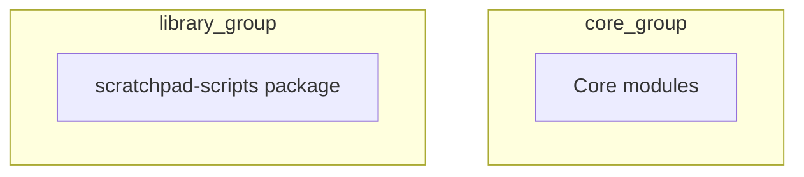

# Architecture report: arkenfox/user.js

> Automated static analysis. **Observed** = directly seen in files/imports/AST; **Inferred** = interpretation from that evidence. Repository code was not executed.

## 1. Repository at a glance

| Item | Value |
| --- | --- |
| Repository | arkenfox/user.js |
| Description | Firefox privacy, security and anti-tracking: a comprehensive user.js template for configuration and hardening |
| Language | JavaScript |
| Stars | 12986 |
| Licence | MIT |
| Analysed commit / branch | 06914fb7d2d4904f078995005b65745ec9861bfc / master |
| Framework(s) | None detected |
| Files analysed | 9 |
| Components | 2 |

## 2. Architecture in one minute

arkenfox/user.js - Firefox privacy, security and anti-tracking: a comprehensive user.js template for configuration and hardening. This repository was analysed statically from 9 file(s) (0 Python). Detected technologies (observed from imports/manifests): no known frameworks/libraries. Files are grouped into 2 component(s): Core modules, scratchpad-scripts package. Findings below distinguish observed facts from inferred interpretation.

## 3. High-level block diagram

## 4. Main components

### Core modules (`core`)

- **Kind:** core
- **Status:** Observed
- **Confidence:** 0.85
- **Responsibility:** Groups 3 file(s) under core modules (observed from repository paths and static analysis).
- **Paths:** `prefsCleaner.sh`, `updater.sh`, `user.js`
- **Evidence:** [prefsCleaner.sh](https://github.com/arkenfox/user.js/blob/06914fb7d2d4904f078995005b65745ec9861bfc/prefsCleaner.sh); [updater.sh](https://github.com/arkenfox/user.js/blob/06914fb7d2d4904f078995005b65745ec9861bfc/updater.sh); [user.js](https://github.com/arkenfox/user.js/blob/06914fb7d2d4904f078995005b65745ec9861bfc/user.js)

### scratchpad-scripts package (`scratchpad_scripts`)

- **Kind:** library
- **Status:** Observed
- **Confidence:** 0.85
- **Responsibility:** Groups 2 file(s) under scratchpad-scripts package (observed from repository paths and static analysis).
- **Paths:** `scratchpad-scripts/arkenfox-cleanup.js`, `scratchpad-scripts/troubleshooter.js`
- **Evidence:** [scratchpad-scripts/arkenfox-cleanup.js](https://github.com/arkenfox/user.js/blob/06914fb7d2d4904f078995005b65745ec9861bfc/scratchpad-scripts/arkenfox-cleanup.js); [scratchpad-scripts/troubleshooter.js](https://github.com/arkenfox/user.js/blob/06914fb7d2d4904f078995005b65745ec9861bfc/scratchpad-scripts/troubleshooter.js)

## 5. Execution flow

No entry point was observed; the startup flow below is therefore limited.

Representative flow (derived from observed entry points and the import graph; steps beyond the entry point are **Inferred**):

1. Execution starts at an observed entry point listed above, if present.
2. No internal import relationships between components were observed.

## 6. Project structure

### `(root)`

- `LICENSE.txt` - docs (1065 bytes)
- `README.md` - docs (2827 bytes)
- `prefsCleaner.bat` - other (4167 bytes)
- `prefsCleaner.sh` - source, Shell (6137 bytes)
- `updater.bat` - other (10928 bytes)
- `updater.sh` - source, Shell (13923 bytes)
- `user.js` - source, JavaScript (79987 bytes)

### `scratchpad-scripts`

- `scratchpad-scripts/arkenfox-cleanup.js` - source, JavaScript (6631 bytes)
- `scratchpad-scripts/troubleshooter.js` - source, JavaScript (7072 bytes)

## 7. Key dependencies and integrations

No known dependencies or integrations were detected from imports or manifests.

## 8. Data and state

No database, cache, queue, or persistent-state usage was observed in the analysed files. State handling, if any, may be in-memory or in files that were not analysed.

## 9. Configuration and deployment clues

No configuration, manifest, CI, or container files were observed.

## 10. Design observations

- No strong design patterns could be established from the available evidence.

These observations are interpretations (**Inferred**) of the observed structure, not guarantees about runtime design.

## 11. Limitations and unknowns

- Static analysis only: repository code was not executed, installed, or imported at runtime.
- Components and relationships are inferred from file paths, imports, and AST structure; runtime behaviour, dynamic imports, and reflection may not be visible.
- No clear application entry point was observed in the analysed files.
- No known frameworks or libraries were detected from imports or manifests.
- Repository text was treated as untrusted data; no instructions found in repository files were followed, and likely secret values were redacted/excluded.
- JavaScript and TypeScript files were inventoried from paths and package manifests. They were not parsed with a full language AST, and repository code was not executed.

## 12. Source references

- [prefsCleaner.sh](https://github.com/arkenfox/user.js/blob/06914fb7d2d4904f078995005b65745ec9861bfc/prefsCleaner.sh)
- [scratchpad-scripts/arkenfox-cleanup.js](https://github.com/arkenfox/user.js/blob/06914fb7d2d4904f078995005b65745ec9861bfc/scratchpad-scripts/arkenfox-cleanup.js)
- [scratchpad-scripts/troubleshooter.js](https://github.com/arkenfox/user.js/blob/06914fb7d2d4904f078995005b65745ec9861bfc/scratchpad-scripts/troubleshooter.js)
- [updater.sh](https://github.com/arkenfox/user.js/blob/06914fb7d2d4904f078995005b65745ec9861bfc/updater.sh)
- [user.js](https://github.com/arkenfox/user.js/blob/06914fb7d2d4904f078995005b65745ec9861bfc/user.js)
