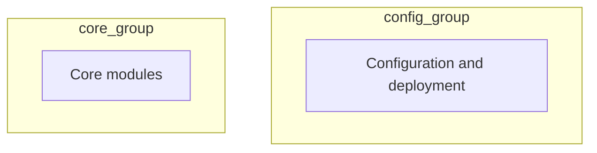

# Architecture report: ascoders/weekly

> Automated static analysis. **Observed** = directly seen in files/imports/AST; **Inferred** = interpretation from that evidence. Repository code was not executed.

## 1. Repository at a glance

| Item | Value |
| --- | --- |
| Repository | ascoders/weekly |
| Description | 前端精读周刊。帮你理解最前沿、实用的技术。 |
| Language | JavaScript |
| Stars | 31723 |
| Licence | Not detected |
| Analysed commit / branch | 9357b24e8b5dc367e67da0bafcd5cb040821bb10 / master |
| Framework(s) | None detected |
| Files analysed | 303 |
| Components | 2 |

## 2. Architecture in one minute

ascoders/weekly - 前端精读周刊。帮你理解最前沿、实用的技术。. This repository was analysed statically from 303 file(s) (0 Python). Detected technologies (observed from imports/manifests): no known frameworks/libraries. Files are grouped into 2 component(s): Configuration and deployment, Core modules. Findings below distinguish observed facts from inferred interpretation.

## 3. High-level block diagram

## 4. Main components

### Configuration and deployment (`config`)

- **Kind:** config
- **Status:** Observed
- **Confidence:** 0.85
- **Responsibility:** Groups 1 file(s) under configuration and deployment (observed from repository paths and static analysis).
- **Paths:** `package.json`
- **Evidence:** [package.json](https://github.com/ascoders/weekly/blob/9357b24e8b5dc367e67da0bafcd5cb040821bb10/package.json)

### Core modules (`core`)

- **Kind:** core
- **Status:** Observed
- **Confidence:** 0.85
- **Responsibility:** Groups 1 file(s) under core modules (observed from repository paths and static analysis).
- **Paths:** `helper.js`
- **Evidence:** [helper.js](https://github.com/ascoders/weekly/blob/9357b24e8b5dc367e67da0bafcd5cb040821bb10/helper.js)

## 5. Execution flow

No entry point was observed; the startup flow below is therefore limited.

Representative flow (derived from observed entry points and the import graph; steps beyond the entry point are **Inferred**):

1. Execution starts at an observed entry point listed above, if present.
2. No internal import relationships between components were observed.

## 6. Project structure

### `(root)`

- `.gitignore` - other (24 bytes)
- `.lintmdrc` - other (99 bytes)
- `.travis.yml` - ci, YAML (96 bytes)
- `helper.js` - source, JavaScript (695 bytes)
- `package.json` - manifest (638 bytes)
- `readme.md` - docs (52842 bytes)
- `数据技术专家能力模型.md` - docs (3207 bytes)

### `SQL`

- `SQL/231.SQL 入门.md` - docs (10711 bytes)
- `SQL/232.SQL 聚合查询.md` - docs (7933 bytes)
- `SQL/233.SQL 复杂查询.md` - docs (8399 bytes)
- `SQL/234.SQL CASE 表达式.md` - docs (5514 bytes)
- `SQL/235.SQL 窗口函数.md` - docs (5145 bytes)
- `SQL/236.SQL grouping.md` - docs (5502 bytes)

### `TS 类型体操`

- `TS 类型体操/243.精读《Pick, Awaited, If...》.md` - docs (14538 bytes)
- `TS 类型体操/244.精读《Get return type, Omit, ReadOnly...》.md` - docs (11251 bytes)
- `TS 类型体操/245.精读《Promise.all, Replace, Type Lookup...》.md` - docs (8435 bytes)
- `TS 类型体操/246.精读《Permutation, Flatten, Absolute...》.md` - docs (10231 bytes)
- `TS 类型体操/247.精读《Diff, AnyOf, IsUnion...》.md` - docs (11760 bytes)
- `TS 类型体操/248.精读《MinusOne, PickByType, StartsWith...》.md` - docs (14131 bytes)
- `TS 类型体操/249.精读《ObjectEntries, Shift, Reverse...》.md` - docs (10322 bytes)
- `TS 类型体操/250.精读《Flip, Fibonacci, AllCombinations...》.md` - docs (13518 bytes)
- `TS 类型体操/251.精读《Trim Right, Without, Trunc...》.md` - docs (5941 bytes)
- `TS 类型体操/252.精读《Unique, MapTypes, Construct Tuple...》.md` - docs (11528 bytes)

### `前沿技术`

- `前沿技术/1.精读《js 模块化发展》.md` - docs (15399 bytes)
- `前沿技术/10.精读《Web Components 的困境》.md` - docs (8185 bytes)
- `前沿技术/100.精读《V8 引擎 Lazy Parsing》.md` - docs (8154 bytes)
- `前沿技术/101.精读《持续集成 vs 持续交付 vs 持续部署》.md` - docs (13023 bytes)
- `前沿技术/102.精读《Monorepo 的优势》.md` - docs (10149 bytes)
- `前沿技术/104.精读《Function Component 入门》.md` - docs (45495 bytes)
- `前沿技术/105.精读《What's new in javascript》.md` - docs (11763 bytes)
- `前沿技术/107.精读《Optional chaining》.md` - docs (18543 bytes)
- `前沿技术/109.精读《Vue3.0 Function API》.md` - docs (15466 bytes)
- `前沿技术/11.精读《前端调试技巧》.md` - docs (7565 bytes)
- `前沿技术/111.精读《前端未来展望》.md` - docs (15622 bytes)
- `前沿技术/112.精读《源码学习》.md` - docs (14519 bytes)
- `前沿技术/113.精读《Nodejs V12》.md` - docs (6025 bytes)
- `前沿技术/117.精读《Tableau 探索式模型》.md` - docs (45640 bytes)
- `前沿技术/118.精读《使用 css 变量生成颜色主题》.md` - docs (7143 bytes)
- `前沿技术/119.精读《前端深水区》.md` - docs (7309 bytes)
- `前沿技术/12.精读《React 高阶组件》.md` - docs (9642 bytes)
- `前沿技术/120.精读《React Hooks 最佳实践》.md` - docs (10934 bytes)
- `前沿技术/121.精读《前端与 BI》.md` - docs (13094 bytes)
- `前沿技术/123.精读《用 Babel 创造自定义 JS 语法》.md` - docs (19733 bytes)
- `前沿技术/124.精读《用 css grid 重新思考布局》.md` - docs (12365 bytes)
- `前沿技术/125.精读《深度学习 - 函数式之美》.md` - docs (7608 bytes)
- `前沿技术/126.精读《Nuxtjs》.md` - docs (13359 bytes)
- `前沿技术/127.精读《React Conf 2019 - Day1》.md` - docs (23331 bytes)
- `前沿技术/129.精读《React Conf 2019 - Day2》.md` - docs (25519 bytes)
- `前沿技术/13.精读《This 带来的困惑》.md` - docs (8142 bytes)
- `前沿技术/132.精读《正交的 React 组件》.md` - docs (8814 bytes)
- `前沿技术/133.精读《寻找框架设计的平衡点》.md` - docs (11616 bytes)
- `前沿技术/134.精读《我在阿里数据中台大前端》.md` - docs (10003 bytes)
- `前沿技术/138.精读《精通 console.log》.md` - docs (5739 bytes)
- `前沿技术/139.精读《手写 JSON Parser》.md` - docs (11402 bytes)
- `前沿技术/14.精读《架构设计之 DCI》.md` - docs (13106 bytes)
- `前沿技术/140.精读《结合 React 使用原生 Drag Drop API》.md` - docs (8373 bytes)
- `前沿技术/141.精读《useRef 与 createRef 的区别》.md` - docs (4788 bytes)
- `前沿技术/142.精读《如何做好 CodeReview》.md` - docs (8424 bytes)
- `前沿技术/143.精读《Suspense 改变开发方式》.md` - docs (12276 bytes)
- `前沿技术/144.精读《Webpack5 新特性 - 模块联邦》.md` - docs (6571 bytes)
- `前沿技术/145.精读《React Router v6》.md` - docs (10738 bytes)
- `前沿技术/146.精读《React Hooks 数据流》.md` - docs (11288 bytes)
- `前沿技术/147. 精读《@types react 值得注意的 TS 技巧》.md` - docs (6501 bytes)
- `前沿技术/148. 精读《React Error Boundaries》.md` - docs (5256 bytes)
- `前沿技术/149. 精读《React 性能调试》.md` - docs (8207 bytes)
- `前沿技术/15.精读《TC39 与 ECMAScript 提案》.md` - docs (30595 bytes)
- `前沿技术/150. 精读《Deno 1.0 你需要了解的》.md` - docs (14485 bytes)
- `前沿技术/152. 精读《recoil》.md` - docs (10545 bytes)
- `前沿技术/153. 精读《snowpack》.md` - docs (9336 bytes)
- `前沿技术/154. 精读《用 React 做按需渲染》.md` - docs (15570 bytes)
- `前沿技术/157. 精读《如何比较 Object 对象》.md` - docs (6329 bytes)
- `前沿技术/158. 精读《Typescript 4》.md` - docs (14030 bytes)
- `前沿技术/159. 精读《对低代码搭建的理解》.md` - docs (11849 bytes)
- `前沿技术/16.精读《CSS Animations vs Web Animations API》.md` - docs (5940 bytes)
- `前沿技术/160. 精读《函数缓存》.md` - docs (10863 bytes)
- `前沿技术/161.精读《可视化搭建思考 - 富文本搭建》.md` - docs (9223 bytes)
- `前沿技术/162.精读《Tasks, microtasks, queues and schedules》.md` - docs (7489 bytes)
- `前沿技术/163.精读《Spring 概念》.md` - docs (12740 bytes)
- `前沿技术/164.精读《数据搭建引擎 bi-designer API-设计器》.md` - docs (23998 bytes)
- `前沿技术/165.精读《数据搭建引擎 bi-designer API-组件》.md` - docs (39007 bytes)
- `前沿技术/166.精读《BI 搭建 - 筛选条件》.md` - docs (12365 bytes)
- `前沿技术/17.精读《如何安全地使用 React context》.md` - docs (4562 bytes)
- `前沿技术/18.精读《设计完美的日期选择器》.md` - docs (5700 bytes)
- `前沿技术/19.精读《最佳前端面试题》及面试官技巧.md` - docs (8377 bytes)
- `前沿技术/190.精读《DOM diff 原理详解》.md` - docs (12236 bytes)
- `前沿技术/191.精读《高性能表格》.md` - docs (11693 bytes)
- `前沿技术/192.精读《DOM diff 最长上升子序列》.md` - docs (16208 bytes)
- `前沿技术/193.精读《React Server Component》.md` - docs (18418 bytes)
- `前沿技术/194.精读《算法基础数据结构》.md` - docs (10593 bytes)
- `前沿技术/195.精读《新一代前端构建工具对比》.md` - docs (8167 bytes)
- `前沿技术/196.精读《前端职业规划 - 2021 年》.md` - docs (19489 bytes)
- `前沿技术/197.精读《低代码逻辑编排》.md` - docs (20696 bytes)
- `前沿技术/2.精读《模态框的最佳实践》.md` - docs (10640 bytes)
- `前沿技术/20.精读《Nestjs》文档.md` - docs (10649 bytes)
- `前沿技术/202.精读《React 18》.md` - docs (11585 bytes)
- `前沿技术/204.精读《默认、命名导出的区别》.md` - docs (7839 bytes)
- `前沿技术/205.精读《JS with 语法》.md` - docs (3573 bytes)
- `前沿技术/206.精读《一种 Hooks 数据流管理方案》.md` - docs (9890 bytes)
- `前沿技术/207.精读《Typescript infer 关键字》.md` - docs (6753 bytes)
- `前沿技术/208.精读《Typescript 4.4》.md` - docs (9607 bytes)
- `前沿技术/209.精读《捕获所有异步 error》.md` - docs (7761 bytes)
- `前沿技术/21.精读《Web fonts: when you need them, when you don’t》.md` - docs (6716 bytes)
- `前沿技术/210.精读《class static block》.md` - docs (6088 bytes)
- `前沿技术/211.精读《Microsoft Power Fx》.md` - docs (9023 bytes)
- `前沿技术/212.精读《可维护性思考》.md` - docs (10778 bytes)
- `前沿技术/213.精读《Prisma 的使用》.md` - docs (16512 bytes)
- `前沿技术/214.精读《web streams》.md` - docs (15337 bytes)
- `前沿技术/215.精读《什么是 LOD 表达式》.md` - docs (7314 bytes)
- `前沿技术/216.精读《15 大 LOD 表达式 - 上》.md` - docs (11004 bytes)
- `前沿技术/217.精读《15 大 LOD 表达式 - 下》.md` - docs (10797 bytes)
- `前沿技术/218.精读《Rust 是 JS 基建的未来》.md` - docs (13291 bytes)
- `前沿技术/219.精读《深入了解现代浏览器一》.md` - docs (10578 bytes)
- `前沿技术/22.精读《V8 引擎特性带来的的 JS 性能变化》.md` - docs (4634 bytes)
- `前沿技术/220.精读《深入了解现代浏览器二》.md` - docs (8920 bytes)
- `前沿技术/221.精读《深入了解现代浏览器三》.md` - docs (8901 bytes)
- `前沿技术/222.精读《深入了解现代浏览器四》.md` - docs (9982 bytes)
- `前沿技术/223.精读《Records & Tuples 提案》.md` - docs (21722 bytes)
- `前沿技术/224.精读《Records & Tuples for React》.md` - docs (10930 bytes)
- `前沿技术/225.精读《Excel JS API》.md` - docs (7028 bytes)
- `前沿技术/226.精读《2021 前端新秀回顾》.md` - docs (17617 bytes)
- `前沿技术/228.精读《pipe operator for JavaScript》.md` - docs (10338 bytes)
- `前沿技术/23.精读《API 设计原则》.md` - docs (5661 bytes)
- `前沿技术/230.精读《对 Markdown 的思考》.md` - docs (13091 bytes)
- `前沿技术/237.精读《Typescript 4.5-4.6 新特性》.md` - docs (16421 bytes)
- `前沿技术/238.精读《不再需要 JS 做的 5 件事》.md` - docs (7045 bytes)
- `前沿技术/239.精读《JS 数组的内部实现》.md` - docs (11838 bytes)
- `前沿技术/24.精读《现代 JavaScript 概览》.md` - docs (10194 bytes)
- `前沿技术/240.精读《React useEvent RFC》.md` - docs (7250 bytes)
- `前沿技术/242.精读《web reflow》.md` - docs (9540 bytes)
- `前沿技术/25.精读《null >= 0?》.md` - docs (5481 bytes)
- `前沿技术/253.精读《pnpm》.md` - docs (11028 bytes)
- `前沿技术/254.精读《对前端架构的理解 - 分层与抽象》.md` - docs (16342 bytes)
- `前沿技术/255.精读《SolidJS》.md` - docs (12061 bytes)
- `前沿技术/256.精读《依赖注入简介》.md` - docs (12058 bytes)
- `前沿技术/257.精读《State of CSS 2022》.md` - docs (11565 bytes)
- `前沿技术/258.精读《proposal-extractors》.md` - docs (5014 bytes)
- `前沿技术/259.精读《Headless 组件用法与原理》.md` - docs (9418 bytes)
- `前沿技术/26.精读《加密媒体扩展》.md` - docs (12067 bytes)
- `前沿技术/260.精读《如何为 TS 类型写单测》.md` - docs (3673 bytes)
- `前沿技术/261.精读《Rest vs Spread 语法》.md` - docs (4216 bytes)
- `前沿技术/262.精读《迭代器 Iterable》.md` - docs (6849 bytes)
- `前沿技术/263.精读《我们为何弃用 css-in-js》.md` - docs (7702 bytes)
- `前沿技术/264.精读《维护好一个复杂项目》.md` - docs (10938 bytes)
- `前沿技术/265.精读《磁贴布局 - 功能分析》.md` - docs (12222 bytes)
- `前沿技术/266.精读《磁贴布局 - 功能实现》.md` - docs (12810 bytes)
- `前沿技术/267.精读《磁贴布局 - 性能优化》.md` - docs (9957 bytes)
- `前沿技术/27.精读《css-in-js 杀鸡用牛刀》.md` - docs (8517 bytes)
- `前沿技术/277.精读《利用 GPT 解读 PDF》.md` - docs (10154 bytes)
- `前沿技术/28.精读《2017 前端性能优化备忘录》.md` - docs (27560 bytes)
- `前沿技术/281.精读《自由 + 磁贴混合布局》.md` - docs (4695 bytes)
- `前沿技术/282.精读《自由布局吸附线的实现》.md` - docs (4610 bytes)
- `前沿技术/287.精读《VisActor 数据可视化工具》.md` - docs (9985 bytes)
- `前沿技术/29.精读《JS 中的内存管理》.md` - docs (10590 bytes)
- `前沿技术/3.精读《前后端渲染之争》.md` - docs (13349 bytes)
- `前沿技术/30.精读《Javascript 事件循环与异步》.md` - docs (5113 bytes)
- `前沿技术/31.精读《我不再使用高阶组件》.md` - docs (7532 bytes)
- `前沿技术/32.精读《React Router4.0 进阶概念》.md` - docs (6993 bytes)
- `前沿技术/33.精读《30 行 js 代码创建神经网络》.md` - docs (7975 bytes)
- `前沿技术/34.精读《React 代码整洁之道》.md` - docs (8632 bytes)
- `前沿技术/35.精读《dob - 框架实现》.md` - docs (10096 bytes)
- `前沿技术/36.精读《When You “Git” in Trouble- a Version Control Story》.md` - docs (10174 bytes)
- `前沿技术/37.精读《how we position and what we compare》.md` - docs (5035 bytes)
- `前沿技术/38.精读《dob - 框架使用》.md` - docs (17623 bytes)
- `前沿技术/39.精读《全链路体验浏览器挖矿》.md` - docs (13088 bytes)
- `前沿技术/4.精读《AsyncAwait 优越之处》.md` - docs (9827 bytes)
- `前沿技术/40.精读《初探 Reason 与 GraphQL》.md` - docs (6817 bytes)
- `前沿技术/41.精读《Ant Design 3.0 背后的故事》.md` - docs (6893 bytes)
- `前沿技术/42.精读《前端数据流哲学》.md` - docs (23117 bytes)
- `前沿技术/43.精读《增强现实与可视化》.md` - docs (6784 bytes)
- `前沿技术/44.精读《Rekit Studio》.md` - docs (14285 bytes)
- `前沿技术/45.精读《React's new Context API》.md` - docs (6707 bytes)
- `前沿技术/46.精读《react-rxjs》.md` - docs (8650 bytes)
- `前沿技术/47.精读《webpack4.0 升级指南》.md` - docs (11048 bytes)
- `前沿技术/49.精读《Compilers are the New Frameworks》.md` - docs (9115 bytes)
- `前沿技术/5.精读《民工叔单页数据流方案》.md` - docs (7196 bytes)
- `前沿技术/50.精读《快速上手构建 ARKit 应用》.md` - docs (5125 bytes)
- `前沿技术/51.精读《Elements of Web Dev》.md` - docs (4227 bytes)
- `前沿技术/52.精读《图解 ES 模块》.md` - docs (12808 bytes)
- `前沿技术/53.精读《插件化思维》.md` - docs (22395 bytes)
- `前沿技术/54.精读《在浏览器运行 serverRender》.md` - docs (6086 bytes)
- `前沿技术/55.精读《async await 是把双刃剑》.md` - docs (6984 bytes)
- `前沿技术/56.精读《重新思考 Redux》.md` - docs (9597 bytes)
- `前沿技术/57.精读《现代 js 框架存在的根本原因》.md` - docs (7696 bytes)
- `前沿技术/58.精读《Typescript2.0 - 2.9》.md` - docs (18221 bytes)
- `前沿技术/59.精读《如何利用 Nodejs 监听文件夹》.md` - docs (7449 bytes)
- `前沿技术/6.精读《JavaScript 错误堆栈处理》.md` - docs (8426 bytes)
- `前沿技术/60.精读《如何在 nodejs 使用环境变量》.md` - docs (6650 bytes)
- `前沿技术/61.精读《React 八种条件渲染》.md` - docs (8436 bytes)
- `前沿技术/62.精读《JS 引擎基础之 Shapes and Inline Caches》.md` - docs (13778 bytes)
- `前沿技术/63.精读《React 的多态性》.md` - docs (6178 bytes)
- `前沿技术/68.精读《衡量用户体验》.md` - docs (4985 bytes)
- `前沿技术/69.精读《SQL vs Flux》.md` - docs (5441 bytes)
- `前沿技术/7.精读《请停止 css-in-js 的行为》.md` - docs (6793 bytes)
- `前沿技术/72.精读《REST, GraphQL, Webhooks, & gRPC 如何选型》.md` - docs (10666 bytes)
- `前沿技术/74.精读《12 个评估 JS 库你需要关心的事》.md` - docs (10006 bytes)
- `前沿技术/76.精读《谈谈 Web Workers》.md` - docs (7337 bytes)
- `前沿技术/77.精读《用 Reduce 实现 Promise 串行执行》.md` - docs (4401 bytes)
- `前沿技术/79.精读《React Hooks》.md` - docs (13589 bytes)
- `前沿技术/8.精读《入坑 React 前没有人会告诉你的事》.md` - docs (10294 bytes)
- `前沿技术/80.精读《怎么用 React Hooks 造轮子》.md` - docs (27401 bytes)
- `前沿技术/81.精读《使用 CSS 属性选择器》.md` - docs (9090 bytes)
- `前沿技术/83.精读《React16 新特性》.md` - docs (21585 bytes)
- `前沿技术/84.精读《Typescript 3.2 新特性》.md` - docs (4765 bytes)
- `前沿技术/86.精读《国际化布局 - Logical Properties》.md` - docs (9199 bytes)
- `前沿技术/87.精读《setState 做了什么》.md` - docs (8212 bytes)
- `前沿技术/88.精读《Caches API》.md` - docs (5005 bytes)
- `前沿技术/89.精读《如何编译前端项目与组件》.md` - docs (9367 bytes)
- `前沿技术/9.精读《Immutable 结构共享》.md` - docs (6951 bytes)
- `前沿技术/91.精读《正则 ES2018》.md` - docs (9285 bytes)
- `前沿技术/94.精读《Serverless 给前端带来了什么》.md` - docs (20680 bytes)
- `前沿技术/95.精读《Function VS Class 组件》.md` - docs (12415 bytes)
- `前沿技术/96.精读《useEffect 完全指南》.md` - docs (20243 bytes)
- `前沿技术/97.精读《编写有弹性的组件》.md` - docs (19902 bytes)
- `前沿技术/99.精读《Scheduling in React》.md` - docs (8497 bytes)

### `可视化搭建`

- `可视化搭建/268.如何抽象可视化搭建.md` - docs (9783 bytes)
- `可视化搭建/269.组件注册与画布渲染.md` - docs (11091 bytes)
- `可视化搭建/270.画布与组件元信息数据流.md` - docs (10252 bytes)
- `可视化搭建/271.可视化搭建内置 API.md` - docs (12409 bytes)
- `可视化搭建/272.容器组件设计.md` - docs (5970 bytes)
- `可视化搭建/273.组件值与联动.md` - docs (8492 bytes)
- `可视化搭建/274.定义联动协议.md` - docs (10624 bytes)
- `可视化搭建/275.组件值校验.md` - docs (5456 bytes)
- `可视化搭建/276.keepAlive 模式.md` - docs (3991 bytes)
- `可视化搭建/278.ComponentLoader 与动态组件.md` - docs (5055 bytes)
- `可视化搭建/279.自动批处理与冻结.md` - docs (7222 bytes)
- `可视化搭建/280.场景实战.md` - docs (7742 bytes)

### `商业思考`

- `商业思考/103.精读《为什么专家不再关心技术细节》.md` - docs (11928 bytes)
- `商业思考/106.精读《数据之上·智慧之光 - 2018》.md` - docs (15667 bytes)
- `商业思考/108.精读《智能商业》.md` - docs (22851 bytes)
- `商业思考/114.精读《谁在世界中心》.md` - docs (20770 bytes)
- `商业思考/115.精读《Tableau 入门》.md` - docs (16402 bytes)
- `商业思考/116.精读《刷新》.md` - docs (10931 bytes)
- `商业思考/131.精读《从 0 到 1》.md` - docs (21757 bytes)
- `商业思考/135.精读《极客公园 IFX - 上》.md` - docs (24222 bytes)
- `商业思考/136.精读《极客公园 IFX - 下》.md` - docs (16201 bytes)
- `商业思考/137.精读《当我在分享的时候，我在做什么？》.md` - docs (13044 bytes)
- `商业思考/90.精读《极客公园 2019》.md` - docs (46074 bytes)

### `数学之美`

- `数学之美/296.手动算根号.md` - docs (4941 bytes)

### `机器学习`

- `机器学习/291.机器学习简介: 寻找函数的艺术.md` - docs (14380 bytes)
- `机器学习/292.万能近似定理: 逼近任何函数的理论.md` - docs (9354 bytes)
- `机器学习/293.实现万能近似函数: 神经网络的架构设计.md` - docs (12065 bytes)
- `机器学习/294.反向传播: 揭秘神经网络的学习机制.md` - docs (12913 bytes)
- `机器学习/295.完整实现神经网络: 实战演练.md` - docs (13533 bytes)

### `源码解读`

- `源码解读/110.精读《Inject Instance 源码》.md` - docs (6924 bytes)
- `源码解读/122.精读《robot 源码 - 有限状态机》.md` - docs (10637 bytes)
- `源码解读/128.精读《Hooks 取数 - swr 源码》.md` - docs (15770 bytes)
- `源码解读/130.精读《unstated 与 unstated-next 源码》.md` - docs (19484 bytes)
- `源码解读/151. 精读《@umijs use-request》源码.md` - docs (14986 bytes)
- `源码解读/155. 精读《use-what-changed 源码》.md` - docs (5036 bytes)
- `源码解读/156. 精读《react-intersection-observer 源码》.md` - docs (10906 bytes)
- `源码解读/227. 精读《zustand 源码》.md` - docs (13795 bytes)
- `源码解读/229.精读《vue-lit 源码》.md` - docs (12853 bytes)
- `源码解读/241.精读《react-snippets - Router 源码》.md` - docs (6751 bytes)
- `源码解读/48.精读《Immer.js》源码.md` - docs (8563 bytes)
- `源码解读/73.精读《sqorn 源码》.md` - docs (7972 bytes)
- `源码解读/75.精读《Epitath 源码 - renderProps 新用法》.md` - docs (8709 bytes)
- `源码解读/82.精读《Htm - Hyperscript 源码》.md` - docs (4954 bytes)
- `源码解读/92.精读《React PowerPlug 源码》.md` - docs (19201 bytes)
- `源码解读/93.精读《syntax-parser 源码》.md` - docs (22108 bytes)
- `源码解读/98.精读《react-easy-state 源码》.md` - docs (6503 bytes)

### `生活`

- `生活/290.个人养老金利与弊.md` - docs (8181 bytes)

### `算法`

- `算法/198.精读《算法 - 动态规划》.md` - docs (24191 bytes)
- `算法/199.精读《算法 - 滑动窗口》.md` - docs (19934 bytes)
- `算法/200.精读《算法 - 回溯》.md` - docs (15829 bytes)
- `算法/201.精读《算法 - 二叉树》.md` - docs (13030 bytes)
- `算法/203.精读《算法 - 二叉搜索树》.md` - docs (7993 bytes)
- `算法/283.精读《算法题 - 通配符匹配》.md` - docs (11684 bytes)
- `算法/284.精读《算法题 - 统计可以被 K 整除的下标对数目》.md` - docs (9470 bytes)
- `算法/285.精读《算法题 - 最小覆盖子串》.md` - docs (7684 bytes)
- `算法/286.精读《算法题 - 地下城游戏》.md` - docs (11209 bytes)
- `算法/288.精读《算法题 - 编辑距离》.md` - docs (7389 bytes)
- `算法/289.精读《算法题 - 二叉树中的最大路径和》.md` - docs (8069 bytes)

### `编译原理`

- `编译原理/64.精读《手写 SQL 编译器 - 词法分析》.md` - docs (4927 bytes)
- `编译原理/65.精读《手写 SQL 编译器 - 文法介绍》.md` - docs (7304 bytes)
- `编译原理/66.精读《手写 SQL 编译器 - 语法分析》.md` - docs (14276 bytes)
- `编译原理/67.精读《手写 SQL 编译器 - 回溯》.md` - docs (13579 bytes)
- `编译原理/70.精读《手写 SQL 编译器 - 语法树》.md` - docs (5337 bytes)
- `编译原理/71.精读《手写 SQL 编译器 - 错误提示》.md` - docs (7291 bytes)
- `编译原理/78.精读《手写 SQL 编译器 - 性能优化之缓存》.md` - docs (3787 bytes)
- `编译原理/85.精读《手写 SQL 编译器 - 智能提示》.md` - docs (17814 bytes)

### `设计模式`

- `设计模式/167.精读《设计模式 - Abstract Factory 抽象工厂》.md` - docs (9601 bytes)
- `设计模式/168.精读《设计模式 - Builder 生成器》.md` - docs (9449 bytes)
- `设计模式/169.精读《设计模式 - Factory Method 工厂方法》.md` - docs (8798 bytes)
- `设计模式/170.精读《设计模式 - Prototype 原型模式》.md` - docs (7193 bytes)
- `设计模式/171.精读《设计模式 - Singleton 单例模式》.md` - docs (5808 bytes)
- `设计模式/172.精读《设计模式 - Adapter 适配器模式》.md` - docs (5909 bytes)
- `设计模式/173.精读《设计模式 - Bridge 桥接模式》.md` - docs (7293 bytes)
- `设计模式/174.精读《设计模式 - Composite 组合模式》.md` - docs (5493 bytes)
- `设计模式/175.精读《设计模式 - Decorator 装饰器模式》.md` - docs (5360 bytes)
- `设计模式/176.精读《设计模式 - Facade 外观模式》.md` - docs (5021 bytes)
- `设计模式/177.精读《设计模式 - Flyweight 享元模式》.md` - docs (7567 bytes)
- `设计模式/178.精读《设计模式 - Proxy 代理模式》.md` - docs (5501 bytes)
- `设计模式/179.精读《设计模式 - Chain of Responsibility 职责链模式》.md` - docs (7222 bytes)
- `设计模式/180.精读《设计模式 - Command 命令模式》.md` - docs (5547 bytes)
- `设计模式/181.精读《设计模式 - Interpreter 解释器模式》.md` - docs (6013 bytes)
- `设计模式/182.精读《设计模式 - Iterator 迭代器模式》.md` - docs (6634 bytes)
- `设计模式/183.精读《设计模式 - Mediator 中介者模式》.md` - docs (7141 bytes)
- `设计模式/184.精读《设计模式 - Memoto 备忘录模式》.md` - docs (8431 bytes)
- `设计模式/185.精读《设计模式 - Observer 观察者模式》.md` - docs (6570 bytes)
- `设计模式/186.精读《设计模式 - State 状态模式》.md` - docs (6478 bytes)
- `设计模式/187.精读《设计模式 - Strategy 策略模式》.md` - docs (4564 bytes)
- `设计模式/188.精读《设计模式 - Template Method 模版模式》.md` - docs (5174 bytes)
- `设计模式/189.精读《设计模式 - Visitor 访问者模式》.md` - docs (8355 bytes)

## 7. Key dependencies and integrations

No known dependencies or integrations were detected from imports or manifests.

## 8. Data and state

No database, cache, queue, or persistent-state usage was observed in the analysed files. State handling, if any, may be in-memory or in files that were not analysed.

## 9. Configuration and deployment clues

- `.travis.yml` (ci)
- `package.json` (manifest)

## 10. Design observations

- No strong design patterns could be established from the available evidence.

These observations are interpretations (**Inferred**) of the observed structure, not guarantees about runtime design.

## 11. Limitations and unknowns

- Static analysis only: repository code was not executed, installed, or imported at runtime.
- Components and relationships are inferred from file paths, imports, and AST structure; runtime behaviour, dynamic imports, and reflection may not be visible.
- 1 file(s) were skipped during inventory (1 x lockfile excluded).
- No clear application entry point was observed in the analysed files.
- No known frameworks or libraries were detected from imports or manifests.
- Repository text was treated as untrusted data; no instructions found in repository files were followed, and likely secret values were redacted/excluded.
- JavaScript and TypeScript files were inventoried from paths and package manifests. They were not parsed with a full language AST, and repository code was not executed.

## 12. Source references

- [helper.js](https://github.com/ascoders/weekly/blob/9357b24e8b5dc367e67da0bafcd5cb040821bb10/helper.js)
- [package.json](https://github.com/ascoders/weekly/blob/9357b24e8b5dc367e67da0bafcd5cb040821bb10/package.json)
