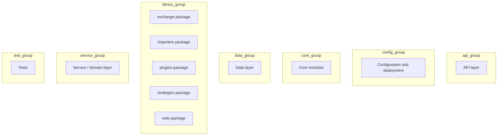

# Architecture report: askmike/gekko

> Automated static analysis. **Observed** = directly seen in files/imports/AST; **Inferred** = interpretation from that evidence. Repository code was not executed.

## 1. Repository at a glance

| Item | Value |
| --- | --- |
| Repository | askmike/gekko |
| Description | A bitcoin trading bot written in node - https://gekko.wizb.it/ |
| Language | JavaScript |
| Stars | 10177 |
| Licence | MIT |
| Analysed commit / branch | ff5698f1ae6329bab5729f145c35a74161e82bac / develop |
| Framework(s) | Koa, Vue |
| Files analysed | 358 |
| Components | 11 |

## 2. Architecture in one minute

askmike/gekko - A bitcoin trading bot written in node - https://gekko.wizb.it/. This repository was analysed statically from 358 file(s) (0 Python). Detected technologies (observed from imports/manifests): PostgreSQL, Redis, SQLite, Koa, Vue, Docker. Files are grouped into 11 component(s): API layer, Configuration and deployment, Core modules, Data layer, exchange package, importers package, plugins package, Service / domain layer. Findings below distinguish observed facts from inferred interpretation.

## 3. High-level block diagram

## 4. Main components

### API layer (`api_layer`)

- **Kind:** api
- **Status:** Observed
- **Confidence:** 0.85
- **Responsibility:** Groups 15 file(s) under api layer (observed from repository paths and static analysis).
- **Paths:** `web/routes/apiKeys.js`, `web/routes/backtest.js`, `web/routes/baseConfig.js`, `web/routes/configPart.js`, `web/routes/deleteGekko.js`, `web/routes/exchanges.js`, `web/routes/getCandles.js`, `web/routes/import.js`, `web/routes/info.js`, `web/routes/list.js`, `web/routes/scanDatasets.js`, `web/routes/scanDateRange.js`, `web/routes/startGekko.js`, `web/routes/stopGekko.js`, `web/routes/strategies.js`
- **Evidence:** [web/routes/apiKeys.js](https://github.com/askmike/gekko/blob/ff5698f1ae6329bab5729f145c35a74161e82bac/web/routes/apiKeys.js); [web/routes/backtest.js](https://github.com/askmike/gekko/blob/ff5698f1ae6329bab5729f145c35a74161e82bac/web/routes/backtest.js); [web/routes/baseConfig.js](https://github.com/askmike/gekko/blob/ff5698f1ae6329bab5729f145c35a74161e82bac/web/routes/baseConfig.js); [web/routes/configPart.js](https://github.com/askmike/gekko/blob/ff5698f1ae6329bab5729f145c35a74161e82bac/web/routes/configPart.js); [web/routes/deleteGekko.js](https://github.com/askmike/gekko/blob/ff5698f1ae6329bab5729f145c35a74161e82bac/web/routes/deleteGekko.js); [web/routes/exchanges.js](https://github.com/askmike/gekko/blob/ff5698f1ae6329bab5729f145c35a74161e82bac/web/routes/exchanges.js); [web/routes/getCandles.js](https://github.com/askmike/gekko/blob/ff5698f1ae6329bab5729f145c35a74161e82bac/web/routes/getCandles.js); [web/routes/import.js](https://github.com/askmike/gekko/blob/ff5698f1ae6329bab5729f145c35a74161e82bac/web/routes/import.js)

### Configuration and deployment (`config`)

- **Kind:** config
- **Status:** Observed
- **Confidence:** 0.85
- **Responsibility:** Groups 45 file(s) under configuration and deployment (observed from repository paths and static analysis).
- **Paths:** `Dockerfile`, `appveyor.yml`, `config/adapters/mongodb.toml`, `config/adapters/postgresql.toml`, `config/adapters/sqlite.toml`, `config/backtest.toml`, `config/general.toml`, `config/plugins/candleWriter.toml`, `config/plugins/paperTrader.toml`, `config/plugins/performanceAnalyzer.toml`, `config/plugins/pushbullet.toml`, `config/plugins/trader.toml`, `config/plugins/tradingAdvisor.toml`, `config/strategies/CCI.toml`, `config/strategies/DEMA.toml`, `config/strategies/MACD.toml`, `config/strategies/PPO.toml`, `config/strategies/RSI.toml`, `config/strategies/StochRSI.toml`, `config/strategies/TMA.toml`, `config/strategies/TSI.toml`, `config/strategies/UO.toml`, `config/strategies/custom.toml`, `config/strategies/talib-macd.toml`, `config/strategies/tulip-adx.toml`, `config/strategies/tulip-macd.toml`, `config/strategies/tulip-multi-strat.toml`, `config/strategies/varPPO.toml`, `docker-compose.yml`, `exchange/package.json`, `exchange/wrappers/binance-markets.json`, `exchange/wrappers/bitfinex-markets.json`, `exchange/wrappers/coinbase-markets.json`, `exchange/wrappers/coinfalcon-markets.json`, `exchange/wrappers/exmo-markets.json`, `exchange/wrappers/kraken-markets.json`, `exchange/wrappers/poloniex-markets.json`, `exchange/wrappers/quadriga-markets.json`, `exchange/wrappers/therocktrading-markets.json`, `package.json`, `web/vue/package.json`, `web/vue/src/components/config/apiConfigBuilder.vue`, `web/vue/src/components/config/config.vue`, `web/vue/src/store/modules/config/mutations.js`, `web/vue/src/store/modules/config/sync.js`
- **Evidence:** [Dockerfile](https://github.com/askmike/gekko/blob/ff5698f1ae6329bab5729f145c35a74161e82bac/Dockerfile); [appveyor.yml](https://github.com/askmike/gekko/blob/ff5698f1ae6329bab5729f145c35a74161e82bac/appveyor.yml); [config/adapters/mongodb.toml](https://github.com/askmike/gekko/blob/ff5698f1ae6329bab5729f145c35a74161e82bac/config/adapters/mongodb.toml); [config/adapters/postgresql.toml](https://github.com/askmike/gekko/blob/ff5698f1ae6329bab5729f145c35a74161e82bac/config/adapters/postgresql.toml); [config/adapters/sqlite.toml](https://github.com/askmike/gekko/blob/ff5698f1ae6329bab5729f145c35a74161e82bac/config/adapters/sqlite.toml); [config/backtest.toml](https://github.com/askmike/gekko/blob/ff5698f1ae6329bab5729f145c35a74161e82bac/config/backtest.toml); [config/general.toml](https://github.com/askmike/gekko/blob/ff5698f1ae6329bab5729f145c35a74161e82bac/config/general.toml); [config/plugins/candleWriter.toml](https://github.com/askmike/gekko/blob/ff5698f1ae6329bab5729f145c35a74161e82bac/config/plugins/candleWriter.toml)

### Core modules (`core`)

- **Kind:** core
- **Status:** Observed
- **Confidence:** 0.85
- **Responsibility:** Groups 5 file(s) under core modules (observed from repository paths and static analysis).
- **Paths:** `docker-entrypoint.sh`, `gekko.js`, `plugins.js`, `sample-config.js`, `subscriptions.js`
- **Evidence:** [docker-entrypoint.sh](https://github.com/askmike/gekko/blob/ff5698f1ae6329bab5729f145c35a74161e82bac/docker-entrypoint.sh); [gekko.js](https://github.com/askmike/gekko/blob/ff5698f1ae6329bab5729f145c35a74161e82bac/gekko.js); [plugins.js](https://github.com/askmike/gekko/blob/ff5698f1ae6329bab5729f145c35a74161e82bac/plugins.js); [sample-config.js](https://github.com/askmike/gekko/blob/ff5698f1ae6329bab5729f145c35a74161e82bac/sample-config.js); [subscriptions.js](https://github.com/askmike/gekko/blob/ff5698f1ae6329bab5729f145c35a74161e82bac/subscriptions.js)

### Data layer (`data_layer`)

- **Kind:** data
- **Status:** Observed
- **Confidence:** 0.85
- **Responsibility:** Groups 4 file(s) under data layer (observed from repository paths and static analysis).
- **Paths:** `web/vue/src/components/data/data.vue`, `web/vue/src/components/data/import/importConfigBuilder.vue`, `web/vue/src/components/data/import/importer.vue`, `web/vue/src/components/data/import/single.vue`
- **Evidence:** [web/vue/src/components/data/data.vue](https://github.com/askmike/gekko/blob/ff5698f1ae6329bab5729f145c35a74161e82bac/web/vue/src/components/data/data.vue); [web/vue/src/components/data/import/importConfigBuilder.vue](https://github.com/askmike/gekko/blob/ff5698f1ae6329bab5729f145c35a74161e82bac/web/vue/src/components/data/import/importConfigBuilder.vue); [web/vue/src/components/data/import/importer.vue](https://github.com/askmike/gekko/blob/ff5698f1ae6329bab5729f145c35a74161e82bac/web/vue/src/components/data/import/importer.vue); [web/vue/src/components/data/import/single.vue](https://github.com/askmike/gekko/blob/ff5698f1ae6329bab5729f145c35a74161e82bac/web/vue/src/components/data/import/single.vue)

### exchange package (`exchange`)

- **Kind:** library
- **Status:** Observed
- **Confidence:** 0.85
- **Responsibility:** Groups 32 file(s) under exchange package (observed from repository paths and static analysis).
- **Paths:** `exchange/dependencyCheck.js`, `exchange/exchangeChecker.js`, `exchange/exchangeErrors.js`, `exchange/exchangeUtils.js`, `exchange/gekkoBroker.js`, `exchange/orders/index.js`, `exchange/orders/limit.js`, `exchange/orders/order.js`, `exchange/orders/states.js`, `exchange/orders/sticky.js`, `exchange/portfolioManager.js`, `exchange/trigger.js`, `exchange/triggers/index.js`, `exchange/triggers/trailingStop.js`, `exchange/util/genMarketFiles/update-binance.js`, `exchange/util/genMarketFiles/update-bitfinex.js`, `exchange/util/genMarketFiles/update-coinbase.js`, `exchange/util/genMarketFiles/update-coinfalcon.js`, `exchange/util/genMarketFiles/update-kraken.js`, `exchange/wrappers/DEBUG_exchange-simulator.js`, `exchange/wrappers/binance.js`, `exchange/wrappers/bitfinex.js`, `exchange/wrappers/bittrex.js`, `exchange/wrappers/coinfalcon.js`, `exchange/wrappers/coingi.js`, `exchange/wrappers/exmo.js`, `exchange/wrappers/gdax.js`, `exchange/wrappers/kraken.js`, `exchange/wrappers/lakebtc.js`, `exchange/wrappers/luno.js`, `exchange/wrappers/poloniex.js`, `exchange/wrappers/therocktrading.js`
- **Evidence:** [exchange/dependencyCheck.js](https://github.com/askmike/gekko/blob/ff5698f1ae6329bab5729f145c35a74161e82bac/exchange/dependencyCheck.js); [exchange/exchangeChecker.js](https://github.com/askmike/gekko/blob/ff5698f1ae6329bab5729f145c35a74161e82bac/exchange/exchangeChecker.js); [exchange/exchangeErrors.js](https://github.com/askmike/gekko/blob/ff5698f1ae6329bab5729f145c35a74161e82bac/exchange/exchangeErrors.js); [exchange/exchangeUtils.js](https://github.com/askmike/gekko/blob/ff5698f1ae6329bab5729f145c35a74161e82bac/exchange/exchangeUtils.js); [exchange/gekkoBroker.js](https://github.com/askmike/gekko/blob/ff5698f1ae6329bab5729f145c35a74161e82bac/exchange/gekkoBroker.js); [exchange/orders/index.js](https://github.com/askmike/gekko/blob/ff5698f1ae6329bab5729f145c35a74161e82bac/exchange/orders/index.js); [exchange/orders/limit.js](https://github.com/askmike/gekko/blob/ff5698f1ae6329bab5729f145c35a74161e82bac/exchange/orders/limit.js); [exchange/orders/order.js](https://github.com/askmike/gekko/blob/ff5698f1ae6329bab5729f145c35a74161e82bac/exchange/orders/order.js)

### importers package (`importers`)

- **Kind:** library
- **Status:** Observed
- **Confidence:** 0.85
- **Responsibility:** Groups 9 file(s) under importers package (observed from repository paths and static analysis).
- **Paths:** `importers/exchanges/binance.js`, `importers/exchanges/bitfinex.js`, `importers/exchanges/btcc.js`, `importers/exchanges/coinfalcon.js`, `importers/exchanges/gdax.js`, `importers/exchanges/kraken.js`, `importers/exchanges/luno.js`, `importers/exchanges/poloniex.js`, `importers/exchanges/therocktrading.js`
- **Evidence:** [importers/exchanges/binance.js](https://github.com/askmike/gekko/blob/ff5698f1ae6329bab5729f145c35a74161e82bac/importers/exchanges/binance.js); [importers/exchanges/bitfinex.js](https://github.com/askmike/gekko/blob/ff5698f1ae6329bab5729f145c35a74161e82bac/importers/exchanges/bitfinex.js); [importers/exchanges/btcc.js](https://github.com/askmike/gekko/blob/ff5698f1ae6329bab5729f145c35a74161e82bac/importers/exchanges/btcc.js); [importers/exchanges/coinfalcon.js](https://github.com/askmike/gekko/blob/ff5698f1ae6329bab5729f145c35a74161e82bac/importers/exchanges/coinfalcon.js); [importers/exchanges/gdax.js](https://github.com/askmike/gekko/blob/ff5698f1ae6329bab5729f145c35a74161e82bac/importers/exchanges/gdax.js); [importers/exchanges/kraken.js](https://github.com/askmike/gekko/blob/ff5698f1ae6329bab5729f145c35a74161e82bac/importers/exchanges/kraken.js); [importers/exchanges/luno.js](https://github.com/askmike/gekko/blob/ff5698f1ae6329bab5729f145c35a74161e82bac/importers/exchanges/luno.js); [importers/exchanges/poloniex.js](https://github.com/askmike/gekko/blob/ff5698f1ae6329bab5729f145c35a74161e82bac/importers/exchanges/poloniex.js)

### plugins package (`plugins`)

- **Kind:** library
- **Status:** Observed
- **Confidence:** 0.85
- **Responsibility:** Groups 41 file(s) under plugins package (observed from repository paths and static analysis).
- **Paths:** `plugins/adviceLogger.js`, `plugins/backtestResultExporter.js`, `plugins/blotter.js`, `plugins/campfire.js`, `plugins/candleUploader.js`, `plugins/childToParent.js`, `plugins/eventLogger.js`, `plugins/ifttt.js`, `plugins/ircbot.js`, `plugins/kodi.js`, `plugins/mailer.js`, `plugins/mongodb/handle.js`, `plugins/mongodb/reader.js`, `plugins/mongodb/scanner.js`, `plugins/mongodb/util.js`, `plugins/mongodb/writer.js`, `plugins/paperTrader/paperTrader.js`, `plugins/performanceAnalyzer/logger.js`, `plugins/performanceAnalyzer/performanceAnalyzer.js`, `plugins/postgresql/handle.js`, `plugins/postgresql/reader.js`, `plugins/postgresql/scanner.js`, `plugins/postgresql/util.js`, `plugins/postgresql/writer.js`, `plugins/pushbullet.js`, `plugins/pushover.js`, `plugins/redisBeacon.js`, `plugins/slack.js`, `plugins/sqlite/handle.js`, `plugins/sqlite/reader.js`, `plugins/sqlite/scanner.js`, `plugins/sqlite/util.js`, `plugins/sqlite/writer.js`, `plugins/telegrambot.js`, `plugins/trader/trader.js`, `plugins/tradingAdvisor/asyncIndicatorRunner.js`, `plugins/tradingAdvisor/baseTradingMethod.js`, `plugins/tradingAdvisor/tradingAdvisor.js`, `plugins/twitter.js`, `plugins/webserver.js`, `plugins/xmppbot.js`
- **Evidence:** [plugins/adviceLogger.js](https://github.com/askmike/gekko/blob/ff5698f1ae6329bab5729f145c35a74161e82bac/plugins/adviceLogger.js); [plugins/backtestResultExporter.js](https://github.com/askmike/gekko/blob/ff5698f1ae6329bab5729f145c35a74161e82bac/plugins/backtestResultExporter.js); [plugins/blotter.js](https://github.com/askmike/gekko/blob/ff5698f1ae6329bab5729f145c35a74161e82bac/plugins/blotter.js); [plugins/campfire.js](https://github.com/askmike/gekko/blob/ff5698f1ae6329bab5729f145c35a74161e82bac/plugins/campfire.js); [plugins/candleUploader.js](https://github.com/askmike/gekko/blob/ff5698f1ae6329bab5729f145c35a74161e82bac/plugins/candleUploader.js); [plugins/childToParent.js](https://github.com/askmike/gekko/blob/ff5698f1ae6329bab5729f145c35a74161e82bac/plugins/childToParent.js); [plugins/eventLogger.js](https://github.com/askmike/gekko/blob/ff5698f1ae6329bab5729f145c35a74161e82bac/plugins/eventLogger.js); [plugins/ifttt.js](https://github.com/askmike/gekko/blob/ff5698f1ae6329bab5729f145c35a74161e82bac/plugins/ifttt.js)

### Service / domain layer (`service_layer`)

- **Kind:** service
- **Status:** Observed
- **Confidence:** 0.85
- **Responsibility:** Groups 36 file(s) under service / domain layer (observed from repository paths and static analysis).
- **Paths:** `core/budfox/budfox.js`, `core/budfox/candleCreator.js`, `core/budfox/candleManager.js`, `core/budfox/heart.js`, `core/budfox/marketDataProvider.js`, `core/budfox/marketFetcher.js`, `core/budfox/tradeBatcher.js`, `core/candleBatcher.js`, `core/emitter.js`, `core/gekkoStream.js`, `core/log.js`, `core/markets/backtest.js`, `core/markets/importer.js`, `core/markets/leech.js`, `core/markets/realtime.js`, `core/pipeline.js`, `core/pluginUtil.js`, `core/prepareDateRange.js`, `core/stats.js`, `core/talib.js`, `core/tools/candleLoader.js`, `core/tools/configBuilder.js`, `core/tools/dataStitcher.js`, `core/tools/dateRangeScanner.js`, `core/tulind.js`, `core/util.js`, `core/workers/datasetScan/parent.js`, `core/workers/dateRangeScan/child.js`, `core/workers/dateRangeScan/parent.js`, `core/workers/loadCandles/child.js`, `core/workers/loadCandles/parent.js`, `core/workers/pipeline/child.js`, `core/workers/pipeline/messageHandlers/backtestHandler.js`, `core/workers/pipeline/messageHandlers/importerHandler.js`, `core/workers/pipeline/messageHandlers/realtimeHandler.js`, `core/workers/pipeline/parent.js`
- **Evidence:** [core/budfox/budfox.js](https://github.com/askmike/gekko/blob/ff5698f1ae6329bab5729f145c35a74161e82bac/core/budfox/budfox.js); [core/budfox/candleCreator.js](https://github.com/askmike/gekko/blob/ff5698f1ae6329bab5729f145c35a74161e82bac/core/budfox/candleCreator.js); [core/budfox/candleManager.js](https://github.com/askmike/gekko/blob/ff5698f1ae6329bab5729f145c35a74161e82bac/core/budfox/candleManager.js); [core/budfox/heart.js](https://github.com/askmike/gekko/blob/ff5698f1ae6329bab5729f145c35a74161e82bac/core/budfox/heart.js); [core/budfox/marketDataProvider.js](https://github.com/askmike/gekko/blob/ff5698f1ae6329bab5729f145c35a74161e82bac/core/budfox/marketDataProvider.js); [core/budfox/marketFetcher.js](https://github.com/askmike/gekko/blob/ff5698f1ae6329bab5729f145c35a74161e82bac/core/budfox/marketFetcher.js); [core/budfox/tradeBatcher.js](https://github.com/askmike/gekko/blob/ff5698f1ae6329bab5729f145c35a74161e82bac/core/budfox/tradeBatcher.js); [core/candleBatcher.js](https://github.com/askmike/gekko/blob/ff5698f1ae6329bab5729f145c35a74161e82bac/core/candleBatcher.js)

### strategies package (`strategies`)

- **Kind:** library
- **Status:** Observed
- **Confidence:** 0.85
- **Responsibility:** Groups 29 file(s) under strategies package (observed from repository paths and static analysis).
- **Paths:** `strategies/CCI.js`, `strategies/DEBUG_single-advice.js`, `strategies/DEBUG_toggle-advice.js`, `strategies/DEMA.js`, `strategies/MACD.js`, `strategies/PPO.js`, `strategies/RSI.js`, `strategies/StochRSI.js`, `strategies/TMA.js`, `strategies/TSI.js`, `strategies/UO.js`, `strategies/custom.js`, `strategies/indicators/CCI.js`, `strategies/indicators/DEMA.js`, `strategies/indicators/EMA.js`, `strategies/indicators/LRC.js`, `strategies/indicators/MACD.js`, `strategies/indicators/PPO.js`, `strategies/indicators/RSI.js`, `strategies/indicators/SMA.js`, `strategies/indicators/SMMA.js`, `strategies/indicators/TSI.js`, `strategies/indicators/UO.js`, `strategies/noop.js`, `strategies/talib-macd.js`, `strategies/tulip-adx.js`, `strategies/tulip-macd.js`, `strategies/tulip-multi-strat.js`, `strategies/varPPO.js`
- **Evidence:** [strategies/CCI.js](https://github.com/askmike/gekko/blob/ff5698f1ae6329bab5729f145c35a74161e82bac/strategies/CCI.js); [strategies/DEBUG_single-advice.js](https://github.com/askmike/gekko/blob/ff5698f1ae6329bab5729f145c35a74161e82bac/strategies/DEBUG_single-advice.js); [strategies/DEBUG_toggle-advice.js](https://github.com/askmike/gekko/blob/ff5698f1ae6329bab5729f145c35a74161e82bac/strategies/DEBUG_toggle-advice.js); [strategies/DEMA.js](https://github.com/askmike/gekko/blob/ff5698f1ae6329bab5729f145c35a74161e82bac/strategies/DEMA.js); [strategies/MACD.js](https://github.com/askmike/gekko/blob/ff5698f1ae6329bab5729f145c35a74161e82bac/strategies/MACD.js); [strategies/PPO.js](https://github.com/askmike/gekko/blob/ff5698f1ae6329bab5729f145c35a74161e82bac/strategies/PPO.js); [strategies/RSI.js](https://github.com/askmike/gekko/blob/ff5698f1ae6329bab5729f145c35a74161e82bac/strategies/RSI.js); [strategies/StochRSI.js](https://github.com/askmike/gekko/blob/ff5698f1ae6329bab5729f145c35a74161e82bac/strategies/StochRSI.js)

### Tests (`tests`)

- **Kind:** test
- **Status:** Observed
- **Confidence:** 0.85
- **Responsibility:** Groups 17 file(s) under tests (observed from repository paths and static analysis).
- **Paths:** `test/_prepare.js`, `test/candleBatcher.js`, `test/exchanges/bitstamp.js`, `test/exchanges/data/bitstamp_trades.json`, `test/indicators/cci.js`, `test/indicators/dema.js`, `test/indicators/ema.js`, `test/indicators/macd.js`, `test/indicators/ppo.js`, `test/indicators/rsi.js`, `test/indicators/sma.js`, `test/indicators/smma.js`, `test/marketFetcher.js`, `test/plugins/portfolioManager.js`, `test/test-config.json`, `test/tradeBatcher.js`, `test/triggers/trailingStop.js`
- **Evidence:** [test/_prepare.js](https://github.com/askmike/gekko/blob/ff5698f1ae6329bab5729f145c35a74161e82bac/test/_prepare.js); [test/candleBatcher.js](https://github.com/askmike/gekko/blob/ff5698f1ae6329bab5729f145c35a74161e82bac/test/candleBatcher.js); [test/exchanges/bitstamp.js](https://github.com/askmike/gekko/blob/ff5698f1ae6329bab5729f145c35a74161e82bac/test/exchanges/bitstamp.js); [test/exchanges/data/bitstamp_trades.json](https://github.com/askmike/gekko/blob/ff5698f1ae6329bab5729f145c35a74161e82bac/test/exchanges/data/bitstamp_trades.json); [test/indicators/cci.js](https://github.com/askmike/gekko/blob/ff5698f1ae6329bab5729f145c35a74161e82bac/test/indicators/cci.js); [test/indicators/dema.js](https://github.com/askmike/gekko/blob/ff5698f1ae6329bab5729f145c35a74161e82bac/test/indicators/dema.js); [test/indicators/ema.js](https://github.com/askmike/gekko/blob/ff5698f1ae6329bab5729f145c35a74161e82bac/test/indicators/ema.js); [test/indicators/macd.js](https://github.com/askmike/gekko/blob/ff5698f1ae6329bab5729f145c35a74161e82bac/test/indicators/macd.js)

### web package (`web`)

- **Kind:** library
- **Status:** Observed
- **Confidence:** 0.85
- **Responsibility:** Groups 57 file(s) under web package (observed from repository paths and static analysis).
- **Paths:** `web/apiKeyManager.js`, `web/baseUIconfig.js`, `web/isWindows.js`, `web/server.js`, `web/state/cache.js`, `web/state/gekkoManager.js`, `web/state/listManager.js`, `web/state/logger.js`, `web/state/reduceState.js`, `web/vue/babel.config.js`, `web/vue/public/UIconfig.js`, `web/vue/src/App.vue`, `web/vue/src/components/backtester/backtestConfigBuilder.vue`, `web/vue/src/components/backtester/backtester.vue`, `web/vue/src/components/backtester/result/chartWrapper.vue`, `web/vue/src/components/backtester/result/result.vue`, `web/vue/src/components/backtester/result/roundtripTable.vue`, `web/vue/src/components/backtester/result/summary.vue`, `web/vue/src/components/gekko/gekkoConfigBuilder.vue`, `web/vue/src/components/gekko/list.vue`, `web/vue/src/components/gekko/new.vue`, `web/vue/src/components/gekko/singleGekko.vue`, `web/vue/src/components/gekko/singleWatcher.vue`, `web/vue/src/components/global/blockSpinner.vue`, `web/vue/src/components/global/configbuilder/datasetpicker.vue`, `web/vue/src/components/global/configbuilder/exchangepicker.vue`, `web/vue/src/components/global/configbuilder/marketpicker.vue`, `web/vue/src/components/global/configbuilder/papertrader.vue`, `web/vue/src/components/global/configbuilder/rangecreator.vue`, `web/vue/src/components/global/configbuilder/rangepicker.vue`, `web/vue/src/components/global/configbuilder/stratpicker.vue`, `web/vue/src/components/global/configbuilder/typepicker.vue`, `web/vue/src/components/global/mixins/dataset.js`, `web/vue/src/components/global/paperTradeSummary.vue`, `web/vue/src/components/global/progressBar.vue`, `web/vue/src/components/global/ws.js`, `web/vue/src/components/layout/footer.vue`, `web/vue/src/components/layout/header.vue`, `web/vue/src/components/layout/home.vue`, `web/vue/src/components/layout/modal.vue`, `web/vue/src/d3/chart3.js`, `web/vue/src/d3/chart4.js`, `web/vue/src/d3/message.js`, `web/vue/src/main.js`, `web/vue/src/store/index.js`, `web/vue/src/store/init.js`, `web/vue/src/store/modules/gekkos/mutations.js`, `web/vue/src/store/modules/gekkos/sync.js`, `web/vue/src/store/modules/imports/mutations.js`, `web/vue/src/store/modules/imports/sync.js`, `web/vue/src/store/modules/messages/mutations.js`, `web/vue/src/store/modules/notifications/mutations.js`, `web/vue/src/store/modules/notifications/sync.js`, `web/vue/src/tools/ajax.js`, `web/vue/src/tools/api.js`, `web/vue/src/tools/marked.js`, `web/vue/vue.config.js`
- **Evidence:** [web/apiKeyManager.js](https://github.com/askmike/gekko/blob/ff5698f1ae6329bab5729f145c35a74161e82bac/web/apiKeyManager.js); [web/baseUIconfig.js](https://github.com/askmike/gekko/blob/ff5698f1ae6329bab5729f145c35a74161e82bac/web/baseUIconfig.js); [web/isWindows.js](https://github.com/askmike/gekko/blob/ff5698f1ae6329bab5729f145c35a74161e82bac/web/isWindows.js); [web/server.js](https://github.com/askmike/gekko/blob/ff5698f1ae6329bab5729f145c35a74161e82bac/web/server.js); [web/state/cache.js](https://github.com/askmike/gekko/blob/ff5698f1ae6329bab5729f145c35a74161e82bac/web/state/cache.js); [web/state/gekkoManager.js](https://github.com/askmike/gekko/blob/ff5698f1ae6329bab5729f145c35a74161e82bac/web/state/gekkoManager.js); [web/state/listManager.js](https://github.com/askmike/gekko/blob/ff5698f1ae6329bab5729f145c35a74161e82bac/web/state/listManager.js); [web/state/logger.js](https://github.com/askmike/gekko/blob/ff5698f1ae6329bab5729f145c35a74161e82bac/web/state/logger.js)

## 5. Execution flow

**Observed** entry point(s):

- [exchange/gekkoBroker.js](https://github.com/askmike/gekko/blob/ff5698f1ae6329bab5729f145c35a74161e82bac/exchange/gekkoBroker.js)
- [exchange/orders/index.js](https://github.com/askmike/gekko/blob/ff5698f1ae6329bab5729f145c35a74161e82bac/exchange/orders/index.js)
- [exchange/triggers/index.js](https://github.com/askmike/gekko/blob/ff5698f1ae6329bab5729f145c35a74161e82bac/exchange/triggers/index.js)
- [web/server.js](https://github.com/askmike/gekko/blob/ff5698f1ae6329bab5729f145c35a74161e82bac/web/server.js)
- [web/vue/src/main.js](https://github.com/askmike/gekko/blob/ff5698f1ae6329bab5729f145c35a74161e82bac/web/vue/src/main.js)

Representative flow (derived from observed entry points and the import graph; steps beyond the entry point are **Inferred**):

1. Execution starts at an observed entry point listed above, if present.
2. No internal import relationships between components were observed.

## 6. Project structure

### `(root)`

- `.dockerignore` - container (75 bytes)
- `.editorconfig` - config (147 bytes)
- `.gitignore` - other (551 bytes)
- `.prettierrc` - other (51 bytes)
- `.travis.yml` - ci, YAML (39 bytes)
- `CONTRIBUTING.md` - docs (2538 bytes)
- `Dockerfile` - container (808 bytes)
- `LICENSE` - docs (1099 bytes)
- `README.md` - docs (1802 bytes)
- `appveyor.yml` - config (240 bytes)
- `docker-compose.yml` - container (1131 bytes)
- `docker-entrypoint.sh` - source, Shell (358 bytes)
- `gekko.js` - source, JavaScript (1962 bytes)
- `package.json` - manifest (1435 bytes)
- `plugins.js` - source, JavaScript (6432 bytes)
- `sample-config.js` - source, JavaScript (13387 bytes)
- `subscriptions.js` - source, JavaScript (2373 bytes)

### `.github`

- `.github/ISSUE_TEMPLATE.md` - docs (618 bytes)
- `.github/PULL_REQUEST_TEMPLATE.md` - docs (261 bytes)
- `.github/stale.yml` - config (832 bytes)

### `config`

- `config/adapters/mongodb.toml` - config (138 bytes)
- `config/adapters/postgresql.toml` - config (148 bytes)
- `config/adapters/sqlite.toml` - config (118 bytes)
- `config/backtest.toml` - config (147 bytes)
- `config/general.toml` - config (131 bytes)
- `config/plugins/candleWriter.toml` - config (33 bytes)
- `config/plugins/paperTrader.toml` - config (113 bytes)
- `config/plugins/performanceAnalyzer.toml` - config (129 bytes)
- `config/plugins/pushbullet.toml` - config (322 bytes)
- `config/plugins/trader.toml` - config (178 bytes)
- `config/plugins/tradingAdvisor.toml` - config (107 bytes)
- `config/strategies/CCI.toml` - config (183 bytes)
- `config/strategies/DEMA.toml` - config (51 bytes)
- `config/strategies/MACD.toml` - config (86 bytes)
- `config/strategies/PPO.toml` - config (86 bytes)
- `config/strategies/RSI.toml` - config (62 bytes)
- `config/strategies/StochRSI.toml` - config (61 bytes)
- `config/strategies/TMA.toml` - config (32 bytes)
- `config/strategies/TSI.toml` - config (70 bytes)
- `config/strategies/UO.toml` - config (144 bytes)
- `config/strategies/custom.toml` - config (22 bytes)
- `config/strategies/talib-macd.toml` - config (115 bytes)
- `config/strategies/tulip-adx.toml` - config (85 bytes)
- `config/strategies/tulip-macd.toml` - config (115 bytes)
- `config/strategies/tulip-multi-strat.toml` - config (215 bytes)
- `config/strategies/varPPO.toml` - config (179 bytes)

### `core`

- `core/budfox/budfox.js` - source, JavaScript (1826 bytes)
- `core/budfox/candleCreator.js` - source, JavaScript (4648 bytes)
- `core/budfox/candleManager.js` - source, JavaScript (834 bytes)
- `core/budfox/heart.js` - source, JavaScript (1172 bytes)
- `core/budfox/marketDataProvider.js` - source, JavaScript (996 bytes)
- `core/budfox/marketFetcher.js` - source, JavaScript (3070 bytes)
- `core/budfox/tradeBatcher.js` - source, JavaScript (2756 bytes)
- `core/candleBatcher.js` - source, JavaScript (2075 bytes)
- `core/emitter.js` - source, JavaScript (968 bytes)
- `core/gekkoStream.js` - source, JavaScript (3121 bytes)
- `core/log.js` - source, JavaScript (1773 bytes)
- `core/markets/backtest.js` - source, JavaScript (2608 bytes)
- `core/markets/importer.js` - source, JavaScript (2513 bytes)
- `core/markets/leech.js` - source, JavaScript (2084 bytes)
- `core/markets/realtime.js` - source, JavaScript (514 bytes)
- `core/pipeline.js` - source, JavaScript (6299 bytes)
- `core/pluginUtil.js` - source, JavaScript (2838 bytes)
- `core/prepareDateRange.js` - source, JavaScript (1843 bytes)
- `core/stats.js` - source, JavaScript (395 bytes)
- `core/talib.js` - source, JavaScript (61483 bytes)
- `core/tools/candleLoader.js` - source, JavaScript (2017 bytes)
- `core/tools/configBuilder.js` - source, JavaScript (1243 bytes)
- `core/tools/dataStitcher.js` - source, JavaScript (7492 bytes)
- `core/tools/dateRangeScanner.js` - source, JavaScript (3495 bytes)
- `core/tulind.js` - source, JavaScript (26504 bytes)
- `core/util.js` - source, JavaScript (4491 bytes)
- `core/workers/datasetScan/parent.js` - source, JavaScript (1148 bytes)
- `core/workers/dateRangeScan/child.js` - source, JavaScript (500 bytes)
- `core/workers/dateRangeScan/parent.js` - source, JavaScript (510 bytes)
- `core/workers/loadCandles/child.js` - source, JavaScript (587 bytes)
- `core/workers/loadCandles/parent.js` - source, JavaScript (1317 bytes)
- `core/workers/pipeline/child.js` - source, JavaScript (1638 bytes)
- `core/workers/pipeline/messageHandlers/backtestHandler.js` - source, JavaScript (505 bytes)
- `core/workers/pipeline/messageHandlers/importerHandler.js` - source, JavaScript (499 bytes)
- `core/workers/pipeline/messageHandlers/realtimeHandler.js` - source, JavaScript (388 bytes)
- `core/workers/pipeline/parent.js` - source, JavaScript (717 bytes)

### `docs`

- `docs/commandline/Importing.md` - docs (2011 bytes)
- `docs/commandline/about_the_commandline.md` - docs (1201 bytes)
- `docs/commandline/backtesting.md` - docs (4513 bytes)
- `docs/commandline/plugins.md` - docs (9225 bytes)
- `docs/commandline/tradebot.md` - docs (1032 bytes)
- `docs/extending/add_a_plugin.md` - docs (1701 bytes)
- `docs/extending/add_an_exchange.md` - docs (11409 bytes)
- `docs/extending/other_software.md` - docs (1056 bytes)
- `docs/features/backtesting.md` - docs (2645 bytes)
- `docs/features/importing.md` - docs (964 bytes)
- `docs/features/paper_trading.md` - docs (757 bytes)
- `docs/features/trading_bot.md` - docs (1655 bytes)
- `docs/gekko-broker/introduction.md` - docs (4107 bytes)
- `docs/gekko-broker/sticky_order.md` - docs (1333 bytes)
- `docs/gekko-broker/wrapper_api.md` - docs (1699 bytes)
- `docs/installation/configuring_gekko_on_a_server.md` - docs (5928 bytes)
- `docs/installation/installing_gekko.md` - docs (2797 bytes)
- `docs/installation/installing_gekko_on_raspberry_pi_2_or_3.md` - docs (2174 bytes)
- `docs/installation/installing_gekko_on_windows.md` - docs (2847 bytes)
- `docs/installation/installing_gekko_on_windows_with_bash_on_windows_10.md` - docs (3855 bytes)
- `docs/installation/installing_gekko_using_docker.md` - docs (879 bytes)
- `docs/installation/updating_gekko.md` - docs (1888 bytes)
- `docs/internals/architecture.md` - docs (3819 bytes)
- `docs/internals/budfox.md` - docs (3161 bytes)
- `docs/internals/events.md` - docs (16183 bytes)
- `docs/internals/gekko_ui.md` - docs (2656 bytes)
- `docs/internals/plugins.md` - docs (2306 bytes)
- `docs/internals/server_api.md` - docs (15829 bytes)
- `docs/introduction/about_gekko.md` - docs (4581 bytes)
- `docs/introduction/getting_help.md` - docs (1371 bytes)
- `docs/introduction/roadmap.md` - docs (421 bytes)
- `docs/introduction/scope.md` - docs (2757 bytes)
- `docs/introduction/supported_exchanges.md` - docs (4257 bytes)
- `docs/introduction/supporting_the_project.md` - docs (470 bytes)
- `docs/strategies/creating_a_strategy.md` - docs (8429 bytes)
- `docs/strategies/gekko_indicators.md` - docs (5019 bytes)
- `docs/strategies/introduction.md` - docs (9495 bytes)
- `docs/strategies/talib_indicators.md` - docs (7728 bytes)
- `docs/strategies/tulip_indicators.md` - docs (21483 bytes)

### `exchange`

- `exchange/.npmignore` - other (7 bytes)
- `exchange/README.md` - docs (90 bytes)
- `exchange/dependencyCheck.js` - source, JavaScript (554 bytes)
- `exchange/exchangeChecker.js` - source, JavaScript (3283 bytes)
- `exchange/exchangeErrors.js` - source, JavaScript (814 bytes)
- `exchange/exchangeUtils.js` - source, JavaScript (3587 bytes)
- `exchange/gekkoBroker.js` - source, JavaScript (4216 bytes)
- `exchange/orders/index.js` - source, JavaScript (66 bytes)
- `exchange/orders/limit.js` - source, JavaScript (5040 bytes)
- `exchange/orders/order.js` - source, JavaScript (1763 bytes)
- `exchange/orders/states.js` - source, JavaScript (614 bytes)
- `exchange/orders/sticky.js` - source, JavaScript (18300 bytes)
- `exchange/package.json` - manifest (1014 bytes)
- `exchange/portfolioManager.js` - source, JavaScript (1905 bytes)
- `exchange/trigger.js` - source, JavaScript (1655 bytes)
- `exchange/triggers/index.js` - source, JavaScript (83 bytes)
- `exchange/triggers/trailingStop.js` - source, JavaScript (1383 bytes)
- `exchange/util/genMarketFiles/update-binance.js` - source, JavaScript (1466 bytes)
- `exchange/util/genMarketFiles/update-bitfinex.js` - source, JavaScript (1311 bytes)
- `exchange/util/genMarketFiles/update-coinbase.js` - source, JavaScript (1274 bytes)
- `exchange/util/genMarketFiles/update-coinfalcon.js` - source, JavaScript (1337 bytes)
- `exchange/util/genMarketFiles/update-kraken.js` - source, JavaScript (3567 bytes)
- `exchange/wrappers/DEBUG_exchange-simulator.js` - source, JavaScript (1553 bytes)
- `exchange/wrappers/binance-markets.json` - config (69524 bytes)
- `exchange/wrappers/binance.js` - source, JavaScript (13811 bytes)
- `exchange/wrappers/bitcoin-co-id.js.old` - other (9265 bytes)
- `exchange/wrappers/bitfinex-markets.json` - config (48307 bytes)
- `exchange/wrappers/bitfinex.js` - source, JavaScript (8233 bytes)
- `exchange/wrappers/bitfinex_v2.js.prep` - other (6479 bytes)
- `exchange/wrappers/bitstamp.js.old` - other (8091 bytes)
- `exchange/wrappers/bittrex.js` - source, JavaScript (31895 bytes)
- `exchange/wrappers/btc-markets.js.old` - other (7117 bytes)
- `exchange/wrappers/btcc.js.old` - other (4408 bytes)
- `exchange/wrappers/bx.in.th.js.old` - other (2208 bytes)
- `exchange/wrappers/cexio.js.old` - other (6046 bytes)
- `exchange/wrappers/coinbase-markets.json` - config (3581 bytes)
- `exchange/wrappers/coinfalcon-markets.json` - config (4646 bytes)
- `exchange/wrappers/coinfalcon.js` - source, JavaScript (9749 bytes)
- `exchange/wrappers/coingi.js` - source, JavaScript (8948 bytes)
- `exchange/wrappers/exmo-markets.json` - config (566 bytes)
- `exchange/wrappers/exmo.js` - source, JavaScript (6242 bytes)
- `exchange/wrappers/gdax.js` - source, JavaScript (11833 bytes)
- `exchange/wrappers/gemini.js.old` - other (6423 bytes)
- `exchange/wrappers/kraken-markets.json` - config (21107 bytes)
- `exchange/wrappers/kraken.js` - source, JavaScript (12560 bytes)
- `exchange/wrappers/lakebtc.js` - source, JavaScript (3614 bytes)
- `exchange/wrappers/luno.js` - source, JavaScript (11597 bytes)
- `exchange/wrappers/mexbt.js.old` - other (4260 bytes)
- `exchange/wrappers/mtgox.js.old` - other (6375 bytes)
- `exchange/wrappers/okcoin.js.old` - other (5180 bytes)
- `exchange/wrappers/poloniex-markets.json` - config (47237 bytes)
- `exchange/wrappers/poloniex.js` - source, JavaScript (13845 bytes)
- `exchange/wrappers/quadriga-markets.json` - config (2130 bytes)
- `exchange/wrappers/quadriga.js.old` - other (7702 bytes)
- `exchange/wrappers/therocktrading-markets.json` - config (2706 bytes)
- `exchange/wrappers/therocktrading.js` - source, JavaScript (7682 bytes)
- `exchange/wrappers/wex.nz.js.old` - other (9933 bytes)
- `exchange/wrappers/zaif.jp.js.old` - other (3653 bytes)

### `importers`

- `importers/exchanges/binance.js` - source, JavaScript (1531 bytes)
- `importers/exchanges/bitfinex.js` - source, JavaScript (3676 bytes)
- `importers/exchanges/btcc.js` - source, JavaScript (1722 bytes)
- `importers/exchanges/coinfalcon.js` - source, JavaScript (1205 bytes)
- `importers/exchanges/gdax.js` - source, JavaScript (4407 bytes)
- `importers/exchanges/kraken.js` - source, JavaScript (1673 bytes)
- `importers/exchanges/luno.js` - source, JavaScript (2764 bytes)
- `importers/exchanges/poloniex.js` - source, JavaScript (2863 bytes)
- `importers/exchanges/therocktrading.js` - source, JavaScript (2068 bytes)

### `logs`

- `logs/.gitignore` - other (13 bytes)

### `plugins`

- `plugins/adviceLogger.js` - source, JavaScript (961 bytes)
- `plugins/backtestResultExporter.js` - source, JavaScript (3835 bytes)
- `plugins/blotter.js` - source, JavaScript (3919 bytes)
- `plugins/campfire.js` - source, JavaScript (3635 bytes)
- `plugins/candleUploader.js` - source, JavaScript (1619 bytes)
- `plugins/childToParent.js` - source, JavaScript (634 bytes)
- `plugins/eventLogger.js` - source, JavaScript (522 bytes)
- `plugins/ifttt.js` - source, JavaScript (2264 bytes)
- `plugins/ircbot.js` - source, JavaScript (4139 bytes)
- `plugins/kodi.js` - source, JavaScript (1851 bytes)
- `plugins/mailer.js` - source, JavaScript (3511 bytes)
- `plugins/mongodb/handle.js` - source, JavaScript (1341 bytes)
- `plugins/mongodb/reader.js` - source, JavaScript (3494 bytes)
- `plugins/mongodb/scanner.js` - source, JavaScript (1260 bytes)
- `plugins/mongodb/util.js` - source, JavaScript (451 bytes)
- `plugins/mongodb/writer.js` - source, JavaScript (3112 bytes)
- `plugins/paperTrader/paperTrader.js` - source, JavaScript (6691 bytes)
- `plugins/performanceAnalyzer/logger.js` - source, JavaScript (4037 bytes)
- `plugins/performanceAnalyzer/performanceAnalyzer.js` - source, JavaScript (6556 bytes)
- `plugins/postgresql/handle.js` - source, JavaScript (2756 bytes)
- `plugins/postgresql/reader.js` - source, JavaScript (4831 bytes)
- `plugins/postgresql/scanner.js` - source, JavaScript (2536 bytes)
- `plugins/postgresql/util.js` - source, JavaScript (1875 bytes)
- `plugins/postgresql/writer.js` - source, JavaScript (1668 bytes)
- `plugins/pushbullet.js` - source, JavaScript (9301 bytes)
- `plugins/pushover.js` - source, JavaScript (1962 bytes)
- `plugins/redisBeacon.js` - source, JavaScript (1549 bytes)
- `plugins/slack.js` - source, JavaScript (2701 bytes)
- `plugins/sqlite/handle.js` - source, JavaScript (1614 bytes)
- `plugins/sqlite/reader.js` - source, JavaScript (3691 bytes)
- `plugins/sqlite/scanner.js` - source, JavaScript (1458 bytes)
- `plugins/sqlite/util.js` - source, JavaScript (339 bytes)
- `plugins/sqlite/writer.js` - source, JavaScript (2863 bytes)
- `plugins/telegrambot.js` - source, JavaScript (5465 bytes)
- `plugins/trader/trader.js` - source, JavaScript (10647 bytes)
- `plugins/tradingAdvisor/asyncIndicatorRunner.js` - source, JavaScript (3585 bytes)
- `plugins/tradingAdvisor/baseTradingMethod.js` - source, JavaScript (8160 bytes)
- `plugins/tradingAdvisor/tradingAdvisor.js` - source, JavaScript (3160 bytes)
- `plugins/twitter.js` - source, JavaScript (2252 bytes)
- `plugins/webserver.js` - source, JavaScript (555 bytes)
- `plugins/xmppbot.js` - source, JavaScript (5455 bytes)

### `strategies`

- `strategies/CCI.js` - source, JavaScript (4091 bytes)
- `strategies/DEBUG_single-advice.js` - source, JavaScript (554 bytes)
- `strategies/DEBUG_toggle-advice.js` - source, JavaScript (769 bytes)
- `strategies/DEMA.js` - source, JavaScript (1959 bytes)
- `strategies/MACD.js` - source, JavaScript (3162 bytes)
- `strategies/PPO.js` - source, JavaScript (3540 bytes)
- `strategies/RSI.js` - source, JavaScript (2282 bytes)
- `strategies/StochRSI.js` - source, JavaScript (2774 bytes)
- `strategies/TMA.js` - source, JavaScript (928 bytes)
- `strategies/TSI.js` - source, JavaScript (2184 bytes)
- `strategies/UO.js` - source, JavaScript (2183 bytes)
- `strategies/custom.js` - source, JavaScript (1459 bytes)
- `strategies/indicators/CCI.js` - source, JavaScript (1595 bytes)
- `strategies/indicators/DEMA.js` - source, JavaScript (479 bytes)
- `strategies/indicators/EMA.js` - source, JavaScript (880 bytes)
- `strategies/indicators/LRC.js` - source, JavaScript (2431 bytes)
- `strategies/indicators/MACD.js` - source, JavaScript (653 bytes)
- `strategies/indicators/PPO.js` - source, JavaScript (1141 bytes)
- `strategies/indicators/RSI.js` - source, JavaScript (1201 bytes)
- `strategies/indicators/SMA.js` - source, JavaScript (548 bytes)
- `strategies/indicators/SMMA.js` - source, JavaScript (624 bytes)
- `strategies/indicators/TSI.js` - source, JavaScript (968 bytes)
- `strategies/indicators/UO.js` - source, JavaScript (1449 bytes)
- `strategies/noop.js` - source, JavaScript (243 bytes)
- `strategies/talib-macd.js` - source, JavaScript (1545 bytes)
- `strategies/tulip-adx.js` - source, JavaScript (795 bytes)
- `strategies/tulip-macd.js` - source, JavaScript (1514 bytes)
- `strategies/tulip-multi-strat.js` - source, JavaScript (1738 bytes)
- `strategies/varPPO.js` - source, JavaScript (3297 bytes)

### `test`

- `test/_prepare.js` - test, JavaScript (175 bytes)
- `test/candleBatcher.js` - test, JavaScript (3932 bytes)
- `test/exchanges/bitstamp.js` - test, JavaScript (2787 bytes)
- `test/exchanges/data/bitstamp_trades.json` - test (20523 bytes)
- `test/indicators/cci.js` - test, JavaScript (3515 bytes)
- `test/indicators/dema.js` - test, JavaScript (1755 bytes)
- `test/indicators/ema.js` - test, JavaScript (3634 bytes)
- `test/indicators/macd.js` - test, JavaScript (7274 bytes)
- `test/indicators/ppo.js` - test, JavaScript (3878 bytes)
- `test/indicators/rsi.js` - test, JavaScript (3221 bytes)
- `test/indicators/sma.js` - test, JavaScript (2664 bytes)
- `test/indicators/smma.js` - test, JavaScript (3133 bytes)
- `test/marketFetcher.js` - test, JavaScript (2393 bytes)
- `test/plugins/portfolioManager.js` - test, JavaScript (0 bytes)
- `test/test-config.json` - test (2624 bytes)
- `test/tradeBatcher.js` - test, JavaScript (3876 bytes)
- `test/triggers/trailingStop.js` - test, JavaScript (3718 bytes)

### `web`

- `web/apiKeyManager.js` - source, JavaScript (1067 bytes)
- `web/baseUIconfig.js` - source, JavaScript (610 bytes)
- `web/isWindows.js` - source, JavaScript (212 bytes)
- `web/routes/apiKeys.js` - source, JavaScript (481 bytes)
- `web/routes/backtest.js` - source, JavaScript (735 bytes)
- `web/routes/baseConfig.js` - source, JavaScript (2514 bytes)
- `web/routes/configPart.js` - source, JavaScript (518 bytes)
- `web/routes/deleteGekko.js` - source, JavaScript (399 bytes)
- `web/routes/exchanges.js` - source, JavaScript (835 bytes)
- `web/routes/getCandles.js` - source, JavaScript (868 bytes)
- `web/routes/import.js` - source, JavaScript (1604 bytes)
- `web/routes/info.js` - source, JavaScript (147 bytes)
- `web/routes/list.js` - source, JavaScript (145 bytes)
- `web/routes/scanDatasets.js` - source, JavaScript (407 bytes)
- `web/routes/scanDateRange.js` - source, JavaScript (409 bytes)
- `web/routes/startGekko.js` - source, JavaScript (835 bytes)
- `web/routes/stopGekko.js` - source, JavaScript (414 bytes)
- `web/routes/strategies.js` - source, JavaScript (817 bytes)
- `web/server.js` - source, JavaScript (3882 bytes)
- `web/state/cache.js` - source, JavaScript (212 bytes)
- `web/state/gekkoManager.js` - source, JavaScript (5699 bytes)
- `web/state/listManager.js` - source, JavaScript (1254 bytes)
- `web/state/logger.js` - source, JavaScript (713 bytes)
- `web/state/reduceState.js` - source, JavaScript (1375 bytes)
- `web/vue/babel.config.js` - source, JavaScript (141 bytes)
- `web/vue/package.json` - manifest (838 bytes)
- `web/vue/public/UIconfig.js` - source, JavaScript (610 bytes)
- `web/vue/public/index.html` - other (892 bytes)
- `web/vue/src/App.vue` - source, Vue (1550 bytes)
- `web/vue/src/components/backtester/backtestConfigBuilder.vue` - source, Vue (3204 bytes)
- `web/vue/src/components/backtester/backtester.vue` - source, Vue (1349 bytes)
- `web/vue/src/components/backtester/result/chartWrapper.vue` - source, Vue (1645 bytes)
- `web/vue/src/components/backtester/result/result.vue` - source, Vue (759 bytes)
- `web/vue/src/components/backtester/result/roundtripTable.vue` - source, Vue (1936 bytes)
- `web/vue/src/components/backtester/result/summary.vue` - source, Vue (1052 bytes)
- `web/vue/src/components/config/apiConfigBuilder.vue` - source, Vue (2101 bytes)
- `web/vue/src/components/config/config.vue` - source, Vue (1226 bytes)
- `web/vue/src/components/data/data.vue` - source, Vue (2639 bytes)
- `web/vue/src/components/data/import/importConfigBuilder.vue` - source, Vue (1197 bytes)
- `web/vue/src/components/data/import/importer.vue` - source, Vue (2330 bytes)
- `web/vue/src/components/data/import/single.vue` - source, Vue (2832 bytes)
- `web/vue/src/components/gekko/gekkoConfigBuilder.vue` - source, Vue (3011 bytes)
- `web/vue/src/components/gekko/list.vue` - source, Vue (4186 bytes)
- `web/vue/src/components/gekko/new.vue` - source, Vue (5594 bytes)
- `web/vue/src/components/gekko/singleGekko.vue` - source, Vue (11113 bytes)
- `web/vue/src/components/gekko/singleWatcher.vue` - source, Vue (3921 bytes)
- `web/vue/src/components/global/blockSpinner.vue` - source, Vue (1184 bytes)
- `web/vue/src/components/global/configbuilder/datasetpicker.vue` - source, Vue (3268 bytes)
- `web/vue/src/components/global/configbuilder/exchangepicker.vue` - source, Vue (1310 bytes)
- `web/vue/src/components/global/configbuilder/marketpicker.vue` - source, Vue (2401 bytes)
- `web/vue/src/components/global/configbuilder/papertrader.vue` - source, Vue (1676 bytes)
- `web/vue/src/components/global/configbuilder/rangecreator.vue` - source, Vue (1804 bytes)
- `web/vue/src/components/global/configbuilder/rangepicker.vue` - source, Vue (3523 bytes)
- `web/vue/src/components/global/configbuilder/stratpicker.vue` - source, Vue (3713 bytes)
- `web/vue/src/components/global/configbuilder/typepicker.vue` - source, Vue (855 bytes)
- `web/vue/src/components/global/mixins/dataset.js` - source, JavaScript (1398 bytes)
- `web/vue/src/components/global/paperTradeSummary.vue` - source, Vue (989 bytes)
- `web/vue/src/components/global/progressBar.vue` - source, Vue (1187 bytes)
- `web/vue/src/components/global/ws.js` - source, JavaScript (1300 bytes)
- `web/vue/src/components/layout/footer.vue` - source, Vue (477 bytes)
- `web/vue/src/components/layout/header.vue` - source, Vue (910 bytes)
- `web/vue/src/components/layout/home.vue` - source, Vue (677 bytes)
- `web/vue/src/components/layout/modal.vue` - source, Vue (1315 bytes)
- `web/vue/src/d3/chart3.js` - source, JavaScript (4302 bytes)
- `web/vue/src/d3/chart4.js` - source, JavaScript (5495 bytes)
- `web/vue/src/d3/message.js` - source, JavaScript (258 bytes)
- `web/vue/src/main.js` - source, JavaScript (1384 bytes)
- `web/vue/src/store/index.js` - source, JavaScript (896 bytes)
- `web/vue/src/store/init.js` - source, JavaScript (353 bytes)
- `web/vue/src/store/modules/config/mutations.js` - source, JavaScript (241 bytes)
- `web/vue/src/store/modules/config/sync.js` - source, JavaScript (1322 bytes)
- `web/vue/src/store/modules/gekkos/mutations.js` - source, JavaScript (1601 bytes)
- `web/vue/src/store/modules/gekkos/sync.js` - source, JavaScript (851 bytes)
- `web/vue/src/store/modules/imports/mutations.js` - source, JavaScript (508 bytes)
- `web/vue/src/store/modules/imports/sync.js` - source, JavaScript (381 bytes)
- `web/vue/src/store/modules/messages/mutations.js` - source, JavaScript (0 bytes)
- `web/vue/src/store/modules/notifications/mutations.js` - source, JavaScript (164 bytes)
- `web/vue/src/store/modules/notifications/sync.js` - source, JavaScript (306 bytes)
- `web/vue/src/tools/ajax.js` - source, JavaScript (576 bytes)
- `web/vue/src/tools/api.js` - source, JavaScript (493 bytes)
- `web/vue/src/tools/marked.js` - source, JavaScript (637 bytes)
- `web/vue/vue.config.js` - source, JavaScript (364 bytes)

## 7. Key dependencies and integrations

| Name | Category | Status | Confidence | Evidence |
| --- | --- | --- | --- | --- |
| PostgreSQL | database | Observed | 0.80 | [docker-compose.yml:10](https://github.com/askmike/gekko/blob/ff5698f1ae6329bab5729f145c35a74161e82bac/docker-compose.yml#L10) |
| Redis | database | Observed | 0.80 | [docker-compose.yml:9](https://github.com/askmike/gekko/blob/ff5698f1ae6329bab5729f145c35a74161e82bac/docker-compose.yml#L9) |
| SQLite | database | Observed | 0.85 | [package.json:38](https://github.com/askmike/gekko/blob/ff5698f1ae6329bab5729f145c35a74161e82bac/package.json#L38) |
| Koa | framework | Observed | 0.85 | [package.json:24](https://github.com/askmike/gekko/blob/ff5698f1ae6329bab5729f145c35a74161e82bac/package.json#L24) |
| Vue | framework | Observed | 0.85 | [web/vue/package.json:2](https://github.com/askmike/gekko/blob/ff5698f1ae6329bab5729f145c35a74161e82bac/web/vue/package.json#L2) |
| Docker | tooling | Observed | 0.85 | [Dockerfile](https://github.com/askmike/gekko/blob/ff5698f1ae6329bab5729f145c35a74161e82bac/Dockerfile) |
| Docker Compose | tooling | Observed | 0.85 | [docker-compose.yml](https://github.com/askmike/gekko/blob/ff5698f1ae6329bab5729f145c35a74161e82bac/docker-compose.yml) |

## 8. Data and state

- **PostgreSQL** (Observed, confidence 0.80) - evidence: [docker-compose.yml:10](https://github.com/askmike/gekko/blob/ff5698f1ae6329bab5729f145c35a74161e82bac/docker-compose.yml#L10)
- **Redis** (Observed, confidence 0.80) - evidence: [docker-compose.yml:9](https://github.com/askmike/gekko/blob/ff5698f1ae6329bab5729f145c35a74161e82bac/docker-compose.yml#L9)
- **SQLite** (Observed, confidence 0.85) - evidence: [package.json:38](https://github.com/askmike/gekko/blob/ff5698f1ae6329bab5729f145c35a74161e82bac/package.json#L38)
- Data component `data_layer` (Observed): Groups 4 file(s) under data layer (observed from repository paths and static analysis).

## 9. Configuration and deployment clues

- `.dockerignore` (container)
- `.editorconfig` (config)
- `.github/stale.yml` (config)
- `.travis.yml` (ci)
- `Dockerfile` (container)
- `appveyor.yml` (config)
- `config/adapters/mongodb.toml` (config)
- `config/adapters/postgresql.toml` (config)
- `config/adapters/sqlite.toml` (config)
- `config/backtest.toml` (config)
- `config/general.toml` (config)
- `config/plugins/candleWriter.toml` (config)
- `config/plugins/paperTrader.toml` (config)
- `config/plugins/performanceAnalyzer.toml` (config)
- `config/plugins/pushbullet.toml` (config)
- `config/plugins/trader.toml` (config)
- `config/plugins/tradingAdvisor.toml` (config)
- `config/strategies/CCI.toml` (config)
- `config/strategies/DEMA.toml` (config)
- `config/strategies/MACD.toml` (config)
- `config/strategies/PPO.toml` (config)
- `config/strategies/RSI.toml` (config)
- `config/strategies/StochRSI.toml` (config)
- `config/strategies/TMA.toml` (config)
- `config/strategies/TSI.toml` (config)
- `config/strategies/UO.toml` (config)
- `config/strategies/custom.toml` (config)
- `config/strategies/talib-macd.toml` (config)
- `config/strategies/tulip-adx.toml` (config)
- `config/strategies/tulip-macd.toml` (config)
- `config/strategies/tulip-multi-strat.toml` (config)
- `config/strategies/varPPO.toml` (config)
- `docker-compose.yml` (container)
- `exchange/package.json` (manifest)
- `exchange/wrappers/binance-markets.json` (config)
- `exchange/wrappers/bitfinex-markets.json` (config)
- `exchange/wrappers/coinbase-markets.json` (config)
- `exchange/wrappers/coinfalcon-markets.json` (config)
- `exchange/wrappers/exmo-markets.json` (config)
- `exchange/wrappers/kraken-markets.json` (config)
- `exchange/wrappers/poloniex-markets.json` (config)
- `exchange/wrappers/quadriga-markets.json` (config)
- `exchange/wrappers/therocktrading-markets.json` (config)
- `package.json` (manifest)
- `web/vue/package.json` (manifest)

## 10. Design observations

- An entry/API layer is separated from other code (Inferred from paths and decorators).
- Data-related code is grouped separately, suggesting a data-layer boundary (Inferred).
- Service/domain code is distinct from entry and data code, suggesting layered separation (Inferred).
- Tests are present alongside source code (Observed from test file paths).

These observations are interpretations (**Inferred**) of the observed structure, not guarantees about runtime design.

## 11. Limitations and unknowns

- Static analysis only: repository code was not executed, installed, or imported at runtime.
- Components and relationships are inferred from file paths, imports, and AST structure; runtime behaviour, dynamic imports, and reflection may not be visible.
- 15 file(s) were skipped during inventory (1 x likely secret file excluded; 2 x lockfile excluded; 12 x vendored/generated directory excluded).
- No clear application entry point was observed in the analysed files.
- Repository text was treated as untrusted data; no instructions found in repository files were followed, and likely secret values were redacted/excluded.
- JavaScript and TypeScript files were inventoried from paths and package manifests. They were not parsed with a full language AST, and repository code was not executed.
- The GitHub repository was marked archived at selection time.

## 12. Source references

- [Dockerfile](https://github.com/askmike/gekko/blob/ff5698f1ae6329bab5729f145c35a74161e82bac/Dockerfile)
- [appveyor.yml](https://github.com/askmike/gekko/blob/ff5698f1ae6329bab5729f145c35a74161e82bac/appveyor.yml)
- [config/adapters/mongodb.toml](https://github.com/askmike/gekko/blob/ff5698f1ae6329bab5729f145c35a74161e82bac/config/adapters/mongodb.toml)
- [config/adapters/postgresql.toml](https://github.com/askmike/gekko/blob/ff5698f1ae6329bab5729f145c35a74161e82bac/config/adapters/postgresql.toml)
- [config/adapters/sqlite.toml](https://github.com/askmike/gekko/blob/ff5698f1ae6329bab5729f145c35a74161e82bac/config/adapters/sqlite.toml)
- [config/backtest.toml](https://github.com/askmike/gekko/blob/ff5698f1ae6329bab5729f145c35a74161e82bac/config/backtest.toml)
- [config/general.toml](https://github.com/askmike/gekko/blob/ff5698f1ae6329bab5729f145c35a74161e82bac/config/general.toml)
- [config/plugins/candleWriter.toml](https://github.com/askmike/gekko/blob/ff5698f1ae6329bab5729f145c35a74161e82bac/config/plugins/candleWriter.toml)
- [core/budfox/budfox.js](https://github.com/askmike/gekko/blob/ff5698f1ae6329bab5729f145c35a74161e82bac/core/budfox/budfox.js)
- [core/budfox/candleCreator.js](https://github.com/askmike/gekko/blob/ff5698f1ae6329bab5729f145c35a74161e82bac/core/budfox/candleCreator.js)
- [core/budfox/candleManager.js](https://github.com/askmike/gekko/blob/ff5698f1ae6329bab5729f145c35a74161e82bac/core/budfox/candleManager.js)
- [core/budfox/heart.js](https://github.com/askmike/gekko/blob/ff5698f1ae6329bab5729f145c35a74161e82bac/core/budfox/heart.js)
- [core/budfox/marketDataProvider.js](https://github.com/askmike/gekko/blob/ff5698f1ae6329bab5729f145c35a74161e82bac/core/budfox/marketDataProvider.js)
- [core/budfox/marketFetcher.js](https://github.com/askmike/gekko/blob/ff5698f1ae6329bab5729f145c35a74161e82bac/core/budfox/marketFetcher.js)
- [core/budfox/tradeBatcher.js](https://github.com/askmike/gekko/blob/ff5698f1ae6329bab5729f145c35a74161e82bac/core/budfox/tradeBatcher.js)
- [core/candleBatcher.js](https://github.com/askmike/gekko/blob/ff5698f1ae6329bab5729f145c35a74161e82bac/core/candleBatcher.js)
- [docker-compose.yml](https://github.com/askmike/gekko/blob/ff5698f1ae6329bab5729f145c35a74161e82bac/docker-compose.yml)
- [docker-compose.yml:9](https://github.com/askmike/gekko/blob/ff5698f1ae6329bab5729f145c35a74161e82bac/docker-compose.yml#L9)
- [docker-compose.yml:10](https://github.com/askmike/gekko/blob/ff5698f1ae6329bab5729f145c35a74161e82bac/docker-compose.yml#L10)
- [docker-entrypoint.sh](https://github.com/askmike/gekko/blob/ff5698f1ae6329bab5729f145c35a74161e82bac/docker-entrypoint.sh)
- [exchange/dependencyCheck.js](https://github.com/askmike/gekko/blob/ff5698f1ae6329bab5729f145c35a74161e82bac/exchange/dependencyCheck.js)
- [exchange/exchangeChecker.js](https://github.com/askmike/gekko/blob/ff5698f1ae6329bab5729f145c35a74161e82bac/exchange/exchangeChecker.js)
- [exchange/exchangeErrors.js](https://github.com/askmike/gekko/blob/ff5698f1ae6329bab5729f145c35a74161e82bac/exchange/exchangeErrors.js)
- [exchange/exchangeUtils.js](https://github.com/askmike/gekko/blob/ff5698f1ae6329bab5729f145c35a74161e82bac/exchange/exchangeUtils.js)
- [exchange/gekkoBroker.js](https://github.com/askmike/gekko/blob/ff5698f1ae6329bab5729f145c35a74161e82bac/exchange/gekkoBroker.js)
- [exchange/orders/index.js](https://github.com/askmike/gekko/blob/ff5698f1ae6329bab5729f145c35a74161e82bac/exchange/orders/index.js)
- [exchange/orders/limit.js](https://github.com/askmike/gekko/blob/ff5698f1ae6329bab5729f145c35a74161e82bac/exchange/orders/limit.js)
- [exchange/orders/order.js](https://github.com/askmike/gekko/blob/ff5698f1ae6329bab5729f145c35a74161e82bac/exchange/orders/order.js)
- [exchange/triggers/index.js](https://github.com/askmike/gekko/blob/ff5698f1ae6329bab5729f145c35a74161e82bac/exchange/triggers/index.js)
- [gekko.js](https://github.com/askmike/gekko/blob/ff5698f1ae6329bab5729f145c35a74161e82bac/gekko.js)
- [importers/exchanges/binance.js](https://github.com/askmike/gekko/blob/ff5698f1ae6329bab5729f145c35a74161e82bac/importers/exchanges/binance.js)
- [importers/exchanges/bitfinex.js](https://github.com/askmike/gekko/blob/ff5698f1ae6329bab5729f145c35a74161e82bac/importers/exchanges/bitfinex.js)
- [importers/exchanges/btcc.js](https://github.com/askmike/gekko/blob/ff5698f1ae6329bab5729f145c35a74161e82bac/importers/exchanges/btcc.js)
- [importers/exchanges/coinfalcon.js](https://github.com/askmike/gekko/blob/ff5698f1ae6329bab5729f145c35a74161e82bac/importers/exchanges/coinfalcon.js)
- [importers/exchanges/gdax.js](https://github.com/askmike/gekko/blob/ff5698f1ae6329bab5729f145c35a74161e82bac/importers/exchanges/gdax.js)
- [importers/exchanges/kraken.js](https://github.com/askmike/gekko/blob/ff5698f1ae6329bab5729f145c35a74161e82bac/importers/exchanges/kraken.js)
- [importers/exchanges/luno.js](https://github.com/askmike/gekko/blob/ff5698f1ae6329bab5729f145c35a74161e82bac/importers/exchanges/luno.js)
- [importers/exchanges/poloniex.js](https://github.com/askmike/gekko/blob/ff5698f1ae6329bab5729f145c35a74161e82bac/importers/exchanges/poloniex.js)
- [package.json:24](https://github.com/askmike/gekko/blob/ff5698f1ae6329bab5729f145c35a74161e82bac/package.json#L24)
- [package.json:38](https://github.com/askmike/gekko/blob/ff5698f1ae6329bab5729f145c35a74161e82bac/package.json#L38)
- [plugins.js](https://github.com/askmike/gekko/blob/ff5698f1ae6329bab5729f145c35a74161e82bac/plugins.js)
- [plugins/adviceLogger.js](https://github.com/askmike/gekko/blob/ff5698f1ae6329bab5729f145c35a74161e82bac/plugins/adviceLogger.js)
- [plugins/backtestResultExporter.js](https://github.com/askmike/gekko/blob/ff5698f1ae6329bab5729f145c35a74161e82bac/plugins/backtestResultExporter.js)
- [plugins/blotter.js](https://github.com/askmike/gekko/blob/ff5698f1ae6329bab5729f145c35a74161e82bac/plugins/blotter.js)
- [plugins/campfire.js](https://github.com/askmike/gekko/blob/ff5698f1ae6329bab5729f145c35a74161e82bac/plugins/campfire.js)
- [plugins/candleUploader.js](https://github.com/askmike/gekko/blob/ff5698f1ae6329bab5729f145c35a74161e82bac/plugins/candleUploader.js)
- [plugins/childToParent.js](https://github.com/askmike/gekko/blob/ff5698f1ae6329bab5729f145c35a74161e82bac/plugins/childToParent.js)
- [plugins/eventLogger.js](https://github.com/askmike/gekko/blob/ff5698f1ae6329bab5729f145c35a74161e82bac/plugins/eventLogger.js)
- [plugins/ifttt.js](https://github.com/askmike/gekko/blob/ff5698f1ae6329bab5729f145c35a74161e82bac/plugins/ifttt.js)
- [sample-config.js](https://github.com/askmike/gekko/blob/ff5698f1ae6329bab5729f145c35a74161e82bac/sample-config.js)
- [strategies/CCI.js](https://github.com/askmike/gekko/blob/ff5698f1ae6329bab5729f145c35a74161e82bac/strategies/CCI.js)
- [strategies/DEBUG_single-advice.js](https://github.com/askmike/gekko/blob/ff5698f1ae6329bab5729f145c35a74161e82bac/strategies/DEBUG_single-advice.js)
- [strategies/DEBUG_toggle-advice.js](https://github.com/askmike/gekko/blob/ff5698f1ae6329bab5729f145c35a74161e82bac/strategies/DEBUG_toggle-advice.js)
- [strategies/DEMA.js](https://github.com/askmike/gekko/blob/ff5698f1ae6329bab5729f145c35a74161e82bac/strategies/DEMA.js)
- [strategies/MACD.js](https://github.com/askmike/gekko/blob/ff5698f1ae6329bab5729f145c35a74161e82bac/strategies/MACD.js)
- [strategies/PPO.js](https://github.com/askmike/gekko/blob/ff5698f1ae6329bab5729f145c35a74161e82bac/strategies/PPO.js)
- [strategies/RSI.js](https://github.com/askmike/gekko/blob/ff5698f1ae6329bab5729f145c35a74161e82bac/strategies/RSI.js)
- [strategies/StochRSI.js](https://github.com/askmike/gekko/blob/ff5698f1ae6329bab5729f145c35a74161e82bac/strategies/StochRSI.js)
- [subscriptions.js](https://github.com/askmike/gekko/blob/ff5698f1ae6329bab5729f145c35a74161e82bac/subscriptions.js)
- [test/_prepare.js](https://github.com/askmike/gekko/blob/ff5698f1ae6329bab5729f145c35a74161e82bac/test/_prepare.js)
- [test/candleBatcher.js](https://github.com/askmike/gekko/blob/ff5698f1ae6329bab5729f145c35a74161e82bac/test/candleBatcher.js)
- [test/exchanges/bitstamp.js](https://github.com/askmike/gekko/blob/ff5698f1ae6329bab5729f145c35a74161e82bac/test/exchanges/bitstamp.js)
- [test/exchanges/data/bitstamp_trades.json](https://github.com/askmike/gekko/blob/ff5698f1ae6329bab5729f145c35a74161e82bac/test/exchanges/data/bitstamp_trades.json)
- [test/indicators/cci.js](https://github.com/askmike/gekko/blob/ff5698f1ae6329bab5729f145c35a74161e82bac/test/indicators/cci.js)
- [test/indicators/dema.js](https://github.com/askmike/gekko/blob/ff5698f1ae6329bab5729f145c35a74161e82bac/test/indicators/dema.js)
- [test/indicators/ema.js](https://github.com/askmike/gekko/blob/ff5698f1ae6329bab5729f145c35a74161e82bac/test/indicators/ema.js)
- [test/indicators/macd.js](https://github.com/askmike/gekko/blob/ff5698f1ae6329bab5729f145c35a74161e82bac/test/indicators/macd.js)
- [web/apiKeyManager.js](https://github.com/askmike/gekko/blob/ff5698f1ae6329bab5729f145c35a74161e82bac/web/apiKeyManager.js)
- [web/baseUIconfig.js](https://github.com/askmike/gekko/blob/ff5698f1ae6329bab5729f145c35a74161e82bac/web/baseUIconfig.js)
- [web/isWindows.js](https://github.com/askmike/gekko/blob/ff5698f1ae6329bab5729f145c35a74161e82bac/web/isWindows.js)
- [web/routes/apiKeys.js](https://github.com/askmike/gekko/blob/ff5698f1ae6329bab5729f145c35a74161e82bac/web/routes/apiKeys.js)
- [web/routes/backtest.js](https://github.com/askmike/gekko/blob/ff5698f1ae6329bab5729f145c35a74161e82bac/web/routes/backtest.js)
- [web/routes/baseConfig.js](https://github.com/askmike/gekko/blob/ff5698f1ae6329bab5729f145c35a74161e82bac/web/routes/baseConfig.js)
- [web/routes/configPart.js](https://github.com/askmike/gekko/blob/ff5698f1ae6329bab5729f145c35a74161e82bac/web/routes/configPart.js)
- [web/routes/deleteGekko.js](https://github.com/askmike/gekko/blob/ff5698f1ae6329bab5729f145c35a74161e82bac/web/routes/deleteGekko.js)
- [web/routes/exchanges.js](https://github.com/askmike/gekko/blob/ff5698f1ae6329bab5729f145c35a74161e82bac/web/routes/exchanges.js)
- [web/routes/getCandles.js](https://github.com/askmike/gekko/blob/ff5698f1ae6329bab5729f145c35a74161e82bac/web/routes/getCandles.js)
- [web/routes/import.js](https://github.com/askmike/gekko/blob/ff5698f1ae6329bab5729f145c35a74161e82bac/web/routes/import.js)
- [web/server.js](https://github.com/askmike/gekko/blob/ff5698f1ae6329bab5729f145c35a74161e82bac/web/server.js)
- [web/state/cache.js](https://github.com/askmike/gekko/blob/ff5698f1ae6329bab5729f145c35a74161e82bac/web/state/cache.js)
- [web/state/gekkoManager.js](https://github.com/askmike/gekko/blob/ff5698f1ae6329bab5729f145c35a74161e82bac/web/state/gekkoManager.js)
- [web/state/listManager.js](https://github.com/askmike/gekko/blob/ff5698f1ae6329bab5729f145c35a74161e82bac/web/state/listManager.js)
- [web/state/logger.js](https://github.com/askmike/gekko/blob/ff5698f1ae6329bab5729f145c35a74161e82bac/web/state/logger.js)
- [web/vue/package.json:2](https://github.com/askmike/gekko/blob/ff5698f1ae6329bab5729f145c35a74161e82bac/web/vue/package.json#L2)
- [web/vue/src/components/data/data.vue](https://github.com/askmike/gekko/blob/ff5698f1ae6329bab5729f145c35a74161e82bac/web/vue/src/components/data/data.vue)
- [web/vue/src/components/data/import/importConfigBuilder.vue](https://github.com/askmike/gekko/blob/ff5698f1ae6329bab5729f145c35a74161e82bac/web/vue/src/components/data/import/importConfigBuilder.vue)
- [web/vue/src/components/data/import/importer.vue](https://github.com/askmike/gekko/blob/ff5698f1ae6329bab5729f145c35a74161e82bac/web/vue/src/components/data/import/importer.vue)
- [web/vue/src/components/data/import/single.vue](https://github.com/askmike/gekko/blob/ff5698f1ae6329bab5729f145c35a74161e82bac/web/vue/src/components/data/import/single.vue)
- [web/vue/src/main.js](https://github.com/askmike/gekko/blob/ff5698f1ae6329bab5729f145c35a74161e82bac/web/vue/src/main.js)
