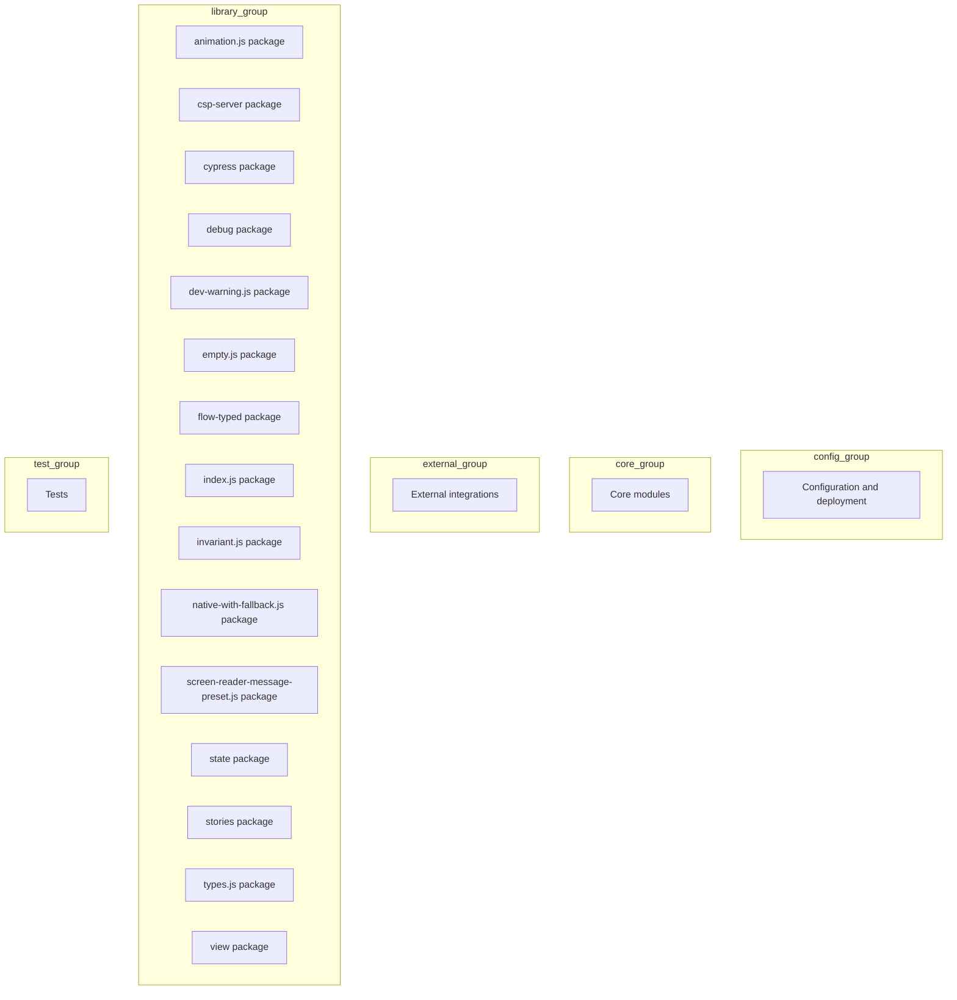

# Architecture report: atlassian/react-beautiful-dnd

> Automated static analysis. **Observed** = directly seen in files/imports/AST; **Inferred** = interpretation from that evidence. Repository code was not executed.

## 1. Repository at a glance

| Item | Value |
| --- | --- |
| Repository | atlassian/react-beautiful-dnd |
| Description | Beautiful and accessible drag and drop for lists with React |
| Language | JavaScript |
| Stars | 33884 |
| Licence | Other |
| Analysed commit / branch | 2baf5c6344cbb7862cf21ee697152bffb3765fa9 / master |
| Framework(s) | React |
| Files analysed | 782 |
| Components | 19 |

## 2. Architecture in one minute

atlassian/react-beautiful-dnd - Beautiful and accessible drag and drop for lists with React. This repository was analysed statically from 782 file(s) (0 Python). Detected technologies (observed from imports/manifests): React, Redux, Jest, webpack. Files are grouped into 19 component(s): animation.js package, Configuration and deployment, Core modules, csp-server package, cypress package, debug package, dev-warning.js package, empty.js package. Findings below distinguish observed facts from inferred interpretation.

## 3. High-level block diagram

## 4. Main components

### animation.js package (`animation_js`)

- **Kind:** library
- **Status:** Observed
- **Confidence:** 0.85
- **Responsibility:** Groups 1 file(s) under animation.js package (observed from repository paths and static analysis).
- **Paths:** `src/animation.js`
- **Evidence:** [src/animation.js](https://github.com/atlassian/react-beautiful-dnd/blob/2baf5c6344cbb7862cf21ee697152bffb3765fa9/src/animation.js)

### Configuration and deployment (`config`)

- **Kind:** config
- **Status:** Observed
- **Confidence:** 0.85
- **Responsibility:** Groups 3 file(s) under configuration and deployment (observed from repository paths and static analysis).
- **Paths:** `cypress.json`, `package.json`, `renovate.json`
- **Evidence:** [cypress.json](https://github.com/atlassian/react-beautiful-dnd/blob/2baf5c6344cbb7862cf21ee697152bffb3765fa9/cypress.json); [package.json](https://github.com/atlassian/react-beautiful-dnd/blob/2baf5c6344cbb7862cf21ee697152bffb3765fa9/package.json); [renovate.json](https://github.com/atlassian/react-beautiful-dnd/blob/2baf5c6344cbb7862cf21ee697152bffb3765fa9/renovate.json)

### Core modules (`core`)

- **Kind:** core
- **Status:** Observed
- **Confidence:** 0.85
- **Responsibility:** Groups 6 file(s) under core modules (observed from repository paths and static analysis).
- **Paths:** `a11y-audit-parse.js`, `babel.config.js`, `browser-test-harness.js`, `jest.config.js`, `rollup.config.js`, `server-ports.js`
- **Evidence:** [a11y-audit-parse.js](https://github.com/atlassian/react-beautiful-dnd/blob/2baf5c6344cbb7862cf21ee697152bffb3765fa9/a11y-audit-parse.js); [babel.config.js](https://github.com/atlassian/react-beautiful-dnd/blob/2baf5c6344cbb7862cf21ee697152bffb3765fa9/babel.config.js); [browser-test-harness.js](https://github.com/atlassian/react-beautiful-dnd/blob/2baf5c6344cbb7862cf21ee697152bffb3765fa9/browser-test-harness.js); [jest.config.js](https://github.com/atlassian/react-beautiful-dnd/blob/2baf5c6344cbb7862cf21ee697152bffb3765fa9/jest.config.js); [rollup.config.js](https://github.com/atlassian/react-beautiful-dnd/blob/2baf5c6344cbb7862cf21ee697152bffb3765fa9/rollup.config.js); [server-ports.js](https://github.com/atlassian/react-beautiful-dnd/blob/2baf5c6344cbb7862cf21ee697152bffb3765fa9/server-ports.js)

### csp-server package (`csp_server`)

- **Kind:** library
- **Status:** Observed
- **Confidence:** 0.85
- **Responsibility:** Groups 7 file(s) under csp-server package (observed from repository paths and static analysis).
- **Paths:** `csp-server/.eslintrc.js`, `csp-server/app.jsx`, `csp-server/client.js`, `csp-server/main.js`, `csp-server/server.js`, `csp-server/start.sh`, `csp-server/webpack.config.js`
- **Evidence:** [csp-server/.eslintrc.js](https://github.com/atlassian/react-beautiful-dnd/blob/2baf5c6344cbb7862cf21ee697152bffb3765fa9/csp-server/.eslintrc.js); [csp-server/app.jsx](https://github.com/atlassian/react-beautiful-dnd/blob/2baf5c6344cbb7862cf21ee697152bffb3765fa9/csp-server/app.jsx); [csp-server/client.js](https://github.com/atlassian/react-beautiful-dnd/blob/2baf5c6344cbb7862cf21ee697152bffb3765fa9/csp-server/client.js); [csp-server/main.js](https://github.com/atlassian/react-beautiful-dnd/blob/2baf5c6344cbb7862cf21ee697152bffb3765fa9/csp-server/main.js); [csp-server/server.js](https://github.com/atlassian/react-beautiful-dnd/blob/2baf5c6344cbb7862cf21ee697152bffb3765fa9/csp-server/server.js); [csp-server/start.sh](https://github.com/atlassian/react-beautiful-dnd/blob/2baf5c6344cbb7862cf21ee697152bffb3765fa9/csp-server/start.sh); [csp-server/webpack.config.js](https://github.com/atlassian/react-beautiful-dnd/blob/2baf5c6344cbb7862cf21ee697152bffb3765fa9/csp-server/webpack.config.js)

### cypress package (`cypress`)

- **Kind:** library
- **Status:** Observed
- **Confidence:** 0.85
- **Responsibility:** Groups 4 file(s) under cypress package (observed from repository paths and static analysis).
- **Paths:** `cypress/.eslintrc.js`, `cypress/plugins/index.js`, `cypress/support/commands.js`, `cypress/support/index.js`
- **Evidence:** [cypress/.eslintrc.js](https://github.com/atlassian/react-beautiful-dnd/blob/2baf5c6344cbb7862cf21ee697152bffb3765fa9/cypress/.eslintrc.js); [cypress/plugins/index.js](https://github.com/atlassian/react-beautiful-dnd/blob/2baf5c6344cbb7862cf21ee697152bffb3765fa9/cypress/plugins/index.js); [cypress/support/commands.js](https://github.com/atlassian/react-beautiful-dnd/blob/2baf5c6344cbb7862cf21ee697152bffb3765fa9/cypress/support/commands.js); [cypress/support/index.js](https://github.com/atlassian/react-beautiful-dnd/blob/2baf5c6344cbb7862cf21ee697152bffb3765fa9/cypress/support/index.js)

### debug package (`debug`)

- **Kind:** library
- **Status:** Observed
- **Confidence:** 0.85
- **Responsibility:** Groups 5 file(s) under debug package (observed from repository paths and static analysis).
- **Paths:** `src/debug/middleware/action-timing-average.js`, `src/debug/middleware/action-timing.js`, `src/debug/middleware/log.js`, `src/debug/middleware/user-timing.js`, `src/debug/timings.js`
- **Evidence:** [src/debug/middleware/action-timing-average.js](https://github.com/atlassian/react-beautiful-dnd/blob/2baf5c6344cbb7862cf21ee697152bffb3765fa9/src/debug/middleware/action-timing-average.js); [src/debug/middleware/action-timing.js](https://github.com/atlassian/react-beautiful-dnd/blob/2baf5c6344cbb7862cf21ee697152bffb3765fa9/src/debug/middleware/action-timing.js); [src/debug/middleware/log.js](https://github.com/atlassian/react-beautiful-dnd/blob/2baf5c6344cbb7862cf21ee697152bffb3765fa9/src/debug/middleware/log.js); [src/debug/middleware/user-timing.js](https://github.com/atlassian/react-beautiful-dnd/blob/2baf5c6344cbb7862cf21ee697152bffb3765fa9/src/debug/middleware/user-timing.js); [src/debug/timings.js](https://github.com/atlassian/react-beautiful-dnd/blob/2baf5c6344cbb7862cf21ee697152bffb3765fa9/src/debug/timings.js)

### dev-warning.js package (`dev_warning_js`)

- **Kind:** library
- **Status:** Observed
- **Confidence:** 0.85
- **Responsibility:** Groups 1 file(s) under dev-warning.js package (observed from repository paths and static analysis).
- **Paths:** `src/dev-warning.js`
- **Evidence:** [src/dev-warning.js](https://github.com/atlassian/react-beautiful-dnd/blob/2baf5c6344cbb7862cf21ee697152bffb3765fa9/src/dev-warning.js)

### empty.js package (`empty_js`)

- **Kind:** library
- **Status:** Observed
- **Confidence:** 0.85
- **Responsibility:** Groups 1 file(s) under empty.js package (observed from repository paths and static analysis).
- **Paths:** `src/empty.js`
- **Evidence:** [src/empty.js](https://github.com/atlassian/react-beautiful-dnd/blob/2baf5c6344cbb7862cf21ee697152bffb3765fa9/src/empty.js)

### External integrations (`external_integrations`)

- **Kind:** external
- **Status:** Observed
- **Confidence:** 0.85
- **Responsibility:** Groups 7 file(s) under external integrations (observed from repository paths and static analysis).
- **Paths:** `cypress/integration/content-security-policy.spec.js`, `cypress/integration/focus.spec.js`, `cypress/integration/move-between-lists.spec.js`, `cypress/integration/reorder-lists.spec.js`, `cypress/integration/reorder-virtual.spec.js`, `cypress/integration/reorder.spec.js`, `cypress/integration/util.js`
- **Evidence:** [cypress/integration/content-security-policy.spec.js](https://github.com/atlassian/react-beautiful-dnd/blob/2baf5c6344cbb7862cf21ee697152bffb3765fa9/cypress/integration/content-security-policy.spec.js); [cypress/integration/focus.spec.js](https://github.com/atlassian/react-beautiful-dnd/blob/2baf5c6344cbb7862cf21ee697152bffb3765fa9/cypress/integration/focus.spec.js); [cypress/integration/move-between-lists.spec.js](https://github.com/atlassian/react-beautiful-dnd/blob/2baf5c6344cbb7862cf21ee697152bffb3765fa9/cypress/integration/move-between-lists.spec.js); [cypress/integration/reorder-lists.spec.js](https://github.com/atlassian/react-beautiful-dnd/blob/2baf5c6344cbb7862cf21ee697152bffb3765fa9/cypress/integration/reorder-lists.spec.js); [cypress/integration/reorder-virtual.spec.js](https://github.com/atlassian/react-beautiful-dnd/blob/2baf5c6344cbb7862cf21ee697152bffb3765fa9/cypress/integration/reorder-virtual.spec.js); [cypress/integration/reorder.spec.js](https://github.com/atlassian/react-beautiful-dnd/blob/2baf5c6344cbb7862cf21ee697152bffb3765fa9/cypress/integration/reorder.spec.js); [cypress/integration/util.js](https://github.com/atlassian/react-beautiful-dnd/blob/2baf5c6344cbb7862cf21ee697152bffb3765fa9/cypress/integration/util.js)

### flow-typed package (`flow_typed`)

- **Kind:** library
- **Status:** Observed
- **Confidence:** 0.85
- **Responsibility:** Groups 71 file(s) under flow-typed package (observed from repository paths and static analysis).
- **Paths:** `flow-typed/custom/cypress.js`, `flow-typed/custom/raf.js`, `flow-typed/npm/@atlaskit/css-reset_vx.x.x.js`, `flow-typed/npm/@atlaskit/theme_vx.x.x.js`, `flow-typed/npm/@babel/core_vx.x.x.js`, `flow-typed/npm/@babel/plugin-proposal-class-properties_vx.x.x.js`, `flow-typed/npm/@babel/plugin-transform-modules-commonjs_vx.x.x.js`, `flow-typed/npm/@babel/plugin-transform-object-assign_vx.x.x.js`, `flow-typed/npm/@babel/plugin-transform-runtime_vx.x.x.js`, `flow-typed/npm/@babel/preset-env_vx.x.x.js`, `flow-typed/npm/@babel/preset-flow_vx.x.x.js`, `flow-typed/npm/@babel/preset-react_vx.x.x.js`, `flow-typed/npm/@babel/runtime_vx.x.x.js`, `flow-typed/npm/@emotion/babel-preset-css-prop_vx.x.x.js`, `flow-typed/npm/@storybook/react_v5.x.x.js`, `flow-typed/npm/@storybook/theming_vx.x.x.js`, `flow-typed/npm/@testing-library/react_v9.x.x.js`, `flow-typed/npm/babel-core_vx.x.x.js`, `flow-typed/npm/babel-eslint_vx.x.x.js`, `flow-typed/npm/babel-jest_vx.x.x.js`, `flow-typed/npm/babel-loader_vx.x.x.js`, `flow-typed/npm/babel-plugin-dev-expression_vx.x.x.js`, `flow-typed/npm/cross-env_vx.x.x.js`, `flow-typed/npm/cypress_vx.x.x.js`, `flow-typed/npm/enzyme-adapter-react-16_vx.x.x.js`, `flow-typed/npm/enzyme_v3.x.x.js`, `flow-typed/npm/eslint-config-airbnb_vx.x.x.js`, `flow-typed/npm/eslint-config-prettier_vx.x.x.js`, `flow-typed/npm/eslint-plugin-cypress_vx.x.x.js`, `flow-typed/npm/eslint-plugin-es5_vx.x.x.js`, `flow-typed/npm/eslint-plugin-flowtype_vx.x.x.js`, `flow-typed/npm/eslint-plugin-import_vx.x.x.js`, `flow-typed/npm/eslint-plugin-jest_vx.x.x.js`, `flow-typed/npm/eslint-plugin-jsx-a11y_vx.x.x.js`, `flow-typed/npm/eslint-plugin-prettier_vx.x.x.js`, `flow-typed/npm/eslint-plugin-react-hooks_vx.x.x.js`, `flow-typed/npm/eslint-plugin-react_vx.x.x.js`, `flow-typed/npm/eslint_vx.x.x.js`, `flow-typed/npm/flow-bin_v0.x.x.js`, `flow-typed/npm/fs-extra_vx.x.x.js`, `flow-typed/npm/globby_vx.x.x.js`, `flow-typed/npm/jest-axe_vx.x.x.js`, `flow-typed/npm/jest-junit_vx.x.x.js`, `flow-typed/npm/jest-watch-typeahead_vx.x.x.js`, `flow-typed/npm/jest_vx.x.x.js`, `flow-typed/npm/lighthouse_vx.x.x.js`, `flow-typed/npm/markdown-it_vx.x.x.js`, `flow-typed/npm/prettier_v1.x.x.js`, `flow-typed/npm/react-redux_v7.x.x.js`, `flow-typed/npm/react-test-renderer_v16.x.x.js`, `flow-typed/npm/redux_v4.x.x.js`, `flow-typed/npm/require-from-string_vx.x.x.js`, `flow-typed/npm/rimraf_vx.x.x.js`, `flow-typed/npm/rollup-plugin-babel_vx.x.x.js`, `flow-typed/npm/rollup-plugin-commonjs_vx.x.x.js`, `flow-typed/npm/rollup-plugin-json_vx.x.x.js`, `flow-typed/npm/rollup-plugin-node-resolve_vx.x.x.js`, `flow-typed/npm/rollup-plugin-replace_vx.x.x.js`, `flow-typed/npm/rollup-plugin-size-snapshot_vx.x.x.js`, `flow-typed/npm/rollup-plugin-strip_vx.x.x.js`, `flow-typed/npm/rollup-plugin-terser_vx.x.x.js`, `flow-typed/npm/rollup_vx.x.x.js`, `flow-typed/npm/styled-components_vx.x.x.js`, `flow-typed/npm/stylelint-config-prettier_vx.x.x.js`, `flow-typed/npm/stylelint-config-recommended_vx.x.x.js`, `flow-typed/npm/stylelint-config-standard_vx.x.x.js`, `flow-typed/npm/stylelint-config-styled-components_vx.x.x.js`, `flow-typed/npm/stylelint-processor-styled-components_vx.x.x.js`, `flow-typed/npm/stylelint_vx.x.x.js`, `flow-typed/npm/wait-port_vx.x.x.js`, `flow-typed/npm/webpack_v4.x.x.js`
- **Evidence:** [flow-typed/custom/cypress.js](https://github.com/atlassian/react-beautiful-dnd/blob/2baf5c6344cbb7862cf21ee697152bffb3765fa9/flow-typed/custom/cypress.js); [flow-typed/custom/raf.js](https://github.com/atlassian/react-beautiful-dnd/blob/2baf5c6344cbb7862cf21ee697152bffb3765fa9/flow-typed/custom/raf.js); [flow-typed/npm/@atlaskit/css-reset_vx.x.x.js](https://github.com/atlassian/react-beautiful-dnd/blob/2baf5c6344cbb7862cf21ee697152bffb3765fa9/flow-typed/npm/%40atlaskit/css-reset_vx.x.x.js); [flow-typed/npm/@atlaskit/theme_vx.x.x.js](https://github.com/atlassian/react-beautiful-dnd/blob/2baf5c6344cbb7862cf21ee697152bffb3765fa9/flow-typed/npm/%40atlaskit/theme_vx.x.x.js); [flow-typed/npm/@babel/core_vx.x.x.js](https://github.com/atlassian/react-beautiful-dnd/blob/2baf5c6344cbb7862cf21ee697152bffb3765fa9/flow-typed/npm/%40babel/core_vx.x.x.js); [flow-typed/npm/@babel/plugin-proposal-class-properties_vx.x.x.js](https://github.com/atlassian/react-beautiful-dnd/blob/2baf5c6344cbb7862cf21ee697152bffb3765fa9/flow-typed/npm/%40babel/plugin-proposal-class-properties_vx.x.x.js); [flow-typed/npm/@babel/plugin-transform-modules-commonjs_vx.x.x.js](https://github.com/atlassian/react-beautiful-dnd/blob/2baf5c6344cbb7862cf21ee697152bffb3765fa9/flow-typed/npm/%40babel/plugin-transform-modules-commonjs_vx.x.x.js); [flow-typed/npm/@babel/plugin-transform-object-assign_vx.x.x.js](https://github.com/atlassian/react-beautiful-dnd/blob/2baf5c6344cbb7862cf21ee697152bffb3765fa9/flow-typed/npm/%40babel/plugin-transform-object-assign_vx.x.x.js)

### index.js package (`index_js`)

- **Kind:** library
- **Status:** Observed
- **Confidence:** 0.85
- **Responsibility:** Groups 1 file(s) under index.js package (observed from repository paths and static analysis).
- **Paths:** `src/index.js`
- **Evidence:** [src/index.js](https://github.com/atlassian/react-beautiful-dnd/blob/2baf5c6344cbb7862cf21ee697152bffb3765fa9/src/index.js)

### invariant.js package (`invariant_js`)

- **Kind:** library
- **Status:** Observed
- **Confidence:** 0.85
- **Responsibility:** Groups 1 file(s) under invariant.js package (observed from repository paths and static analysis).
- **Paths:** `src/invariant.js`
- **Evidence:** [src/invariant.js](https://github.com/atlassian/react-beautiful-dnd/blob/2baf5c6344cbb7862cf21ee697152bffb3765fa9/src/invariant.js)

### native-with-fallback.js package (`native_with_fallback_js`)

- **Kind:** library
- **Status:** Observed
- **Confidence:** 0.85
- **Responsibility:** Groups 1 file(s) under native-with-fallback.js package (observed from repository paths and static analysis).
- **Paths:** `src/native-with-fallback.js`
- **Evidence:** [src/native-with-fallback.js](https://github.com/atlassian/react-beautiful-dnd/blob/2baf5c6344cbb7862cf21ee697152bffb3765fa9/src/native-with-fallback.js)

### screen-reader-message-preset.js package (`screen_reader_message_preset_js`)

- **Kind:** library
- **Status:** Observed
- **Confidence:** 0.85
- **Responsibility:** Groups 1 file(s) under screen-reader-message-preset.js package (observed from repository paths and static analysis).
- **Paths:** `src/screen-reader-message-preset.js`
- **Evidence:** [src/screen-reader-message-preset.js](https://github.com/atlassian/react-beautiful-dnd/blob/2baf5c6344cbb7862cf21ee697152bffb3765fa9/src/screen-reader-message-preset.js)

### state package (`state`)

- **Kind:** library
- **Status:** Observed
- **Confidence:** 0.85
- **Responsibility:** Groups 126 file(s) under state package (observed from repository paths and static analysis).
- **Paths:** `src/state/action-creators.js`, `src/state/auto-scroller/auto-scroller-types.js`, `src/state/auto-scroller/can-scroll.js`, `src/state/auto-scroller/fluid-scroller/config.js`, `src/state/auto-scroller/fluid-scroller/did-start-in-scrollable-area.js`, `src/state/auto-scroller/fluid-scroller/get-best-scrollable-droppable.js`, `src/state/auto-scroller/fluid-scroller/get-droppable-scroll-change.js`, `src/state/auto-scroller/fluid-scroller/get-percentage.js`, `src/state/auto-scroller/fluid-scroller/get-scroll/adjust-for-size-limits.js`, `src/state/auto-scroller/fluid-scroller/get-scroll/get-scroll-on-axis/dampen-value-by-time.js`, `src/state/auto-scroller/fluid-scroller/get-scroll/get-scroll-on-axis/get-distance-thresholds.js`, `src/state/auto-scroller/fluid-scroller/get-scroll/get-scroll-on-axis/get-value-from-distance.js`, `src/state/auto-scroller/fluid-scroller/get-scroll/get-scroll-on-axis/get-value.js`, `src/state/auto-scroller/fluid-scroller/get-scroll/get-scroll-on-axis/index.js`, `src/state/auto-scroller/fluid-scroller/get-scroll/get-scroll-on-axis/min-scroll.js`, `src/state/auto-scroller/fluid-scroller/get-scroll/index.js`, `src/state/auto-scroller/fluid-scroller/get-window-scroll-change.js`, `src/state/auto-scroller/fluid-scroller/index.js`, `src/state/auto-scroller/fluid-scroller/scroll.js`, `src/state/auto-scroller/index.js`, `src/state/auto-scroller/jump-scroller.js`, `src/state/axis.js`, `src/state/calculate-drag-impact/calculate-reorder-impact.js`, `src/state/can-start-drag.js`, `src/state/create-store.js`, `src/state/did-start-after-critical.js`, `src/state/dimension-marshal/dimension-marshal-types.js`, `src/state/dimension-marshal/dimension-marshal.js`, `src/state/dimension-marshal/get-initial-publish.js`, `src/state/dimension-marshal/while-dragging-publisher.js`, `src/state/dimension-structures.js`, `src/state/droppable/get-droppable.js`, `src/state/droppable/is-home-of.js`, `src/state/droppable/scroll-droppable.js`, `src/state/droppable/should-use-placeholder.js`, `src/state/droppable/util/clip.js`, `src/state/droppable/util/get-subject.js`, `src/state/droppable/what-is-dragged-over-from-result.js`, `src/state/droppable/what-is-dragged-over.js`, `src/state/droppable/with-placeholder.js`, `src/state/get-center-from-impact/get-client-border-box-center/get-client-from-page-border-box-center.js`, `src/state/get-center-from-impact/get-client-border-box-center/index.js`, `src/state/get-center-from-impact/get-page-border-box-center/index.js`, `src/state/get-center-from-impact/get-page-border-box-center/when-combining.js`, `src/state/get-center-from-impact/get-page-border-box-center/when-reordering.js`, `src/state/get-center-from-impact/move-relative-to.js`, `src/state/get-combined-item-displacement.js`, `src/state/get-displaced-by.js`, `src/state/get-displacement-groups.js`, `src/state/get-drag-impact/get-combine-impact.js`, `src/state/get-drag-impact/get-reorder-impact.js`, `src/state/get-drag-impact/index.js`, `src/state/get-draggables-inside-droppable.js`, `src/state/get-droppable-over.js`, `src/state/get-frame.js`, `src/state/get-home-location.js`, `src/state/get-impact-location.js`, `src/state/get-is-displaced.js`, `src/state/get-lift-effect.js`, `src/state/get-max-scroll.js`, `src/state/is-movement-allowed.js`, `src/state/is-within.js`, `src/state/middleware/auto-scroll.js`, `src/state/middleware/dimension-marshal-stopper.js`, `src/state/middleware/drop/drop-animation-finish-middleware.js`, `src/state/middleware/drop/drop-animation-flush-on-scroll-middleware.js`, `src/state/middleware/drop/drop-middleware.js`, `src/state/middleware/drop/get-drop-duration.js`, `src/state/middleware/drop/get-drop-impact.js`, `src/state/middleware/drop/get-new-home-client-offset.js`, `src/state/middleware/drop/index.js`, `src/state/middleware/focus.js`, `src/state/middleware/lift.js`, `src/state/middleware/pending-drop.js`, `src/state/middleware/responders/async-marshal.js`, `src/state/middleware/responders/expiring-announce.js`, `src/state/middleware/responders/index.js`, `src/state/middleware/responders/is-equal.js`, `src/state/middleware/responders/publisher.js`, `src/state/middleware/responders/responders-middleware.js`, `src/state/middleware/scroll-listener.js`, `src/state/middleware/style.js`, `src/state/middleware/util/validate-dimensions.js`, `src/state/move-in-direction/index.js`, `src/state/move-in-direction/move-cross-axis/get-best-cross-axis-droppable.js`, `src/state/move-in-direction/move-cross-axis/get-closest-draggable.js`, `src/state/move-in-direction/move-cross-axis/index.js`, `src/state/move-in-direction/move-cross-axis/move-to-new-droppable.js`, `src/state/move-in-direction/move-cross-axis/without-starting-displacement.js`, `src/state/move-in-direction/move-in-direction-types.js`, `src/state/move-in-direction/move-to-next-place/index.js`, `src/state/move-in-direction/move-to-next-place/is-totally-visible-in-new-location.js`, `src/state/move-in-direction/move-to-next-place/move-to-next-combine/index.js`, `src/state/move-in-direction/move-to-next-place/move-to-next-index/from-combine.js`, `src/state/move-in-direction/move-to-next-place/move-to-next-index/from-reorder.js`, `src/state/move-in-direction/move-to-next-place/move-to-next-index/index.js`, `src/state/no-impact.js`, `src/state/patch-dimension-map.js`, `src/state/patch-droppable-map.js`, `src/state/position.js`, `src/state/post-reducer/when-moving/refresh-snap.js`, `src/state/post-reducer/when-moving/update.js`, `src/state/publish-while-dragging-in-virtual/adjust-additions-for-scroll-changes.js`, `src/state/publish-while-dragging-in-virtual/index.js`, `src/state/publish-while-dragging-in-virtual/offset-draggable.js`, `src/state/recompute-placeholders.js`, `src/state/rect.js`, `src/state/reducer.js`, `src/state/registry/create-registry.js`, `src/state/registry/registry-types.js`, `src/state/registry/use-registry.js`, `src/state/remove-draggable-from-list.js`, `src/state/scroll-viewport.js`, `src/state/spacing.js`, `src/state/store-types.js`, `src/state/update-displacement-visibility/recompute.js`, `src/state/update-displacement-visibility/speculatively-increase.js`, `src/state/visibility/is-partially-visible-through-frame.js`, `src/state/visibility/is-position-in-frame.js`, `src/state/visibility/is-totally-visible-through-frame-on-axis.js`, `src/state/visibility/is-totally-visible-through-frame.js`, `src/state/visibility/is-visible.js`, `src/state/with-scroll-change/with-all-displacement.js`, `src/state/with-scroll-change/with-droppable-displacement.js`, `src/state/with-scroll-change/with-droppable-scroll.js`, `src/state/with-scroll-change/with-viewport-displacement.js`
- **Evidence:** [src/state/action-creators.js](https://github.com/atlassian/react-beautiful-dnd/blob/2baf5c6344cbb7862cf21ee697152bffb3765fa9/src/state/action-creators.js); [src/state/auto-scroller/auto-scroller-types.js](https://github.com/atlassian/react-beautiful-dnd/blob/2baf5c6344cbb7862cf21ee697152bffb3765fa9/src/state/auto-scroller/auto-scroller-types.js); [src/state/auto-scroller/can-scroll.js](https://github.com/atlassian/react-beautiful-dnd/blob/2baf5c6344cbb7862cf21ee697152bffb3765fa9/src/state/auto-scroller/can-scroll.js); [src/state/auto-scroller/fluid-scroller/config.js](https://github.com/atlassian/react-beautiful-dnd/blob/2baf5c6344cbb7862cf21ee697152bffb3765fa9/src/state/auto-scroller/fluid-scroller/config.js); [src/state/auto-scroller/fluid-scroller/did-start-in-scrollable-area.js](https://github.com/atlassian/react-beautiful-dnd/blob/2baf5c6344cbb7862cf21ee697152bffb3765fa9/src/state/auto-scroller/fluid-scroller/did-start-in-scrollable-area.js); [src/state/auto-scroller/fluid-scroller/get-best-scrollable-droppable.js](https://github.com/atlassian/react-beautiful-dnd/blob/2baf5c6344cbb7862cf21ee697152bffb3765fa9/src/state/auto-scroller/fluid-scroller/get-best-scrollable-droppable.js); [src/state/auto-scroller/fluid-scroller/get-droppable-scroll-change.js](https://github.com/atlassian/react-beautiful-dnd/blob/2baf5c6344cbb7862cf21ee697152bffb3765fa9/src/state/auto-scroller/fluid-scroller/get-droppable-scroll-change.js); [src/state/auto-scroller/fluid-scroller/get-percentage.js](https://github.com/atlassian/react-beautiful-dnd/blob/2baf5c6344cbb7862cf21ee697152bffb3765fa9/src/state/auto-scroller/fluid-scroller/get-percentage.js)

### stories package (`stories`)

- **Kind:** library
- **Status:** Observed
- **Confidence:** 0.85
- **Responsibility:** Groups 82 file(s) under stories package (observed from repository paths and static analysis).
- **Paths:** `stories/.eslintrc.js`, `stories/1-single-vertical-list.stories.js`, `stories/10-table.stories.js`, `stories/11-portal.stories.js`, `stories/12-dynamic.stories.js`, `stories/15-on-before-capture.stories.js`, `stories/2-single-horizontal.stories.js`, `stories/20-super-simple.stories.js`, `stories/21-change-on-drag-start.stories.js`, `stories/25-fixed-list.stories.js`, `stories/3-board.stories.stories.js`, `stories/30-custom-drop.stories.js`, `stories/35-function-component.stories.js`, `stories/4-complex-vertical-list.stories.js`, `stories/40-programmatic.stories.js`, `stories/45-virtual.stories.js`, `stories/5-multiple-vertical-lists.stories.js`, `stories/50-multiple-contexts.stories.js`, `stories/55-mixed-sizes.stories.js`, `stories/6-multiple-horizontal-lists.stories.js`, `stories/7-interactive-elements.stories.js`, `stories/8-accessibility.stories.js`, `stories/9-multi-drag.stories.js`, `stories/99-debug.stories.js`, `stories/src/accessible/blur-context.js`, `stories/src/accessible/data.js`, `stories/src/accessible/task-app.jsx`, `stories/src/accessible/task-list.jsx`, `stories/src/accessible/task.jsx`, `stories/src/board/board.jsx`, `stories/src/board/column.jsx`, `stories/src/constants.js`, `stories/src/custom-drop/funny-drop.jsx`, `stories/src/custom-drop/no-drop.jsx`, `stories/src/data.js`, `stories/src/dynamic/lazy-loading.jsx`, `stories/src/dynamic/with-controls.jsx`, `stories/src/fixed-list/fixed-sidebar.jsx`, `stories/src/function-component/quote-app.jsx`, `stories/src/horizontal/author-app.jsx`, `stories/src/interactive-elements/interactive-elements-app.jsx`, `stories/src/mixed-sizes/mixed-size-items.jsx`, `stories/src/mixed-sizes/mixed-size-lists-experiment.jsx`, `stories/src/mixed-sizes/mixed-size-lists.jsx`, `stories/src/multi-drag/column.jsx`, `stories/src/multi-drag/data.js`, `stories/src/multi-drag/task-app.jsx`, `stories/src/multi-drag/task.jsx`, `stories/src/multi-drag/types.js`, `stories/src/multi-drag/utils.js`, `stories/src/multiple-horizontal/quote-app.jsx`, `stories/src/multiple-vertical/quote-app.jsx`, `stories/src/on-before-capture/adding-things.jsx`, `stories/src/portal/portal-app.jsx`, `stories/src/primatives/author-item.jsx`, `stories/src/primatives/author-list.jsx`, `stories/src/primatives/quote-item.jsx`, `stories/src/primatives/quote-list.jsx`, `stories/src/primatives/title.jsx`, `stories/src/programmatic/multiple-contexts.jsx`, `stories/src/programmatic/runsheet.jsx`, `stories/src/programmatic/with-controls.jsx`, `stories/src/reorder.js`, `stories/src/simple/simple-mixed-spacing.jsx`, `stories/src/simple/simple-scrollable.jsx`, `stories/src/simple/simple.jsx`, `stories/src/table/with-clone.jsx`, `stories/src/table/with-dimension-locking.jsx`, `stories/src/table/with-fixed-columns.jsx`, `stories/src/table/with-portal.jsx`, `stories/src/types.js`, `stories/src/vertical-grouped/quote-app.jsx`, `stories/src/vertical-nested/quote-app.jsx`, `stories/src/vertical-nested/quote-list.jsx`, `stories/src/vertical-nested/types.js`, `stories/src/vertical/quote-app.jsx`, `stories/src/virtual/quote-count-chooser.jsx`, `stories/src/virtual/react-virtualized/board.jsx`, `stories/src/virtual/react-virtualized/list.jsx`, `stories/src/virtual/react-virtualized/window-list.jsx`, `stories/src/virtual/react-window/board.jsx`, `stories/src/virtual/react-window/list.jsx`
- **Evidence:** [stories/.eslintrc.js](https://github.com/atlassian/react-beautiful-dnd/blob/2baf5c6344cbb7862cf21ee697152bffb3765fa9/stories/.eslintrc.js); [stories/1-single-vertical-list.stories.js](https://github.com/atlassian/react-beautiful-dnd/blob/2baf5c6344cbb7862cf21ee697152bffb3765fa9/stories/1-single-vertical-list.stories.js); [stories/10-table.stories.js](https://github.com/atlassian/react-beautiful-dnd/blob/2baf5c6344cbb7862cf21ee697152bffb3765fa9/stories/10-table.stories.js); [stories/11-portal.stories.js](https://github.com/atlassian/react-beautiful-dnd/blob/2baf5c6344cbb7862cf21ee697152bffb3765fa9/stories/11-portal.stories.js); [stories/12-dynamic.stories.js](https://github.com/atlassian/react-beautiful-dnd/blob/2baf5c6344cbb7862cf21ee697152bffb3765fa9/stories/12-dynamic.stories.js); [stories/15-on-before-capture.stories.js](https://github.com/atlassian/react-beautiful-dnd/blob/2baf5c6344cbb7862cf21ee697152bffb3765fa9/stories/15-on-before-capture.stories.js); [stories/2-single-horizontal.stories.js](https://github.com/atlassian/react-beautiful-dnd/blob/2baf5c6344cbb7862cf21ee697152bffb3765fa9/stories/2-single-horizontal.stories.js); [stories/20-super-simple.stories.js](https://github.com/atlassian/react-beautiful-dnd/blob/2baf5c6344cbb7862cf21ee697152bffb3765fa9/stories/20-super-simple.stories.js)

### Tests (`tests`)

- **Kind:** test
- **Status:** Observed
- **Confidence:** 0.85
- **Responsibility:** Groups 302 file(s) under tests (observed from repository paths and static analysis).
- **Paths:** `test/.eslintrc.js`, `test/env-setup.js`, `test/test-flow-types.js`, `test/test-setup.js`, `test/unit/dev-warning.spec.js`, `test/unit/docs/content.spec.js`, `test/unit/docs/no-broken-links.spec.js`, `test/unit/health/drop-dev-warnings-for-prod.spec.js`, `test/unit/health/src-file-name-convention.spec.js`, `test/unit/integration/accessibility/axe-audit.spec.js`, `test/unit/integration/body-removal-before-unmount.spec.js`, `test/unit/integration/combine-on-start.spec.js`, `test/unit/integration/disable-on-start.spec.js`, `test/unit/integration/drag-drop-context/check-doctype.spec.js`, `test/unit/integration/drag-drop-context/check-react-version.spec.js`, `test/unit/integration/drag-drop-context/clashing-with-consumers-redux.spec.js`, `test/unit/integration/drag-drop-context/error-handling/error-in-react-tree.spec.js`, `test/unit/integration/drag-drop-context/error-handling/error-on-window.spec.js`, `test/unit/integration/drag-drop-context/on-before-capture/additions.spec.js`, `test/unit/integration/drag-drop-context/on-before-capture/removals.spec.js`, `test/unit/integration/drag-drop-context/reset-server-context.spec.js`, `test/unit/integration/drag-drop-context/unmount.spec.js`, `test/unit/integration/drag-handle/keyboard-sensor/directional-movement.spec.js`, `test/unit/integration/drag-handle/keyboard-sensor/no-click-blocking.spec.js`, `test/unit/integration/drag-handle/keyboard-sensor/prevent-keyboard-scroll.spec.js`, `test/unit/integration/drag-handle/keyboard-sensor/prevent-standard-keys-while-dragging.spec.js`, `test/unit/integration/drag-handle/keyboard-sensor/starting-a-drag.spec.js`, `test/unit/integration/drag-handle/keyboard-sensor/stopping-a-drag.spec.js`, `test/unit/integration/drag-handle/mouse-sensor/cancel-while-pending.spec.js`, `test/unit/integration/drag-handle/mouse-sensor/click-blocking.spec.js`, `test/unit/integration/drag-handle/mouse-sensor/force-press.spec.js`, `test/unit/integration/drag-handle/mouse-sensor/prevent-standard-keys-while-dragging.spec.js`, `test/unit/integration/drag-handle/mouse-sensor/starting-a-dragging.spec.js`, `test/unit/integration/drag-handle/mouse-sensor/stopping-a-drag.spec.js`, `test/unit/integration/drag-handle/sensor-marshal/click-blocking.spec.js`, `test/unit/integration/drag-handle/sensor-marshal/force-releasing-locks.spec.js`, `test/unit/integration/drag-handle/sensor-marshal/is-lock-claimed.spec.js`, `test/unit/integration/drag-handle/sensor-marshal/lock-context-isolation.spec.js`, `test/unit/integration/drag-handle/sensor-marshal/move-throttling.spec.js`, `test/unit/integration/drag-handle/sensor-marshal/no-double-lift.spec.js`, `test/unit/integration/drag-handle/sensor-marshal/obtaining-lock.spec.js`, `test/unit/integration/drag-handle/sensor-marshal/outdated-locks.spec.js`, `test/unit/integration/drag-handle/shared-behaviours/abort-on-error.spec.js`, `test/unit/integration/drag-handle/shared-behaviours/cancel-while-dragging.spec.js`, `test/unit/integration/drag-handle/shared-behaviours/cannot-start-when-disabled.spec.js`, `test/unit/integration/drag-handle/shared-behaviours/cannot-start-when-something-else-has-lock.spec.js`, `test/unit/integration/drag-handle/shared-behaviours/cannot-start-when-unmounted.spec.js`, `test/unit/integration/drag-handle/shared-behaviours/cleanup.spec.js`, `test/unit/integration/drag-handle/shared-behaviours/contenteditable.spec.js`, `test/unit/integration/drag-handle/shared-behaviours/disable-default-sensors.spec.js`, `test/unit/integration/drag-handle/shared-behaviours/interactive-elements.spec.js`, `test/unit/integration/drag-handle/shared-behaviours/lock-released-mid-drag.spec.js`, `test/unit/integration/drag-handle/shared-behaviours/lock-released-pre-drag.spec.js`, `test/unit/integration/drag-handle/shared-behaviours/nested-handles.spec.js`, `test/unit/integration/drag-handle/shared-behaviours/no-dragging-svgs.spec.js`, `test/unit/integration/drag-handle/shared-behaviours/parent-rendering-should-not-kill-drag.spec.js`, `test/unit/integration/drag-handle/shared-behaviours/validate-controls.spec.js`, `test/unit/integration/drag-handle/touch-sensor/cancel-while-pending.spec.js`, `test/unit/integration/drag-handle/touch-sensor/click-blocking.spec.js`, `test/unit/integration/drag-handle/touch-sensor/context-menu-opt-out.spec.js`, `test/unit/integration/drag-handle/touch-sensor/force-press.spec.js`, `test/unit/integration/drag-handle/touch-sensor/starting-a-drag.spec.js`, `test/unit/integration/drag-handle/touch-sensor/stopping-a-drag.spec.js`, `test/unit/integration/drag-handle/touch-sensor/unmounted-while-pending-timer-running.spec.js`, `test/unit/integration/draggable/combined-with.spec.js`, `test/unit/integration/draggable/dragging.spec.js`, `test/unit/integration/draggable/dropping.spec.js`, `test/unit/integration/draggable/moving-out-of-the-way.spec.js`, `test/unit/integration/draggable/portal.spec.js`, `test/unit/integration/draggable/resting.spec.js`, `test/unit/integration/draggable/validation.spec.js`, `test/unit/integration/droppable/clone.spec.js`, `test/unit/integration/droppable/placeholder.spec.js`, `test/unit/integration/reorder-render-sync.spec.js`, `test/unit/integration/responders-integration.spec.js`, `test/unit/integration/responders-timing.spec.js`, `test/unit/integration/server-side-rendering/__snapshots__/server-rendering.spec.js.snap`, `test/unit/integration/server-side-rendering/client-hydration.spec.js`, `test/unit/integration/server-side-rendering/server-rendering.spec.js`, `test/unit/integration/util/app.jsx`, `test/unit/integration/util/board.jsx`, `test/unit/integration/util/controls.js`, `test/unit/integration/util/expanded-mouse.js`, `test/unit/integration/util/helpers.js`, `test/unit/state/auto-scroll/can-scroll.spec.js`, `test/unit/state/auto-scroll/choosing-the-right-scroller.spec.js`, `test/unit/state/auto-scroll/fluid-scroller/big-draggables.spec.js`, `test/unit/state/auto-scroll/fluid-scroller/droppable-scrolling.spec.js`, `test/unit/state/auto-scroll/fluid-scroller/lifecycle.spec.js`, `test/unit/state/auto-scroll/fluid-scroller/time-dampening.spec.js`, `test/unit/state/auto-scroll/fluid-scroller/util/drag-to.js`, `test/unit/state/auto-scroll/fluid-scroller/util/for-each.js`, `test/unit/state/auto-scroll/fluid-scroller/util/get-args-mock.js`, `test/unit/state/auto-scroll/fluid-scroller/util/get-droppable.js`, `test/unit/state/auto-scroll/fluid-scroller/util/viewport.js`, `test/unit/state/auto-scroll/fluid-scroller/window-before-droppable.spec.js`, `test/unit/state/auto-scroll/fluid-scroller/window-scrolling.spec.js`, `test/unit/state/auto-scroll/jump-scroller.spec.js`, `test/unit/state/can-start-drag.spec.js`, `test/unit/state/dimension-structures.spec.js`, `test/unit/state/droppable/clip.spec.js`, `test/unit/state/droppable/get-droppable.spec.js`, `test/unit/state/droppable/get-subject.spec.js`, `test/unit/state/droppable/is-home-of.spec.js`, `test/unit/state/droppable/scroll-droppable.spec.js`, `test/unit/state/droppable/what-is-dragged-over.spec.js`, `test/unit/state/droppable/with-placeholder.spec.js`, `test/unit/state/get-center-from-impact/get-client-border-box-center.spec.js`, `test/unit/state/get-center-from-impact/get-client-from-page-border-box-center.spec.js`, `test/unit/state/get-center-from-impact/get-page-border-box-center/combine/when-combining.spec.js`, `test/unit/state/get-center-from-impact/get-page-border-box-center/combine/with-droppable-scroll.spec.js`, `test/unit/state/get-center-from-impact/get-page-border-box-center/in-home-location.spec.js`, `test/unit/state/get-center-from-impact/get-page-border-box-center/over-nothing.spec.js`, `test/unit/state/get-center-from-impact/get-page-border-box-center/reorder/in-empty-list.spec.js`, `test/unit/state/get-center-from-impact/get-page-border-box-center/reorder/nothing-displaced.spec.js`, `test/unit/state/get-center-from-impact/get-page-border-box-center/reorder/there-is-displacement.spec.js`, `test/unit/state/get-center-from-impact/get-page-border-box-center/reorder/with-droppable-scroll.spec.js`, `test/unit/state/get-center-from-impact/move-relative-to.spec.js`, `test/unit/state/get-displacement-groups/get-displacement-groups.spec.js`, `test/unit/state/get-displacement-groups/use-initial-position-not-displaced.spec.js`, `test/unit/state/get-drag-impact/combine/is-combine-disabled.spec.js`, `test/unit/state/get-drag-impact/combine/should-not-combine-with-home-draggable.spec.js`, `test/unit/state/get-drag-impact/combine/started-after-critical.spec.js`, `test/unit/state/get-drag-impact/combine/started-before-critical.spec.js`, `test/unit/state/get-drag-impact/combine/with-droppable-scroll.spec.js`, `test/unit/state/get-drag-impact/is-disabled.spec.js`, `test/unit/state/get-drag-impact/over-nothing.spec.js`, `test/unit/state/get-drag-impact/reorder/over-foreign-list/did-not-start-displaced.spec.js`, `test/unit/state/get-drag-impact/reorder/over-foreign-list/move-backward-from-last-item.spec.js`, `test/unit/state/get-drag-impact/reorder/over-foreign-list/move-past-last-item.spec.js`, `test/unit/state/get-drag-impact/reorder/over-home-list/displacement-visibility.spec.js`, `test/unit/state/get-drag-impact/reorder/over-home-list/move-past-last-item.spec.js`, `test/unit/state/get-drag-impact/reorder/over-home-list/started-after-critical.spec.js`, `test/unit/state/get-drag-impact/reorder/over-home-list/started-before-critical.spec.js`, `test/unit/state/get-drag-impact/reorder/over-home-list/with-droppable-scroll.spec.js`, `test/unit/state/get-drag-impact/util/get-combine-threshold.js`, `test/unit/state/get-drag-impact/util/get-offset-for-edge.js`, `test/unit/state/get-draggables-inside-droppable.spec.js`, `test/unit/state/get-droppable-over/center-is-over.spec.js`, `test/unit/state/get-droppable-over/is-disabled.spec.js`, `test/unit/state/get-droppable-over/is-not-visible.spec.js`, `test/unit/state/get-droppable-over/is-over-nothing.spec.js`, `test/unit/state/get-droppable-over/item-edge-is-over-list-center.spec.js`, `test/unit/state/get-droppable-over/item-is-totally-over.spec.js`, `test/unit/state/get-droppable-over/preferencing.spec.js`, `test/unit/state/get-lift-effect/get-lift-effect.spec.js`, `test/unit/state/is-within.spec.js`, `test/unit/state/middleware/auto-scroll.spec.js`, `test/unit/state/middleware/dimension-marshal-stopper.spec.js`, `test/unit/state/middleware/drop/conditionally-animate-drop.spec.js`, `test/unit/state/middleware/drop/drop-animation-finish-middleware.spec.js`, `test/unit/state/middleware/drop/drop-animation-flush-on-scroll-middleware.spec.js`, `test/unit/state/middleware/drop/drop-impact.spec.js`, `test/unit/state/middleware/drop/drop-position.spec.js`, `test/unit/state/middleware/drop/get-drop-duration.spec.js`, `test/unit/state/middleware/drop/result-impact-mismatch.spec.js`, `test/unit/state/middleware/drop/timing.spec.js`, `test/unit/state/middleware/lift.spec.js`, `test/unit/state/middleware/pending-drop.spec.js`, `test/unit/state/middleware/responders/abort.spec.js`, `test/unit/state/middleware/responders/announcements.spec.js`, `test/unit/state/middleware/responders/drop.spec.js`, `test/unit/state/middleware/responders/flushing.spec.js`, `test/unit/state/middleware/responders/repeated-use.spec.js`, `test/unit/state/middleware/responders/start.spec.js`, `test/unit/state/middleware/responders/update.spec.js`, `test/unit/state/middleware/responders/util/get-announce-stub.js`, `test/unit/state/middleware/responders/util/get-completed-with-result.js`, `test/unit/state/middleware/responders/util/get-responders-stub.js`, `test/unit/state/middleware/style.spec.js`, `test/unit/state/middleware/util/create-store.js`, `test/unit/state/middleware/util/pass-through-middleware.js`, `test/unit/state/middleware/validate-indexes.spec.js`, `test/unit/state/move-in-direction/move-cross-axis/get-best-cross-axis-droppable.spec.js`, `test/unit/state/move-in-direction/move-cross-axis/get-closest-draggable/with-starting-displacement.spec.js`, `test/unit/state/move-in-direction/move-cross-axis/get-closest-draggable/without-starting-displacement.spec.js`, `test/unit/state/move-in-direction/move-cross-axis/move-to-new-droppable/to-foreign-list.spec.js`, `test/unit/state/move-in-direction/move-cross-axis/move-to-new-droppable/to-home-list.spec.js`, `test/unit/state/move-in-direction/move-cross-axis/no-visible-targets-in-list.spec.js`, `test/unit/state/move-in-direction/move-in-direction.spec.js`, `test/unit/state/move-in-direction/move-to-next-place/move-to-next-combine/in-foreign-list.legacy.spec.js`, `test/unit/state/move-in-direction/move-to-next-place/move-to-next-combine/in-home-list.legacy.spec.js`, `test/unit/state/move-in-direction/move-to-next-place/move-to-next-index/from-combine/did-not-start-after-critical.spec.js`, `test/unit/state/move-in-direction/move-to-next-place/move-to-next-index/from-combine/started-after-critical.spec.js`, `test/unit/state/move-in-direction/move-to-next-place/move-to-next-index/from-reorder/in-foreign-list.spec.js`, `test/unit/state/move-in-direction/move-to-next-place/move-to-next-index/from-reorder/in-home-list.spec.js`, `test/unit/state/move-in-direction/move-to-next-place/moving-to-invisible-place/not-visible-in-droppable.spec.js`, `test/unit/state/move-in-direction/move-to-next-place/moving-to-invisible-place/not-visible-in-viewport.spec.js`, `test/unit/state/position.spec.js`, `test/unit/state/post-reducer/.gitkeep`, `test/unit/state/publish-while-dragging/adjust-additions-for-scroll-change.spec.js`, `test/unit/state/publish-while-dragging/displacement-animation.spec.js`, `test/unit/state/publish-while-dragging/droppable-scroll-change.spec.js`, `test/unit/state/publish-while-dragging/nothing-changed.spec.js`, `test/unit/state/publish-while-dragging/phase-change.spec.js`, `test/unit/state/publish-while-dragging/recompute-after-critical.spec.js`, `test/unit/state/publish-while-dragging/util.js`, `test/unit/state/recompute-placeholders.spec.js`, `test/unit/state/registry/cleanup.spec.js`, `test/unit/state/registry/draggable-registration.spec.js`, `test/unit/state/registry/droppable-registration.spec.js`, `test/unit/state/registry/event-listeners.spec.js`, `test/unit/state/registry/queries.spec.js`, `test/unit/state/registry/use-registry.spec.js`, `test/unit/state/scroll-viewport.spec.js`, `test/unit/state/spacing.spec.js`, `test/unit/state/update-displacement-visibility/recompute.spec.js`, `test/unit/state/update-displacement-visibility/speculative-displacement.spec.js`, `test/unit/state/visibility/is-partially-visible-through-frame.spec.js`, `test/unit/state/visibility/is-partially-visible.spec.js`, `test/unit/state/visibility/is-position-in-frame.spec.js`, `test/unit/state/visibility/is-totally-visible-on-axis.spec.js`, `test/unit/state/visibility/is-totally-visible-through-frame.spec.js`, `test/unit/state/visibility/is-totally-visible.spec.js`, `test/unit/view/animate-in-out/animate-in-out.spec.js`, `test/unit/view/animate-in-out/child-rendering.spec.js`, `test/unit/view/announcer.spec.js`, `test/unit/view/connected-draggable/child-render-behaviour.spec.js`, `test/unit/view/connected-draggable/combine-target-for.spec.js`, `test/unit/view/connected-draggable/combine-with.spec.js`, `test/unit/view/connected-draggable/dragging.spec.js`, `test/unit/view/connected-draggable/dropping-something-else.spec.js`, `test/unit/view/connected-draggable/dropping-with-result-mismatch.spec.js`, `test/unit/view/connected-draggable/dropping.spec.js`, `test/unit/view/connected-draggable/nothing-is-dragging.spec.js`, `test/unit/view/connected-draggable/selector-isolation.spec.js`, `test/unit/view/connected-draggable/something-else-dragging-in-virtual.spec.js`, `test/unit/view/connected-draggable/something-else-is-dragging.spec.js`, `test/unit/view/connected-draggable/util/get-dragging-map-props.js`, `test/unit/view/connected-draggable/util/get-own-props.js`, `test/unit/view/connected-draggable/util/get-secondary-map-props.js`, `test/unit/view/connected-draggable/util/get-snapshot.js`, `test/unit/view/connected-droppable/child-render-behaviour.spec.js`, `test/unit/view/connected-droppable/disabled.spec.js`, `test/unit/view/connected-droppable/dragging.spec.js`, `test/unit/view/connected-droppable/dropping.spec.js`, `test/unit/view/connected-droppable/post-drop.spec.js`, `test/unit/view/connected-droppable/selector-isolation.spec.js`, `test/unit/view/connected-droppable/util/get-own-props.js`, `test/unit/view/connected-droppable/util/resting-props.js`, `test/unit/view/connected-droppable/util/with-combine-impact.js`, `test/unit/view/dimension-marshal/droppable-passthrough.spec.js`, `test/unit/view/dimension-marshal/initial-publish.spec.js`, `test/unit/view/dimension-marshal/publish-while-dragging.spec.js`, `test/unit/view/dimension-marshal/util.js`, `test/unit/view/drag-drop-context/content-security-protection-nonce.spec.js`, `test/unit/view/droppable/home-list-placeholder-cleanup.spec.js`, `test/unit/view/droppable/inner-ref-validation.spec.js`, `test/unit/view/droppable/own-props-validation.spec.js`, `test/unit/view/droppable/pass-through-snapshot.spec.js`, `test/unit/view/droppable/placeholder-setup-warning.spec.js`, `test/unit/view/droppable/placeholder.spec.js`, `test/unit/view/droppable/update-max-window-scroll.spec.js`, `test/unit/view/droppable/util/get-props.js`, `test/unit/view/droppable/util/get-stubber.js`, `test/unit/view/droppable/util/mount.js`, `test/unit/view/is-type-of-element/is-element.spec.js`, `test/unit/view/is-type-of-element/is-html-element.spec.js`, `test/unit/view/is-type-of-element/is-svg-element.spec.js`, `test/unit/view/is-type-of-element/util/get-svg.js`, `test/unit/view/placeholder/animated-mount.spec.js`, `test/unit/view/placeholder/on-close.spec.js`, `test/unit/view/placeholder/on-transition-end.spec.js`, `test/unit/view/placeholder/util/data.js`, `test/unit/view/placeholder/util/expect.js`, `test/unit/view/placeholder/util/get-placeholder-style.js`, `test/unit/view/placeholder/util/placeholder-with-class.js`, `test/unit/view/style-marshal/get-styles.spec.js`, `test/unit/view/style-marshal/style-marshal.spec.js`, `test/unit/view/use-draggable-publisher.spec.js`, `test/unit/view/use-droppable-publisher/forced-scroll.spec.js`, `test/unit/view/use-droppable-publisher/is-combined-enabled-change.spec.js`, `test/unit/view/use-droppable-publisher/is-element-scrollable.spec.js`, `test/unit/view/use-droppable-publisher/is-enabled-change.spec.js`, `test/unit/view/use-droppable-publisher/publishing.spec.js`, `test/unit/view/use-droppable-publisher/recollection.spec.js`, `test/unit/view/use-droppable-publisher/registration.spec.js`, `test/unit/view/use-droppable-publisher/scroll-watching.spec.js`, `test/unit/view/use-droppable-publisher/util/shared.js`, `test/util/after-point.js`, `test/util/before-point.js`, `test/util/cause-runtime-error.js`, `test/util/clone-impact.js`, `test/util/console.js`, `test/util/create-ref.js`, `test/util/dimension-marshal.js`, `test/util/dimension.js`, `test/util/dragging-state.js`, `test/util/force-update.js`, `test/util/get-simple-state-preset.js`, `test/util/impact.js`, `test/util/no-after-critical.js`, `test/util/pass-through-props.jsx`, `test/util/preset-action-args.js`, `test/util/registry.js`, `test/util/reorder.js`, `test/util/set-window-scroll-size.js`, `test/util/set-window-scroll.js`, `test/util/spacing.js`, `test/util/try-clean-prototype-stubs.js`, `test/util/user-input-util.js`, `test/util/viewport.js`
- **Evidence:** [test/.eslintrc.js](https://github.com/atlassian/react-beautiful-dnd/blob/2baf5c6344cbb7862cf21ee697152bffb3765fa9/test/.eslintrc.js); [test/env-setup.js](https://github.com/atlassian/react-beautiful-dnd/blob/2baf5c6344cbb7862cf21ee697152bffb3765fa9/test/env-setup.js); [test/test-flow-types.js](https://github.com/atlassian/react-beautiful-dnd/blob/2baf5c6344cbb7862cf21ee697152bffb3765fa9/test/test-flow-types.js); [test/test-setup.js](https://github.com/atlassian/react-beautiful-dnd/blob/2baf5c6344cbb7862cf21ee697152bffb3765fa9/test/test-setup.js); [test/unit/dev-warning.spec.js](https://github.com/atlassian/react-beautiful-dnd/blob/2baf5c6344cbb7862cf21ee697152bffb3765fa9/test/unit/dev-warning.spec.js); [test/unit/docs/content.spec.js](https://github.com/atlassian/react-beautiful-dnd/blob/2baf5c6344cbb7862cf21ee697152bffb3765fa9/test/unit/docs/content.spec.js); [test/unit/docs/no-broken-links.spec.js](https://github.com/atlassian/react-beautiful-dnd/blob/2baf5c6344cbb7862cf21ee697152bffb3765fa9/test/unit/docs/no-broken-links.spec.js); [test/unit/health/drop-dev-warnings-for-prod.spec.js](https://github.com/atlassian/react-beautiful-dnd/blob/2baf5c6344cbb7862cf21ee697152bffb3765fa9/test/unit/health/drop-dev-warnings-for-prod.spec.js)

### types.js package (`types_js`)

- **Kind:** library
- **Status:** Observed
- **Confidence:** 0.85
- **Responsibility:** Groups 1 file(s) under types.js package (observed from repository paths and static analysis).
- **Paths:** `src/types.js`
- **Evidence:** [src/types.js](https://github.com/atlassian/react-beautiful-dnd/blob/2baf5c6344cbb7862cf21ee697152bffb3765fa9/src/types.js)

### view package (`view`)

- **Kind:** library
- **Status:** Observed
- **Confidence:** 0.85
- **Responsibility:** Groups 92 file(s) under view package (observed from repository paths and static analysis).
- **Paths:** `src/view/animate-in-out/animate-in-out.jsx`, `src/view/animate-in-out/index.js`, `src/view/check-is-valid-inner-ref.js`, `src/view/context/app-context.js`, `src/view/context/droppable-context.js`, `src/view/context/store-context.js`, `src/view/data-attributes.js`, `src/view/drag-drop-context/app.jsx`, `src/view/drag-drop-context/check-doctype.js`, `src/view/drag-drop-context/check-react-version.js`, `src/view/drag-drop-context/drag-drop-context-types.js`, `src/view/drag-drop-context/drag-drop-context.jsx`, `src/view/drag-drop-context/error-boundary.jsx`, `src/view/drag-drop-context/index.js`, `src/view/drag-drop-context/use-startup-validation.js`, `src/view/drag-drop-context/use-unique-context-id.js`, `src/view/draggable/connected-draggable.js`, `src/view/draggable/draggable-api.jsx`, `src/view/draggable/draggable-types.js`, `src/view/draggable/draggable.jsx`, `src/view/draggable/get-style.js`, `src/view/draggable/index.js`, `src/view/draggable/use-validation.js`, `src/view/droppable/connected-droppable.js`, `src/view/droppable/droppable-types.js`, `src/view/droppable/droppable.jsx`, `src/view/droppable/index.js`, `src/view/droppable/use-validation.js`, `src/view/event-bindings/bind-events.js`, `src/view/event-bindings/event-types.js`, `src/view/get-body-element.js`, `src/view/get-border-box-center-position.js`, `src/view/get-document-element.js`, `src/view/get-elements/find-drag-handle.js`, `src/view/get-elements/find-draggable.js`, `src/view/is-strict-equal.js`, `src/view/is-type-of-element/is-element.js`, `src/view/is-type-of-element/is-html-element.js`, `src/view/is-type-of-element/is-svg-element.js`, `src/view/key-codes.js`, `src/view/placeholder/index.js`, `src/view/placeholder/placeholder-types.js`, `src/view/placeholder/placeholder.jsx`, `src/view/scroll-listener.js`, `src/view/throw-if-invalid-inner-ref.js`, `src/view/use-announcer/index.js`, `src/view/use-announcer/use-announcer.js`, `src/view/use-dev-setup-warning.js`, `src/view/use-dev.js`, `src/view/use-draggable-publisher/get-dimension.js`, `src/view/use-draggable-publisher/index.js`, `src/view/use-draggable-publisher/use-draggable-publisher.js`, `src/view/use-droppable-publisher/check-for-nested-scroll-container.js`, `src/view/use-droppable-publisher/get-closest-scrollable.js`, `src/view/use-droppable-publisher/get-dimension.js`, `src/view/use-droppable-publisher/get-env.js`, `src/view/use-droppable-publisher/get-listener-options.js`, `src/view/use-droppable-publisher/get-scroll.js`, `src/view/use-droppable-publisher/index.js`, `src/view/use-droppable-publisher/is-in-fixed-container.js`, `src/view/use-droppable-publisher/use-droppable-publisher.js`, `src/view/use-focus-marshal/focus-marshal-types.js`, `src/view/use-focus-marshal/index.js`, `src/view/use-focus-marshal/use-focus-marshal.js`, `src/view/use-hidden-text-element/index.js`, `src/view/use-hidden-text-element/use-hidden-text-element.js`, `src/view/use-isomorphic-layout-effect.js`, `src/view/use-previous-ref.js`, `src/view/use-required-context.js`, `src/view/use-sensor-marshal/closest.js`, `src/view/use-sensor-marshal/find-closest-draggable-id-from-event.js`, `src/view/use-sensor-marshal/index.js`, `src/view/use-sensor-marshal/is-event-in-interactive-element.js`, `src/view/use-sensor-marshal/lock.js`, `src/view/use-sensor-marshal/sensors/use-keyboard-sensor.js`, `src/view/use-sensor-marshal/sensors/use-mouse-sensor.js`, `src/view/use-sensor-marshal/sensors/use-touch-sensor.js`, `src/view/use-sensor-marshal/sensors/util/prevent-standard-key-events.js`, `src/view/use-sensor-marshal/sensors/util/supported-page-visibility-event-name.js`, `src/view/use-sensor-marshal/use-sensor-marshal.js`, `src/view/use-sensor-marshal/use-validate-sensor-hooks.js`, `src/view/use-style-marshal/get-styles.js`, `src/view/use-style-marshal/index.js`, `src/view/use-style-marshal/style-marshal-types.js`, `src/view/use-style-marshal/use-style-marshal.js`, `src/view/use-unique-id.js`, `src/view/visually-hidden-style.js`, `src/view/window/get-max-window-scroll.js`, `src/view/window/get-viewport.js`, `src/view/window/get-window-from-el.js`, `src/view/window/get-window-scroll.js`, `src/view/window/scroll-window.js`
- **Evidence:** [src/view/animate-in-out/animate-in-out.jsx](https://github.com/atlassian/react-beautiful-dnd/blob/2baf5c6344cbb7862cf21ee697152bffb3765fa9/src/view/animate-in-out/animate-in-out.jsx); [src/view/animate-in-out/index.js](https://github.com/atlassian/react-beautiful-dnd/blob/2baf5c6344cbb7862cf21ee697152bffb3765fa9/src/view/animate-in-out/index.js); [src/view/check-is-valid-inner-ref.js](https://github.com/atlassian/react-beautiful-dnd/blob/2baf5c6344cbb7862cf21ee697152bffb3765fa9/src/view/check-is-valid-inner-ref.js); [src/view/context/app-context.js](https://github.com/atlassian/react-beautiful-dnd/blob/2baf5c6344cbb7862cf21ee697152bffb3765fa9/src/view/context/app-context.js); [src/view/context/droppable-context.js](https://github.com/atlassian/react-beautiful-dnd/blob/2baf5c6344cbb7862cf21ee697152bffb3765fa9/src/view/context/droppable-context.js); [src/view/context/store-context.js](https://github.com/atlassian/react-beautiful-dnd/blob/2baf5c6344cbb7862cf21ee697152bffb3765fa9/src/view/context/store-context.js); [src/view/data-attributes.js](https://github.com/atlassian/react-beautiful-dnd/blob/2baf5c6344cbb7862cf21ee697152bffb3765fa9/src/view/data-attributes.js); [src/view/drag-drop-context/app.jsx](https://github.com/atlassian/react-beautiful-dnd/blob/2baf5c6344cbb7862cf21ee697152bffb3765fa9/src/view/drag-drop-context/app.jsx)

## 5. Execution flow

**Observed** entry point(s):

- [.storybook/main.js](https://github.com/atlassian/react-beautiful-dnd/blob/2baf5c6344cbb7862cf21ee697152bffb3765fa9/.storybook/main.js)
- [csp-server/app.jsx](https://github.com/atlassian/react-beautiful-dnd/blob/2baf5c6344cbb7862cf21ee697152bffb3765fa9/csp-server/app.jsx)
- [csp-server/main.js](https://github.com/atlassian/react-beautiful-dnd/blob/2baf5c6344cbb7862cf21ee697152bffb3765fa9/csp-server/main.js)
- [csp-server/server.js](https://github.com/atlassian/react-beautiful-dnd/blob/2baf5c6344cbb7862cf21ee697152bffb3765fa9/csp-server/server.js)
- [cypress/plugins/index.js](https://github.com/atlassian/react-beautiful-dnd/blob/2baf5c6344cbb7862cf21ee697152bffb3765fa9/cypress/plugins/index.js)
- [cypress/support/index.js](https://github.com/atlassian/react-beautiful-dnd/blob/2baf5c6344cbb7862cf21ee697152bffb3765fa9/cypress/support/index.js)
- [src/index.js](https://github.com/atlassian/react-beautiful-dnd/blob/2baf5c6344cbb7862cf21ee697152bffb3765fa9/src/index.js)
- [src/state/auto-scroller/index.js](https://github.com/atlassian/react-beautiful-dnd/blob/2baf5c6344cbb7862cf21ee697152bffb3765fa9/src/state/auto-scroller/index.js)
- [src/state/get-drag-impact/index.js](https://github.com/atlassian/react-beautiful-dnd/blob/2baf5c6344cbb7862cf21ee697152bffb3765fa9/src/state/get-drag-impact/index.js)
- [src/state/move-in-direction/index.js](https://github.com/atlassian/react-beautiful-dnd/blob/2baf5c6344cbb7862cf21ee697152bffb3765fa9/src/state/move-in-direction/index.js)
- [src/state/publish-while-dragging-in-virtual/index.js](https://github.com/atlassian/react-beautiful-dnd/blob/2baf5c6344cbb7862cf21ee697152bffb3765fa9/src/state/publish-while-dragging-in-virtual/index.js)
- [src/view/animate-in-out/index.js](https://github.com/atlassian/react-beautiful-dnd/blob/2baf5c6344cbb7862cf21ee697152bffb3765fa9/src/view/animate-in-out/index.js)

Representative flow (derived from observed entry points and the import graph; steps beyond the entry point are **Inferred**):

1. Execution starts at an observed entry point listed above, if present.
2. No internal import relationships between components were observed.

## 6. Project structure

### `(root)`

- `.browserlistrc` - other (167 bytes)
- `.eslintignore` - other (68 bytes)
- `.eslintrc.js` - source, JavaScript (7244 bytes)
- `.flowconfig` - other (666 bytes)
- `.gitignore` - other (319 bytes)
- `.nvmrc` - other (7 bytes)
- `.prettierignore` - other (15 bytes)
- `.prettierrc` - other (105 bytes)
- `.size-snapshot.json` - config (494 bytes)
- `.stylelintrc.json` - config (427 bytes)
- `CHANGELOG.md` - docs (223 bytes)
- `CODE_OF_CONDUCT.md` - docs (3219 bytes)
- `CONTRIBUTING.md` - docs (7132 bytes)
- `LICENSE` - docs (558 bytes)
- `README.md` - docs (11096 bytes)
- `a11y-audit-parse.js` - source, JavaScript (1094 bytes)
- `babel.config.js` - source, JavaScript (331 bytes)
- `browser-test-harness.js` - source, JavaScript (1409 bytes)
- `cypress.json` - config (41 bytes)
- `jest.config.js` - source, JavaScript (587 bytes)
- `package.json` - manifest (5720 bytes)
- `renovate.json` - config (41 bytes)
- `rollup.config.js` - source, JavaScript (3583 bytes)
- `server-ports.js` - source, JavaScript (91 bytes)

### `.circleci`

- `.circleci/config.yml` - ci, YAML (4903 bytes)

### `.github`

- `.github/ISSUE_TEMPLATE/bug-report.md` - docs (2707 bytes)
- `.github/ISSUE_TEMPLATE/feature-request.md` - docs (749 bytes)
- `.github/ISSUE_TEMPLATE/tree-issue.md` - docs (317 bytes)

### `.storybook`

- `.storybook/.babelrc` - other (335 bytes)
- `.storybook/babel-setup.md` - docs (547 bytes)
- `.storybook/compressed-logo-rbd.svg` - other (3703 bytes)
- `.storybook/config.js` - source, JavaScript (2177 bytes)
- `.storybook/custom-decorators/global-styles.jsx` - source, JavaScript (423 bytes)
- `.storybook/main.js` - source, JavaScript (105 bytes)
- `.storybook/preview-head.html` - other (203 bytes)

### `csp-server`

- `csp-server/.eslintrc.js` - source, JavaScript (441 bytes)
- `csp-server/app.jsx` - source, JavaScript (2858 bytes)
- `csp-server/client.js` - source, JavaScript (376 bytes)
- `csp-server/main.js` - source, JavaScript (733 bytes)
- `csp-server/server.js` - source, JavaScript (1916 bytes)
- `csp-server/start.sh` - source, Shell (40 bytes)
- `csp-server/webpack.config.js` - source, JavaScript (1152 bytes)

### `cypress`

- `cypress/.eslintrc.js` - source, JavaScript (274 bytes)
- `cypress/fixtures/.gitkeep` - other (0 bytes)
- `cypress/integration/content-security-policy.spec.js` - source, JavaScript (1653 bytes)
- `cypress/integration/focus.spec.js` - source, JavaScript (4421 bytes)
- `cypress/integration/move-between-lists.spec.js` - source, JavaScript (1258 bytes)
- `cypress/integration/reorder-lists.spec.js` - source, JavaScript (1100 bytes)
- `cypress/integration/reorder-virtual.spec.js` - source, JavaScript (1629 bytes)
- `cypress/integration/reorder.spec.js` - source, JavaScript (1242 bytes)
- `cypress/integration/util.js` - source, JavaScript (644 bytes)
- `cypress/plugins/index.js` - source, JavaScript (741 bytes)
- `cypress/support/commands.js` - source, JavaScript (858 bytes)
- `cypress/support/index.js` - source, JavaScript (680 bytes)

### `docs`

- `docs/about/accessibility.md` - docs (1131 bytes)
- `docs/about/animations.md` - docs (1610 bytes)
- `docs/about/browser-support.md` - docs (1352 bytes)
- `docs/about/design-principles.md` - docs (4816 bytes)
- `docs/about/examples.md` - docs (1171 bytes)
- `docs/about/installation.md` - docs (2654 bytes)
- `docs/api/drag-drop-context.md` - docs (4278 bytes)
- `docs/api/draggable.md` - docs (19157 bytes)
- `docs/api/droppable.md` - docs (15451 bytes)
- `docs/api/reset-server-context.md` - docs (575 bytes)
- `docs/guides/auto-scrolling.md` - docs (4390 bytes)
- `docs/guides/avoiding-image-flickering.md` - docs (2838 bytes)
- `docs/guides/browser-focus.md` - docs (2193 bytes)
- `docs/guides/changes-while-dragging.md` - docs (4241 bytes)
- `docs/guides/combining.md` - docs (3521 bytes)
- `docs/guides/common-setup-issues.md` - docs (2759 bytes)
- `docs/guides/content-security-policy.md` - docs (1895 bytes)
- `docs/guides/doctype.md` - docs (824 bytes)
- `docs/guides/dragging-svgs.md` - docs (3777 bytes)
- `docs/guides/drop-animation.md` - docs (4198 bytes)
- `docs/guides/how-we-detect-scroll-containers.md` - docs (3760 bytes)
- `docs/guides/how-we-use-dom-events.md` - docs (9886 bytes)
- `docs/guides/identifiers.md` - docs (2303 bytes)
- `docs/guides/preset-styles.md` - docs (4937 bytes)
- `docs/guides/reparenting.md` - docs (5757 bytes)
- `docs/guides/responders.md` - docs (10848 bytes)
- `docs/guides/screen-reader.md` - docs (20082 bytes)
- `docs/guides/setup-problem-detection-and-error-recovery.md` - docs (4205 bytes)
- `docs/guides/types.md` - docs (5947 bytes)
- `docs/guides/using-inner-ref.md` - docs (6451 bytes)
- `docs/patterns/multi-drag.md` - docs (17201 bytes)
- `docs/patterns/tables.md` - docs (6012 bytes)
- `docs/patterns/virtual-lists.md` - docs (7494 bytes)
- `docs/sensors/keyboard.md` - docs (3001 bytes)
- `docs/sensors/mouse.md` - docs (1772 bytes)
- `docs/sensors/sensor-api.md` - docs (14401 bytes)
- `docs/sensors/touch.md` - docs (2488 bytes)
- `docs/support/community-and-addons.md` - docs (1023 bytes)
- `docs/support/engineering-health.md` - docs (2564 bytes)
- `docs/support/media.md` - docs (8014 bytes)
- `docs/support/upgrading.md` - docs (969 bytes)

### `flow-typed`

- `flow-typed/custom/cypress.js` - source, JavaScript (240 bytes)
- `flow-typed/custom/raf.js` - source, JavaScript (462 bytes)
- `flow-typed/npm/@atlaskit/css-reset_vx.x.x.js` - source, JavaScript (4150 bytes)
- `flow-typed/npm/@atlaskit/theme_vx.x.x.js` - source, JavaScript (9648 bytes)
- `flow-typed/npm/@babel/core_vx.x.x.js` - source, JavaScript (11456 bytes)
- `flow-typed/npm/@babel/plugin-proposal-class-properties_vx.x.x.js` - source, JavaScript (1162 bytes)
- `flow-typed/npm/@babel/plugin-transform-modules-commonjs_vx.x.x.js` - source, JavaScript (1170 bytes)
- `flow-typed/npm/@babel/plugin-transform-object-assign_vx.x.x.js` - source, JavaScript (1146 bytes)
- `flow-typed/npm/@babel/plugin-transform-runtime_vx.x.x.js` - source, JavaScript (1962 bytes)
- `flow-typed/npm/@babel/preset-env_vx.x.x.js` - source, JavaScript (8256 bytes)
- `flow-typed/npm/@babel/preset-flow_vx.x.x.js` - source, JavaScript (994 bytes)
- `flow-typed/npm/@babel/preset-react_vx.x.x.js` - source, JavaScript (1002 bytes)
- `flow-typed/npm/@babel/runtime_vx.x.x.js` - source, JavaScript (36658 bytes)
- `flow-typed/npm/@emotion/babel-preset-css-prop_vx.x.x.js` - source, JavaScript (2327 bytes)
- `flow-typed/npm/@storybook/react_v5.x.x.js` - source, JavaScript (1715 bytes)
- `flow-typed/npm/@storybook/theming_vx.x.x.js` - source, JavaScript (3959 bytes)
- `flow-typed/npm/@testing-library/react_v9.x.x.js` - source, JavaScript (9902 bytes)
- `flow-typed/npm/babel-core_vx.x.x.js` - source, JavaScript (857 bytes)
- `flow-typed/npm/babel-eslint_vx.x.x.js` - source, JavaScript (3903 bytes)
- `flow-typed/npm/babel-jest_vx.x.x.js` - source, JavaScript (941 bytes)
- `flow-typed/npm/babel-loader_vx.x.x.js` - source, JavaScript (1719 bytes)
- `flow-typed/npm/babel-plugin-dev-expression_vx.x.x.js` - source, JavaScript (963 bytes)
- `flow-typed/npm/cross-env_vx.x.x.js` - source, JavaScript (1898 bytes)
- `flow-typed/npm/cypress_vx.x.x.js` - source, JavaScript (3907 bytes)
- `flow-typed/npm/enzyme-adapter-react-16_vx.x.x.js` - source, JavaScript (2987 bytes)
- `flow-typed/npm/enzyme_v3.x.x.js` - source, JavaScript (4812 bytes)
- `flow-typed/npm/eslint-config-airbnb_vx.x.x.js` - source, JavaScript (3088 bytes)
- `flow-typed/npm/eslint-config-prettier_vx.x.x.js` - source, JavaScript (2848 bytes)
- `flow-typed/npm/eslint-plugin-cypress_vx.x.x.js` - source, JavaScript (3769 bytes)
- `flow-typed/npm/eslint-plugin-es5_vx.x.x.js` - source, JavaScript (6356 bytes)
- `flow-typed/npm/eslint-plugin-flowtype_vx.x.x.js` - source, JavaScript (19896 bytes)
- `flow-typed/npm/eslint-plugin-import_vx.x.x.js` - source, JavaScript (14942 bytes)
- `flow-typed/npm/eslint-plugin-jest_vx.x.x.js` - source, JavaScript (12004 bytes)
- `flow-typed/npm/eslint-plugin-jsx-a11y_vx.x.x.js` - source, JavaScript (49691 bytes)
- `flow-typed/npm/eslint-plugin-prettier_vx.x.x.js` - source, JavaScript (957 bytes)
- `flow-typed/npm/eslint-plugin-react-hooks_vx.x.x.js` - source, JavaScript (1600 bytes)
- `flow-typed/npm/eslint-plugin-react_vx.x.x.js` - source, JavaScript (28482 bytes)
- `flow-typed/npm/eslint_vx.x.x.js` - source, JavaScript (84339 bytes)
- `flow-typed/npm/flow-bin_v0.x.x.js` - source, JavaScript (189 bytes)
- `flow-typed/npm/fs-extra_vx.x.x.js` - source, JavaScript (8176 bytes)
- `flow-typed/npm/globby_vx.x.x.js` - source, JavaScript (1162 bytes)
- `flow-typed/npm/jest-axe_vx.x.x.js` - source, JavaScript (1017 bytes)
- `flow-typed/npm/jest-junit_vx.x.x.js` - source, JavaScript (1788 bytes)
- `flow-typed/npm/jest-watch-typeahead_vx.x.x.js` - source, JavaScript (3742 bytes)
- `flow-typed/npm/jest_vx.x.x.js` - source, JavaScript (35269 bytes)
- `flow-typed/npm/lighthouse_vx.x.x.js` - source, JavaScript (104803 bytes)
- `flow-typed/npm/markdown-it_vx.x.x.js` - source, JavaScript (12937 bytes)
- `flow-typed/npm/prettier_v1.x.x.js` - source, JavaScript (6884 bytes)
- `flow-typed/npm/react-redux_v7.x.x.js` - source, JavaScript (10990 bytes)
- `flow-typed/npm/react-test-renderer_v16.x.x.js` - source, JavaScript (2548 bytes)
- `flow-typed/npm/redux_v4.x.x.js` - source, JavaScript (2613 bytes)
- `flow-typed/npm/require-from-string_vx.x.x.js` - source, JavaScript (911 bytes)
- `flow-typed/npm/rimraf_vx.x.x.js` - source, JavaScript (962 bytes)
- `flow-typed/npm/rollup-plugin-babel_vx.x.x.js` - source, JavaScript (2412 bytes)
- `flow-typed/npm/rollup-plugin-commonjs_vx.x.x.js` - source, JavaScript (2924 bytes)
- `flow-typed/npm/rollup-plugin-json_vx.x.x.js` - source, JavaScript (1505 bytes)
- `flow-typed/npm/rollup-plugin-node-resolve_vx.x.x.js` - source, JavaScript (1665 bytes)
- `flow-typed/npm/rollup-plugin-replace_vx.x.x.js` - source, JavaScript (1565 bytes)
- `flow-typed/npm/rollup-plugin-size-snapshot_vx.x.x.js` - source, JavaScript (1867 bytes)
- `flow-typed/npm/rollup-plugin-strip_vx.x.x.js` - source, JavaScript (1217 bytes)
- `flow-typed/npm/rollup-plugin-terser_vx.x.x.js` - source, JavaScript (1125 bytes)
- `flow-typed/npm/rollup_vx.x.x.js` - source, JavaScript (1903 bytes)
- `flow-typed/npm/styled-components_vx.x.x.js` - source, JavaScript (4825 bytes)
- `flow-typed/npm/stylelint-config-prettier_vx.x.x.js` - source, JavaScript (1504 bytes)
- `flow-typed/npm/stylelint-config-recommended_vx.x.x.js` - source, JavaScript (974 bytes)
- `flow-typed/npm/stylelint-config-standard_vx.x.x.js` - source, JavaScript (954 bytes)
- `flow-typed/npm/stylelint-config-styled-components_vx.x.x.js` - source, JavaScript (1016 bytes)
- `flow-typed/npm/stylelint-processor-styled-components_vx.x.x.js` - source, JavaScript (19619 bytes)
- `flow-typed/npm/stylelint_vx.x.x.js` - source, JavaScript (110504 bytes)
- `flow-typed/npm/wait-port_vx.x.x.js` - source, JavaScript (2936 bytes)
- `flow-typed/npm/webpack_v4.x.x.js` - source, JavaScript (18815 bytes)

### `src`

- `src/animation.js` - source, JavaScript (2016 bytes)
- `src/debug/middleware/action-timing-average.js` - source, JavaScript (1171 bytes)
- `src/debug/middleware/action-timing.js` - source, JavaScript (390 bytes)
- `src/debug/middleware/log.js` - source, JavaScript (639 bytes)
- `src/debug/middleware/user-timing.js` - source, JavaScript (476 bytes)
- `src/debug/timings.js` - source, JavaScript (1878 bytes)
- `src/dev-warning.js` - source, JavaScript (1393 bytes)
- `src/empty.js` - source, JavaScript (103 bytes)
- `src/index.js` - source, JavaScript (1325 bytes)
- `src/invariant.js` - source, JavaScript (975 bytes)
- `src/native-with-fallback.js` - source, JavaScript (1860 bytes)
- `src/screen-reader-message-preset.js` - source, JavaScript (3319 bytes)
- `src/state/action-creators.js` - source, JavaScript (6780 bytes)
- `src/state/auto-scroller/auto-scroller-types.js` - source, JavaScript (196 bytes)
- `src/state/auto-scroller/can-scroll.js` - source, JavaScript (3588 bytes)
- `src/state/auto-scroller/fluid-scroller/config.js` - source, JavaScript (754 bytes)
- `src/state/auto-scroller/fluid-scroller/did-start-in-scrollable-area.js` - source, JavaScript (9 bytes)
- `src/state/auto-scroller/fluid-scroller/get-best-scrollable-droppable.js` - source, JavaScript (1988 bytes)
- `src/state/auto-scroller/fluid-scroller/get-droppable-scroll-change.js` - source, JavaScript (900 bytes)
- `src/state/auto-scroller/fluid-scroller/get-percentage.js` - source, JavaScript (623 bytes)
- `src/state/auto-scroller/fluid-scroller/get-scroll/adjust-for-size-limits.js` - source, JavaScript (785 bytes)
- `src/state/auto-scroller/fluid-scroller/get-scroll/get-scroll-on-axis/dampen-value-by-time.js` - source, JavaScript (1102 bytes)
- `src/state/auto-scroller/fluid-scroller/get-scroll/get-scroll-on-axis/get-distance-thresholds.js` - source, JavaScript (695 bytes)
- `src/state/auto-scroller/fluid-scroller/get-scroll/get-scroll-on-axis/get-value-from-distance.js` - source, JavaScript (2049 bytes)
- `src/state/auto-scroller/fluid-scroller/get-scroll/get-scroll-on-axis/get-value.js` - source, JavaScript (1037 bytes)
- `src/state/auto-scroller/fluid-scroller/get-scroll/get-scroll-on-axis/index.js` - source, JavaScript (1047 bytes)
- `src/state/auto-scroller/fluid-scroller/get-scroll/get-scroll-on-axis/min-scroll.js` - source, JavaScript (114 bytes)
- `src/state/auto-scroller/fluid-scroller/get-scroll/index.js` - source, JavaScript (2087 bytes)
- `src/state/auto-scroller/fluid-scroller/get-window-scroll-change.js` - source, JavaScript (679 bytes)
- `src/state/auto-scroller/fluid-scroller/index.js` - source, JavaScript (2290 bytes)
- `src/state/auto-scroller/fluid-scroller/scroll.js` - source, JavaScript (1822 bytes)
- `src/state/auto-scroller/index.js` - source, JavaScript (1325 bytes)
- `src/state/auto-scroller/jump-scroller.js` - source, JavaScript (3717 bytes)
- `src/state/axis.js` - source, JavaScript (541 bytes)
- `src/state/calculate-drag-impact/calculate-reorder-impact.js` - source, JavaScript (3020 bytes)
- `src/state/can-start-drag.js` - source, JavaScript (992 bytes)
- `src/state/create-store.js` - source, JavaScript (4028 bytes)
- `src/state/did-start-after-critical.js` - source, JavaScript (241 bytes)
- `src/state/dimension-marshal/dimension-marshal-types.js` - source, JavaScript (1396 bytes)
- `src/state/dimension-marshal/dimension-marshal.js` - source, JavaScript (5893 bytes)
- `src/state/dimension-marshal/get-initial-publish.js` - source, JavaScript (1723 bytes)
- `src/state/dimension-marshal/while-dragging-publisher.js` - source, JavaScript (3459 bytes)
- `src/state/dimension-structures.js` - source, JavaScript (972 bytes)
- `src/state/droppable/get-droppable.js` - source, JavaScript (2222 bytes)
- `src/state/droppable/is-home-of.js` - source, JavaScript (248 bytes)
- `src/state/droppable/scroll-droppable.js` - source, JavaScript (1450 bytes)
- `src/state/droppable/should-use-placeholder.js` - source, JavaScript (306 bytes)
- `src/state/droppable/util/clip.js` - source, JavaScript (459 bytes)
- `src/state/droppable/util/get-subject.js` - source, JavaScript (1417 bytes)
- `src/state/droppable/what-is-dragged-over-from-result.js` - source, JavaScript (303 bytes)
- `src/state/droppable/what-is-dragged-over.js` - source, JavaScript (329 bytes)
- `src/state/droppable/with-placeholder.js` - source, JavaScript (4439 bytes)
- `src/state/get-center-from-impact/get-client-border-box-center/get-client-from-page-border-box-center.js` - source, JavaScript (747 bytes)
- `src/state/get-center-from-impact/get-client-border-box-center/index.js` - source, JavaScript (955 bytes)
- `src/state/get-center-from-impact/get-page-border-box-center/index.js` - source, JavaScript (1509 bytes)
- `src/state/get-center-from-impact/get-page-border-box-center/when-combining.js` - source, JavaScript (1155 bytes)
- `src/state/get-center-from-impact/get-page-border-box-center/when-reordering.js` - source, JavaScript (3177 bytes)
- `src/state/get-center-from-impact/move-relative-to.js` - source, JavaScript (2040 bytes)
- `src/state/get-combined-item-displacement.js` - source, JavaScript (802 bytes)
- `src/state/get-displaced-by.js` - source, JavaScript (459 bytes)
- `src/state/get-displacement-groups.js` - source, JavaScript (3195 bytes)
- `src/state/get-drag-impact/get-combine-impact.js` - source, JavaScript (3592 bytes)
- `src/state/get-drag-impact/get-reorder-impact.js` - source, JavaScript (4115 bytes)
- `src/state/get-drag-impact/index.js` - source, JavaScript (2411 bytes)
- `src/state/get-draggables-inside-droppable.js` - source, JavaScript (935 bytes)
- `src/state/get-droppable-over.js` - source, JavaScript (4610 bytes)
- `src/state/get-frame.js` - source, JavaScript (304 bytes)
- `src/state/get-home-location.js` - source, JavaScript (226 bytes)
- `src/state/get-impact-location.js` - source, JavaScript (429 bytes)
- `src/state/get-is-displaced.js` - source, JavaScript (292 bytes)
- `src/state/get-lift-effect.js` - source, JavaScript (2318 bytes)
- `src/state/get-max-scroll.js` - source, JavaScript (586 bytes)
- `src/state/is-movement-allowed.js` - source, JavaScript (285 bytes)
- `src/state/is-within.js` - source, JavaScript (213 bytes)
- `src/state/middleware/auto-scroll.js` - source, JavaScript (1096 bytes)
- `src/state/middleware/dimension-marshal-stopper.js` - source, JavaScript (592 bytes)
- `src/state/middleware/drop/drop-animation-finish-middleware.js` - source, JavaScript (642 bytes)
- `src/state/middleware/drop/drop-animation-flush-on-scroll-middleware.js` - source, JavaScript (1870 bytes)
- `src/state/middleware/drop/drop-middleware.js` - source, JavaScript (4128 bytes)
- `src/state/middleware/drop/get-drop-duration.js` - source, JavaScript (1411 bytes)
- `src/state/middleware/drop/get-drop-impact.js` - source, JavaScript (1724 bytes)
- `src/state/middleware/drop/get-new-home-client-offset.js` - source, JavaScript (1359 bytes)
- `src/state/middleware/drop/index.js` - source, JavaScript (54 bytes)
- `src/state/middleware/focus.js` - source, JavaScript (1112 bytes)
- `src/state/middleware/lift.js` - source, JavaScript (2034 bytes)
- `src/state/middleware/pending-drop.js` - source, JavaScript (862 bytes)
- `src/state/middleware/responders/async-marshal.js` - source, JavaScript (1209 bytes)
- `src/state/middleware/responders/expiring-announce.js` - source, JavaScript (1035 bytes)
- `src/state/middleware/responders/index.js` - source, JavaScript (60 bytes)
- `src/state/middleware/responders/is-equal.js` - source, JavaScript (1496 bytes)
- `src/state/middleware/responders/publisher.js` - source, JavaScript (6539 bytes)
- `src/state/middleware/responders/responders-middleware.js` - source, JavaScript (1943 bytes)
- `src/state/middleware/scroll-listener.js` - source, JavaScript (923 bytes)
- `src/state/middleware/style.js` - source, JavaScript (607 bytes)
- `src/state/middleware/util/validate-dimensions.js` - source, JavaScript (1724 bytes)
- `src/state/move-in-direction/index.js` - source, JavaScript (2610 bytes)
- `src/state/move-in-direction/move-cross-axis/get-best-cross-axis-droppable.js` - source, JavaScript (5611 bytes)
- `src/state/move-in-direction/move-cross-axis/get-closest-draggable.js` - source, JavaScript (2365 bytes)
- `src/state/move-in-direction/move-cross-axis/index.js` - source, JavaScript (2843 bytes)
- `src/state/move-in-direction/move-cross-axis/move-to-new-droppable.js` - source, JavaScript (3457 bytes)
- `src/state/move-in-direction/move-cross-axis/without-starting-displacement.js` - source, JavaScript (1153 bytes)
- `src/state/move-in-direction/move-in-direction-types.js` - source, JavaScript (221 bytes)
- `src/state/move-in-direction/move-to-next-place/index.js` - source, JavaScript (3522 bytes)
- `src/state/move-in-direction/move-to-next-place/is-totally-visible-in-new-location.js` - source, JavaScript (1526 bytes)
- `src/state/move-in-direction/move-to-next-place/move-to-next-combine/index.js` - source, JavaScript (2387 bytes)
- `src/state/move-in-direction/move-to-next-place/move-to-next-index/from-combine.js` - source, JavaScript (1169 bytes)
- `src/state/move-in-direction/move-to-next-place/move-to-next-index/from-reorder.js` - source, JavaScript (1086 bytes)
- `src/state/move-in-direction/move-to-next-place/move-to-next-index/index.js` - source, JavaScript (2026 bytes)
- `src/state/no-impact.js` - source, JavaScript (565 bytes)
- `src/state/patch-dimension-map.js` - source, JavaScript (335 bytes)
- `src/state/patch-droppable-map.js` - source, JavaScript (258 bytes)
- `src/state/position.js` - source, JavaScript (1810 bytes)
- `src/state/post-reducer/when-moving/refresh-snap.js` - source, JavaScript (1945 bytes)
- `src/state/post-reducer/when-moving/update.js` - source, JavaScript (3318 bytes)
- `src/state/publish-while-dragging-in-virtual/adjust-additions-for-scroll-changes.js` - source, JavaScript (1873 bytes)
- `src/state/publish-while-dragging-in-virtual/index.js` - source, JavaScript (4265 bytes)
- `src/state/publish-while-dragging-in-virtual/offset-draggable.js` - source, JavaScript (679 bytes)
- `src/state/recompute-placeholders.js` - source, JavaScript (2218 bytes)
- `src/state/rect.js` - source, JavaScript (267 bytes)
- `src/state/reducer.js` - source, JavaScript (11941 bytes)
- `src/state/registry/create-registry.js` - source, JavaScript (4376 bytes)
- `src/state/registry/registry-types.js` - source, JavaScript (2491 bytes)
- `src/state/registry/use-registry.js` - source, JavaScript (613 bytes)
- `src/state/remove-draggable-from-list.js` - source, JavaScript (332 bytes)
- `src/state/scroll-viewport.js` - source, JavaScript (965 bytes)
- `src/state/spacing.js` - source, JavaScript (1140 bytes)
- `src/state/store-types.js` - source, JavaScript (643 bytes)
- `src/state/update-displacement-visibility/recompute.js` - source, JavaScript (1139 bytes)
- `src/state/update-displacement-visibility/speculatively-increase.js` - source, JavaScript (2887 bytes)
- `src/state/visibility/is-partially-visible-through-frame.js` - source, JavaScript (1988 bytes)
- `src/state/visibility/is-position-in-frame.js` - source, JavaScript (412 bytes)
- `src/state/visibility/is-totally-visible-through-frame-on-axis.js` - source, JavaScript (602 bytes)
- `src/state/visibility/is-totally-visible-through-frame.js` - source, JavaScript (520 bytes)
- `src/state/visibility/is-visible.js` - source, JavaScript (2951 bytes)
- `src/state/with-scroll-change/with-all-displacement.js` - source, JavaScript (462 bytes)
- `src/state/with-scroll-change/with-droppable-displacement.js` - source, JavaScript (379 bytes)
- `src/state/with-scroll-change/with-droppable-scroll.js` - source, JavaScript (387 bytes)
- `src/state/with-scroll-change/with-viewport-displacement.js` - source, JavaScript (252 bytes)
- `src/types.js` - source, JavaScript (12343 bytes)
- `src/view/animate-in-out/animate-in-out.jsx` - source, JavaScript (2069 bytes)
- `src/view/animate-in-out/index.js` - source, JavaScript (53 bytes)
- `src/view/check-is-valid-inner-ref.js` - source, JavaScript (474 bytes)
- `src/view/context/app-context.js` - source, JavaScript (666 bytes)
- `src/view/context/droppable-context.js` - source, JavaScript (293 bytes)
- `src/view/context/store-context.js` - source, JavaScript (141 bytes)
- `src/view/data-attributes.js` - source, JavaScript (754 bytes)
- `src/view/drag-drop-context/app.jsx` - source, JavaScript (7570 bytes)
- `src/view/drag-drop-context/check-doctype.js` - source, JavaScript (821 bytes)
- `src/view/drag-drop-context/check-react-version.js` - source, JavaScript (1626 bytes)
- `src/view/drag-drop-context/drag-drop-context-types.js` - source, JavaScript (162 bytes)
- `src/view/drag-drop-context/drag-drop-context.jsx` - source, JavaScript (2033 bytes)
- `src/view/drag-drop-context/error-boundary.jsx` - source, JavaScript (2188 bytes)
- `src/view/drag-drop-context/index.js` - source, JavaScript (76 bytes)
- `src/view/drag-drop-context/use-startup-validation.js` - source, JavaScript (433 bytes)
- `src/view/drag-drop-context/use-unique-context-id.js` - source, JavaScript (254 bytes)
- `src/view/draggable/connected-draggable.js` - source, JavaScript (10829 bytes)
- `src/view/draggable/draggable-api.jsx` - source, JavaScript (1609 bytes)
- `src/view/draggable/draggable-types.js` - source, JavaScript (5127 bytes)
- `src/view/draggable/draggable.jsx` - source, JavaScript (4702 bytes)
- `src/view/draggable/get-style.js` - source, JavaScript (3117 bytes)
- `src/view/draggable/index.js` - source, JavaScript (71 bytes)
- `src/view/draggable/use-validation.js` - source, JavaScript (2141 bytes)
- `src/view/droppable/connected-droppable.js` - source, JavaScript (8103 bytes)
- `src/view/droppable/droppable-types.js` - source, JavaScript (2517 bytes)
- `src/view/droppable/droppable.jsx` - source, JavaScript (4632 bytes)
- `src/view/droppable/index.js` - source, JavaScript (58 bytes)
- `src/view/droppable/use-validation.js` - source, JavaScript (2693 bytes)
- `src/view/event-bindings/bind-events.js` - source, JavaScript (891 bytes)
- `src/view/event-bindings/event-types.js` - source, JavaScript (265 bytes)
- `src/view/get-body-element.js` - source, JavaScript (206 bytes)
- `src/view/get-border-box-center-position.js` - source, JavaScript (158 bytes)
- `src/view/get-document-element.js` - source, JavaScript (217 bytes)
- `src/view/get-elements/find-drag-handle.js` - source, JavaScript (1232 bytes)
- `src/view/get-elements/find-draggable.js` - source, JavaScript (981 bytes)
- `src/view/is-strict-equal.js` - source, JavaScript (66 bytes)
- `src/view/is-type-of-element/is-element.js` - source, JavaScript (189 bytes)
- `src/view/is-type-of-element/is-html-element.js` - source, JavaScript (197 bytes)
- `src/view/is-type-of-element/is-svg-element.js` - source, JavaScript (419 bytes)
- `src/view/key-codes.js` - source, JavaScript (419 bytes)
- `src/view/placeholder/index.js` - source, JavaScript (50 bytes)
- `src/view/placeholder/placeholder-types.js` - source, JavaScript (302 bytes)
- `src/view/placeholder/placeholder.jsx` - source, JavaScript (5263 bytes)
- `src/view/scroll-listener.js` - source, JavaScript (2279 bytes)
- `src/view/throw-if-invalid-inner-ref.js` - source, JavaScript (446 bytes)
- `src/view/use-announcer/index.js` - source, JavaScript (52 bytes)
- `src/view/use-announcer/use-announcer.js` - source, JavaScript (2503 bytes)
- `src/view/use-dev-setup-warning.js` - source, JavaScript (531 bytes)
- `src/view/use-dev.js` - source, JavaScript (235 bytes)
- `src/view/use-draggable-publisher/get-dimension.js` - source, JavaScript (1038 bytes)
- `src/view/use-draggable-publisher/index.js` - source, JavaScript (62 bytes)
- `src/view/use-draggable-publisher/use-draggable-publisher.js` - source, JavaScript (2302 bytes)
- `src/view/use-droppable-publisher/check-for-nested-scroll-container.js` - source, JavaScript (764 bytes)
- `src/view/use-droppable-publisher/get-closest-scrollable.js` - source, JavaScript (2896 bytes)
- `src/view/use-droppable-publisher/get-dimension.js` - source, JavaScript (3638 bytes)
- `src/view/use-droppable-publisher/get-env.js` - source, JavaScript (799 bytes)
- `src/view/use-droppable-publisher/get-listener-options.js` - source, JavaScript (241 bytes)
- `src/view/use-droppable-publisher/get-scroll.js` - source, JavaScript (145 bytes)
- `src/view/use-droppable-publisher/index.js` - source, JavaScript (62 bytes)
- `src/view/use-droppable-publisher/is-in-fixed-container.js` - source, JavaScript (368 bytes)
- `src/view/use-droppable-publisher/use-droppable-publisher.js` - source, JavaScript (8593 bytes)
- `src/view/use-focus-marshal/focus-marshal-types.js` - source, JavaScript (398 bytes)
- `src/view/use-focus-marshal/index.js` - source, JavaScript (56 bytes)
- `src/view/use-focus-marshal/use-focus-marshal.js` - source, JavaScript (3472 bytes)
- `src/view/use-hidden-text-element/index.js` - source, JavaScript (62 bytes)
- `src/view/use-hidden-text-element/use-hidden-text-element.js` - source, JavaScript (1497 bytes)
- `src/view/use-isomorphic-layout-effect.js` - source, JavaScript (809 bytes)
- `src/view/use-previous-ref.js` - source, JavaScript (315 bytes)
- `src/view/use-required-context.js` - source, JavaScript (311 bytes)
- `src/view/use-sensor-marshal/closest.js` - source, JavaScript (1227 bytes)
- `src/view/use-sensor-marshal/find-closest-draggable-id-from-event.js` - source, JavaScript (1258 bytes)
- `src/view/use-sensor-marshal/index.js` - source, JavaScript (279 bytes)
- `src/view/use-sensor-marshal/is-event-in-interactive-element.js` - source, JavaScript (1907 bytes)
- `src/view/use-sensor-marshal/lock.js` - source, JavaScript (1008 bytes)
- `src/view/use-sensor-marshal/sensors/use-keyboard-sensor.js` - source, JavaScript (5918 bytes)
- `src/view/use-sensor-marshal/sensors/use-mouse-sensor.js` - source, JavaScript (9921 bytes)
- `src/view/use-sensor-marshal/sensors/use-touch-sensor.js` - source, JavaScript (13342 bytes)
- `src/view/use-sensor-marshal/sensors/util/prevent-standard-key-events.js` - source, JavaScript (332 bytes)
- `src/view/use-sensor-marshal/sensors/util/supported-page-visibility-event-name.js` - source, JavaScript (645 bytes)
- `src/view/use-sensor-marshal/use-sensor-marshal.js` - source, JavaScript (12013 bytes)
- `src/view/use-sensor-marshal/use-validate-sensor-hooks.js` - source, JavaScript (640 bytes)
- `src/view/use-style-marshal/get-styles.js` - source, JavaScript (5344 bytes)
- `src/view/use-style-marshal/index.js` - source, JavaScript (56 bytes)
- `src/view/use-style-marshal/style-marshal-types.js` - source, JavaScript (180 bytes)
- `src/view/use-style-marshal/use-style-marshal.js` - source, JavaScript (3687 bytes)
- `src/view/use-unique-id.js` - source, JavaScript (448 bytes)
- `src/view/visually-hidden-style.js` - source, JavaScript (376 bytes)
- `src/view/window/get-max-window-scroll.js` - source, JavaScript (547 bytes)
- `src/view/window/get-viewport.js` - source, JavaScript (1318 bytes)
- `src/view/window/get-window-from-el.js` - source, JavaScript (123 bytes)
- `src/view/window/get-window-scroll.js` - source, JavaScript (863 bytes)
- `src/view/window/scroll-window.js` - source, JavaScript (193 bytes)

### `stories`

- `stories/.eslintrc.js` - source, JavaScript (516 bytes)
- `stories/1-single-vertical-list.stories.js` - source, JavaScript (1541 bytes)
- `stories/10-table.stories.js` - source, JavaScript (680 bytes)
- `stories/11-portal.stories.js` - source, JavaScript (284 bytes)
- `stories/12-dynamic.stories.js` - source, JavaScript (350 bytes)
- `stories/15-on-before-capture.stories.js` - source, JavaScript (238 bytes)
- `stories/2-single-horizontal.stories.js` - source, JavaScript (797 bytes)
- `stories/20-super-simple.stories.js` - source, JavaScript (606 bytes)
- `stories/21-change-on-drag-start.stories.js` - source, JavaScript (3717 bytes)
- `stories/25-fixed-list.stories.js` - source, JavaScript (239 bytes)
- `stories/3-board.stories.stories.js` - source, JavaScript (988 bytes)
- `stories/30-custom-drop.stories.js` - source, JavaScript (327 bytes)
- `stories/35-function-component.stories.js` - source, JavaScript (268 bytes)
- `stories/4-complex-vertical-list.stories.js` - source, JavaScript (482 bytes)
- `stories/40-programmatic.stories.js` - source, JavaScript (415 bytes)
- `stories/45-virtual.stories.js` - source, JavaScript (909 bytes)
- `stories/5-multiple-vertical-lists.stories.js` - source, JavaScript (923 bytes)
- `stories/50-multiple-contexts.stories.js` - source, JavaScript (256 bytes)
- `stories/55-mixed-sizes.stories.js` - source, JavaScript (545 bytes)
- `stories/6-multiple-horizontal-lists.stories.js` - source, JavaScript (542 bytes)
- `stories/7-interactive-elements.stories.js` - source, JavaScript (281 bytes)
- `stories/8-accessibility.stories.js` - source, JavaScript (206 bytes)
- `stories/9-multi-drag.stories.js` - source, JavaScript (199 bytes)
- `stories/99-debug.stories.js` - source, JavaScript (375 bytes)
- `stories/src/accessible/blur-context.js` - source, JavaScript (118 bytes)
- `stories/src/accessible/data.js` - source, JavaScript (275 bytes)
- `stories/src/accessible/task-app.jsx` - source, JavaScript (3757 bytes)
- `stories/src/accessible/task-list.jsx` - source, JavaScript (1618 bytes)
- `stories/src/accessible/task.jsx` - source, JavaScript (2247 bytes)
- `stories/src/board/board.jsx` - source, JavaScript (4270 bytes)
- `stories/src/board/column.jsx` - source, JavaScript (2268 bytes)
- `stories/src/constants.js` - source, JavaScript (80 bytes)
- `stories/src/custom-drop/funny-drop.jsx` - source, JavaScript (2944 bytes)
- `stories/src/custom-drop/no-drop.jsx` - source, JavaScript (2484 bytes)
- `stories/src/data.js` - source, JavaScript (3756 bytes)
- `stories/src/dynamic/lazy-loading.jsx` - source, JavaScript (2194 bytes)
- `stories/src/dynamic/with-controls.jsx` - source, JavaScript (7337 bytes)
- `stories/src/fixed-list/fixed-sidebar.jsx` - source, JavaScript (4501 bytes)
- `stories/src/function-component/quote-app.jsx` - source, JavaScript (2126 bytes)
- `stories/src/horizontal/author-app.jsx` - source, JavaScript (1836 bytes)
- `stories/src/interactive-elements/interactive-elements-app.jsx` - source, JavaScript (6041 bytes)
- `stories/src/mixed-sizes/mixed-size-items.jsx` - source, JavaScript (1227 bytes)
- `stories/src/mixed-sizes/mixed-size-lists-experiment.jsx` - source, JavaScript (6947 bytes)
- `stories/src/mixed-sizes/mixed-size-lists.jsx` - source, JavaScript (3582 bytes)
- `stories/src/multi-drag/column.jsx` - source, JavaScript (3260 bytes)
- `stories/src/multi-drag/data.js` - source, JavaScript (782 bytes)
- `stories/src/multi-drag/task-app.jsx` - source, JavaScript (5423 bytes)
- `stories/src/multi-drag/task.jsx` - source, JavaScript (5606 bytes)
- `stories/src/multi-drag/types.js` - source, JavaScript (322 bytes)
- `stories/src/multi-drag/utils.js` - source, JavaScript (7441 bytes)
- `stories/src/multiple-horizontal/quote-app.jsx` - source, JavaScript (1652 bytes)
- `stories/src/multiple-vertical/quote-app.jsx` - source, JavaScript (5420 bytes)
- `stories/src/on-before-capture/adding-things.jsx` - source, JavaScript (4092 bytes)
- `stories/src/portal/portal-app.jsx` - source, JavaScript (3897 bytes)
- `stories/src/primatives/author-item.jsx` - source, JavaScript (1485 bytes)
- `stories/src/primatives/author-list.jsx` - source, JavaScript (3108 bytes)
- `stories/src/primatives/quote-item.jsx` - source, JavaScript (4825 bytes)
- `stories/src/primatives/quote-list.jsx` - source, JavaScript (4728 bytes)
- `stories/src/primatives/title.jsx` - source, JavaScript (391 bytes)
- `stories/src/programmatic/multiple-contexts.jsx` - source, JavaScript (3740 bytes)
- `stories/src/programmatic/runsheet.jsx` - source, JavaScript (2130 bytes)
- `stories/src/programmatic/with-controls.jsx` - source, JavaScript (5847 bytes)
- `stories/src/reorder.js` - source, JavaScript (2417 bytes)
- `stories/src/simple/simple-mixed-spacing.jsx` - source, JavaScript (3363 bytes)
- `stories/src/simple/simple-scrollable.jsx` - source, JavaScript (3490 bytes)
- `stories/src/simple/simple.jsx` - source, JavaScript (3050 bytes)
- `stories/src/table/with-clone.jsx` - source, JavaScript (9866 bytes)
- `stories/src/table/with-dimension-locking.jsx` - source, JavaScript (7492 bytes)
- `stories/src/table/with-fixed-columns.jsx` - source, JavaScript (5433 bytes)
- `stories/src/table/with-portal.jsx` - source, JavaScript (9482 bytes)
- `stories/src/types.js` - source, JavaScript (555 bytes)
- `stories/src/vertical-grouped/quote-app.jsx` - source, JavaScript (1805 bytes)
- `stories/src/vertical-nested/quote-app.jsx` - source, JavaScript (2810 bytes)
- `stories/src/vertical-nested/quote-list.jsx` - source, JavaScript (2941 bytes)
- `stories/src/vertical-nested/types.js` - source, JavaScript (102 bytes)
- `stories/src/vertical/quote-app.jsx` - source, JavaScript (1816 bytes)
- `stories/src/virtual/quote-count-chooser.jsx` - source, JavaScript (1417 bytes)
- `stories/src/virtual/react-virtualized/board.jsx` - source, JavaScript (6875 bytes)
- `stories/src/virtual/react-virtualized/list.jsx` - source, JavaScript (3049 bytes)
- `stories/src/virtual/react-virtualized/window-list.jsx` - source, JavaScript (3428 bytes)
- `stories/src/virtual/react-window/board.jsx` - source, JavaScript (6624 bytes)
- `stories/src/virtual/react-window/list.jsx` - source, JavaScript (2610 bytes)

### `test`

- `test/.eslintrc.js` - test, JavaScript (441 bytes)
- `test/env-setup.js` - test, JavaScript (1313 bytes)
- `test/test-flow-types.js` - test, JavaScript (1408 bytes)
- `test/test-setup.js` - test, JavaScript (851 bytes)
- `test/unit/dev-warning.spec.js` - test, JavaScript (644 bytes)
- `test/unit/docs/content.spec.js` - test, JavaScript (1887 bytes)
- `test/unit/docs/no-broken-links.spec.js` - test, JavaScript (2063 bytes)
- `test/unit/health/drop-dev-warnings-for-prod.spec.js` - test, JavaScript (1286 bytes)
- `test/unit/health/src-file-name-convention.spec.js` - test, JavaScript (1094 bytes)
- `test/unit/integration/accessibility/axe-audit.spec.js` - test, JavaScript (565 bytes)
- `test/unit/integration/body-removal-before-unmount.spec.js` - test, JavaScript (1068 bytes)
- `test/unit/integration/combine-on-start.spec.js` - test, JavaScript (3799 bytes)
- `test/unit/integration/disable-on-start.spec.js` - test, JavaScript (3668 bytes)
- `test/unit/integration/drag-drop-context/check-doctype.spec.js` - test, JavaScript (961 bytes)
- `test/unit/integration/drag-drop-context/check-react-version.spec.js` - test, JavaScript (2766 bytes)
- `test/unit/integration/drag-drop-context/clashing-with-consumers-redux.spec.js` - test, JavaScript (3454 bytes)
- `test/unit/integration/drag-drop-context/error-handling/error-in-react-tree.spec.js` - test, JavaScript (2183 bytes)
- `test/unit/integration/drag-drop-context/error-handling/error-on-window.spec.js` - test, JavaScript (1624 bytes)
- `test/unit/integration/drag-drop-context/on-before-capture/additions.spec.js` - test, JavaScript (4604 bytes)
- `test/unit/integration/drag-drop-context/on-before-capture/removals.spec.js` - test, JavaScript (3094 bytes)
- `test/unit/integration/drag-drop-context/reset-server-context.spec.js` - test, JavaScript (1287 bytes)
- `test/unit/integration/drag-drop-context/unmount.spec.js` - test, JavaScript (860 bytes)
- `test/unit/integration/drag-handle/keyboard-sensor/directional-movement.spec.js` - test, JavaScript (2786 bytes)
- `test/unit/integration/drag-handle/keyboard-sensor/no-click-blocking.spec.js` - test, JavaScript (940 bytes)
- `test/unit/integration/drag-handle/keyboard-sensor/prevent-keyboard-scroll.spec.js` - test, JavaScript (860 bytes)
- `test/unit/integration/drag-handle/keyboard-sensor/prevent-standard-keys-while-dragging.spec.js` - test, JavaScript (772 bytes)
- `test/unit/integration/drag-handle/keyboard-sensor/starting-a-drag.spec.js` - test, JavaScript (620 bytes)
- `test/unit/integration/drag-handle/keyboard-sensor/stopping-a-drag.spec.js` - test, JavaScript (2238 bytes)
- `test/unit/integration/drag-handle/mouse-sensor/cancel-while-pending.spec.js` - test, JavaScript (1783 bytes)
- `test/unit/integration/drag-handle/mouse-sensor/click-blocking.spec.js` - test, JavaScript (2231 bytes)
- `test/unit/integration/drag-handle/mouse-sensor/force-press.spec.js` - test, JavaScript (3240 bytes)
- `test/unit/integration/drag-handle/mouse-sensor/prevent-standard-keys-while-dragging.spec.js` - test, JavaScript (809 bytes)
- `test/unit/integration/drag-handle/mouse-sensor/starting-a-dragging.spec.js` - test, JavaScript (4878 bytes)
- `test/unit/integration/drag-handle/mouse-sensor/stopping-a-drag.spec.js` - test, JavaScript (2446 bytes)
- `test/unit/integration/drag-handle/sensor-marshal/click-blocking.spec.js` - test, JavaScript (2723 bytes)
- `test/unit/integration/drag-handle/sensor-marshal/force-releasing-locks.spec.js` - test, JavaScript (969 bytes)
- `test/unit/integration/drag-handle/sensor-marshal/is-lock-claimed.spec.js` - test, JavaScript (1017 bytes)
- `test/unit/integration/drag-handle/sensor-marshal/lock-context-isolation.spec.js` - test, JavaScript (1049 bytes)
- `test/unit/integration/drag-handle/sensor-marshal/move-throttling.spec.js` - test, JavaScript (2261 bytes)
- `test/unit/integration/drag-handle/sensor-marshal/no-double-lift.spec.js` - test, JavaScript (890 bytes)
- `test/unit/integration/drag-handle/sensor-marshal/obtaining-lock.spec.js` - test, JavaScript (4621 bytes)
- `test/unit/integration/drag-handle/sensor-marshal/outdated-locks.spec.js` - test, JavaScript (2606 bytes)
- `test/unit/integration/drag-handle/shared-behaviours/abort-on-error.spec.js` - test, JavaScript (3857 bytes)
- `test/unit/integration/drag-handle/shared-behaviours/cancel-while-dragging.spec.js` - test, JavaScript (2476 bytes)
- `test/unit/integration/drag-handle/shared-behaviours/cannot-start-when-disabled.spec.js` - test, JavaScript (613 bytes)
- `test/unit/integration/drag-handle/shared-behaviours/cannot-start-when-something-else-has-lock.spec.js` - test, JavaScript (905 bytes)
- `test/unit/integration/drag-handle/shared-behaviours/cannot-start-when-unmounted.spec.js` - test, JavaScript (569 bytes)
- `test/unit/integration/drag-handle/shared-behaviours/cleanup.spec.js` - test, JavaScript (1213 bytes)
- `test/unit/integration/drag-handle/shared-behaviours/contenteditable.spec.js` - test, JavaScript (4329 bytes)
- `test/unit/integration/drag-handle/shared-behaviours/disable-default-sensors.spec.js` - test, JavaScript (578 bytes)
- `test/unit/integration/drag-handle/shared-behaviours/interactive-elements.spec.js` - test, JavaScript (4767 bytes)
- `test/unit/integration/drag-handle/shared-behaviours/lock-released-mid-drag.spec.js` - test, JavaScript (1132 bytes)
- `test/unit/integration/drag-handle/shared-behaviours/lock-released-pre-drag.spec.js` - test, JavaScript (1285 bytes)
- `test/unit/integration/drag-handle/shared-behaviours/nested-handles.spec.js` - test, JavaScript (1102 bytes)
- `test/unit/integration/drag-handle/shared-behaviours/no-dragging-svgs.spec.js` - test, JavaScript (2137 bytes)
- `test/unit/integration/drag-handle/shared-behaviours/parent-rendering-should-not-kill-drag.spec.js` - test, JavaScript (724 bytes)
- `test/unit/integration/drag-handle/shared-behaviours/validate-controls.spec.js` - test, JavaScript (2186 bytes)
- `test/unit/integration/drag-handle/touch-sensor/cancel-while-pending.spec.js` - test, JavaScript (1159 bytes)
- `test/unit/integration/drag-handle/touch-sensor/click-blocking.spec.js` - test, JavaScript (1098 bytes)
- `test/unit/integration/drag-handle/touch-sensor/context-menu-opt-out.spec.js` - test, JavaScript (890 bytes)
- `test/unit/integration/drag-handle/touch-sensor/force-press.spec.js` - test, JavaScript (5069 bytes)
- `test/unit/integration/drag-handle/touch-sensor/starting-a-drag.spec.js` - test, JavaScript (2439 bytes)
- `test/unit/integration/drag-handle/touch-sensor/stopping-a-drag.spec.js` - test, JavaScript (2524 bytes)
- `test/unit/integration/drag-handle/touch-sensor/unmounted-while-pending-timer-running.spec.js` - test, JavaScript (718 bytes)
- `test/unit/integration/draggable/combined-with.spec.js` - test, JavaScript (1569 bytes)
- `test/unit/integration/draggable/dragging.spec.js` - test, JavaScript (3855 bytes)
- `test/unit/integration/draggable/dropping.spec.js` - test, JavaScript (6409 bytes)
- `test/unit/integration/draggable/moving-out-of-the-way.spec.js` - test, JavaScript (1509 bytes)
- `test/unit/integration/draggable/portal.spec.js` - test, JavaScript (1817 bytes)
- `test/unit/integration/draggable/resting.spec.js` - test, JavaScript (1571 bytes)
- `test/unit/integration/draggable/validation.spec.js` - test, JavaScript (6061 bytes)
- `test/unit/integration/droppable/clone.spec.js` - test, JavaScript (3962 bytes)
- `test/unit/integration/droppable/placeholder.spec.js` - test, JavaScript (12081 bytes)
- `test/unit/integration/reorder-render-sync.spec.js` - test, JavaScript (5872 bytes)
- `test/unit/integration/responders-integration.spec.js` - test, JavaScript (11840 bytes)
- `test/unit/integration/responders-timing.spec.js` - test, JavaScript (4054 bytes)
- `test/unit/integration/server-side-rendering/__snapshots__/server-rendering.spec.js.snap` - test (3142 bytes)
- `test/unit/integration/server-side-rendering/client-hydration.spec.js` - test, JavaScript (1581 bytes)
- `test/unit/integration/server-side-rendering/server-rendering.spec.js` - test, JavaScript (1956 bytes)
- `test/unit/integration/util/app.jsx` - test, JavaScript (5003 bytes)
- `test/unit/integration/util/board.jsx` - test, JavaScript (5578 bytes)
- `test/unit/integration/util/controls.js` - test, JavaScript (3533 bytes)
- `test/unit/integration/util/expanded-mouse.js` - test, JavaScript (1721 bytes)
- `test/unit/integration/util/helpers.js` - test, JavaScript (5230 bytes)
- `test/unit/state/auto-scroll/can-scroll.spec.js` - test, JavaScript (15779 bytes)
- `test/unit/state/auto-scroll/choosing-the-right-scroller.spec.js` - test, JavaScript (2872 bytes)
- `test/unit/state/auto-scroll/fluid-scroller/big-draggables.spec.js` - test, JavaScript (7809 bytes)
- `test/unit/state/auto-scroll/fluid-scroller/droppable-scrolling.spec.js` - test, JavaScript (14145 bytes)
- `test/unit/state/auto-scroll/fluid-scroller/lifecycle.spec.js` - test, JavaScript (1552 bytes)
- `test/unit/state/auto-scroll/fluid-scroller/time-dampening.spec.js` - test, JavaScript (7200 bytes)
- `test/unit/state/auto-scroll/fluid-scroller/util/drag-to.js` - test, JavaScript (1007 bytes)
- `test/unit/state/auto-scroll/fluid-scroller/util/for-each.js` - test, JavaScript (933 bytes)
- `test/unit/state/auto-scroll/fluid-scroller/util/get-args-mock.js` - test, JavaScript (511 bytes)
- `test/unit/state/auto-scroll/fluid-scroller/util/get-droppable.js` - test, JavaScript (1224 bytes)
- `test/unit/state/auto-scroll/fluid-scroller/util/viewport.js` - test, JavaScript (789 bytes)
- `test/unit/state/auto-scroll/fluid-scroller/window-before-droppable.spec.js` - test, JavaScript (2300 bytes)
- `test/unit/state/auto-scroll/fluid-scroller/window-scrolling.spec.js` - test, JavaScript (12872 bytes)
- `test/unit/state/auto-scroll/jump-scroller.spec.js` - test, JavaScript (21228 bytes)
- `test/unit/state/can-start-drag.spec.js` - test, JavaScript (1725 bytes)
- `test/unit/state/dimension-structures.spec.js` - test, JavaScript (1282 bytes)
- `test/unit/state/droppable/clip.spec.js` - test, JavaScript (1041 bytes)
- `test/unit/state/droppable/get-droppable.spec.js` - test, JavaScript (7310 bytes)
- `test/unit/state/droppable/get-subject.spec.js` - test, JavaScript (3775 bytes)
- `test/unit/state/droppable/is-home-of.spec.js` - test, JavaScript (625 bytes)
- `test/unit/state/droppable/scroll-droppable.spec.js` - test, JavaScript (4485 bytes)
- `test/unit/state/droppable/what-is-dragged-over.spec.js` - test, JavaScript (1069 bytes)
- `test/unit/state/droppable/with-placeholder.spec.js` - test, JavaScript (12313 bytes)
- `test/unit/state/get-center-from-impact/get-client-border-box-center.spec.js` - test, JavaScript (4499 bytes)
- `test/unit/state/get-center-from-impact/get-client-from-page-border-box-center.spec.js` - test, JavaScript (1569 bytes)
- `test/unit/state/get-center-from-impact/get-page-border-box-center/combine/when-combining.spec.js` - test, JavaScript (6092 bytes)
- `test/unit/state/get-center-from-impact/get-page-border-box-center/combine/with-droppable-scroll.spec.js` - test, JavaScript (3306 bytes)
- `test/unit/state/get-center-from-impact/get-page-border-box-center/in-home-location.spec.js` - test, JavaScript (1189 bytes)
- `test/unit/state/get-center-from-impact/get-page-border-box-center/over-nothing.spec.js` - test, JavaScript (1182 bytes)
- `test/unit/state/get-center-from-impact/get-page-border-box-center/reorder/in-empty-list.spec.js` - test, JavaScript (1371 bytes)
- `test/unit/state/get-center-from-impact/get-page-border-box-center/reorder/nothing-displaced.spec.js` - test, JavaScript (4174 bytes)
- `test/unit/state/get-center-from-impact/get-page-border-box-center/reorder/there-is-displacement.spec.js` - test, JavaScript (4219 bytes)
- `test/unit/state/get-center-from-impact/get-page-border-box-center/reorder/with-droppable-scroll.spec.js` - test, JavaScript (2998 bytes)
- `test/unit/state/get-center-from-impact/move-relative-to.spec.js` - test, JavaScript (3659 bytes)
- `test/unit/state/get-displacement-groups/get-displacement-groups.spec.js` - test, JavaScript (8421 bytes)
- `test/unit/state/get-displacement-groups/use-initial-position-not-displaced.spec.js` - test, JavaScript (2794 bytes)
- `test/unit/state/get-drag-impact/combine/is-combine-disabled.spec.js` - test, JavaScript (3333 bytes)
- `test/unit/state/get-drag-impact/combine/should-not-combine-with-home-draggable.spec.js` - test, JavaScript (1361 bytes)
- `test/unit/state/get-drag-impact/combine/started-after-critical.spec.js` - test, JavaScript (11247 bytes)
- `test/unit/state/get-drag-impact/combine/started-before-critical.spec.js` - test, JavaScript (11056 bytes)
- `test/unit/state/get-drag-impact/combine/with-droppable-scroll.spec.js` - test, JavaScript (3489 bytes)
- `test/unit/state/get-drag-impact/is-disabled.spec.js` - test, JavaScript (2143 bytes)
- `test/unit/state/get-drag-impact/over-nothing.spec.js` - test, JavaScript (1322 bytes)
- `test/unit/state/get-drag-impact/reorder/over-foreign-list/did-not-start-displaced.spec.js` - test, JavaScript (5513 bytes)
- `test/unit/state/get-drag-impact/reorder/over-foreign-list/move-backward-from-last-item.spec.js` - test, JavaScript (2725 bytes)
- `test/unit/state/get-drag-impact/reorder/over-foreign-list/move-past-last-item.spec.js` - test, JavaScript (2273 bytes)
- `test/unit/state/get-drag-impact/reorder/over-home-list/displacement-visibility.spec.js` - test, JavaScript (10176 bytes)
- `test/unit/state/get-drag-impact/reorder/over-home-list/move-past-last-item.spec.js` - test, JavaScript (2145 bytes)
- `test/unit/state/get-drag-impact/reorder/over-home-list/started-after-critical.spec.js` - test, JavaScript (6013 bytes)
- `test/unit/state/get-drag-impact/reorder/over-home-list/started-before-critical.spec.js` - test, JavaScript (6125 bytes)
- `test/unit/state/get-drag-impact/reorder/over-home-list/with-droppable-scroll.spec.js` - test, JavaScript (5550 bytes)
- `test/unit/state/get-drag-impact/util/get-combine-threshold.js` - test, JavaScript (489 bytes)
- `test/unit/state/get-drag-impact/util/get-offset-for-edge.js` - test, JavaScript (1629 bytes)
- `test/unit/state/get-draggables-inside-droppable.spec.js` - test, JavaScript (1615 bytes)
- `test/unit/state/get-droppable-over/center-is-over.spec.js` - test, JavaScript (2405 bytes)
- `test/unit/state/get-droppable-over/is-disabled.spec.js` - test, JavaScript (915 bytes)
- `test/unit/state/get-droppable-over/is-not-visible.spec.js` - test, JavaScript (4788 bytes)
- `test/unit/state/get-droppable-over/is-over-nothing.spec.js` - test, JavaScript (610 bytes)
- `test/unit/state/get-droppable-over/item-edge-is-over-list-center.spec.js` - test, JavaScript (3437 bytes)
- `test/unit/state/get-droppable-over/item-is-totally-over.spec.js` - test, JavaScript (3847 bytes)
- `test/unit/state/get-droppable-over/preferencing.spec.js` - test, JavaScript (3596 bytes)
- `test/unit/state/get-lift-effect/get-lift-effect.spec.js` - test, JavaScript (1546 bytes)
- `test/unit/state/is-within.spec.js` - test, JavaScript (857 bytes)
- `test/unit/state/middleware/auto-scroll.spec.js` - test, JavaScript (1773 bytes)
- `test/unit/state/middleware/dimension-marshal-stopper.spec.js` - test, JavaScript (2882 bytes)
- `test/unit/state/middleware/drop/conditionally-animate-drop.spec.js` - test, JavaScript (6521 bytes)
- `test/unit/state/middleware/drop/drop-animation-finish-middleware.spec.js` - test, JavaScript (1980 bytes)
- `test/unit/state/middleware/drop/drop-animation-flush-on-scroll-middleware.spec.js` - test, JavaScript (2973 bytes)
- `test/unit/state/middleware/drop/drop-impact.spec.js` - test, JavaScript (4149 bytes)
- `test/unit/state/middleware/drop/drop-position.spec.js` - test, JavaScript (5698 bytes)
- `test/unit/state/middleware/drop/get-drop-duration.spec.js` - test, JavaScript (1360 bytes)
- `test/unit/state/middleware/drop/result-impact-mismatch.spec.js` - test, JavaScript (4261 bytes)
- `test/unit/state/middleware/drop/timing.spec.js` - test, JavaScript (3080 bytes)
- `test/unit/state/middleware/lift.spec.js` - test, JavaScript (4005 bytes)
- `test/unit/state/middleware/pending-drop.spec.js` - test, JavaScript (2312 bytes)
- `test/unit/state/middleware/responders/abort.spec.js` - test, JavaScript (4117 bytes)
- `test/unit/state/middleware/responders/announcements.spec.js` - test, JavaScript (6544 bytes)
- `test/unit/state/middleware/responders/drop.spec.js` - test, JavaScript (3270 bytes)
- `test/unit/state/middleware/responders/flushing.spec.js` - test, JavaScript (4057 bytes)
- `test/unit/state/middleware/responders/repeated-use.spec.js` - test, JavaScript (2363 bytes)
- `test/unit/state/middleware/responders/start.spec.js` - test, JavaScript (3079 bytes)
- `test/unit/state/middleware/responders/update.spec.js` - test, JavaScript (3070 bytes)
- `test/unit/state/middleware/responders/util/get-announce-stub.js` - test, JavaScript (113 bytes)
- `test/unit/state/middleware/responders/util/get-completed-with-result.js` - test, JavaScript (486 bytes)
- `test/unit/state/middleware/responders/util/get-responders-stub.js` - test, JavaScript (222 bytes)
- `test/unit/state/middleware/style.spec.js` - test, JavaScript (2159 bytes)
- `test/unit/state/middleware/util/create-store.js` - test, JavaScript (310 bytes)
- `test/unit/state/middleware/util/pass-through-middleware.js` - test, JavaScript (326 bytes)
- `test/unit/state/middleware/validate-indexes.spec.js` - test, JavaScript (4536 bytes)
- `test/unit/state/move-in-direction/move-cross-axis/get-best-cross-axis-droppable.spec.js` - test, JavaScript (33154 bytes)
- `test/unit/state/move-in-direction/move-cross-axis/get-closest-draggable/with-starting-displacement.spec.js` - test, JavaScript (6185 bytes)
- `test/unit/state/move-in-direction/move-cross-axis/get-closest-draggable/without-starting-displacement.spec.js` - test, JavaScript (12415 bytes)
- `test/unit/state/move-in-direction/move-cross-axis/move-to-new-droppable/to-foreign-list.spec.js` - test, JavaScript (14675 bytes)
- `test/unit/state/move-in-direction/move-cross-axis/move-to-new-droppable/to-home-list.spec.js` - test, JavaScript (5954 bytes)
- `test/unit/state/move-in-direction/move-cross-axis/no-visible-targets-in-list.spec.js` - test, JavaScript (2442 bytes)
- `test/unit/state/move-in-direction/move-in-direction.spec.js` - test, JavaScript (5899 bytes)
- `test/unit/state/move-in-direction/move-to-next-place/move-to-next-combine/in-foreign-list.legacy.spec.js` - test, JavaScript (5366 bytes)
- `test/unit/state/move-in-direction/move-to-next-place/move-to-next-combine/in-home-list.legacy.spec.js` - test, JavaScript (6484 bytes)
- `test/unit/state/move-in-direction/move-to-next-place/move-to-next-index/from-combine/did-not-start-after-critical.spec.js` - test, JavaScript (9042 bytes)
- `test/unit/state/move-in-direction/move-to-next-place/move-to-next-index/from-combine/started-after-critical.spec.js` - test, JavaScript (7121 bytes)
- `test/unit/state/move-in-direction/move-to-next-place/move-to-next-index/from-reorder/in-foreign-list.spec.js` - test, JavaScript (15283 bytes)
- `test/unit/state/move-in-direction/move-to-next-place/move-to-next-index/from-reorder/in-home-list.spec.js` - test, JavaScript (11650 bytes)
- `test/unit/state/move-in-direction/move-to-next-place/moving-to-invisible-place/not-visible-in-droppable.spec.js` - test, JavaScript (10970 bytes)
- `test/unit/state/move-in-direction/move-to-next-place/moving-to-invisible-place/not-visible-in-viewport.spec.js` - test, JavaScript (10774 bytes)
- `test/unit/state/position.spec.js` - test, JavaScript (4008 bytes)
- `test/unit/state/post-reducer/.gitkeep` - test (0 bytes)
- `test/unit/state/publish-while-dragging/adjust-additions-for-scroll-change.spec.js` - test, JavaScript (4292 bytes)
- `test/unit/state/publish-while-dragging/displacement-animation.spec.js` - test, JavaScript (3736 bytes)
- `test/unit/state/publish-while-dragging/droppable-scroll-change.spec.js` - test, JavaScript (2030 bytes)
- `test/unit/state/publish-while-dragging/nothing-changed.spec.js` - test, JavaScript (1012 bytes)
- `test/unit/state/publish-while-dragging/phase-change.spec.js` - test, JavaScript (972 bytes)
- `test/unit/state/publish-while-dragging/recompute-after-critical.spec.js` - test, JavaScript (3760 bytes)
- `test/unit/state/publish-while-dragging/util.js` - test, JavaScript (1981 bytes)
- `test/unit/state/recompute-placeholders.spec.js` - test, JavaScript (6371 bytes)
- `test/unit/state/registry/cleanup.spec.js` - test, JavaScript (1690 bytes)
- `test/unit/state/registry/draggable-registration.spec.js` - test, JavaScript (4016 bytes)
- `test/unit/state/registry/droppable-registration.spec.js` - test, JavaScript (2599 bytes)
- `test/unit/state/registry/event-listeners.spec.js` - test, JavaScript (2032 bytes)
- `test/unit/state/registry/queries.spec.js` - test, JavaScript (4140 bytes)
- `test/unit/state/registry/use-registry.spec.js` - test, JavaScript (1216 bytes)
- `test/unit/state/scroll-viewport.spec.js` - test, JavaScript (3919 bytes)
- `test/unit/state/spacing.spec.js` - test, JavaScript (1574 bytes)
- `test/unit/state/update-displacement-visibility/recompute.spec.js` - test, JavaScript (2475 bytes)
- `test/unit/state/update-displacement-visibility/speculative-displacement.spec.js` - test, JavaScript (13742 bytes)
- `test/unit/state/visibility/is-partially-visible-through-frame.spec.js` - test, JavaScript (4247 bytes)
- `test/unit/state/visibility/is-partially-visible.spec.js` - test, JavaScript (16442 bytes)
- `test/unit/state/visibility/is-position-in-frame.spec.js` - test, JavaScript (1189 bytes)
- `test/unit/state/visibility/is-totally-visible-on-axis.spec.js` - test, JavaScript (2369 bytes)
- `test/unit/state/visibility/is-totally-visible-through-frame.spec.js` - test, JavaScript (2769 bytes)
- `test/unit/state/visibility/is-totally-visible.spec.js` - test, JavaScript (16806 bytes)
- `test/unit/view/animate-in-out/animate-in-out.spec.js` - test, JavaScript (4532 bytes)
- `test/unit/view/animate-in-out/child-rendering.spec.js` - test, JavaScript (2204 bytes)
- `test/unit/view/announcer.spec.js` - test, JavaScript (2319 bytes)
- `test/unit/view/connected-draggable/child-render-behaviour.spec.js` - test, JavaScript (2721 bytes)
- `test/unit/view/connected-draggable/combine-target-for.spec.js` - test, JavaScript (3195 bytes)
- `test/unit/view/connected-draggable/combine-with.spec.js` - test, JavaScript (3411 bytes)
- `test/unit/view/connected-draggable/dragging.spec.js` - test, JavaScript (4894 bytes)
- `test/unit/view/connected-draggable/dropping-something-else.spec.js` - test, JavaScript (3498 bytes)
- `test/unit/view/connected-draggable/dropping-with-result-mismatch.spec.js` - test, JavaScript (1954 bytes)
- `test/unit/view/connected-draggable/dropping.spec.js` - test, JavaScript (3578 bytes)
- `test/unit/view/connected-draggable/nothing-is-dragging.spec.js` - test, JavaScript (1160 bytes)
- `test/unit/view/connected-draggable/selector-isolation.spec.js` - test, JavaScript (1237 bytes)
- `test/unit/view/connected-draggable/something-else-dragging-in-virtual.spec.js` - test, JavaScript (4493 bytes)
- `test/unit/view/connected-draggable/something-else-is-dragging.spec.js` - test, JavaScript (9504 bytes)
- `test/unit/view/connected-draggable/util/get-dragging-map-props.js` - test, JavaScript (356 bytes)
- `test/unit/view/connected-draggable/util/get-own-props.js` - test, JavaScript (482 bytes)
- `test/unit/view/connected-draggable/util/get-secondary-map-props.js` - test, JavaScript (359 bytes)
- `test/unit/view/connected-draggable/util/get-snapshot.js` - test, JavaScript (1068 bytes)
- `test/unit/view/connected-droppable/child-render-behaviour.spec.js` - test, JavaScript (2012 bytes)
- `test/unit/view/connected-droppable/disabled.spec.js` - test, JavaScript (2816 bytes)
- `test/unit/view/connected-droppable/dragging.spec.js` - test, JavaScript (8706 bytes)
- `test/unit/view/connected-droppable/dropping.spec.js` - test, JavaScript (6019 bytes)
- `test/unit/view/connected-droppable/post-drop.spec.js` - test, JavaScript (5850 bytes)
- `test/unit/view/connected-droppable/selector-isolation.spec.js` - test, JavaScript (1173 bytes)
- `test/unit/view/connected-droppable/util/get-own-props.js` - test, JavaScript (603 bytes)
- `test/unit/view/connected-droppable/util/resting-props.js` - test, JavaScript (370 bytes)
- `test/unit/view/connected-droppable/util/with-combine-impact.js` - test, JavaScript (215 bytes)
- `test/unit/view/dimension-marshal/droppable-passthrough.spec.js` - test, JavaScript (6017 bytes)
- `test/unit/view/dimension-marshal/initial-publish.spec.js` - test, JavaScript (10285 bytes)
- `test/unit/view/dimension-marshal/publish-while-dragging.spec.js` - test, JavaScript (18015 bytes)
- `test/unit/view/dimension-marshal/util.js` - test, JavaScript (640 bytes)
- `test/unit/view/drag-drop-context/content-security-protection-nonce.spec.js` - test, JavaScript (791 bytes)
- `test/unit/view/droppable/home-list-placeholder-cleanup.spec.js` - test, JavaScript (1402 bytes)
- `test/unit/view/droppable/inner-ref-validation.spec.js` - test, JavaScript (1154 bytes)
- `test/unit/view/droppable/own-props-validation.spec.js` - test, JavaScript (1616 bytes)
- `test/unit/view/droppable/pass-through-snapshot.spec.js` - test, JavaScript (1279 bytes)
- `test/unit/view/droppable/placeholder-setup-warning.spec.js` - test, JavaScript (2152 bytes)
- `test/unit/view/droppable/placeholder.spec.js` - test, JavaScript (2081 bytes)
- `test/unit/view/droppable/update-max-window-scroll.spec.js` - test, JavaScript (1865 bytes)
- `test/unit/view/droppable/util/get-props.js` - test, JavaScript (2725 bytes)
- `test/unit/view/droppable/util/get-stubber.js` - test, JavaScript (582 bytes)
- `test/unit/view/droppable/util/mount.js` - test, JavaScript (2193 bytes)
- `test/unit/view/is-type-of-element/is-element.spec.js` - test, JavaScript (1169 bytes)
- `test/unit/view/is-type-of-element/is-html-element.spec.js` - test, JavaScript (1671 bytes)
- `test/unit/view/is-type-of-element/is-svg-element.spec.js` - test, JavaScript (1706 bytes)
- `test/unit/view/is-type-of-element/util/get-svg.js` - test, JavaScript (174 bytes)
- `test/unit/view/placeholder/animated-mount.spec.js` - test, JavaScript (3204 bytes)
- `test/unit/view/placeholder/on-close.spec.js` - test, JavaScript (2044 bytes)
- `test/unit/view/placeholder/on-transition-end.spec.js` - test, JavaScript (1968 bytes)
- `test/unit/view/placeholder/util/data.js` - test, JavaScript (230 bytes)
- `test/unit/view/placeholder/util/expect.js` - test, JavaScript (872 bytes)
- `test/unit/view/placeholder/util/get-placeholder-style.js` - test, JavaScript (301 bytes)
- `test/unit/view/placeholder/util/placeholder-with-class.js` - test, JavaScript (466 bytes)
- `test/unit/view/style-marshal/get-styles.spec.js` - test, JavaScript (987 bytes)
- `test/unit/view/style-marshal/style-marshal.spec.js` - test, JavaScript (6827 bytes)
- `test/unit/view/use-draggable-publisher.spec.js` - test, JavaScript (11545 bytes)
- `test/unit/view/use-droppable-publisher/forced-scroll.spec.js` - test, JavaScript (4476 bytes)
- `test/unit/view/use-droppable-publisher/is-combined-enabled-change.spec.js` - test, JavaScript (3828 bytes)
- `test/unit/view/use-droppable-publisher/is-element-scrollable.spec.js` - test, JavaScript (2640 bytes)
- `test/unit/view/use-droppable-publisher/is-enabled-change.spec.js` - test, JavaScript (3452 bytes)
- `test/unit/view/use-droppable-publisher/publishing.spec.js` - test, JavaScript (17634 bytes)
- `test/unit/view/use-droppable-publisher/recollection.spec.js` - test, JavaScript (4493 bytes)
- `test/unit/view/use-droppable-publisher/registration.spec.js` - test, JavaScript (3908 bytes)
- `test/unit/view/use-droppable-publisher/scroll-watching.spec.js` - test, JavaScript (13838 bytes)
- `test/unit/view/use-droppable-publisher/util/shared.js` - test, JavaScript (5743 bytes)
- `test/util/after-point.js` - test, JavaScript (408 bytes)
- `test/util/before-point.js` - test, JavaScript (425 bytes)
- `test/util/cause-runtime-error.js` - test, JavaScript (249 bytes)
- `test/util/clone-impact.js` - test, JavaScript (150 bytes)
- `test/util/console.js` - test, JavaScript (788 bytes)
- `test/util/create-ref.js` - test, JavaScript (232 bytes)
- `test/util/dimension-marshal.js` - test, JavaScript (1398 bytes)
- `test/util/dimension.js` - test, JavaScript (19027 bytes)
- `test/util/dragging-state.js` - test, JavaScript (1452 bytes)
- `test/util/force-update.js` - test, JavaScript (255 bytes)
- `test/util/get-simple-state-preset.js` - test, JavaScript (5617 bytes)
- `test/util/impact.js` - test, JavaScript (1720 bytes)
- `test/util/no-after-critical.js` - test, JavaScript (267 bytes)
- `test/util/pass-through-props.jsx` - test, JavaScript (235 bytes)
- `test/util/preset-action-args.js` - test, JavaScript (4697 bytes)
- `test/util/registry.js` - test, JavaScript (3942 bytes)
- `test/util/reorder.js` - test, JavaScript (280 bytes)
- `test/util/set-window-scroll-size.js` - test, JavaScript (714 bytes)
- `test/util/set-window-scroll.js` - test, JavaScript (590 bytes)
- `test/util/spacing.js` - test, JavaScript (726 bytes)
- `test/util/try-clean-prototype-stubs.js` - test, JavaScript (275 bytes)
- `test/util/user-input-util.js` - test, JavaScript (2996 bytes)
- `test/util/viewport.js` - test, JavaScript (2331 bytes)

### `test-reports`

- `test-reports/lighthouse/.gitkeep` - other (0 bytes)

## 7. Key dependencies and integrations

| Name | Category | Status | Confidence | Evidence |
| --- | --- | --- | --- | --- |
| React | framework | Observed | 0.90 | [package.json:2](https://github.com/atlassian/react-beautiful-dnd/blob/2baf5c6344cbb7862cf21ee697152bffb3765fa9/package.json#L2); [package.json:122](https://github.com/atlassian/react-beautiful-dnd/blob/2baf5c6344cbb7862cf21ee697152bffb3765fa9/package.json#L122) |
| Redux | library | Observed | 0.85 | [package.json:63](https://github.com/atlassian/react-beautiful-dnd/blob/2baf5c6344cbb7862cf21ee697152bffb3765fa9/package.json#L63) |
| Jest | tooling | Observed | 0.85 | [package.json:37](https://github.com/atlassian/react-beautiful-dnd/blob/2baf5c6344cbb7862cf21ee697152bffb3765fa9/package.json#L37) |
| webpack | tooling | Observed | 0.85 | [package.json:146](https://github.com/atlassian/react-beautiful-dnd/blob/2baf5c6344cbb7862cf21ee697152bffb3765fa9/package.json#L146) |

## 8. Data and state

No database, cache, queue, or persistent-state usage was observed in the analysed files. State handling, if any, may be in-memory or in files that were not analysed.

## 9. Configuration and deployment clues

- `.circleci/config.yml` (ci)
- `.size-snapshot.json` (config)
- `.stylelintrc.json` (config)
- `cypress.json` (config)
- `package.json` (manifest)
- `renovate.json` (config)

## 10. Design observations

- Tests are present alongside source code (Observed from test file paths).
- External integrations appear isolated behind a boundary component (Inferred from imports/paths).

These observations are interpretations (**Inferred**) of the observed structure, not guarantees about runtime design.

## 11. Limitations and unknowns

- Static analysis only: repository code was not executed, installed, or imported at runtime.
- Components and relationships are inferred from file paths, imports, and AST structure; runtime behaviour, dynamic imports, and reflection may not be visible.
- No clear application entry point was observed in the analysed files.
- Repository text was treated as untrusted data; no instructions found in repository files were followed, and likely secret values were redacted/excluded.
- JavaScript and TypeScript files were inventoried from paths and package manifests. They were not parsed with a full language AST, and repository code was not executed.
- The GitHub repository was marked archived at selection time.

## 12. Source references

- [.storybook/main.js](https://github.com/atlassian/react-beautiful-dnd/blob/2baf5c6344cbb7862cf21ee697152bffb3765fa9/.storybook/main.js)
- [a11y-audit-parse.js](https://github.com/atlassian/react-beautiful-dnd/blob/2baf5c6344cbb7862cf21ee697152bffb3765fa9/a11y-audit-parse.js)
- [babel.config.js](https://github.com/atlassian/react-beautiful-dnd/blob/2baf5c6344cbb7862cf21ee697152bffb3765fa9/babel.config.js)
- [browser-test-harness.js](https://github.com/atlassian/react-beautiful-dnd/blob/2baf5c6344cbb7862cf21ee697152bffb3765fa9/browser-test-harness.js)
- [csp-server/.eslintrc.js](https://github.com/atlassian/react-beautiful-dnd/blob/2baf5c6344cbb7862cf21ee697152bffb3765fa9/csp-server/.eslintrc.js)
- [csp-server/app.jsx](https://github.com/atlassian/react-beautiful-dnd/blob/2baf5c6344cbb7862cf21ee697152bffb3765fa9/csp-server/app.jsx)
- [csp-server/client.js](https://github.com/atlassian/react-beautiful-dnd/blob/2baf5c6344cbb7862cf21ee697152bffb3765fa9/csp-server/client.js)
- [csp-server/main.js](https://github.com/atlassian/react-beautiful-dnd/blob/2baf5c6344cbb7862cf21ee697152bffb3765fa9/csp-server/main.js)
- [csp-server/server.js](https://github.com/atlassian/react-beautiful-dnd/blob/2baf5c6344cbb7862cf21ee697152bffb3765fa9/csp-server/server.js)
- [csp-server/start.sh](https://github.com/atlassian/react-beautiful-dnd/blob/2baf5c6344cbb7862cf21ee697152bffb3765fa9/csp-server/start.sh)
- [csp-server/webpack.config.js](https://github.com/atlassian/react-beautiful-dnd/blob/2baf5c6344cbb7862cf21ee697152bffb3765fa9/csp-server/webpack.config.js)
- [cypress.json](https://github.com/atlassian/react-beautiful-dnd/blob/2baf5c6344cbb7862cf21ee697152bffb3765fa9/cypress.json)
- [cypress/.eslintrc.js](https://github.com/atlassian/react-beautiful-dnd/blob/2baf5c6344cbb7862cf21ee697152bffb3765fa9/cypress/.eslintrc.js)
- [cypress/integration/content-security-policy.spec.js](https://github.com/atlassian/react-beautiful-dnd/blob/2baf5c6344cbb7862cf21ee697152bffb3765fa9/cypress/integration/content-security-policy.spec.js)
- [cypress/integration/focus.spec.js](https://github.com/atlassian/react-beautiful-dnd/blob/2baf5c6344cbb7862cf21ee697152bffb3765fa9/cypress/integration/focus.spec.js)
- [cypress/integration/move-between-lists.spec.js](https://github.com/atlassian/react-beautiful-dnd/blob/2baf5c6344cbb7862cf21ee697152bffb3765fa9/cypress/integration/move-between-lists.spec.js)
- [cypress/integration/reorder-lists.spec.js](https://github.com/atlassian/react-beautiful-dnd/blob/2baf5c6344cbb7862cf21ee697152bffb3765fa9/cypress/integration/reorder-lists.spec.js)
- [cypress/integration/reorder-virtual.spec.js](https://github.com/atlassian/react-beautiful-dnd/blob/2baf5c6344cbb7862cf21ee697152bffb3765fa9/cypress/integration/reorder-virtual.spec.js)
- [cypress/integration/reorder.spec.js](https://github.com/atlassian/react-beautiful-dnd/blob/2baf5c6344cbb7862cf21ee697152bffb3765fa9/cypress/integration/reorder.spec.js)
- [cypress/integration/util.js](https://github.com/atlassian/react-beautiful-dnd/blob/2baf5c6344cbb7862cf21ee697152bffb3765fa9/cypress/integration/util.js)
- [cypress/plugins/index.js](https://github.com/atlassian/react-beautiful-dnd/blob/2baf5c6344cbb7862cf21ee697152bffb3765fa9/cypress/plugins/index.js)
- [cypress/support/commands.js](https://github.com/atlassian/react-beautiful-dnd/blob/2baf5c6344cbb7862cf21ee697152bffb3765fa9/cypress/support/commands.js)
- [cypress/support/index.js](https://github.com/atlassian/react-beautiful-dnd/blob/2baf5c6344cbb7862cf21ee697152bffb3765fa9/cypress/support/index.js)
- [flow-typed/custom/cypress.js](https://github.com/atlassian/react-beautiful-dnd/blob/2baf5c6344cbb7862cf21ee697152bffb3765fa9/flow-typed/custom/cypress.js)
- [flow-typed/custom/raf.js](https://github.com/atlassian/react-beautiful-dnd/blob/2baf5c6344cbb7862cf21ee697152bffb3765fa9/flow-typed/custom/raf.js)
- [flow-typed/npm/@atlaskit/css-reset_vx.x.x.js](https://github.com/atlassian/react-beautiful-dnd/blob/2baf5c6344cbb7862cf21ee697152bffb3765fa9/flow-typed/npm/%40atlaskit/css-reset_vx.x.x.js)
- [flow-typed/npm/@atlaskit/theme_vx.x.x.js](https://github.com/atlassian/react-beautiful-dnd/blob/2baf5c6344cbb7862cf21ee697152bffb3765fa9/flow-typed/npm/%40atlaskit/theme_vx.x.x.js)
- [flow-typed/npm/@babel/core_vx.x.x.js](https://github.com/atlassian/react-beautiful-dnd/blob/2baf5c6344cbb7862cf21ee697152bffb3765fa9/flow-typed/npm/%40babel/core_vx.x.x.js)
- [flow-typed/npm/@babel/plugin-proposal-class-properties_vx.x.x.js](https://github.com/atlassian/react-beautiful-dnd/blob/2baf5c6344cbb7862cf21ee697152bffb3765fa9/flow-typed/npm/%40babel/plugin-proposal-class-properties_vx.x.x.js)
- [flow-typed/npm/@babel/plugin-transform-modules-commonjs_vx.x.x.js](https://github.com/atlassian/react-beautiful-dnd/blob/2baf5c6344cbb7862cf21ee697152bffb3765fa9/flow-typed/npm/%40babel/plugin-transform-modules-commonjs_vx.x.x.js)
- [flow-typed/npm/@babel/plugin-transform-object-assign_vx.x.x.js](https://github.com/atlassian/react-beautiful-dnd/blob/2baf5c6344cbb7862cf21ee697152bffb3765fa9/flow-typed/npm/%40babel/plugin-transform-object-assign_vx.x.x.js)
- [jest.config.js](https://github.com/atlassian/react-beautiful-dnd/blob/2baf5c6344cbb7862cf21ee697152bffb3765fa9/jest.config.js)
- [package.json](https://github.com/atlassian/react-beautiful-dnd/blob/2baf5c6344cbb7862cf21ee697152bffb3765fa9/package.json)
- [package.json:2](https://github.com/atlassian/react-beautiful-dnd/blob/2baf5c6344cbb7862cf21ee697152bffb3765fa9/package.json#L2)
- [package.json:37](https://github.com/atlassian/react-beautiful-dnd/blob/2baf5c6344cbb7862cf21ee697152bffb3765fa9/package.json#L37)
- [package.json:63](https://github.com/atlassian/react-beautiful-dnd/blob/2baf5c6344cbb7862cf21ee697152bffb3765fa9/package.json#L63)
- [package.json:122](https://github.com/atlassian/react-beautiful-dnd/blob/2baf5c6344cbb7862cf21ee697152bffb3765fa9/package.json#L122)
- [package.json:146](https://github.com/atlassian/react-beautiful-dnd/blob/2baf5c6344cbb7862cf21ee697152bffb3765fa9/package.json#L146)
- [renovate.json](https://github.com/atlassian/react-beautiful-dnd/blob/2baf5c6344cbb7862cf21ee697152bffb3765fa9/renovate.json)
- [rollup.config.js](https://github.com/atlassian/react-beautiful-dnd/blob/2baf5c6344cbb7862cf21ee697152bffb3765fa9/rollup.config.js)
- [server-ports.js](https://github.com/atlassian/react-beautiful-dnd/blob/2baf5c6344cbb7862cf21ee697152bffb3765fa9/server-ports.js)
- [src/animation.js](https://github.com/atlassian/react-beautiful-dnd/blob/2baf5c6344cbb7862cf21ee697152bffb3765fa9/src/animation.js)
- [src/debug/middleware/action-timing-average.js](https://github.com/atlassian/react-beautiful-dnd/blob/2baf5c6344cbb7862cf21ee697152bffb3765fa9/src/debug/middleware/action-timing-average.js)
- [src/debug/middleware/action-timing.js](https://github.com/atlassian/react-beautiful-dnd/blob/2baf5c6344cbb7862cf21ee697152bffb3765fa9/src/debug/middleware/action-timing.js)
- [src/debug/middleware/log.js](https://github.com/atlassian/react-beautiful-dnd/blob/2baf5c6344cbb7862cf21ee697152bffb3765fa9/src/debug/middleware/log.js)
- [src/debug/middleware/user-timing.js](https://github.com/atlassian/react-beautiful-dnd/blob/2baf5c6344cbb7862cf21ee697152bffb3765fa9/src/debug/middleware/user-timing.js)
- [src/debug/timings.js](https://github.com/atlassian/react-beautiful-dnd/blob/2baf5c6344cbb7862cf21ee697152bffb3765fa9/src/debug/timings.js)
- [src/dev-warning.js](https://github.com/atlassian/react-beautiful-dnd/blob/2baf5c6344cbb7862cf21ee697152bffb3765fa9/src/dev-warning.js)
- [src/empty.js](https://github.com/atlassian/react-beautiful-dnd/blob/2baf5c6344cbb7862cf21ee697152bffb3765fa9/src/empty.js)
- [src/index.js](https://github.com/atlassian/react-beautiful-dnd/blob/2baf5c6344cbb7862cf21ee697152bffb3765fa9/src/index.js)
- [src/invariant.js](https://github.com/atlassian/react-beautiful-dnd/blob/2baf5c6344cbb7862cf21ee697152bffb3765fa9/src/invariant.js)
- [src/native-with-fallback.js](https://github.com/atlassian/react-beautiful-dnd/blob/2baf5c6344cbb7862cf21ee697152bffb3765fa9/src/native-with-fallback.js)
- [src/screen-reader-message-preset.js](https://github.com/atlassian/react-beautiful-dnd/blob/2baf5c6344cbb7862cf21ee697152bffb3765fa9/src/screen-reader-message-preset.js)
- [src/state/action-creators.js](https://github.com/atlassian/react-beautiful-dnd/blob/2baf5c6344cbb7862cf21ee697152bffb3765fa9/src/state/action-creators.js)
- [src/state/auto-scroller/auto-scroller-types.js](https://github.com/atlassian/react-beautiful-dnd/blob/2baf5c6344cbb7862cf21ee697152bffb3765fa9/src/state/auto-scroller/auto-scroller-types.js)
- [src/state/auto-scroller/can-scroll.js](https://github.com/atlassian/react-beautiful-dnd/blob/2baf5c6344cbb7862cf21ee697152bffb3765fa9/src/state/auto-scroller/can-scroll.js)
- [src/state/auto-scroller/fluid-scroller/config.js](https://github.com/atlassian/react-beautiful-dnd/blob/2baf5c6344cbb7862cf21ee697152bffb3765fa9/src/state/auto-scroller/fluid-scroller/config.js)
- [src/state/auto-scroller/fluid-scroller/did-start-in-scrollable-area.js](https://github.com/atlassian/react-beautiful-dnd/blob/2baf5c6344cbb7862cf21ee697152bffb3765fa9/src/state/auto-scroller/fluid-scroller/did-start-in-scrollable-area.js)
- [src/state/auto-scroller/fluid-scroller/get-best-scrollable-droppable.js](https://github.com/atlassian/react-beautiful-dnd/blob/2baf5c6344cbb7862cf21ee697152bffb3765fa9/src/state/auto-scroller/fluid-scroller/get-best-scrollable-droppable.js)
- [src/state/auto-scroller/fluid-scroller/get-droppable-scroll-change.js](https://github.com/atlassian/react-beautiful-dnd/blob/2baf5c6344cbb7862cf21ee697152bffb3765fa9/src/state/auto-scroller/fluid-scroller/get-droppable-scroll-change.js)
- [src/state/auto-scroller/fluid-scroller/get-percentage.js](https://github.com/atlassian/react-beautiful-dnd/blob/2baf5c6344cbb7862cf21ee697152bffb3765fa9/src/state/auto-scroller/fluid-scroller/get-percentage.js)
- [src/state/auto-scroller/index.js](https://github.com/atlassian/react-beautiful-dnd/blob/2baf5c6344cbb7862cf21ee697152bffb3765fa9/src/state/auto-scroller/index.js)
- [src/state/get-drag-impact/index.js](https://github.com/atlassian/react-beautiful-dnd/blob/2baf5c6344cbb7862cf21ee697152bffb3765fa9/src/state/get-drag-impact/index.js)
- [src/state/move-in-direction/index.js](https://github.com/atlassian/react-beautiful-dnd/blob/2baf5c6344cbb7862cf21ee697152bffb3765fa9/src/state/move-in-direction/index.js)
- [src/state/publish-while-dragging-in-virtual/index.js](https://github.com/atlassian/react-beautiful-dnd/blob/2baf5c6344cbb7862cf21ee697152bffb3765fa9/src/state/publish-while-dragging-in-virtual/index.js)
- [src/types.js](https://github.com/atlassian/react-beautiful-dnd/blob/2baf5c6344cbb7862cf21ee697152bffb3765fa9/src/types.js)
- [src/view/animate-in-out/animate-in-out.jsx](https://github.com/atlassian/react-beautiful-dnd/blob/2baf5c6344cbb7862cf21ee697152bffb3765fa9/src/view/animate-in-out/animate-in-out.jsx)
- [src/view/animate-in-out/index.js](https://github.com/atlassian/react-beautiful-dnd/blob/2baf5c6344cbb7862cf21ee697152bffb3765fa9/src/view/animate-in-out/index.js)
- [src/view/check-is-valid-inner-ref.js](https://github.com/atlassian/react-beautiful-dnd/blob/2baf5c6344cbb7862cf21ee697152bffb3765fa9/src/view/check-is-valid-inner-ref.js)
- [src/view/context/app-context.js](https://github.com/atlassian/react-beautiful-dnd/blob/2baf5c6344cbb7862cf21ee697152bffb3765fa9/src/view/context/app-context.js)
- [src/view/context/droppable-context.js](https://github.com/atlassian/react-beautiful-dnd/blob/2baf5c6344cbb7862cf21ee697152bffb3765fa9/src/view/context/droppable-context.js)
- [src/view/context/store-context.js](https://github.com/atlassian/react-beautiful-dnd/blob/2baf5c6344cbb7862cf21ee697152bffb3765fa9/src/view/context/store-context.js)
- [src/view/data-attributes.js](https://github.com/atlassian/react-beautiful-dnd/blob/2baf5c6344cbb7862cf21ee697152bffb3765fa9/src/view/data-attributes.js)
- [src/view/drag-drop-context/app.jsx](https://github.com/atlassian/react-beautiful-dnd/blob/2baf5c6344cbb7862cf21ee697152bffb3765fa9/src/view/drag-drop-context/app.jsx)
- [stories/.eslintrc.js](https://github.com/atlassian/react-beautiful-dnd/blob/2baf5c6344cbb7862cf21ee697152bffb3765fa9/stories/.eslintrc.js)
- [stories/1-single-vertical-list.stories.js](https://github.com/atlassian/react-beautiful-dnd/blob/2baf5c6344cbb7862cf21ee697152bffb3765fa9/stories/1-single-vertical-list.stories.js)
- [stories/10-table.stories.js](https://github.com/atlassian/react-beautiful-dnd/blob/2baf5c6344cbb7862cf21ee697152bffb3765fa9/stories/10-table.stories.js)
- [stories/11-portal.stories.js](https://github.com/atlassian/react-beautiful-dnd/blob/2baf5c6344cbb7862cf21ee697152bffb3765fa9/stories/11-portal.stories.js)
- [stories/12-dynamic.stories.js](https://github.com/atlassian/react-beautiful-dnd/blob/2baf5c6344cbb7862cf21ee697152bffb3765fa9/stories/12-dynamic.stories.js)
- [stories/15-on-before-capture.stories.js](https://github.com/atlassian/react-beautiful-dnd/blob/2baf5c6344cbb7862cf21ee697152bffb3765fa9/stories/15-on-before-capture.stories.js)
- [stories/2-single-horizontal.stories.js](https://github.com/atlassian/react-beautiful-dnd/blob/2baf5c6344cbb7862cf21ee697152bffb3765fa9/stories/2-single-horizontal.stories.js)
- [stories/20-super-simple.stories.js](https://github.com/atlassian/react-beautiful-dnd/blob/2baf5c6344cbb7862cf21ee697152bffb3765fa9/stories/20-super-simple.stories.js)
- [test/.eslintrc.js](https://github.com/atlassian/react-beautiful-dnd/blob/2baf5c6344cbb7862cf21ee697152bffb3765fa9/test/.eslintrc.js)
- [test/env-setup.js](https://github.com/atlassian/react-beautiful-dnd/blob/2baf5c6344cbb7862cf21ee697152bffb3765fa9/test/env-setup.js)
- [test/test-flow-types.js](https://github.com/atlassian/react-beautiful-dnd/blob/2baf5c6344cbb7862cf21ee697152bffb3765fa9/test/test-flow-types.js)
- [test/test-setup.js](https://github.com/atlassian/react-beautiful-dnd/blob/2baf5c6344cbb7862cf21ee697152bffb3765fa9/test/test-setup.js)
- [test/unit/dev-warning.spec.js](https://github.com/atlassian/react-beautiful-dnd/blob/2baf5c6344cbb7862cf21ee697152bffb3765fa9/test/unit/dev-warning.spec.js)
- [test/unit/docs/content.spec.js](https://github.com/atlassian/react-beautiful-dnd/blob/2baf5c6344cbb7862cf21ee697152bffb3765fa9/test/unit/docs/content.spec.js)
- [test/unit/docs/no-broken-links.spec.js](https://github.com/atlassian/react-beautiful-dnd/blob/2baf5c6344cbb7862cf21ee697152bffb3765fa9/test/unit/docs/no-broken-links.spec.js)
- [test/unit/health/drop-dev-warnings-for-prod.spec.js](https://github.com/atlassian/react-beautiful-dnd/blob/2baf5c6344cbb7862cf21ee697152bffb3765fa9/test/unit/health/drop-dev-warnings-for-prod.spec.js)
