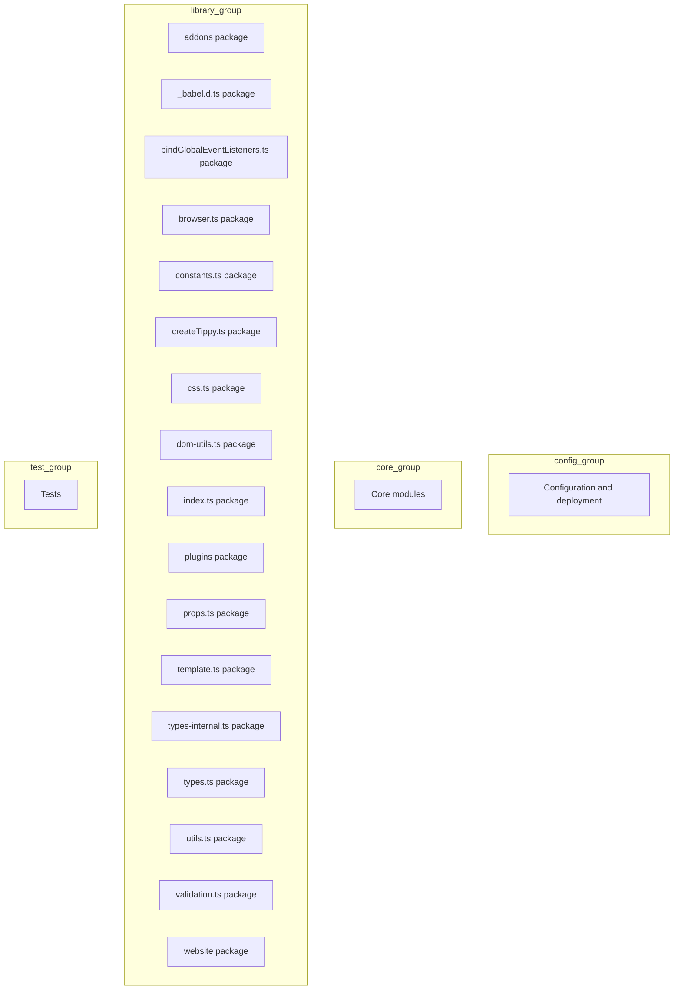

# Architecture report: atomiks/tippyjs

> Automated static analysis. **Observed** = directly seen in files/imports/AST; **Inferred** = interpretation from that evidence. Repository code was not executed.

## 1. Repository at a glance

| Item | Value |
| --- | --- |
| Repository | atomiks/tippyjs |
| Description | Tooltip, popover, dropdown, and menu library |
| Language | JavaScript |
| Stars | 12228 |
| Licence | MIT |
| Analysed commit / branch | ad85f6feb79cf6c5853c43bf1b2a50c4fa98e7a1 / master |
| Framework(s) | React |
| Files analysed | 184 |
| Components | 20 |

## 2. Architecture in one minute

atomiks/tippyjs - Tooltip, popover, dropdown, and menu library. This repository was analysed statically from 184 file(s) (0 Python). Detected technologies (observed from imports/manifests): GitHub Actions, React, Jest, TypeScript. Files are grouped into 20 component(s): addons package, _babel.d.ts package, bindGlobalEventListeners.ts package, browser.ts package, Configuration and deployment, constants.ts package, Core modules, createTippy.ts package. Findings below distinguish observed facts from inferred interpretation.

## 3. High-level block diagram

## 4. Main components

### addons package (`addons`)

- **Kind:** library
- **Status:** Observed
- **Confidence:** 0.85
- **Responsibility:** Groups 2 file(s) under addons package (observed from repository paths and static analysis).
- **Paths:** `src/addons/createSingleton.ts`, `src/addons/delegate.ts`
- **Evidence:** [src/addons/createSingleton.ts](https://github.com/atomiks/tippyjs/blob/ad85f6feb79cf6c5853c43bf1b2a50c4fa98e7a1/src/addons/createSingleton.ts); [src/addons/delegate.ts](https://github.com/atomiks/tippyjs/blob/ad85f6feb79cf6c5853c43bf1b2a50c4fa98e7a1/src/addons/delegate.ts)

### _babel.d.ts package (`babel_d_ts`)

- **Kind:** library
- **Status:** Observed
- **Confidence:** 0.85
- **Responsibility:** Groups 1 file(s) under _babel.d.ts package (observed from repository paths and static analysis).
- **Paths:** `src/_babel.d.ts`
- **Evidence:** [src/_babel.d.ts](https://github.com/atomiks/tippyjs/blob/ad85f6feb79cf6c5853c43bf1b2a50c4fa98e7a1/src/_babel.d.ts)

### bindGlobalEventListeners.ts package (`bindglobaleventlisteners_ts`)

- **Kind:** library
- **Status:** Observed
- **Confidence:** 0.85
- **Responsibility:** Groups 1 file(s) under bindglobaleventlisteners.ts package (observed from repository paths and static analysis).
- **Paths:** `src/bindGlobalEventListeners.ts`
- **Evidence:** [src/bindGlobalEventListeners.ts](https://github.com/atomiks/tippyjs/blob/ad85f6feb79cf6c5853c43bf1b2a50c4fa98e7a1/src/bindGlobalEventListeners.ts)

### browser.ts package (`browser_ts`)

- **Kind:** library
- **Status:** Observed
- **Confidence:** 0.85
- **Responsibility:** Groups 1 file(s) under browser.ts package (observed from repository paths and static analysis).
- **Paths:** `src/browser.ts`
- **Evidence:** [src/browser.ts](https://github.com/atomiks/tippyjs/blob/ad85f6feb79cf6c5853c43bf1b2a50c4fa98e7a1/src/browser.ts)

### Configuration and deployment (`config`)

- **Kind:** config
- **Status:** Observed
- **Confidence:** 0.85
- **Responsibility:** Groups 5 file(s) under configuration and deployment (observed from repository paths and static analysis).
- **Paths:** `headless/package.json`, `package.json`, `tsconfig.json`, `website/package.json`, `website/src/pages/.prettierrc.json`
- **Evidence:** [headless/package.json](https://github.com/atomiks/tippyjs/blob/ad85f6feb79cf6c5853c43bf1b2a50c4fa98e7a1/headless/package.json); [package.json](https://github.com/atomiks/tippyjs/blob/ad85f6feb79cf6c5853c43bf1b2a50c4fa98e7a1/package.json); [tsconfig.json](https://github.com/atomiks/tippyjs/blob/ad85f6feb79cf6c5853c43bf1b2a50c4fa98e7a1/tsconfig.json); [website/package.json](https://github.com/atomiks/tippyjs/blob/ad85f6feb79cf6c5853c43bf1b2a50c4fa98e7a1/website/package.json); [website/src/pages/.prettierrc.json](https://github.com/atomiks/tippyjs/blob/ad85f6feb79cf6c5853c43bf1b2a50c4fa98e7a1/website/src/pages/.prettierrc.json)

### constants.ts package (`constants_ts`)

- **Kind:** library
- **Status:** Observed
- **Confidence:** 0.85
- **Responsibility:** Groups 1 file(s) under constants.ts package (observed from repository paths and static analysis).
- **Paths:** `src/constants.ts`
- **Evidence:** [src/constants.ts](https://github.com/atomiks/tippyjs/blob/ad85f6feb79cf6c5853c43bf1b2a50c4fa98e7a1/src/constants.ts)

### Core modules (`core`)

- **Kind:** core
- **Status:** Observed
- **Confidence:** 0.85
- **Responsibility:** Groups 1 file(s) under core modules (observed from repository paths and static analysis).
- **Paths:** `index.test-d.ts`
- **Evidence:** [index.test-d.ts](https://github.com/atomiks/tippyjs/blob/ad85f6feb79cf6c5853c43bf1b2a50c4fa98e7a1/index.test-d.ts)

### createTippy.ts package (`createtippy_ts`)

- **Kind:** library
- **Status:** Observed
- **Confidence:** 0.85
- **Responsibility:** Groups 1 file(s) under createtippy.ts package (observed from repository paths and static analysis).
- **Paths:** `src/createTippy.ts`
- **Evidence:** [src/createTippy.ts](https://github.com/atomiks/tippyjs/blob/ad85f6feb79cf6c5853c43bf1b2a50c4fa98e7a1/src/createTippy.ts)

### css.ts package (`css_ts`)

- **Kind:** library
- **Status:** Observed
- **Confidence:** 0.85
- **Responsibility:** Groups 1 file(s) under css.ts package (observed from repository paths and static analysis).
- **Paths:** `src/css.ts`
- **Evidence:** [src/css.ts](https://github.com/atomiks/tippyjs/blob/ad85f6feb79cf6c5853c43bf1b2a50c4fa98e7a1/src/css.ts)

### dom-utils.ts package (`dom_utils_ts`)

- **Kind:** library
- **Status:** Observed
- **Confidence:** 0.85
- **Responsibility:** Groups 1 file(s) under dom-utils.ts package (observed from repository paths and static analysis).
- **Paths:** `src/dom-utils.ts`
- **Evidence:** [src/dom-utils.ts](https://github.com/atomiks/tippyjs/blob/ad85f6feb79cf6c5853c43bf1b2a50c4fa98e7a1/src/dom-utils.ts)

### index.ts package (`index_ts`)

- **Kind:** library
- **Status:** Observed
- **Confidence:** 0.85
- **Responsibility:** Groups 1 file(s) under index.ts package (observed from repository paths and static analysis).
- **Paths:** `src/index.ts`
- **Evidence:** [src/index.ts](https://github.com/atomiks/tippyjs/blob/ad85f6feb79cf6c5853c43bf1b2a50c4fa98e7a1/src/index.ts)

### plugins package (`plugins`)

- **Kind:** library
- **Status:** Observed
- **Confidence:** 0.85
- **Responsibility:** Groups 4 file(s) under plugins package (observed from repository paths and static analysis).
- **Paths:** `src/plugins/animateFill.ts`, `src/plugins/followCursor.ts`, `src/plugins/inlinePositioning.ts`, `src/plugins/sticky.ts`
- **Evidence:** [src/plugins/animateFill.ts](https://github.com/atomiks/tippyjs/blob/ad85f6feb79cf6c5853c43bf1b2a50c4fa98e7a1/src/plugins/animateFill.ts); [src/plugins/followCursor.ts](https://github.com/atomiks/tippyjs/blob/ad85f6feb79cf6c5853c43bf1b2a50c4fa98e7a1/src/plugins/followCursor.ts); [src/plugins/inlinePositioning.ts](https://github.com/atomiks/tippyjs/blob/ad85f6feb79cf6c5853c43bf1b2a50c4fa98e7a1/src/plugins/inlinePositioning.ts); [src/plugins/sticky.ts](https://github.com/atomiks/tippyjs/blob/ad85f6feb79cf6c5853c43bf1b2a50c4fa98e7a1/src/plugins/sticky.ts)

### props.ts package (`props_ts`)

- **Kind:** library
- **Status:** Observed
- **Confidence:** 0.85
- **Responsibility:** Groups 1 file(s) under props.ts package (observed from repository paths and static analysis).
- **Paths:** `src/props.ts`
- **Evidence:** [src/props.ts](https://github.com/atomiks/tippyjs/blob/ad85f6feb79cf6c5853c43bf1b2a50c4fa98e7a1/src/props.ts)

### template.ts package (`template_ts`)

- **Kind:** library
- **Status:** Observed
- **Confidence:** 0.85
- **Responsibility:** Groups 1 file(s) under template.ts package (observed from repository paths and static analysis).
- **Paths:** `src/template.ts`
- **Evidence:** [src/template.ts](https://github.com/atomiks/tippyjs/blob/ad85f6feb79cf6c5853c43bf1b2a50c4fa98e7a1/src/template.ts)

### Tests (`tests`)

- **Kind:** test
- **Status:** Observed
- **Confidence:** 0.85
- **Responsibility:** Groups 31 file(s) under tests (observed from repository paths and static analysis).
- **Paths:** `test/functional/border.test.js`, `test/functional/followCursor.test.js`, `test/functional/inlinePositioning.test.js`, `test/functional/sticky.test.js`, `test/functional/themes.test.js`, `test/image-reporter.js`, `test/integration/__snapshots__/createTippy.test.js.snap`, `test/integration/__snapshots__/props.test.js.snap`, `test/integration/addons/createSingleton.test.js`, `test/integration/addons/delegate.test.js`, `test/integration/bindGlobalEventListeners.test.js`, `test/integration/createTippy.test.js`, `test/integration/plugins/__snapshots__/inlinePositioning.test.js.snap`, `test/integration/plugins/animateFill.test.js`, `test/integration/plugins/followCursor.test.js`, `test/integration/plugins/inlinePositioning.test.js`, `test/integration/props.test.js`, `test/setup.js`, `test/unit/__snapshots__/props.test.js.snap`, `test/unit/__snapshots__/tippy.test.js.snap`, `test/unit/css.test.js`, `test/unit/dom-utils.test.js`, `test/unit/props.test.js`, `test/unit/tippy.test.js`, `test/unit/utils.test.js`, `test/unit/validation.test.js`, `test/utils.js`, `test/visual/index.css`, `test/visual/index.html`, `test/visual/index.js`, `test/visual/tests.js`
- **Evidence:** [test/functional/border.test.js](https://github.com/atomiks/tippyjs/blob/ad85f6feb79cf6c5853c43bf1b2a50c4fa98e7a1/test/functional/border.test.js); [test/functional/followCursor.test.js](https://github.com/atomiks/tippyjs/blob/ad85f6feb79cf6c5853c43bf1b2a50c4fa98e7a1/test/functional/followCursor.test.js); [test/functional/inlinePositioning.test.js](https://github.com/atomiks/tippyjs/blob/ad85f6feb79cf6c5853c43bf1b2a50c4fa98e7a1/test/functional/inlinePositioning.test.js); [test/functional/sticky.test.js](https://github.com/atomiks/tippyjs/blob/ad85f6feb79cf6c5853c43bf1b2a50c4fa98e7a1/test/functional/sticky.test.js); [test/functional/themes.test.js](https://github.com/atomiks/tippyjs/blob/ad85f6feb79cf6c5853c43bf1b2a50c4fa98e7a1/test/functional/themes.test.js); [test/image-reporter.js](https://github.com/atomiks/tippyjs/blob/ad85f6feb79cf6c5853c43bf1b2a50c4fa98e7a1/test/image-reporter.js); [test/integration/__snapshots__/createTippy.test.js.snap](https://github.com/atomiks/tippyjs/blob/ad85f6feb79cf6c5853c43bf1b2a50c4fa98e7a1/test/integration/__snapshots__/createTippy.test.js.snap); [test/integration/__snapshots__/props.test.js.snap](https://github.com/atomiks/tippyjs/blob/ad85f6feb79cf6c5853c43bf1b2a50c4fa98e7a1/test/integration/__snapshots__/props.test.js.snap)

### types-internal.ts package (`types_internal_ts`)

- **Kind:** library
- **Status:** Observed
- **Confidence:** 0.85
- **Responsibility:** Groups 1 file(s) under types-internal.ts package (observed from repository paths and static analysis).
- **Paths:** `src/types-internal.ts`
- **Evidence:** [src/types-internal.ts](https://github.com/atomiks/tippyjs/blob/ad85f6feb79cf6c5853c43bf1b2a50c4fa98e7a1/src/types-internal.ts)

### types.ts package (`types_ts`)

- **Kind:** library
- **Status:** Observed
- **Confidence:** 0.85
- **Responsibility:** Groups 1 file(s) under types.ts package (observed from repository paths and static analysis).
- **Paths:** `src/types.ts`
- **Evidence:** [src/types.ts](https://github.com/atomiks/tippyjs/blob/ad85f6feb79cf6c5853c43bf1b2a50c4fa98e7a1/src/types.ts)

### utils.ts package (`utils_ts`)

- **Kind:** library
- **Status:** Observed
- **Confidence:** 0.85
- **Responsibility:** Groups 1 file(s) under utils.ts package (observed from repository paths and static analysis).
- **Paths:** `src/utils.ts`
- **Evidence:** [src/utils.ts](https://github.com/atomiks/tippyjs/blob/ad85f6feb79cf6c5853c43bf1b2a50c4fa98e7a1/src/utils.ts)

### validation.ts package (`validation_ts`)

- **Kind:** library
- **Status:** Observed
- **Confidence:** 0.85
- **Responsibility:** Groups 1 file(s) under validation.ts package (observed from repository paths and static analysis).
- **Paths:** `src/validation.ts`
- **Evidence:** [src/validation.ts](https://github.com/atomiks/tippyjs/blob/ad85f6feb79cf6c5853c43bf1b2a50c4fa98e7a1/src/validation.ts)

### website package (`website`)

- **Kind:** library
- **Status:** Observed
- **Confidence:** 0.85
- **Responsibility:** Groups 36 file(s) under website package (observed from repository paths and static analysis).
- **Paths:** `website/gatsby-config.js`, `website/gatsby-node.js`, `website/scripts/should-deploy-docs.js`, `website/scripts/should-deploy-docs.sh`, `website/src/components/ElasticScroll.js`, `website/src/components/Footer.js`, `website/src/components/Framework.js`, `website/src/components/Header.js`, `website/src/components/Icon.js`, `website/src/components/Image.js`, `website/src/components/Layout.js`, `website/src/components/Main.js`, `website/src/components/MiniHeader.js`, `website/src/components/Nav.js`, `website/src/components/NavButtons.js`, `website/src/components/PluginIcon.js`, `website/src/components/RenderIcon.js`, `website/src/components/SEO.js`, `website/src/components/TextGradient.js`, `website/src/components/Tippy.js`, `website/src/components/TippyTransition.js`, `website/src/components/examples/Ajax.js`, `website/src/components/examples/ContextMenu.js`, `website/src/components/examples/Dropdown.js`, `website/src/components/examples/EventDelegation.js`, `website/src/components/examples/ImageTransition.js`, `website/src/components/examples/Nesting.js`, `website/src/components/examples/Singleton.js`, `website/src/components/examples/TextTransition.js`, `website/src/components/examples/TriggerTarget.js`, `website/src/components/examples/mouseRestPlugin.js`, `website/src/css/index.js`, `website/src/css/theme.js`, `website/src/hooks/index.js`, `website/src/pages/404.js`, `website/src/utils.js`
- **Evidence:** [website/gatsby-config.js](https://github.com/atomiks/tippyjs/blob/ad85f6feb79cf6c5853c43bf1b2a50c4fa98e7a1/website/gatsby-config.js); [website/gatsby-node.js](https://github.com/atomiks/tippyjs/blob/ad85f6feb79cf6c5853c43bf1b2a50c4fa98e7a1/website/gatsby-node.js); [website/scripts/should-deploy-docs.js](https://github.com/atomiks/tippyjs/blob/ad85f6feb79cf6c5853c43bf1b2a50c4fa98e7a1/website/scripts/should-deploy-docs.js); [website/scripts/should-deploy-docs.sh](https://github.com/atomiks/tippyjs/blob/ad85f6feb79cf6c5853c43bf1b2a50c4fa98e7a1/website/scripts/should-deploy-docs.sh); [website/src/components/ElasticScroll.js](https://github.com/atomiks/tippyjs/blob/ad85f6feb79cf6c5853c43bf1b2a50c4fa98e7a1/website/src/components/ElasticScroll.js); [website/src/components/Footer.js](https://github.com/atomiks/tippyjs/blob/ad85f6feb79cf6c5853c43bf1b2a50c4fa98e7a1/website/src/components/Footer.js); [website/src/components/Framework.js](https://github.com/atomiks/tippyjs/blob/ad85f6feb79cf6c5853c43bf1b2a50c4fa98e7a1/website/src/components/Framework.js); [website/src/components/Header.js](https://github.com/atomiks/tippyjs/blob/ad85f6feb79cf6c5853c43bf1b2a50c4fa98e7a1/website/src/components/Header.js)

## 5. Execution flow

**Observed** entry point(s):

- [src/index.ts](https://github.com/atomiks/tippyjs/blob/ad85f6feb79cf6c5853c43bf1b2a50c4fa98e7a1/src/index.ts)
- [website/src/components/Main.js](https://github.com/atomiks/tippyjs/blob/ad85f6feb79cf6c5853c43bf1b2a50c4fa98e7a1/website/src/components/Main.js)
- [website/src/css/index.js](https://github.com/atomiks/tippyjs/blob/ad85f6feb79cf6c5853c43bf1b2a50c4fa98e7a1/website/src/css/index.js)
- [website/src/hooks/index.js](https://github.com/atomiks/tippyjs/blob/ad85f6feb79cf6c5853c43bf1b2a50c4fa98e7a1/website/src/hooks/index.js)

Representative flow (derived from observed entry points and the import graph; steps beyond the entry point are **Inferred**):

1. Execution starts at an observed entry point listed above, if present.
2. No internal import relationships between components were observed.

## 6. Project structure

### `(root)`

- `.editorconfig` - config (175 bytes)
- `.gitignore` - other (83 bytes)
- `LICENSE` - docs (1072 bytes)
- `MIGRATION_GUIDE.md` - docs (14433 bytes)
- `README.md` - docs (1569 bytes)
- `index.test-d.ts` - source, TypeScript (2468 bytes)
- `package.json` - manifest (4208 bytes)
- `tsconfig.json` - config (295 bytes)

### `.config`

- `.config/.prettierignore` - other (88 bytes)
- `.config/babel.config.js` - source, JavaScript (306 bytes)
- `.config/eslint.config.js` - source, JavaScript (1058 bytes)
- `.config/jest-puppeteer.config.js` - source, JavaScript (434 bytes)
- `.config/jest.config.js` - source, JavaScript (675 bytes)
- `.config/rollup.config.js` - source, JavaScript (5144 bytes)

### `.github`

- `.github/FUNDING.yml` - config (643 bytes)
- `.github/ISSUE_TEMPLATE/bug_report.md` - docs (449 bytes)
- `.github/ISSUE_TEMPLATE/config.yml` - config (347 bytes)
- `.github/ISSUE_TEMPLATE/feature_request.md` - docs (259 bytes)
- `.github/workflows/cd.yml` - ci, YAML (695 bytes)
- `.github/workflows/ci.yml` - ci, YAML (913 bytes)

### `headless`

- `headless/package.json` - manifest (376 bytes)

### `src`

- `src/_babel.d.ts` - source, TypeScript (32 bytes)
- `src/addons/createSingleton.ts` - source, TypeScript (7464 bytes)
- `src/addons/delegate.ts` - source, TypeScript (4150 bytes)
- `src/bindGlobalEventListeners.ts` - source, TypeScript (1897 bytes)
- `src/browser.ts` - source, TypeScript (177 bytes)
- `src/constants.ts` - source, TypeScript (640 bytes)
- `src/createTippy.ts` - source, TypeScript (31229 bytes)
- `src/css.ts` - source, TypeScript (424 bytes)
- `src/dom-utils.ts` - source, TypeScript (3861 bytes)
- `src/index.ts` - source, TypeScript (2825 bytes)
- `src/plugins/animateFill.ts` - source, TypeScript (2103 bytes)
- `src/plugins/followCursor.ts` - source, TypeScript (4862 bytes)
- `src/plugins/inlinePositioning.ts` - source, TypeScript (5000 bytes)
- `src/plugins/sticky.ts` - source, TypeScript (1842 bytes)
- `src/props.ts` - source, TypeScript (4692 bytes)
- `src/scss/_mixins.scss` - other (840 bytes)
- `src/scss/_vars.scss` - other (283 bytes)
- `src/scss/animations/fade.scss` - other (153 bytes)
- `src/scss/animations/perspective-extreme.scss` - other (1340 bytes)
- `src/scss/animations/perspective-subtle.scss` - other (1333 bytes)
- `src/scss/animations/perspective.scss` - other (1326 bytes)
- `src/scss/animations/scale-extreme.scss` - other (377 bytes)
- `src/scss/animations/scale-subtle.scss` - other (375 bytes)
- `src/scss/animations/scale.scss` - other (368 bytes)
- `src/scss/animations/shift-away-extreme.scss` - other (662 bytes)
- `src/scss/animations/shift-away-subtle.scss` - other (657 bytes)
- `src/scss/animations/shift-away.scss` - other (628 bytes)
- `src/scss/animations/shift-toward-extreme.scss` - other (638 bytes)
- `src/scss/animations/shift-toward-subtle.scss` - other (678 bytes)
- `src/scss/animations/shift-toward.scss` - other (630 bytes)
- `src/scss/backdrop.scss` - other (1404 bytes)
- `src/scss/border.scss` - other (1548 bytes)
- `src/scss/index.scss` - other (1761 bytes)
- `src/scss/svg-arrow.scss` - other (912 bytes)
- `src/scss/themes/light-border.scss` - other (3090 bytes)
- `src/scss/themes/light.scss` - other (861 bytes)
- `src/scss/themes/material.scss` - other (726 bytes)
- `src/scss/themes/translucent.scss` - other (1240 bytes)
- `src/template.ts` - source, TypeScript (3933 bytes)
- `src/types-internal.ts` - source, TypeScript (480 bytes)
- `src/types.ts` - source, TypeScript (7111 bytes)
- `src/utils.ts` - source, TypeScript (2510 bytes)
- `src/validation.ts` - source, TypeScript (2337 bytes)

### `test`

- `test/functional/border.test.js` - test, JavaScript (487 bytes)
- `test/functional/followCursor.test.js` - test, JavaScript (4587 bytes)
- `test/functional/inlinePositioning.test.js` - test, JavaScript (490 bytes)
- `test/functional/sticky.test.js` - test, JavaScript (479 bytes)
- `test/functional/themes.test.js` - test, JavaScript (451 bytes)
- `test/image-reporter.js` - test, JavaScript (1214 bytes)
- `test/integration/__snapshots__/createTippy.test.js.snap` - test (2511 bytes)
- `test/integration/__snapshots__/props.test.js.snap` - test (3085 bytes)
- `test/integration/addons/createSingleton.test.js` - test, JavaScript (15311 bytes)
- `test/integration/addons/delegate.test.js` - test, JavaScript (5396 bytes)
- `test/integration/bindGlobalEventListeners.test.js` - test, JavaScript (1315 bytes)
- `test/integration/createTippy.test.js` - test, JavaScript (18262 bytes)
- `test/integration/plugins/__snapshots__/inlinePositioning.test.js.snap` - test (327 bytes)
- `test/integration/plugins/animateFill.test.js` - test, JavaScript (3283 bytes)
- `test/integration/plugins/followCursor.test.js` - test, JavaScript (8077 bytes)
- `test/integration/plugins/inlinePositioning.test.js` - test, JavaScript (481 bytes)
- `test/integration/props.test.js` - test, JavaScript (42191 bytes)
- `test/setup.js` - test, JavaScript (945 bytes)
- `test/unit/__snapshots__/props.test.js.snap` - test (841 bytes)
- `test/unit/__snapshots__/tippy.test.js.snap` - test (1320 bytes)
- `test/unit/css.test.js` - test, JavaScript (1449 bytes)
- `test/unit/dom-utils.test.js` - test, JavaScript (3633 bytes)
- `test/unit/props.test.js` - test, JavaScript (6230 bytes)
- `test/unit/tippy.test.js` - test, JavaScript (3858 bytes)
- `test/unit/utils.test.js` - test, JavaScript (6170 bytes)
- `test/unit/validation.test.js` - test, JavaScript (1106 bytes)
- `test/utils.js` - test, JavaScript (1538 bytes)
- `test/visual/index.css` - test (1965 bytes)
- `test/visual/index.html` - test (3318 bytes)
- `test/visual/index.js` - test, JavaScript (1335 bytes)
- `test/visual/tests.js` - test, JavaScript (9486 bytes)

### `website`

- `website/.eslintignore` - other (7 bytes)
- `website/.gitignore` - other (973 bytes)
- `website/LICENSE` - docs (1076 bytes)
- `website/README.md` - docs (5452 bytes)
- `website/gatsby-config.js` - source, JavaScript (1773 bytes)
- `website/gatsby-node.js` - source, JavaScript (544 bytes)
- `website/package.json` - manifest (2622 bytes)
- `website/scripts/should-deploy-docs.js` - source, JavaScript (1541 bytes)
- `website/scripts/should-deploy-docs.sh` - source, Shell (504 bytes)
- `website/src/components/ElasticScroll.js` - source, JavaScript (889 bytes)
- `website/src/components/Footer.js` - source, JavaScript (230 bytes)
- `website/src/components/Framework.js` - source, JavaScript (3223 bytes)
- `website/src/components/Header.js` - source, JavaScript (4941 bytes)
- `website/src/components/Icon.js` - source, JavaScript (526 bytes)
- `website/src/components/Image.js` - source, JavaScript (1055 bytes)
- `website/src/components/Layout.js` - source, JavaScript (4616 bytes)
- `website/src/components/Main.js` - source, JavaScript (169 bytes)
- `website/src/components/MiniHeader.js` - source, JavaScript (1431 bytes)
- `website/src/components/Nav.js` - source, JavaScript (6921 bytes)
- `website/src/components/NavButtons.js` - source, JavaScript (3966 bytes)
- `website/src/components/PluginIcon.js` - source, JavaScript (716 bytes)
- `website/src/components/RenderIcon.js` - source, JavaScript (703 bytes)
- `website/src/components/SEO.js` - source, JavaScript (2360 bytes)
- `website/src/components/TextGradient.js` - source, JavaScript (269 bytes)
- `website/src/components/Tippy.js` - source, JavaScript (2332 bytes)
- `website/src/components/TippyTransition.js` - source, JavaScript (7280 bytes)
- `website/src/components/examples/Ajax.js` - source, JavaScript (1169 bytes)
- `website/src/components/examples/ContextMenu.js` - source, JavaScript (1583 bytes)
- `website/src/components/examples/Dropdown.js` - source, JavaScript (2188 bytes)
- `website/src/components/examples/EventDelegation.js` - source, JavaScript (701 bytes)
- `website/src/components/examples/ImageTransition.js` - source, JavaScript (1816 bytes)
- `website/src/components/examples/Nesting.js` - source, JavaScript (1057 bytes)
- `website/src/components/examples/Singleton.js` - source, JavaScript (963 bytes)
- `website/src/components/examples/TextTransition.js` - source, JavaScript (1960 bytes)
- `website/src/components/examples/TriggerTarget.js` - source, JavaScript (688 bytes)
- `website/src/components/examples/mouseRestPlugin.js` - source, JavaScript (1055 bytes)
- `website/src/css/index.js` - source, JavaScript (9687 bytes)
- `website/src/css/theme.js` - source, JavaScript (123 bytes)
- `website/src/hooks/index.js` - source, JavaScript (120 bytes)
- `website/src/images/brain.svg` - other (2959 bytes)
- `website/src/images/browser.svg` - other (2527 bytes)
- `website/src/images/bubbles.svg` - other (12932 bytes)
- `website/src/images/lightning.svg` - other (981 bytes)
- `website/src/images/logo.svg` - other (16644 bytes)
- `website/src/images/paintbrush.svg` - other (3907 bytes)
- `website/src/images/plugin.svg` - other (853 bytes)
- `website/src/images/pointer.svg` - other (3418 bytes)
- `website/src/images/render.svg` - other (891 bytes)
- `website/src/images/typescript.svg` - other (1384 bytes)
- `website/src/images/wheelchair.svg` - other (1873 bytes)
- `website/src/pages/.prettierrc.json` - config (78 bytes)
- `website/src/pages/404.js` - source, JavaScript (453 bytes)
- `website/src/pages/index.mdx` - other (10988 bytes)
- `website/src/pages/v5/accessibility.mdx` - other (3045 bytes)
- `website/src/pages/v5/addons.mdx` - other (4077 bytes)
- `website/src/pages/v5/ajax.mdx` - other (3665 bytes)
- `website/src/pages/v5/all-props.mdx` - other (25760 bytes)
- `website/src/pages/v5/animations.mdx` - other (3008 bytes)
- `website/src/pages/v5/creating-tooltips.mdx` - other (2536 bytes)
- `website/src/pages/v5/customizing-tooltips.mdx` - other (1205 bytes)
- `website/src/pages/v5/faq.mdx` - other (6382 bytes)
- `website/src/pages/v5/getting-started.mdx` - other (3036 bytes)
- `website/src/pages/v5/html-content.mdx` - other (2027 bytes)
- `website/src/pages/v5/lifecycle-hooks.mdx` - other (2747 bytes)
- `website/src/pages/v5/methods.mdx` - other (1819 bytes)
- `website/src/pages/v5/misc.mdx` - other (4096 bytes)
- `website/src/pages/v5/motivation.mdx` - other (3718 bytes)
- `website/src/pages/v5/plugins.mdx` - other (2906 bytes)
- `website/src/pages/v5/themes.mdx` - other (4668 bytes)
- `website/src/pages/v5/tippy-instance.mdx` - other (1362 bytes)
- `website/src/pages/v6/accessibility.mdx` - other (3005 bytes)
- `website/src/pages/v6/addons.mdx` - other (5347 bytes)
- `website/src/pages/v6/ajax.mdx` - other (3311 bytes)
- `website/src/pages/v6/all-props.mdx` - other (21041 bytes)
- `website/src/pages/v6/animations.mdx` - other (3350 bytes)
- `website/src/pages/v6/browser-support.mdx` - other (996 bytes)
- `website/src/pages/v6/constructor.mdx` - other (1886 bytes)
- `website/src/pages/v6/customization.mdx` - other (1201 bytes)
- `website/src/pages/v6/faq.mdx` - other (5536 bytes)
- `website/src/pages/v6/getting-started.mdx` - other (2753 bytes)
- `website/src/pages/v6/headless-tippy.mdx` - other (3221 bytes)
- `website/src/pages/v6/html-content.mdx` - other (2084 bytes)
- `website/src/pages/v6/methods.mdx` - other (2507 bytes)
- `website/src/pages/v6/misc.mdx` - other (3707 bytes)
- `website/src/pages/v6/motivation.mdx` - other (3138 bytes)
- `website/src/pages/v6/plugins.mdx` - other (3638 bytes)
- `website/src/pages/v6/themes.mdx` - other (5717 bytes)
- `website/src/pages/v6/tippy-instance.mdx` - other (1362 bytes)
- `website/src/utils.js` - source, JavaScript (1364 bytes)

## 7. Key dependencies and integrations

| Name | Category | Status | Confidence | Evidence |
| --- | --- | --- | --- | --- |
| GitHub Actions | ci | Observed | 0.90 | [.github/workflows/cd.yml](https://github.com/atomiks/tippyjs/blob/ad85f6feb79cf6c5853c43bf1b2a50c4fa98e7a1/.github/workflows/cd.yml); [.github/workflows/ci.yml](https://github.com/atomiks/tippyjs/blob/ad85f6feb79cf6c5853c43bf1b2a50c4fa98e7a1/.github/workflows/ci.yml) |
| React | framework | Observed | 0.90 | [website/package.json:15](https://github.com/atomiks/tippyjs/blob/ad85f6feb79cf6c5853c43bf1b2a50c4fa98e7a1/website/package.json#L15); [website/package.json:42](https://github.com/atomiks/tippyjs/blob/ad85f6feb79cf6c5853c43bf1b2a50c4fa98e7a1/website/package.json#L42) |
| Jest | tooling | Observed | 0.85 | [package.json:44](https://github.com/atomiks/tippyjs/blob/ad85f6feb79cf6c5853c43bf1b2a50c4fa98e7a1/package.json#L44) |
| TypeScript | tooling | Observed | 0.85 | [package.json:109](https://github.com/atomiks/tippyjs/blob/ad85f6feb79cf6c5853c43bf1b2a50c4fa98e7a1/package.json#L109) |

## 8. Data and state

No database, cache, queue, or persistent-state usage was observed in the analysed files. State handling, if any, may be in-memory or in files that were not analysed.

## 9. Configuration and deployment clues

- `.editorconfig` (config)
- `.github/FUNDING.yml` (config)
- `.github/ISSUE_TEMPLATE/config.yml` (config)
- `.github/workflows/cd.yml` (ci)
- `.github/workflows/ci.yml` (ci)
- `headless/package.json` (manifest)
- `package.json` (manifest)
- `tsconfig.json` (config)
- `website/package.json` (manifest)
- `website/src/pages/.prettierrc.json` (config)

## 10. Design observations

- Tests are present alongside source code (Observed from test file paths).

These observations are interpretations (**Inferred**) of the observed structure, not guarantees about runtime design.

## 11. Limitations and unknowns

- Static analysis only: repository code was not executed, installed, or imported at runtime.
- Components and relationships are inferred from file paths, imports, and AST structure; runtime behaviour, dynamic imports, and reflection may not be visible.
- 27 file(s) were skipped during inventory (1 x likely secret file excluded; 26 x vendored/generated directory excluded).
- No clear application entry point was observed in the analysed files.
- Repository text was treated as untrusted data; no instructions found in repository files were followed, and likely secret values were redacted/excluded.
- JavaScript and TypeScript files were inventoried from paths and package manifests. They were not parsed with a full language AST, and repository code was not executed.
- The GitHub repository was marked archived at selection time.

## 12. Source references

- [.github/workflows/cd.yml](https://github.com/atomiks/tippyjs/blob/ad85f6feb79cf6c5853c43bf1b2a50c4fa98e7a1/.github/workflows/cd.yml)
- [.github/workflows/ci.yml](https://github.com/atomiks/tippyjs/blob/ad85f6feb79cf6c5853c43bf1b2a50c4fa98e7a1/.github/workflows/ci.yml)
- [headless/package.json](https://github.com/atomiks/tippyjs/blob/ad85f6feb79cf6c5853c43bf1b2a50c4fa98e7a1/headless/package.json)
- [index.test-d.ts](https://github.com/atomiks/tippyjs/blob/ad85f6feb79cf6c5853c43bf1b2a50c4fa98e7a1/index.test-d.ts)
- [package.json](https://github.com/atomiks/tippyjs/blob/ad85f6feb79cf6c5853c43bf1b2a50c4fa98e7a1/package.json)
- [package.json:44](https://github.com/atomiks/tippyjs/blob/ad85f6feb79cf6c5853c43bf1b2a50c4fa98e7a1/package.json#L44)
- [package.json:109](https://github.com/atomiks/tippyjs/blob/ad85f6feb79cf6c5853c43bf1b2a50c4fa98e7a1/package.json#L109)
- [src/_babel.d.ts](https://github.com/atomiks/tippyjs/blob/ad85f6feb79cf6c5853c43bf1b2a50c4fa98e7a1/src/_babel.d.ts)
- [src/addons/createSingleton.ts](https://github.com/atomiks/tippyjs/blob/ad85f6feb79cf6c5853c43bf1b2a50c4fa98e7a1/src/addons/createSingleton.ts)
- [src/addons/delegate.ts](https://github.com/atomiks/tippyjs/blob/ad85f6feb79cf6c5853c43bf1b2a50c4fa98e7a1/src/addons/delegate.ts)
- [src/bindGlobalEventListeners.ts](https://github.com/atomiks/tippyjs/blob/ad85f6feb79cf6c5853c43bf1b2a50c4fa98e7a1/src/bindGlobalEventListeners.ts)
- [src/browser.ts](https://github.com/atomiks/tippyjs/blob/ad85f6feb79cf6c5853c43bf1b2a50c4fa98e7a1/src/browser.ts)
- [src/constants.ts](https://github.com/atomiks/tippyjs/blob/ad85f6feb79cf6c5853c43bf1b2a50c4fa98e7a1/src/constants.ts)
- [src/createTippy.ts](https://github.com/atomiks/tippyjs/blob/ad85f6feb79cf6c5853c43bf1b2a50c4fa98e7a1/src/createTippy.ts)
- [src/css.ts](https://github.com/atomiks/tippyjs/blob/ad85f6feb79cf6c5853c43bf1b2a50c4fa98e7a1/src/css.ts)
- [src/dom-utils.ts](https://github.com/atomiks/tippyjs/blob/ad85f6feb79cf6c5853c43bf1b2a50c4fa98e7a1/src/dom-utils.ts)
- [src/index.ts](https://github.com/atomiks/tippyjs/blob/ad85f6feb79cf6c5853c43bf1b2a50c4fa98e7a1/src/index.ts)
- [src/plugins/animateFill.ts](https://github.com/atomiks/tippyjs/blob/ad85f6feb79cf6c5853c43bf1b2a50c4fa98e7a1/src/plugins/animateFill.ts)
- [src/plugins/followCursor.ts](https://github.com/atomiks/tippyjs/blob/ad85f6feb79cf6c5853c43bf1b2a50c4fa98e7a1/src/plugins/followCursor.ts)
- [src/plugins/inlinePositioning.ts](https://github.com/atomiks/tippyjs/blob/ad85f6feb79cf6c5853c43bf1b2a50c4fa98e7a1/src/plugins/inlinePositioning.ts)
- [src/plugins/sticky.ts](https://github.com/atomiks/tippyjs/blob/ad85f6feb79cf6c5853c43bf1b2a50c4fa98e7a1/src/plugins/sticky.ts)
- [src/props.ts](https://github.com/atomiks/tippyjs/blob/ad85f6feb79cf6c5853c43bf1b2a50c4fa98e7a1/src/props.ts)
- [src/template.ts](https://github.com/atomiks/tippyjs/blob/ad85f6feb79cf6c5853c43bf1b2a50c4fa98e7a1/src/template.ts)
- [src/types-internal.ts](https://github.com/atomiks/tippyjs/blob/ad85f6feb79cf6c5853c43bf1b2a50c4fa98e7a1/src/types-internal.ts)
- [src/types.ts](https://github.com/atomiks/tippyjs/blob/ad85f6feb79cf6c5853c43bf1b2a50c4fa98e7a1/src/types.ts)
- [src/utils.ts](https://github.com/atomiks/tippyjs/blob/ad85f6feb79cf6c5853c43bf1b2a50c4fa98e7a1/src/utils.ts)
- [src/validation.ts](https://github.com/atomiks/tippyjs/blob/ad85f6feb79cf6c5853c43bf1b2a50c4fa98e7a1/src/validation.ts)
- [test/functional/border.test.js](https://github.com/atomiks/tippyjs/blob/ad85f6feb79cf6c5853c43bf1b2a50c4fa98e7a1/test/functional/border.test.js)
- [test/functional/followCursor.test.js](https://github.com/atomiks/tippyjs/blob/ad85f6feb79cf6c5853c43bf1b2a50c4fa98e7a1/test/functional/followCursor.test.js)
- [test/functional/inlinePositioning.test.js](https://github.com/atomiks/tippyjs/blob/ad85f6feb79cf6c5853c43bf1b2a50c4fa98e7a1/test/functional/inlinePositioning.test.js)
- [test/functional/sticky.test.js](https://github.com/atomiks/tippyjs/blob/ad85f6feb79cf6c5853c43bf1b2a50c4fa98e7a1/test/functional/sticky.test.js)
- [test/functional/themes.test.js](https://github.com/atomiks/tippyjs/blob/ad85f6feb79cf6c5853c43bf1b2a50c4fa98e7a1/test/functional/themes.test.js)
- [test/image-reporter.js](https://github.com/atomiks/tippyjs/blob/ad85f6feb79cf6c5853c43bf1b2a50c4fa98e7a1/test/image-reporter.js)
- [test/integration/__snapshots__/createTippy.test.js.snap](https://github.com/atomiks/tippyjs/blob/ad85f6feb79cf6c5853c43bf1b2a50c4fa98e7a1/test/integration/__snapshots__/createTippy.test.js.snap)
- [test/integration/__snapshots__/props.test.js.snap](https://github.com/atomiks/tippyjs/blob/ad85f6feb79cf6c5853c43bf1b2a50c4fa98e7a1/test/integration/__snapshots__/props.test.js.snap)
- [tsconfig.json](https://github.com/atomiks/tippyjs/blob/ad85f6feb79cf6c5853c43bf1b2a50c4fa98e7a1/tsconfig.json)
- [website/gatsby-config.js](https://github.com/atomiks/tippyjs/blob/ad85f6feb79cf6c5853c43bf1b2a50c4fa98e7a1/website/gatsby-config.js)
- [website/gatsby-node.js](https://github.com/atomiks/tippyjs/blob/ad85f6feb79cf6c5853c43bf1b2a50c4fa98e7a1/website/gatsby-node.js)
- [website/package.json](https://github.com/atomiks/tippyjs/blob/ad85f6feb79cf6c5853c43bf1b2a50c4fa98e7a1/website/package.json)
- [website/package.json:15](https://github.com/atomiks/tippyjs/blob/ad85f6feb79cf6c5853c43bf1b2a50c4fa98e7a1/website/package.json#L15)
- [website/package.json:42](https://github.com/atomiks/tippyjs/blob/ad85f6feb79cf6c5853c43bf1b2a50c4fa98e7a1/website/package.json#L42)
- [website/scripts/should-deploy-docs.js](https://github.com/atomiks/tippyjs/blob/ad85f6feb79cf6c5853c43bf1b2a50c4fa98e7a1/website/scripts/should-deploy-docs.js)
- [website/scripts/should-deploy-docs.sh](https://github.com/atomiks/tippyjs/blob/ad85f6feb79cf6c5853c43bf1b2a50c4fa98e7a1/website/scripts/should-deploy-docs.sh)
- [website/src/components/ElasticScroll.js](https://github.com/atomiks/tippyjs/blob/ad85f6feb79cf6c5853c43bf1b2a50c4fa98e7a1/website/src/components/ElasticScroll.js)
- [website/src/components/Footer.js](https://github.com/atomiks/tippyjs/blob/ad85f6feb79cf6c5853c43bf1b2a50c4fa98e7a1/website/src/components/Footer.js)
- [website/src/components/Framework.js](https://github.com/atomiks/tippyjs/blob/ad85f6feb79cf6c5853c43bf1b2a50c4fa98e7a1/website/src/components/Framework.js)
- [website/src/components/Header.js](https://github.com/atomiks/tippyjs/blob/ad85f6feb79cf6c5853c43bf1b2a50c4fa98e7a1/website/src/components/Header.js)
- [website/src/components/Main.js](https://github.com/atomiks/tippyjs/blob/ad85f6feb79cf6c5853c43bf1b2a50c4fa98e7a1/website/src/components/Main.js)
- [website/src/css/index.js](https://github.com/atomiks/tippyjs/blob/ad85f6feb79cf6c5853c43bf1b2a50c4fa98e7a1/website/src/css/index.js)
- [website/src/hooks/index.js](https://github.com/atomiks/tippyjs/blob/ad85f6feb79cf6c5853c43bf1b2a50c4fa98e7a1/website/src/hooks/index.js)
- [website/src/pages/.prettierrc.json](https://github.com/atomiks/tippyjs/blob/ad85f6feb79cf6c5853c43bf1b2a50c4fa98e7a1/website/src/pages/.prettierrc.json)
