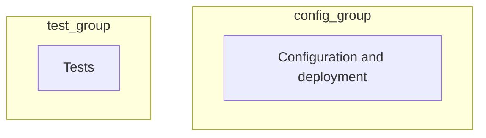

# Architecture report: auchenberg/volkswagen

> Automated static analysis. **Observed** = directly seen in files/imports/AST; **Inferred** = interpretation from that evidence. Repository code was not executed.

## 1. Repository at a glance

| Item | Value |
| --- | --- |
| Repository | auchenberg/volkswagen |
| Description | :see_no_evil: Volkswagen detects when your tests are being run in a CI server, and makes them pass. |
| Language | JavaScript |
| Stars | 15467 |
| Licence | MIT |
| Analysed commit / branch | ae379b4459ee4dd71b4783246b99f6a3135fdc4b / master |
| Framework(s) | None detected |
| Files analysed | 13 |
| Components | 2 |

## 2. Architecture in one minute

auchenberg/volkswagen - :see_no_evil: Volkswagen detects when your tests are being run in a CI server, and makes them pass.. This repository was analysed statically from 13 file(s) (0 Python). Detected technologies (observed from imports/manifests): no known frameworks/libraries. Files are grouped into 2 component(s): Configuration and deployment, Tests. Findings below distinguish observed facts from inferred interpretation.

## 3. High-level block diagram

## 4. Main components

### Configuration and deployment (`config`)

- **Kind:** config
- **Status:** Observed
- **Confidence:** 0.85
- **Responsibility:** Groups 1 file(s) under configuration and deployment (observed from repository paths and static analysis).
- **Paths:** `package.json`
- **Evidence:** [package.json](https://github.com/auchenberg/volkswagen/blob/ae379b4459ee4dd71b4783246b99f6a3135fdc4b/package.json)

### Tests (`tests`)

- **Kind:** test
- **Status:** Observed
- **Confidence:** 0.85
- **Responsibility:** Groups 7 file(s) under tests (observed from repository paths and static analysis).
- **Paths:** `test/_fake-ci.js`, `test/assert.js`, `test/chai.js`, `test/exit-code.js`, `test/tap.js`, `test/tape.js`, `test/throw.js`
- **Evidence:** [test/_fake-ci.js](https://github.com/auchenberg/volkswagen/blob/ae379b4459ee4dd71b4783246b99f6a3135fdc4b/test/_fake-ci.js); [test/assert.js](https://github.com/auchenberg/volkswagen/blob/ae379b4459ee4dd71b4783246b99f6a3135fdc4b/test/assert.js); [test/chai.js](https://github.com/auchenberg/volkswagen/blob/ae379b4459ee4dd71b4783246b99f6a3135fdc4b/test/chai.js); [test/exit-code.js](https://github.com/auchenberg/volkswagen/blob/ae379b4459ee4dd71b4783246b99f6a3135fdc4b/test/exit-code.js); [test/tap.js](https://github.com/auchenberg/volkswagen/blob/ae379b4459ee4dd71b4783246b99f6a3135fdc4b/test/tap.js); [test/tape.js](https://github.com/auchenberg/volkswagen/blob/ae379b4459ee4dd71b4783246b99f6a3135fdc4b/test/tape.js); [test/throw.js](https://github.com/auchenberg/volkswagen/blob/ae379b4459ee4dd71b4783246b99f6a3135fdc4b/test/throw.js)

## 5. Execution flow

No entry point was observed; the startup flow below is therefore limited.

Representative flow (derived from observed entry points and the import graph; steps beyond the entry point are **Inferred**):

1. Execution starts at an observed entry point listed above, if present.
2. No internal import relationships between components were observed.

## 6. Project structure

### `(root)`

- `.gitignore` - other (29 bytes)
- `.travis.yml` - ci, YAML (81 bytes)
- `LICENSE` - docs (1124 bytes)
- `README.md` - docs (2854 bytes)
- `package.json` - manifest (1152 bytes)

### `.these`

- `.these/aren't/the/source/files/you're/looking/for.js` - source, JavaScript (2202 bytes)

### `test`

- `test/_fake-ci.js` - test, JavaScript (212 bytes)
- `test/assert.js` - test, JavaScript (1107 bytes)
- `test/chai.js` - test, JavaScript (5280 bytes)
- `test/exit-code.js` - test, JavaScript (183 bytes)
- `test/tap.js` - test, JavaScript (1077 bytes)
- `test/tape.js` - test, JavaScript (410 bytes)
- `test/throw.js` - test, JavaScript (216 bytes)

## 7. Key dependencies and integrations

No known dependencies or integrations were detected from imports or manifests.

## 8. Data and state

No database, cache, queue, or persistent-state usage was observed in the analysed files. State handling, if any, may be in-memory or in files that were not analysed.

## 9. Configuration and deployment clues

- `.travis.yml` (ci)
- `package.json` (manifest)

## 10. Design observations

- Tests are present alongside source code (Observed from test file paths).

These observations are interpretations (**Inferred**) of the observed structure, not guarantees about runtime design.

## 11. Limitations and unknowns

- Static analysis only: repository code was not executed, installed, or imported at runtime.
- Components and relationships are inferred from file paths, imports, and AST structure; runtime behaviour, dynamic imports, and reflection may not be visible.
- No clear application entry point was observed in the analysed files.
- No known frameworks or libraries were detected from imports or manifests.
- Repository text was treated as untrusted data; no instructions found in repository files were followed, and likely secret values were redacted/excluded.
- JavaScript and TypeScript files were inventoried from paths and package manifests. They were not parsed with a full language AST, and repository code was not executed.

## 12. Source references

- [package.json](https://github.com/auchenberg/volkswagen/blob/ae379b4459ee4dd71b4783246b99f6a3135fdc4b/package.json)
- [test/_fake-ci.js](https://github.com/auchenberg/volkswagen/blob/ae379b4459ee4dd71b4783246b99f6a3135fdc4b/test/_fake-ci.js)
- [test/assert.js](https://github.com/auchenberg/volkswagen/blob/ae379b4459ee4dd71b4783246b99f6a3135fdc4b/test/assert.js)
- [test/chai.js](https://github.com/auchenberg/volkswagen/blob/ae379b4459ee4dd71b4783246b99f6a3135fdc4b/test/chai.js)
- [test/exit-code.js](https://github.com/auchenberg/volkswagen/blob/ae379b4459ee4dd71b4783246b99f6a3135fdc4b/test/exit-code.js)
- [test/tap.js](https://github.com/auchenberg/volkswagen/blob/ae379b4459ee4dd71b4783246b99f6a3135fdc4b/test/tap.js)
- [test/tape.js](https://github.com/auchenberg/volkswagen/blob/ae379b4459ee4dd71b4783246b99f6a3135fdc4b/test/tape.js)
- [test/throw.js](https://github.com/auchenberg/volkswagen/blob/ae379b4459ee4dd71b4783246b99f6a3135fdc4b/test/throw.js)
