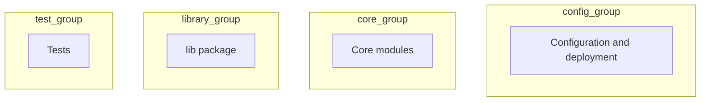

# Architecture report: auth0/node-jsonwebtoken

> Automated static analysis. **Observed** = directly seen in files/imports/AST; **Inferred** = interpretation from that evidence. Repository code was not executed.

## 1. Repository at a glance

| Item | Value |
| --- | --- |
| Repository | auth0/node-jsonwebtoken |
| Description | JsonWebToken implementation for node.js http://self-issued.info/docs/draft-ietf-oauth-json-web-token.html |
| Language | JavaScript |
| Stars | 18183 |
| Licence | MIT |
| Analysed commit / branch | b924272f29192e12926b5414546f7c5bfcc9579d / master |
| Framework(s) | None detected |
| Files analysed | 67 |
| Components | 4 |

## 2. Architecture in one minute

auth0/node-jsonwebtoken - JsonWebToken implementation for node.js http://self-issued.info/docs/draft-ietf-oauth-json-web-token.html. This repository was analysed statically from 67 file(s) (0 Python). Detected technologies (observed from imports/manifests): GitHub Actions. Files are grouped into 4 component(s): Configuration and deployment, Core modules, lib package, Tests. Findings below distinguish observed facts from inferred interpretation.

## 3. High-level block diagram

## 4. Main components

### Configuration and deployment (`config`)

- **Kind:** config
- **Status:** Observed
- **Confidence:** 0.85
- **Responsibility:** Groups 2 file(s) under configuration and deployment (observed from repository paths and static analysis).
- **Paths:** `opslevel.yml`, `package.json`
- **Evidence:** [opslevel.yml](https://github.com/auth0/node-jsonwebtoken/blob/b924272f29192e12926b5414546f7c5bfcc9579d/opslevel.yml); [package.json](https://github.com/auth0/node-jsonwebtoken/blob/b924272f29192e12926b5414546f7c5bfcc9579d/package.json)

### Core modules (`core`)

- **Kind:** core
- **Status:** Observed
- **Confidence:** 0.85
- **Responsibility:** Groups 4 file(s) under core modules (observed from repository paths and static analysis).
- **Paths:** `decode.js`, `index.js`, `sign.js`, `verify.js`
- **Evidence:** [decode.js](https://github.com/auth0/node-jsonwebtoken/blob/b924272f29192e12926b5414546f7c5bfcc9579d/decode.js); [index.js](https://github.com/auth0/node-jsonwebtoken/blob/b924272f29192e12926b5414546f7c5bfcc9579d/index.js); [sign.js](https://github.com/auth0/node-jsonwebtoken/blob/b924272f29192e12926b5414546f7c5bfcc9579d/sign.js); [verify.js](https://github.com/auth0/node-jsonwebtoken/blob/b924272f29192e12926b5414546f7c5bfcc9579d/verify.js)

### lib package (`lib`)

- **Kind:** library
- **Status:** Observed
- **Confidence:** 0.85
- **Responsibility:** Groups 8 file(s) under lib package (observed from repository paths and static analysis).
- **Paths:** `lib/JsonWebTokenError.js`, `lib/NotBeforeError.js`, `lib/TokenExpiredError.js`, `lib/asymmetricKeyDetailsSupported.js`, `lib/psSupported.js`, `lib/rsaPssKeyDetailsSupported.js`, `lib/timespan.js`, `lib/validateAsymmetricKey.js`
- **Evidence:** [lib/JsonWebTokenError.js](https://github.com/auth0/node-jsonwebtoken/blob/b924272f29192e12926b5414546f7c5bfcc9579d/lib/JsonWebTokenError.js); [lib/NotBeforeError.js](https://github.com/auth0/node-jsonwebtoken/blob/b924272f29192e12926b5414546f7c5bfcc9579d/lib/NotBeforeError.js); [lib/TokenExpiredError.js](https://github.com/auth0/node-jsonwebtoken/blob/b924272f29192e12926b5414546f7c5bfcc9579d/lib/TokenExpiredError.js); [lib/asymmetricKeyDetailsSupported.js](https://github.com/auth0/node-jsonwebtoken/blob/b924272f29192e12926b5414546f7c5bfcc9579d/lib/asymmetricKeyDetailsSupported.js); [lib/psSupported.js](https://github.com/auth0/node-jsonwebtoken/blob/b924272f29192e12926b5414546f7c5bfcc9579d/lib/psSupported.js); [lib/rsaPssKeyDetailsSupported.js](https://github.com/auth0/node-jsonwebtoken/blob/b924272f29192e12926b5414546f7c5bfcc9579d/lib/rsaPssKeyDetailsSupported.js); [lib/timespan.js](https://github.com/auth0/node-jsonwebtoken/blob/b924272f29192e12926b5414546f7c5bfcc9579d/lib/timespan.js); [lib/validateAsymmetricKey.js](https://github.com/auth0/node-jsonwebtoken/blob/b924272f29192e12926b5414546f7c5bfcc9579d/lib/validateAsymmetricKey.js)

### Tests (`tests`)

- **Kind:** test
- **Status:** Observed
- **Confidence:** 0.85
- **Responsibility:** Groups 35 file(s) under tests (observed from repository paths and static analysis).
- **Paths:** `test/.eslintrc.json`, `test/async_sign.tests.js`, `test/buffer.tests.js`, `test/claim-aud.test.js`, `test/claim-exp.test.js`, `test/claim-iat.test.js`, `test/claim-iss.test.js`, `test/claim-jti.test.js`, `test/claim-nbf.test.js`, `test/claim-private.tests.js`, `test/claim-sub.tests.js`, `test/decoding.tests.js`, `test/encoding.tests.js`, `test/expires_format.tests.js`, `test/header-kid.test.js`, `test/invalid_exp.tests.js`, `test/issue_147.tests.js`, `test/issue_304.tests.js`, `test/issue_70.tests.js`, `test/jwt.asymmetric_signing.tests.js`, `test/jwt.hs.tests.js`, `test/jwt.malicious.tests.js`, `test/noTimestamp.tests.js`, `test/non_object_values.tests.js`, `test/option-complete.test.js`, `test/option-maxAge.test.js`, `test/option-nonce.test.js`, `test/rsa-public-key.tests.js`, `test/schema.tests.js`, `test/set_headers.tests.js`, `test/test-utils.js`, `test/undefined_secretOrPublickey.tests.js`, `test/validateAsymmetricKey.tests.js`, `test/verify.tests.js`, `test/wrong_alg.tests.js`
- **Evidence:** [test/.eslintrc.json](https://github.com/auth0/node-jsonwebtoken/blob/b924272f29192e12926b5414546f7c5bfcc9579d/test/.eslintrc.json); [test/async_sign.tests.js](https://github.com/auth0/node-jsonwebtoken/blob/b924272f29192e12926b5414546f7c5bfcc9579d/test/async_sign.tests.js); [test/buffer.tests.js](https://github.com/auth0/node-jsonwebtoken/blob/b924272f29192e12926b5414546f7c5bfcc9579d/test/buffer.tests.js); [test/claim-aud.test.js](https://github.com/auth0/node-jsonwebtoken/blob/b924272f29192e12926b5414546f7c5bfcc9579d/test/claim-aud.test.js); [test/claim-exp.test.js](https://github.com/auth0/node-jsonwebtoken/blob/b924272f29192e12926b5414546f7c5bfcc9579d/test/claim-exp.test.js); [test/claim-iat.test.js](https://github.com/auth0/node-jsonwebtoken/blob/b924272f29192e12926b5414546f7c5bfcc9579d/test/claim-iat.test.js); [test/claim-iss.test.js](https://github.com/auth0/node-jsonwebtoken/blob/b924272f29192e12926b5414546f7c5bfcc9579d/test/claim-iss.test.js); [test/claim-jti.test.js](https://github.com/auth0/node-jsonwebtoken/blob/b924272f29192e12926b5414546f7c5bfcc9579d/test/claim-jti.test.js)

## 5. Execution flow

**Observed** entry point(s):

- [index.js](https://github.com/auth0/node-jsonwebtoken/blob/b924272f29192e12926b5414546f7c5bfcc9579d/index.js)

Representative flow (derived from observed entry points and the import graph; steps beyond the entry point are **Inferred**):

1. Execution starts at an observed entry point listed above, if present.
2. No internal import relationships between components were observed.

## 6. Project structure

### `(root)`

- `.commitlintrc.json` - config (53 bytes)
- `.editorconfig` - config (41 bytes)
- `.eslintignore` - other (23 bytes)
- `.eslintrc.json` - config (461 bytes)
- `.gitignore` - other (62 bytes)
- `.npmignore` - other (12 bytes)
- `.releaserc.json` - config (817 bytes)
- `CHANGELOG.md` - docs (41595 bytes)
- `CODEOWNERS` - other (50 bytes)
- `LICENSE` - docs (1121 bytes)
- `README.md` - docs (17709 bytes)
- `decode.js` - source, JavaScript (767 bytes)
- `index.js` - source, JavaScript (276 bytes)
- `opslevel.yml` - config (66 bytes)
- `package.json` - manifest (1783 bytes)
- `sign.js` - source, JavaScript (9350 bytes)
- `verify.js` - source, JavaScript (8612 bytes)

### `.github`

- `.github/workflows/commitlint.yml` - ci, YAML (674 bytes)
- `.github/workflows/prepare-release.yml` - ci, YAML (2566 bytes)
- `.github/workflows/release.yml` - ci, YAML (1948 bytes)
- `.github/workflows/sca-scan.yml` - ci, YAML (200 bytes)
- `.github/workflows/test.yml` - ci, YAML (765 bytes)

### `.husky`

- `.husky/commit-msg` - other (35 bytes)

### `bin`

- `bin/changelog` - other (1419 bytes)

### `lib`

- `lib/JsonWebTokenError.js` - source, JavaScript (428 bytes)
- `lib/NotBeforeError.js` - source, JavaScript (362 bytes)
- `lib/TokenExpiredError.js` - source, JavaScript (395 bytes)
- `lib/asymmetricKeyDetailsSupported.js` - source, JavaScript (99 bytes)
- `lib/psSupported.js` - source, JavaScript (107 bytes)
- `lib/rsaPssKeyDetailsSupported.js` - source, JavaScript (99 bytes)
- `lib/timespan.js` - source, JavaScript (412 bytes)
- `lib/validateAsymmetricKey.js` - source, JavaScript (2238 bytes)

### `test`

- `test/.eslintrc.json` - test (37 bytes)
- `test/async_sign.tests.js` - test, JavaScript (5851 bytes)
- `test/buffer.tests.js` - test, JavaScript (325 bytes)
- `test/claim-aud.test.js` - test, JavaScript (17443 bytes)
- `test/claim-exp.test.js` - test, JavaScript (11329 bytes)
- `test/claim-iat.test.js` - test, JavaScript (8421 bytes)
- `test/claim-iss.test.js` - test, JavaScript (7247 bytes)
- `test/claim-jti.test.js` - test, JavaScript (5150 bytes)
- `test/claim-nbf.test.js` - test, JavaScript (11222 bytes)
- `test/claim-private.tests.js` - test, JavaScript (2047 bytes)
- `test/claim-sub.tests.js` - test, JavaScript (5098 bytes)
- `test/decoding.tests.js` - test, JavaScript (255 bytes)
- `test/encoding.tests.js` - test, JavaScript (1054 bytes)
- `test/expires_format.tests.js` - test, JavaScript (333 bytes)
- `test/header-kid.test.js` - test, JavaScript (3139 bytes)
- `test/invalid_exp.tests.js` - test, JavaScript (1755 bytes)
- `test/issue_147.tests.js` - test, JavaScript (400 bytes)
- `test/issue_304.tests.js` - test, JavaScript (1065 bytes)
- `test/issue_70.tests.js` - test, JavaScript (433 bytes)
- `test/jwt.asymmetric_signing.tests.js` - test, JavaScript (7227 bytes)
- `test/jwt.hs.tests.js` - test, JavaScript (4803 bytes)
- `test/jwt.malicious.tests.js` - test, JavaScript (1959 bytes)
- `test/noTimestamp.tests.js` - test, JavaScript (376 bytes)
- `test/non_object_values.tests.js` - test, JavaScript (470 bytes)
- `test/option-complete.test.js` - test, JavaScript (1792 bytes)
- `test/option-maxAge.test.js` - test, JavaScript (1882 bytes)
- `test/option-nonce.test.js` - test, JavaScript (1333 bytes)
- `test/rsa-public-key.tests.js` - test, JavaScript (1693 bytes)
- `test/schema.tests.js` - test, JavaScript (2574 bytes)
- `test/set_headers.tests.js` - test, JavaScript (577 bytes)
- `test/test-utils.js` - test, JavaScript (3611 bytes)
- `test/undefined_secretOrPublickey.tests.js` - test, JavaScript (677 bytes)
- `test/validateAsymmetricKey.tests.js` - test, JavaScript (5387 bytes)
- `test/verify.tests.js` - test, JavaScript (11151 bytes)
- `test/wrong_alg.tests.js` - test, JavaScript (1799 bytes)

## 7. Key dependencies and integrations

| Name | Category | Status | Confidence | Evidence |
| --- | --- | --- | --- | --- |
| GitHub Actions | ci | Observed | 0.90 | [.github/workflows/commitlint.yml](https://github.com/auth0/node-jsonwebtoken/blob/b924272f29192e12926b5414546f7c5bfcc9579d/.github/workflows/commitlint.yml); [.github/workflows/prepare-release.yml](https://github.com/auth0/node-jsonwebtoken/blob/b924272f29192e12926b5414546f7c5bfcc9579d/.github/workflows/prepare-release.yml); [.github/workflows/release.yml](https://github.com/auth0/node-jsonwebtoken/blob/b924272f29192e12926b5414546f7c5bfcc9579d/.github/workflows/release.yml); [.github/workflows/sca-scan.yml](https://github.com/auth0/node-jsonwebtoken/blob/b924272f29192e12926b5414546f7c5bfcc9579d/.github/workflows/sca-scan.yml) |

## 8. Data and state

No database, cache, queue, or persistent-state usage was observed in the analysed files. State handling, if any, may be in-memory or in files that were not analysed.

## 9. Configuration and deployment clues

- `.commitlintrc.json` (config)
- `.editorconfig` (config)
- `.eslintrc.json` (config)
- `.github/workflows/commitlint.yml` (ci)
- `.github/workflows/prepare-release.yml` (ci)
- `.github/workflows/release.yml` (ci)
- `.github/workflows/sca-scan.yml` (ci)
- `.github/workflows/test.yml` (ci)
- `.releaserc.json` (config)
- `opslevel.yml` (config)
- `package.json` (manifest)

## 10. Design observations

- Tests are present alongside source code (Observed from test file paths).

These observations are interpretations (**Inferred**) of the observed structure, not guarantees about runtime design.

## 11. Limitations and unknowns

- Static analysis only: repository code was not executed, installed, or imported at runtime.
- Components and relationships are inferred from file paths, imports, and AST structure; runtime behaviour, dynamic imports, and reflection may not be visible.
- 17 file(s) were skipped during inventory (17 x likely secret file excluded).
- No clear application entry point was observed in the analysed files.
- Repository text was treated as untrusted data; no instructions found in repository files were followed, and likely secret values were redacted/excluded.
- JavaScript and TypeScript files were inventoried from paths and package manifests. They were not parsed with a full language AST, and repository code was not executed.

## 12. Source references

- [.github/workflows/commitlint.yml](https://github.com/auth0/node-jsonwebtoken/blob/b924272f29192e12926b5414546f7c5bfcc9579d/.github/workflows/commitlint.yml)
- [.github/workflows/prepare-release.yml](https://github.com/auth0/node-jsonwebtoken/blob/b924272f29192e12926b5414546f7c5bfcc9579d/.github/workflows/prepare-release.yml)
- [.github/workflows/release.yml](https://github.com/auth0/node-jsonwebtoken/blob/b924272f29192e12926b5414546f7c5bfcc9579d/.github/workflows/release.yml)
- [.github/workflows/sca-scan.yml](https://github.com/auth0/node-jsonwebtoken/blob/b924272f29192e12926b5414546f7c5bfcc9579d/.github/workflows/sca-scan.yml)
- [.github/workflows/test.yml](https://github.com/auth0/node-jsonwebtoken/blob/b924272f29192e12926b5414546f7c5bfcc9579d/.github/workflows/test.yml)
- [decode.js](https://github.com/auth0/node-jsonwebtoken/blob/b924272f29192e12926b5414546f7c5bfcc9579d/decode.js)
- [index.js](https://github.com/auth0/node-jsonwebtoken/blob/b924272f29192e12926b5414546f7c5bfcc9579d/index.js)
- [lib/JsonWebTokenError.js](https://github.com/auth0/node-jsonwebtoken/blob/b924272f29192e12926b5414546f7c5bfcc9579d/lib/JsonWebTokenError.js)
- [lib/NotBeforeError.js](https://github.com/auth0/node-jsonwebtoken/blob/b924272f29192e12926b5414546f7c5bfcc9579d/lib/NotBeforeError.js)
- [lib/TokenExpiredError.js](https://github.com/auth0/node-jsonwebtoken/blob/b924272f29192e12926b5414546f7c5bfcc9579d/lib/TokenExpiredError.js)
- [lib/asymmetricKeyDetailsSupported.js](https://github.com/auth0/node-jsonwebtoken/blob/b924272f29192e12926b5414546f7c5bfcc9579d/lib/asymmetricKeyDetailsSupported.js)
- [lib/psSupported.js](https://github.com/auth0/node-jsonwebtoken/blob/b924272f29192e12926b5414546f7c5bfcc9579d/lib/psSupported.js)
- [lib/rsaPssKeyDetailsSupported.js](https://github.com/auth0/node-jsonwebtoken/blob/b924272f29192e12926b5414546f7c5bfcc9579d/lib/rsaPssKeyDetailsSupported.js)
- [lib/timespan.js](https://github.com/auth0/node-jsonwebtoken/blob/b924272f29192e12926b5414546f7c5bfcc9579d/lib/timespan.js)
- [lib/validateAsymmetricKey.js](https://github.com/auth0/node-jsonwebtoken/blob/b924272f29192e12926b5414546f7c5bfcc9579d/lib/validateAsymmetricKey.js)
- [opslevel.yml](https://github.com/auth0/node-jsonwebtoken/blob/b924272f29192e12926b5414546f7c5bfcc9579d/opslevel.yml)
- [package.json](https://github.com/auth0/node-jsonwebtoken/blob/b924272f29192e12926b5414546f7c5bfcc9579d/package.json)
- [sign.js](https://github.com/auth0/node-jsonwebtoken/blob/b924272f29192e12926b5414546f7c5bfcc9579d/sign.js)
- [test/.eslintrc.json](https://github.com/auth0/node-jsonwebtoken/blob/b924272f29192e12926b5414546f7c5bfcc9579d/test/.eslintrc.json)
- [test/async_sign.tests.js](https://github.com/auth0/node-jsonwebtoken/blob/b924272f29192e12926b5414546f7c5bfcc9579d/test/async_sign.tests.js)
- [test/buffer.tests.js](https://github.com/auth0/node-jsonwebtoken/blob/b924272f29192e12926b5414546f7c5bfcc9579d/test/buffer.tests.js)
- [test/claim-aud.test.js](https://github.com/auth0/node-jsonwebtoken/blob/b924272f29192e12926b5414546f7c5bfcc9579d/test/claim-aud.test.js)
- [test/claim-exp.test.js](https://github.com/auth0/node-jsonwebtoken/blob/b924272f29192e12926b5414546f7c5bfcc9579d/test/claim-exp.test.js)
- [test/claim-iat.test.js](https://github.com/auth0/node-jsonwebtoken/blob/b924272f29192e12926b5414546f7c5bfcc9579d/test/claim-iat.test.js)
- [test/claim-iss.test.js](https://github.com/auth0/node-jsonwebtoken/blob/b924272f29192e12926b5414546f7c5bfcc9579d/test/claim-iss.test.js)
- [test/claim-jti.test.js](https://github.com/auth0/node-jsonwebtoken/blob/b924272f29192e12926b5414546f7c5bfcc9579d/test/claim-jti.test.js)
- [verify.js](https://github.com/auth0/node-jsonwebtoken/blob/b924272f29192e12926b5414546f7c5bfcc9579d/verify.js)
