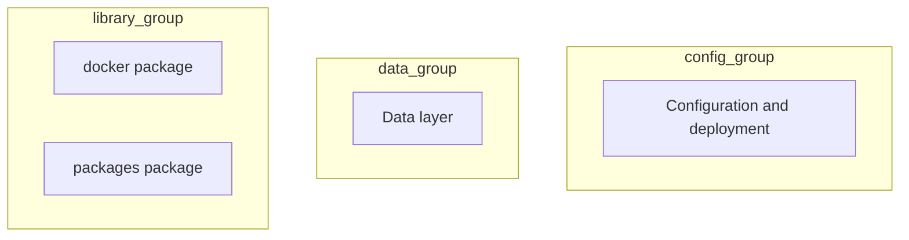

# Architecture report: automatisch/automatisch

> Automated static analysis. **Observed** = directly seen in files/imports/AST; **Inferred** = interpretation from that evidence. Repository code was not executed.

## 1. Repository at a glance

| Item | Value |
| --- | --- |
| Repository | automatisch/automatisch |
| Description | The open source Zapier alternative. Build workflow automation without spending time and money. |
| Language | JavaScript |
| Stars | 14021 |
| Licence | Other |
| Analysed commit / branch | 41f3c56a163103cae761bb44f03638cb84e859ee / main |
| Framework(s) | Express |
| Files analysed | 800 |
| Components | 4 |

## 2. Architecture in one minute

automatisch/automatisch - The open source Zapier alternative. Build workflow automation without spending time and money.. This repository was analysed statically from 800 file(s) (0 Python). Detected technologies (observed from imports/manifests): GitHub Actions, PostgreSQL, Redis, Express, axios, Docker. Files are grouped into 4 component(s): Configuration and deployment, Data layer, docker package, packages package. Findings below distinguish observed facts from inferred interpretation.

## 3. High-level block diagram

## 4. Main components

### Configuration and deployment (`config`)

- **Kind:** config
- **Status:** Observed
- **Confidence:** 0.85
- **Responsibility:** Groups 6 file(s) under configuration and deployment (observed from repository paths and static analysis).
- **Paths:** `docker-compose.yml`, `docker/Dockerfile`, `docker/Dockerfile.compose`, `packages/backend/.eslintrc.json`, `packages/backend/jsconfig.json`, `packages/backend/package.json`
- **Evidence:** [docker-compose.yml](https://github.com/automatisch/automatisch/blob/41f3c56a163103cae761bb44f03638cb84e859ee/docker-compose.yml); [docker/Dockerfile](https://github.com/automatisch/automatisch/blob/41f3c56a163103cae761bb44f03638cb84e859ee/docker/Dockerfile); [docker/Dockerfile.compose](https://github.com/automatisch/automatisch/blob/41f3c56a163103cae761bb44f03638cb84e859ee/docker/Dockerfile.compose); [packages/backend/.eslintrc.json](https://github.com/automatisch/automatisch/blob/41f3c56a163103cae761bb44f03638cb84e859ee/packages/backend/.eslintrc.json); [packages/backend/jsconfig.json](https://github.com/automatisch/automatisch/blob/41f3c56a163103cae761bb44f03638cb84e859ee/packages/backend/jsconfig.json); [packages/backend/package.json](https://github.com/automatisch/automatisch/blob/41f3c56a163103cae761bb44f03638cb84e859ee/packages/backend/package.json)

### Data layer (`data_layer`)

- **Kind:** data
- **Status:** Observed
- **Confidence:** 0.85
- **Responsibility:** Groups 5 file(s) under data layer (observed from repository paths and static analysis).
- **Paths:** `packages/backend/bin/database/client.js`, `packages/backend/bin/database/create.js`, `packages/backend/bin/database/drop.js`, `packages/backend/bin/database/seed-user.js`, `packages/backend/bin/database/utils.js`
- **Evidence:** [packages/backend/bin/database/client.js](https://github.com/automatisch/automatisch/blob/41f3c56a163103cae761bb44f03638cb84e859ee/packages/backend/bin/database/client.js); [packages/backend/bin/database/create.js](https://github.com/automatisch/automatisch/blob/41f3c56a163103cae761bb44f03638cb84e859ee/packages/backend/bin/database/create.js); [packages/backend/bin/database/drop.js](https://github.com/automatisch/automatisch/blob/41f3c56a163103cae761bb44f03638cb84e859ee/packages/backend/bin/database/drop.js); [packages/backend/bin/database/seed-user.js](https://github.com/automatisch/automatisch/blob/41f3c56a163103cae761bb44f03638cb84e859ee/packages/backend/bin/database/seed-user.js); [packages/backend/bin/database/utils.js](https://github.com/automatisch/automatisch/blob/41f3c56a163103cae761bb44f03638cb84e859ee/packages/backend/bin/database/utils.js)

### docker package (`docker`)

- **Kind:** library
- **Status:** Observed
- **Confidence:** 0.85
- **Responsibility:** Groups 2 file(s) under docker package (observed from repository paths and static analysis).
- **Paths:** `docker/compose-entrypoint.sh`, `docker/entrypoint.sh`
- **Evidence:** [docker/compose-entrypoint.sh](https://github.com/automatisch/automatisch/blob/41f3c56a163103cae761bb44f03638cb84e859ee/docker/compose-entrypoint.sh); [docker/entrypoint.sh](https://github.com/automatisch/automatisch/blob/41f3c56a163103cae761bb44f03638cb84e859ee/docker/entrypoint.sh)

### packages package (`packages`)

- **Kind:** library
- **Status:** Observed
- **Confidence:** 0.85
- **Responsibility:** Groups 711 file(s) under packages package (observed from repository paths and static analysis).
- **Paths:** `packages/backend/alias-loader.mjs`, `packages/backend/knexfile.js`, `packages/backend/src/app.js`, `packages/backend/src/apps/agents/actions/index.js`, `packages/backend/src/apps/agents/actions/run-agent/index.js`, `packages/backend/src/apps/agents/dynamic-data/index.js`, `packages/backend/src/apps/agents/dynamic-data/list-agents/index.js`, `packages/backend/src/apps/agents/index.js`, `packages/backend/src/apps/airbrake/auth/index.js`, `packages/backend/src/apps/airbrake/auth/is-still-verified.js`, `packages/backend/src/apps/airbrake/auth/verify-credentials.js`, `packages/backend/src/apps/airbrake/common/add-api-key.js`, `packages/backend/src/apps/airbrake/common/set-base-url.js`, `packages/backend/src/apps/airbrake/dynamic-data/index.js`, `packages/backend/src/apps/airbrake/dynamic-data/list-projects/index.js`, `packages/backend/src/apps/airbrake/index.js`, `packages/backend/src/apps/airbrake/triggers/index.js`, `packages/backend/src/apps/airbrake/triggers/new-errors/index.js`, `packages/backend/src/apps/airtable/actions/create-record/index.js`, `packages/backend/src/apps/airtable/actions/find-record/index.js`, `packages/backend/src/apps/airtable/actions/index.js`, `packages/backend/src/apps/airtable/auth/generate-auth-url.js`, `packages/backend/src/apps/airtable/auth/index.js`, `packages/backend/src/apps/airtable/auth/is-still-verified.js`, `packages/backend/src/apps/airtable/auth/refresh-token.js`, `packages/backend/src/apps/airtable/auth/verify-credentials.js`, `packages/backend/src/apps/airtable/common/add-auth-header.js`, `packages/backend/src/apps/airtable/common/auth-scope.js`, `packages/backend/src/apps/airtable/common/get-current-user.js`, `packages/backend/src/apps/airtable/dynamic-data/index.js`, `packages/backend/src/apps/airtable/dynamic-data/list-bases/index.js`, `packages/backend/src/apps/airtable/dynamic-data/list-table-fields/index.js`, `packages/backend/src/apps/airtable/dynamic-data/list-table-views/index.js`, `packages/backend/src/apps/airtable/dynamic-data/list-tables/index.js`, `packages/backend/src/apps/airtable/dynamic-fields/index.js`, `packages/backend/src/apps/airtable/dynamic-fields/list-fields/index.js`, `packages/backend/src/apps/airtable/index.js`, `packages/backend/src/apps/anthropic/actions/index.js`, `packages/backend/src/apps/anthropic/actions/send-message/index.js`, `packages/backend/src/apps/anthropic/auth/index.js`, `packages/backend/src/apps/anthropic/auth/is-still-verified.js`, `packages/backend/src/apps/anthropic/auth/verify-credentials.js`, `packages/backend/src/apps/anthropic/common/add-anthropic-version-header.js`, `packages/backend/src/apps/anthropic/common/add-auth-header.js`, `packages/backend/src/apps/anthropic/dynamic-data/index.js`, `packages/backend/src/apps/anthropic/dynamic-data/list-models/index.js`, `packages/backend/src/apps/anthropic/index.js`, `packages/backend/src/apps/appwrite/auth/index.js`, `packages/backend/src/apps/appwrite/auth/is-still-verified.js`, `packages/backend/src/apps/appwrite/auth/verify-credentials.js`, `packages/backend/src/apps/appwrite/common/add-auth-header.js`, `packages/backend/src/apps/appwrite/common/set-base-url.js`, `packages/backend/src/apps/appwrite/dynamic-data/index.js`, `packages/backend/src/apps/appwrite/dynamic-data/list-collections/index.js`, `packages/backend/src/apps/appwrite/dynamic-data/list-databases/index.js`, `packages/backend/src/apps/appwrite/index.js`, `packages/backend/src/apps/appwrite/triggers/index.js`, `packages/backend/src/apps/appwrite/triggers/new-documents/index.js`, `packages/backend/src/apps/asana/actions/create-project/index.js`, `packages/backend/src/apps/asana/actions/create-task/index.js`, `packages/backend/src/apps/asana/actions/find-project/index.js`, `packages/backend/src/apps/asana/actions/find-task-in-project/index.js`, `packages/backend/src/apps/asana/actions/index.js`, `packages/backend/src/apps/asana/auth/generate-auth-url.js`, `packages/backend/src/apps/asana/auth/index.js`, `packages/backend/src/apps/asana/auth/is-still-verified.js`, `packages/backend/src/apps/asana/auth/refresh-token.js`, `packages/backend/src/apps/asana/auth/verify-credentials.js`, `packages/backend/src/apps/asana/common/add-auth-header.js`, `packages/backend/src/apps/asana/common/get-current-user.js`, `packages/backend/src/apps/asana/dynamic-data/index.js`, `packages/backend/src/apps/asana/dynamic-data/list-projects/index.js`, `packages/backend/src/apps/asana/dynamic-data/list-sections/index.js`, `packages/backend/src/apps/asana/dynamic-data/list-tags/index.js`, `packages/backend/src/apps/asana/dynamic-data/list-teams/index.js`, `packages/backend/src/apps/asana/dynamic-data/list-users/index.js`, `packages/backend/src/apps/asana/dynamic-data/list-workspaces/index.js`, `packages/backend/src/apps/asana/index.js`, `packages/backend/src/apps/azure-openai/actions/index.js`, `packages/backend/src/apps/azure-openai/actions/send-prompt/index.js`, `packages/backend/src/apps/azure-openai/auth/index.js`, `packages/backend/src/apps/azure-openai/auth/is-still-verified.js`, `packages/backend/src/apps/azure-openai/auth/verify-credentials.js`, `packages/backend/src/apps/azure-openai/common/add-auth-header.js`, `packages/backend/src/apps/azure-openai/common/set-base-url.js`, `packages/backend/src/apps/azure-openai/index.js`, `packages/backend/src/apps/better-stack/actions/acknowledge-incident/index.js`, `packages/backend/src/apps/better-stack/actions/create-incident/index.js`, `packages/backend/src/apps/better-stack/actions/find-incident/index.js`, `packages/backend/src/apps/better-stack/actions/index.js`, `packages/backend/src/apps/better-stack/actions/resolve-incident/index.js`, `packages/backend/src/apps/better-stack/auth/index.js`, `packages/backend/src/apps/better-stack/auth/is-still-verified.js`, `packages/backend/src/apps/better-stack/auth/verify-credentials.js`, `packages/backend/src/apps/better-stack/common/add-auth-header.js`, `packages/backend/src/apps/better-stack/index.js`, `packages/backend/src/apps/brave-search/actions/index.js`, `packages/backend/src/apps/brave-search/actions/web-search/index.js`, `packages/backend/src/apps/brave-search/auth/index.js`, `packages/backend/src/apps/brave-search/auth/is-still-verified.js`, `packages/backend/src/apps/brave-search/auth/verify-credentials.js`, `packages/backend/src/apps/brave-search/common/add-accept-header.js`, `packages/backend/src/apps/brave-search/common/add-auth-header.js`, `packages/backend/src/apps/brave-search/dynamic-data/index.js`, `packages/backend/src/apps/brave-search/dynamic-data/list-models/index.js`, `packages/backend/src/apps/brave-search/index.js`, `packages/backend/src/apps/carbone/actions/add-template/index.js`, `packages/backend/src/apps/carbone/actions/index.js`, `packages/backend/src/apps/carbone/auth/index.js`, `packages/backend/src/apps/carbone/auth/is-still-verified.js`, `packages/backend/src/apps/carbone/auth/verify-credentials.js`, `packages/backend/src/apps/carbone/common/add-auth-header.js`, `packages/backend/src/apps/carbone/index.js`, `packages/backend/src/apps/changedetection/actions/create-watch/index.js`, `packages/backend/src/apps/changedetection/actions/delete-watch/index.js`, `packages/backend/src/apps/changedetection/actions/index.js`, `packages/backend/src/apps/changedetection/auth/index.js`, `packages/backend/src/apps/changedetection/auth/is-still-verified.js`, `packages/backend/src/apps/changedetection/auth/verify-credentials.js`, `packages/backend/src/apps/changedetection/common/add-auth-header.js`, `packages/backend/src/apps/changedetection/common/set-base-url.js`, `packages/backend/src/apps/changedetection/dynamic-data/index.js`, `packages/backend/src/apps/changedetection/dynamic-data/list-watches/index.js`, `packages/backend/src/apps/changedetection/index.js`, `packages/backend/src/apps/changedetection/triggers/changed-watch/index.js`, `packages/backend/src/apps/changedetection/triggers/index.js`, `packages/backend/src/apps/clickup/actions/create-folder/index.js`, `packages/backend/src/apps/clickup/actions/create-list/index.js`, `packages/backend/src/apps/clickup/actions/create-task/index.js`, `packages/backend/src/apps/clickup/actions/find-task-by-id/index.js`, `packages/backend/src/apps/clickup/actions/index.js`, `packages/backend/src/apps/clickup/auth/generate-auth-url.js`, `packages/backend/src/apps/clickup/auth/index.js`, `packages/backend/src/apps/clickup/auth/is-still-verified.js`, `packages/backend/src/apps/clickup/auth/verify-credentials.js`, `packages/backend/src/apps/clickup/common/add-auth-header.js`, `packages/backend/src/apps/clickup/common/get-current-user.js`, `packages/backend/src/apps/clickup/dynamic-data/index.js`, `packages/backend/src/apps/clickup/dynamic-data/list-assignees/index.js`, `packages/backend/src/apps/clickup/dynamic-data/list-folders/index.js`, `packages/backend/src/apps/clickup/dynamic-data/list-lists/index.js`, `packages/backend/src/apps/clickup/dynamic-data/list-spaces/index.js`, `packages/backend/src/apps/clickup/dynamic-data/list-statuses/index.js`, `packages/backend/src/apps/clickup/dynamic-data/list-tags/index.js`, `packages/backend/src/apps/clickup/dynamic-data/list-tasks/index.js`, `packages/backend/src/apps/clickup/dynamic-data/list-workspaces/index.js`, `packages/backend/src/apps/clickup/dynamic-fields/index.js`, `packages/backend/src/apps/clickup/dynamic-fields/use-custom-id/index.js`, `packages/backend/src/apps/clickup/index.js`, `packages/backend/src/apps/clickup/triggers/index.js`, `packages/backend/src/apps/clickup/triggers/new-folders/index.js`, `packages/backend/src/apps/clickup/triggers/new-lists/index.js`, `packages/backend/src/apps/clickup/triggers/new-tasks/index.js`, `packages/backend/src/apps/clickup/triggers/updated-task/index.js`, `packages/backend/src/apps/code/actions/index.js`, `packages/backend/src/apps/code/actions/run-javascript/index.js`, `packages/backend/src/apps/code/index.js`, `packages/backend/src/apps/cryptography/actions/create-hmac/index.js`, `packages/backend/src/apps/cryptography/actions/create-rsa-sha256-signature/index.js`, `packages/backend/src/apps/cryptography/actions/index.js`, `packages/backend/src/apps/cryptography/index.js`, `packages/backend/src/apps/datastore/actions/get-value/index.js`, `packages/backend/src/apps/datastore/actions/index.js`, `packages/backend/src/apps/datastore/actions/set-value/index.js`, `packages/backend/src/apps/datastore/index.js`, `packages/backend/src/apps/deepl/actions/index.js`, `packages/backend/src/apps/deepl/actions/translate-text/index.js`, `packages/backend/src/apps/deepl/auth/index.js`, `packages/backend/src/apps/deepl/auth/is-still-verified.js`, `packages/backend/src/apps/deepl/auth/verify-credentials.js`, `packages/backend/src/apps/deepl/common/add-auth-header.js`, `packages/backend/src/apps/deepl/index.js`, `packages/backend/src/apps/delay/actions/delay-for/index.js`, `packages/backend/src/apps/delay/actions/delay-until/index.js`, `packages/backend/src/apps/delay/actions/index.js`, `packages/backend/src/apps/delay/index.js`, `packages/backend/src/apps/discord/actions/create-scheduled-event/index.js`, `packages/backend/src/apps/discord/actions/index.js`, `packages/backend/src/apps/discord/actions/send-message-to-channel/index.js`, `packages/backend/src/apps/discord/actions/update-scheduled-event/index.js`, `packages/backend/src/apps/discord/auth/generate-auth-url.js`, `packages/backend/src/apps/discord/auth/index.js`, `packages/backend/src/apps/discord/auth/is-still-verified.js`, `packages/backend/src/apps/discord/auth/verify-credentials.js`, `packages/backend/src/apps/discord/common/add-auth-header.js`, `packages/backend/src/apps/discord/common/get-current-user.js`, `packages/backend/src/apps/discord/common/scopes.js`, `packages/backend/src/apps/discord/dynamic-data/index.js`, `packages/backend/src/apps/discord/dynamic-data/list-channels/index.js`, `packages/backend/src/apps/discord/dynamic-data/list-scheduled-events/index.js`, `packages/backend/src/apps/discord/dynamic-data/list-voice-channels/index.js`, `packages/backend/src/apps/discord/dynamic-fields/index.js`, `packages/backend/src/apps/discord/dynamic-fields/list-external-scheduled-event-fields/index.js`, `packages/backend/src/apps/discord/dynamic-fields/list-scheduled-event-fields-for-update/index.js`, `packages/backend/src/apps/discord/index.js`, `packages/backend/src/apps/discord/triggers/index.js`, `packages/backend/src/apps/disqus/auth/generate-auth-url.js`, `packages/backend/src/apps/disqus/auth/index.js`, `packages/backend/src/apps/disqus/auth/is-still-verified.js`, `packages/backend/src/apps/disqus/auth/refresh-token.js`, `packages/backend/src/apps/disqus/auth/verify-credentials.js`, `packages/backend/src/apps/disqus/common/add-auth-header.js`, `packages/backend/src/apps/disqus/common/auth-scope.js`, `packages/backend/src/apps/disqus/common/get-current-user.js`, `packages/backend/src/apps/disqus/dynamic-data/index.js`, `packages/backend/src/apps/disqus/dynamic-data/list-forums/index.js`, `packages/backend/src/apps/disqus/index.js`, `packages/backend/src/apps/disqus/triggers/index.js`, `packages/backend/src/apps/disqus/triggers/new-comments/index.js`, `packages/backend/src/apps/disqus/triggers/new-flagged-comments/index.js`, `packages/backend/src/apps/dropbox/actions/create-folder/index.js`, `packages/backend/src/apps/dropbox/actions/create-text-file/index.js`, `packages/backend/src/apps/dropbox/actions/index.js`, `packages/backend/src/apps/dropbox/actions/rename-file/index.js`, `packages/backend/src/apps/dropbox/auth/generate-auth-url.js`, `packages/backend/src/apps/dropbox/auth/index.js`, `packages/backend/src/apps/dropbox/auth/is-still-verified.js`, `packages/backend/src/apps/dropbox/auth/refresh-token.js`, `packages/backend/src/apps/dropbox/auth/verify-credentials.js`, `packages/backend/src/apps/dropbox/common/add-auth-header.js`, `packages/backend/src/apps/dropbox/common/get-current-account.js`, `packages/backend/src/apps/dropbox/common/scopes.js`, `packages/backend/src/apps/dropbox/index.js`, `packages/backend/src/apps/dropbox/triggers/index.js`, `packages/backend/src/apps/dropbox/triggers/new-files-in-folder/index.js`, `packages/backend/src/apps/dropbox/triggers/new-folders/index.js`, `packages/backend/src/apps/eventbrite/actions/create-event/index.js`, `packages/backend/src/apps/eventbrite/actions/index.js`, `packages/backend/src/apps/eventbrite/actions/publish-event/index.js`, `packages/backend/src/apps/eventbrite/auth/generate-auth-url.js`, `packages/backend/src/apps/eventbrite/auth/index.js`, `packages/backend/src/apps/eventbrite/auth/is-still-verified.js`, `packages/backend/src/apps/eventbrite/auth/verify-credentials.js`, `packages/backend/src/apps/eventbrite/common/add-auth-header.js`, `packages/backend/src/apps/eventbrite/common/get-current-user.js`, `packages/backend/src/apps/eventbrite/dynamic-data/index.js`, `packages/backend/src/apps/eventbrite/dynamic-data/list-currency/index.js`, `packages/backend/src/apps/eventbrite/dynamic-data/list-events/index.js`, `packages/backend/src/apps/eventbrite/dynamic-data/list-organizations/index.js`, `packages/backend/src/apps/eventbrite/dynamic-data/list-venues/index.js`, `packages/backend/src/apps/eventbrite/index.js`, `packages/backend/src/apps/eventbrite/triggers/index.js`, `packages/backend/src/apps/eventbrite/triggers/new-attendee-check-in/index.js`, `packages/backend/src/apps/eventbrite/triggers/new-attendee-registered/index.js`, `packages/backend/src/apps/eventbrite/triggers/new-events/index.js`, `packages/backend/src/apps/eventbrite/triggers/updated-attendee/index.js`, `packages/backend/src/apps/filter/actions/continue/index.js`, `packages/backend/src/apps/filter/actions/index.js`, `packages/backend/src/apps/filter/index.js`, `packages/backend/src/apps/firefly-iii/auth/generate-auth-url.js`, `packages/backend/src/apps/firefly-iii/auth/index.js`, `packages/backend/src/apps/firefly-iii/auth/is-still-verified.js`, `packages/backend/src/apps/firefly-iii/auth/refresh-token.js`, `packages/backend/src/apps/firefly-iii/auth/verify-credentials.js`, `packages/backend/src/apps/firefly-iii/common/add-auth-header.js`, `packages/backend/src/apps/firefly-iii/common/get-current-user.js`, `packages/backend/src/apps/firefly-iii/common/set-base-url.js`, `packages/backend/src/apps/firefly-iii/index.js`, `packages/backend/src/apps/firefly-iii/triggers/index.js`, `packages/backend/src/apps/firefly-iii/triggers/transaction-created/index.js`, `packages/backend/src/apps/firefly-iii/triggers/transaction-deleted/index.js`, `packages/backend/src/apps/firefly-iii/triggers/transaction-updated/index.js`, `packages/backend/src/apps/flickr/auth/generate-auth-url.js`, `packages/backend/src/apps/flickr/auth/index.js`, `packages/backend/src/apps/flickr/auth/is-still-verified.js`, `packages/backend/src/apps/flickr/auth/verify-credentials.js`, `packages/backend/src/apps/flickr/common/add-auth-header.js`, `packages/backend/src/apps/flickr/common/oauth-client.js`, `packages/backend/src/apps/flickr/dynamic-data/index.js`, `packages/backend/src/apps/flickr/dynamic-data/list-albums/index.js`, `packages/backend/src/apps/flickr/index.js`, `packages/backend/src/apps/flickr/triggers/index.js`, `packages/backend/src/apps/flickr/triggers/new-albums/index.js`, `packages/backend/src/apps/flickr/triggers/new-albums/new-albums.js`, `packages/backend/src/apps/flickr/triggers/new-favorite-photos/index.js`, `packages/backend/src/apps/flickr/triggers/new-favorite-photos/new-favorite-photos.js`, `packages/backend/src/apps/flickr/triggers/new-photos-in-album/index.js`, `packages/backend/src/apps/flickr/triggers/new-photos-in-album/new-photos-in-album.js`, `packages/backend/src/apps/flickr/triggers/new-photos/index.js`, `packages/backend/src/apps/flickr/triggers/new-photos/new-photos.js`, `packages/backend/src/apps/flowers-software/auth/index.js`, `packages/backend/src/apps/flowers-software/auth/is-still-verified.js`, `packages/backend/src/apps/flowers-software/auth/verify-credentials.js`, `packages/backend/src/apps/flowers-software/common/add-auth-header.js`, `packages/backend/src/apps/flowers-software/common/get-webhooks.js`, `packages/backend/src/apps/flowers-software/common/webhook-filters.js`, `packages/backend/src/apps/flowers-software/index.js`, `packages/backend/src/apps/flowers-software/triggers/index.js`, `packages/backend/src/apps/flowers-software/triggers/new-activity/index.js`, `packages/backend/src/apps/formatter/actions/date-time/index.js`, `packages/backend/src/apps/formatter/actions/date-time/transformers/format-date-time.js`, `packages/backend/src/apps/formatter/actions/date-time/transformers/get-current-timestamp-in-seconds.js`, `packages/backend/src/apps/formatter/actions/date-time/transformers/get-current-timestamp.js`, `packages/backend/src/apps/formatter/actions/index.js`, `packages/backend/src/apps/formatter/actions/numbers/index.js`, `packages/backend/src/apps/formatter/actions/numbers/transformers/format-number.js`, `packages/backend/src/apps/formatter/actions/numbers/transformers/format-phone-number.js`, `packages/backend/src/apps/formatter/actions/numbers/transformers/perform-math-operation.js`, `packages/backend/src/apps/formatter/actions/numbers/transformers/random-number.js`, `packages/backend/src/apps/formatter/actions/text/index.js`, `packages/backend/src/apps/formatter/actions/text/transformers/base64-to-string.js`, `packages/backend/src/apps/formatter/actions/text/transformers/capitalize.js`, `packages/backend/src/apps/formatter/actions/text/transformers/create-uuid.js`, `packages/backend/src/apps/formatter/actions/text/transformers/encode-uri-component.js`, `packages/backend/src/apps/formatter/actions/text/transformers/encode-uri.js`, `packages/backend/src/apps/formatter/actions/text/transformers/extract-email-address.js`, `packages/backend/src/apps/formatter/actions/text/transformers/extract-number.js`, `packages/backend/src/apps/formatter/actions/text/transformers/html-to-markdown.js`, `packages/backend/src/apps/formatter/actions/text/transformers/lowercase.js`, `packages/backend/src/apps/formatter/actions/text/transformers/markdown-to-html.js`, `packages/backend/src/apps/formatter/actions/text/transformers/parse-stringified-json.js`, `packages/backend/src/apps/formatter/actions/text/transformers/pluralize.js`, `packages/backend/src/apps/formatter/actions/text/transformers/replace.js`, `packages/backend/src/apps/formatter/actions/text/transformers/string-to-base64.js`, `packages/backend/src/apps/formatter/actions/text/transformers/trim-whitespace.js`, `packages/backend/src/apps/formatter/actions/text/transformers/use-default-value.js`, `packages/backend/src/apps/formatter/common/phone-number-country-codes.js`, `packages/backend/src/apps/formatter/dynamic-fields/index.js`, `packages/backend/src/apps/formatter/dynamic-fields/list-replace-regex-options/index.js`, `packages/backend/src/apps/formatter/dynamic-fields/list-transform-options/date-time/format-date-time.js`, `packages/backend/src/apps/formatter/dynamic-fields/list-transform-options/date-time/options/format.js`, `packages/backend/src/apps/formatter/dynamic-fields/list-transform-options/date-time/options/timezone.js`, `packages/backend/src/apps/formatter/dynamic-fields/list-transform-options/index.js`, `packages/backend/src/apps/formatter/dynamic-fields/list-transform-options/numbers/format-number.js`, `packages/backend/src/apps/formatter/dynamic-fields/list-transform-options/numbers/format-phone-number.js`, `packages/backend/src/apps/formatter/dynamic-fields/list-transform-options/numbers/perform-math-operation.js`, `packages/backend/src/apps/formatter/dynamic-fields/list-transform-options/numbers/random-number.js`, `packages/backend/src/apps/formatter/dynamic-fields/list-transform-options/text/base64-to-string.js`, `packages/backend/src/apps/formatter/dynamic-fields/list-transform-options/text/capitalize.js`, `packages/backend/src/apps/formatter/dynamic-fields/list-transform-options/text/encode-uri-component.js`, `packages/backend/src/apps/formatter/dynamic-fields/list-transform-options/text/encode-uri.js`, `packages/backend/src/apps/formatter/dynamic-fields/list-transform-options/text/extract-email-address.js`, `packages/backend/src/apps/formatter/dynamic-fields/list-transform-options/text/extract-number.js`, `packages/backend/src/apps/formatter/dynamic-fields/list-transform-options/text/html-to-markdown.js`, `packages/backend/src/apps/formatter/dynamic-fields/list-transform-options/text/lowercase.js`, `packages/backend/src/apps/formatter/dynamic-fields/list-transform-options/text/markdown-to-html.js`, `packages/backend/src/apps/formatter/dynamic-fields/list-transform-options/text/parse-stringified-json.js`, `packages/backend/src/apps/formatter/dynamic-fields/list-transform-options/text/pluralize.js`, `packages/backend/src/apps/formatter/dynamic-fields/list-transform-options/text/replace.js`, `packages/backend/src/apps/formatter/dynamic-fields/list-transform-options/text/string-to-base64.js`, `packages/backend/src/apps/formatter/dynamic-fields/list-transform-options/text/trim-whitespace.js`, `packages/backend/src/apps/formatter/dynamic-fields/list-transform-options/text/use-default-value.js`, `packages/backend/src/apps/formatter/index.js`, `packages/backend/src/apps/forms/actions/index.ee.js`, `packages/backend/src/apps/forms/actions/respond-with/index.ee.js`, `packages/backend/src/apps/forms/dynamic-data/index.js`, `packages/backend/src/apps/forms/dynamic-data/list-forms/index.js`, `packages/backend/src/apps/forms/index.ee.js`, `packages/backend/src/apps/forms/triggers/index.ee.js`, `packages/backend/src/apps/forms/triggers/new-form-submission/index.ee.js`, `packages/backend/src/apps/frappe/actions/create-doc/index.js`, `packages/backend/src/apps/frappe/actions/delete-doc/index.js`, `packages/backend/src/apps/frappe/actions/get-doc/index.js`, `packages/backend/src/apps/frappe/actions/get-list/index.js`, `packages/backend/src/apps/frappe/actions/index.js`, `packages/backend/src/apps/frappe/actions/update-doc/index.js`, `packages/backend/src/apps/frappe/auth/generate-auth-url.js`, `packages/backend/src/apps/frappe/auth/index.js`, `packages/backend/src/apps/frappe/auth/is-still-verified.js`, `packages/backend/src/apps/frappe/auth/refresh-token.js`, `packages/backend/src/apps/frappe/auth/verify-credentials.js`, `packages/backend/src/apps/frappe/common/add-auth-header.js`, `packages/backend/src/apps/frappe/common/constants.js`, `packages/backend/src/apps/frappe/common/get-current-user.js`, `packages/backend/src/apps/frappe/common/set-base-url.js`, `packages/backend/src/apps/frappe/common/utils.js`, `packages/backend/src/apps/frappe/dynamic-data/index.js`, `packages/backend/src/apps/frappe/dynamic-data/list-doctypes/index.js`, `packages/backend/src/apps/frappe/dynamic-fields/index.js`, `packages/backend/src/apps/frappe/dynamic-fields/list-fields/index.js`, `packages/backend/src/apps/frappe/index.js`, `packages/backend/src/apps/freescout/auth/index.js`, `packages/backend/src/apps/freescout/auth/is-still-verified.js`, `packages/backend/src/apps/freescout/auth/verify-credentials.js`, `packages/backend/src/apps/freescout/common/add-auth-header.js`, `packages/backend/src/apps/freescout/common/set-base-url.js`, `packages/backend/src/apps/freescout/common/webhook-filters.js`, `packages/backend/src/apps/freescout/index.js`, `packages/backend/src/apps/freescout/triggers/index.js`, `packages/backend/src/apps/freescout/triggers/new-event/index.js`, `packages/backend/src/apps/ghost/auth/index.js`, `packages/backend/src/apps/ghost/auth/is-still-verified.js`, `packages/backend/src/apps/ghost/auth/verify-credentials.js`, `packages/backend/src/apps/ghost/common/add-auth-header.js`, `packages/backend/src/apps/ghost/common/set-base-url.js`, `packages/backend/src/apps/ghost/index.js`, `packages/backend/src/apps/ghost/triggers/index.js`, `packages/backend/src/apps/ghost/triggers/new-post-published/index.js`, `packages/backend/src/apps/gitea/actions/create-issue/index.js`, `packages/backend/src/apps/gitea/actions/index.js`, `packages/backend/src/apps/gitea/auth/generate-auth-url.js`, `packages/backend/src/apps/gitea/auth/index.js`, `packages/backend/src/apps/gitea/auth/is-still-verified.js`, `packages/backend/src/apps/gitea/auth/refresh-token.js`, `packages/backend/src/apps/gitea/auth/verify-credentials.js`, `packages/backend/src/apps/gitea/common/add-auth-header.js`, `packages/backend/src/apps/gitea/common/get-current-user.js`, `packages/backend/src/apps/gitea/common/set-base-url.js`, `packages/backend/src/apps/gitea/dynamic-data/index.js`, `packages/backend/src/apps/gitea/dynamic-data/list-labels/index.js`, `packages/backend/src/apps/gitea/dynamic-data/list-repos/index.js`, `packages/backend/src/apps/gitea/index.js`, `packages/backend/src/apps/gitea/triggers/index.js`, `packages/backend/src/apps/gitea/triggers/new-issues/index.js`, `packages/backend/src/apps/gitea/triggers/new-pull-requests/index.js`, `packages/backend/src/apps/gitea/triggers/new-stargazers/index.js`, `packages/backend/src/apps/gitea/triggers/new-watchers/index.js`, `packages/backend/src/apps/github/actions/create-issue/index.js`, `packages/backend/src/apps/github/actions/index.js`, `packages/backend/src/apps/github/auth/generate-auth-url.js`, `packages/backend/src/apps/github/auth/index.js`, `packages/backend/src/apps/github/auth/is-still-verified.js`, `packages/backend/src/apps/github/auth/verify-credentials.js`, `packages/backend/src/apps/github/common/add-auth-header.js`, `packages/backend/src/apps/github/common/get-current-user.js`, `packages/backend/src/apps/github/common/get-repo-owner-and-repo.js`, `packages/backend/src/apps/github/common/paginate-all.js`, `packages/backend/src/apps/github/dynamic-data/index.js`, `packages/backend/src/apps/github/dynamic-data/list-labels/index.js`, `packages/backend/src/apps/github/dynamic-data/list-repos/index.js`, `packages/backend/src/apps/github/index.js`, `packages/backend/src/apps/github/triggers/index.js`, `packages/backend/src/apps/github/triggers/new-issues/index.js`, `packages/backend/src/apps/github/triggers/new-issues/new-issues.js`, `packages/backend/src/apps/github/triggers/new-pull-request-event/index.js`, `packages/backend/src/apps/github/triggers/new-pull-requests/index.js`, `packages/backend/src/apps/github/triggers/new-pull-requests/new-pull-requests.js`, `packages/backend/src/apps/github/triggers/new-stargazers/index.js`, `packages/backend/src/apps/github/triggers/new-stargazers/new-stargazers.js`, `packages/backend/src/apps/github/triggers/new-watchers/index.js`, `packages/backend/src/apps/github/triggers/new-watchers/new-watchers.js`, `packages/backend/src/apps/gitlab/auth/generate-auth-url.js`, `packages/backend/src/apps/gitlab/auth/index.js`, `packages/backend/src/apps/gitlab/auth/is-still-verified.js`, `packages/backend/src/apps/gitlab/auth/refresh-token.js`, `packages/backend/src/apps/gitlab/auth/verify-credentials.js`, `packages/backend/src/apps/gitlab/common/add-auth-header.js`, `packages/backend/src/apps/gitlab/common/get-base-url.js`, `packages/backend/src/apps/gitlab/common/get-current-user.js`, `packages/backend/src/apps/gitlab/common/paginate-all.js`, `packages/backend/src/apps/gitlab/common/set-base-url.js`, `packages/backend/src/apps/gitlab/dynamic-data/index.js`, `packages/backend/src/apps/gitlab/dynamic-data/list-projects/index.js`, `packages/backend/src/apps/gitlab/index.js`, `packages/backend/src/apps/gitlab/triggers/confidential-issue-event/index.js`, `packages/backend/src/apps/gitlab/triggers/confidential-issue-event/issue_event.js`, `packages/backend/src/apps/gitlab/triggers/confidential-note-event/index.js`, `packages/backend/src/apps/gitlab/triggers/confidential-note-event/note_event.js`, `packages/backend/src/apps/gitlab/triggers/deployment-event/deployment_event.js`, `packages/backend/src/apps/gitlab/triggers/deployment-event/index.js`, `packages/backend/src/apps/gitlab/triggers/feature-flag-event/feature_flag_event.js`, `packages/backend/src/apps/gitlab/triggers/feature-flag-event/index.js`, `packages/backend/src/apps/gitlab/triggers/index.js`, `packages/backend/src/apps/gitlab/triggers/issue-event/index.js`, `packages/backend/src/apps/gitlab/triggers/issue-event/issue_event.js`, `packages/backend/src/apps/gitlab/triggers/job-event/index.js`, `packages/backend/src/apps/gitlab/triggers/job-event/job_event.js`, `packages/backend/src/apps/gitlab/triggers/lib.js`, `packages/backend/src/apps/gitlab/triggers/merge-request-event/index.js`, `packages/backend/src/apps/gitlab/triggers/merge-request-event/merge_request_event.js`, `packages/backend/src/apps/gitlab/triggers/note-event/index.js`, `packages/backend/src/apps/gitlab/triggers/note-event/note_event.js`, `packages/backend/src/apps/gitlab/triggers/pipeline-event/index.js`, `packages/backend/src/apps/gitlab/triggers/pipeline-event/pipeline_event.js`, `packages/backend/src/apps/gitlab/triggers/push-event/index.js`, `packages/backend/src/apps/gitlab/triggers/push-event/push_event.js`, `packages/backend/src/apps/gitlab/triggers/release-event/index.js`, `packages/backend/src/apps/gitlab/triggers/release-event/release_event.js`, `packages/backend/src/apps/gitlab/triggers/tag-push-event/index.js`, `packages/backend/src/apps/gitlab/triggers/tag-push-event/tag_push_event.js`, `packages/backend/src/apps/gitlab/triggers/types.js`, `packages/backend/src/apps/gitlab/triggers/wiki-page-event/index.js`, `packages/backend/src/apps/gitlab/triggers/wiki-page-event/wiki_page_event.js`, `packages/backend/src/apps/gmail/actions/create-draft/index.js`, `packages/backend/src/apps/gmail/actions/index.js`, `packages/backend/src/apps/gmail/actions/reply-to-email/index.js`, `packages/backend/src/apps/gmail/actions/send-email/index.js`, `packages/backend/src/apps/gmail/actions/send-to-trash/index.js`, `packages/backend/src/apps/gmail/actions/star-email/index.js`, `packages/backend/src/apps/gmail/auth/generate-auth-url.js`, `packages/backend/src/apps/gmail/auth/index.js`, `packages/backend/src/apps/gmail/auth/is-still-verified.js`, `packages/backend/src/apps/gmail/auth/refresh-token.js`, `packages/backend/src/apps/gmail/auth/verify-credentials.js`, `packages/backend/src/apps/gmail/common/add-auth-header.js`, `packages/backend/src/apps/gmail/common/auth-scope.js`, `packages/backend/src/apps/gmail/common/get-current-user.js`, `packages/backend/src/apps/gmail/dynamic-data/index.js`, `packages/backend/src/apps/gmail/dynamic-data/list-emails/index.js`, `packages/backend/src/apps/gmail/dynamic-data/list-labels/index.js`, `packages/backend/src/apps/gmail/dynamic-data/list-messages/index.js`, `packages/backend/src/apps/gmail/dynamic-data/list-signatures/index.js`, `packages/backend/src/apps/gmail/dynamic-data/list-threads/index.js`, `packages/backend/src/apps/gmail/index.js`, `packages/backend/src/apps/gmail/triggers/index.js`, `packages/backend/src/apps/gmail/triggers/new-emails/index.js`, `packages/backend/src/apps/google-calendar/auth/generate-auth-url.js`, `packages/backend/src/apps/google-calendar/auth/index.js`, `packages/backend/src/apps/google-calendar/auth/is-still-verified.js`, `packages/backend/src/apps/google-calendar/auth/refresh-token.js`, `packages/backend/src/apps/google-calendar/auth/verify-credentials.js`, `packages/backend/src/apps/google-calendar/common/add-auth-header.js`, `packages/backend/src/apps/google-calendar/common/auth-scope.js`, `packages/backend/src/apps/google-calendar/common/get-current-user.js`, `packages/backend/src/apps/google-calendar/dynamic-data/index.js`, `packages/backend/src/apps/google-calendar/dynamic-data/list-calendars/index.js`, `packages/backend/src/apps/google-calendar/index.js`, `packages/backend/src/apps/google-calendar/triggers/index.js`, `packages/backend/src/apps/google-calendar/triggers/new-calendar/index.js`, `packages/backend/src/apps/google-calendar/triggers/new-event/index.js`, `packages/backend/src/apps/google-docs/actions/create-document/index.js`, `packages/backend/src/apps/google-docs/actions/index.js`, `packages/backend/src/apps/google-docs/auth/generate-auth-url.js`, `packages/backend/src/apps/google-docs/auth/index.js`, `packages/backend/src/apps/google-docs/auth/is-still-verified.js`, `packages/backend/src/apps/google-docs/auth/refresh-token.js`, `packages/backend/src/apps/google-docs/auth/verify-credentials.js`, `packages/backend/src/apps/google-docs/common/add-auth-header.js`, `packages/backend/src/apps/google-docs/common/auth-scope.js`, `packages/backend/src/apps/google-docs/common/get-current-user.js`, `packages/backend/src/apps/google-docs/dynamic-data/index.js`, `packages/backend/src/apps/google-docs/dynamic-data/list-drives/index.js`, `packages/backend/src/apps/google-docs/index.js`, `packages/backend/src/apps/google-docs/triggers/index.js`, `packages/backend/src/apps/google-docs/triggers/new-document/index.js`, `packages/backend/src/apps/google-docs/triggers/new-document/new-document.js`, `packages/backend/src/apps/google-drive/auth/generate-auth-url.js`, `packages/backend/src/apps/google-drive/auth/index.js`, `packages/backend/src/apps/google-drive/auth/is-still-verified.js`, `packages/backend/src/apps/google-drive/auth/refresh-token.js`, `packages/backend/src/apps/google-drive/auth/verify-credentials.js`, `packages/backend/src/apps/google-drive/common/add-auth-header.js`, `packages/backend/src/apps/google-drive/common/auth-scope.js`, `packages/backend/src/apps/google-drive/common/get-current-user.js`, `packages/backend/src/apps/google-drive/dynamic-data/index.js`, `packages/backend/src/apps/google-drive/dynamic-data/list-drives/index.js`, `packages/backend/src/apps/google-drive/dynamic-data/list-folders/index.js`, `packages/backend/src/apps/google-drive/index.js`, `packages/backend/src/apps/google-drive/triggers/index.js`, `packages/backend/src/apps/google-drive/triggers/new-files-in-folder/index.js`, `packages/backend/src/apps/google-drive/triggers/new-files-in-folder/new-files-in-folder.js`, `packages/backend/src/apps/google-drive/triggers/new-files/index.js`, `packages/backend/src/apps/google-drive/triggers/new-files/new-files.js`, `packages/backend/src/apps/google-drive/triggers/new-folders/index.js`, `packages/backend/src/apps/google-drive/triggers/new-folders/new-folders.js`, `packages/backend/src/apps/google-drive/triggers/updated-files/index.js`, `packages/backend/src/apps/google-drive/triggers/updated-files/updated-files.js`, `packages/backend/src/apps/google-forms/auth/generate-auth-url.js`, `packages/backend/src/apps/google-forms/auth/index.js`, `packages/backend/src/apps/google-forms/auth/is-still-verified.js`, `packages/backend/src/apps/google-forms/auth/refresh-token.js`, `packages/backend/src/apps/google-forms/auth/verify-credentials.js`, `packages/backend/src/apps/google-forms/common/add-auth-header.js`, `packages/backend/src/apps/google-forms/common/auth-scope.js`, `packages/backend/src/apps/google-forms/common/get-current-user.js`, `packages/backend/src/apps/google-forms/dynamic-data/index.js`, `packages/backend/src/apps/google-forms/dynamic-data/list-forms/index.js`, `packages/backend/src/apps/google-forms/index.js`, `packages/backend/src/apps/google-forms/triggers/index.js`, `packages/backend/src/apps/google-forms/triggers/new-form-responses/index.js`, `packages/backend/src/apps/google-forms/triggers/new-form-responses/new-form-responses.js`, `packages/backend/src/apps/google-sheets/actions/create-spreadsheet-row/index.js`, `packages/backend/src/apps/google-sheets/actions/create-spreadsheet/index.js`, `packages/backend/src/apps/google-sheets/actions/create-worksheet/index.js`, `packages/backend/src/apps/google-sheets/actions/find-worksheet/index.js`, `packages/backend/src/apps/google-sheets/actions/index.js`, `packages/backend/src/apps/google-sheets/auth/generate-auth-url.js`, `packages/backend/src/apps/google-sheets/auth/index.js`, `packages/backend/src/apps/google-sheets/auth/is-still-verified.js`, `packages/backend/src/apps/google-sheets/auth/refresh-token.js`, `packages/backend/src/apps/google-sheets/auth/verify-credentials.js`, `packages/backend/src/apps/google-sheets/common/add-auth-header.js`, `packages/backend/src/apps/google-sheets/common/auth-scope.js`, `packages/backend/src/apps/google-sheets/common/get-current-user.js`, `packages/backend/src/apps/google-sheets/dynamic-data/index.js`, `packages/backend/src/apps/google-sheets/dynamic-data/list-drives/index.js`, `packages/backend/src/apps/google-sheets/dynamic-data/list-spreadsheets/index.js`, `packages/backend/src/apps/google-sheets/dynamic-data/list-worksheets/index.js`, `packages/backend/src/apps/google-sheets/dynamic-fields/index.js`, `packages/backend/src/apps/google-sheets/dynamic-fields/list-create-worksheet-fields/index.js`, `packages/backend/src/apps/google-sheets/dynamic-fields/list-sheet-headers/index.js`, `packages/backend/src/apps/google-sheets/index.js`, `packages/backend/src/apps/google-sheets/triggers/index.js`, `packages/backend/src/apps/google-sheets/triggers/new-spreadsheet-rows/index.js`, `packages/backend/src/apps/google-sheets/triggers/new-spreadsheet-rows/new-spreadsheet-rows.js`, `packages/backend/src/apps/google-sheets/triggers/new-spreadsheets/index.js`, `packages/backend/src/apps/google-sheets/triggers/new-spreadsheets/new-spreadsheets.js`, `packages/backend/src/apps/google-sheets/triggers/new-worksheets/index.js`, `packages/backend/src/apps/google-sheets/triggers/new-worksheets/new-worksheets.js`, `packages/backend/src/apps/google-tasks/actions/create-task-list/index.js`, `packages/backend/src/apps/google-tasks/actions/create-task/index.js`, `packages/backend/src/apps/google-tasks/actions/find-task/index.js`, `packages/backend/src/apps/google-tasks/actions/index.js`, `packages/backend/src/apps/google-tasks/actions/update-task/index.js`, `packages/backend/src/apps/google-tasks/auth/generate-auth-url.js`, `packages/backend/src/apps/google-tasks/auth/index.js`, `packages/backend/src/apps/google-tasks/auth/is-still-verified.js`, `packages/backend/src/apps/google-tasks/auth/refresh-token.js`, `packages/backend/src/apps/google-tasks/auth/verify-credentials.js`, `packages/backend/src/apps/google-tasks/common/add-auth-header.js`, `packages/backend/src/apps/google-tasks/common/auth-scope.js`, `packages/backend/src/apps/google-tasks/common/get-current-user.js`, `packages/backend/src/apps/google-tasks/dynamic-data/index.js`, `packages/backend/src/apps/google-tasks/dynamic-data/list-task-lists/index.js`, `packages/backend/src/apps/google-tasks/dynamic-data/list-tasks/index.js`, `packages/backend/src/apps/google-tasks/index.js`, `packages/backend/src/apps/google-tasks/triggers/index.js`, `packages/backend/src/apps/google-tasks/triggers/new-completed-tasks/index.js`, `packages/backend/src/apps/google-tasks/triggers/new-task-lists/index.js`, `packages/backend/src/apps/google-tasks/triggers/new-tasks/index.js`, `packages/backend/src/apps/helix/actions/index.js`, `packages/backend/src/apps/helix/actions/new-chat/index.js`, `packages/backend/src/apps/helix/auth/index.js`, `packages/backend/src/apps/helix/auth/is-still-verified.js`, `packages/backend/src/apps/helix/auth/verify-credentials.js`, `packages/backend/src/apps/helix/common/add-auth-header.js`, `packages/backend/src/apps/helix/common/set-base-url.js`, `packages/backend/src/apps/helix/index.js`, `packages/backend/src/apps/http-request/actions/custom-request/index.js`, `packages/backend/src/apps/http-request/actions/index.js`, `packages/backend/src/apps/http-request/index.js`, `packages/backend/src/apps/hubspot/actions/create-contact/index.js`, `packages/backend/src/apps/hubspot/actions/index.js`, `packages/backend/src/apps/hubspot/actions/update-contact/index.js`, `packages/backend/src/apps/hubspot/auth/generate-auth-url.js`, `packages/backend/src/apps/hubspot/auth/index.js`, `packages/backend/src/apps/hubspot/auth/is-still-verified.js`, `packages/backend/src/apps/hubspot/auth/refresh-token.js`, `packages/backend/src/apps/hubspot/auth/verify-credentials.js`, `packages/backend/src/apps/hubspot/common/add-auth-header.js`, `packages/backend/src/apps/hubspot/common/get-access-token-info.js`, `packages/backend/src/apps/hubspot/common/scopes.js`, `packages/backend/src/apps/hubspot/index.js`, `packages/backend/src/apps/invoice-ninja/actions/create-client/fields.js`, `packages/backend/src/apps/invoice-ninja/actions/create-client/index.js`, `packages/backend/src/apps/invoice-ninja/actions/create-invoice/fields.js`, `packages/backend/src/apps/invoice-ninja/actions/create-invoice/index.js`, `packages/backend/src/apps/invoice-ninja/actions/create-payment/fields.js`, `packages/backend/src/apps/invoice-ninja/actions/create-payment/index.js`, `packages/backend/src/apps/invoice-ninja/actions/create-product/fields.js`, `packages/backend/src/apps/invoice-ninja/actions/create-product/index.js`, `packages/backend/src/apps/invoice-ninja/actions/index.js`, `packages/backend/src/apps/invoice-ninja/auth/index.js`, `packages/backend/src/apps/invoice-ninja/auth/is-still-verified.js`, `packages/backend/src/apps/invoice-ninja/auth/verify-credentials.js`, `packages/backend/src/apps/invoice-ninja/common/add-auth-header.js`, `packages/backend/src/apps/invoice-ninja/common/filter-provided-fields.js`, `packages/backend/src/apps/invoice-ninja/common/set-base-url.js`, `packages/backend/src/apps/invoice-ninja/dynamic-data/index.js`, `packages/backend/src/apps/invoice-ninja/dynamic-data/list-clients/index.js`, `packages/backend/src/apps/invoice-ninja/dynamic-data/list-invoices/index.js`, `packages/backend/src/apps/invoice-ninja/index.js`, `packages/backend/src/apps/invoice-ninja/triggers/index.js`, `packages/backend/src/apps/invoice-ninja/triggers/new-clients/index.js`, `packages/backend/src/apps/invoice-ninja/triggers/new-credits/index.js`, `packages/backend/src/apps/invoice-ninja/triggers/new-invoices/index.js`, `packages/backend/src/apps/invoice-ninja/triggers/new-payments/index.js`, `packages/backend/src/apps/invoice-ninja/triggers/new-projects/index.js`, `packages/backend/src/apps/invoice-ninja/triggers/new-quotes/index.js`, `packages/backend/src/apps/jotform/auth/index.js`, `packages/backend/src/apps/jotform/auth/is-still-verified.js`, `packages/backend/src/apps/jotform/auth/verify-credentials.js`, `packages/backend/src/apps/jotform/common/add-auth-header.js`, `packages/backend/src/apps/jotform/common/get-current-user.js`, `packages/backend/src/apps/jotform/common/set-base-url.js`, `packages/backend/src/apps/jotform/dynamic-data/index.js`, `packages/backend/src/apps/jotform/dynamic-data/list-forms/index.js`, `packages/backend/src/apps/jotform/index.js`, `packages/backend/src/apps/jotform/triggers/index.js`, `packages/backend/src/apps/jotform/triggers/new-submissions/index.js`, `packages/backend/src/apps/libretranslate/actions/detect-language/index.js`, `packages/backend/src/apps/libretranslate/actions/index.js`, `packages/backend/src/apps/libretranslate/actions/translate-text/index.js`, `packages/backend/src/apps/libretranslate/auth/index.js`, `packages/backend/src/apps/libretranslate/auth/is-still-verified.js`, `packages/backend/src/apps/libretranslate/auth/verify-credentials.js`, `packages/backend/src/apps/libretranslate/common/add-api-key.js`, `packages/backend/src/apps/libretranslate/common/set-base-url.js`, `packages/backend/src/apps/libretranslate/dynamic-data/index.js`, `packages/backend/src/apps/libretranslate/dynamic-data/list-languages/index.js`, `packages/backend/src/apps/libretranslate/index.js`, `packages/backend/src/apps/mailchimp/actions/create-campaign/index.js`, `packages/backend/src/apps/mailchimp/actions/index.js`, `packages/backend/src/apps/mailchimp/actions/send-campaign/index.js`, `packages/backend/src/apps/mailchimp/auth/generate-auth-url.js`, `packages/backend/src/apps/mailchimp/auth/index.js`, `packages/backend/src/apps/mailchimp/auth/is-still-verified.js`, `packages/backend/src/apps/mailchimp/auth/verify-credentials.js`, `packages/backend/src/apps/mailchimp/common/add-auth-header.js`, `packages/backend/src/apps/mailchimp/common/get-current-user.js`, `packages/backend/src/apps/mailchimp/common/set-base-url.js`, `packages/backend/src/apps/mailchimp/dynamic-data/index.js`, `packages/backend/src/apps/mailchimp/dynamic-data/list-audiences/index.js`, `packages/backend/src/apps/mailchimp/dynamic-data/list-campaigns/index.js`, `packages/backend/src/apps/mailchimp/dynamic-data/list-segments-or-tags/index.js`, `packages/backend/src/apps/mailchimp/dynamic-data/list-templates/index.js`, `packages/backend/src/apps/mailchimp/index.js`, `packages/backend/src/apps/mailchimp/triggers/email-opened/index.js`, `packages/backend/src/apps/mailchimp/triggers/index.js`, `packages/backend/src/apps/mailchimp/triggers/new-subscribers/index.js`, `packages/backend/src/apps/mailchimp/triggers/new-unsubscribers/index.js`, `packages/backend/src/apps/mailerlite/auth/index.js`, `packages/backend/src/apps/mailerlite/auth/is-still-verified.js`, `packages/backend/src/apps/mailerlite/auth/verify-credentials.js`, `packages/backend/src/apps/mailerlite/common/add-auth-header.js`, `packages/backend/src/apps/mailerlite/index.js`, `packages/backend/src/apps/mailerlite/triggers/campaign-sent/index.js`, `packages/backend/src/apps/mailerlite/triggers/index.js`, `packages/backend/src/apps/mailerlite/triggers/spam-complaint/index.js`, `packages/backend/src/apps/mailerlite/triggers/subscriber-created/index.js`, `packages/backend/src/apps/mailerlite/triggers/subscriber-unsubscribed/index.js`
- **Evidence:** [packages/backend/alias-loader.mjs](https://github.com/automatisch/automatisch/blob/41f3c56a163103cae761bb44f03638cb84e859ee/packages/backend/alias-loader.mjs); [packages/backend/knexfile.js](https://github.com/automatisch/automatisch/blob/41f3c56a163103cae761bb44f03638cb84e859ee/packages/backend/knexfile.js); [packages/backend/src/app.js](https://github.com/automatisch/automatisch/blob/41f3c56a163103cae761bb44f03638cb84e859ee/packages/backend/src/app.js); [packages/backend/src/apps/agents/actions/index.js](https://github.com/automatisch/automatisch/blob/41f3c56a163103cae761bb44f03638cb84e859ee/packages/backend/src/apps/agents/actions/index.js); [packages/backend/src/apps/agents/actions/run-agent/index.js](https://github.com/automatisch/automatisch/blob/41f3c56a163103cae761bb44f03638cb84e859ee/packages/backend/src/apps/agents/actions/run-agent/index.js); [packages/backend/src/apps/agents/dynamic-data/index.js](https://github.com/automatisch/automatisch/blob/41f3c56a163103cae761bb44f03638cb84e859ee/packages/backend/src/apps/agents/dynamic-data/index.js); [packages/backend/src/apps/agents/dynamic-data/list-agents/index.js](https://github.com/automatisch/automatisch/blob/41f3c56a163103cae761bb44f03638cb84e859ee/packages/backend/src/apps/agents/dynamic-data/list-agents/index.js); [packages/backend/src/apps/agents/index.js](https://github.com/automatisch/automatisch/blob/41f3c56a163103cae761bb44f03638cb84e859ee/packages/backend/src/apps/agents/index.js)

## 5. Execution flow

**Observed** entry point(s):

- [packages/backend/src/app.js](https://github.com/automatisch/automatisch/blob/41f3c56a163103cae761bb44f03638cb84e859ee/packages/backend/src/app.js)

Representative flow (derived from observed entry points and the import graph; steps beyond the entry point are **Inferred**):

1. Execution starts at an observed entry point listed above, if present.
2. No internal import relationships between components were observed.

## 6. Project structure

### `(root)`

- `.dockerignore` - container (164 bytes)
- `.gitignore` - other (2092 bytes)
- `.node-version` - other (8 bytes)
- `.nvmrc` - other (8 bytes)
- `.prettierrc.js` - source, JavaScript (43 bytes)
- `.yarnrc` - other (23 bytes)
- `CODE_OF_CONDUCT.md` - docs (5072 bytes)
- `CONTRIBUTOR_LICENSE_AGREEMENT.md` - docs (463 bytes)
- `LICENSE` - docs (157 bytes)
- `LICENSE.agpl` - other (34273 bytes)
- `LICENSE.enterprise` - other (2073 bytes)
- `README.md` - docs (3041 bytes)
- `docker-compose.yml` - container (1770 bytes)

### `.devcontainer`

- `.devcontainer/Dockerfile` - container (62 bytes)
- `.devcontainer/boot.sh` - source, Shell (985 bytes)
- `.devcontainer/devcontainer.json` - config (1243 bytes)
- `.devcontainer/docker-compose.yml` - container (1422 bytes)

### `.github`

- `.github/FUNDING.yml` - config (67 bytes)
- `.github/workflows/backend.yml` - ci, YAML (1333 bytes)
- `.github/workflows/ci.yml` - ci, YAML (4232 bytes)
- `.github/workflows/docs-change.yml` - ci, YAML (973 bytes)
- `.github/workflows/playwright.yml` - ci, YAML (5020 bytes)
- `.github/workflows/release.yml` - ci, YAML (4033 bytes)

### `.vscode`

- `.vscode/launch.json` - config (238 bytes)
- `.vscode/settings.json` - config (170 bytes)

### `docker`

- `docker/Dockerfile` - container (514 bytes)
- `docker/Dockerfile.compose` - container (275 bytes)
- `docker/compose-entrypoint.sh` - source, Shell (946 bytes)
- `docker/entrypoint.sh` - source, Shell (145 bytes)

### `packages`

- `packages/backend/.env-example` - other (587 bytes)
- `packages/backend/.env-example.test` - other (398 bytes)
- `packages/backend/.eslintignore` - other (174 bytes)
- `packages/backend/.eslintrc.json` - config (200 bytes)
- `packages/backend/README.md` - docs (108 bytes)
- `packages/backend/alias-loader.mjs` - source, JavaScript (990 bytes)
- `packages/backend/bin/database/client.js` - source, JavaScript (136 bytes)
- `packages/backend/bin/database/create.js` - source, JavaScript (78 bytes)
- `packages/backend/bin/database/drop.js` - source, JavaScript (60 bytes)
- `packages/backend/bin/database/seed-user.js` - source, JavaScript (56 bytes)
- `packages/backend/bin/database/utils.js` - source, JavaScript (3502 bytes)
- `packages/backend/jsconfig.json` - config (724 bytes)
- `packages/backend/knexfile.js` - source, JavaScript (954 bytes)
- `packages/backend/package.json` - manifest (4228 bytes)
- `packages/backend/src/app.js` - source, JavaScript (1601 bytes)
- `packages/backend/src/apps/agents/actions/index.js` - source, JavaScript (73 bytes)
- `packages/backend/src/apps/agents/actions/run-agent/index.js` - source, JavaScript (1088 bytes)
- `packages/backend/src/apps/agents/assets/favicon.svg` - other (455 bytes)
- `packages/backend/src/apps/agents/dynamic-data/index.js` - source, JavaScript (79 bytes)
- `packages/backend/src/apps/agents/dynamic-data/list-agents/index.js` - source, JavaScript (251 bytes)
- `packages/backend/src/apps/agents/index.js` - source, JavaScript (436 bytes)
- `packages/backend/src/apps/airbrake/assets/favicon.svg` - other (1618 bytes)
- `packages/backend/src/apps/airbrake/auth/index.js` - source, JavaScript (1023 bytes)
- `packages/backend/src/apps/airbrake/auth/is-still-verified.js` - source, JavaScript (178 bytes)
- `packages/backend/src/apps/airbrake/auth/verify-credentials.js` - source, JavaScript (115 bytes)
- `packages/backend/src/apps/airbrake/common/add-api-key.js` - source, JavaScript (216 bytes)
- `packages/backend/src/apps/airbrake/common/set-base-url.js` - source, JavaScript (210 bytes)
- `packages/backend/src/apps/airbrake/dynamic-data/index.js` - source, JavaScript (85 bytes)
- `packages/backend/src/apps/airbrake/dynamic-data/list-projects/index.js` - source, JavaScript (407 bytes)
- `packages/backend/src/apps/airbrake/index.js` - source, JavaScript (655 bytes)
- `packages/backend/src/apps/airbrake/triggers/index.js` - source, JavaScript (76 bytes)
- `packages/backend/src/apps/airbrake/triggers/new-errors/index.js` - source, JavaScript (1258 bytes)
- `packages/backend/src/apps/airtable/actions/create-record/index.js` - source, JavaScript (2072 bytes)
- `packages/backend/src/apps/airtable/actions/find-record/index.js` - source, JavaScript (4151 bytes)
- `packages/backend/src/apps/airtable/actions/index.js` - source, JavaScript (146 bytes)
- `packages/backend/src/apps/airtable/assets/favicon.svg` - other (1935 bytes)
- `packages/backend/src/apps/airtable/auth/generate-auth-url.js` - source, JavaScript (1110 bytes)
- `packages/backend/src/apps/airtable/auth/index.js` - source, JavaScript (1135 bytes)
- `packages/backend/src/apps/airtable/auth/is-still-verified.js` - source, JavaScript (210 bytes)
- `packages/backend/src/apps/airtable/auth/refresh-token.js` - source, JavaScript (1025 bytes)
- `packages/backend/src/apps/airtable/auth/verify-credentials.js` - source, JavaScript (1639 bytes)
- `packages/backend/src/apps/airtable/common/add-auth-header.js` - source, JavaScript (313 bytes)
- `packages/backend/src/apps/airtable/common/auth-scope.js` - source, JavaScript (246 bytes)
- `packages/backend/src/apps/airtable/common/get-current-user.js` - source, JavaScript (164 bytes)
- `packages/backend/src/apps/airtable/dynamic-data/index.js` - source, JavaScript (288 bytes)
- `packages/backend/src/apps/airtable/dynamic-data/list-bases/index.js` - source, JavaScript (500 bytes)
- `packages/backend/src/apps/airtable/dynamic-data/list-table-fields/index.js` - source, JavaScript (801 bytes)
- `packages/backend/src/apps/airtable/dynamic-data/list-table-views/index.js` - source, JavaScript (789 bytes)
- `packages/backend/src/apps/airtable/dynamic-data/list-tables/index.js` - source, JavaScript (634 bytes)
- `packages/backend/src/apps/airtable/dynamic-fields/index.js` - source, JavaScript (79 bytes)
- `packages/backend/src/apps/airtable/dynamic-fields/list-fields/index.js` - source, JavaScript (2128 bytes)
- `packages/backend/src/apps/airtable/index.js` - source, JavaScript (694 bytes)
- `packages/backend/src/apps/anthropic/actions/index.js` - source, JavaScript (82 bytes)
- `packages/backend/src/apps/anthropic/actions/send-message/index.js` - source, JavaScript (3256 bytes)
- `packages/backend/src/apps/anthropic/assets/favicon.svg` - other (1339 bytes)
- `packages/backend/src/apps/anthropic/auth/index.js` - source, JavaScript (787 bytes)
- `packages/backend/src/apps/anthropic/auth/is-still-verified.js` - source, JavaScript (125 bytes)
- `packages/backend/src/apps/anthropic/auth/verify-credentials.js` - source, JavaScript (113 bytes)
- `packages/backend/src/apps/anthropic/common/add-anthropic-version-header.js` - source, JavaScript (166 bytes)
- `packages/backend/src/apps/anthropic/common/add-auth-header.js` - source, JavaScript (199 bytes)
- `packages/backend/src/apps/anthropic/dynamic-data/index.js` - source, JavaScript (79 bytes)
- `packages/backend/src/apps/anthropic/dynamic-data/list-models/index.js` - source, JavaScript (540 bytes)
- `packages/backend/src/apps/anthropic/index.js` - source, JavaScript (737 bytes)
- `packages/backend/src/apps/appwrite/assets/favicon.svg` - other (2660 bytes)
- `packages/backend/src/apps/appwrite/auth/index.js` - source, JavaScript (1449 bytes)
- `packages/backend/src/apps/appwrite/auth/is-still-verified.js` - source, JavaScript (178 bytes)
- `packages/backend/src/apps/appwrite/auth/verify-credentials.js` - source, JavaScript (112 bytes)
- `packages/backend/src/apps/appwrite/common/add-auth-header.js` - source, JavaScript (452 bytes)
- `packages/backend/src/apps/appwrite/common/set-base-url.js` - source, JavaScript (292 bytes)
- `packages/backend/src/apps/appwrite/dynamic-data/index.js` - source, JavaScript (164 bytes)
- `packages/backend/src/apps/appwrite/dynamic-data/list-collections/index.js` - source, JavaScript (838 bytes)
- `packages/backend/src/apps/appwrite/dynamic-data/list-databases/index.js` - source, JavaScript (665 bytes)
- `packages/backend/src/apps/appwrite/index.js` - source, JavaScript (688 bytes)
- `packages/backend/src/apps/appwrite/triggers/index.js` - source, JavaScript (85 bytes)
- `packages/backend/src/apps/appwrite/triggers/new-documents/index.js` - source, JavaScript (2402 bytes)
- `packages/backend/src/apps/asana/actions/create-project/index.js` - source, JavaScript (4508 bytes)
- `packages/backend/src/apps/asana/actions/create-task/index.js` - source, JavaScript (6708 bytes)
- `packages/backend/src/apps/asana/actions/find-project/index.js` - source, JavaScript (1005 bytes)
- `packages/backend/src/apps/asana/actions/find-task-in-project/index.js` - source, JavaScript (1485 bytes)
- `packages/backend/src/apps/asana/actions/index.js` - source, JavaScript (297 bytes)
- `packages/backend/src/apps/asana/assets/favicon.svg` - other (771 bytes)
- `packages/backend/src/apps/asana/auth/generate-auth-url.js` - source, JavaScript (660 bytes)
- `packages/backend/src/apps/asana/auth/index.js` - source, JavaScript (1129 bytes)
- `packages/backend/src/apps/asana/auth/is-still-verified.js` - source, JavaScript (218 bytes)
- `packages/backend/src/apps/asana/auth/refresh-token.js` - source, JavaScript (922 bytes)
- `packages/backend/src/apps/asana/auth/verify-credentials.js` - source, JavaScript (1128 bytes)
- `packages/backend/src/apps/asana/common/add-auth-header.js` - source, JavaScript (331 bytes)
- `packages/backend/src/apps/asana/common/get-current-user.js` - source, JavaScript (186 bytes)
- `packages/backend/src/apps/asana/dynamic-data/index.js` - source, JavaScript (411 bytes)
- `packages/backend/src/apps/asana/dynamic-data/list-projects/index.js` - source, JavaScript (756 bytes)
- `packages/backend/src/apps/asana/dynamic-data/list-sections/index.js` - source, JavaScript (742 bytes)
- `packages/backend/src/apps/asana/dynamic-data/list-tags/index.js` - source, JavaScript (723 bytes)
- `packages/backend/src/apps/asana/dynamic-data/list-teams/index.js` - source, JavaScript (732 bytes)
- `packages/backend/src/apps/asana/dynamic-data/list-users/index.js` - source, JavaScript (732 bytes)
- `packages/backend/src/apps/asana/dynamic-data/list-workspaces/index.js` - source, JavaScript (620 bytes)
- `packages/backend/src/apps/asana/index.js` - source, JavaScript (608 bytes)
- `packages/backend/src/apps/azure-openai/actions/index.js` - source, JavaScript (79 bytes)
- `packages/backend/src/apps/azure-openai/actions/send-prompt/index.js` - source, JavaScript (3343 bytes)
- `packages/backend/src/apps/azure-openai/assets/favicon.svg` - other (3701 bytes)
- `packages/backend/src/apps/azure-openai/auth/index.js` - source, JavaScript (1505 bytes)
- `packages/backend/src/apps/azure-openai/auth/is-still-verified.js` - source, JavaScript (131 bytes)
- `packages/backend/src/apps/azure-openai/auth/verify-credentials.js` - source, JavaScript (120 bytes)
- `packages/backend/src/apps/azure-openai/common/add-auth-header.js` - source, JavaScript (271 bytes)
- `packages/backend/src/apps/azure-openai/common/set-base-url.js` - source, JavaScript (270 bytes)
- `packages/backend/src/apps/azure-openai/index.js` - source, JavaScript (664 bytes)
- `packages/backend/src/apps/better-stack/actions/acknowledge-incident/index.js` - source, JavaScript (1128 bytes)
- `packages/backend/src/apps/better-stack/actions/create-incident/index.js` - source, JavaScript (3441 bytes)
- `packages/backend/src/apps/better-stack/actions/find-incident/index.js` - source, JavaScript (585 bytes)
- `packages/backend/src/apps/better-stack/actions/index.js` - source, JavaScript (333 bytes)
- `packages/backend/src/apps/better-stack/actions/resolve-incident/index.js` - source, JavaScript (1095 bytes)
- `packages/backend/src/apps/better-stack/assets/favicon.svg` - other (1151 bytes)
- `packages/backend/src/apps/better-stack/auth/index.js` - source, JavaScript (739 bytes)
- `packages/backend/src/apps/better-stack/auth/is-still-verified.js` - source, JavaScript (178 bytes)
- `packages/backend/src/apps/better-stack/auth/verify-credentials.js` - source, JavaScript (115 bytes)
- `packages/backend/src/apps/better-stack/common/add-auth-header.js` - source, JavaScript (212 bytes)
- `packages/backend/src/apps/better-stack/index.js` - source, JavaScript (585 bytes)
- `packages/backend/src/apps/brave-search/actions/index.js` - source, JavaScript (76 bytes)
- `packages/backend/src/apps/brave-search/actions/web-search/index.js` - source, JavaScript (1094 bytes)
- `packages/backend/src/apps/brave-search/assets/favicon.svg` - other (996 bytes)
- `packages/backend/src/apps/brave-search/auth/index.js` - source, JavaScript (790 bytes)
- `packages/backend/src/apps/brave-search/auth/is-still-verified.js` - source, JavaScript (89 bytes)
- `packages/backend/src/apps/brave-search/auth/verify-credentials.js` - source, JavaScript (93 bytes)
- `packages/backend/src/apps/brave-search/common/add-accept-header.js` - source, JavaScript (172 bytes)
- `packages/backend/src/apps/brave-search/common/add-auth-header.js` - source, JavaScript (210 bytes)
- `packages/backend/src/apps/brave-search/dynamic-data/index.js` - source, JavaScript (79 bytes)
- `packages/backend/src/apps/brave-search/dynamic-data/list-models/index.js` - source, JavaScript (540 bytes)
- `packages/backend/src/apps/brave-search/index.js` - source, JavaScript (728 bytes)
- `packages/backend/src/apps/carbone/actions/add-template/index.js` - source, JavaScript (921 bytes)
- `packages/backend/src/apps/carbone/actions/index.js` - source, JavaScript (82 bytes)
- `packages/backend/src/apps/carbone/assets/favicon.svg` - other (27021 bytes)
- `packages/backend/src/apps/carbone/auth/index.js` - source, JavaScript (719 bytes)
- `packages/backend/src/apps/carbone/auth/is-still-verified.js` - source, JavaScript (178 bytes)
- `packages/backend/src/apps/carbone/auth/verify-credentials.js` - source, JavaScript (213 bytes)
- `packages/backend/src/apps/carbone/common/add-auth-header.js` - source, JavaScript (264 bytes)
- `packages/backend/src/apps/carbone/index.js` - source, JavaScript (548 bytes)
- `packages/backend/src/apps/changedetection/actions/create-watch/index.js` - source, JavaScript (617 bytes)
- `packages/backend/src/apps/changedetection/actions/delete-watch/index.js` - source, JavaScript (600 bytes)
- `packages/backend/src/apps/changedetection/actions/index.js` - source, JavaScript (146 bytes)
- `packages/backend/src/apps/changedetection/assets/favicon.svg` - other (10174 bytes)
- `packages/backend/src/apps/changedetection/auth/index.js` - source, JavaScript (972 bytes)
- `packages/backend/src/apps/changedetection/auth/is-still-verified.js` - source, JavaScript (178 bytes)
- `packages/backend/src/apps/changedetection/auth/verify-credentials.js` - source, JavaScript (217 bytes)
- `packages/backend/src/apps/changedetection/common/add-auth-header.js` - source, JavaScript (164 bytes)
- `packages/backend/src/apps/changedetection/common/set-base-url.js` - source, JavaScript (211 bytes)
- `packages/backend/src/apps/changedetection/dynamic-data/index.js` - source, JavaScript (82 bytes)
- `packages/backend/src/apps/changedetection/dynamic-data/list-watches/index.js` - source, JavaScript (367 bytes)
- `packages/backend/src/apps/changedetection/index.js` - source, JavaScript (751 bytes)
- `packages/backend/src/apps/changedetection/triggers/changed-watch/index.js` - source, JavaScript (912 bytes)
- `packages/backend/src/apps/changedetection/triggers/index.js` - source, JavaScript (85 bytes)
- `packages/backend/src/apps/clickup/actions/create-folder/index.js` - source, JavaScript (1480 bytes)
- `packages/backend/src/apps/clickup/actions/create-list/index.js` - source, JavaScript (2797 bytes)
- `packages/backend/src/apps/clickup/actions/create-task/index.js` - source, JavaScript (6148 bytes)
- `packages/backend/src/apps/clickup/actions/find-task-by-id/index.js` - source, JavaScript (1695 bytes)
- `packages/backend/src/apps/clickup/actions/index.js` - source, JavaScript (276 bytes)
- `packages/backend/src/apps/clickup/assets/favicon.svg` - other (1833 bytes)
- `packages/backend/src/apps/clickup/auth/generate-auth-url.js` - source, JavaScript (560 bytes)
- `packages/backend/src/apps/clickup/auth/index.js` - source, JavaScript (1070 bytes)
- `packages/backend/src/apps/clickup/auth/is-still-verified.js` - source, JavaScript (210 bytes)
- `packages/backend/src/apps/clickup/auth/verify-credentials.js` - source, JavaScript (808 bytes)
- `packages/backend/src/apps/clickup/common/add-auth-header.js` - source, JavaScript (240 bytes)
- `packages/backend/src/apps/clickup/common/get-current-user.js` - source, JavaScript (142 bytes)
- `packages/backend/src/apps/clickup/dynamic-data/index.js` - source, JavaScript (543 bytes)
- `packages/backend/src/apps/clickup/dynamic-data/list-assignees/index.js` - source, JavaScript (512 bytes)
- `packages/backend/src/apps/clickup/dynamic-data/list-folders/index.js` - source, JavaScript (501 bytes)
- `packages/backend/src/apps/clickup/dynamic-data/list-lists/index.js` - source, JavaScript (482 bytes)
- `packages/backend/src/apps/clickup/dynamic-data/list-spaces/index.js` - source, JavaScript (504 bytes)
- `packages/backend/src/apps/clickup/dynamic-data/list-statuses/index.js` - source, JavaScript (503 bytes)
- `packages/backend/src/apps/clickup/dynamic-data/list-tags/index.js` - source, JavaScript (469 bytes)
- `packages/backend/src/apps/clickup/dynamic-data/list-tasks/index.js` - source, JavaScript (724 bytes)
- `packages/backend/src/apps/clickup/dynamic-data/list-workspaces/index.js` - source, JavaScript (406 bytes)
- `packages/backend/src/apps/clickup/dynamic-fields/index.js` - source, JavaScript (83 bytes)
- `packages/backend/src/apps/clickup/dynamic-fields/use-custom-id/index.js` - source, JavaScript (628 bytes)
- `packages/backend/src/apps/clickup/index.js` - source, JavaScript (748 bytes)
- `packages/backend/src/apps/clickup/triggers/index.js` - source, JavaScript (253 bytes)
- `packages/backend/src/apps/clickup/triggers/new-folders/index.js` - source, JavaScript (2135 bytes)
- `packages/backend/src/apps/clickup/triggers/new-lists/index.js` - source, JavaScript (2682 bytes)
- `packages/backend/src/apps/clickup/triggers/new-tasks/index.js` - source, JavaScript (3959 bytes)
- `packages/backend/src/apps/clickup/triggers/updated-task/index.js` - source, JavaScript (3711 bytes)
- `packages/backend/src/apps/code/actions/index.js` - source, JavaScript (88 bytes)
- `packages/backend/src/apps/code/actions/run-javascript/index.js` - source, JavaScript (2284 bytes)
- `packages/backend/src/apps/code/assets/favicon.svg` - other (519 bytes)
- `packages/backend/src/apps/code/index.js` - source, JavaScript (362 bytes)
- `packages/backend/src/apps/cryptography/actions/create-hmac/index.js` - source, JavaScript (1763 bytes)
- `packages/backend/src/apps/cryptography/actions/create-rsa-sha256-signature/index.js` - source, JavaScript (1841 bytes)
- `packages/backend/src/apps/cryptography/actions/index.js` - source, JavaScript (184 bytes)
- `packages/backend/src/apps/cryptography/assets/favicon.svg` - other (1900 bytes)
- `packages/backend/src/apps/cryptography/index.js` - source, JavaScript (394 bytes)
- `packages/backend/src/apps/datastore/actions/get-value/index.js` - source, JavaScript (559 bytes)
- `packages/backend/src/apps/datastore/actions/index.js` - source, JavaScript (128 bytes)
- `packages/backend/src/apps/datastore/actions/set-value/index.js` - source, JavaScript (757 bytes)
- `packages/backend/src/apps/datastore/assets/favicon.svg` - other (704 bytes)
- `packages/backend/src/apps/datastore/index.js` - source, JavaScript (382 bytes)
- `packages/backend/src/apps/deepl/actions/index.js` - source, JavaScript (88 bytes)
- `packages/backend/src/apps/deepl/actions/translate-text/index.js` - source, JavaScript (2463 bytes)
- `packages/backend/src/apps/deepl/assets/favicon.svg` - other (5549 bytes)
- `packages/backend/src/apps/deepl/auth/index.js` - source, JavaScript (750 bytes)
- `packages/backend/src/apps/deepl/auth/is-still-verified.js` - source, JavaScript (178 bytes)
- `packages/backend/src/apps/deepl/auth/verify-credentials.js` - source, JavaScript (180 bytes)
- `packages/backend/src/apps/deepl/common/add-auth-header.js` - source, JavaScript (295 bytes)
- `packages/backend/src/apps/deepl/index.js` - source, JavaScript (538 bytes)
- `packages/backend/src/apps/delay/actions/delay-for/index.js` - source, JavaScript (1210 bytes)
- `packages/backend/src/apps/delay/actions/delay-until/index.js` - source, JavaScript (609 bytes)
- `packages/backend/src/apps/delay/actions/index.js` - source, JavaScript (134 bytes)
- `packages/backend/src/apps/delay/assets/favicon.svg` - other (2157 bytes)
- `packages/backend/src/apps/delay/index.js` - source, JavaScript (366 bytes)
- `packages/backend/src/apps/discord/actions/create-scheduled-event/index.js` - source, JavaScript (2160 bytes)
- `packages/backend/src/apps/discord/actions/index.js` - source, JavaScript (304 bytes)
- `packages/backend/src/apps/discord/actions/send-message-to-channel/index.js` - source, JavaScript (1083 bytes)
- `packages/backend/src/apps/discord/actions/update-scheduled-event/index.js` - source, JavaScript (3070 bytes)
- `packages/backend/src/apps/discord/assets/favicon.svg` - other (993 bytes)
- `packages/backend/src/apps/discord/auth/generate-auth-url.js` - source, JavaScript (617 bytes)
- `packages/backend/src/apps/discord/auth/index.js` - source, JavaScript (1599 bytes)
- `packages/backend/src/apps/discord/auth/is-still-verified.js` - source, JavaScript (179 bytes)
- `packages/backend/src/apps/discord/auth/verify-credentials.js` - source, JavaScript (1270 bytes)
- `packages/backend/src/apps/discord/common/add-auth-header.js` - source, JavaScript (248 bytes)
- `packages/backend/src/apps/discord/common/get-current-user.js` - source, JavaScript (184 bytes)
- `packages/backend/src/apps/discord/common/scopes.js` - source, JavaScript (60 bytes)
- `packages/backend/src/apps/discord/dynamic-data/index.js` - source, JavaScript (257 bytes)
- `packages/backend/src/apps/discord/dynamic-data/list-channels/index.js` - source, JavaScript (592 bytes)
- `packages/backend/src/apps/discord/dynamic-data/list-scheduled-events/index.js` - source, JavaScript (479 bytes)
- `packages/backend/src/apps/discord/dynamic-data/list-voice-channels/index.js` - source, JavaScript (589 bytes)
- `packages/backend/src/apps/discord/dynamic-fields/index.js` - source, JavaScript (289 bytes)
- `packages/backend/src/apps/discord/dynamic-fields/list-external-scheduled-event-fields/index.js` - source, JavaScript (2321 bytes)
- `packages/backend/src/apps/discord/dynamic-fields/list-scheduled-event-fields-for-update/index.js` - source, JavaScript (2325 bytes)
- `packages/backend/src/apps/discord/index.js` - source, JavaScript (744 bytes)
- `packages/backend/src/apps/discord/triggers/index.js` - source, JavaScript (19 bytes)
- `packages/backend/src/apps/disqus/assets/favicon.svg` - other (1119 bytes)
- `packages/backend/src/apps/disqus/auth/generate-auth-url.js` - source, JavaScript (603 bytes)
- `packages/backend/src/apps/disqus/auth/index.js` - source, JavaScript (1121 bytes)
- `packages/backend/src/apps/disqus/auth/is-still-verified.js` - source, JavaScript (225 bytes)
- `packages/backend/src/apps/disqus/auth/refresh-token.js` - source, JavaScript (681 bytes)
- `packages/backend/src/apps/disqus/auth/verify-credentials.js` - source, JavaScript (940 bytes)
- `packages/backend/src/apps/disqus/common/add-auth-header.js` - source, JavaScript (339 bytes)
- `packages/backend/src/apps/disqus/common/auth-scope.js` - source, JavaScript (82 bytes)
- `packages/backend/src/apps/disqus/common/get-current-user.js` - source, JavaScript (259 bytes)
- `packages/backend/src/apps/disqus/dynamic-data/index.js` - source, JavaScript (79 bytes)
- `packages/backend/src/apps/disqus/dynamic-data/list-forums/index.js` - source, JavaScript (659 bytes)
- `packages/backend/src/apps/disqus/index.js` - source, JavaScript (613 bytes)
- `packages/backend/src/apps/disqus/triggers/index.js` - source, JavaScript (168 bytes)
- `packages/backend/src/apps/disqus/triggers/new-comments/index.js` - source, JavaScript (2436 bytes)
- `packages/backend/src/apps/disqus/triggers/new-flagged-comments/index.js` - source, JavaScript (1410 bytes)
- `packages/backend/src/apps/dropbox/actions/create-folder/index.js` - source, JavaScript (1415 bytes)
- `packages/backend/src/apps/dropbox/actions/create-text-file/index.js` - source, JavaScript (2226 bytes)
- `packages/backend/src/apps/dropbox/actions/index.js` - source, JavaScript (220 bytes)
- `packages/backend/src/apps/dropbox/actions/rename-file/index.js` - source, JavaScript (1169 bytes)
- `packages/backend/src/apps/dropbox/assets/favicon.svg` - other (213 bytes)
- `packages/backend/src/apps/dropbox/auth/generate-auth-url.js` - source, JavaScript (614 bytes)
- `packages/backend/src/apps/dropbox/auth/index.js` - source, JavaScript (1153 bytes)
- `packages/backend/src/apps/dropbox/auth/is-still-verified.js` - source, JavaScript (208 bytes)
- `packages/backend/src/apps/dropbox/auth/refresh-token.js` - source, JavaScript (733 bytes)
- `packages/backend/src/apps/dropbox/auth/verify-credentials.js` - source, JavaScript (1938 bytes)
- `packages/backend/src/apps/dropbox/common/add-auth-header.js` - source, JavaScript (360 bytes)
- `packages/backend/src/apps/dropbox/common/get-current-account.js` - source, JavaScript (179 bytes)
- `packages/backend/src/apps/dropbox/common/scopes.js` - source, JavaScript (141 bytes)
- `packages/backend/src/apps/dropbox/index.js` - source, JavaScript (609 bytes)
- `packages/backend/src/apps/dropbox/triggers/index.js` - source, JavaScript (160 bytes)
- `packages/backend/src/apps/dropbox/triggers/new-files-in-folder/index.js` - source, JavaScript (1633 bytes)
- `packages/backend/src/apps/dropbox/triggers/new-folders/index.js` - source, JavaScript (1612 bytes)
- `packages/backend/src/apps/eventbrite/actions/create-event/index.js` - source, JavaScript (3183 bytes)
- `packages/backend/src/apps/eventbrite/actions/index.js` - source, JavaScript (149 bytes)
- `packages/backend/src/apps/eventbrite/actions/publish-event/index.js` - source, JavaScript (1328 bytes)
- `packages/backend/src/apps/eventbrite/assets/favicon.svg` - other (1143 bytes)
- `packages/backend/src/apps/eventbrite/auth/generate-auth-url.js` - source, JavaScript (523 bytes)
- `packages/backend/src/apps/eventbrite/auth/index.js` - source, JavaScript (1074 bytes)
- `packages/backend/src/apps/eventbrite/auth/is-still-verified.js` - source, JavaScript (210 bytes)
- `packages/backend/src/apps/eventbrite/auth/verify-credentials.js` - source, JavaScript (1066 bytes)
- `packages/backend/src/apps/eventbrite/common/add-auth-header.js` - source, JavaScript (182 bytes)
- `packages/backend/src/apps/eventbrite/common/get-current-user.js` - source, JavaScript (161 bytes)
- `packages/backend/src/apps/eventbrite/dynamic-data/index.js` - source, JavaScript (289 bytes)
- `packages/backend/src/apps/eventbrite/dynamic-data/list-currency/index.js` - source, JavaScript (1270 bytes)
- `packages/backend/src/apps/eventbrite/dynamic-data/list-events/index.js` - source, JavaScript (1004 bytes)
- `packages/backend/src/apps/eventbrite/dynamic-data/list-organizations/index.js` - source, JavaScript (726 bytes)
- `packages/backend/src/apps/eventbrite/dynamic-data/list-venues/index.js` - source, JavaScript (817 bytes)
- `packages/backend/src/apps/eventbrite/index.js` - source, JavaScript (697 bytes)
- `packages/backend/src/apps/eventbrite/triggers/index.js` - source, JavaScript (345 bytes)
- `packages/backend/src/apps/eventbrite/triggers/new-attendee-check-in/index.js` - source, JavaScript (2607 bytes)
- `packages/backend/src/apps/eventbrite/triggers/new-attendee-registered/index.js` - source, JavaScript (2604 bytes)
- `packages/backend/src/apps/eventbrite/triggers/new-events/index.js` - source, JavaScript (2091 bytes)
- `packages/backend/src/apps/eventbrite/triggers/updated-attendee/index.js` - source, JavaScript (2595 bytes)
- `packages/backend/src/apps/filter/actions/continue/index.js` - source, JavaScript (2092 bytes)
- `packages/backend/src/apps/filter/actions/index.js` - source, JavaScript (90 bytes)
- `packages/backend/src/apps/filter/assets/favicon.svg` - other (628 bytes)
- `packages/backend/src/apps/filter/index.js` - source, JavaScript (370 bytes)
- `packages/backend/src/apps/firefly-iii/assets/favicon.svg` - other (2115 bytes)
- `packages/backend/src/apps/firefly-iii/auth/generate-auth-url.js` - source, JavaScript (586 bytes)
- `packages/backend/src/apps/firefly-iii/auth/index.js` - source, JavaScript (1289 bytes)
- `packages/backend/src/apps/firefly-iii/auth/is-still-verified.js` - source, JavaScript (225 bytes)
- `packages/backend/src/apps/firefly-iii/auth/refresh-token.js` - source, JavaScript (594 bytes)
- `packages/backend/src/apps/firefly-iii/auth/verify-credentials.js` - source, JavaScript (1084 bytes)
- `packages/backend/src/apps/firefly-iii/common/add-auth-header.js` - source, JavaScript (200 bytes)
- `packages/backend/src/apps/firefly-iii/common/get-current-user.js` - source, JavaScript (240 bytes)
- `packages/backend/src/apps/firefly-iii/common/set-base-url.js` - source, JavaScript (357 bytes)
- `packages/backend/src/apps/firefly-iii/index.js` - source, JavaScript (613 bytes)
- `packages/backend/src/apps/firefly-iii/triggers/index.js` - source, JavaScript (273 bytes)
- `packages/backend/src/apps/firefly-iii/triggers/transaction-created/index.js` - source, JavaScript (1251 bytes)
- `packages/backend/src/apps/firefly-iii/triggers/transaction-deleted/index.js` - source, JavaScript (1249 bytes)
- `packages/backend/src/apps/firefly-iii/triggers/transaction-updated/index.js` - source, JavaScript (1248 bytes)
- `packages/backend/src/apps/flickr/assets/favicon.svg` - other (261 bytes)
- `packages/backend/src/apps/flickr/auth/generate-auth-url.js` - source, JavaScript (707 bytes)
- `packages/backend/src/apps/flickr/auth/index.js` - source, JavaScript (1306 bytes)
- `packages/backend/src/apps/flickr/auth/is-still-verified.js` - source, JavaScript (267 bytes)
- `packages/backend/src/apps/flickr/auth/verify-credentials.js` - source, JavaScript (649 bytes)
- `packages/backend/src/apps/flickr/common/add-auth-header.js` - source, JavaScript (1029 bytes)
- `packages/backend/src/apps/flickr/common/oauth-client.js` - source, JavaScript (472 bytes)
- `packages/backend/src/apps/flickr/dynamic-data/index.js` - source, JavaScript (79 bytes)
- `packages/backend/src/apps/flickr/dynamic-data/list-albums/index.js` - source, JavaScript (939 bytes)
- `packages/backend/src/apps/flickr/index.js` - source, JavaScript (675 bytes)
- `packages/backend/src/apps/flickr/triggers/index.js` - source, JavaScript (300 bytes)
- `packages/backend/src/apps/flickr/triggers/new-albums/index.js` - source, JavaScript (309 bytes)
- `packages/backend/src/apps/flickr/triggers/new-albums/new-albums.js` - source, JavaScript (983 bytes)
- `packages/backend/src/apps/flickr/triggers/new-favorite-photos/index.js` - source, JavaScript (349 bytes)
- `packages/backend/src/apps/flickr/triggers/new-favorite-photos/new-favorite-photos.js` - source, JavaScript (1036 bytes)
- `packages/backend/src/apps/flickr/triggers/new-photos-in-album/index.js` - source, JavaScript (697 bytes)
- `packages/backend/src/apps/flickr/triggers/new-photos-in-album/new-photos-in-album.js` - source, JavaScript (1025 bytes)
- `packages/backend/src/apps/flickr/triggers/new-photos/index.js` - source, JavaScript (306 bytes)
- `packages/backend/src/apps/flickr/triggers/new-photos/new-photos.js` - source, JavaScript (1024 bytes)
- `packages/backend/src/apps/flowers-software/assets/favicon.svg` - other (2224 bytes)
- `packages/backend/src/apps/flowers-software/auth/index.js` - source, JavaScript (856 bytes)
- `packages/backend/src/apps/flowers-software/auth/is-still-verified.js` - source, JavaScript (179 bytes)
- `packages/backend/src/apps/flowers-software/auth/verify-credentials.js` - source, JavaScript (471 bytes)
- `packages/backend/src/apps/flowers-software/common/add-auth-header.js` - source, JavaScript (344 bytes)
- `packages/backend/src/apps/flowers-software/common/get-webhooks.js` - source, JavaScript (103 bytes)
- `packages/backend/src/apps/flowers-software/common/webhook-filters.js` - source, JavaScript (11718 bytes)
- `packages/backend/src/apps/flowers-software/index.js` - source, JavaScript (614 bytes)
- `packages/backend/src/apps/flowers-software/triggers/index.js` - source, JavaScript (82 bytes)
- `packages/backend/src/apps/flowers-software/triggers/new-activity/index.js` - source, JavaScript (1468 bytes)
- `packages/backend/src/apps/formatter/actions/date-time/index.js` - source, JavaScript (1587 bytes)
- `packages/backend/src/apps/formatter/actions/date-time/transformers/format-date-time.js` - source, JavaScript (920 bytes)
- `packages/backend/src/apps/formatter/actions/date-time/transformers/get-current-timestamp-in-seconds.js` - source, JavaScript (134 bytes)
- `packages/backend/src/apps/formatter/actions/date-time/transformers/get-current-timestamp.js` - source, JavaScript (97 bytes)
- `packages/backend/src/apps/formatter/actions/index.js` - source, JavaScript (166 bytes)
- `packages/backend/src/apps/formatter/actions/numbers/index.js` - source, JavaScript (1608 bytes)
- `packages/backend/src/apps/formatter/actions/numbers/transformers/format-number.js` - source, JavaScript (1066 bytes)
- `packages/backend/src/apps/formatter/actions/numbers/transformers/format-phone-number.js` - source, JavaScript (671 bytes)
- `packages/backend/src/apps/formatter/actions/numbers/transformers/perform-math-operation.js` - source, JavaScript (965 bytes)
- `packages/backend/src/apps/formatter/actions/numbers/transformers/random-number.js` - source, JavaScript (370 bytes)
- `packages/backend/src/apps/formatter/actions/text/index.js` - source, JavaScript (3276 bytes)
- `packages/backend/src/apps/formatter/actions/text/transformers/base64-to-string.js` - source, JavaScript (204 bytes)
- `packages/backend/src/apps/formatter/actions/text/transformers/capitalize.js` - source, JavaScript (250 bytes)
- `packages/backend/src/apps/formatter/actions/text/transformers/create-uuid.js` - source, JavaScript (119 bytes)
- `packages/backend/src/apps/formatter/actions/text/transformers/encode-uri-component.js` - source, JavaScript (192 bytes)
- `packages/backend/src/apps/formatter/actions/text/transformers/encode-uri.js` - source, JavaScript (165 bytes)
- `packages/backend/src/apps/formatter/actions/text/transformers/extract-email-address.js` - source, JavaScript (356 bytes)
- `packages/backend/src/apps/formatter/actions/text/transformers/extract-number.js` - source, JavaScript (462 bytes)
- `packages/backend/src/apps/formatter/actions/text/transformers/html-to-markdown.js` - source, JavaScript (238 bytes)
- `packages/backend/src/apps/formatter/actions/text/transformers/lowercase.js` - source, JavaScript (128 bytes)
- `packages/backend/src/apps/formatter/actions/text/transformers/markdown-to-html.js` - source, JavaScript (245 bytes)
- `packages/backend/src/apps/formatter/actions/text/transformers/parse-stringified-json.js` - source, JavaScript (149 bytes)
- `packages/backend/src/apps/formatter/actions/text/transformers/pluralize.js` - source, JavaScript (175 bytes)
- `packages/backend/src/apps/formatter/actions/text/transformers/replace.js` - source, JavaScript (657 bytes)
- `packages/backend/src/apps/formatter/actions/text/transformers/string-to-base64.js` - source, JavaScript (194 bytes)
- `packages/backend/src/apps/formatter/actions/text/transformers/trim-whitespace.js` - source, JavaScript (131 bytes)
- `packages/backend/src/apps/formatter/actions/text/transformers/use-default-value.js` - source, JavaScript (217 bytes)
- `packages/backend/src/apps/formatter/assets/favicon.svg` - other (243 bytes)
- `packages/backend/src/apps/formatter/common/phone-number-country-codes.js` - source, JavaScript (9726 bytes)
- `packages/backend/src/apps/formatter/dynamic-fields/index.js` - source, JavaScript (212 bytes)
- `packages/backend/src/apps/formatter/dynamic-fields/list-replace-regex-options/index.js` - source, JavaScript (495 bytes)
- `packages/backend/src/apps/formatter/dynamic-fields/list-transform-options/date-time/format-date-time.js` - source, JavaScript (1112 bytes)
- `packages/backend/src/apps/formatter/dynamic-fields/list-transform-options/date-time/options/format.js` - source, JavaScript (1375 bytes)
- `packages/backend/src/apps/formatter/dynamic-fields/list-transform-options/date-time/options/timezone.js` - source, JavaScript (25340 bytes)
- `packages/backend/src/apps/formatter/dynamic-fields/list-transform-options/index.js` - source, JavaScript (1671 bytes)
- `packages/backend/src/apps/formatter/dynamic-fields/list-transform-options/numbers/format-number.js` - source, JavaScript (1000 bytes)
- `packages/backend/src/apps/formatter/dynamic-fields/list-transform-options/numbers/format-phone-number.js` - source, JavaScript (994 bytes)
- `packages/backend/src/apps/formatter/dynamic-fields/list-transform-options/numbers/perform-math-operation.js` - source, JavaScript (922 bytes)
- `packages/backend/src/apps/formatter/dynamic-fields/list-transform-options/numbers/random-number.js` - source, JavaScript (634 bytes)
- `packages/backend/src/apps/formatter/dynamic-fields/list-transform-options/text/base64-to-string.js` - source, JavaScript (239 bytes)
- `packages/backend/src/apps/formatter/dynamic-fields/list-transform-options/text/capitalize.js` - source, JavaScript (211 bytes)
- `packages/backend/src/apps/formatter/dynamic-fields/list-transform-options/text/encode-uri-component.js` - source, JavaScript (220 bytes)
- `packages/backend/src/apps/formatter/dynamic-fields/list-transform-options/text/encode-uri.js` - source, JavaScript (192 bytes)
- `packages/backend/src/apps/formatter/dynamic-fields/list-transform-options/text/extract-email-address.js` - source, JavaScript (247 bytes)
- `packages/backend/src/apps/formatter/dynamic-fields/list-transform-options/text/extract-number.js` - source, JavaScript (227 bytes)
- `packages/backend/src/apps/formatter/dynamic-fields/list-transform-options/text/html-to-markdown.js` - source, JavaScript (229 bytes)
- `packages/backend/src/apps/formatter/dynamic-fields/list-transform-options/text/lowercase.js` - source, JavaScript (208 bytes)
- `packages/backend/src/apps/formatter/dynamic-fields/list-transform-options/text/markdown-to-html.js` - source, JavaScript (234 bytes)
- `packages/backend/src/apps/formatter/dynamic-fields/list-transform-options/text/parse-stringified-json.js` - source, JavaScript (226 bytes)
- `packages/backend/src/apps/formatter/dynamic-fields/list-transform-options/text/pluralize.js` - source, JavaScript (208 bytes)
- `packages/backend/src/apps/formatter/dynamic-fields/list-transform-options/text/replace.js` - source, JavaScript (1152 bytes)
- `packages/backend/src/apps/formatter/dynamic-fields/list-transform-options/text/string-to-base64.js` - source, JavaScript (227 bytes)
- `packages/backend/src/apps/formatter/dynamic-fields/list-transform-options/text/trim-whitespace.js` - source, JavaScript (241 bytes)
- `packages/backend/src/apps/formatter/dynamic-fields/list-transform-options/text/use-default-value.js` - source, JavaScript (455 bytes)
- `packages/backend/src/apps/formatter/index.js` - source, JavaScript (454 bytes)
- `packages/backend/src/apps/forms/actions/index.ee.js` - source, JavaScript (85 bytes)
- `packages/backend/src/apps/forms/actions/respond-with/index.ee.js` - source, JavaScript (1566 bytes)
- `packages/backend/src/apps/forms/assets/favicon.svg` - other (324 bytes)
- `packages/backend/src/apps/forms/dynamic-data/index.js` - source, JavaScript (76 bytes)
- `packages/backend/src/apps/forms/dynamic-data/list-forms/index.js` - source, JavaScript (243 bytes)
- `packages/backend/src/apps/forms/index.ee.js` - source, JavaScript (514 bytes)
- `packages/backend/src/apps/forms/triggers/index.ee.js` - source, JavaScript (98 bytes)
- `packages/backend/src/apps/forms/triggers/new-form-submission/index.ee.js` - source, JavaScript (1752 bytes)
- `packages/backend/src/apps/frappe/actions/create-doc/index.js` - source, JavaScript (1403 bytes)
- `packages/backend/src/apps/frappe/actions/delete-doc/index.js` - source, JavaScript (1013 bytes)
- `packages/backend/src/apps/frappe/actions/get-doc/index.js` - source, JavaScript (1010 bytes)
- `packages/backend/src/apps/frappe/actions/get-list/index.js` - source, JavaScript (1967 bytes)
- `packages/backend/src/apps/frappe/actions/index.js` - source, JavaScript (293 bytes)
- `packages/backend/src/apps/frappe/actions/update-doc/index.js` - source, JavaScript (1599 bytes)
- `packages/backend/src/apps/frappe/assets/favicon.svg` - other (487 bytes)
- `packages/backend/src/apps/frappe/auth/generate-auth-url.js` - source, JavaScript (539 bytes)
- `packages/backend/src/apps/frappe/auth/index.js` - source, JavaScript (1659 bytes)
- `packages/backend/src/apps/frappe/auth/is-still-verified.js` - source, JavaScript (193 bytes)
- `packages/backend/src/apps/frappe/auth/refresh-token.js` - source, JavaScript (980 bytes)
- `packages/backend/src/apps/frappe/auth/verify-credentials.js` - source, JavaScript (1263 bytes)
- `packages/backend/src/apps/frappe/common/add-auth-header.js` - source, JavaScript (295 bytes)
- `packages/backend/src/apps/frappe/common/constants.js` - source, JavaScript (229 bytes)
- `packages/backend/src/apps/frappe/common/get-current-user.js` - source, JavaScript (236 bytes)
- `packages/backend/src/apps/frappe/common/set-base-url.js` - source, JavaScript (296 bytes)
- `packages/backend/src/apps/frappe/common/utils.js` - source, JavaScript (191 bytes)
- `packages/backend/src/apps/frappe/dynamic-data/index.js` - source, JavaScript (84 bytes)
- `packages/backend/src/apps/frappe/dynamic-data/list-doctypes/index.js` - source, JavaScript (860 bytes)
- `packages/backend/src/apps/frappe/dynamic-fields/index.js` - source, JavaScript (79 bytes)
- `packages/backend/src/apps/frappe/dynamic-fields/list-fields/index.js` - source, JavaScript (1542 bytes)
- `packages/backend/src/apps/frappe/index.js` - source, JavaScript (715 bytes)
- `packages/backend/src/apps/freescout/assets/favicon.svg` - other (1450 bytes)
- `packages/backend/src/apps/freescout/auth/index.js` - source, JavaScript (1074 bytes)
- `packages/backend/src/apps/freescout/auth/is-still-verified.js` - source, JavaScript (124 bytes)
- `packages/backend/src/apps/freescout/auth/verify-credentials.js` - source, JavaScript (113 bytes)
- `packages/backend/src/apps/freescout/common/add-auth-header.js` - source, JavaScript (209 bytes)
- `packages/backend/src/apps/freescout/common/set-base-url.js` - source, JavaScript (209 bytes)
- `packages/backend/src/apps/freescout/common/webhook-filters.js` - source, JavaScript (975 bytes)
- `packages/backend/src/apps/freescout/index.js` - source, JavaScript (585 bytes)
- `packages/backend/src/apps/freescout/triggers/index.js` - source, JavaScript (73 bytes)
- `packages/backend/src/apps/freescout/triggers/new-event/index.js` - source, JavaScript (1407 bytes)
- `packages/backend/src/apps/ghost/assets/favicon.svg` - other (4043 bytes)
- `packages/backend/src/apps/ghost/auth/index.js` - source, JavaScript (646 bytes)
- `packages/backend/src/apps/ghost/auth/is-still-verified.js` - source, JavaScript (178 bytes)
- `packages/backend/src/apps/ghost/auth/verify-credentials.js` - source, JavaScript (313 bytes)
- `packages/backend/src/apps/ghost/common/add-auth-header.js` - source, JavaScript (456 bytes)
- `packages/backend/src/apps/ghost/common/set-base-url.js` - source, JavaScript (227 bytes)
- `packages/backend/src/apps/ghost/index.js` - source, JavaScript (583 bytes)
- `packages/backend/src/apps/ghost/triggers/index.js` - source, JavaScript (98 bytes)
- `packages/backend/src/apps/ghost/triggers/new-post-published/index.js` - source, JavaScript (1240 bytes)
- `packages/backend/src/apps/gitea/actions/create-issue/index.js` - source, JavaScript (2290 bytes)
- `packages/backend/src/apps/gitea/actions/index.js` - source, JavaScript (82 bytes)
- `packages/backend/src/apps/gitea/assets/favicon.svg` - other (2207 bytes)
- `packages/backend/src/apps/gitea/auth/generate-auth-url.js` - source, JavaScript (623 bytes)
- `packages/backend/src/apps/gitea/auth/index.js` - source, JavaScript (1359 bytes)
- `packages/backend/src/apps/gitea/auth/is-still-verified.js` - source, JavaScript (213 bytes)
- `packages/backend/src/apps/gitea/auth/refresh-token.js` - source, JavaScript (695 bytes)
- `packages/backend/src/apps/gitea/auth/verify-credentials.js` - source, JavaScript (1372 bytes)
- `packages/backend/src/apps/gitea/common/add-auth-header.js` - source, JavaScript (240 bytes)
- `packages/backend/src/apps/gitea/common/get-current-user.js` - source, JavaScript (154 bytes)
- `packages/backend/src/apps/gitea/common/set-base-url.js` - source, JavaScript (313 bytes)
- `packages/backend/src/apps/gitea/dynamic-data/index.js` - source, JavaScript (137 bytes)
- `packages/backend/src/apps/gitea/dynamic-data/list-labels/index.js` - source, JavaScript (977 bytes)
- `packages/backend/src/apps/gitea/dynamic-data/list-repos/index.js` - source, JavaScript (721 bytes)
- `packages/backend/src/apps/gitea/index.js` - source, JavaScript (706 bytes)
- `packages/backend/src/apps/gitea/triggers/index.js` - source, JavaScript (287 bytes)
- `packages/backend/src/apps/gitea/triggers/new-issues/index.js` - source, JavaScript (2830 bytes)
- `packages/backend/src/apps/gitea/triggers/new-pull-requests/index.js` - source, JavaScript (2707 bytes)
- `packages/backend/src/apps/gitea/triggers/new-stargazers/index.js` - source, JavaScript (1382 bytes)
- `packages/backend/src/apps/gitea/triggers/new-watchers/index.js` - source, JavaScript (1384 bytes)
- `packages/backend/src/apps/github/actions/create-issue/index.js` - source, JavaScript (1344 bytes)
- `packages/backend/src/apps/github/actions/index.js` - source, JavaScript (82 bytes)
- `packages/backend/src/apps/github/assets/favicon.svg` - other (542 bytes)
- `packages/backend/src/apps/github/auth/generate-auth-url.js` - source, JavaScript (579 bytes)
- `packages/backend/src/apps/github/auth/index.js` - source, JavaScript (1297 bytes)
- `packages/backend/src/apps/github/auth/is-still-verified.js` - source, JavaScript (196 bytes)
- `packages/backend/src/apps/github/auth/verify-credentials.js` - source, JavaScript (839 bytes)
- `packages/backend/src/apps/github/common/add-auth-header.js` - source, JavaScript (247 bytes)
- `packages/backend/src/apps/github/common/get-current-user.js` - source, JavaScript (179 bytes)
- `packages/backend/src/apps/github/common/get-repo-owner-and-repo.js` - source, JavaScript (190 bytes)
- `packages/backend/src/apps/github/common/paginate-all.js` - source, JavaScript (575 bytes)
- `packages/backend/src/apps/github/dynamic-data/index.js` - source, JavaScript (137 bytes)
- `packages/backend/src/apps/github/dynamic-data/list-labels/index.js` - source, JavaScript (630 bytes)
- `packages/backend/src/apps/github/dynamic-data/list-repos/index.js` - source, JavaScript (425 bytes)
- `packages/backend/src/apps/github/index.js` - source, JavaScript (666 bytes)
- `packages/backend/src/apps/github/triggers/index.js` - source, JavaScript (390 bytes)
- `packages/backend/src/apps/github/triggers/new-issues/index.js` - source, JavaScript (1939 bytes)
- `packages/backend/src/apps/github/triggers/new-issues/new-issues.js` - source, JavaScript (1069 bytes)
- `packages/backend/src/apps/github/triggers/new-pull-request-event/index.js` - source, JavaScript (3187 bytes)
- `packages/backend/src/apps/github/triggers/new-pull-requests/index.js` - source, JavaScript (684 bytes)
- `packages/backend/src/apps/github/triggers/new-pull-requests/new-pull-requests.js` - source, JavaScript (1049 bytes)
- `packages/backend/src/apps/github/triggers/new-stargazers/index.js` - source, JavaScript (668 bytes)
- `packages/backend/src/apps/github/triggers/new-stargazers/new-stargazers.js` - source, JavaScript (1497 bytes)
- `packages/backend/src/apps/github/triggers/new-watchers/index.js` - source, JavaScript (660 bytes)
- `packages/backend/src/apps/github/triggers/new-watchers/new-watchers.js` - source, JavaScript (1374 bytes)
- `packages/backend/src/apps/gitlab/assets/favicon.svg` - other (1137 bytes)
- `packages/backend/src/apps/gitlab/auth/generate-auth-url.js` - source, JavaScript (662 bytes)
- `packages/backend/src/apps/gitlab/auth/index.js` - source, JavaScript (1749 bytes)
- `packages/backend/src/apps/gitlab/auth/is-still-verified.js` - source, JavaScript (196 bytes)
- `packages/backend/src/apps/gitlab/auth/refresh-token.js` - source, JavaScript (705 bytes)
- `packages/backend/src/apps/gitlab/auth/verify-credentials.js` - source, JavaScript (1162 bytes)
- `packages/backend/src/apps/gitlab/common/add-auth-header.js` - source, JavaScript (278 bytes)
- `packages/backend/src/apps/gitlab/common/get-base-url.js` - source, JavaScript (217 bytes)
- `packages/backend/src/apps/gitlab/common/get-current-user.js` - source, JavaScript (252 bytes)
- `packages/backend/src/apps/gitlab/common/paginate-all.js` - source, JavaScript (648 bytes)
- `packages/backend/src/apps/gitlab/common/set-base-url.js` - source, JavaScript (523 bytes)
- `packages/backend/src/apps/gitlab/dynamic-data/index.js` - source, JavaScript (85 bytes)
- `packages/backend/src/apps/gitlab/dynamic-data/list-projects/index.js` - source, JavaScript (744 bytes)
- `packages/backend/src/apps/gitlab/index.js` - source, JavaScript (672 bytes)
- `packages/backend/src/apps/gitlab/triggers/confidential-issue-event/index.js` - source, JavaScript (999 bytes)
- `packages/backend/src/apps/gitlab/triggers/confidential-issue-event/issue_event.js` - source, JavaScript (4251 bytes)
- `packages/backend/src/apps/gitlab/triggers/confidential-note-event/index.js` - source, JavaScript (996 bytes)
- `packages/backend/src/apps/gitlab/triggers/confidential-note-event/note_event.js` - source, JavaScript (2523 bytes)
- `packages/backend/src/apps/gitlab/triggers/deployment-event/deployment_event.js` - source, JavaScript (1703 bytes)
- `packages/backend/src/apps/gitlab/triggers/deployment-event/index.js` - source, JavaScript (867 bytes)
- `packages/backend/src/apps/gitlab/triggers/feature-flag-event/feature_flag_event.js` - source, JavaScript (1232 bytes)
- `packages/backend/src/apps/gitlab/triggers/feature-flag-event/index.js` - source, JavaScript (862 bytes)
- `packages/backend/src/apps/gitlab/triggers/index.js` - source, JavaScript (987 bytes)
- `packages/backend/src/apps/gitlab/triggers/issue-event/index.js` - source, JavaScript (863 bytes)
- `packages/backend/src/apps/gitlab/triggers/issue-event/issue_event.js` - source, JavaScript (4251 bytes)
- `packages/backend/src/apps/gitlab/triggers/job-event/index.js` - source, JavaScript (797 bytes)
- `packages/backend/src/apps/gitlab/triggers/job-event/job_event.js` - source, JavaScript (1795 bytes)
- `packages/backend/src/apps/gitlab/triggers/lib.js` - source, JavaScript (2409 bytes)
- `packages/backend/src/apps/gitlab/triggers/merge-request-event/index.js` - source, JavaScript (880 bytes)
- `packages/backend/src/apps/gitlab/triggers/merge-request-event/merge_request_event.js` - source, JavaScript (6328 bytes)
- `packages/backend/src/apps/gitlab/triggers/note-event/index.js` - source, JavaScript (864 bytes)
- `packages/backend/src/apps/gitlab/triggers/note-event/note_event.js` - source, JavaScript (2523 bytes)
- `packages/backend/src/apps/gitlab/triggers/pipeline-event/index.js` - source, JavaScript (836 bytes)
- `packages/backend/src/apps/gitlab/triggers/pipeline-event/pipeline_event.js` - source, JavaScript (6821 bytes)
- `packages/backend/src/apps/gitlab/triggers/push-event/index.js` - source, JavaScript (1676 bytes)
- `packages/backend/src/apps/gitlab/triggers/push-event/push_event.js` - source, JavaScript (2589 bytes)
- `packages/backend/src/apps/gitlab/triggers/release-event/index.js` - source, JavaScript (827 bytes)
- `packages/backend/src/apps/gitlab/triggers/release-event/release_event.js` - source, JavaScript (2521 bytes)
- `packages/backend/src/apps/gitlab/triggers/tag-push-event/index.js` - source, JavaScript (832 bytes)
- `packages/backend/src/apps/gitlab/triggers/tag-push-event/tag_push_event.js` - source, JavaScript (1495 bytes)
- `packages/backend/src/apps/gitlab/triggers/types.js` - source, JavaScript (568 bytes)
- `packages/backend/src/apps/gitlab/triggers/wiki-page-event/index.js` - source, JavaScript (853 bytes)
- `packages/backend/src/apps/gitlab/triggers/wiki-page-event/wiki_page_event.js` - source, JavaScript (1728 bytes)
- `packages/backend/src/apps/gmail/actions/create-draft/index.js` - source, JavaScript (3957 bytes)
- `packages/backend/src/apps/gmail/actions/index.js` - source, JavaScript (331 bytes)
- `packages/backend/src/apps/gmail/actions/reply-to-email/index.js` - source, JavaScript (4618 bytes)
- `packages/backend/src/apps/gmail/actions/send-email/index.js` - source, JavaScript (4249 bytes)
- `packages/backend/src/apps/gmail/actions/send-to-trash/index.js` - source, JavaScript (848 bytes)
- `packages/backend/src/apps/gmail/actions/star-email/index.js` - source, JavaScript (896 bytes)
- `packages/backend/src/apps/gmail/assets/favicon.svg` - other (720 bytes)
- `packages/backend/src/apps/gmail/auth/generate-auth-url.js` - source, JavaScript (672 bytes)
- `packages/backend/src/apps/gmail/auth/index.js` - source, JavaScript (1136 bytes)
- `packages/backend/src/apps/gmail/auth/is-still-verified.js` - source, JavaScript (220 bytes)
- `packages/backend/src/apps/gmail/auth/refresh-token.js` - source, JavaScript (726 bytes)
- `packages/backend/src/apps/gmail/auth/verify-credentials.js` - source, JavaScript (1259 bytes)
- `packages/backend/src/apps/gmail/common/add-auth-header.js` - source, JavaScript (313 bytes)
- `packages/backend/src/apps/gmail/common/auth-scope.js` - source, JavaScript (257 bytes)
- `packages/backend/src/apps/gmail/common/get-current-user.js` - source, JavaScript (233 bytes)
- `packages/backend/src/apps/gmail/dynamic-data/index.js` - source, JavaScript (357 bytes)
- `packages/backend/src/apps/gmail/dynamic-data/list-emails/index.js` - source, JavaScript (437 bytes)
- `packages/backend/src/apps/gmail/dynamic-data/list-labels/index.js` - source, JavaScript (398 bytes)
- `packages/backend/src/apps/gmail/dynamic-data/list-messages/index.js` - source, JavaScript (709 bytes)
- `packages/backend/src/apps/gmail/dynamic-data/list-signatures/index.js` - source, JavaScript (456 bytes)
- `packages/backend/src/apps/gmail/dynamic-data/list-threads/index.js` - source, JavaScript (707 bytes)
- `packages/backend/src/apps/gmail/index.js` - source, JavaScript (673 bytes)
- `packages/backend/src/apps/gmail/triggers/index.js` - source, JavaScript (76 bytes)
- `packages/backend/src/apps/gmail/triggers/new-emails/index.js` - source, JavaScript (1540 bytes)
- `packages/backend/src/apps/google-calendar/assets/favicon.svg` - other (2262 bytes)
- `packages/backend/src/apps/google-calendar/auth/generate-auth-url.js` - source, JavaScript (672 bytes)
- `packages/backend/src/apps/google-calendar/auth/index.js` - source, JavaScript (1146 bytes)
- `packages/backend/src/apps/google-calendar/auth/is-still-verified.js` - source, JavaScript (220 bytes)
- `packages/backend/src/apps/google-calendar/auth/refresh-token.js` - source, JavaScript (638 bytes)
- `packages/backend/src/apps/google-calendar/auth/verify-credentials.js` - source, JavaScript (1240 bytes)
- `packages/backend/src/apps/google-calendar/common/add-auth-header.js` - source, JavaScript (240 bytes)
- `packages/backend/src/apps/google-calendar/common/auth-scope.js` - source, JavaScript (202 bytes)
- `packages/backend/src/apps/google-calendar/common/get-current-user.js` - source, JavaScript (233 bytes)
- `packages/backend/src/apps/google-calendar/dynamic-data/index.js` - source, JavaScript (88 bytes)
- `packages/backend/src/apps/google-calendar/dynamic-data/list-calendars/index.js` - source, JavaScript (597 bytes)
- `packages/backend/src/apps/google-calendar/index.js` - source, JavaScript (671 bytes)
- `packages/backend/src/apps/google-calendar/triggers/index.js` - source, JavaScript (137 bytes)
- `packages/backend/src/apps/google-calendar/triggers/new-calendar/index.js` - source, JavaScript (784 bytes)
- `packages/backend/src/apps/google-calendar/triggers/new-event/index.js` - source, JavaScript (1189 bytes)
- `packages/backend/src/apps/google-docs/actions/create-document/index.js` - source, JavaScript (1405 bytes)
- `packages/backend/src/apps/google-docs/actions/index.js` - source, JavaScript (91 bytes)
- `packages/backend/src/apps/google-docs/assets/favicon.svg` - other (394 bytes)
- `packages/backend/src/apps/google-docs/auth/generate-auth-url.js` - source, JavaScript (672 bytes)
- `packages/backend/src/apps/google-docs/auth/index.js` - source, JavaScript (1142 bytes)
- `packages/backend/src/apps/google-docs/auth/is-still-verified.js` - source, JavaScript (220 bytes)
- `packages/backend/src/apps/google-docs/auth/refresh-token.js` - source, JavaScript (638 bytes)
- `packages/backend/src/apps/google-docs/auth/verify-credentials.js` - source, JavaScript (1240 bytes)
- `packages/backend/src/apps/google-docs/common/add-auth-header.js` - source, JavaScript (240 bytes)
- `packages/backend/src/apps/google-docs/common/auth-scope.js` - source, JavaScript (246 bytes)
- `packages/backend/src/apps/google-docs/common/get-current-user.js` - source, JavaScript (233 bytes)
- `packages/backend/src/apps/google-docs/dynamic-data/index.js` - source, JavaScript (79 bytes)
- `packages/backend/src/apps/google-docs/dynamic-data/list-drives/index.js` - source, JavaScript (668 bytes)
- `packages/backend/src/apps/google-docs/index.js` - source, JavaScript (705 bytes)
- `packages/backend/src/apps/google-docs/triggers/index.js` - source, JavaScript (82 bytes)
- `packages/backend/src/apps/google-docs/triggers/new-document/index.js` - source, JavaScript (813 bytes)
- `packages/backend/src/apps/google-docs/triggers/new-document/new-document.js` - source, JavaScript (833 bytes)
- `packages/backend/src/apps/google-drive/assets/favicon.svg` - other (755 bytes)
- `packages/backend/src/apps/google-drive/auth/generate-auth-url.js` - source, JavaScript (672 bytes)
- `packages/backend/src/apps/google-drive/auth/index.js` - source, JavaScript (1143 bytes)
- `packages/backend/src/apps/google-drive/auth/is-still-verified.js` - source, JavaScript (220 bytes)
- `packages/backend/src/apps/google-drive/auth/refresh-token.js` - source, JavaScript (638 bytes)
- `packages/backend/src/apps/google-drive/auth/verify-credentials.js` - source, JavaScript (1240 bytes)
- `packages/backend/src/apps/google-drive/common/add-auth-header.js` - source, JavaScript (240 bytes)
- `packages/backend/src/apps/google-drive/common/auth-scope.js` - source, JavaScript (199 bytes)
- `packages/backend/src/apps/google-drive/common/get-current-user.js` - source, JavaScript (233 bytes)
- `packages/backend/src/apps/google-drive/dynamic-data/index.js` - source, JavaScript (143 bytes)
- `packages/backend/src/apps/google-drive/dynamic-data/list-drives/index.js` - source, JavaScript (612 bytes)
- `packages/backend/src/apps/google-drive/dynamic-data/list-folders/index.js` - source, JavaScript (892 bytes)
- `packages/backend/src/apps/google-drive/index.js` - source, JavaScript (653 bytes)
- `packages/backend/src/apps/google-drive/triggers/index.js` - source, JavaScript (282 bytes)
- `packages/backend/src/apps/google-drive/triggers/new-files-in-folder/index.js` - source, JavaScript (1589 bytes)
- `packages/backend/src/apps/google-drive/triggers/new-files-in-folder/new-files-in-folder.js` - source, JavaScript (948 bytes)
- `packages/backend/src/apps/google-drive/triggers/new-files/index.js` - source, JavaScript (811 bytes)
- `packages/backend/src/apps/google-drive/triggers/new-files/new-files.js` - source, JavaScript (776 bytes)
- `packages/backend/src/apps/google-drive/triggers/new-folders/index.js` - source, JavaScript (1564 bytes)
- `packages/backend/src/apps/google-drive/triggers/new-folders/new-folders.js` - source, JavaScript (936 bytes)
- `packages/backend/src/apps/google-drive/triggers/updated-files/index.js` - source, JavaScript (1903 bytes)
- `packages/backend/src/apps/google-drive/triggers/updated-files/updated-files.js` - source, JavaScript (1086 bytes)
- `packages/backend/src/apps/google-forms/assets/favicon.svg` - other (2684 bytes)
- `packages/backend/src/apps/google-forms/auth/generate-auth-url.js` - source, JavaScript (672 bytes)
- `packages/backend/src/apps/google-forms/auth/index.js` - source, JavaScript (1143 bytes)
- `packages/backend/src/apps/google-forms/auth/is-still-verified.js` - source, JavaScript (220 bytes)
- `packages/backend/src/apps/google-forms/auth/refresh-token.js` - source, JavaScript (638 bytes)
- `packages/backend/src/apps/google-forms/auth/verify-credentials.js` - source, JavaScript (1240 bytes)
- `packages/backend/src/apps/google-forms/common/add-auth-header.js` - source, JavaScript (265 bytes)
- `packages/backend/src/apps/google-forms/common/auth-scope.js` - source, JavaScript (286 bytes)
- `packages/backend/src/apps/google-forms/common/get-current-user.js` - source, JavaScript (233 bytes)
- `packages/backend/src/apps/google-forms/dynamic-data/index.js` - source, JavaScript (76 bytes)
- `packages/backend/src/apps/google-forms/dynamic-data/list-forms/index.js` - source, JavaScript (631 bytes)
- `packages/backend/src/apps/google-forms/index.js` - source, JavaScript (654 bytes)
- `packages/backend/src/apps/google-forms/triggers/index.js` - source, JavaScript (98 bytes)
- `packages/backend/src/apps/google-forms/triggers/new-form-responses/index.js` - source, JavaScript (756 bytes)
- `packages/backend/src/apps/google-forms/triggers/new-form-responses/new-form-responses.js` - source, JavaScript (618 bytes)
- `packages/backend/src/apps/google-sheets/actions/create-spreadsheet-row/index.js` - source, JavaScript (3253 bytes)
- `packages/backend/src/apps/google-sheets/actions/create-spreadsheet/index.js` - source, JavaScript (2348 bytes)
- `packages/backend/src/apps/google-sheets/actions/create-worksheet/index.js` - source, JavaScript (3950 bytes)
- `packages/backend/src/apps/google-sheets/actions/find-worksheet/index.js` - source, JavaScript (4132 bytes)
- `packages/backend/src/apps/google-sheets/actions/index.js` - source, JavaScript (349 bytes)
- `packages/backend/src/apps/google-sheets/assets/favicon.svg` - other (9183 bytes)
- `packages/backend/src/apps/google-sheets/auth/generate-auth-url.js` - source, JavaScript (672 bytes)
- `packages/backend/src/apps/google-sheets/auth/index.js` - source, JavaScript (1144 bytes)
- `packages/backend/src/apps/google-sheets/auth/is-still-verified.js` - source, JavaScript (220 bytes)
- `packages/backend/src/apps/google-sheets/auth/refresh-token.js` - source, JavaScript (638 bytes)
- `packages/backend/src/apps/google-sheets/auth/verify-credentials.js` - source, JavaScript (1240 bytes)
- `packages/backend/src/apps/google-sheets/common/add-auth-header.js` - source, JavaScript (240 bytes)
- `packages/backend/src/apps/google-sheets/common/auth-scope.js` - source, JavaScript (249 bytes)
- `packages/backend/src/apps/google-sheets/common/get-current-user.js` - source, JavaScript (233 bytes)
- `packages/backend/src/apps/google-sheets/dynamic-data/index.js` - source, JavaScript (231 bytes)
- `packages/backend/src/apps/google-sheets/dynamic-data/list-drives/index.js` - source, JavaScript (668 bytes)
- `packages/backend/src/apps/google-sheets/dynamic-data/list-spreadsheets/index.js` - source, JavaScript (954 bytes)
- `packages/backend/src/apps/google-sheets/dynamic-data/list-worksheets/index.js` - source, JavaScript (763 bytes)
- `packages/backend/src/apps/google-sheets/dynamic-fields/index.js` - source, JavaScript (206 bytes)
- `packages/backend/src/apps/google-sheets/dynamic-fields/list-create-worksheet-fields/index.js` - source, JavaScript (536 bytes)
- `packages/backend/src/apps/google-sheets/dynamic-fields/list-sheet-headers/index.js` - source, JavaScript (1156 bytes)
- `packages/backend/src/apps/google-sheets/index.js` - source, JavaScript (791 bytes)
- `packages/backend/src/apps/google-sheets/triggers/index.js` - source, JavaScript (250 bytes)
- `packages/backend/src/apps/google-sheets/triggers/new-spreadsheet-rows/index.js` - source, JavaScript (2035 bytes)
- `packages/backend/src/apps/google-sheets/triggers/new-spreadsheet-rows/new-spreadsheet-rows.js` - source, JavaScript (816 bytes)
- `packages/backend/src/apps/google-sheets/triggers/new-spreadsheets/index.js` - source, JavaScript (837 bytes)
- `packages/backend/src/apps/google-sheets/triggers/new-spreadsheets/new-spreadsheets.js` - source, JavaScript (844 bytes)
- `packages/backend/src/apps/google-sheets/triggers/new-worksheets/index.js` - source, JavaScript (1392 bytes)
- `packages/backend/src/apps/google-sheets/triggers/new-worksheets/new-worksheets.js` - source, JavaScript (577 bytes)
- `packages/backend/src/apps/google-tasks/actions/create-task-list/index.js` - source, JavaScript (619 bytes)
- `packages/backend/src/apps/google-tasks/actions/create-task/index.js` - source, JavaScript (1317 bytes)
- `packages/backend/src/apps/google-tasks/actions/find-task/index.js` - source, JavaScript (1185 bytes)
- `packages/backend/src/apps/google-tasks/actions/index.js` - source, JavaScript (269 bytes)
- `packages/backend/src/apps/google-tasks/actions/update-task/index.js` - source, JavaScript (2444 bytes)
- `packages/backend/src/apps/google-tasks/assets/favicon.svg` - other (2241 bytes)
- `packages/backend/src/apps/google-tasks/auth/generate-auth-url.js` - source, JavaScript (672 bytes)
- `packages/backend/src/apps/google-tasks/auth/index.js` - source, JavaScript (1143 bytes)
- `packages/backend/src/apps/google-tasks/auth/is-still-verified.js` - source, JavaScript (220 bytes)
- `packages/backend/src/apps/google-tasks/auth/refresh-token.js` - source, JavaScript (637 bytes)
- `packages/backend/src/apps/google-tasks/auth/verify-credentials.js` - source, JavaScript (1240 bytes)
- `packages/backend/src/apps/google-tasks/common/add-auth-header.js` - source, JavaScript (240 bytes)
- `packages/backend/src/apps/google-tasks/common/auth-scope.js` - source, JavaScript (199 bytes)
- `packages/backend/src/apps/google-tasks/common/get-current-user.js` - source, JavaScript (233 bytes)
- `packages/backend/src/apps/google-tasks/dynamic-data/index.js` - source, JavaScript (147 bytes)
- `packages/backend/src/apps/google-tasks/dynamic-data/list-task-lists/index.js` - source, JavaScript (628 bytes)
- `packages/backend/src/apps/google-tasks/dynamic-data/list-tasks/index.js` - source, JavaScript (763 bytes)
- `packages/backend/src/apps/google-tasks/index.js` - source, JavaScript (726 bytes)
- `packages/backend/src/apps/google-tasks/triggers/index.js` - source, JavaScript (224 bytes)
- `packages/backend/src/apps/google-tasks/triggers/new-completed-tasks/index.js` - source, JavaScript (1336 bytes)
- `packages/backend/src/apps/google-tasks/triggers/new-task-lists/index.js` - source, JavaScript (742 bytes)
- `packages/backend/src/apps/google-tasks/triggers/new-tasks/index.js` - source, JavaScript (1144 bytes)
- `packages/backend/src/apps/helix/actions/index.js` - source, JavaScript (70 bytes)
- `packages/backend/src/apps/helix/actions/new-chat/index.js` - source, JavaScript (1314 bytes)
- `packages/backend/src/apps/helix/assets/favicon.svg` - other (1626 bytes)
- `packages/backend/src/apps/helix/auth/index.js` - source, JavaScript (1061 bytes)
- `packages/backend/src/apps/helix/auth/is-still-verified.js` - source, JavaScript (178 bytes)
- `packages/backend/src/apps/helix/auth/verify-credentials.js` - source, JavaScript (183 bytes)
- `packages/backend/src/apps/helix/common/add-auth-header.js` - source, JavaScript (265 bytes)
- `packages/backend/src/apps/helix/common/set-base-url.js` - source, JavaScript (355 bytes)
- `packages/backend/src/apps/helix/index.js` - source, JavaScript (605 bytes)
- `packages/backend/src/apps/http-request/actions/custom-request/index.js` - source, JavaScript (3874 bytes)
- `packages/backend/src/apps/http-request/actions/index.js` - source, JavaScript (88 bytes)
- `packages/backend/src/apps/http-request/assets/favicon.svg` - other (1332 bytes)
- `packages/backend/src/apps/http-request/index.js` - source, JavaScript (394 bytes)
- `packages/backend/src/apps/hubspot/actions/create-contact/index.js` - source, JavaScript (1826 bytes)
- `packages/backend/src/apps/hubspot/actions/index.js` - source, JavaScript (158 bytes)
- `packages/backend/src/apps/hubspot/actions/update-contact/index.js` - source, JavaScript (2360 bytes)
- `packages/backend/src/apps/hubspot/assets/favicon.svg` - other (2164 bytes)
- `packages/backend/src/apps/hubspot/auth/generate-auth-url.js` - source, JavaScript (558 bytes)
- `packages/backend/src/apps/hubspot/auth/index.js` - source, JavaScript (1158 bytes)
- `packages/backend/src/apps/hubspot/auth/is-still-verified.js` - source, JavaScript (192 bytes)
- `packages/backend/src/apps/hubspot/auth/refresh-token.js` - source, JavaScript (717 bytes)
- `packages/backend/src/apps/hubspot/auth/verify-credentials.js` - source, JavaScript (1476 bytes)
- `packages/backend/src/apps/hubspot/common/add-auth-header.js` - source, JavaScript (366 bytes)
- `packages/backend/src/apps/hubspot/common/get-access-token-info.js` - source, JavaScript (205 bytes)
- `packages/backend/src/apps/hubspot/common/scopes.js` - source, JavaScript (100 bytes)
- `packages/backend/src/apps/hubspot/index.js` - source, JavaScript (553 bytes)
- `packages/backend/src/apps/invoice-ninja/actions/create-client/fields.js` - source, JavaScript (22424 bytes)
- `packages/backend/src/apps/invoice-ninja/actions/create-client/index.js` - source, JavaScript (2160 bytes)
- `packages/backend/src/apps/invoice-ninja/actions/create-invoice/fields.js` - source, JavaScript (8008 bytes)
- `packages/backend/src/apps/invoice-ninja/actions/create-invoice/index.js` - source, JavaScript (3309 bytes)
- `packages/backend/src/apps/invoice-ninja/actions/create-payment/fields.js` - source, JavaScript (2754 bytes)
- `packages/backend/src/apps/invoice-ninja/actions/create-payment/index.js` - source, JavaScript (1004 bytes)
- `packages/backend/src/apps/invoice-ninja/actions/create-product/fields.js` - source, JavaScript (1976 bytes)
- `packages/backend/src/apps/invoice-ninja/actions/create-product/index.js` - source, JavaScript (1225 bytes)
- `packages/backend/src/apps/invoice-ninja/actions/index.js` - source, JavaScript (295 bytes)
- `packages/backend/src/apps/invoice-ninja/assets/favicon.svg` - other (1583 bytes)
- `packages/backend/src/apps/invoice-ninja/auth/index.js` - source, JavaScript (796 bytes)
- `packages/backend/src/apps/invoice-ninja/auth/is-still-verified.js` - source, JavaScript (179 bytes)
- `packages/backend/src/apps/invoice-ninja/auth/verify-credentials.js` - source, JavaScript (269 bytes)
- `packages/backend/src/apps/invoice-ninja/common/add-auth-header.js` - source, JavaScript (448 bytes)
- `packages/backend/src/apps/invoice-ninja/common/filter-provided-fields.js` - source, JavaScript (457 bytes)
- `packages/backend/src/apps/invoice-ninja/common/set-base-url.js` - source, JavaScript (213 bytes)
- `packages/backend/src/apps/invoice-ninja/dynamic-data/index.js` - source, JavaScript (149 bytes)
- `packages/backend/src/apps/invoice-ninja/dynamic-data/list-clients/index.js` - source, JavaScript (478 bytes)
- `packages/backend/src/apps/invoice-ninja/dynamic-data/list-invoices/index.js` - source, JavaScript (489 bytes)
- `packages/backend/src/apps/invoice-ninja/index.js` - source, JavaScript (765 bytes)
- `packages/backend/src/apps/invoice-ninja/triggers/index.js` - source, JavaScript (405 bytes)
- `packages/backend/src/apps/invoice-ninja/triggers/new-clients/index.js` - source, JavaScript (1210 bytes)
- `packages/backend/src/apps/invoice-ninja/triggers/new-credits/index.js` - source, JavaScript (1211 bytes)
- `packages/backend/src/apps/invoice-ninja/triggers/new-invoices/index.js` - source, JavaScript (1215 bytes)
- `packages/backend/src/apps/invoice-ninja/triggers/new-payments/index.js` - source, JavaScript (1215 bytes)
- `packages/backend/src/apps/invoice-ninja/triggers/new-projects/index.js` - source, JavaScript (1216 bytes)
- `packages/backend/src/apps/invoice-ninja/triggers/new-quotes/index.js` - source, JavaScript (1205 bytes)
- `packages/backend/src/apps/jotform/assets/favicon.svg` - other (1206 bytes)
- `packages/backend/src/apps/jotform/auth/index.js` - source, JavaScript (635 bytes)
- `packages/backend/src/apps/jotform/auth/is-still-verified.js` - source, JavaScript (202 bytes)
- `packages/backend/src/apps/jotform/auth/verify-credentials.js` - source, JavaScript (267 bytes)
- `packages/backend/src/apps/jotform/common/add-auth-header.js` - source, JavaScript (201 bytes)
- `packages/backend/src/apps/jotform/common/get-current-user.js` - source, JavaScript (186 bytes)
- `packages/backend/src/apps/jotform/common/set-base-url.js` - source, JavaScript (258 bytes)
- `packages/backend/src/apps/jotform/dynamic-data/index.js` - source, JavaScript (76 bytes)
- `packages/backend/src/apps/jotform/dynamic-data/list-forms/index.js` - source, JavaScript (809 bytes)
- `packages/backend/src/apps/jotform/index.js` - source, JavaScript (686 bytes)
- `packages/backend/src/apps/jotform/triggers/index.js` - source, JavaScript (91 bytes)
- `packages/backend/src/apps/jotform/triggers/new-submissions/index.js` - source, JavaScript (2461 bytes)
- `packages/backend/src/apps/libretranslate/actions/detect-language/index.js` - source, JavaScript (590 bytes)
- `packages/backend/src/apps/libretranslate/actions/index.js` - source, JavaScript (161 bytes)
- `packages/backend/src/apps/libretranslate/actions/translate-text/index.js` - source, JavaScript (1742 bytes)
- `packages/backend/src/apps/libretranslate/assets/favicon.svg` - other (3185 bytes)
- `packages/backend/src/apps/libretranslate/auth/index.js` - source, JavaScript (999 bytes)
- `packages/backend/src/apps/libretranslate/auth/is-still-verified.js` - source, JavaScript (178 bytes)
- `packages/backend/src/apps/libretranslate/auth/verify-credentials.js` - source, JavaScript (154 bytes)
- `packages/backend/src/apps/libretranslate/common/add-api-key.js` - source, JavaScript (210 bytes)
- `packages/backend/src/apps/libretranslate/common/set-base-url.js` - source, JavaScript (270 bytes)
- `packages/backend/src/apps/libretranslate/dynamic-data/index.js` - source, JavaScript (88 bytes)
- `packages/backend/src/apps/libretranslate/dynamic-data/list-languages/index.js` - source, JavaScript (496 bytes)
- `packages/backend/src/apps/libretranslate/index.js` - source, JavaScript (705 bytes)
- `packages/backend/src/apps/mailchimp/actions/create-campaign/index.js` - source, JavaScript (4389 bytes)
- `packages/backend/src/apps/mailchimp/actions/index.js` - source, JavaScript (158 bytes)
- `packages/backend/src/apps/mailchimp/actions/send-campaign/index.js` - source, JavaScript (785 bytes)
- `packages/backend/src/apps/mailchimp/assets/favicon.svg` - other (5081 bytes)
- `packages/backend/src/apps/mailchimp/auth/generate-auth-url.js` - source, JavaScript (525 bytes)
- `packages/backend/src/apps/mailchimp/auth/index.js` - source, JavaScript (1074 bytes)
- `packages/backend/src/apps/mailchimp/auth/is-still-verified.js` - source, JavaScript (215 bytes)
- `packages/backend/src/apps/mailchimp/auth/verify-credentials.js` - source, JavaScript (1097 bytes)
- `packages/backend/src/apps/mailchimp/common/add-auth-header.js` - source, JavaScript (295 bytes)
- `packages/backend/src/apps/mailchimp/common/get-current-user.js` - source, JavaScript (407 bytes)
- `packages/backend/src/apps/mailchimp/common/set-base-url.js` - source, JavaScript (305 bytes)
- `packages/backend/src/apps/mailchimp/dynamic-data/index.js` - source, JavaScript (295 bytes)
- `packages/backend/src/apps/mailchimp/dynamic-data/list-audiences/index.js` - source, JavaScript (782 bytes)
- `packages/backend/src/apps/mailchimp/dynamic-data/list-campaigns/index.js` - source, JavaScript (939 bytes)
- `packages/backend/src/apps/mailchimp/dynamic-data/list-segments-or-tags/index.js` - source, JavaScript (978 bytes)
- `packages/backend/src/apps/mailchimp/dynamic-data/list-templates/index.js` - source, JavaScript (548 bytes)
- `packages/backend/src/apps/mailchimp/index.js` - source, JavaScript (722 bytes)
- `packages/backend/src/apps/mailchimp/triggers/email-opened/index.js` - source, JavaScript (2152 bytes)
- `packages/backend/src/apps/mailchimp/triggers/index.js` - source, JavaScript (234 bytes)
- `packages/backend/src/apps/mailchimp/triggers/new-subscribers/index.js` - source, JavaScript (2200 bytes)
- `packages/backend/src/apps/mailchimp/triggers/new-unsubscribers/index.js` - source, JavaScript (2305 bytes)
- `packages/backend/src/apps/mailerlite/assets/favicon.svg` - other (9182 bytes)
- `packages/backend/src/apps/mailerlite/auth/index.js` - source, JavaScript (722 bytes)
- `packages/backend/src/apps/mailerlite/auth/is-still-verified.js` - source, JavaScript (178 bytes)
- `packages/backend/src/apps/mailerlite/auth/verify-credentials.js` - source, JavaScript (213 bytes)
- `packages/backend/src/apps/mailerlite/common/add-auth-header.js` - source, JavaScript (212 bytes)
- `packages/backend/src/apps/mailerlite/index.js` - source, JavaScript (583 bytes)
- `packages/backend/src/apps/mailerlite/triggers/campaign-sent/index.js` - source, JavaScript (1169 bytes)
- `packages/backend/src/apps/mailerlite/triggers/index.js` - source, JavaScript (345 bytes)
- `packages/backend/src/apps/mailerlite/triggers/spam-complaint/index.js` - source, JavaScript (1762 bytes)
- `packages/backend/src/apps/mailerlite/triggers/subscriber-created/index.js` - source, JavaScript (1790 bytes)
- `packages/backend/src/apps/mailerlite/triggers/subscriber-unsubscribed/index.js` - source, JavaScript (1834 bytes)

## 7. Key dependencies and integrations

| Name | Category | Status | Confidence | Evidence |
| --- | --- | --- | --- | --- |
| GitHub Actions | ci | Observed | 0.90 | [.github/workflows/backend.yml](https://github.com/automatisch/automatisch/blob/41f3c56a163103cae761bb44f03638cb84e859ee/.github/workflows/backend.yml); [.github/workflows/ci.yml](https://github.com/automatisch/automatisch/blob/41f3c56a163103cae761bb44f03638cb84e859ee/.github/workflows/ci.yml); [.github/workflows/docs-change.yml](https://github.com/automatisch/automatisch/blob/41f3c56a163103cae761bb44f03638cb84e859ee/.github/workflows/docs-change.yml); [.github/workflows/playwright.yml](https://github.com/automatisch/automatisch/blob/41f3c56a163103cae761bb44f03638cb84e859ee/.github/workflows/playwright.yml) |
| PostgreSQL | database | Observed | 0.85 | [.devcontainer/docker-compose.yml:11](https://github.com/automatisch/automatisch/blob/41f3c56a163103cae761bb44f03638cb84e859ee/.devcontainer/docker-compose.yml#L11); [docker-compose.yml:11](https://github.com/automatisch/automatisch/blob/41f3c56a163103cae761bb44f03638cb84e859ee/docker-compose.yml#L11) |
| Redis | database | Observed | 0.85 | [.devcontainer/docker-compose.yml:28](https://github.com/automatisch/automatisch/blob/41f3c56a163103cae761bb44f03638cb84e859ee/.devcontainer/docker-compose.yml#L28); [docker-compose.yml:13](https://github.com/automatisch/automatisch/blob/41f3c56a163103cae761bb44f03638cb84e859ee/docker-compose.yml#L13) |
| Express | framework | Observed | 0.85 | [packages/backend/package.json:23](https://github.com/automatisch/automatisch/blob/41f3c56a163103cae761bb44f03638cb84e859ee/packages/backend/package.json#L23) |
| axios | library | Observed | 0.85 | [packages/backend/package.json:37](https://github.com/automatisch/automatisch/blob/41f3c56a163103cae761bb44f03638cb84e859ee/packages/backend/package.json#L37) |
| Docker | tooling | Observed | 0.90 | [.devcontainer/Dockerfile](https://github.com/automatisch/automatisch/blob/41f3c56a163103cae761bb44f03638cb84e859ee/.devcontainer/Dockerfile); [.github/workflows/release.yml:79](https://github.com/automatisch/automatisch/blob/41f3c56a163103cae761bb44f03638cb84e859ee/.github/workflows/release.yml#L79); [docker/Dockerfile](https://github.com/automatisch/automatisch/blob/41f3c56a163103cae761bb44f03638cb84e859ee/docker/Dockerfile); [docker/Dockerfile.compose](https://github.com/automatisch/automatisch/blob/41f3c56a163103cae761bb44f03638cb84e859ee/docker/Dockerfile.compose) |
| Docker Compose | tooling | Observed | 0.90 | [.devcontainer/docker-compose.yml](https://github.com/automatisch/automatisch/blob/41f3c56a163103cae761bb44f03638cb84e859ee/.devcontainer/docker-compose.yml); [docker-compose.yml](https://github.com/automatisch/automatisch/blob/41f3c56a163103cae761bb44f03638cb84e859ee/docker-compose.yml) |
| Vitest | tooling | Observed | 0.85 | [packages/backend/package.json:12](https://github.com/automatisch/automatisch/blob/41f3c56a163103cae761bb44f03638cb84e859ee/packages/backend/package.json#L12) |

## 8. Data and state

- **PostgreSQL** (Observed, confidence 0.85) - evidence: [.devcontainer/docker-compose.yml:11](https://github.com/automatisch/automatisch/blob/41f3c56a163103cae761bb44f03638cb84e859ee/.devcontainer/docker-compose.yml#L11); [docker-compose.yml:11](https://github.com/automatisch/automatisch/blob/41f3c56a163103cae761bb44f03638cb84e859ee/docker-compose.yml#L11)
- **Redis** (Observed, confidence 0.85) - evidence: [.devcontainer/docker-compose.yml:28](https://github.com/automatisch/automatisch/blob/41f3c56a163103cae761bb44f03638cb84e859ee/.devcontainer/docker-compose.yml#L28); [docker-compose.yml:13](https://github.com/automatisch/automatisch/blob/41f3c56a163103cae761bb44f03638cb84e859ee/docker-compose.yml#L13)
- Data component `data_layer` (Observed): Groups 5 file(s) under data layer (observed from repository paths and static analysis).

## 9. Configuration and deployment clues

- `.devcontainer/Dockerfile` (container)
- `.devcontainer/devcontainer.json` (config)
- `.devcontainer/docker-compose.yml` (container)
- `.dockerignore` (container)
- `.github/FUNDING.yml` (config)
- `.github/workflows/backend.yml` (ci)
- `.github/workflows/ci.yml` (ci)
- `.github/workflows/docs-change.yml` (ci)
- `.github/workflows/playwright.yml` (ci)
- `.github/workflows/release.yml` (ci)
- `.vscode/launch.json` (config)
- `.vscode/settings.json` (config)
- `docker-compose.yml` (container)
- `docker/Dockerfile` (container)
- `docker/Dockerfile.compose` (container)
- `packages/backend/.eslintrc.json` (config)
- `packages/backend/jsconfig.json` (config)
- `packages/backend/package.json` (manifest)

## 10. Design observations

- Data-related code is grouped separately, suggesting a data-layer boundary (Inferred).

These observations are interpretations (**Inferred**) of the observed structure, not guarantees about runtime design.

## 11. Limitations and unknowns

- Static analysis only: repository code was not executed, installed, or imported at runtime.
- Components and relationships are inferred from file paths, imports, and AST structure; runtime behaviour, dynamic imports, and reflection may not be visible.
- No clear application entry point was observed in the analysed files.
- Repository text was treated as untrusted data; no instructions found in repository files were followed, and likely secret values were redacted/excluded.
- JavaScript and TypeScript files were inventoried from paths and package manifests. They were not parsed with a full language AST, and repository code was not executed.

## 12. Source references

- [.devcontainer/Dockerfile](https://github.com/automatisch/automatisch/blob/41f3c56a163103cae761bb44f03638cb84e859ee/.devcontainer/Dockerfile)
- [.devcontainer/docker-compose.yml](https://github.com/automatisch/automatisch/blob/41f3c56a163103cae761bb44f03638cb84e859ee/.devcontainer/docker-compose.yml)
- [.devcontainer/docker-compose.yml:11](https://github.com/automatisch/automatisch/blob/41f3c56a163103cae761bb44f03638cb84e859ee/.devcontainer/docker-compose.yml#L11)
- [.devcontainer/docker-compose.yml:28](https://github.com/automatisch/automatisch/blob/41f3c56a163103cae761bb44f03638cb84e859ee/.devcontainer/docker-compose.yml#L28)
- [.github/workflows/backend.yml](https://github.com/automatisch/automatisch/blob/41f3c56a163103cae761bb44f03638cb84e859ee/.github/workflows/backend.yml)
- [.github/workflows/ci.yml](https://github.com/automatisch/automatisch/blob/41f3c56a163103cae761bb44f03638cb84e859ee/.github/workflows/ci.yml)
- [.github/workflows/docs-change.yml](https://github.com/automatisch/automatisch/blob/41f3c56a163103cae761bb44f03638cb84e859ee/.github/workflows/docs-change.yml)
- [.github/workflows/playwright.yml](https://github.com/automatisch/automatisch/blob/41f3c56a163103cae761bb44f03638cb84e859ee/.github/workflows/playwright.yml)
- [.github/workflows/release.yml](https://github.com/automatisch/automatisch/blob/41f3c56a163103cae761bb44f03638cb84e859ee/.github/workflows/release.yml)
- [.github/workflows/release.yml:79](https://github.com/automatisch/automatisch/blob/41f3c56a163103cae761bb44f03638cb84e859ee/.github/workflows/release.yml#L79)
- [docker-compose.yml](https://github.com/automatisch/automatisch/blob/41f3c56a163103cae761bb44f03638cb84e859ee/docker-compose.yml)
- [docker-compose.yml:11](https://github.com/automatisch/automatisch/blob/41f3c56a163103cae761bb44f03638cb84e859ee/docker-compose.yml#L11)
- [docker-compose.yml:13](https://github.com/automatisch/automatisch/blob/41f3c56a163103cae761bb44f03638cb84e859ee/docker-compose.yml#L13)
- [docker/Dockerfile](https://github.com/automatisch/automatisch/blob/41f3c56a163103cae761bb44f03638cb84e859ee/docker/Dockerfile)
- [docker/Dockerfile.compose](https://github.com/automatisch/automatisch/blob/41f3c56a163103cae761bb44f03638cb84e859ee/docker/Dockerfile.compose)
- [docker/compose-entrypoint.sh](https://github.com/automatisch/automatisch/blob/41f3c56a163103cae761bb44f03638cb84e859ee/docker/compose-entrypoint.sh)
- [docker/entrypoint.sh](https://github.com/automatisch/automatisch/blob/41f3c56a163103cae761bb44f03638cb84e859ee/docker/entrypoint.sh)
- [packages/backend/.eslintrc.json](https://github.com/automatisch/automatisch/blob/41f3c56a163103cae761bb44f03638cb84e859ee/packages/backend/.eslintrc.json)
- [packages/backend/alias-loader.mjs](https://github.com/automatisch/automatisch/blob/41f3c56a163103cae761bb44f03638cb84e859ee/packages/backend/alias-loader.mjs)
- [packages/backend/bin/database/client.js](https://github.com/automatisch/automatisch/blob/41f3c56a163103cae761bb44f03638cb84e859ee/packages/backend/bin/database/client.js)
- [packages/backend/bin/database/create.js](https://github.com/automatisch/automatisch/blob/41f3c56a163103cae761bb44f03638cb84e859ee/packages/backend/bin/database/create.js)
- [packages/backend/bin/database/drop.js](https://github.com/automatisch/automatisch/blob/41f3c56a163103cae761bb44f03638cb84e859ee/packages/backend/bin/database/drop.js)
- [packages/backend/bin/database/seed-user.js](https://github.com/automatisch/automatisch/blob/41f3c56a163103cae761bb44f03638cb84e859ee/packages/backend/bin/database/seed-user.js)
- [packages/backend/bin/database/utils.js](https://github.com/automatisch/automatisch/blob/41f3c56a163103cae761bb44f03638cb84e859ee/packages/backend/bin/database/utils.js)
- [packages/backend/jsconfig.json](https://github.com/automatisch/automatisch/blob/41f3c56a163103cae761bb44f03638cb84e859ee/packages/backend/jsconfig.json)
- [packages/backend/knexfile.js](https://github.com/automatisch/automatisch/blob/41f3c56a163103cae761bb44f03638cb84e859ee/packages/backend/knexfile.js)
- [packages/backend/package.json](https://github.com/automatisch/automatisch/blob/41f3c56a163103cae761bb44f03638cb84e859ee/packages/backend/package.json)
- [packages/backend/package.json:12](https://github.com/automatisch/automatisch/blob/41f3c56a163103cae761bb44f03638cb84e859ee/packages/backend/package.json#L12)
- [packages/backend/package.json:23](https://github.com/automatisch/automatisch/blob/41f3c56a163103cae761bb44f03638cb84e859ee/packages/backend/package.json#L23)
- [packages/backend/package.json:37](https://github.com/automatisch/automatisch/blob/41f3c56a163103cae761bb44f03638cb84e859ee/packages/backend/package.json#L37)
- [packages/backend/src/app.js](https://github.com/automatisch/automatisch/blob/41f3c56a163103cae761bb44f03638cb84e859ee/packages/backend/src/app.js)
- [packages/backend/src/apps/agents/actions/index.js](https://github.com/automatisch/automatisch/blob/41f3c56a163103cae761bb44f03638cb84e859ee/packages/backend/src/apps/agents/actions/index.js)
- [packages/backend/src/apps/agents/actions/run-agent/index.js](https://github.com/automatisch/automatisch/blob/41f3c56a163103cae761bb44f03638cb84e859ee/packages/backend/src/apps/agents/actions/run-agent/index.js)
- [packages/backend/src/apps/agents/dynamic-data/index.js](https://github.com/automatisch/automatisch/blob/41f3c56a163103cae761bb44f03638cb84e859ee/packages/backend/src/apps/agents/dynamic-data/index.js)
- [packages/backend/src/apps/agents/dynamic-data/list-agents/index.js](https://github.com/automatisch/automatisch/blob/41f3c56a163103cae761bb44f03638cb84e859ee/packages/backend/src/apps/agents/dynamic-data/list-agents/index.js)
- [packages/backend/src/apps/agents/index.js](https://github.com/automatisch/automatisch/blob/41f3c56a163103cae761bb44f03638cb84e859ee/packages/backend/src/apps/agents/index.js)
