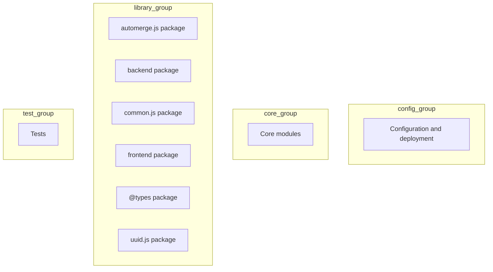

# Architecture report: automerge/automerge-classic

> Automated static analysis. **Observed** = directly seen in files/imports/AST; **Inferred** = interpretation from that evidence. Repository code was not executed.

## 1. Repository at a glance

| Item | Value |
| --- | --- |
| Repository | automerge/automerge-classic |
| Description | A JSON-like data structure (a CRDT) that can be modified concurrently by different users, and merged again automatically. |
| Language | JavaScript |
| Stars | 14681 |
| Licence | MIT |
| Analysed commit / branch | 0605308926a03353eb1072c3afa2a3a8580fcef9 / main |
| Framework(s) | None detected |
| Files analysed | 54 |
| Components | 9 |

## 2. Architecture in one minute

automerge/automerge-classic - A JSON-like data structure (a CRDT) that can be modified concurrently by different users, and merged again automatically.. This repository was analysed statically from 54 file(s) (0 Python). Detected technologies (observed from imports/manifests): GitHub Actions, TypeScript, webpack. Files are grouped into 9 component(s): automerge.js package, backend package, common.js package, Configuration and deployment, Core modules, frontend package, Tests, @types package. Findings below distinguish observed facts from inferred interpretation.

## 3. High-level block diagram

## 4. Main components

### automerge.js package (`automerge_js`)

- **Kind:** library
- **Status:** Observed
- **Confidence:** 0.85
- **Responsibility:** Groups 1 file(s) under automerge.js package (observed from repository paths and static analysis).
- **Paths:** `src/automerge.js`
- **Evidence:** [src/automerge.js](https://github.com/automerge/automerge-classic/blob/0605308926a03353eb1072c3afa2a3a8580fcef9/src/automerge.js)

### backend package (`backend`)

- **Kind:** library
- **Status:** Observed
- **Confidence:** 0.85
- **Responsibility:** Groups 7 file(s) under backend package (observed from repository paths and static analysis).
- **Paths:** `backend/backend.js`, `backend/columnar.js`, `backend/encoding.js`, `backend/index.js`, `backend/new.js`, `backend/sync.js`, `backend/util.js`
- **Evidence:** [backend/backend.js](https://github.com/automerge/automerge-classic/blob/0605308926a03353eb1072c3afa2a3a8580fcef9/backend/backend.js); [backend/columnar.js](https://github.com/automerge/automerge-classic/blob/0605308926a03353eb1072c3afa2a3a8580fcef9/backend/columnar.js); [backend/encoding.js](https://github.com/automerge/automerge-classic/blob/0605308926a03353eb1072c3afa2a3a8580fcef9/backend/encoding.js); [backend/index.js](https://github.com/automerge/automerge-classic/blob/0605308926a03353eb1072c3afa2a3a8580fcef9/backend/index.js); [backend/new.js](https://github.com/automerge/automerge-classic/blob/0605308926a03353eb1072c3afa2a3a8580fcef9/backend/new.js); [backend/sync.js](https://github.com/automerge/automerge-classic/blob/0605308926a03353eb1072c3afa2a3a8580fcef9/backend/sync.js); [backend/util.js](https://github.com/automerge/automerge-classic/blob/0605308926a03353eb1072c3afa2a3a8580fcef9/backend/util.js)

### common.js package (`common_js`)

- **Kind:** library
- **Status:** Observed
- **Confidence:** 0.85
- **Responsibility:** Groups 1 file(s) under common.js package (observed from repository paths and static analysis).
- **Paths:** `src/common.js`
- **Evidence:** [src/common.js](https://github.com/automerge/automerge-classic/blob/0605308926a03353eb1072c3afa2a3a8580fcef9/src/common.js)

### Configuration and deployment (`config`)

- **Kind:** config
- **Status:** Observed
- **Confidence:** 0.85
- **Responsibility:** Groups 2 file(s) under configuration and deployment (observed from repository paths and static analysis).
- **Paths:** `package.json`, `tsconfig.json`
- **Evidence:** [package.json](https://github.com/automerge/automerge-classic/blob/0605308926a03353eb1072c3afa2a3a8580fcef9/package.json); [tsconfig.json](https://github.com/automerge/automerge-classic/blob/0605308926a03353eb1072c3afa2a3a8580fcef9/tsconfig.json)

### Core modules (`core`)

- **Kind:** core
- **Status:** Observed
- **Confidence:** 0.85
- **Responsibility:** Groups 3 file(s) under core modules (observed from repository paths and static analysis).
- **Paths:** `karma.conf.js`, `karma.sauce.js`, `webpack.config.js`
- **Evidence:** [karma.conf.js](https://github.com/automerge/automerge-classic/blob/0605308926a03353eb1072c3afa2a3a8580fcef9/karma.conf.js); [karma.sauce.js](https://github.com/automerge/automerge-classic/blob/0605308926a03353eb1072c3afa2a3a8580fcef9/karma.sauce.js); [webpack.config.js](https://github.com/automerge/automerge-classic/blob/0605308926a03353eb1072c3afa2a3a8580fcef9/webpack.config.js)

### frontend package (`frontend`)

- **Kind:** library
- **Status:** Observed
- **Confidence:** 0.85
- **Responsibility:** Groups 10 file(s) under frontend package (observed from repository paths and static analysis).
- **Paths:** `frontend/apply_patch.js`, `frontend/constants.js`, `frontend/context.js`, `frontend/counter.js`, `frontend/index.js`, `frontend/numbers.js`, `frontend/observable.js`, `frontend/proxies.js`, `frontend/table.js`, `frontend/text.js`
- **Evidence:** [frontend/apply_patch.js](https://github.com/automerge/automerge-classic/blob/0605308926a03353eb1072c3afa2a3a8580fcef9/frontend/apply_patch.js); [frontend/constants.js](https://github.com/automerge/automerge-classic/blob/0605308926a03353eb1072c3afa2a3a8580fcef9/frontend/constants.js); [frontend/context.js](https://github.com/automerge/automerge-classic/blob/0605308926a03353eb1072c3afa2a3a8580fcef9/frontend/context.js); [frontend/counter.js](https://github.com/automerge/automerge-classic/blob/0605308926a03353eb1072c3afa2a3a8580fcef9/frontend/counter.js); [frontend/index.js](https://github.com/automerge/automerge-classic/blob/0605308926a03353eb1072c3afa2a3a8580fcef9/frontend/index.js); [frontend/numbers.js](https://github.com/automerge/automerge-classic/blob/0605308926a03353eb1072c3afa2a3a8580fcef9/frontend/numbers.js); [frontend/observable.js](https://github.com/automerge/automerge-classic/blob/0605308926a03353eb1072c3afa2a3a8580fcef9/frontend/observable.js); [frontend/proxies.js](https://github.com/automerge/automerge-classic/blob/0605308926a03353eb1072c3afa2a3a8580fcef9/frontend/proxies.js)

### Tests (`tests`)

- **Kind:** test
- **Status:** Observed
- **Confidence:** 0.85
- **Responsibility:** Groups 17 file(s) under tests (observed from repository paths and static analysis).
- **Paths:** `test/backend_test.js`, `test/columnar_test.js`, `test/context_test.js`, `test/encoding_test.js`, `test/frontend_test.js`, `test/fuzz_test.js`, `test/helpers.js`, `test/new_backend_test.js`, `test/observable_test.js`, `test/proxies_test.js`, `test/sync_test.js`, `test/table_test.js`, `test/test.js`, `test/text_test.js`, `test/typescript_test.ts`, `test/uuid_test.js`, `test/wasm.js`
- **Evidence:** [test/backend_test.js](https://github.com/automerge/automerge-classic/blob/0605308926a03353eb1072c3afa2a3a8580fcef9/test/backend_test.js); [test/columnar_test.js](https://github.com/automerge/automerge-classic/blob/0605308926a03353eb1072c3afa2a3a8580fcef9/test/columnar_test.js); [test/context_test.js](https://github.com/automerge/automerge-classic/blob/0605308926a03353eb1072c3afa2a3a8580fcef9/test/context_test.js); [test/encoding_test.js](https://github.com/automerge/automerge-classic/blob/0605308926a03353eb1072c3afa2a3a8580fcef9/test/encoding_test.js); [test/frontend_test.js](https://github.com/automerge/automerge-classic/blob/0605308926a03353eb1072c3afa2a3a8580fcef9/test/frontend_test.js); [test/fuzz_test.js](https://github.com/automerge/automerge-classic/blob/0605308926a03353eb1072c3afa2a3a8580fcef9/test/fuzz_test.js); [test/helpers.js](https://github.com/automerge/automerge-classic/blob/0605308926a03353eb1072c3afa2a3a8580fcef9/test/helpers.js); [test/new_backend_test.js](https://github.com/automerge/automerge-classic/blob/0605308926a03353eb1072c3afa2a3a8580fcef9/test/new_backend_test.js)

### @types package (`types`)

- **Kind:** library
- **Status:** Observed
- **Confidence:** 0.85
- **Responsibility:** Groups 1 file(s) under @types package (observed from repository paths and static analysis).
- **Paths:** `@types/automerge/index.d.ts`
- **Evidence:** [@types/automerge/index.d.ts](https://github.com/automerge/automerge-classic/blob/0605308926a03353eb1072c3afa2a3a8580fcef9/%40types/automerge/index.d.ts)

### uuid.js package (`uuid_js`)

- **Kind:** library
- **Status:** Observed
- **Confidence:** 0.85
- **Responsibility:** Groups 1 file(s) under uuid.js package (observed from repository paths and static analysis).
- **Paths:** `src/uuid.js`
- **Evidence:** [src/uuid.js](https://github.com/automerge/automerge-classic/blob/0605308926a03353eb1072c3afa2a3a8580fcef9/src/uuid.js)

## 5. Execution flow

**Observed** entry point(s):

- [backend/index.js](https://github.com/automerge/automerge-classic/blob/0605308926a03353eb1072c3afa2a3a8580fcef9/backend/index.js)
- [frontend/index.js](https://github.com/automerge/automerge-classic/blob/0605308926a03353eb1072c3afa2a3a8580fcef9/frontend/index.js)
- [src/automerge.js](https://github.com/automerge/automerge-classic/blob/0605308926a03353eb1072c3afa2a3a8580fcef9/src/automerge.js)

Representative flow (derived from observed entry points and the import graph; steps beyond the entry point are **Inferred**):

1. Execution starts at an observed entry point listed above, if present.
2. No internal import relationships between components were observed.

## 6. Project structure

### `(root)`

- `.babelrc` - other (61 bytes)
- `.eslintrc.json` - config (8876 bytes)
- `.gitignore` - other (50 bytes)
- `.mocharc.yaml` - config (222 bytes)
- `CHANGELOG.md` - docs (24219 bytes)
- `LICENSE` - docs (1118 bytes)
- `README.md` - docs (1912 bytes)
- `karma.conf.js` - source, JavaScript (1347 bytes)
- `karma.sauce.js` - source, JavaScript (2481 bytes)
- `package.json` - manifest (2180 bytes)
- `tsconfig.json` - config (396 bytes)
- `webpack.config.js` - source, JavaScript (484 bytes)

### `.github`

- `.github/workflows/automerge-ci.yml` - ci, YAML (2358 bytes)

### `@types`

- `@types/automerge/index.d.ts` - source, TypeScript (12985 bytes)

### `backend`

- `backend/backend.js` - source, JavaScript (7405 bytes)
- `backend/columnar.js` - source, JavaScript (42456 bytes)
- `backend/encoding.js` - source, JavaScript (41472 bytes)
- `backend/index.js` - source, JavaScript (690 bytes)
- `backend/new.js` - source, JavaScript (98256 bytes)
- `backend/sync.js` - source, JavaScript (20367 bytes)
- `backend/util.js` - source, JavaScript (375 bytes)

### `frontend`

- `frontend/apply_patch.js` - source, JavaScript (11129 bytes)
- `frontend/constants.js` - source, JavaScript (823 bytes)
- `frontend/context.js` - source, JavaScript (24956 bytes)
- `frontend/counter.js` - source, JavaScript (2586 bytes)
- `frontend/index.js` - source, JavaScript (14633 bytes)
- `frontend/numbers.js` - source, JavaScript (843 bytes)
- `frontend/observable.js` - source, JavaScript (4746 bytes)
- `frontend/proxies.js` - source, JavaScript (8340 bytes)
- `frontend/table.js` - source, JavaScript (7796 bytes)
- `frontend/text.js` - source, JavaScript (5172 bytes)

### `img`

- `img/brandmark.svg` - other (885 bytes)
- `img/lockup.svg` - other (3025 bytes)
- `img/sign.svg` - other (3567 bytes)

### `src`

- `src/automerge.js` - source, JavaScript (5560 bytes)
- `src/common.js` - source, JavaScript (1531 bytes)
- `src/uuid.js` - source, JavaScript (317 bytes)

### `test`

- `test/backend_test.js` - test, JavaScript (69722 bytes)
- `test/columnar_test.js` - test, JavaScript (4460 bytes)
- `test/context_test.js` - test, JavaScript (21206 bytes)
- `test/encoding_test.js` - test, JavaScript (58580 bytes)
- `test/frontend_test.js` - test, JavaScript (36390 bytes)
- `test/fuzz_test.js` - test, JavaScript (7963 bytes)
- `test/helpers.js` - test, JavaScript (1190 bytes)
- `test/new_backend_test.js` - test, JavaScript (114926 bytes)
- `test/observable_test.js` - test, JavaScript (7494 bytes)
- `test/proxies_test.js` - test, JavaScript (18910 bytes)
- `test/sync_test.js` - test, JavaScript (42220 bytes)
- `test/table_test.js` - test, JavaScript (7115 bytes)
- `test/test.js` - test, JavaScript (70696 bytes)
- `test/text_test.js` - test, JavaScript (22851 bytes)
- `test/typescript_test.ts` - test, TypeScript (24966 bytes)
- `test/uuid_test.js` - test, JavaScript (743 bytes)
- `test/wasm.js` - test, JavaScript (12427 bytes)

## 7. Key dependencies and integrations

| Name | Category | Status | Confidence | Evidence |
| --- | --- | --- | --- | --- |
| GitHub Actions | ci | Observed | 0.85 | [.github/workflows/automerge-ci.yml](https://github.com/automerge/automerge-classic/blob/0605308926a03353eb1072c3afa2a3a8580fcef9/.github/workflows/automerge-ci.yml) |
| TypeScript | tooling | Observed | 0.85 | [package.json:61](https://github.com/automerge/automerge-classic/blob/0605308926a03353eb1072c3afa2a3a8580fcef9/package.json#L61) |
| webpack | tooling | Observed | 0.85 | [package.json:13](https://github.com/automerge/automerge-classic/blob/0605308926a03353eb1072c3afa2a3a8580fcef9/package.json#L13) |

## 8. Data and state

No database, cache, queue, or persistent-state usage was observed in the analysed files. State handling, if any, may be in-memory or in files that were not analysed.

## 9. Configuration and deployment clues

- `.eslintrc.json` (config)
- `.github/workflows/automerge-ci.yml` (ci)
- `.mocharc.yaml` (config)
- `package.json` (manifest)
- `tsconfig.json` (config)

## 10. Design observations

- Tests are present alongside source code (Observed from test file paths).

These observations are interpretations (**Inferred**) of the observed structure, not guarantees about runtime design.

## 11. Limitations and unknowns

- Static analysis only: repository code was not executed, installed, or imported at runtime.
- Components and relationships are inferred from file paths, imports, and AST structure; runtime behaviour, dynamic imports, and reflection may not be visible.
- No clear application entry point was observed in the analysed files.
- Repository text was treated as untrusted data; no instructions found in repository files were followed, and likely secret values were redacted/excluded.
- JavaScript and TypeScript files were inventoried from paths and package manifests. They were not parsed with a full language AST, and repository code was not executed.

## 12. Source references

- [.github/workflows/automerge-ci.yml](https://github.com/automerge/automerge-classic/blob/0605308926a03353eb1072c3afa2a3a8580fcef9/.github/workflows/automerge-ci.yml)
- [@types/automerge/index.d.ts](https://github.com/automerge/automerge-classic/blob/0605308926a03353eb1072c3afa2a3a8580fcef9/%40types/automerge/index.d.ts)
- [backend/backend.js](https://github.com/automerge/automerge-classic/blob/0605308926a03353eb1072c3afa2a3a8580fcef9/backend/backend.js)
- [backend/columnar.js](https://github.com/automerge/automerge-classic/blob/0605308926a03353eb1072c3afa2a3a8580fcef9/backend/columnar.js)
- [backend/encoding.js](https://github.com/automerge/automerge-classic/blob/0605308926a03353eb1072c3afa2a3a8580fcef9/backend/encoding.js)
- [backend/index.js](https://github.com/automerge/automerge-classic/blob/0605308926a03353eb1072c3afa2a3a8580fcef9/backend/index.js)
- [backend/new.js](https://github.com/automerge/automerge-classic/blob/0605308926a03353eb1072c3afa2a3a8580fcef9/backend/new.js)
- [backend/sync.js](https://github.com/automerge/automerge-classic/blob/0605308926a03353eb1072c3afa2a3a8580fcef9/backend/sync.js)
- [backend/util.js](https://github.com/automerge/automerge-classic/blob/0605308926a03353eb1072c3afa2a3a8580fcef9/backend/util.js)
- [frontend/apply_patch.js](https://github.com/automerge/automerge-classic/blob/0605308926a03353eb1072c3afa2a3a8580fcef9/frontend/apply_patch.js)
- [frontend/constants.js](https://github.com/automerge/automerge-classic/blob/0605308926a03353eb1072c3afa2a3a8580fcef9/frontend/constants.js)
- [frontend/context.js](https://github.com/automerge/automerge-classic/blob/0605308926a03353eb1072c3afa2a3a8580fcef9/frontend/context.js)
- [frontend/counter.js](https://github.com/automerge/automerge-classic/blob/0605308926a03353eb1072c3afa2a3a8580fcef9/frontend/counter.js)
- [frontend/index.js](https://github.com/automerge/automerge-classic/blob/0605308926a03353eb1072c3afa2a3a8580fcef9/frontend/index.js)
- [frontend/numbers.js](https://github.com/automerge/automerge-classic/blob/0605308926a03353eb1072c3afa2a3a8580fcef9/frontend/numbers.js)
- [frontend/observable.js](https://github.com/automerge/automerge-classic/blob/0605308926a03353eb1072c3afa2a3a8580fcef9/frontend/observable.js)
- [frontend/proxies.js](https://github.com/automerge/automerge-classic/blob/0605308926a03353eb1072c3afa2a3a8580fcef9/frontend/proxies.js)
- [karma.conf.js](https://github.com/automerge/automerge-classic/blob/0605308926a03353eb1072c3afa2a3a8580fcef9/karma.conf.js)
- [karma.sauce.js](https://github.com/automerge/automerge-classic/blob/0605308926a03353eb1072c3afa2a3a8580fcef9/karma.sauce.js)
- [package.json](https://github.com/automerge/automerge-classic/blob/0605308926a03353eb1072c3afa2a3a8580fcef9/package.json)
- [package.json:13](https://github.com/automerge/automerge-classic/blob/0605308926a03353eb1072c3afa2a3a8580fcef9/package.json#L13)
- [package.json:61](https://github.com/automerge/automerge-classic/blob/0605308926a03353eb1072c3afa2a3a8580fcef9/package.json#L61)
- [src/automerge.js](https://github.com/automerge/automerge-classic/blob/0605308926a03353eb1072c3afa2a3a8580fcef9/src/automerge.js)
- [src/common.js](https://github.com/automerge/automerge-classic/blob/0605308926a03353eb1072c3afa2a3a8580fcef9/src/common.js)
- [src/uuid.js](https://github.com/automerge/automerge-classic/blob/0605308926a03353eb1072c3afa2a3a8580fcef9/src/uuid.js)
- [test/backend_test.js](https://github.com/automerge/automerge-classic/blob/0605308926a03353eb1072c3afa2a3a8580fcef9/test/backend_test.js)
- [test/columnar_test.js](https://github.com/automerge/automerge-classic/blob/0605308926a03353eb1072c3afa2a3a8580fcef9/test/columnar_test.js)
- [test/context_test.js](https://github.com/automerge/automerge-classic/blob/0605308926a03353eb1072c3afa2a3a8580fcef9/test/context_test.js)
- [test/encoding_test.js](https://github.com/automerge/automerge-classic/blob/0605308926a03353eb1072c3afa2a3a8580fcef9/test/encoding_test.js)
- [test/frontend_test.js](https://github.com/automerge/automerge-classic/blob/0605308926a03353eb1072c3afa2a3a8580fcef9/test/frontend_test.js)
- [test/fuzz_test.js](https://github.com/automerge/automerge-classic/blob/0605308926a03353eb1072c3afa2a3a8580fcef9/test/fuzz_test.js)
- [test/helpers.js](https://github.com/automerge/automerge-classic/blob/0605308926a03353eb1072c3afa2a3a8580fcef9/test/helpers.js)
- [test/new_backend_test.js](https://github.com/automerge/automerge-classic/blob/0605308926a03353eb1072c3afa2a3a8580fcef9/test/new_backend_test.js)
- [tsconfig.json](https://github.com/automerge/automerge-classic/blob/0605308926a03353eb1072c3afa2a3a8580fcef9/tsconfig.json)
- [webpack.config.js](https://github.com/automerge/automerge-classic/blob/0605308926a03353eb1072c3afa2a3a8580fcef9/webpack.config.js)
