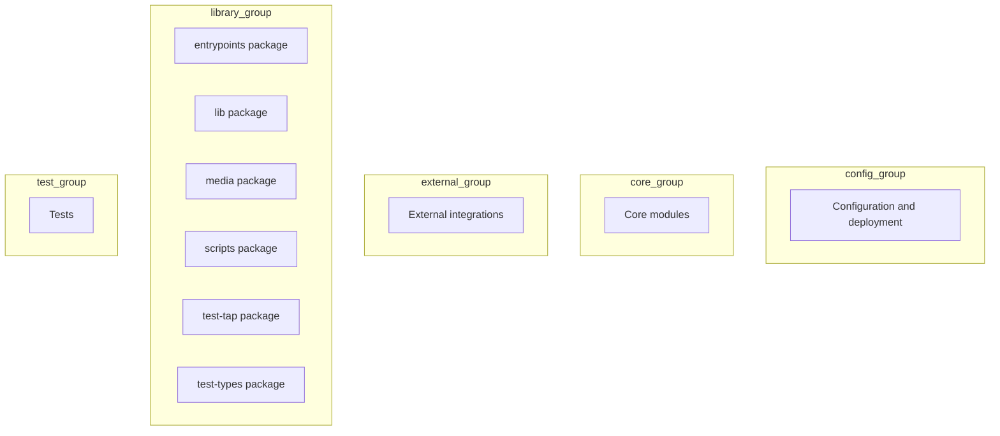

# Architecture report: avajs/ava

> Automated static analysis. **Observed** = directly seen in files/imports/AST; **Inferred** = interpretation from that evidence. Repository code was not executed.

## 1. Repository at a glance

| Item | Value |
| --- | --- |
| Repository | avajs/ava |
| Description | Node.js test runner that lets you develop with confidence 🚀 |
| Language | JavaScript |
| Stars | 20829 |
| Licence | MIT |
| Analysed commit / branch | a4fb2094052078faca5094fbe8cab7cbf18c785b / main |
| Framework(s) | None detected |
| Files analysed | 792 |
| Components | 10 |

## 2. Architecture in one minute

avajs/ava - Node.js test runner that lets you develop with confidence 🚀. This repository was analysed statically from 792 file(s) (0 Python). Detected technologies (observed from imports/manifests): GitHub Actions, TypeScript. Files are grouped into 10 component(s): Configuration and deployment, Core modules, entrypoints package, External integrations, lib package, media package, scripts package, test-tap package. Findings below distinguish observed facts from inferred interpretation.

## 3. High-level block diagram

## 4. Main components

### Configuration and deployment (`config`)

- **Kind:** config
- **Status:** Observed
- **Confidence:** 0.85
- **Responsibility:** Groups 54 file(s) under configuration and deployment (observed from repository paths and static analysis).
- **Paths:** `media/screenshot-fixtures/package.json`, `mise.toml`, `package.json`, `pnpm-workspace.yaml`, `test-tap/fixture/caching/package.json`, `test-tap/fixture/eslint-plugin-helper/for-overriding/package.json`, `test-tap/fixture/eslint-plugin-helper/package.json`, `test-tap/fixture/esm/package.json`, `test-tap/fixture/extensions/package.json`, `test-tap/fixture/globs/no-files/package.json`, `test-tap/fixture/load-config/contains-ava-property/package.json`, `test-tap/fixture/load-config/explicit-bad-extension/package.json`, `test-tap/fixture/load-config/factory-no-plain-return/package.json`, `test-tap/fixture/load-config/no-default-export/package.json`, `test-tap/fixture/load-config/no-plain-config/package.json`, `test-tap/fixture/load-config/non-function/package.json`, `test-tap/fixture/load-config/non-object-experiments/package.json`, `test-tap/fixture/load-config/package-no-file-yes-factory/package.json`, `test-tap/fixture/load-config/package-no-file-yes/package.json`, `test-tap/fixture/load-config/package-only/package.json`, `test-tap/fixture/load-config/package-yes-explicit-yes/package.json`, `test-tap/fixture/load-config/package-yes-file-yes/package.json`, `test-tap/fixture/load-config/throws/package.json`, `test-tap/fixture/load-config/unsupported-experiments/package.json`, `test-tap/fixture/package-config/fail-without-assertions/package.json`, `test-tap/fixture/package.json`, `test-tap/fixture/parallel-runs/custom-comparator/package.json`, `test-tap/fixture/parallel-runs/less-files-than-ci-total/package.json`, `test-tap/fixture/parallel-runs/more-files-than-ci-total/package.json`, `test-tap/fixture/parallel-runs/no-files/package.json`, `test-tap/fixture/pkg-type-module/package.json`, `test-tap/fixture/report/failfast/package.json`, `test-tap/fixture/report/failfast2/package.json`, `test-tap/fixture/report/only/package.json`, `test-tap/fixture/report/regular/package.json`, `test-tap/fixture/report/timeoutcontextlogs/package.json`, `test-tap/fixture/report/timeoutinmultiplefiles/package.json`, `test-tap/fixture/report/timeoutinsinglefile/package.json`, `test-tap/fixture/report/timeoutwithmatch/package.json`, `test-tap/fixture/report/watch/package.json`, `test-tap/fixture/reset-cache/package.json`, `test-tap/fixture/snapshots/__tests__-dir/package.json`, `test-tap/fixture/snapshots/package.json`, `test-tap/fixture/snapshots/test-content/package.json`, `test-tap/fixture/snapshots/test-dir/package.json`, `test-tap/fixture/snapshots/test-snapshot-location/package.json`, `test-tap/fixture/snapshots/test-sourcemaps/package.json`, `test-tap/fixture/snapshots/test-sourcemaps/tsconfig.json`, `test-tap/fixture/snapshots/tests-dir/package.json`, `test-tap/fixture/snapshots/watcher-rerun-unlink/package.json`, `test-tap/fixture/snapshots/watcher-rerun/package.json`, `test-tap/fixture/sort-tests/package.json`, `test-tap/fixture/tap/package.json`, `test-tap/tsconfig.json`
- **Evidence:** [media/screenshot-fixtures/package.json](https://github.com/avajs/ava/blob/a4fb2094052078faca5094fbe8cab7cbf18c785b/media/screenshot-fixtures/package.json); [mise.toml](https://github.com/avajs/ava/blob/a4fb2094052078faca5094fbe8cab7cbf18c785b/mise.toml); [package.json](https://github.com/avajs/ava/blob/a4fb2094052078faca5094fbe8cab7cbf18c785b/package.json); [pnpm-workspace.yaml](https://github.com/avajs/ava/blob/a4fb2094052078faca5094fbe8cab7cbf18c785b/pnpm-workspace.yaml); [test-tap/fixture/caching/package.json](https://github.com/avajs/ava/blob/a4fb2094052078faca5094fbe8cab7cbf18c785b/test-tap/fixture/caching/package.json); [test-tap/fixture/eslint-plugin-helper/for-overriding/package.json](https://github.com/avajs/ava/blob/a4fb2094052078faca5094fbe8cab7cbf18c785b/test-tap/fixture/eslint-plugin-helper/for-overriding/package.json); [test-tap/fixture/eslint-plugin-helper/package.json](https://github.com/avajs/ava/blob/a4fb2094052078faca5094fbe8cab7cbf18c785b/test-tap/fixture/eslint-plugin-helper/package.json); [test-tap/fixture/esm/package.json](https://github.com/avajs/ava/blob/a4fb2094052078faca5094fbe8cab7cbf18c785b/test-tap/fixture/esm/package.json)

### Core modules (`core`)

- **Kind:** core
- **Status:** Observed
- **Confidence:** 0.85
- **Responsibility:** Groups 3 file(s) under core modules (observed from repository paths and static analysis).
- **Paths:** `ava.config.js`, `index.d.ts`, `plugin.d.ts`
- **Evidence:** [ava.config.js](https://github.com/avajs/ava/blob/a4fb2094052078faca5094fbe8cab7cbf18c785b/ava.config.js); [index.d.ts](https://github.com/avajs/ava/blob/a4fb2094052078faca5094fbe8cab7cbf18c785b/index.d.ts); [plugin.d.ts](https://github.com/avajs/ava/blob/a4fb2094052078faca5094fbe8cab7cbf18c785b/plugin.d.ts)

### entrypoints package (`entrypoints`)

- **Kind:** library
- **Status:** Observed
- **Confidence:** 0.85
- **Responsibility:** Groups 7 file(s) under entrypoints package (observed from repository paths and static analysis).
- **Paths:** `entrypoints/cli.js`, `entrypoints/eslint-plugin-helper.js`, `entrypoints/internal.d.ts`, `entrypoints/main.d.ts`, `entrypoints/main.js`, `entrypoints/plugin.d.ts`, `entrypoints/plugin.js`
- **Evidence:** [entrypoints/cli.js](https://github.com/avajs/ava/blob/a4fb2094052078faca5094fbe8cab7cbf18c785b/entrypoints/cli.js); [entrypoints/eslint-plugin-helper.js](https://github.com/avajs/ava/blob/a4fb2094052078faca5094fbe8cab7cbf18c785b/entrypoints/eslint-plugin-helper.js); [entrypoints/internal.d.ts](https://github.com/avajs/ava/blob/a4fb2094052078faca5094fbe8cab7cbf18c785b/entrypoints/internal.d.ts); [entrypoints/main.d.ts](https://github.com/avajs/ava/blob/a4fb2094052078faca5094fbe8cab7cbf18c785b/entrypoints/main.d.ts); [entrypoints/main.js](https://github.com/avajs/ava/blob/a4fb2094052078faca5094fbe8cab7cbf18c785b/entrypoints/main.js); [entrypoints/plugin.d.ts](https://github.com/avajs/ava/blob/a4fb2094052078faca5094fbe8cab7cbf18c785b/entrypoints/plugin.d.ts); [entrypoints/plugin.js](https://github.com/avajs/ava/blob/a4fb2094052078faca5094fbe8cab7cbf18c785b/entrypoints/plugin.js)

### External integrations (`external_integrations`)

- **Kind:** external
- **Status:** Observed
- **Confidence:** 0.85
- **Responsibility:** Groups 7 file(s) under external integrations (observed from repository paths and static analysis).
- **Paths:** `test-tap/integration/assorted.js`, `test-tap/integration/debug.js`, `test-tap/integration/parallel-runs.js`, `test-tap/integration/repl.js`, `test-tap/integration/snapshots.js`, `test-tap/integration/stack-traces.js`, `test-tap/integration/stalled.js`
- **Evidence:** [test-tap/integration/assorted.js](https://github.com/avajs/ava/blob/a4fb2094052078faca5094fbe8cab7cbf18c785b/test-tap/integration/assorted.js); [test-tap/integration/debug.js](https://github.com/avajs/ava/blob/a4fb2094052078faca5094fbe8cab7cbf18c785b/test-tap/integration/debug.js); [test-tap/integration/parallel-runs.js](https://github.com/avajs/ava/blob/a4fb2094052078faca5094fbe8cab7cbf18c785b/test-tap/integration/parallel-runs.js); [test-tap/integration/repl.js](https://github.com/avajs/ava/blob/a4fb2094052078faca5094fbe8cab7cbf18c785b/test-tap/integration/repl.js); [test-tap/integration/snapshots.js](https://github.com/avajs/ava/blob/a4fb2094052078faca5094fbe8cab7cbf18c785b/test-tap/integration/snapshots.js); [test-tap/integration/stack-traces.js](https://github.com/avajs/ava/blob/a4fb2094052078faca5094fbe8cab7cbf18c785b/test-tap/integration/stack-traces.js); [test-tap/integration/stalled.js](https://github.com/avajs/ava/blob/a4fb2094052078faca5094fbe8cab7cbf18c785b/test-tap/integration/stalled.js)

### lib package (`lib`)

- **Kind:** library
- **Status:** Observed
- **Confidence:** 0.85
- **Responsibility:** Groups 53 file(s) under lib package (observed from repository paths and static analysis).
- **Paths:** `lib/api-event-iterator.js`, `lib/api.js`, `lib/assert.js`, `lib/assertion-error.js`, `lib/chalk.js`, `lib/cli.js`, `lib/code-excerpt.js`, `lib/concordance-options.js`, `lib/concordance.js`, `lib/context-ref.js`, `lib/create-chain.js`, `lib/environment-variables.js`, `lib/eslint-plugin-helper-worker.js`, `lib/extensions.js`, `lib/fork.js`, `lib/glob-helpers.js`, `lib/globs.js`, `lib/ipc-flow-control.js`, `lib/is-ci.js`, `lib/like-selector.js`, `lib/line-numbers.js`, `lib/load-config.js`, `lib/node-arguments.js`, `lib/now-and-timers.js`, `lib/parse-test-args.js`, `lib/pkg.js`, `lib/plugin-support/shared-worker-loader.js`, `lib/plugin-support/shared-workers.js`, `lib/provider-manager.js`, `lib/reporters/beautify-stack.js`, `lib/reporters/colors.js`, `lib/reporters/default.js`, `lib/reporters/format-serialized-error.js`, `lib/reporters/improper-usage-messages.js`, `lib/reporters/prefix-title.js`, `lib/reporters/tap.js`, `lib/run-status.js`, `lib/runner.js`, `lib/scheduler.js`, `lib/serialize-error.js`, `lib/snapshot-manager.js`, `lib/test.js`, `lib/watcher.js`, `lib/worker/base.js`, `lib/worker/channel.js`, `lib/worker/completion-handlers.js`, `lib/worker/guard-environment.js`, `lib/worker/line-numbers.js`, `lib/worker/main.js`, `lib/worker/options.js`, `lib/worker/plugin.js`, `lib/worker/state.js`, `lib/worker/utils.js`
- **Evidence:** [lib/api-event-iterator.js](https://github.com/avajs/ava/blob/a4fb2094052078faca5094fbe8cab7cbf18c785b/lib/api-event-iterator.js); [lib/api.js](https://github.com/avajs/ava/blob/a4fb2094052078faca5094fbe8cab7cbf18c785b/lib/api.js); [lib/assert.js](https://github.com/avajs/ava/blob/a4fb2094052078faca5094fbe8cab7cbf18c785b/lib/assert.js); [lib/assertion-error.js](https://github.com/avajs/ava/blob/a4fb2094052078faca5094fbe8cab7cbf18c785b/lib/assertion-error.js); [lib/chalk.js](https://github.com/avajs/ava/blob/a4fb2094052078faca5094fbe8cab7cbf18c785b/lib/chalk.js); [lib/cli.js](https://github.com/avajs/ava/blob/a4fb2094052078faca5094fbe8cab7cbf18c785b/lib/cli.js); [lib/code-excerpt.js](https://github.com/avajs/ava/blob/a4fb2094052078faca5094fbe8cab7cbf18c785b/lib/code-excerpt.js); [lib/concordance-options.js](https://github.com/avajs/ava/blob/a4fb2094052078faca5094fbe8cab7cbf18c785b/lib/concordance-options.js)

### media package (`media`)

- **Kind:** library
- **Status:** Observed
- **Confidence:** 0.85
- **Responsibility:** Groups 6 file(s) under media package (observed from repository paths and static analysis).
- **Paths:** `media/screenshot-fixtures/magic-assert-buffers.js`, `media/screenshot-fixtures/magic-assert-exceptions.js`, `media/screenshot-fixtures/magic-assert-objects.js`, `media/screenshot-fixtures/magic-assert-strings.js`, `media/screenshot-fixtures/tap-reporter.js`, `media/screenshot-fixtures/verbose-reporter.js`
- **Evidence:** [media/screenshot-fixtures/magic-assert-buffers.js](https://github.com/avajs/ava/blob/a4fb2094052078faca5094fbe8cab7cbf18c785b/media/screenshot-fixtures/magic-assert-buffers.js); [media/screenshot-fixtures/magic-assert-exceptions.js](https://github.com/avajs/ava/blob/a4fb2094052078faca5094fbe8cab7cbf18c785b/media/screenshot-fixtures/magic-assert-exceptions.js); [media/screenshot-fixtures/magic-assert-objects.js](https://github.com/avajs/ava/blob/a4fb2094052078faca5094fbe8cab7cbf18c785b/media/screenshot-fixtures/magic-assert-objects.js); [media/screenshot-fixtures/magic-assert-strings.js](https://github.com/avajs/ava/blob/a4fb2094052078faca5094fbe8cab7cbf18c785b/media/screenshot-fixtures/magic-assert-strings.js); [media/screenshot-fixtures/tap-reporter.js](https://github.com/avajs/ava/blob/a4fb2094052078faca5094fbe8cab7cbf18c785b/media/screenshot-fixtures/tap-reporter.js); [media/screenshot-fixtures/verbose-reporter.js](https://github.com/avajs/ava/blob/a4fb2094052078faca5094fbe8cab7cbf18c785b/media/screenshot-fixtures/verbose-reporter.js)

### scripts package (`scripts`)

- **Kind:** library
- **Status:** Observed
- **Confidence:** 0.85
- **Responsibility:** Groups 2 file(s) under scripts package (observed from repository paths and static analysis).
- **Paths:** `scripts/ci.sh`, `scripts/test.sh`
- **Evidence:** [scripts/ci.sh](https://github.com/avajs/ava/blob/a4fb2094052078faca5094fbe8cab7cbf18c785b/scripts/ci.sh); [scripts/test.sh](https://github.com/avajs/ava/blob/a4fb2094052078faca5094fbe8cab7cbf18c785b/scripts/test.sh)

### test-tap package (`test_tap`)

- **Kind:** library
- **Status:** Observed
- **Confidence:** 0.85
- **Responsibility:** Groups 161 file(s) under test-tap package (observed from repository paths and static analysis).
- **Paths:** `test-tap/api.js`, `test-tap/assert.js`, `test-tap/chalk.js`, `test-tap/code-excerpt.js`, `test-tap/eslint-plugin-helper.js`, `test-tap/fixture/caching/test.js`, `test-tap/fixture/error-in-anonymous-function.js`, `test-tap/fixture/es2015.js`, `test-tap/fixture/eslint-plugin-helper/ava.config.js`, `test-tap/fixture/eslint-plugin-helper/for-overriding/ava.config.js`, `test-tap/fixture/fail-fast/crash/crashes.js`, `test-tap/fixture/fail-fast/crash/passes.js`, `test-tap/fixture/fail-fast/multiple-files/fails.js`, `test-tap/fixture/fail-fast/multiple-files/passes-slow.js`, `test-tap/fixture/fail-fast/multiple-files/passes.js`, `test-tap/fixture/fail-fast/single-file/test.js`, `test-tap/fixture/fail-fast/timeout/fails.js`, `test-tap/fixture/fail-fast/timeout/passes-slow.js`, `test-tap/fixture/fail-fast/timeout/passes.js`, `test-tap/fixture/fail-fast/without-error/a.js`, `test-tap/fixture/fail-fast/without-error/b.js`, `test-tap/fixture/formatting-color.js`, `test-tap/fixture/globs/default-patterns/sub/directory/__tests__/_foo.js`, `test-tap/fixture/globs/default-patterns/sub/directory/__tests__/fixtures/foo.js`, `test-tap/fixture/globs/default-patterns/sub/directory/__tests__/foo.js`, `test-tap/fixture/globs/default-patterns/sub/directory/__tests__/helpers/foo.js`, `test-tap/fixture/globs/default-patterns/sub/directory/__tests__/helpers/foo.ts`, `test-tap/fixture/globs/default-patterns/sub/directory/bar.spec.js`, `test-tap/fixture/globs/default-patterns/sub/directory/bar.test.js`, `test-tap/fixture/globs/default-patterns/test-foo.js`, `test-tap/fixture/globs/default-patterns/test-foo.ts`, `test-tap/fixture/globs/default-patterns/test.js`, `test-tap/fixture/hooks-skipped.js`, `test-tap/fixture/ignored-dirs/helpers/test.js`, `test-tap/fixture/ignored-dirs/test.js`, `test-tap/fixture/infinity-stack-trace.js`, `test-tap/fixture/js.js`, `test-tap/fixture/load-config/contains-ava-property/ava.config.js`, `test-tap/fixture/load-config/factory-no-plain-return/ava.config.js`, `test-tap/fixture/load-config/no-default-export/ava.config.js`, `test-tap/fixture/load-config/no-plain-config/ava.config.js`, `test-tap/fixture/load-config/non-function/ava.config.js`, `test-tap/fixture/load-config/non-object-experiments/ava.config.js`, `test-tap/fixture/load-config/package-no-file-yes-factory/ava.config.js`, `test-tap/fixture/load-config/package-no-file-yes/ava.config.js`, `test-tap/fixture/load-config/package-yes-explicit-yes/explicit.js`, `test-tap/fixture/load-config/package-yes-explicit-yes/nested/explicit.js`, `test-tap/fixture/load-config/package-yes-file-yes/ava.config.js`, `test-tap/fixture/load-config/throws/ava.config.js`, `test-tap/fixture/load-config/unsupported-experiments/ava.config.js`, `test-tap/fixture/long-running.js`, `test-tap/fixture/match-no-match-2.js`, `test-tap/fixture/match-no-match.js`, `test-tap/fixture/matcher-skip.js`, `test-tap/fixture/mjs.mjs`, `test-tap/fixture/no-tests.js`, `test-tap/fixture/node-env-foo.js`, `test-tap/fixture/node-env-test.js`, `test-tap/fixture/package-config/fail-without-assertions/test.js`, `test-tap/fixture/parallel-runs/custom-comparator/0-1.js`, `test-tap/fixture/parallel-runs/custom-comparator/0-2.js`, `test-tap/fixture/parallel-runs/custom-comparator/0-3.js`, `test-tap/fixture/parallel-runs/custom-comparator/1-1.js`, `test-tap/fixture/parallel-runs/custom-comparator/1-2.js`, `test-tap/fixture/parallel-runs/custom-comparator/1-3.js`, `test-tap/fixture/parallel-runs/custom-comparator/2-1.js`, `test-tap/fixture/parallel-runs/custom-comparator/2-2.js`, `test-tap/fixture/parallel-runs/custom-comparator/2-3.js`, `test-tap/fixture/parallel-runs/custom-comparator/ava.config.js`, `test-tap/fixture/parallel-runs/less-files-than-ci-total/2.js`, `test-tap/fixture/parallel-runs/less-files-than-ci-total/9.js`, `test-tap/fixture/parallel-runs/more-files-than-ci-total/10.js`, `test-tap/fixture/parallel-runs/more-files-than-ci-total/2.js`, `test-tap/fixture/parallel-runs/more-files-than-ci-total/2a.js`, `test-tap/fixture/parallel-runs/more-files-than-ci-total/9.js`, `test-tap/fixture/parallel-runs/more-files-than-ci-total/Ab.js`, `test-tap/fixture/parallel-runs/more-files-than-ci-total/a.js`, `test-tap/fixture/parallel-runs/more-files-than-ci-total/b.js`, `test-tap/fixture/parallel-runs/more-files-than-ci-total/c.js`, `test-tap/fixture/pkg-type-module/test.js`, `test-tap/fixture/process-cwd-default.js`, `test-tap/fixture/process-cwd-pkgdir.js`, `test-tap/fixture/report/edgecases/ast-syntax-error.js`, `test-tap/fixture/report/edgecases/ava-import-no-test-declaration.js`, `test-tap/fixture/report/edgecases/import-and-use-test-member.js`, `test-tap/fixture/report/edgecases/no-ava-import.js`, `test-tap/fixture/report/edgecases/test.js`, `test-tap/fixture/report/edgecases/throws.js`, `test-tap/fixture/report/failfast/a.js`, `test-tap/fixture/report/failfast/b.js`, `test-tap/fixture/report/failfast2/a.js`, `test-tap/fixture/report/failfast2/b.js`, `test-tap/fixture/report/only/a.js`, `test-tap/fixture/report/only/b.js`, `test-tap/fixture/report/regular/bad-test-chain.js`, `test-tap/fixture/report/regular/nested-objects.js`, `test-tap/fixture/report/regular/output-in-hook.js`, `test-tap/fixture/report/regular/test.js`, `test-tap/fixture/report/regular/traces-in-t-throws.js`, `test-tap/fixture/report/regular/uncaught-exception.js`, `test-tap/fixture/report/regular/unhandled-rejection.js`, `test-tap/fixture/report/timeoutcontextlogs/a.js`, `test-tap/fixture/report/timeoutcontextlogs/b.js`, `test-tap/fixture/report/timeoutinmultiplefiles/a.js`, `test-tap/fixture/report/timeoutinmultiplefiles/b.js`, `test-tap/fixture/report/timeoutinsinglefile/a.js`, `test-tap/fixture/report/timeoutwithmatch/a.js`, `test-tap/fixture/report/watch/test.js`, `test-tap/fixture/reset-cache/test.js`, `test-tap/fixture/serial.js`, `test-tap/fixture/skip-only.js`, `test-tap/fixture/snapshots/__tests__-dir/__tests__/test.js`, `test-tap/fixture/snapshots/test-snapshot-location/src/feature/nested-feature/test.js`, `test-tap/fixture/snapshots/test-snapshot-location/src/feature/test.js`, `test-tap/fixture/snapshots/test-snapshot-location/src/test.js`, `test-tap/fixture/snapshots/test-sourcemaps/src/feature/__tests__/test.ts`, `test-tap/fixture/snapshots/test-sourcemaps/src/test.ts`, `test-tap/fixture/snapshots/test.js`, `test-tap/fixture/snapshots/watcher-rerun-unlink/test.js`, `test-tap/fixture/snapshots/watcher-rerun/test.js`, `test-tap/fixture/sort-tests/0.js`, `test-tap/fixture/sort-tests/1.js`, `test-tap/fixture/sort-tests/2.js`, `test-tap/fixture/sort-tests/ava.config.js`, `test-tap/fixture/stalled-tests/observable.js`, `test-tap/fixture/stalled-tests/promise.js`, `test-tap/fixture/symlinkdir/symlink.js`, `test-tap/fixture/tap/test.js`, `test-tap/fixture/target-symlink.js`, `test-tap/fixture/test-count-2.js`, `test-tap/fixture/test-count-3.js`, `test-tap/fixture/test-count.js`, `test-tap/fixture/with-dependencies/dep-1.js`, `test-tap/fixture/with-dependencies/dep-2.js`, `test-tap/fixture/with-dependencies/no-tests.js`, `test-tap/fixture/with-dependencies/test-failure.js`, `test-tap/fixture/with-dependencies/test-uncaught-exception.js`, `test-tap/fixture/with-dependencies/test.js`, `test-tap/fixture/worker-argv.js`, `test-tap/globs.js`, `test-tap/helper/ava-test.js`, `test-tap/helper/chalk0.js`, `test-tap/helper/cli.js`, `test-tap/helper/fix-reporter-env.js`, `test-tap/helper/replay-report.js`, `test-tap/helper/report-worker.js`, `test-tap/helper/report.js`, `test-tap/helper/tty-stream.js`, `test-tap/hooks.js`, `test-tap/line-numbers.js`, `test-tap/node-arguments.js`, `test-tap/promise.js`, `test-tap/reporters/default.js`, `test-tap/reporters/improper-usage-messages.js`, `test-tap/reporters/prefix-title.js`, `test-tap/reporters/tap.js`, `test-tap/run-status.js`, `test-tap/runner.js`, `test-tap/test-try-commit.js`, `test-tap/test.js`, `test-tap/try-snapshot.js`
- **Evidence:** [test-tap/api.js](https://github.com/avajs/ava/blob/a4fb2094052078faca5094fbe8cab7cbf18c785b/test-tap/api.js); [test-tap/assert.js](https://github.com/avajs/ava/blob/a4fb2094052078faca5094fbe8cab7cbf18c785b/test-tap/assert.js); [test-tap/chalk.js](https://github.com/avajs/ava/blob/a4fb2094052078faca5094fbe8cab7cbf18c785b/test-tap/chalk.js); [test-tap/code-excerpt.js](https://github.com/avajs/ava/blob/a4fb2094052078faca5094fbe8cab7cbf18c785b/test-tap/code-excerpt.js); [test-tap/eslint-plugin-helper.js](https://github.com/avajs/ava/blob/a4fb2094052078faca5094fbe8cab7cbf18c785b/test-tap/eslint-plugin-helper.js); [test-tap/fixture/caching/test.js](https://github.com/avajs/ava/blob/a4fb2094052078faca5094fbe8cab7cbf18c785b/test-tap/fixture/caching/test.js); [test-tap/fixture/error-in-anonymous-function.js](https://github.com/avajs/ava/blob/a4fb2094052078faca5094fbe8cab7cbf18c785b/test-tap/fixture/error-in-anonymous-function.js); [test-tap/fixture/es2015.js](https://github.com/avajs/ava/blob/a4fb2094052078faca5094fbe8cab7cbf18c785b/test-tap/fixture/es2015.js)

### test-types package (`test_types`)

- **Kind:** library
- **Status:** Observed
- **Confidence:** 0.85
- **Responsibility:** Groups 13 file(s) under test-types package (observed from repository paths and static analysis).
- **Paths:** `test-types/module/assertions-as-type-guards.ts`, `test-types/module/conditional-chains.ts`, `test-types/module/context.ts`, `test-types/module/deep-equal.ts`, `test-types/module/implementation-result.ts`, `test-types/module/like.ts`, `test-types/module/macros.ts`, `test-types/module/plugin.ts`, `test-types/module/snapshot.ts`, `test-types/module/teardown.ts`, `test-types/module/throws.ts`, `test-types/module/timeout.ts`, `test-types/module/try-commit.ts`
- **Evidence:** [test-types/module/assertions-as-type-guards.ts](https://github.com/avajs/ava/blob/a4fb2094052078faca5094fbe8cab7cbf18c785b/test-types/module/assertions-as-type-guards.ts); [test-types/module/conditional-chains.ts](https://github.com/avajs/ava/blob/a4fb2094052078faca5094fbe8cab7cbf18c785b/test-types/module/conditional-chains.ts); [test-types/module/context.ts](https://github.com/avajs/ava/blob/a4fb2094052078faca5094fbe8cab7cbf18c785b/test-types/module/context.ts); [test-types/module/deep-equal.ts](https://github.com/avajs/ava/blob/a4fb2094052078faca5094fbe8cab7cbf18c785b/test-types/module/deep-equal.ts); [test-types/module/implementation-result.ts](https://github.com/avajs/ava/blob/a4fb2094052078faca5094fbe8cab7cbf18c785b/test-types/module/implementation-result.ts); [test-types/module/like.ts](https://github.com/avajs/ava/blob/a4fb2094052078faca5094fbe8cab7cbf18c785b/test-types/module/like.ts); [test-types/module/macros.ts](https://github.com/avajs/ava/blob/a4fb2094052078faca5094fbe8cab7cbf18c785b/test-types/module/macros.ts); [test-types/module/plugin.ts](https://github.com/avajs/ava/blob/a4fb2094052078faca5094fbe8cab7cbf18c785b/test-types/module/plugin.ts)

### Tests (`tests`)

- **Kind:** test
- **Status:** Observed
- **Confidence:** 0.85
- **Responsibility:** Groups 332 file(s) under tests (observed from repository paths and static analysis).
- **Paths:** `test-tap/fixture/globs/custom-extension/test/do-not-compile.js`, `test-tap/fixture/globs/custom-extension/test/foo.jsx`, `test-tap/fixture/globs/custom-extension/test/helpers/a.jsx`, `test-tap/fixture/globs/custom-extension/test/helpers/b.js`, `test-tap/fixture/globs/custom-extension/test/sub/_helper.jsx`, `test-tap/fixture/globs/custom-extension/test/sub/bar.jsx`, `test-tap/fixture/globs/cwd/dir-a/test/bar.js`, `test-tap/fixture/globs/cwd/dir-a/test/foo.js`, `test-tap/fixture/globs/cwd/dir-b/test/baz.js`, `test-tap/fixture/globs/default-patterns/test/_foo-help.js`, `test-tap/fixture/globs/default-patterns/test/baz.js`, `test-tap/fixture/globs/default-patterns/test/deep/deep.js`, `test-tap/fixture/globs/default-patterns/test/fixtures/foo-fixt.js`, `test-tap/fixture/globs/default-patterns/test/helpers/test.js`, `test-tap/fixture/globs/default-patterns/tests/_foo-help.js`, `test-tap/fixture/globs/default-patterns/tests/baz.js`, `test-tap/fixture/globs/default-patterns/tests/deep/deep.js`, `test-tap/fixture/globs/default-patterns/tests/fixtures/foo-fixt.js`, `test-tap/fixture/globs/default-patterns/tests/helpers/test.js`, `test-tap/fixture/snapshots/test-content/tests/test.js`, `test-tap/fixture/snapshots/test-dir/test/test.js`, `test-tap/fixture/snapshots/test-sourcemaps/src/test/test.ts`, `test-tap/fixture/snapshots/tests-dir/tests/test.js`, `test/.fake-root`, `test/README.md`, `test/assertions/fixtures/global-regex.js`, `test/assertions/fixtures/happy-path.js`, `test/assertions/fixtures/happy-path.js.md`, `test/assertions/fixtures/package.json`, `test/assertions/fixtures/throws-async.js`, `test/assertions/fixtures/throws-no-error.js`, `test/assertions/fixtures/throws.js`, `test/assertions/snapshots/test.js.md`, `test/assertions/test.js`, `test/builtin-nodejs-assert/fixtures/assert-failure.js`, `test/builtin-nodejs-assert/fixtures/package.json`, `test/builtin-nodejs-assert/test.js`, `test/child-process/fixtures/package.json`, `test/child-process/fixtures/test.js`, `test/child-process/test.js`, `test/completion-handlers/fixtures/exit0.js`, `test/completion-handlers/fixtures/one.js`, `test/completion-handlers/fixtures/package.json`, `test/completion-handlers/fixtures/two.js`, `test/completion-handlers/test.js`, `test/concurrency/fixtures/concurrency.js`, `test/concurrency/fixtures/package.json`, `test/concurrency/snapshots/test.js.md`, `test/concurrency/test.js`, `test/config-require/fixtures/exports-default/package.json`, `test/config-require/fixtures/exports-default/required.js`, `test/config-require/fixtures/exports-default/test.js`, `test/config-require/fixtures/failed-import/package.json`, `test/config-require/fixtures/failed-import/test.js`, `test/config-require/fixtures/non-json/ava.config.js`, `test/config-require/fixtures/non-json/package.json`, `test/config-require/fixtures/non-json/required.js`, `test/config-require/fixtures/non-json/test.js`, `test/config-require/fixtures/require-dependency/.gitignore`, `test/config-require/fixtures/require-dependency/package.json`, `test/config-require/fixtures/require-dependency/test.js`, `test/config-require/fixtures/single-argument/package.json`, `test/config-require/fixtures/single-argument/required.js`, `test/config-require/fixtures/single-argument/test.js`, `test/config-require/fixtures/with-arguments/ava.config.js`, `test/config-require/fixtures/with-arguments/package.json`, `test/config-require/fixtures/with-arguments/required-esm.js`, `test/config-require/fixtures/with-arguments/required.js`, `test/config-require/fixtures/with-arguments/side-effect.js`, `test/config-require/fixtures/with-arguments/test.js`, `test/config-require/test.js`, `test/config/fixtures/config-errors/ava.config.js`, `test/config/fixtures/config-errors/package.json`, `test/config/fixtures/config-errors/test.js`, `test/config/fixtures/factory-promise-return/ava.config.js`, `test/config/fixtures/factory-promise-return/package.json`, `test/config/fixtures/file-yes-js-yes-mjs-yes/ava.config.js`, `test/config/fixtures/file-yes-js-yes-mjs-yes/ava.config.mjs`, `test/config/fixtures/file-yes-js-yes-mjs-yes/package.json`, `test/config/fixtures/js-as-esm/ava.config.js`, `test/config/fixtures/js-as-esm/error.js`, `test/config/fixtures/js-as-esm/no-default-export.js`, `test/config/fixtures/js-as-esm/package.json`, `test/config/fixtures/js-with-tests/ava.config.js`, `test/config/fixtures/js-with-tests/dir-a-wrapper/dir-a/dir-a-wrapper-3.js`, `test/config/fixtures/js-with-tests/dir-a-wrapper/dir-a/dir-a-wrapper-4.js`, `test/config/fixtures/js-with-tests/dir-a/dir-a-base-1.js`, `test/config/fixtures/js-with-tests/dir-a/dir-a-base-2.js`, `test/config/fixtures/js-with-tests/package.json`, `test/config/fixtures/mjs/ava.config.mjs`, `test/config/fixtures/mjs/error.mjs`, `test/config/fixtures/mjs/no-default-export.mjs`, `test/config/fixtures/mjs/package.json`, `test/config/fixtures/monorepo/ava.config.mjs`, `test/config/fixtures/monorepo/package/foo.js`, `test/config/fixtures/monorepo/package/package.json`, `test/config/fixtures/pkg-with-tests/dir-a-wrapper/dir-a/dir-a-wrapper-3.js`, `test/config/fixtures/pkg-with-tests/dir-a-wrapper/dir-a/dir-a-wrapper-4.js`, `test/config/fixtures/pkg-with-tests/dir-a/dir-a-base-1.js`, `test/config/fixtures/pkg-with-tests/dir-a/dir-a-base-2.js`, `test/config/fixtures/pkg-with-tests/package.json`, `test/config/fixtures/promise-config/ava.config.js`, `test/config/fixtures/promise-config/package.json`, `test/config/fixtures/unsupported-configs/ava.config.js`, `test/config/fixtures/unsupported-configs/ava.config.json`, `test/config/fixtures/unsupported-configs/package.json`, `test/config/integration.js`, `test/config/loader.js`, `test/config/next-gen.js`, `test/config/snapshots/integration.js.md`, `test/config/snapshots/loader.js.md`, `test/config/snapshots/next-gen.js.md`, `test/create-chain/test.js`, `test/environment-variables/fixtures/environment-variables/ava.config.js`, `test/environment-variables/fixtures/environment-variables/environment-variables.js`, `test/environment-variables/fixtures/environment-variables/package.json`, `test/environment-variables/fixtures/invalid-environment-variables/package.json`, `test/environment-variables/snapshots/test.js.md`, `test/environment-variables/test.js`, `test/extensions/fixtures/object-form/package.json`, `test/extensions/fixtures/shared-duplicates/package.json`, `test/extensions/fixtures/top-level-duplicates/package.json`, `test/extensions/fixtures/top-level/package.json`, `test/extensions/snapshots/test.js.md`, `test/extensions/test.js`, `test/external-assertions/fixtures/assert-failure.js`, `test/external-assertions/fixtures/expect-failure.js`, `test/external-assertions/fixtures/package.json`, `test/external-assertions/snapshots/test.js.md`, `test/external-assertions/test.js`, `test/globs/fixtures/files/package.json`, `test/globs/fixtures/filter-by-directory/directory/test.js`, `test/globs/fixtures/filter-by-directory/package.json`, `test/globs/fixtures/filter-by-directory/test.js`, `test/globs/fixtures/ignored-by-watcher/package.json`, `test/globs/fixtures/treat-patterns-as-files/_helper.js`, `test/globs/fixtures/treat-patterns-as-files/foo.js`, `test/globs/fixtures/treat-patterns-as-files/foo.ts`, `test/globs/fixtures/treat-patterns-as-files/package.json`, `test/globs/fixtures/treat-patterns-as-files/test.js`, `test/globs/snapshots/test.js.md`, `test/globs/test.js`, `test/helpers/exec.js`, `test/helpers/simulate-tty.js`, `test/helpers/with-temporary-fixture.js`, `test/hook-restrictions/fixtures/invalid-snapshots-in-hooks.js`, `test/hook-restrictions/fixtures/invalid-t-try-in-hooks.js`, `test/hook-restrictions/fixtures/package.json`, `test/hook-restrictions/snapshots/test.js.md`, `test/hook-restrictions/test.js`, `test/idle-timeouts/fixtures/console-output.js`, `test/idle-timeouts/fixtures/package.json`, `test/idle-timeouts/test.js`, `test/internal-events/fixtures/.gitignore`, `test/internal-events/fixtures/ava.config.js`, `test/internal-events/fixtures/package.json`, `test/internal-events/fixtures/test.js`, `test/internal-events/test.js`, `test/line-numbers/fixtures/README.md`, `test/line-numbers/fixtures/line-numbers.js`, `test/line-numbers/fixtures/line-numbers.ts`, `test/line-numbers/fixtures/package.json`, `test/line-numbers/snapshots/test.js.md`, `test/line-numbers/test.js`, `test/macros/fixtures/macros.js`, `test/macros/fixtures/package.json`, `test/macros/test.js`, `test/meta/fixtures/debug-mode.js`, `test/meta/fixtures/meta.js`, `test/meta/fixtures/package.json`, `test/meta/test.js`, `test/multiple-implementations/fixtures/package.json`, `test/multiple-implementations/fixtures/test.js`, `test/multiple-implementations/fixtures/try.js`, `test/multiple-implementations/test.js`, `test/node-arguments/fixtures/node-arguments-from-config/node-arguments-from-config.js`, `test/node-arguments/fixtures/node-arguments-from-config/package.json`, `test/node-arguments/fixtures/node-arguments-from-config/setup.js`, `test/node-arguments/fixtures/node-arguments/node-arguments.js`, `test/node-arguments/fixtures/node-arguments/package.json`, `test/node-arguments/fixtures/thread-arguments-filter/package.json`, `test/node-arguments/fixtures/thread-arguments-filter/process.js`, `test/node-arguments/fixtures/thread-arguments-filter/thread-arguments-filter.config.js`, `test/node-arguments/fixtures/thread-arguments-filter/thread.js`, `test/node-arguments/snapshots/test.js.md`, `test/node-arguments/test.js`, `test/scheduler/fixtures/1pass.js`, `test/scheduler/fixtures/2fail.js`, `test/scheduler/fixtures/disabled-cache.js`, `test/scheduler/fixtures/package.json`, `test/scheduler/test.js`, `test/shared-workers/cannot-publish-before-available/fixtures/_worker.js`, `test/shared-workers/cannot-publish-before-available/fixtures/package.json`, `test/shared-workers/cannot-publish-before-available/fixtures/test.js`, `test/shared-workers/cannot-publish-before-available/snapshots/test.js.md`, `test/shared-workers/cannot-publish-before-available/test.js`, `test/shared-workers/lifecycle/fixtures/_worker.js`, `test/shared-workers/lifecycle/fixtures/available.js`, `test/shared-workers/lifecycle/fixtures/package.json`, `test/shared-workers/lifecycle/fixtures/teardown.js`, `test/shared-workers/lifecycle/test.js`, `test/shared-workers/multiple-workers-are-loaded/fixtures/package.json`, `test/shared-workers/multiple-workers-are-loaded/fixtures/test.js`, `test/shared-workers/multiple-workers-are-loaded/fixtures/worker.mjs`, `test/shared-workers/multiple-workers-are-loaded/test.js`, `test/shared-workers/restricted-to-worker-threads/fixtures/_worker.js`, `test/shared-workers/restricted-to-worker-threads/fixtures/package.json`, `test/shared-workers/restricted-to-worker-threads/fixtures/test.js`, `test/shared-workers/restricted-to-worker-threads/test.js`, `test/shared-workers/timeout/fixtures/package.json`, `test/shared-workers/timeout/fixtures/test.js`, `test/shared-workers/timeout/fixtures/worker.mjs`, `test/shared-workers/timeout/test.js`, `test/shared-workers/unsupported-protocol/fixtures/_worker.js`, `test/shared-workers/unsupported-protocol/fixtures/in-shared-worker.js`, `test/shared-workers/unsupported-protocol/fixtures/in-test-worker.js`, `test/shared-workers/unsupported-protocol/fixtures/package.json`, `test/shared-workers/unsupported-protocol/snapshots/test.js.md`, `test/shared-workers/unsupported-protocol/test.js`, `test/shared-workers/worker-execution-crash/fixtures/_plugin.js`, `test/shared-workers/worker-execution-crash/fixtures/_worker.js`, `test/shared-workers/worker-execution-crash/fixtures/package.json`, `test/shared-workers/worker-execution-crash/fixtures/test.js`, `test/shared-workers/worker-execution-crash/snapshots/test.js.md`, `test/shared-workers/worker-execution-crash/test.js`, `test/shared-workers/worker-protocol/fixtures/_declare.js`, `test/shared-workers/worker-protocol/fixtures/_plugin.js`, `test/shared-workers/worker-protocol/fixtures/_worker.js`, `test/shared-workers/worker-protocol/fixtures/other.test.js`, `test/shared-workers/worker-protocol/fixtures/package.json`, `test/shared-workers/worker-protocol/fixtures/test.js`, `test/shared-workers/worker-protocol/snapshots/test.js.md`, `test/shared-workers/worker-protocol/test.js`, `test/shared-workers/worker-startup-crashes/fixtures/_factory-function.js`, `test/shared-workers/worker-startup-crashes/fixtures/_module.js`, `test/shared-workers/worker-startup-crashes/fixtures/_no-factory-function.js`, `test/shared-workers/worker-startup-crashes/fixtures/factory-function.js`, `test/shared-workers/worker-startup-crashes/fixtures/module.js`, `test/shared-workers/worker-startup-crashes/fixtures/no-factory-function.js`, `test/shared-workers/worker-startup-crashes/fixtures/package.json`, `test/shared-workers/worker-startup-crashes/snapshots/test.js.md`, `test/shared-workers/worker-startup-crashes/test.js`, `test/shared-workers/workers-are-loaded-once/fixtures/_plugin.js`, `test/shared-workers/workers-are-loaded-once/fixtures/_worker.js`, `test/shared-workers/workers-are-loaded-once/fixtures/package.json`, `test/shared-workers/workers-are-loaded-once/fixtures/test-1.js`, `test/shared-workers/workers-are-loaded-once/fixtures/test-2.js`, `test/shared-workers/workers-are-loaded-once/test.js`, `test/snapshot-order/fixtures/intertest-order/package.json`, `test/snapshot-order/fixtures/intertest-order/test.js`, `test/snapshot-order/fixtures/randomness/.gitignore`, `test/snapshot-order/fixtures/randomness/package.json`, `test/snapshot-order/fixtures/randomness/test.js`, `test/snapshot-order/fixtures/randomness/test.js.md`, `test/snapshot-order/fixtures/report-declaration-order/package.json`, `test/snapshot-order/fixtures/report-declaration-order/test.js`, `test/snapshot-order/helpers/get-snapshot-ids.js`, `test/snapshot-order/intertest-order.js`, `test/snapshot-order/randomness.js`, `test/snapshot-order/report-declaration-order.js`, `test/snapshot-order/snapshots/randomness.js.md`, `test/snapshot-regenerate-report/fixtures/package.json`, `test/snapshot-regenerate-report/fixtures/test.js`, `test/snapshot-regenerate-report/test.js`, `test/snapshot-removal/fixtures/fixed-snapshot-dir/fixedSnapshotDir/test.js.md`, `test/snapshot-removal/fixtures/fixed-snapshot-dir/package.json`, `test/snapshot-removal/fixtures/fixed-snapshot-dir/test.js`, `test/snapshot-removal/fixtures/no-snapshots/package.json`, `test/snapshot-removal/fixtures/no-snapshots/test.js`, `test/snapshot-removal/fixtures/only-test/package.json`, `test/snapshot-removal/fixtures/only-test/test.js`, `test/snapshot-removal/fixtures/only-test/test.js.md`, `test/snapshot-removal/fixtures/removal/package.json`, `test/snapshot-removal/fixtures/removal/test.js`, `test/snapshot-removal/fixtures/removal/test.js.md`, `test/snapshot-removal/fixtures/skipped-snapshots-in-try/package.json`, `test/snapshot-removal/fixtures/skipped-snapshots-in-try/test.js`, `test/snapshot-removal/fixtures/skipped-snapshots-in-try/test.js.md`, `test/snapshot-removal/fixtures/skipped-snapshots/package.json`, `test/snapshot-removal/fixtures/skipped-snapshots/test.js`, `test/snapshot-removal/fixtures/skipped-snapshots/test.js.md`, `test/snapshot-removal/fixtures/skipped-tests/package.json`, `test/snapshot-removal/fixtures/skipped-tests/test.js`, `test/snapshot-removal/fixtures/skipped-tests/test.js.md`, `test/snapshot-removal/fixtures/snapshot-dir/package.json`, `test/snapshot-removal/fixtures/snapshot-dir/test/snapshots/test.js.md`, `test/snapshot-removal/fixtures/snapshot-dir/test/test.js`, `test/snapshot-removal/fixtures/try/package.json`, `test/snapshot-removal/fixtures/try/test.js`, `test/snapshot-removal/fixtures/try/test.js.md`, `test/snapshot-removal/helpers/macros.js`, `test/snapshot-removal/snapshots/test.js.md`, `test/snapshot-removal/test.js`, `test/snapshot-tests/code-block.js`, `test/snapshot-tests/corrupt.js`, `test/snapshot-tests/fixtures/code-block-snapshot/package.json`, `test/snapshot-tests/fixtures/code-block-snapshot/test.js`, `test/snapshot-tests/fixtures/corrupt/package.json`, `test/snapshot-tests/fixtures/corrupt/test.js`, `test/snapshot-tests/fixtures/large/package.json`, `test/snapshot-tests/fixtures/large/test.js`, `test/snapshot-tests/fixtures/multiline-snapshot-label/package.json`, `test/snapshot-tests/fixtures/multiline-snapshot-label/test.js`, `test/snapshot-tests/fixtures/normalized-title-in-snapshots/package.json`, `test/snapshot-tests/fixtures/normalized-title-in-snapshots/test.js`, `test/snapshot-tests/fixtures/normalized-title-in-stdout/package.json`, `test/snapshot-tests/fixtures/normalized-title-in-stdout/test.js`, `test/snapshot-tests/formatting.js`, `test/snapshot-tests/large.js`, `test/snapshot-tests/snapshots/code-block.js.md`, `test/snapshot-tests/snapshots/corrupt.js.md`, `test/snapshot-tests/snapshots/formatting.js.md`, `test/snapshot-workflow/README.md`, `test/snapshot-workflow/adding.js`, `test/snapshot-workflow/changing-label.js`, `test/snapshot-workflow/fixtures/adding-skipped-snapshots/package.json`, `test/snapshot-workflow/fixtures/adding-skipped-snapshots/test.js`, `test/snapshot-workflow/fixtures/adding-skipped-snapshots/test.js.md`, `test/snapshot-workflow/fixtures/adding-snapshots/package.json`, `test/snapshot-workflow/fixtures/adding-snapshots/test.js`, `test/snapshot-workflow/fixtures/adding-snapshots/test.js.md`, `test/snapshot-workflow/fixtures/adding-test/package.json`, `test/snapshot-workflow/fixtures/adding-test/test.js`, `test/snapshot-workflow/fixtures/adding-test/test.js.md`, `test/snapshot-workflow/fixtures/changing-label/package.json`, `test/snapshot-workflow/fixtures/changing-label/test.js`, `test/snapshot-workflow/fixtures/changing-label/test.js.md`, `test/snapshot-workflow/fixtures/changing-title/package.json`, `test/snapshot-workflow/fixtures/changing-title/test.js`, `test/snapshot-workflow/fixtures/changing-title/test.js.md`, `test/snapshot-workflow/fixtures/commit-skip/package.json`, `test/snapshot-workflow/fixtures/commit-skip/test.js`
- **Evidence:** [test-tap/fixture/globs/custom-extension/test/do-not-compile.js](https://github.com/avajs/ava/blob/a4fb2094052078faca5094fbe8cab7cbf18c785b/test-tap/fixture/globs/custom-extension/test/do-not-compile.js); [test-tap/fixture/globs/custom-extension/test/foo.jsx](https://github.com/avajs/ava/blob/a4fb2094052078faca5094fbe8cab7cbf18c785b/test-tap/fixture/globs/custom-extension/test/foo.jsx); [test-tap/fixture/globs/custom-extension/test/helpers/a.jsx](https://github.com/avajs/ava/blob/a4fb2094052078faca5094fbe8cab7cbf18c785b/test-tap/fixture/globs/custom-extension/test/helpers/a.jsx); [test-tap/fixture/globs/custom-extension/test/helpers/b.js](https://github.com/avajs/ava/blob/a4fb2094052078faca5094fbe8cab7cbf18c785b/test-tap/fixture/globs/custom-extension/test/helpers/b.js); [test-tap/fixture/globs/custom-extension/test/sub/_helper.jsx](https://github.com/avajs/ava/blob/a4fb2094052078faca5094fbe8cab7cbf18c785b/test-tap/fixture/globs/custom-extension/test/sub/_helper.jsx); [test-tap/fixture/globs/custom-extension/test/sub/bar.jsx](https://github.com/avajs/ava/blob/a4fb2094052078faca5094fbe8cab7cbf18c785b/test-tap/fixture/globs/custom-extension/test/sub/bar.jsx); [test-tap/fixture/globs/cwd/dir-a/test/bar.js](https://github.com/avajs/ava/blob/a4fb2094052078faca5094fbe8cab7cbf18c785b/test-tap/fixture/globs/cwd/dir-a/test/bar.js); [test-tap/fixture/globs/cwd/dir-a/test/foo.js](https://github.com/avajs/ava/blob/a4fb2094052078faca5094fbe8cab7cbf18c785b/test-tap/fixture/globs/cwd/dir-a/test/foo.js)

## 5. Execution flow

**Observed** entry point(s):

- [entrypoints/cli.js](https://github.com/avajs/ava/blob/a4fb2094052078faca5094fbe8cab7cbf18c785b/entrypoints/cli.js)
- [entrypoints/main.js](https://github.com/avajs/ava/blob/a4fb2094052078faca5094fbe8cab7cbf18c785b/entrypoints/main.js)
- [lib/worker/main.js](https://github.com/avajs/ava/blob/a4fb2094052078faca5094fbe8cab7cbf18c785b/lib/worker/main.js)
- [media/screenshot-fixtures/magic-assert-buffers.js](https://github.com/avajs/ava/blob/a4fb2094052078faca5094fbe8cab7cbf18c785b/media/screenshot-fixtures/magic-assert-buffers.js)

Representative flow (derived from observed entry points and the import graph; steps beyond the entry point are **Inferred**):

1. Execution starts at an observed entry point listed above, if present.
2. No internal import relationships between components were observed.

## 6. Project structure

### `(root)`

- `.c8rc.json` - config (257 bytes)
- `.editorconfig` - config (175 bytes)
- `.gitattributes` - other (71 bytes)
- `.gitignore` - other (177 bytes)
- `.taprc` - other (181 bytes)
- `ava.config.js` - source, JavaScript (465 bytes)
- `index.d.ts` - source, TypeScript (154 bytes)
- `license` - docs (1117 bytes)
- `maintaining.md` - docs (4635 bytes)
- `mise.toml` - config (66 bytes)
- `package.json` - manifest (3064 bytes)
- `plugin.d.ts` - source, TypeScript (109 bytes)
- `pnpm-workspace.yaml` - config (36 bytes)
- `readme.md` - docs (7930 bytes)

### `.github`

- `.github/CODE_OF_CONDUCT.md` - docs (3832 bytes)
- `.github/CONTRIBUTING.md` - docs (5621 bytes)
- `.github/ISSUE_TEMPLATE/bug.md` - docs (574 bytes)
- `.github/ISSUE_TEMPLATE/config.yml` - config (306 bytes)
- `.github/ISSUE_TEMPLATE/feature.md` - docs (236 bytes)
- `.github/workflows/ci.yml` - ci, YAML (2075 bytes)
- `.github/workflows/release.yml` - ci, YAML (6552 bytes)

### `docs`

- `docs/01-writing-tests.md` - docs (13012 bytes)
- `docs/02-execution-context.md` - docs (1989 bytes)
- `docs/03-assertions.md` - docs (11420 bytes)
- `docs/04-snapshot-testing.md` - docs (2240 bytes)
- `docs/05-command-line.md` - docs (8287 bytes)
- `docs/06-configuration.md` - docs (10353 bytes)
- `docs/07-test-timeouts.md` - docs (1594 bytes)
- `docs/08-common-pitfalls.md` - docs (6367 bytes)
- `docs/recipes/babel.md` - docs (454 bytes)
- `docs/recipes/browser-testing.md` - docs (1530 bytes)
- `docs/recipes/code-coverage.md` - docs (1137 bytes)
- `docs/recipes/debugging-with-chrome-devtools.md` - docs (1293 bytes)
- `docs/recipes/debugging-with-vscode.md` - docs (3482 bytes)
- `docs/recipes/debugging-with-webstorm.md` - docs (2215 bytes)
- `docs/recipes/endpoint-testing-with-mongoose.md` - docs (4306 bytes)
- `docs/recipes/endpoint-testing.md` - docs (2503 bytes)
- `docs/recipes/isolated-mongodb-integration-tests.md` - docs (2305 bytes)
- `docs/recipes/passing-arguments-to-your-test-files.md` - docs (666 bytes)
- `docs/recipes/puppeteer.md` - docs (1291 bytes)
- `docs/recipes/shared-workers.md` - docs (11388 bytes)
- `docs/recipes/splitting-tests-ci.md` - docs (1697 bytes)
- `docs/recipes/test-setup.md` - docs (4932 bytes)
- `docs/recipes/testing-with-selenium-webdriverjs.md` - docs (3208 bytes)
- `docs/recipes/typescript.md` - docs (7065 bytes)
- `docs/recipes/vue.md` - docs (1214 bytes)
- `docs/recipes/watch-mode.md` - docs (4022 bytes)
- `docs/recipes/when-to-use-plan.md` - docs (4493 bytes)
- `docs/support-statement.md` - docs (1633 bytes)

### `entrypoints`

- `entrypoints/cli.js` - source, JavaScript (61 bytes)
- `entrypoints/eslint-plugin-helper.js` - source, JavaScript (3127 bytes)
- `entrypoints/internal.d.ts` - source, TypeScript (181 bytes)
- `entrypoints/main.d.ts` - source, TypeScript (746 bytes)
- `entrypoints/main.js` - source, JavaScript (127 bytes)
- `entrypoints/plugin.d.ts` - source, TypeScript (322 bytes)
- `entrypoints/plugin.js` - source, JavaScript (62 bytes)

### `examples`

- `examples/endpoint-testing/app.js` - source, JavaScript (259 bytes)
- `examples/endpoint-testing/package.json` - manifest (231 bytes)
- `examples/endpoint-testing/readme.md` - docs (328 bytes)
- `examples/endpoint-testing/test.js` - source, JavaScript (697 bytes)
- `examples/macros/index.js` - source, JavaScript (45 bytes)
- `examples/macros/package.json` - manifest (192 bytes)
- `examples/macros/readme.md` - docs (351 bytes)
- `examples/macros/test.js` - source, JavaScript (333 bytes)
- `examples/matching-titles/package.json` - manifest (217 bytes)
- `examples/matching-titles/readme.md` - docs (389 bytes)
- `examples/matching-titles/test.js` - source, JavaScript (186 bytes)
- `examples/specific-line-numbers/package.json` - manifest (214 bytes)
- `examples/specific-line-numbers/readme.md` - docs (407 bytes)
- `examples/specific-line-numbers/test.js` - source, JavaScript (102 bytes)
- `examples/tap-reporter/package.json` - manifest (227 bytes)
- `examples/tap-reporter/readme.md` - docs (355 bytes)
- `examples/tap-reporter/test.js` - source, JavaScript (207 bytes)
- `examples/timeouts/index.js` - source, JavaScript (467 bytes)
- `examples/timeouts/package.json` - manifest (197 bytes)
- `examples/timeouts/readme.md` - docs (306 bytes)
- `examples/timeouts/test.js` - source, JavaScript (670 bytes)
- `examples/typescript-build/.gitignore` - other (27 bytes)
- `examples/typescript-build/ava.config.js` - source, JavaScript (101 bytes)
- `examples/typescript-build/package.json` - manifest (324 bytes)
- `examples/typescript-build/readme.md` - docs (348 bytes)
- `examples/typescript-build/source/index.ts` - source, TypeScript (110 bytes)
- `examples/typescript-build/source/test.ts` - source, TypeScript (214 bytes)
- `examples/typescript-build/tsconfig.json` - config (111 bytes)
- `examples/typescript-context/.gitignore` - other (27 bytes)
- `examples/typescript-context/ava.config.js` - source, JavaScript (101 bytes)
- `examples/typescript-context/package.json` - manifest (328 bytes)
- `examples/typescript-context/readme.md` - docs (372 bytes)
- `examples/typescript-context/source/index.ts` - source, TypeScript (60 bytes)
- `examples/typescript-context/source/test.ts` - source, TypeScript (338 bytes)
- `examples/typescript-context/tsconfig.json` - config (111 bytes)
- `examples/typescript-loader/ava.config.js` - source, JavaScript (70 bytes)
- `examples/typescript-loader/package.json` - manifest (335 bytes)
- `examples/typescript-loader/readme.md` - docs (348 bytes)
- `examples/typescript-loader/source/index.ts` - source, TypeScript (110 bytes)
- `examples/typescript-loader/source/test.ts` - source, TypeScript (214 bytes)
- `examples/typescript-loader/tsconfig.json` - config (214 bytes)
- `examples/typescript-native/ava.config.js` - source, JavaScript (41 bytes)
- `examples/typescript-native/package.json` - manifest (307 bytes)
- `examples/typescript-native/readme.md` - docs (348 bytes)
- `examples/typescript-native/source/index.ts` - source, TypeScript (110 bytes)
- `examples/typescript-native/source/test.ts` - source, TypeScript (214 bytes)
- `examples/typescript-native/tsconfig.json` - config (214 bytes)

### `lib`

- `lib/api-event-iterator.js` - source, JavaScript (357 bytes)
- `lib/api.js` - source, JavaScript (10556 bytes)
- `lib/assert.js` - source, JavaScript (26034 bytes)
- `lib/assertion-error.js` - source, JavaScript (917 bytes)
- `lib/chalk.js` - source, JavaScript (359 bytes)
- `lib/cli.js` - source, JavaScript (15235 bytes)
- `lib/code-excerpt.js` - source, JavaScript (1299 bytes)
- `lib/concordance-options.js` - source, JavaScript (2989 bytes)
- `lib/concordance.js` - source, JavaScript (510 bytes)
- `lib/context-ref.js` - source, JavaScript (555 bytes)
- `lib/create-chain.js` - source, JavaScript (5357 bytes)
- `lib/environment-variables.js` - source, JavaScript (375 bytes)
- `lib/eslint-plugin-helper-worker.js` - source, JavaScript (2289 bytes)
- `lib/extensions.js` - source, JavaScript (1062 bytes)
- `lib/fork.js` - source, JavaScript (4311 bytes)
- `lib/glob-helpers.js` - source, JavaScript (3452 bytes)
- `lib/globs.js` - source, JavaScript (6576 bytes)
- `lib/ipc-flow-control.js` - source, JavaScript (846 bytes)
- `lib/is-ci.js` - source, JavaScript (190 bytes)
- `lib/like-selector.js` - source, JavaScript (1333 bytes)
- `lib/line-numbers.js` - source, JavaScript (1595 bytes)
- `lib/load-config.js` - source, JavaScript (5764 bytes)
- `lib/node-arguments.js` - source, JavaScript (446 bytes)
- `lib/now-and-timers.js` - source, JavaScript (557 bytes)
- `lib/parse-test-args.js` - source, JavaScript (629 bytes)
- `lib/pkg.js` - source, JavaScript (61 bytes)
- `lib/plugin-support/shared-worker-loader.js` - source, JavaScript (5930 bytes)
- `lib/plugin-support/shared-workers.js` - source, JavaScript (3027 bytes)
- `lib/provider-manager.js` - source, JavaScript (1820 bytes)
- `lib/reporters/beautify-stack.js` - source, JavaScript (2012 bytes)
- `lib/reporters/colors.js` - source, JavaScript (600 bytes)
- `lib/reporters/default.js` - source, JavaScript (24099 bytes)
- `lib/reporters/format-serialized-error.js` - source, JavaScript (511 bytes)
- `lib/reporters/improper-usage-messages.js` - source, JavaScript (1650 bytes)
- `lib/reporters/prefix-title.js` - source, JavaScript (664 bytes)
- `lib/reporters/tap.js` - source, JavaScript (7570 bytes)
- `lib/run-status.js` - source, JavaScript (6645 bytes)
- `lib/runner.js` - source, JavaScript (15504 bytes)
- `lib/scheduler.js` - source, JavaScript (1373 bytes)
- `lib/serialize-error.js` - source, JavaScript (2718 bytes)
- `lib/snapshot-manager.js` - source, JavaScript (18344 bytes)
- `lib/test.js` - source, JavaScript (18130 bytes)
- `lib/watcher.js` - source, JavaScript (23278 bytes)
- `lib/worker/base.js` - source, JavaScript (8566 bytes)
- `lib/worker/channel.js` - source, JavaScript (5995 bytes)
- `lib/worker/completion-handlers.js` - source, JavaScript (305 bytes)
- `lib/worker/guard-environment.js` - source, JavaScript (587 bytes)
- `lib/worker/line-numbers.js` - source, JavaScript (3746 bytes)
- `lib/worker/main.js` - source, JavaScript (309 bytes)
- `lib/worker/options.js` - source, JavaScript (268 bytes)
- `lib/worker/plugin.js` - source, JavaScript (2979 bytes)
- `lib/worker/state.js` - source, JavaScript (194 bytes)
- `lib/worker/utils.js` - source, JavaScript (219 bytes)

### `media`

- `media/logo.ai` - other (131629 bytes)
- `media/logo.svg` - other (3612 bytes)
- `media/screenshot-fixtures/magic-assert-buffers.js` - source, JavaScript (276 bytes)
- `media/screenshot-fixtures/magic-assert-exceptions.js` - source, JavaScript (121 bytes)
- `media/screenshot-fixtures/magic-assert-objects.js` - source, JavaScript (190 bytes)
- `media/screenshot-fixtures/magic-assert-strings.js` - source, JavaScript (146 bytes)
- `media/screenshot-fixtures/mini-reporter.md` - docs (58 bytes)
- `media/screenshot-fixtures/package.json` - manifest (230 bytes)
- `media/screenshot-fixtures/snapshot-testing.md` - docs (51 bytes)
- `media/screenshot-fixtures/tap-reporter.js` - source, JavaScript (355 bytes)
- `media/screenshot-fixtures/verbose-reporter.js` - source, JavaScript (102 bytes)

### `scripts`

- `scripts/ci.sh` - source, Shell (620 bytes)
- `scripts/test.sh` - source, Shell (155 bytes)

### `test`

- `test/.fake-root` - test (0 bytes)
- `test/README.md` - test (467 bytes)
- `test/assertions/fixtures/global-regex.js` - test, JavaScript (814 bytes)
- `test/assertions/fixtures/happy-path.js` - test, JavaScript (1087 bytes)
- `test/assertions/fixtures/happy-path.js.md` - test (215 bytes)
- `test/assertions/fixtures/package.json` - test (63 bytes)
- `test/assertions/fixtures/throws-async.js` - test, JavaScript (289 bytes)
- `test/assertions/fixtures/throws-no-error.js` - test, JavaScript (89 bytes)
- `test/assertions/fixtures/throws.js` - test, JavaScript (243 bytes)
- `test/assertions/snapshots/test.js.md` - test (1292 bytes)
- `test/assertions/test.js` - test, JavaScript (1279 bytes)
- `test/builtin-nodejs-assert/fixtures/assert-failure.js` - test, JavaScript (159 bytes)
- `test/builtin-nodejs-assert/fixtures/package.json` - test (63 bytes)
- `test/builtin-nodejs-assert/test.js` - test, JavaScript (954 bytes)
- `test/child-process/fixtures/package.json` - test (22 bytes)
- `test/child-process/fixtures/test.js` - test, JavaScript (111 bytes)
- `test/child-process/test.js` - test, JavaScript (314 bytes)
- `test/completion-handlers/fixtures/exit0.js` - test, JavaScript (224 bytes)
- `test/completion-handlers/fixtures/one.js` - test, JavaScript (151 bytes)
- `test/completion-handlers/fixtures/package.json` - test (63 bytes)
- `test/completion-handlers/fixtures/two.js` - test, JavaScript (206 bytes)
- `test/completion-handlers/test.js` - test, JavaScript (542 bytes)
- `test/concurrency/fixtures/concurrency.js` - test, JavaScript (61 bytes)
- `test/concurrency/fixtures/package.json` - test (63 bytes)
- `test/concurrency/snapshots/test.js.md` - test (824 bytes)
- `test/concurrency/test.js` - test, JavaScript (1194 bytes)
- `test/config-require/fixtures/exports-default/package.json` - test (65 bytes)
- `test/config-require/fixtures/exports-default/required.js` - test, JavaScript (101 bytes)
- `test/config-require/fixtures/exports-default/test.js` - test, JavaScript (134 bytes)
- `test/config-require/fixtures/failed-import/package.json` - test (67 bytes)
- `test/config-require/fixtures/failed-import/test.js` - test, JavaScript (83 bytes)
- `test/config-require/fixtures/non-json/ava.config.js` - test, JavaScript (112 bytes)
- `test/config-require/fixtures/non-json/package.json` - test (22 bytes)
- `test/config-require/fixtures/non-json/required.js` - test, JavaScript (151 bytes)
- `test/config-require/fixtures/non-json/test.js` - test, JavaScript (185 bytes)
- `test/config-require/fixtures/require-dependency/.gitignore` - test (19 bytes)
- `test/config-require/fixtures/require-dependency/package.json` - test (70 bytes)
- `test/config-require/fixtures/require-dependency/test.js` - test, JavaScript (118 bytes)
- `test/config-require/fixtures/single-argument/package.json` - test (65 bytes)
- `test/config-require/fixtures/single-argument/required.js` - test, JavaScript (143 bytes)
- `test/config-require/fixtures/single-argument/test.js` - test, JavaScript (148 bytes)
- `test/config-require/fixtures/with-arguments/ava.config.js` - test, JavaScript (157 bytes)
- `test/config-require/fixtures/with-arguments/package.json` - test (22 bytes)
- `test/config-require/fixtures/with-arguments/required-esm.js` - test, JavaScript (151 bytes)
- `test/config-require/fixtures/with-arguments/required.js` - test, JavaScript (103 bytes)
- `test/config-require/fixtures/with-arguments/side-effect.js` - test, JavaScript (27 bytes)
- `test/config-require/fixtures/with-arguments/test.js` - test, JavaScript (473 bytes)
- `test/config-require/test.js` - test, JavaScript (1440 bytes)
- `test/config/fixtures/config-errors/ava.config.js` - test, JavaScript (24 bytes)
- `test/config/fixtures/config-errors/package.json` - test (22 bytes)
- `test/config/fixtures/config-errors/test.js` - test, JavaScript (60 bytes)
- `test/config/fixtures/factory-promise-return/ava.config.js` - test, JavaScript (76 bytes)
- `test/config/fixtures/factory-promise-return/package.json` - test (22 bytes)
- `test/config/fixtures/file-yes-js-yes-mjs-yes/ava.config.js` - test, JavaScript (88 bytes)
- `test/config/fixtures/file-yes-js-yes-mjs-yes/ava.config.mjs` - test, JavaScript (88 bytes)
- `test/config/fixtures/file-yes-js-yes-mjs-yes/package.json` - test (22 bytes)
- `test/config/fixtures/js-as-esm/ava.config.js` - test, JavaScript (61 bytes)
- `test/config/fixtures/js-as-esm/error.js` - test, JavaScript (87 bytes)
- `test/config/fixtures/js-as-esm/no-default-export.js` - test, JavaScript (44 bytes)
- `test/config/fixtures/js-as-esm/package.json` - test (22 bytes)
- `test/config/fixtures/js-with-tests/ava.config.js` - test, JavaScript (68 bytes)
- `test/config/fixtures/js-with-tests/dir-a-wrapper/dir-a/dir-a-wrapper-3.js` - test, JavaScript (60 bytes)
- `test/config/fixtures/js-with-tests/dir-a-wrapper/dir-a/dir-a-wrapper-4.js` - test, JavaScript (60 bytes)
- `test/config/fixtures/js-with-tests/dir-a/dir-a-base-1.js` - test, JavaScript (60 bytes)
- `test/config/fixtures/js-with-tests/dir-a/dir-a-base-2.js` - test, JavaScript (60 bytes)
- `test/config/fixtures/js-with-tests/package.json` - test (72 bytes)
- `test/config/fixtures/mjs/ava.config.mjs` - test, JavaScript (61 bytes)
- `test/config/fixtures/mjs/error.mjs` - test, JavaScript (87 bytes)
- `test/config/fixtures/mjs/no-default-export.mjs` - test, JavaScript (44 bytes)
- `test/config/fixtures/mjs/package.json` - test (22 bytes)
- `test/config/fixtures/monorepo/ava.config.mjs` - test, JavaScript (64 bytes)
- `test/config/fixtures/monorepo/package/foo.js` - test, JavaScript (59 bytes)
- `test/config/fixtures/monorepo/package/package.json` - test (22 bytes)
- `test/config/fixtures/pkg-with-tests/dir-a-wrapper/dir-a/dir-a-wrapper-3.js` - test, JavaScript (61 bytes)
- `test/config/fixtures/pkg-with-tests/dir-a-wrapper/dir-a/dir-a-wrapper-4.js` - test, JavaScript (61 bytes)
- `test/config/fixtures/pkg-with-tests/dir-a/dir-a-base-1.js` - test, JavaScript (60 bytes)
- `test/config/fixtures/pkg-with-tests/dir-a/dir-a-base-2.js` - test, JavaScript (60 bytes)
- `test/config/fixtures/pkg-with-tests/package.json` - test (119 bytes)
- `test/config/fixtures/promise-config/ava.config.js` - test, JavaScript (54 bytes)
- `test/config/fixtures/promise-config/package.json` - test (22 bytes)
- `test/config/fixtures/unsupported-configs/ava.config.js` - test, JavaScript (61 bytes)
- `test/config/fixtures/unsupported-configs/ava.config.json` - test (3 bytes)
- `test/config/fixtures/unsupported-configs/package.json` - test (22 bytes)
- `test/config/integration.js` - test, JavaScript (2259 bytes)
- `test/config/loader.js` - test, JavaScript (5247 bytes)
- `test/config/next-gen.js` - test, JavaScript (2961 bytes)
- `test/config/snapshots/integration.js.md` - test (1344 bytes)
- `test/config/snapshots/loader.js.md` - test (1610 bytes)
- `test/config/snapshots/next-gen.js.md` - test (817 bytes)
- `test/create-chain/test.js` - test, JavaScript (7319 bytes)
- `test/environment-variables/fixtures/environment-variables/ava.config.js` - test, JavaScript (126 bytes)
- `test/environment-variables/fixtures/environment-variables/environment-variables.js` - test, JavaScript (145 bytes)
- `test/environment-variables/fixtures/environment-variables/package.json` - test (22 bytes)
- `test/environment-variables/fixtures/invalid-environment-variables/package.json` - test (111 bytes)
- `test/environment-variables/snapshots/test.js.md` - test (660 bytes)
- `test/environment-variables/test.js` - test, JavaScript (1061 bytes)
- `test/extensions/fixtures/object-form/package.json` - test (58 bytes)
- `test/extensions/fixtures/shared-duplicates/package.json` - test (203 bytes)
- `test/extensions/fixtures/top-level-duplicates/package.json` - test (95 bytes)
- `test/extensions/fixtures/top-level/package.json` - test (66 bytes)
- `test/extensions/snapshots/test.js.md` - test (547 bytes)
- `test/extensions/test.js` - test, JavaScript (740 bytes)
- `test/external-assertions/fixtures/assert-failure.js` - test, JavaScript (239 bytes)
- `test/external-assertions/fixtures/expect-failure.js` - test, JavaScript (200 bytes)
- `test/external-assertions/fixtures/package.json` - test (108 bytes)
- `test/external-assertions/snapshots/test.js.md` - test (5418 bytes)
- `test/external-assertions/test.js` - test, JavaScript (1105 bytes)
- `test/globs/fixtures/files/package.json` - test (50 bytes)
- `test/globs/fixtures/filter-by-directory/directory/test.js` - test, JavaScript (65 bytes)
- `test/globs/fixtures/filter-by-directory/package.json` - test (69 bytes)
- `test/globs/fixtures/filter-by-directory/test.js` - test, JavaScript (60 bytes)
- `test/globs/fixtures/ignored-by-watcher/package.json` - test (80 bytes)
- `test/globs/fixtures/treat-patterns-as-files/_helper.js` - test, JavaScript (89 bytes)
- `test/globs/fixtures/treat-patterns-as-files/foo.js` - test, JavaScript (62 bytes)
- `test/globs/fixtures/treat-patterns-as-files/foo.ts` - test, TypeScript (93 bytes)
- `test/globs/fixtures/treat-patterns-as-files/package.json` - test (160 bytes)
- `test/globs/fixtures/treat-patterns-as-files/test.js` - test, JavaScript (63 bytes)
- `test/globs/snapshots/test.js.md` - test (734 bytes)
- `test/globs/test.js` - test, JavaScript (1169 bytes)
- `test/helpers/exec.js` - test, JavaScript (5962 bytes)
- `test/helpers/simulate-tty.js` - test, JavaScript (1379 bytes)
- `test/helpers/with-temporary-fixture.js` - test, JavaScript (311 bytes)
- `test/hook-restrictions/fixtures/invalid-snapshots-in-hooks.js` - test, JavaScript (124 bytes)
- `test/hook-restrictions/fixtures/invalid-t-try-in-hooks.js` - test, JavaScript (145 bytes)
- `test/hook-restrictions/fixtures/package.json` - test (63 bytes)
- `test/hook-restrictions/snapshots/test.js.md` - test (345 bytes)
- `test/hook-restrictions/test.js` - test, JavaScript (577 bytes)
- `test/idle-timeouts/fixtures/console-output.js` - test, JavaScript (370 bytes)
- `test/idle-timeouts/fixtures/package.json` - test (85 bytes)
- `test/idle-timeouts/test.js` - test, JavaScript (431 bytes)
- `test/internal-events/fixtures/.gitignore` - test (21 bytes)
- `test/internal-events/fixtures/ava.config.js` - test, JavaScript (380 bytes)
- `test/internal-events/fixtures/package.json` - test (22 bytes)
- `test/internal-events/fixtures/test.js` - test, JavaScript (67 bytes)
- `test/internal-events/test.js` - test, JavaScript (777 bytes)
- `test/line-numbers/fixtures/README.md` - test (135 bytes)
- `test/line-numbers/fixtures/line-numbers.js` - test, JavaScript (412 bytes)
- `test/line-numbers/fixtures/line-numbers.ts` - test, TypeScript (378 bytes)
- `test/line-numbers/fixtures/package.json` - test (63 bytes)
- `test/line-numbers/snapshots/test.js.md` - test (1804 bytes)
- `test/line-numbers/test.js` - test, JavaScript (2076 bytes)
- `test/macros/fixtures/macros.js` - test, JavaScript (348 bytes)
- `test/macros/fixtures/package.json` - test (60 bytes)
- `test/macros/test.js` - test, JavaScript (181 bytes)
- `test/meta/fixtures/debug-mode.js` - test, JavaScript (112 bytes)
- `test/meta/fixtures/meta.js` - test, JavaScript (364 bytes)
- `test/meta/fixtures/package.json` - test (97 bytes)
- `test/meta/test.js` - test, JavaScript (445 bytes)
- `test/multiple-implementations/fixtures/package.json` - test (60 bytes)
- `test/multiple-implementations/fixtures/test.js` - test, JavaScript (44 bytes)
- `test/multiple-implementations/fixtures/try.js` - test, JavaScript (72 bytes)
- `test/multiple-implementations/test.js` - test, JavaScript (369 bytes)
- `test/node-arguments/fixtures/node-arguments-from-config/node-arguments-from-config.js` - test, JavaScript (245 bytes)
- `test/node-arguments/fixtures/node-arguments-from-config/package.json` - test (120 bytes)
- `test/node-arguments/fixtures/node-arguments-from-config/setup.js` - test, JavaScript (100 bytes)
- `test/node-arguments/fixtures/node-arguments/node-arguments.js` - test, JavaScript (198 bytes)
- `test/node-arguments/fixtures/node-arguments/package.json` - test (63 bytes)
- `test/node-arguments/fixtures/thread-arguments-filter/package.json` - test (22 bytes)
- `test/node-arguments/fixtures/thread-arguments-filter/process.js` - test, JavaScript (244 bytes)
- `test/node-arguments/fixtures/thread-arguments-filter/thread-arguments-filter.config.js` - test, JavaScript (255 bytes)
- `test/node-arguments/fixtures/thread-arguments-filter/thread.js` - test, JavaScript (241 bytes)
- `test/node-arguments/snapshots/test.js.md` - test (1055 bytes)
- `test/node-arguments/test.js` - test, JavaScript (1761 bytes)
- `test/scheduler/fixtures/1pass.js` - test, JavaScript (80 bytes)
- `test/scheduler/fixtures/2fail.js` - test, JavaScript (80 bytes)
- `test/scheduler/fixtures/disabled-cache.js` - test, JavaScript (83 bytes)
- `test/scheduler/fixtures/package.json` - test (63 bytes)
- `test/scheduler/test.js` - test, JavaScript (1858 bytes)
- `test/shared-workers/cannot-publish-before-available/fixtures/_worker.js` - test, JavaScript (102 bytes)
- `test/shared-workers/cannot-publish-before-available/fixtures/package.json` - test (22 bytes)
- `test/shared-workers/cannot-publish-before-available/fixtures/test.js` - test, JavaScript (331 bytes)
- `test/shared-workers/cannot-publish-before-available/snapshots/test.js.md` - test (319 bytes)
- `test/shared-workers/cannot-publish-before-available/test.js` - test, JavaScript (198 bytes)
- `test/shared-workers/lifecycle/fixtures/_worker.js` - test, JavaScript (96 bytes)
- `test/shared-workers/lifecycle/fixtures/available.js` - test, JavaScript (395 bytes)
- `test/shared-workers/lifecycle/fixtures/package.json` - test (60 bytes)
- `test/shared-workers/lifecycle/fixtures/teardown.js` - test, JavaScript (519 bytes)
- `test/shared-workers/lifecycle/test.js` - test, JavaScript (304 bytes)
- `test/shared-workers/multiple-workers-are-loaded/fixtures/package.json` - test (63 bytes)
- `test/shared-workers/multiple-workers-are-loaded/fixtures/test.js` - test, JavaScript (788 bytes)
- `test/shared-workers/multiple-workers-are-loaded/fixtures/worker.mjs` - test, JavaScript (243 bytes)
- `test/shared-workers/multiple-workers-are-loaded/test.js` - test, JavaScript (160 bytes)
- `test/shared-workers/restricted-to-worker-threads/fixtures/_worker.js` - test, JavaScript (102 bytes)
- `test/shared-workers/restricted-to-worker-threads/fixtures/package.json` - test (22 bytes)
- `test/shared-workers/restricted-to-worker-threads/fixtures/test.js` - test, JavaScript (223 bytes)
- `test/shared-workers/restricted-to-worker-threads/test.js` - test, JavaScript (407 bytes)
- `test/shared-workers/timeout/fixtures/package.json` - test (82 bytes)
- `test/shared-workers/timeout/fixtures/test.js` - test, JavaScript (312 bytes)
- `test/shared-workers/timeout/fixtures/worker.mjs` - test, JavaScript (96 bytes)
- `test/shared-workers/timeout/test.js` - test, JavaScript (200 bytes)
- `test/shared-workers/unsupported-protocol/fixtures/_worker.js` - test, JavaScript (101 bytes)
- `test/shared-workers/unsupported-protocol/fixtures/in-shared-worker.js` - test, JavaScript (253 bytes)
- `test/shared-workers/unsupported-protocol/fixtures/in-test-worker.js` - test, JavaScript (132 bytes)
- `test/shared-workers/unsupported-protocol/fixtures/package.json` - test (60 bytes)
- `test/shared-workers/unsupported-protocol/snapshots/test.js.md` - test (502 bytes)
- `test/shared-workers/unsupported-protocol/test.js` - test, JavaScript (663 bytes)
- `test/shared-workers/worker-execution-crash/fixtures/_plugin.js` - test, JavaScript (171 bytes)
- `test/shared-workers/worker-execution-crash/fixtures/_worker.js` - test, JavaScript (331 bytes)
- `test/shared-workers/worker-execution-crash/fixtures/package.json` - test (22 bytes)
- `test/shared-workers/worker-execution-crash/fixtures/test.js` - test, JavaScript (482 bytes)
- `test/shared-workers/worker-execution-crash/snapshots/test.js.md` - test (303 bytes)
- `test/shared-workers/worker-execution-crash/test.js` - test, JavaScript (272 bytes)
- `test/shared-workers/worker-protocol/fixtures/_declare.js` - test, JavaScript (1647 bytes)
- `test/shared-workers/worker-protocol/fixtures/_plugin.js` - test, JavaScript (171 bytes)
- `test/shared-workers/worker-protocol/fixtures/_worker.js` - test, JavaScript (1266 bytes)
- `test/shared-workers/worker-protocol/fixtures/other.test.js` - test, JavaScript (64 bytes)
- `test/shared-workers/worker-protocol/fixtures/package.json` - test (22 bytes)
- `test/shared-workers/worker-protocol/fixtures/test.js` - test, JavaScript (374 bytes)
- `test/shared-workers/worker-protocol/snapshots/test.js.md` - test (940 bytes)
- `test/shared-workers/worker-protocol/test.js` - test, JavaScript (198 bytes)
- `test/shared-workers/worker-startup-crashes/fixtures/_factory-function.js` - test, JavaScript (64 bytes)
- `test/shared-workers/worker-startup-crashes/fixtures/_module.js` - test, JavaScript (25 bytes)
- `test/shared-workers/worker-startup-crashes/fixtures/_no-factory-function.js` - test, JavaScript (0 bytes)
- `test/shared-workers/worker-startup-crashes/fixtures/factory-function.js` - test, JavaScript (263 bytes)
- `test/shared-workers/worker-startup-crashes/fixtures/module.js` - test, JavaScript (253 bytes)
- `test/shared-workers/worker-startup-crashes/fixtures/no-factory-function.js` - test, JavaScript (266 bytes)
- `test/shared-workers/worker-startup-crashes/fixtures/package.json` - test (60 bytes)
- `test/shared-workers/worker-startup-crashes/snapshots/test.js.md` - test (315 bytes)
- `test/shared-workers/worker-startup-crashes/test.js` - test, JavaScript (781 bytes)
- `test/shared-workers/workers-are-loaded-once/fixtures/_plugin.js` - test, JavaScript (306 bytes)
- `test/shared-workers/workers-are-loaded-once/fixtures/_worker.js` - test, JavaScript (304 bytes)
- `test/shared-workers/workers-are-loaded-once/fixtures/package.json` - test (60 bytes)
- `test/shared-workers/workers-are-loaded-once/fixtures/test-1.js` - test, JavaScript (185 bytes)
- `test/shared-workers/workers-are-loaded-once/fixtures/test-2.js` - test, JavaScript (185 bytes)
- `test/shared-workers/workers-are-loaded-once/test.js` - test, JavaScript (307 bytes)
- `test/snapshot-order/fixtures/intertest-order/package.json` - test (22 bytes)
- `test/snapshot-order/fixtures/intertest-order/test.js` - test, JavaScript (575 bytes)
- `test/snapshot-order/fixtures/randomness/.gitignore` - test (13 bytes)
- `test/snapshot-order/fixtures/randomness/package.json` - test (22 bytes)
- `test/snapshot-order/fixtures/randomness/test.js` - test, JavaScript (1048 bytes)
- `test/snapshot-order/fixtures/randomness/test.js.md` - test (626 bytes)
- `test/snapshot-order/fixtures/report-declaration-order/package.json` - test (22 bytes)
- `test/snapshot-order/fixtures/report-declaration-order/test.js` - test, JavaScript (830 bytes)
- `test/snapshot-order/helpers/get-snapshot-ids.js` - test, JavaScript (283 bytes)
- `test/snapshot-order/intertest-order.js` - test, JavaScript (1066 bytes)
- `test/snapshot-order/randomness.js` - test, JavaScript (1102 bytes)
- `test/snapshot-order/report-declaration-order.js` - test, JavaScript (822 bytes)
- `test/snapshot-order/snapshots/randomness.js.md` - test (1984 bytes)
- `test/snapshot-regenerate-report/fixtures/package.json` - test (22 bytes)
- `test/snapshot-regenerate-report/fixtures/test.js` - test, JavaScript (601 bytes)
- `test/snapshot-regenerate-report/test.js` - test, JavaScript (1261 bytes)
- `test/snapshot-removal/fixtures/fixed-snapshot-dir/fixedSnapshotDir/test.js.md` - test (236 bytes)
- `test/snapshot-removal/fixtures/fixed-snapshot-dir/package.json` - test (53 bytes)
- `test/snapshot-removal/fixtures/fixed-snapshot-dir/test.js` - test, JavaScript (505 bytes)
- `test/snapshot-removal/fixtures/no-snapshots/package.json` - test (3 bytes)
- `test/snapshot-removal/fixtures/no-snapshots/test.js` - test, JavaScript (253 bytes)
- `test/snapshot-removal/fixtures/only-test/package.json` - test (3 bytes)
- `test/snapshot-removal/fixtures/only-test/test.js` - test, JavaScript (510 bytes)
- `test/snapshot-removal/fixtures/only-test/test.js.md` - test (236 bytes)
- `test/snapshot-removal/fixtures/removal/package.json` - test (3 bytes)
- `test/snapshot-removal/fixtures/removal/test.js` - test, JavaScript (505 bytes)
- `test/snapshot-removal/fixtures/removal/test.js.md` - test (236 bytes)
- `test/snapshot-removal/fixtures/skipped-snapshots-in-try/package.json` - test (3 bytes)
- `test/snapshot-removal/fixtures/skipped-snapshots-in-try/test.js` - test, JavaScript (562 bytes)
- `test/snapshot-removal/fixtures/skipped-snapshots-in-try/test.js.md` - test (178 bytes)
- `test/snapshot-removal/fixtures/skipped-snapshots/package.json` - test (3 bytes)
- `test/snapshot-removal/fixtures/skipped-snapshots/test.js` - test, JavaScript (531 bytes)
- `test/snapshot-removal/fixtures/skipped-snapshots/test.js.md` - test (236 bytes)
- `test/snapshot-removal/fixtures/skipped-tests/package.json` - test (3 bytes)
- `test/snapshot-removal/fixtures/skipped-tests/test.js` - test, JavaScript (510 bytes)
- `test/snapshot-removal/fixtures/skipped-tests/test.js.md` - test (236 bytes)
- `test/snapshot-removal/fixtures/snapshot-dir/package.json` - test (3 bytes)
- `test/snapshot-removal/fixtures/snapshot-dir/test/snapshots/test.js.md` - test (241 bytes)
- `test/snapshot-removal/fixtures/snapshot-dir/test/test.js` - test, JavaScript (505 bytes)
- `test/snapshot-removal/fixtures/try/package.json` - test (3 bytes)
- `test/snapshot-removal/fixtures/try/test.js` - test, JavaScript (541 bytes)
- `test/snapshot-removal/fixtures/try/test.js.md` - test (170 bytes)
- `test/snapshot-removal/helpers/macros.js` - test, JavaScript (2180 bytes)
- `test/snapshot-removal/snapshots/test.js.md` - test (1148 bytes)
- `test/snapshot-removal/test.js` - test, JavaScript (6142 bytes)
- `test/snapshot-tests/code-block.js` - test, JavaScript (742 bytes)
- `test/snapshot-tests/corrupt.js` - test, JavaScript (1867 bytes)
- `test/snapshot-tests/fixtures/code-block-snapshot/package.json` - test (3 bytes)
- `test/snapshot-tests/fixtures/code-block-snapshot/test.js` - test, JavaScript (348 bytes)
- `test/snapshot-tests/fixtures/corrupt/package.json` - test (3 bytes)
- `test/snapshot-tests/fixtures/corrupt/test.js` - test, JavaScript (239 bytes)
- `test/snapshot-tests/fixtures/large/package.json` - test (3 bytes)
- `test/snapshot-tests/fixtures/large/test.js` - test, JavaScript (258 bytes)
- `test/snapshot-tests/fixtures/multiline-snapshot-label/package.json` - test (3 bytes)
- `test/snapshot-tests/fixtures/multiline-snapshot-label/test.js` - test, JavaScript (323 bytes)
- `test/snapshot-tests/fixtures/normalized-title-in-snapshots/package.json` - test (3 bytes)
- `test/snapshot-tests/fixtures/normalized-title-in-snapshots/test.js` - test, JavaScript (297 bytes)
- `test/snapshot-tests/fixtures/normalized-title-in-stdout/package.json` - test (3 bytes)
- `test/snapshot-tests/fixtures/normalized-title-in-stdout/test.js` - test, JavaScript (610 bytes)
- `test/snapshot-tests/formatting.js` - test, JavaScript (1983 bytes)
- `test/snapshot-tests/large.js` - test, JavaScript (535 bytes)
- `test/snapshot-tests/snapshots/code-block.js.md` - test (762 bytes)
- `test/snapshot-tests/snapshots/corrupt.js.md` - test (384 bytes)
- `test/snapshot-tests/snapshots/formatting.js.md` - test (1484 bytes)
- `test/snapshot-workflow/README.md` - test (1484 bytes)
- `test/snapshot-workflow/adding.js` - test, JavaScript (1723 bytes)
- `test/snapshot-workflow/changing-label.js` - test, JavaScript (554 bytes)
- `test/snapshot-workflow/fixtures/adding-skipped-snapshots/package.json` - test (3 bytes)
- `test/snapshot-workflow/fixtures/adding-skipped-snapshots/test.js` - test, JavaScript (360 bytes)
- `test/snapshot-workflow/fixtures/adding-skipped-snapshots/test.js.md` - test (174 bytes)
- `test/snapshot-workflow/fixtures/adding-snapshots/package.json` - test (3 bytes)
- `test/snapshot-workflow/fixtures/adding-snapshots/test.js` - test, JavaScript (317 bytes)
- `test/snapshot-workflow/fixtures/adding-snapshots/test.js.md` - test (174 bytes)
- `test/snapshot-workflow/fixtures/adding-test/package.json` - test (3 bytes)
- `test/snapshot-workflow/fixtures/adding-test/test.js` - test, JavaScript (340 bytes)
- `test/snapshot-workflow/fixtures/adding-test/test.js.md` - test (174 bytes)
- `test/snapshot-workflow/fixtures/changing-label/package.json` - test (3 bytes)
- `test/snapshot-workflow/fixtures/changing-label/test.js` - test, JavaScript (307 bytes)
- `test/snapshot-workflow/fixtures/changing-label/test.js.md` - test (174 bytes)
- `test/snapshot-workflow/fixtures/changing-title/package.json` - test (3 bytes)
- `test/snapshot-workflow/fixtures/changing-title/test.js` - test, JavaScript (296 bytes)
- `test/snapshot-workflow/fixtures/changing-title/test.js.md` - test (178 bytes)
- `test/snapshot-workflow/fixtures/commit-skip/package.json` - test (3 bytes)
- `test/snapshot-workflow/fixtures/commit-skip/test.js` - test, JavaScript (435 bytes)

### `test-tap`

- `test-tap/api.js` - source, JavaScript (13556 bytes)
- `test-tap/assert.js` - source, JavaScript (54278 bytes)
- `test-tap/chalk.js` - source, JavaScript (236 bytes)
- `test-tap/code-excerpt.js` - source, JavaScript (2215 bytes)
- `test-tap/eslint-plugin-helper.js` - source, JavaScript (5275 bytes)
- `test-tap/fixture/.fake-root` - other (0 bytes)
- `test-tap/fixture/assert.js.md` - docs (281 bytes)
- `test-tap/fixture/ava-paths/cwd/.gitkeep` - other (0 bytes)
- `test-tap/fixture/caching/package.json` - manifest (55 bytes)
- `test-tap/fixture/caching/test.js` - source, JavaScript (96 bytes)
- `test-tap/fixture/error-in-anonymous-function.js` - source, JavaScript (170 bytes)
- `test-tap/fixture/es2015.js` - source, JavaScript (82 bytes)
- `test-tap/fixture/eslint-plugin-helper/ava.config.js` - source, JavaScript (189 bytes)
- `test-tap/fixture/eslint-plugin-helper/for-overriding/ava.config.js` - source, JavaScript (195 bytes)
- `test-tap/fixture/eslint-plugin-helper/for-overriding/package.json` - manifest (22 bytes)
- `test-tap/fixture/eslint-plugin-helper/package.json` - manifest (22 bytes)
- `test-tap/fixture/esm/package.json` - manifest (23 bytes)
- `test-tap/fixture/extensions/package.json` - manifest (55 bytes)
- `test-tap/fixture/extensions/test.foo.bar` - other (286 bytes)
- `test-tap/fixture/fail-fast/crash/crashes.js` - source, JavaScript (196 bytes)
- `test-tap/fixture/fail-fast/crash/passes.js` - source, JavaScript (94 bytes)
- `test-tap/fixture/fail-fast/multiple-files/fails.js` - source, JavaScript (336 bytes)
- `test-tap/fixture/fail-fast/multiple-files/passes-slow.js` - source, JavaScript (581 bytes)
- `test-tap/fixture/fail-fast/multiple-files/passes.js` - source, JavaScript (94 bytes)
- `test-tap/fixture/fail-fast/single-file/test.js` - source, JavaScript (179 bytes)
- `test-tap/fixture/fail-fast/timeout/fails.js` - source, JavaScript (178 bytes)
- `test-tap/fixture/fail-fast/timeout/passes-slow.js` - source, JavaScript (207 bytes)
- `test-tap/fixture/fail-fast/timeout/passes.js` - source, JavaScript (94 bytes)
- `test-tap/fixture/fail-fast/without-error/a.js` - source, JavaScript (82 bytes)
- `test-tap/fixture/fail-fast/without-error/b.js` - source, JavaScript (119 bytes)
- `test-tap/fixture/formatting-color.js` - source, JavaScript (105 bytes)
- `test-tap/fixture/globs/custom-extension/test/do-not-compile.js` - test, JavaScript (0 bytes)
- `test-tap/fixture/globs/custom-extension/test/foo.jsx` - test, JavaScript (0 bytes)
- `test-tap/fixture/globs/custom-extension/test/helpers/a.jsx` - test, JavaScript (0 bytes)
- `test-tap/fixture/globs/custom-extension/test/helpers/b.js` - test, JavaScript (0 bytes)
- `test-tap/fixture/globs/custom-extension/test/sub/_helper.jsx` - test, JavaScript (0 bytes)
- `test-tap/fixture/globs/custom-extension/test/sub/bar.jsx` - test, JavaScript (0 bytes)
- `test-tap/fixture/globs/cwd/dir-a/test/bar.js` - test, JavaScript (9 bytes)
- `test-tap/fixture/globs/cwd/dir-a/test/foo.js` - test, JavaScript (9 bytes)
- `test-tap/fixture/globs/cwd/dir-b/test/baz.js` - test, JavaScript (9 bytes)
- `test-tap/fixture/globs/default-patterns/sub/directory/__tests__/_foo.js` - source, JavaScript (9 bytes)
- `test-tap/fixture/globs/default-patterns/sub/directory/__tests__/fixtures/foo.js` - source, JavaScript (9 bytes)
- `test-tap/fixture/globs/default-patterns/sub/directory/__tests__/foo.js` - source, JavaScript (9 bytes)
- `test-tap/fixture/globs/default-patterns/sub/directory/__tests__/helpers/foo.js` - source, JavaScript (9 bytes)
- `test-tap/fixture/globs/default-patterns/sub/directory/__tests__/helpers/foo.ts` - source, TypeScript (9 bytes)
- `test-tap/fixture/globs/default-patterns/sub/directory/bar.spec.js` - source, JavaScript (9 bytes)
- `test-tap/fixture/globs/default-patterns/sub/directory/bar.test.js` - source, JavaScript (9 bytes)
- `test-tap/fixture/globs/default-patterns/test-foo.js` - source, JavaScript (9 bytes)
- `test-tap/fixture/globs/default-patterns/test-foo.ts` - source, TypeScript (9 bytes)
- `test-tap/fixture/globs/default-patterns/test.js` - source, JavaScript (9 bytes)
- `test-tap/fixture/globs/default-patterns/test/_foo-help.js` - test, JavaScript (9 bytes)
- `test-tap/fixture/globs/default-patterns/test/baz.js` - test, JavaScript (9 bytes)
- `test-tap/fixture/globs/default-patterns/test/deep/deep.js` - test, JavaScript (9 bytes)
- `test-tap/fixture/globs/default-patterns/test/fixtures/foo-fixt.js` - test, JavaScript (9 bytes)
- `test-tap/fixture/globs/default-patterns/test/helpers/test.js` - test, JavaScript (9 bytes)
- `test-tap/fixture/globs/default-patterns/tests/_foo-help.js` - test, JavaScript (9 bytes)
- `test-tap/fixture/globs/default-patterns/tests/baz.js` - test, JavaScript (9 bytes)
- `test-tap/fixture/globs/default-patterns/tests/deep/deep.js` - test, JavaScript (9 bytes)
- `test-tap/fixture/globs/default-patterns/tests/fixtures/foo-fixt.js` - test, JavaScript (9 bytes)
- `test-tap/fixture/globs/default-patterns/tests/helpers/test.js` - test, JavaScript (9 bytes)
- `test-tap/fixture/globs/no-files/package.json` - manifest (3 bytes)
- `test-tap/fixture/hooks-skipped.js` - source, JavaScript (350 bytes)
- `test-tap/fixture/ignored-dirs/helpers/test.js` - source, JavaScript (88 bytes)
- `test-tap/fixture/ignored-dirs/test.js` - source, JavaScript (79 bytes)
- `test-tap/fixture/infinity-stack-trace.js` - source, JavaScript (242 bytes)
- `test-tap/fixture/js.js` - source, JavaScript (82 bytes)
- `test-tap/fixture/load-config/contains-ava-property/ava.config.js` - source, JavaScript (45 bytes)
- `test-tap/fixture/load-config/contains-ava-property/package.json` - manifest (22 bytes)
- `test-tap/fixture/load-config/explicit-bad-extension/explicit.txt` - docs (81 bytes)
- `test-tap/fixture/load-config/explicit-bad-extension/package.json` - manifest (3 bytes)
- `test-tap/fixture/load-config/factory-no-plain-return/ava.config.js` - source, JavaScript (77 bytes)
- `test-tap/fixture/load-config/factory-no-plain-return/package.json` - manifest (22 bytes)
- `test-tap/fixture/load-config/no-default-export/ava.config.js` - source, JavaScript (0 bytes)
- `test-tap/fixture/load-config/no-default-export/package.json` - manifest (22 bytes)
- `test-tap/fixture/load-config/no-plain-config/ava.config.js` - source, JavaScript (59 bytes)
- `test-tap/fixture/load-config/no-plain-config/package.json` - manifest (22 bytes)
- `test-tap/fixture/load-config/non-function/ava.config.js` - source, JavaScript (86 bytes)
- `test-tap/fixture/load-config/non-function/package.json` - manifest (22 bytes)
- `test-tap/fixture/load-config/non-object-experiments/ava.config.js` - source, JavaScript (71 bytes)
- `test-tap/fixture/load-config/non-object-experiments/package.json` - manifest (22 bytes)
- `test-tap/fixture/load-config/package-no-file-yes-factory/ava.config.js` - source, JavaScript (85 bytes)
- `test-tap/fixture/load-config/package-no-file-yes-factory/package.json` - manifest (22 bytes)
- `test-tap/fixture/load-config/package-no-file-yes/ava.config.js` - source, JavaScript (82 bytes)
- `test-tap/fixture/load-config/package-no-file-yes/package.json` - manifest (22 bytes)
- `test-tap/fixture/load-config/package-only/package.json` - manifest (57 bytes)
- `test-tap/fixture/load-config/package-yes-explicit-yes/explicit.js` - source, JavaScript (91 bytes)
- `test-tap/fixture/load-config/package-yes-explicit-yes/nested/explicit.js` - source, JavaScript (98 bytes)
- `test-tap/fixture/load-config/package-yes-explicit-yes/package.json` - manifest (73 bytes)
- `test-tap/fixture/load-config/package-yes-file-yes/ava.config.js` - source, JavaScript (88 bytes)
- `test-tap/fixture/load-config/package-yes-file-yes/package.json` - manifest (73 bytes)
- `test-tap/fixture/load-config/throws/ava.config.js` - source, JavaScript (24 bytes)
- `test-tap/fixture/load-config/throws/package.json` - manifest (22 bytes)
- `test-tap/fixture/load-config/unsupported-experiments/ava.config.js` - source, JavaScript (94 bytes)
- `test-tap/fixture/load-config/unsupported-experiments/package.json` - manifest (22 bytes)
- `test-tap/fixture/long-running.js` - source, JavaScript (238 bytes)
- `test-tap/fixture/match-no-match-2.js` - source, JavaScript (215 bytes)
- `test-tap/fixture/match-no-match.js` - source, JavaScript (161 bytes)
- `test-tap/fixture/matcher-skip.js` - source, JavaScript (245 bytes)
- `test-tap/fixture/mjs.mjs` - source, JavaScript (82 bytes)
- `test-tap/fixture/no-tests.js` - source, JavaScript (89 bytes)
- `test-tap/fixture/node-env-foo.js` - source, JavaScript (167 bytes)
- `test-tap/fixture/node-env-test.js` - source, JavaScript (169 bytes)
- `test-tap/fixture/package-config/fail-without-assertions/package.json` - manifest (54 bytes)
- `test-tap/fixture/package-config/fail-without-assertions/test.js` - source, JavaScript (77 bytes)
- `test-tap/fixture/package.json` - manifest (41 bytes)
- `test-tap/fixture/parallel-runs/custom-comparator/0-1.js` - source, JavaScript (166 bytes)
- `test-tap/fixture/parallel-runs/custom-comparator/0-2.js` - source, JavaScript (166 bytes)
- `test-tap/fixture/parallel-runs/custom-comparator/0-3.js` - source, JavaScript (166 bytes)
- `test-tap/fixture/parallel-runs/custom-comparator/1-1.js` - source, JavaScript (166 bytes)
- `test-tap/fixture/parallel-runs/custom-comparator/1-2.js` - source, JavaScript (166 bytes)
- `test-tap/fixture/parallel-runs/custom-comparator/1-3.js` - source, JavaScript (166 bytes)
- `test-tap/fixture/parallel-runs/custom-comparator/2-1.js` - source, JavaScript (166 bytes)
- `test-tap/fixture/parallel-runs/custom-comparator/2-2.js` - source, JavaScript (166 bytes)
- `test-tap/fixture/parallel-runs/custom-comparator/2-3.js` - source, JavaScript (166 bytes)
- `test-tap/fixture/parallel-runs/custom-comparator/ava.config.js` - source, JavaScript (155 bytes)
- `test-tap/fixture/parallel-runs/custom-comparator/package.json` - manifest (22 bytes)
- `test-tap/fixture/parallel-runs/less-files-than-ci-total/2.js` - source, JavaScript (166 bytes)
- `test-tap/fixture/parallel-runs/less-files-than-ci-total/9.js` - source, JavaScript (166 bytes)
- `test-tap/fixture/parallel-runs/less-files-than-ci-total/package.json` - manifest (44 bytes)
- `test-tap/fixture/parallel-runs/more-files-than-ci-total/10.js` - source, JavaScript (166 bytes)
- `test-tap/fixture/parallel-runs/more-files-than-ci-total/2.js` - source, JavaScript (166 bytes)
- `test-tap/fixture/parallel-runs/more-files-than-ci-total/2a.js` - source, JavaScript (166 bytes)
- `test-tap/fixture/parallel-runs/more-files-than-ci-total/9.js` - source, JavaScript (166 bytes)
- `test-tap/fixture/parallel-runs/more-files-than-ci-total/Ab.js` - source, JavaScript (166 bytes)
- `test-tap/fixture/parallel-runs/more-files-than-ci-total/a.js` - source, JavaScript (166 bytes)
- `test-tap/fixture/parallel-runs/more-files-than-ci-total/b.js` - source, JavaScript (166 bytes)
- `test-tap/fixture/parallel-runs/more-files-than-ci-total/c.js` - source, JavaScript (166 bytes)
- `test-tap/fixture/parallel-runs/more-files-than-ci-total/package.json` - manifest (44 bytes)
- `test-tap/fixture/parallel-runs/no-files/package.json` - manifest (44 bytes)
- `test-tap/fixture/pkg-type-module/package.json` - manifest (23 bytes)
- `test-tap/fixture/pkg-type-module/test.js` - source, JavaScript (85 bytes)
- `test-tap/fixture/process-cwd-default.js` - source, JavaScript (369 bytes)
- `test-tap/fixture/process-cwd-pkgdir.js` - source, JavaScript (216 bytes)
- `test-tap/fixture/report/README.md` - docs (194 bytes)
- `test-tap/fixture/report/edgecases/ast-syntax-error.js` - source, JavaScript (106 bytes)
- `test-tap/fixture/report/edgecases/ava-import-no-test-declaration.js` - source, JavaScript (95 bytes)
- `test-tap/fixture/report/edgecases/import-and-use-test-member.js` - source, JavaScript (94 bytes)
- `test-tap/fixture/report/edgecases/no-ava-import.js` - source, JavaScript (0 bytes)
- `test-tap/fixture/report/edgecases/test.js` - source, JavaScript (84 bytes)
- `test-tap/fixture/report/edgecases/throws.js` - source, JavaScript (27 bytes)
- `test-tap/fixture/report/failfast/a.js` - source, JavaScript (83 bytes)
- `test-tap/fixture/report/failfast/b.js` - source, JavaScript (84 bytes)
- `test-tap/fixture/report/failfast/package.json` - manifest (3 bytes)
- `test-tap/fixture/report/failfast2/a.js` - source, JavaScript (114 bytes)
- `test-tap/fixture/report/failfast2/b.js` - source, JavaScript (84 bytes)
- `test-tap/fixture/report/failfast2/package.json` - manifest (3 bytes)
- `test-tap/fixture/report/only/a.js` - source, JavaScript (119 bytes)
- `test-tap/fixture/report/only/b.js` - source, JavaScript (84 bytes)
- `test-tap/fixture/report/only/package.json` - manifest (3 bytes)
- `test-tap/fixture/report/regular/bad-test-chain.js` - source, JavaScript (96 bytes)
- `test-tap/fixture/report/regular/nested-objects.js` - source, JavaScript (660 bytes)
- `test-tap/fixture/report/regular/output-in-hook.js` - source, JavaScript (480 bytes)
- `test-tap/fixture/report/regular/package.json` - manifest (3 bytes)
- `test-tap/fixture/report/regular/test.js` - source, JavaScript (484 bytes)
- `test-tap/fixture/report/regular/traces-in-t-throws.js` - source, JavaScript (650 bytes)
- `test-tap/fixture/report/regular/uncaught-exception.js` - source, JavaScript (156 bytes)
- `test-tap/fixture/report/regular/unhandled-rejection.js` - source, JavaScript (268 bytes)
- `test-tap/fixture/report/timeoutcontextlogs/a.js` - source, JavaScript (526 bytes)
- `test-tap/fixture/report/timeoutcontextlogs/b.js` - source, JavaScript (441 bytes)
- `test-tap/fixture/report/timeoutcontextlogs/package.json` - manifest (3 bytes)
- `test-tap/fixture/report/timeoutinmultiplefiles/a.js` - source, JavaScript (314 bytes)
- `test-tap/fixture/report/timeoutinmultiplefiles/b.js` - source, JavaScript (383 bytes)
- `test-tap/fixture/report/timeoutinmultiplefiles/package.json` - manifest (3 bytes)
- `test-tap/fixture/report/timeoutinsinglefile/a.js` - source, JavaScript (306 bytes)
- `test-tap/fixture/report/timeoutinsinglefile/package.json` - manifest (3 bytes)
- `test-tap/fixture/report/timeoutwithmatch/a.js` - source, JavaScript (394 bytes)
- `test-tap/fixture/report/timeoutwithmatch/package.json` - manifest (3 bytes)
- `test-tap/fixture/report/watch/package.json` - manifest (3 bytes)
- `test-tap/fixture/report/watch/test.js` - source, JavaScript (84 bytes)
- `test-tap/fixture/reset-cache/package.json` - manifest (3 bytes)
- `test-tap/fixture/reset-cache/test.js` - source, JavaScript (79 bytes)
- `test-tap/fixture/serial.js` - source, JavaScript (361 bytes)
- `test-tap/fixture/skip-only.js` - source, JavaScript (87 bytes)
- `test-tap/fixture/snapshots/.gitignore` - other (36 bytes)
- `test-tap/fixture/snapshots/__tests__-dir/__tests__/test.js` - source, JavaScript (198 bytes)
- `test-tap/fixture/snapshots/__tests__-dir/package.json` - manifest (3 bytes)
- `test-tap/fixture/snapshots/package.json` - manifest (3 bytes)
- `test-tap/fixture/snapshots/test-content/package.json` - manifest (53 bytes)
- `test-tap/fixture/snapshots/test-content/test.js.md.expected` - other (187 bytes)
- `test-tap/fixture/snapshots/test-content/tests/test.js` - test, JavaScript (113 bytes)
- `test-tap/fixture/snapshots/test-dir/package.json` - manifest (3 bytes)
- `test-tap/fixture/snapshots/test-dir/test/test.js` - test, JavaScript (198 bytes)
- `test-tap/fixture/snapshots/test-snapshot-location/package.json` - manifest (93 bytes)
- `test-tap/fixture/snapshots/test-snapshot-location/src/feature/nested-feature/test.js` - source, JavaScript (234 bytes)
- `test-tap/fixture/snapshots/test-snapshot-location/src/feature/test.js` - source, JavaScript (217 bytes)
- `test-tap/fixture/snapshots/test-snapshot-location/src/test.js` - source, JavaScript (198 bytes)
- `test-tap/fixture/snapshots/test-sourcemaps/package.json` - manifest (56 bytes)
- `test-tap/fixture/snapshots/test-sourcemaps/src/feature/__tests__/test.ts` - source, TypeScript (220 bytes)
- `test-tap/fixture/snapshots/test-sourcemaps/src/test.ts` - source, TypeScript (218 bytes)
- `test-tap/fixture/snapshots/test-sourcemaps/src/test/test.ts` - test, TypeScript (201 bytes)
- `test-tap/fixture/snapshots/test-sourcemaps/tsconfig.json` - config (177 bytes)
- `test-tap/fixture/snapshots/test.js` - source, JavaScript (192 bytes)
- `test-tap/fixture/snapshots/tests-dir/package.json` - manifest (53 bytes)
- `test-tap/fixture/snapshots/tests-dir/tests/test.js` - test, JavaScript (198 bytes)
- `test-tap/fixture/snapshots/watcher-rerun-unlink/package.json` - manifest (3 bytes)
- `test-tap/fixture/snapshots/watcher-rerun-unlink/test.js` - source, JavaScript (380 bytes)
- `test-tap/fixture/snapshots/watcher-rerun/package.json` - manifest (3 bytes)
- `test-tap/fixture/snapshots/watcher-rerun/test.js` - source, JavaScript (195 bytes)
- `test-tap/fixture/sort-tests/0.js` - source, JavaScript (97 bytes)
- `test-tap/fixture/sort-tests/1.js` - source, JavaScript (98 bytes)
- `test-tap/fixture/sort-tests/2.js` - source, JavaScript (97 bytes)
- `test-tap/fixture/sort-tests/ava.config.js` - source, JavaScript (188 bytes)
- `test-tap/fixture/sort-tests/package.json` - manifest (22 bytes)
- `test-tap/fixture/stalled-tests/observable.js` - source, JavaScript (149 bytes)
- `test-tap/fixture/stalled-tests/promise.js` - source, JavaScript (104 bytes)
- `test-tap/fixture/symlinkdir/symlink.js` - source, JavaScript (85 bytes)
- `test-tap/fixture/tap/package.json` - manifest (47 bytes)
- `test-tap/fixture/tap/test.js` - source, JavaScript (86 bytes)
- `test-tap/fixture/target-symlink.js` - source, JavaScript (82 bytes)
- `test-tap/fixture/test-count-2.js` - source, JavaScript (199 bytes)
- `test-tap/fixture/test-count-3.js` - source, JavaScript (241 bytes)
- `test-tap/fixture/test-count.js` - source, JavaScript (199 bytes)
- `test-tap/fixture/try-snapshot.js.md` - docs (400 bytes)
- `test-tap/fixture/with-dependencies/dep-1.js` - source, JavaScript (0 bytes)
- `test-tap/fixture/with-dependencies/dep-2.js` - source, JavaScript (0 bytes)
- `test-tap/fixture/with-dependencies/dep-3.custom` - other (0 bytes)
- `test-tap/fixture/with-dependencies/no-tests.js` - source, JavaScript (226 bytes)
- `test-tap/fixture/with-dependencies/test-failure.js` - source, JavaScript (314 bytes)
- `test-tap/fixture/with-dependencies/test-uncaught-exception.js` - source, JavaScript (366 bytes)
- `test-tap/fixture/with-dependencies/test.js` - source, JavaScript (314 bytes)
- `test-tap/fixture/worker-argv.js` - source, JavaScript (280 bytes)
- `test-tap/globs.js` - source, JavaScript (6760 bytes)
- `test-tap/helper/ava-test.js` - source, JavaScript (971 bytes)
- `test-tap/helper/chalk0.js` - source, JavaScript (75 bytes)
- `test-tap/helper/cli.js` - source, JavaScript (1559 bytes)
- `test-tap/helper/fix-reporter-env.js` - source, JavaScript (871 bytes)
- `test-tap/helper/replay-report.js` - source, JavaScript (413 bytes)
- `test-tap/helper/report-worker.js` - source, JavaScript (101 bytes)
- `test-tap/helper/report.js` - source, JavaScript (4930 bytes)
- `test-tap/helper/tty-stream.js` - source, JavaScript (2003 bytes)
- `test-tap/hooks.js` - source, JavaScript (11485 bytes)
- `test-tap/integration/assorted.js` - source, JavaScript (4282 bytes)
- `test-tap/integration/debug.js` - source, JavaScript (940 bytes)
- `test-tap/integration/parallel-runs.js` - source, JavaScript (1298 bytes)
- `test-tap/integration/repl.js` - source, JavaScript (262 bytes)
- `test-tap/integration/snapshots.js` - source, JavaScript (9771 bytes)
- `test-tap/integration/stack-traces.js` - source, JavaScript (465 bytes)
- `test-tap/integration/stalled.js` - source, JavaScript (561 bytes)
- `test-tap/line-numbers.js` - source, JavaScript (2540 bytes)
- `test-tap/node-arguments.js` - source, JavaScript (385 bytes)
- `test-tap/promise.js` - source, JavaScript (3009 bytes)
- `test-tap/reporters/default.edgecases.v22.log` - other (1732 bytes)
- `test-tap/reporters/default.edgecases.v24.log` - other (1732 bytes)
- `test-tap/reporters/default.edgecases.v26.log` - other (1732 bytes)
- `test-tap/reporters/default.failfast.v22.log` - other (623 bytes)
- `test-tap/reporters/default.failfast.v24.log` - other (623 bytes)
- `test-tap/reporters/default.failfast.v26.log` - other (623 bytes)
- `test-tap/reporters/default.failfast2.v22.log` - other (655 bytes)
- `test-tap/reporters/default.failfast2.v24.log` - other (655 bytes)
- `test-tap/reporters/default.failfast2.v26.log` - other (655 bytes)
- `test-tap/reporters/default.js` - source, JavaScript (2104 bytes)
- `test-tap/reporters/default.only.v22.log` - other (259 bytes)
- `test-tap/reporters/default.only.v24.log` - other (259 bytes)
- `test-tap/reporters/default.only.v26.log` - other (259 bytes)
- `test-tap/reporters/default.regular.v22.log` - other (12688 bytes)
- `test-tap/reporters/default.regular.v24.log` - other (12688 bytes)
- `test-tap/reporters/default.regular.v26.log` - other (12688 bytes)
- `test-tap/reporters/default.timeoutcontextlogs.v22.log` - other (1174 bytes)
- `test-tap/reporters/default.timeoutcontextlogs.v24.log` - other (1174 bytes)
- `test-tap/reporters/default.timeoutcontextlogs.v26.log` - other (1174 bytes)
- `test-tap/reporters/default.timeoutinmultiplefiles.v22.log` - other (936 bytes)
- `test-tap/reporters/default.timeoutinmultiplefiles.v24.log` - other (936 bytes)
- `test-tap/reporters/default.timeoutinmultiplefiles.v26.log` - other (936 bytes)
- `test-tap/reporters/default.timeoutinsinglefile.v22.log` - other (417 bytes)
- `test-tap/reporters/default.timeoutinsinglefile.v24.log` - other (417 bytes)
- `test-tap/reporters/default.timeoutinsinglefile.v26.log` - other (417 bytes)
- `test-tap/reporters/default.timeoutwithmatch.v22.log` - other (382 bytes)
- `test-tap/reporters/default.timeoutwithmatch.v24.log` - other (382 bytes)
- `test-tap/reporters/default.timeoutwithmatch.v26.log` - other (382 bytes)
- `test-tap/reporters/default.watch.v22.log` - other (2014 bytes)
- `test-tap/reporters/default.watch.v24.log` - other (2014 bytes)
- `test-tap/reporters/default.watch.v26.log` - other (2014 bytes)
- `test-tap/reporters/improper-usage-messages.js` - source, JavaScript (428 bytes)
- `test-tap/reporters/prefix-title.js` - source, JavaScript (2919 bytes)
- `test-tap/reporters/readme.md` - docs (1169 bytes)
- `test-tap/reporters/tap.edgecases.v22.log` - other (1252 bytes)
- `test-tap/reporters/tap.edgecases.v24.log` - other (1252 bytes)
- `test-tap/reporters/tap.edgecases.v26.log` - other (1252 bytes)
- `test-tap/reporters/tap.failfast.v22.log` - other (315 bytes)
- `test-tap/reporters/tap.failfast.v24.log` - other (315 bytes)
- `test-tap/reporters/tap.failfast.v26.log` - other (315 bytes)
- `test-tap/reporters/tap.failfast2.v22.log` - other (316 bytes)
- `test-tap/reporters/tap.failfast2.v24.log` - other (316 bytes)
- `test-tap/reporters/tap.failfast2.v26.log` - other (316 bytes)
- `test-tap/reporters/tap.js` - source, JavaScript (1608 bytes)
- `test-tap/reporters/tap.only.v22.log` - other (208 bytes)
- `test-tap/reporters/tap.only.v24.log` - other (208 bytes)
- `test-tap/reporters/tap.only.v26.log` - other (208 bytes)
- `test-tap/reporters/tap.regular.v22.log` - other (6967 bytes)
- `test-tap/reporters/tap.regular.v24.log` - other (6967 bytes)
- `test-tap/reporters/tap.regular.v26.log` - other (6967 bytes)
- `test-tap/reporters/tap.timeoutinsinglefile.v22.log` - other (648 bytes)
- `test-tap/reporters/tap.timeoutinsinglefile.v24.log` - other (648 bytes)
- `test-tap/reporters/tap.timeoutinsinglefile.v26.log` - other (648 bytes)
- `test-tap/run-status.js` - source, JavaScript (1785 bytes)
- `test-tap/runner.js` - source, JavaScript (18215 bytes)
- `test-tap/test-try-commit.js` - source, JavaScript (12939 bytes)
- `test-tap/test.js` - source, JavaScript (22291 bytes)
- `test-tap/try-snapshot.js` - source, JavaScript (2235 bytes)
- `test-tap/tsconfig.json` - config (59 bytes)

### `test-types`

- `test-types/.gitignore` - other (5 bytes)
- `test-types/module/assertions-as-type-guards.ts` - source, TypeScript (1213 bytes)
- `test-types/module/conditional-chains.ts` - source, TypeScript (697 bytes)
- `test-types/module/context.ts` - source, TypeScript (903 bytes)
- `test-types/module/deep-equal.ts` - source, TypeScript (852 bytes)
- `test-types/module/implementation-result.ts` - source, TypeScript (514 bytes)
- `test-types/module/like.ts` - source, TypeScript (393 bytes)
- `test-types/module/macros.ts` - source, TypeScript (3066 bytes)
- `test-types/module/plugin.ts` - source, TypeScript (718 bytes)
- `test-types/module/snapshot.ts` - source, TypeScript (529 bytes)
- `test-types/module/teardown.ts` - source, TypeScript (243 bytes)
- `test-types/module/throws.ts` - source, TypeScript (2198 bytes)
- `test-types/module/timeout.ts` - source, TypeScript (108 bytes)
- `test-types/module/try-commit.ts` - source, TypeScript (1721 bytes)

## 7. Key dependencies and integrations

| Name | Category | Status | Confidence | Evidence |
| --- | --- | --- | --- | --- |
| GitHub Actions | ci | Observed | 0.90 | [.github/workflows/ci.yml](https://github.com/avajs/ava/blob/a4fb2094052078faca5094fbe8cab7cbf18c785b/.github/workflows/ci.yml); [.github/workflows/release.yml](https://github.com/avajs/ava/blob/a4fb2094052078faca5094fbe8cab7cbf18c785b/.github/workflows/release.yml) |
| TypeScript | tooling | Observed | 0.90 | [examples/typescript-build/package.json:2](https://github.com/avajs/ava/blob/a4fb2094052078faca5094fbe8cab7cbf18c785b/examples/typescript-build/package.json#L2); [examples/typescript-context/package.json:2](https://github.com/avajs/ava/blob/a4fb2094052078faca5094fbe8cab7cbf18c785b/examples/typescript-context/package.json#L2); [examples/typescript-loader/package.json:2](https://github.com/avajs/ava/blob/a4fb2094052078faca5094fbe8cab7cbf18c785b/examples/typescript-loader/package.json#L2); [examples/typescript-native/package.json:2](https://github.com/avajs/ava/blob/a4fb2094052078faca5094fbe8cab7cbf18c785b/examples/typescript-native/package.json#L2) |

## 8. Data and state

No database, cache, queue, or persistent-state usage was observed in the analysed files. State handling, if any, may be in-memory or in files that were not analysed.

## 9. Configuration and deployment clues

- `.c8rc.json` (config)
- `.editorconfig` (config)
- `.github/ISSUE_TEMPLATE/config.yml` (config)
- `.github/workflows/ci.yml` (ci)
- `.github/workflows/release.yml` (ci)
- `examples/endpoint-testing/package.json` (manifest)
- `examples/macros/package.json` (manifest)
- `examples/matching-titles/package.json` (manifest)
- `examples/specific-line-numbers/package.json` (manifest)
- `examples/tap-reporter/package.json` (manifest)
- `examples/timeouts/package.json` (manifest)
- `examples/typescript-build/package.json` (manifest)
- `examples/typescript-build/tsconfig.json` (config)
- `examples/typescript-context/package.json` (manifest)
- `examples/typescript-context/tsconfig.json` (config)
- `examples/typescript-loader/package.json` (manifest)
- `examples/typescript-loader/tsconfig.json` (config)
- `examples/typescript-native/package.json` (manifest)
- `examples/typescript-native/tsconfig.json` (config)
- `media/screenshot-fixtures/package.json` (manifest)
- `mise.toml` (config)
- `package.json` (manifest)
- `pnpm-workspace.yaml` (config)
- `test-tap/fixture/caching/package.json` (manifest)
- `test-tap/fixture/eslint-plugin-helper/for-overriding/package.json` (manifest)
- `test-tap/fixture/eslint-plugin-helper/package.json` (manifest)
- `test-tap/fixture/esm/package.json` (manifest)
- `test-tap/fixture/extensions/package.json` (manifest)
- `test-tap/fixture/globs/no-files/package.json` (manifest)
- `test-tap/fixture/load-config/contains-ava-property/package.json` (manifest)
- `test-tap/fixture/load-config/explicit-bad-extension/package.json` (manifest)
- `test-tap/fixture/load-config/factory-no-plain-return/package.json` (manifest)
- `test-tap/fixture/load-config/no-default-export/package.json` (manifest)
- `test-tap/fixture/load-config/no-plain-config/package.json` (manifest)
- `test-tap/fixture/load-config/non-function/package.json` (manifest)
- `test-tap/fixture/load-config/non-object-experiments/package.json` (manifest)
- `test-tap/fixture/load-config/package-no-file-yes-factory/package.json` (manifest)
- `test-tap/fixture/load-config/package-no-file-yes/package.json` (manifest)
- `test-tap/fixture/load-config/package-only/package.json` (manifest)
- `test-tap/fixture/load-config/package-yes-explicit-yes/package.json` (manifest)
- `test-tap/fixture/load-config/package-yes-file-yes/package.json` (manifest)
- `test-tap/fixture/load-config/throws/package.json` (manifest)
- `test-tap/fixture/load-config/unsupported-experiments/package.json` (manifest)
- `test-tap/fixture/package-config/fail-without-assertions/package.json` (manifest)
- `test-tap/fixture/package.json` (manifest)
- `test-tap/fixture/parallel-runs/custom-comparator/package.json` (manifest)
- `test-tap/fixture/parallel-runs/less-files-than-ci-total/package.json` (manifest)
- `test-tap/fixture/parallel-runs/more-files-than-ci-total/package.json` (manifest)
- `test-tap/fixture/parallel-runs/no-files/package.json` (manifest)
- `test-tap/fixture/pkg-type-module/package.json` (manifest)
- `test-tap/fixture/report/failfast/package.json` (manifest)
- `test-tap/fixture/report/failfast2/package.json` (manifest)
- `test-tap/fixture/report/only/package.json` (manifest)
- `test-tap/fixture/report/regular/package.json` (manifest)
- `test-tap/fixture/report/timeoutcontextlogs/package.json` (manifest)
- `test-tap/fixture/report/timeoutinmultiplefiles/package.json` (manifest)
- `test-tap/fixture/report/timeoutinsinglefile/package.json` (manifest)
- `test-tap/fixture/report/timeoutwithmatch/package.json` (manifest)
- `test-tap/fixture/report/watch/package.json` (manifest)
- `test-tap/fixture/reset-cache/package.json` (manifest)
- `test-tap/fixture/snapshots/__tests__-dir/package.json` (manifest)
- `test-tap/fixture/snapshots/package.json` (manifest)
- `test-tap/fixture/snapshots/test-content/package.json` (manifest)
- `test-tap/fixture/snapshots/test-dir/package.json` (manifest)
- `test-tap/fixture/snapshots/test-snapshot-location/package.json` (manifest)
- `test-tap/fixture/snapshots/test-sourcemaps/package.json` (manifest)
- `test-tap/fixture/snapshots/test-sourcemaps/tsconfig.json` (config)
- `test-tap/fixture/snapshots/tests-dir/package.json` (manifest)
- `test-tap/fixture/snapshots/watcher-rerun-unlink/package.json` (manifest)
- `test-tap/fixture/snapshots/watcher-rerun/package.json` (manifest)
- `test-tap/fixture/sort-tests/package.json` (manifest)
- `test-tap/fixture/tap/package.json` (manifest)
- `test-tap/tsconfig.json` (config)

## 10. Design observations

- Tests are present alongside source code (Observed from test file paths).
- External integrations appear isolated behind a boundary component (Inferred from imports/paths).

These observations are interpretations (**Inferred**) of the observed structure, not guarantees about runtime design.

## 11. Limitations and unknowns

- Static analysis only: repository code was not executed, installed, or imported at runtime.
- Components and relationships are inferred from file paths, imports, and AST structure; runtime behaviour, dynamic imports, and reflection may not be visible.
- 8 file(s) were skipped during inventory (1 x likely secret file excluded; 7 x vendored/generated directory excluded).
- No clear application entry point was observed in the analysed files.
- Repository text was treated as untrusted data; no instructions found in repository files were followed, and likely secret values were redacted/excluded.
- JavaScript and TypeScript files were inventoried from paths and package manifests. They were not parsed with a full language AST, and repository code was not executed.

## 12. Source references

- [.github/workflows/ci.yml](https://github.com/avajs/ava/blob/a4fb2094052078faca5094fbe8cab7cbf18c785b/.github/workflows/ci.yml)
- [.github/workflows/release.yml](https://github.com/avajs/ava/blob/a4fb2094052078faca5094fbe8cab7cbf18c785b/.github/workflows/release.yml)
- [ava.config.js](https://github.com/avajs/ava/blob/a4fb2094052078faca5094fbe8cab7cbf18c785b/ava.config.js)
- [entrypoints/cli.js](https://github.com/avajs/ava/blob/a4fb2094052078faca5094fbe8cab7cbf18c785b/entrypoints/cli.js)
- [entrypoints/eslint-plugin-helper.js](https://github.com/avajs/ava/blob/a4fb2094052078faca5094fbe8cab7cbf18c785b/entrypoints/eslint-plugin-helper.js)
- [entrypoints/internal.d.ts](https://github.com/avajs/ava/blob/a4fb2094052078faca5094fbe8cab7cbf18c785b/entrypoints/internal.d.ts)
- [entrypoints/main.d.ts](https://github.com/avajs/ava/blob/a4fb2094052078faca5094fbe8cab7cbf18c785b/entrypoints/main.d.ts)
- [entrypoints/main.js](https://github.com/avajs/ava/blob/a4fb2094052078faca5094fbe8cab7cbf18c785b/entrypoints/main.js)
- [entrypoints/plugin.d.ts](https://github.com/avajs/ava/blob/a4fb2094052078faca5094fbe8cab7cbf18c785b/entrypoints/plugin.d.ts)
- [entrypoints/plugin.js](https://github.com/avajs/ava/blob/a4fb2094052078faca5094fbe8cab7cbf18c785b/entrypoints/plugin.js)
- [examples/typescript-build/package.json:2](https://github.com/avajs/ava/blob/a4fb2094052078faca5094fbe8cab7cbf18c785b/examples/typescript-build/package.json#L2)
- [examples/typescript-context/package.json:2](https://github.com/avajs/ava/blob/a4fb2094052078faca5094fbe8cab7cbf18c785b/examples/typescript-context/package.json#L2)
- [examples/typescript-loader/package.json:2](https://github.com/avajs/ava/blob/a4fb2094052078faca5094fbe8cab7cbf18c785b/examples/typescript-loader/package.json#L2)
- [examples/typescript-native/package.json:2](https://github.com/avajs/ava/blob/a4fb2094052078faca5094fbe8cab7cbf18c785b/examples/typescript-native/package.json#L2)
- [index.d.ts](https://github.com/avajs/ava/blob/a4fb2094052078faca5094fbe8cab7cbf18c785b/index.d.ts)
- [lib/api-event-iterator.js](https://github.com/avajs/ava/blob/a4fb2094052078faca5094fbe8cab7cbf18c785b/lib/api-event-iterator.js)
- [lib/api.js](https://github.com/avajs/ava/blob/a4fb2094052078faca5094fbe8cab7cbf18c785b/lib/api.js)
- [lib/assert.js](https://github.com/avajs/ava/blob/a4fb2094052078faca5094fbe8cab7cbf18c785b/lib/assert.js)
- [lib/assertion-error.js](https://github.com/avajs/ava/blob/a4fb2094052078faca5094fbe8cab7cbf18c785b/lib/assertion-error.js)
- [lib/chalk.js](https://github.com/avajs/ava/blob/a4fb2094052078faca5094fbe8cab7cbf18c785b/lib/chalk.js)
- [lib/cli.js](https://github.com/avajs/ava/blob/a4fb2094052078faca5094fbe8cab7cbf18c785b/lib/cli.js)
- [lib/code-excerpt.js](https://github.com/avajs/ava/blob/a4fb2094052078faca5094fbe8cab7cbf18c785b/lib/code-excerpt.js)
- [lib/concordance-options.js](https://github.com/avajs/ava/blob/a4fb2094052078faca5094fbe8cab7cbf18c785b/lib/concordance-options.js)
- [lib/worker/main.js](https://github.com/avajs/ava/blob/a4fb2094052078faca5094fbe8cab7cbf18c785b/lib/worker/main.js)
- [media/screenshot-fixtures/magic-assert-buffers.js](https://github.com/avajs/ava/blob/a4fb2094052078faca5094fbe8cab7cbf18c785b/media/screenshot-fixtures/magic-assert-buffers.js)
- [media/screenshot-fixtures/magic-assert-exceptions.js](https://github.com/avajs/ava/blob/a4fb2094052078faca5094fbe8cab7cbf18c785b/media/screenshot-fixtures/magic-assert-exceptions.js)
- [media/screenshot-fixtures/magic-assert-objects.js](https://github.com/avajs/ava/blob/a4fb2094052078faca5094fbe8cab7cbf18c785b/media/screenshot-fixtures/magic-assert-objects.js)
- [media/screenshot-fixtures/magic-assert-strings.js](https://github.com/avajs/ava/blob/a4fb2094052078faca5094fbe8cab7cbf18c785b/media/screenshot-fixtures/magic-assert-strings.js)
- [media/screenshot-fixtures/package.json](https://github.com/avajs/ava/blob/a4fb2094052078faca5094fbe8cab7cbf18c785b/media/screenshot-fixtures/package.json)
- [media/screenshot-fixtures/tap-reporter.js](https://github.com/avajs/ava/blob/a4fb2094052078faca5094fbe8cab7cbf18c785b/media/screenshot-fixtures/tap-reporter.js)
- [media/screenshot-fixtures/verbose-reporter.js](https://github.com/avajs/ava/blob/a4fb2094052078faca5094fbe8cab7cbf18c785b/media/screenshot-fixtures/verbose-reporter.js)
- [mise.toml](https://github.com/avajs/ava/blob/a4fb2094052078faca5094fbe8cab7cbf18c785b/mise.toml)
- [package.json](https://github.com/avajs/ava/blob/a4fb2094052078faca5094fbe8cab7cbf18c785b/package.json)
- [package.json:85](https://github.com/avajs/ava/blob/a4fb2094052078faca5094fbe8cab7cbf18c785b/package.json#L85)
- [plugin.d.ts](https://github.com/avajs/ava/blob/a4fb2094052078faca5094fbe8cab7cbf18c785b/plugin.d.ts)
- [pnpm-workspace.yaml](https://github.com/avajs/ava/blob/a4fb2094052078faca5094fbe8cab7cbf18c785b/pnpm-workspace.yaml)
- [scripts/ci.sh](https://github.com/avajs/ava/blob/a4fb2094052078faca5094fbe8cab7cbf18c785b/scripts/ci.sh)
- [scripts/test.sh](https://github.com/avajs/ava/blob/a4fb2094052078faca5094fbe8cab7cbf18c785b/scripts/test.sh)
- [test-tap/api.js](https://github.com/avajs/ava/blob/a4fb2094052078faca5094fbe8cab7cbf18c785b/test-tap/api.js)
- [test-tap/assert.js](https://github.com/avajs/ava/blob/a4fb2094052078faca5094fbe8cab7cbf18c785b/test-tap/assert.js)
- [test-tap/chalk.js](https://github.com/avajs/ava/blob/a4fb2094052078faca5094fbe8cab7cbf18c785b/test-tap/chalk.js)
- [test-tap/code-excerpt.js](https://github.com/avajs/ava/blob/a4fb2094052078faca5094fbe8cab7cbf18c785b/test-tap/code-excerpt.js)
- [test-tap/eslint-plugin-helper.js](https://github.com/avajs/ava/blob/a4fb2094052078faca5094fbe8cab7cbf18c785b/test-tap/eslint-plugin-helper.js)
- [test-tap/fixture/caching/package.json](https://github.com/avajs/ava/blob/a4fb2094052078faca5094fbe8cab7cbf18c785b/test-tap/fixture/caching/package.json)
- [test-tap/fixture/caching/test.js](https://github.com/avajs/ava/blob/a4fb2094052078faca5094fbe8cab7cbf18c785b/test-tap/fixture/caching/test.js)
- [test-tap/fixture/error-in-anonymous-function.js](https://github.com/avajs/ava/blob/a4fb2094052078faca5094fbe8cab7cbf18c785b/test-tap/fixture/error-in-anonymous-function.js)
- [test-tap/fixture/es2015.js](https://github.com/avajs/ava/blob/a4fb2094052078faca5094fbe8cab7cbf18c785b/test-tap/fixture/es2015.js)
- [test-tap/fixture/eslint-plugin-helper/for-overriding/package.json](https://github.com/avajs/ava/blob/a4fb2094052078faca5094fbe8cab7cbf18c785b/test-tap/fixture/eslint-plugin-helper/for-overriding/package.json)
- [test-tap/fixture/eslint-plugin-helper/package.json](https://github.com/avajs/ava/blob/a4fb2094052078faca5094fbe8cab7cbf18c785b/test-tap/fixture/eslint-plugin-helper/package.json)
- [test-tap/fixture/esm/package.json](https://github.com/avajs/ava/blob/a4fb2094052078faca5094fbe8cab7cbf18c785b/test-tap/fixture/esm/package.json)
- [test-tap/fixture/globs/custom-extension/test/do-not-compile.js](https://github.com/avajs/ava/blob/a4fb2094052078faca5094fbe8cab7cbf18c785b/test-tap/fixture/globs/custom-extension/test/do-not-compile.js)
- [test-tap/fixture/globs/custom-extension/test/foo.jsx](https://github.com/avajs/ava/blob/a4fb2094052078faca5094fbe8cab7cbf18c785b/test-tap/fixture/globs/custom-extension/test/foo.jsx)
- [test-tap/fixture/globs/custom-extension/test/helpers/a.jsx](https://github.com/avajs/ava/blob/a4fb2094052078faca5094fbe8cab7cbf18c785b/test-tap/fixture/globs/custom-extension/test/helpers/a.jsx)
- [test-tap/fixture/globs/custom-extension/test/helpers/b.js](https://github.com/avajs/ava/blob/a4fb2094052078faca5094fbe8cab7cbf18c785b/test-tap/fixture/globs/custom-extension/test/helpers/b.js)
- [test-tap/fixture/globs/custom-extension/test/sub/_helper.jsx](https://github.com/avajs/ava/blob/a4fb2094052078faca5094fbe8cab7cbf18c785b/test-tap/fixture/globs/custom-extension/test/sub/_helper.jsx)
- [test-tap/fixture/globs/custom-extension/test/sub/bar.jsx](https://github.com/avajs/ava/blob/a4fb2094052078faca5094fbe8cab7cbf18c785b/test-tap/fixture/globs/custom-extension/test/sub/bar.jsx)
- [test-tap/fixture/globs/cwd/dir-a/test/bar.js](https://github.com/avajs/ava/blob/a4fb2094052078faca5094fbe8cab7cbf18c785b/test-tap/fixture/globs/cwd/dir-a/test/bar.js)
- [test-tap/fixture/globs/cwd/dir-a/test/foo.js](https://github.com/avajs/ava/blob/a4fb2094052078faca5094fbe8cab7cbf18c785b/test-tap/fixture/globs/cwd/dir-a/test/foo.js)
- [test-tap/integration/assorted.js](https://github.com/avajs/ava/blob/a4fb2094052078faca5094fbe8cab7cbf18c785b/test-tap/integration/assorted.js)
- [test-tap/integration/debug.js](https://github.com/avajs/ava/blob/a4fb2094052078faca5094fbe8cab7cbf18c785b/test-tap/integration/debug.js)
- [test-tap/integration/parallel-runs.js](https://github.com/avajs/ava/blob/a4fb2094052078faca5094fbe8cab7cbf18c785b/test-tap/integration/parallel-runs.js)
- [test-tap/integration/repl.js](https://github.com/avajs/ava/blob/a4fb2094052078faca5094fbe8cab7cbf18c785b/test-tap/integration/repl.js)
- [test-tap/integration/snapshots.js](https://github.com/avajs/ava/blob/a4fb2094052078faca5094fbe8cab7cbf18c785b/test-tap/integration/snapshots.js)
- [test-tap/integration/stack-traces.js](https://github.com/avajs/ava/blob/a4fb2094052078faca5094fbe8cab7cbf18c785b/test-tap/integration/stack-traces.js)
- [test-tap/integration/stalled.js](https://github.com/avajs/ava/blob/a4fb2094052078faca5094fbe8cab7cbf18c785b/test-tap/integration/stalled.js)
- [test-types/module/assertions-as-type-guards.ts](https://github.com/avajs/ava/blob/a4fb2094052078faca5094fbe8cab7cbf18c785b/test-types/module/assertions-as-type-guards.ts)
- [test-types/module/conditional-chains.ts](https://github.com/avajs/ava/blob/a4fb2094052078faca5094fbe8cab7cbf18c785b/test-types/module/conditional-chains.ts)
- [test-types/module/context.ts](https://github.com/avajs/ava/blob/a4fb2094052078faca5094fbe8cab7cbf18c785b/test-types/module/context.ts)
- [test-types/module/deep-equal.ts](https://github.com/avajs/ava/blob/a4fb2094052078faca5094fbe8cab7cbf18c785b/test-types/module/deep-equal.ts)
- [test-types/module/implementation-result.ts](https://github.com/avajs/ava/blob/a4fb2094052078faca5094fbe8cab7cbf18c785b/test-types/module/implementation-result.ts)
- [test-types/module/like.ts](https://github.com/avajs/ava/blob/a4fb2094052078faca5094fbe8cab7cbf18c785b/test-types/module/like.ts)
- [test-types/module/macros.ts](https://github.com/avajs/ava/blob/a4fb2094052078faca5094fbe8cab7cbf18c785b/test-types/module/macros.ts)
- [test-types/module/plugin.ts](https://github.com/avajs/ava/blob/a4fb2094052078faca5094fbe8cab7cbf18c785b/test-types/module/plugin.ts)
