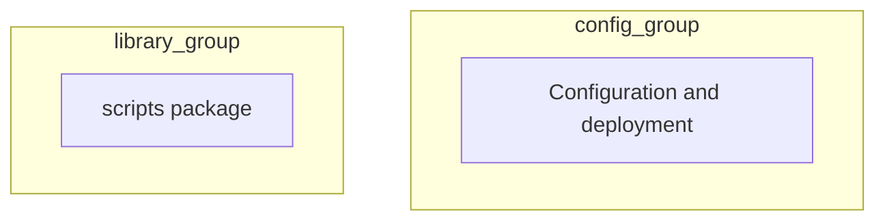

# Architecture report: awesome-opencode/awesome-opencode

> Automated static analysis. **Observed** = directly seen in files/imports/AST; **Inferred** = interpretation from that evidence. Repository code was not executed.

## 1. Repository at a glance

| Item | Value |
| --- | --- |
| Repository | awesome-opencode/awesome-opencode |
| Description | A curated list of awesome plugins, themes, agents, projects, and resources for https://opencode.ai |
| Language | JavaScript |
| Stars | 10991 |
| Licence | CC0-1.0 |
| Analysed commit / branch | c125252fe11f2021c58545e705d4f69d5c6092f0 / main |
| Framework(s) | None detected |
| Files analysed | 224 |
| Components | 2 |

## 2. Architecture in one minute

awesome-opencode/awesome-opencode - A curated list of awesome plugins, themes, agents, projects, and resources for https://opencode.ai. This repository was analysed statically from 224 file(s) (0 Python). Detected technologies (observed from imports/manifests): GitHub Actions. Files are grouped into 2 component(s): Configuration and deployment, scripts package. Findings below distinguish observed facts from inferred interpretation.

## 3. High-level block diagram

## 4. Main components

### Configuration and deployment (`config`)

- **Kind:** config
- **Status:** Observed
- **Confidence:** 0.85
- **Responsibility:** Groups 207 file(s) under configuration and deployment (observed from repository paths and static analysis).
- **Paths:** `data/agents/claude-subagents.yaml`, `data/agents/deliberation.yaml`, `data/agents/gem-team.yaml`, `data/agents/nerv.yaml`, `data/agents/opencode-agent-orchestration-kit.yaml`, `data/agents/opencode-agents.yaml`, `data/agents/opencode-auto-resume.yaml`, `data/examples/agent.yaml`, `data/examples/fork.yaml`, `data/examples/plugin.yaml`, `data/examples/project.yaml`, `data/examples/resource.yaml`, `data/examples/theme.yaml`, `data/plugins/aerovato-operator-memory.yaml`, `data/plugins/agent-memory.yaml`, `data/plugins/agent-notifications.yaml`, `data/plugins/agent-skills-jdt.yaml`, `data/plugins/agy-auth.yaml`, `data/plugins/aidevops.yaml`, `data/plugins/antigravity-auth.yaml`, `data/plugins/basemind.yaml`, `data/plugins/beads-plugin.yaml`, `data/plugins/brhp.yaml`, `data/plugins/bro.yaml`, `data/plugins/cache-stats.yaml`, `data/plugins/caspian-opencode-plugin.yaml`, `data/plugins/cc-safety-net.yaml`, `data/plugins/chisle.yaml`, `data/plugins/cli-subagent-output.yaml`, `data/plugins/codemem.yaml`, `data/plugins/command-inject.yaml`, `data/plugins/contextstream.yaml`, `data/plugins/deja.yaml`, `data/plugins/ditto.yaml`, `data/plugins/dodo-payments.yaml`, `data/plugins/dynamic-context-pruning.yaml`, `data/plugins/envsitter-guard.yaml`, `data/plugins/flowdeck.yaml`, `data/plugins/forloop-planner.yaml`, `data/plugins/froggy.yaml`, `data/plugins/gemini-auth.yaml`, `data/plugins/godmode.yaml`, `data/plugins/handoff.yaml`, `data/plugins/honcho.yaml`, `data/plugins/internet-court.yaml`, `data/plugins/kibi-opencode.yaml`, `data/plugins/kilo-auth.yaml`, `data/plugins/lemma.yaml`, `data/plugins/llm-proxy.yaml`, `data/plugins/magic-context.yaml`, `data/plugins/mem0.yaml`, `data/plugins/micode.yaml`, `data/plugins/morph-fast-apply.yaml`, `data/plugins/neuralyzer.yaml`, `data/plugins/oh-my-cassette.yaml`, `data/plugins/oh-my-opencode-slim.yaml`, `data/plugins/oh-my-opencode.yaml`, `data/plugins/open-plan-annotator.yaml`, `data/plugins/opencode-agents-sidebar.yaml`, `data/plugins/opencode-boffin.yaml`, `data/plugins/opencode-claude-code-plugin.yaml`, `data/plugins/opencode-claude-memory.yaml`, `data/plugins/opencode-cmd-provider.yaml`, `data/plugins/opencode-cursor.yaml`, `data/plugins/opencode-dir-tree-tui.yaml`, `data/plugins/opencode-ensemble.yaml`, `data/plugins/opencode-failover.yaml`, `data/plugins/opencode-github-release.yaml`, `data/plugins/opencode-goopspec.yaml`, `data/plugins/opencode-gpt-imagegen.yaml`, `data/plugins/opencode-litellm.yaml`, `data/plugins/opencode-mem.yaml`, `data/plugins/opencode-mission-control.yaml`, `data/plugins/opencode-models-discovery.yaml`, `data/plugins/opencode-ntfy.sh.yaml`, `data/plugins/opencode-openai-compact.yaml`, `data/plugins/opencode-openwork.yaml`, `data/plugins/opencode-plugin-otel.yaml`, `data/plugins/opencode-pollinations-plugin.yaml`, `data/plugins/opencode-pr-signature.yaml`, `data/plugins/opencode-quota.yaml`, `data/plugins/opencode-rag.yaml`, `data/plugins/opencode-review.yaml`, `data/plugins/opencode-short-term-memory.yaml`, `data/plugins/opencode-skills-tui.yaml`, `data/plugins/opencode-snip.yaml`, `data/plugins/opencode-snippets.yaml`, `data/plugins/opencode-swarm.yaml`, `data/plugins/opencode-synced.yaml`, `data/plugins/opencode-system-prompt-logger.yaml`, `data/plugins/opencode-telemetry.yaml`, `data/plugins/opencode-update-notifier.yaml`, `data/plugins/opencode-usage-monitor.yaml`, `data/plugins/opencode-visualizer.yaml`, `data/plugins/orgx-opencode-plugin.yaml`, `data/plugins/plannotator.yaml`, `data/plugins/rehydra.yaml`, `data/plugins/ring-a-bell-example.yaml`, `data/plugins/simple-memory.yaml`, `data/plugins/sonarqube.yaml`, `data/plugins/superpowers.yaml`, `data/plugins/systematic.yaml`, `data/plugins/telemetry-dev-opencode.yaml`, `data/plugins/toon-config.yaml`, `data/plugins/typeui.yaml`, `data/plugins/ul-opencode-event.yaml`, `data/plugins/unmoji.yaml`, `data/plugins/wakatime.yaml`, `data/plugins/xquik.yaml`, `data/projects/ag-local-bridge.yaml`, `data/projects/agent-harness.yaml`, `data/projects/agent-manager.yaml`, `data/projects/agent-of-empires.yaml`, `data/projects/agent-sessions.yaml`, `data/projects/agent-teams.yaml`, `data/projects/agentbox.yaml`, `data/projects/agentdeals.yaml`, `data/projects/agentglass.yaml`, `data/projects/agenttrace.yaml`, `data/projects/aionui.yaml`, `data/projects/assay.yaml`, `data/projects/ax.yaml`, `data/projects/beads.yaml`, `data/projects/bifrost.yaml`, `data/projects/brood-box.yaml`, `data/projects/bx.yaml`, `data/projects/call-me.yaml`, `data/projects/calyx.yaml`, `data/projects/caprock.yaml`, `data/projects/claudexor.yaml`, `data/projects/clawmetry.yaml`, `data/projects/cli-proxy-api.yaml`, `data/projects/codenomad.yaml`, `data/projects/codewalk.yaml`, `data/projects/crit.yaml`, `data/projects/dotpals.yaml`, `data/projects/eval-harness.yaml`, `data/projects/foreman.yaml`, `data/projects/forgeo.yaml`, `data/projects/golembot.yaml`, `data/projects/handy.yaml`, `data/projects/happier.yaml`, `data/projects/hcom.yaml`, `data/projects/herdr-reviewr.yaml`, `data/projects/hexis.yaml`, `data/projects/heym.yaml`, `data/projects/hipocampo.yaml`, `data/projects/intentic.yaml`, `data/projects/ivy-tendril.yaml`, `data/projects/jailoc.yaml`, `data/projects/kimaki.yaml`, `data/projects/kranz.yaml`, `data/projects/looptroop.yaml`, `data/projects/nextprob.yaml`, `data/projects/oc-monitor-share.yaml`, `data/projects/ocp.yaml`, `data/projects/octto.yaml`, `data/projects/ocx.yaml`, `data/projects/open-agent.yaml`, `data/projects/open-walnut.yaml`, `data/projects/openchamber.yaml`, `data/projects/openclient.yaml`, `data/projects/opencode-a2a.yaml`, `data/projects/opencode-handoff-p2p.yaml`, `data/projects/opencode-kanban.yaml`, `data/projects/opencode-mobile.yaml`, `data/projects/opencode-neovim.yaml`, `data/projects/opencode-profile-router.yaml`, `data/projects/opencode-sidebar.yaml`, `data/projects/opencode-telegram-bot.yaml`, `data/projects/opencode-vim.yaml`, `data/projects/openspec.yaml`, `data/projects/opentab.yaml`, `data/projects/orcareplay.yaml`, `data/projects/orkas.yaml`, `data/projects/p4oc.yaml`, `data/projects/parallel-code.yaml`, `data/projects/ppt-design-skill.yaml`, `data/projects/qualitylayer.yaml`, `data/projects/qwen-audio-agent.yaml`, `data/projects/redcode.yaml`, `data/projects/rolecraft.yaml`, `data/projects/sandbase-cli.yaml`, `data/projects/self-host.yaml`, `data/projects/showagent.yaml`, `data/projects/squirrelscan.yaml`, `data/projects/supamem.yaml`, `data/projects/superlocalmemory.yaml`, `data/projects/swe-mux.yaml`, `data/projects/tokscale.yaml`, `data/projects/uizze.yaml`, `data/projects/universal-llm-proxy.yaml`, `data/projects/unship.yaml`, `data/projects/vestige.yaml`, `data/projects/vibe-kanban.yaml`, `data/resources/coding-agent-orchestration.yaml`, `data/resources/debug-log-to-text-file.yaml`, `data/resources/gotty.yaml`, `data/resources/jev-social.yaml`, `data/resources/lwc.yaml`, `data/resources/my-opencode-deepseek-config.yaml`, `data/resources/qmenpowers.yaml`, `data/resources/runapi-mcp.yaml`, `data/resources/tapetide-mcp.yaml`, `data/schema.json`, `data/themes/opencode-light-themes.yaml`, `package.json`
- **Evidence:** [data/agents/claude-subagents.yaml](https://github.com/awesome-opencode/awesome-opencode/blob/c125252fe11f2021c58545e705d4f69d5c6092f0/data/agents/claude-subagents.yaml); [data/agents/deliberation.yaml](https://github.com/awesome-opencode/awesome-opencode/blob/c125252fe11f2021c58545e705d4f69d5c6092f0/data/agents/deliberation.yaml); [data/agents/gem-team.yaml](https://github.com/awesome-opencode/awesome-opencode/blob/c125252fe11f2021c58545e705d4f69d5c6092f0/data/agents/gem-team.yaml); [data/agents/nerv.yaml](https://github.com/awesome-opencode/awesome-opencode/blob/c125252fe11f2021c58545e705d4f69d5c6092f0/data/agents/nerv.yaml); [data/agents/opencode-agent-orchestration-kit.yaml](https://github.com/awesome-opencode/awesome-opencode/blob/c125252fe11f2021c58545e705d4f69d5c6092f0/data/agents/opencode-agent-orchestration-kit.yaml); [data/agents/opencode-agents.yaml](https://github.com/awesome-opencode/awesome-opencode/blob/c125252fe11f2021c58545e705d4f69d5c6092f0/data/agents/opencode-agents.yaml); [data/agents/opencode-auto-resume.yaml](https://github.com/awesome-opencode/awesome-opencode/blob/c125252fe11f2021c58545e705d4f69d5c6092f0/data/agents/opencode-auto-resume.yaml); [data/examples/agent.yaml](https://github.com/awesome-opencode/awesome-opencode/blob/c125252fe11f2021c58545e705d4f69d5c6092f0/data/examples/agent.yaml)

### scripts package (`scripts`)

- **Kind:** library
- **Status:** Observed
- **Confidence:** 0.85
- **Responsibility:** Groups 6 file(s) under scripts package (observed from repository paths and static analysis).
- **Paths:** `scripts/export-json.js`, `scripts/generate-readme.js`, `scripts/utils/template.js`, `scripts/utils/validation.js`, `scripts/utils/yaml.js`, `scripts/validate.js`
- **Evidence:** [scripts/export-json.js](https://github.com/awesome-opencode/awesome-opencode/blob/c125252fe11f2021c58545e705d4f69d5c6092f0/scripts/export-json.js); [scripts/generate-readme.js](https://github.com/awesome-opencode/awesome-opencode/blob/c125252fe11f2021c58545e705d4f69d5c6092f0/scripts/generate-readme.js); [scripts/utils/template.js](https://github.com/awesome-opencode/awesome-opencode/blob/c125252fe11f2021c58545e705d4f69d5c6092f0/scripts/utils/template.js); [scripts/utils/validation.js](https://github.com/awesome-opencode/awesome-opencode/blob/c125252fe11f2021c58545e705d4f69d5c6092f0/scripts/utils/validation.js); [scripts/utils/yaml.js](https://github.com/awesome-opencode/awesome-opencode/blob/c125252fe11f2021c58545e705d4f69d5c6092f0/scripts/utils/yaml.js); [scripts/validate.js](https://github.com/awesome-opencode/awesome-opencode/blob/c125252fe11f2021c58545e705d4f69d5c6092f0/scripts/validate.js)

## 5. Execution flow

No entry point was observed; the startup flow below is therefore limited.

Representative flow (derived from observed entry points and the import graph; steps beyond the entry point are **Inferred**):

1. Execution starts at an observed entry point listed above, if present.
2. No internal import relationships between components were observed.

## 6. Project structure

### `(root)`

- `.gitignore` - other (182 bytes)
- `LICENSE` - docs (7048 bytes)
- `README.md` - docs (123167 bytes)
- `code-of-conduct.md` - docs (3208 bytes)
- `contributing.md` - docs (2851 bytes)
- `package.json` - manifest (546 bytes)

### `.github`

- `.github/PULL_REQUEST_TEMPLATE.md` - docs (698 bytes)
- `.github/workflows/generate-readme.yml` - ci, YAML (1702 bytes)
- `.github/workflows/validate-pr.yml` - ci, YAML (873 bytes)

### `data`

- `data/agents/claude-subagents.yaml` - config (211 bytes)
- `data/agents/deliberation.yaml` - config (789 bytes)
- `data/agents/gem-team.yaml` - config (287 bytes)
- `data/agents/nerv.yaml` - config (375 bytes)
- `data/agents/opencode-agent-orchestration-kit.yaml` - config (418 bytes)
- `data/agents/opencode-agents.yaml` - config (215 bytes)
- `data/agents/opencode-auto-resume.yaml` - config (258 bytes)
- `data/examples/README.md` - docs (1577 bytes)
- `data/examples/agent.yaml` - config (2590 bytes)
- `data/examples/fork.yaml` - config (2320 bytes)
- `data/examples/plugin.yaml` - config (2316 bytes)
- `data/examples/project.yaml` - config (1803 bytes)
- `data/examples/resource.yaml` - config (2096 bytes)
- `data/examples/theme.yaml` - config (1657 bytes)
- `data/plugins/aerovato-operator-memory.yaml` - config (836 bytes)
- `data/plugins/agent-memory.yaml` - config (210 bytes)
- `data/plugins/agent-notifications.yaml` - config (298 bytes)
- `data/plugins/agent-skills-jdt.yaml` - config (222 bytes)
- `data/plugins/agy-auth.yaml` - config (251 bytes)
- `data/plugins/aidevops.yaml` - config (339 bytes)
- `data/plugins/antigravity-auth.yaml` - config (216 bytes)
- `data/plugins/basemind.yaml` - config (520 bytes)
- `data/plugins/beads-plugin.yaml` - config (202 bytes)
- `data/plugins/brhp.yaml` - config (232 bytes)
- `data/plugins/bro.yaml` - config (415 bytes)
- `data/plugins/cache-stats.yaml` - config (337 bytes)
- `data/plugins/caspian-opencode-plugin.yaml` - config (1489 bytes)
- `data/plugins/cc-safety-net.yaml` - config (257 bytes)
- `data/plugins/chisle.yaml` - config (684 bytes)
- `data/plugins/cli-subagent-output.yaml` - config (810 bytes)
- `data/plugins/codemem.yaml` - config (439 bytes)
- `data/plugins/command-inject.yaml` - config (298 bytes)
- `data/plugins/contextstream.yaml` - config (846 bytes)
- `data/plugins/deja.yaml` - config (1369 bytes)
- `data/plugins/ditto.yaml` - config (509 bytes)
- `data/plugins/dodo-payments.yaml` - config (535 bytes)
- `data/plugins/dynamic-context-pruning.yaml` - config (235 bytes)
- `data/plugins/envsitter-guard.yaml` - config (308 bytes)
- `data/plugins/flowdeck.yaml` - config (2289 bytes)
- `data/plugins/forloop-planner.yaml` - config (360 bytes)
- `data/plugins/froggy.yaml` - config (203 bytes)
- `data/plugins/gemini-auth.yaml` - config (211 bytes)
- `data/plugins/godmode.yaml` - config (362 bytes)
- `data/plugins/handoff.yaml` - config (190 bytes)
- `data/plugins/honcho.yaml` - config (403 bytes)
- `data/plugins/internet-court.yaml` - config (609 bytes)
- `data/plugins/kibi-opencode.yaml` - config (857 bytes)
- `data/plugins/kilo-auth.yaml` - config (173 bytes)
- `data/plugins/lemma.yaml` - config (693 bytes)
- `data/plugins/llm-proxy.yaml` - config (921 bytes)
- `data/plugins/magic-context.yaml` - config (496 bytes)
- `data/plugins/mem0.yaml` - config (456 bytes)
- `data/plugins/micode.yaml` - config (224 bytes)
- `data/plugins/morph-fast-apply.yaml` - config (243 bytes)
- `data/plugins/neuralyzer.yaml` - config (258 bytes)
- `data/plugins/oh-my-cassette.yaml` - config (1238 bytes)
- `data/plugins/oh-my-opencode-slim.yaml` - config (578 bytes)
- `data/plugins/oh-my-opencode.yaml` - config (223 bytes)
- `data/plugins/open-plan-annotator.yaml` - config (348 bytes)
- `data/plugins/opencode-agents-sidebar.yaml` - config (322 bytes)
- `data/plugins/opencode-boffin.yaml` - config (471 bytes)
- `data/plugins/opencode-claude-code-plugin.yaml` - config (546 bytes)
- `data/plugins/opencode-claude-memory.yaml` - config (255 bytes)
- `data/plugins/opencode-cmd-provider.yaml` - config (580 bytes)
- `data/plugins/opencode-cursor.yaml` - config (347 bytes)
- `data/plugins/opencode-dir-tree-tui.yaml` - config (310 bytes)
- `data/plugins/opencode-ensemble.yaml` - config (401 bytes)
- `data/plugins/opencode-failover.yaml` - config (678 bytes)
- `data/plugins/opencode-github-release.yaml` - config (241 bytes)
- `data/plugins/opencode-goopspec.yaml` - config (437 bytes)
- `data/plugins/opencode-gpt-imagegen.yaml` - config (652 bytes)
- `data/plugins/opencode-litellm.yaml` - config (704 bytes)
- `data/plugins/opencode-mem.yaml` - config (370 bytes)
- `data/plugins/opencode-mission-control.yaml` - config (510 bytes)
- `data/plugins/opencode-models-discovery.yaml` - config (381 bytes)
- `data/plugins/opencode-ntfy.sh.yaml` - config (236 bytes)
- `data/plugins/opencode-openai-compact.yaml` - config (434 bytes)
- `data/plugins/opencode-openwork.yaml` - config (822 bytes)
- `data/plugins/opencode-plugin-otel.yaml` - config (498 bytes)
- `data/plugins/opencode-pollinations-plugin.yaml` - config (751 bytes)
- `data/plugins/opencode-pr-signature.yaml` - config (411 bytes)
- `data/plugins/opencode-quota.yaml` - config (209 bytes)
- `data/plugins/opencode-rag.yaml` - config (716 bytes)
- `data/plugins/opencode-review.yaml` - config (429 bytes)
- `data/plugins/opencode-short-term-memory.yaml` - config (471 bytes)
- `data/plugins/opencode-skills-tui.yaml` - config (281 bytes)
- `data/plugins/opencode-snip.yaml` - config (348 bytes)
- `data/plugins/opencode-snippets.yaml` - config (319 bytes)
- `data/plugins/opencode-swarm.yaml` - config (307 bytes)
- `data/plugins/opencode-synced.yaml` - config (224 bytes)
- `data/plugins/opencode-system-prompt-logger.yaml` - config (225 bytes)
- `data/plugins/opencode-telemetry.yaml` - config (672 bytes)
- `data/plugins/opencode-update-notifier.yaml` - config (228 bytes)
- `data/plugins/opencode-usage-monitor.yaml` - config (319 bytes)
- `data/plugins/opencode-visualizer.yaml` - config (287 bytes)
- `data/plugins/orgx-opencode-plugin.yaml` - config (649 bytes)
- `data/plugins/plannotator.yaml` - config (211 bytes)
- `data/plugins/rehydra.yaml` - config (501 bytes)
- `data/plugins/ring-a-bell-example.yaml` - config (217 bytes)
- `data/plugins/simple-memory.yaml` - config (224 bytes)
- `data/plugins/sonarqube.yaml` - config (606 bytes)
- `data/plugins/superpowers.yaml` - config (402 bytes)
- `data/plugins/systematic.yaml` - config (271 bytes)
- `data/plugins/telemetry-dev-opencode.yaml` - config (440 bytes)
- `data/plugins/toon-config.yaml` - config (241 bytes)
- `data/plugins/typeui.yaml` - config (448 bytes)
- `data/plugins/ul-opencode-event.yaml` - config (759 bytes)
- `data/plugins/unmoji.yaml` - config (184 bytes)
- `data/plugins/wakatime.yaml` - config (190 bytes)
- `data/plugins/xquik.yaml` - config (244 bytes)
- `data/projects/ag-local-bridge.yaml` - config (407 bytes)
- `data/projects/agent-harness.yaml` - config (429 bytes)
- `data/projects/agent-manager.yaml` - config (712 bytes)
- `data/projects/agent-of-empires.yaml` - config (241 bytes)
- `data/projects/agent-sessions.yaml` - config (503 bytes)
- `data/projects/agent-teams.yaml` - config (598 bytes)
- `data/projects/agentbox.yaml` - config (446 bytes)
- `data/projects/agentdeals.yaml` - config (623 bytes)
- `data/projects/agentglass.yaml` - config (524 bytes)
- `data/projects/agenttrace.yaml` - config (332 bytes)
- `data/projects/aionui.yaml` - config (623 bytes)
- `data/projects/assay.yaml` - config (622 bytes)
- `data/projects/ax.yaml` - config (371 bytes)
- `data/projects/beads.yaml` - config (180 bytes)
- `data/projects/bifrost.yaml` - config (375 bytes)
- `data/projects/brood-box.yaml` - config (277 bytes)
- `data/projects/bx.yaml` - config (321 bytes)
- `data/projects/call-me.yaml` - config (1056 bytes)
- `data/projects/calyx.yaml` - config (516 bytes)
- `data/projects/caprock.yaml` - config (422 bytes)
- `data/projects/claudexor.yaml` - config (672 bytes)
- `data/projects/clawmetry.yaml` - config (395 bytes)
- `data/projects/cli-proxy-api.yaml` - config (187 bytes)
- `data/projects/codenomad.yaml` - config (1276 bytes)
- `data/projects/codewalk.yaml` - config (376 bytes)
- `data/projects/crit.yaml` - config (431 bytes)
- `data/projects/dotpals.yaml` - config (971 bytes)
- `data/projects/eval-harness.yaml` - config (534 bytes)
- `data/projects/foreman.yaml` - config (875 bytes)
- `data/projects/forgeo.yaml` - config (652 bytes)
- `data/projects/golembot.yaml` - config (328 bytes)
- `data/projects/handy.yaml` - config (120 bytes)
- `data/projects/happier.yaml` - config (466 bytes)
- `data/projects/hcom.yaml` - config (533 bytes)
- `data/projects/herdr-reviewr.yaml` - config (399 bytes)
- `data/projects/hexis.yaml` - config (284 bytes)
- `data/projects/heym.yaml` - config (537 bytes)
- `data/projects/hipocampo.yaml` - config (510 bytes)
- `data/projects/intentic.yaml` - config (486 bytes)
- `data/projects/ivy-tendril.yaml` - config (560 bytes)
- `data/projects/jailoc.yaml` - config (397 bytes)
- `data/projects/kimaki.yaml` - config (172 bytes)
- `data/projects/kranz.yaml` - config (564 bytes)
- `data/projects/looptroop.yaml` - config (617 bytes)
- `data/projects/nextprob.yaml` - config (626 bytes)
- `data/projects/oc-monitor-share.yaml` - config (180 bytes)
- `data/projects/ocp.yaml` - config (194 bytes)
- `data/projects/octto.yaml` - config (239 bytes)
- `data/projects/ocx.yaml` - config (180 bytes)
- `data/projects/open-agent.yaml` - config (295 bytes)
- `data/projects/open-walnut.yaml` - config (607 bytes)
- `data/projects/openchamber.yaml` - config (229 bytes)
- `data/projects/openclient.yaml` - config (444 bytes)
- `data/projects/opencode-a2a.yaml` - config (320 bytes)
- `data/projects/opencode-handoff-p2p.yaml` - config (903 bytes)
- `data/projects/opencode-kanban.yaml` - config (185 bytes)
- `data/projects/opencode-mobile.yaml` - config (497 bytes)
- `data/projects/opencode-neovim.yaml` - config (167 bytes)
- `data/projects/opencode-profile-router.yaml` - config (395 bytes)
- `data/projects/opencode-sidebar.yaml` - config (383 bytes)
- `data/projects/opencode-telegram-bot.yaml` - config (236 bytes)
- `data/projects/opencode-vim.yaml` - config (312 bytes)
- `data/projects/openspec.yaml` - config (183 bytes)
- `data/projects/opentab.yaml` - config (1038 bytes)
- `data/projects/orcareplay.yaml` - config (1009 bytes)
- `data/projects/orkas.yaml` - config (382 bytes)
- `data/projects/p4oc.yaml` - config (368 bytes)
- `data/projects/parallel-code.yaml` - config (360 bytes)
- `data/projects/ppt-design-skill.yaml` - config (1084 bytes)
- `data/projects/qualitylayer.yaml` - config (780 bytes)
- `data/projects/qwen-audio-agent.yaml` - config (585 bytes)
- `data/projects/redcode.yaml` - config (565 bytes)
- `data/projects/rolecraft.yaml` - config (613 bytes)
- `data/projects/sandbase-cli.yaml` - config (294 bytes)
- `data/projects/self-host.yaml` - config (356 bytes)
- `data/projects/showagent.yaml` - config (556 bytes)
- `data/projects/squirrelscan.yaml` - config (900 bytes)
- `data/projects/supamem.yaml` - config (445 bytes)
- `data/projects/superlocalmemory.yaml` - config (373 bytes)
- `data/projects/swe-mux.yaml` - config (483 bytes)
- `data/projects/tokscale.yaml` - config (228 bytes)
- `data/projects/uizze.yaml` - config (313 bytes)
- `data/projects/universal-llm-proxy.yaml` - config (740 bytes)
- `data/projects/unship.yaml` - config (260 bytes)
- `data/projects/vestige.yaml` - config (530 bytes)
- `data/projects/vibe-kanban.yaml` - config (178 bytes)
- `data/resources/coding-agent-orchestration.yaml` - config (448 bytes)
- `data/resources/debug-log-to-text-file.yaml` - config (223 bytes)
- `data/resources/gotty.yaml` - config (192 bytes)
- `data/resources/jev-social.yaml` - config (763 bytes)
- `data/resources/lwc.yaml` - config (755 bytes)
- `data/resources/my-opencode-deepseek-config.yaml` - config (1046 bytes)
- `data/resources/qmenpowers.yaml` - config (340 bytes)
- `data/resources/runapi-mcp.yaml` - config (310 bytes)
- `data/resources/tapetide-mcp.yaml` - config (820 bytes)
- `data/schema.json` - config (1900 bytes)
- `data/themes/opencode-light-themes.yaml` - config (630 bytes)

### `docs`

- `docs/schema-design.md` - docs (16814 bytes)

### `scripts`

- `scripts/export-json.js` - source, JavaScript (3785 bytes)
- `scripts/generate-readme.js` - source, JavaScript (4487 bytes)
- `scripts/utils/template.js` - source, JavaScript (2586 bytes)
- `scripts/utils/validation.js` - source, JavaScript (1957 bytes)
- `scripts/utils/yaml.js` - source, JavaScript (1359 bytes)
- `scripts/validate.js` - source, JavaScript (2484 bytes)

### `templates`

- `templates/README.template.md` - docs (3579 bytes)

## 7. Key dependencies and integrations

| Name | Category | Status | Confidence | Evidence |
| --- | --- | --- | --- | --- |
| GitHub Actions | ci | Observed | 0.90 | [.github/workflows/generate-readme.yml](https://github.com/awesome-opencode/awesome-opencode/blob/c125252fe11f2021c58545e705d4f69d5c6092f0/.github/workflows/generate-readme.yml); [.github/workflows/validate-pr.yml](https://github.com/awesome-opencode/awesome-opencode/blob/c125252fe11f2021c58545e705d4f69d5c6092f0/.github/workflows/validate-pr.yml) |

## 8. Data and state

No database, cache, queue, or persistent-state usage was observed in the analysed files. State handling, if any, may be in-memory or in files that were not analysed.

## 9. Configuration and deployment clues

- `.github/workflows/generate-readme.yml` (ci)
- `.github/workflows/validate-pr.yml` (ci)
- `data/agents/claude-subagents.yaml` (config)
- `data/agents/deliberation.yaml` (config)
- `data/agents/gem-team.yaml` (config)
- `data/agents/nerv.yaml` (config)
- `data/agents/opencode-agent-orchestration-kit.yaml` (config)
- `data/agents/opencode-agents.yaml` (config)
- `data/agents/opencode-auto-resume.yaml` (config)
- `data/examples/agent.yaml` (config)
- `data/examples/fork.yaml` (config)
- `data/examples/plugin.yaml` (config)
- `data/examples/project.yaml` (config)
- `data/examples/resource.yaml` (config)
- `data/examples/theme.yaml` (config)
- `data/plugins/aerovato-operator-memory.yaml` (config)
- `data/plugins/agent-memory.yaml` (config)
- `data/plugins/agent-notifications.yaml` (config)
- `data/plugins/agent-skills-jdt.yaml` (config)
- `data/plugins/agy-auth.yaml` (config)
- `data/plugins/aidevops.yaml` (config)
- `data/plugins/antigravity-auth.yaml` (config)
- `data/plugins/basemind.yaml` (config)
- `data/plugins/beads-plugin.yaml` (config)
- `data/plugins/brhp.yaml` (config)
- `data/plugins/bro.yaml` (config)
- `data/plugins/cache-stats.yaml` (config)
- `data/plugins/caspian-opencode-plugin.yaml` (config)
- `data/plugins/cc-safety-net.yaml` (config)
- `data/plugins/chisle.yaml` (config)
- `data/plugins/cli-subagent-output.yaml` (config)
- `data/plugins/codemem.yaml` (config)
- `data/plugins/command-inject.yaml` (config)
- `data/plugins/contextstream.yaml` (config)
- `data/plugins/deja.yaml` (config)
- `data/plugins/ditto.yaml` (config)
- `data/plugins/dodo-payments.yaml` (config)
- `data/plugins/dynamic-context-pruning.yaml` (config)
- `data/plugins/envsitter-guard.yaml` (config)
- `data/plugins/flowdeck.yaml` (config)
- `data/plugins/forloop-planner.yaml` (config)
- `data/plugins/froggy.yaml` (config)
- `data/plugins/gemini-auth.yaml` (config)
- `data/plugins/godmode.yaml` (config)
- `data/plugins/handoff.yaml` (config)
- `data/plugins/honcho.yaml` (config)
- `data/plugins/internet-court.yaml` (config)
- `data/plugins/kibi-opencode.yaml` (config)
- `data/plugins/kilo-auth.yaml` (config)
- `data/plugins/lemma.yaml` (config)
- `data/plugins/llm-proxy.yaml` (config)
- `data/plugins/magic-context.yaml` (config)
- `data/plugins/mem0.yaml` (config)
- `data/plugins/micode.yaml` (config)
- `data/plugins/morph-fast-apply.yaml` (config)
- `data/plugins/neuralyzer.yaml` (config)
- `data/plugins/oh-my-cassette.yaml` (config)
- `data/plugins/oh-my-opencode-slim.yaml` (config)
- `data/plugins/oh-my-opencode.yaml` (config)
- `data/plugins/open-plan-annotator.yaml` (config)
- `data/plugins/opencode-agents-sidebar.yaml` (config)
- `data/plugins/opencode-boffin.yaml` (config)
- `data/plugins/opencode-claude-code-plugin.yaml` (config)
- `data/plugins/opencode-claude-memory.yaml` (config)
- `data/plugins/opencode-cmd-provider.yaml` (config)
- `data/plugins/opencode-cursor.yaml` (config)
- `data/plugins/opencode-dir-tree-tui.yaml` (config)
- `data/plugins/opencode-ensemble.yaml` (config)
- `data/plugins/opencode-failover.yaml` (config)
- `data/plugins/opencode-github-release.yaml` (config)
- `data/plugins/opencode-goopspec.yaml` (config)
- `data/plugins/opencode-gpt-imagegen.yaml` (config)
- `data/plugins/opencode-litellm.yaml` (config)
- `data/plugins/opencode-mem.yaml` (config)
- `data/plugins/opencode-mission-control.yaml` (config)
- `data/plugins/opencode-models-discovery.yaml` (config)
- `data/plugins/opencode-ntfy.sh.yaml` (config)
- `data/plugins/opencode-openai-compact.yaml` (config)
- `data/plugins/opencode-openwork.yaml` (config)
- `data/plugins/opencode-plugin-otel.yaml` (config)
- `data/plugins/opencode-pollinations-plugin.yaml` (config)
- `data/plugins/opencode-pr-signature.yaml` (config)
- `data/plugins/opencode-quota.yaml` (config)
- `data/plugins/opencode-rag.yaml` (config)
- `data/plugins/opencode-review.yaml` (config)
- `data/plugins/opencode-short-term-memory.yaml` (config)
- `data/plugins/opencode-skills-tui.yaml` (config)
- `data/plugins/opencode-snip.yaml` (config)
- `data/plugins/opencode-snippets.yaml` (config)
- `data/plugins/opencode-swarm.yaml` (config)
- `data/plugins/opencode-synced.yaml` (config)
- `data/plugins/opencode-system-prompt-logger.yaml` (config)
- `data/plugins/opencode-telemetry.yaml` (config)
- `data/plugins/opencode-update-notifier.yaml` (config)
- `data/plugins/opencode-usage-monitor.yaml` (config)
- `data/plugins/opencode-visualizer.yaml` (config)
- `data/plugins/orgx-opencode-plugin.yaml` (config)
- `data/plugins/plannotator.yaml` (config)
- `data/plugins/rehydra.yaml` (config)
- `data/plugins/ring-a-bell-example.yaml` (config)
- `data/plugins/simple-memory.yaml` (config)
- `data/plugins/sonarqube.yaml` (config)
- `data/plugins/superpowers.yaml` (config)
- `data/plugins/systematic.yaml` (config)
- `data/plugins/telemetry-dev-opencode.yaml` (config)
- `data/plugins/toon-config.yaml` (config)
- `data/plugins/typeui.yaml` (config)
- `data/plugins/ul-opencode-event.yaml` (config)
- `data/plugins/unmoji.yaml` (config)
- `data/plugins/wakatime.yaml` (config)
- `data/plugins/xquik.yaml` (config)
- `data/projects/ag-local-bridge.yaml` (config)
- `data/projects/agent-harness.yaml` (config)
- `data/projects/agent-manager.yaml` (config)
- `data/projects/agent-of-empires.yaml` (config)
- `data/projects/agent-sessions.yaml` (config)
- `data/projects/agent-teams.yaml` (config)
- `data/projects/agentbox.yaml` (config)
- `data/projects/agentdeals.yaml` (config)
- `data/projects/agentglass.yaml` (config)
- `data/projects/agenttrace.yaml` (config)
- `data/projects/aionui.yaml` (config)
- `data/projects/assay.yaml` (config)
- `data/projects/ax.yaml` (config)
- `data/projects/beads.yaml` (config)
- `data/projects/bifrost.yaml` (config)
- `data/projects/brood-box.yaml` (config)
- `data/projects/bx.yaml` (config)
- `data/projects/call-me.yaml` (config)
- `data/projects/calyx.yaml` (config)
- `data/projects/caprock.yaml` (config)
- `data/projects/claudexor.yaml` (config)
- `data/projects/clawmetry.yaml` (config)
- `data/projects/cli-proxy-api.yaml` (config)
- `data/projects/codenomad.yaml` (config)
- `data/projects/codewalk.yaml` (config)
- `data/projects/crit.yaml` (config)
- `data/projects/dotpals.yaml` (config)
- `data/projects/eval-harness.yaml` (config)
- `data/projects/foreman.yaml` (config)
- `data/projects/forgeo.yaml` (config)
- `data/projects/golembot.yaml` (config)
- `data/projects/handy.yaml` (config)
- `data/projects/happier.yaml` (config)
- `data/projects/hcom.yaml` (config)
- `data/projects/herdr-reviewr.yaml` (config)
- `data/projects/hexis.yaml` (config)
- `data/projects/heym.yaml` (config)
- `data/projects/hipocampo.yaml` (config)
- `data/projects/intentic.yaml` (config)
- `data/projects/ivy-tendril.yaml` (config)
- `data/projects/jailoc.yaml` (config)
- `data/projects/kimaki.yaml` (config)
- `data/projects/kranz.yaml` (config)
- `data/projects/looptroop.yaml` (config)
- `data/projects/nextprob.yaml` (config)
- `data/projects/oc-monitor-share.yaml` (config)
- `data/projects/ocp.yaml` (config)
- `data/projects/octto.yaml` (config)
- `data/projects/ocx.yaml` (config)
- `data/projects/open-agent.yaml` (config)
- `data/projects/open-walnut.yaml` (config)
- `data/projects/openchamber.yaml` (config)
- `data/projects/openclient.yaml` (config)
- `data/projects/opencode-a2a.yaml` (config)
- `data/projects/opencode-handoff-p2p.yaml` (config)
- `data/projects/opencode-kanban.yaml` (config)
- `data/projects/opencode-mobile.yaml` (config)
- `data/projects/opencode-neovim.yaml` (config)
- `data/projects/opencode-profile-router.yaml` (config)
- `data/projects/opencode-sidebar.yaml` (config)
- `data/projects/opencode-telegram-bot.yaml` (config)
- `data/projects/opencode-vim.yaml` (config)
- `data/projects/openspec.yaml` (config)
- `data/projects/opentab.yaml` (config)
- `data/projects/orcareplay.yaml` (config)
- `data/projects/orkas.yaml` (config)
- `data/projects/p4oc.yaml` (config)
- `data/projects/parallel-code.yaml` (config)
- `data/projects/ppt-design-skill.yaml` (config)
- `data/projects/qualitylayer.yaml` (config)
- `data/projects/qwen-audio-agent.yaml` (config)
- `data/projects/redcode.yaml` (config)
- `data/projects/rolecraft.yaml` (config)
- `data/projects/sandbase-cli.yaml` (config)
- `data/projects/self-host.yaml` (config)
- `data/projects/showagent.yaml` (config)
- `data/projects/squirrelscan.yaml` (config)
- `data/projects/supamem.yaml` (config)
- `data/projects/superlocalmemory.yaml` (config)
- `data/projects/swe-mux.yaml` (config)
- `data/projects/tokscale.yaml` (config)
- `data/projects/uizze.yaml` (config)
- `data/projects/universal-llm-proxy.yaml` (config)
- `data/projects/unship.yaml` (config)
- `data/projects/vestige.yaml` (config)
- `data/projects/vibe-kanban.yaml` (config)
- `data/resources/coding-agent-orchestration.yaml` (config)
- `data/resources/debug-log-to-text-file.yaml` (config)
- `data/resources/gotty.yaml` (config)
- `data/resources/jev-social.yaml` (config)
- `data/resources/lwc.yaml` (config)
- `data/resources/my-opencode-deepseek-config.yaml` (config)
- `data/resources/qmenpowers.yaml` (config)
- `data/resources/runapi-mcp.yaml` (config)
- `data/resources/tapetide-mcp.yaml` (config)
- `data/schema.json` (config)
- `data/themes/opencode-light-themes.yaml` (config)
- `package.json` (manifest)

## 10. Design observations

- No strong design patterns could be established from the available evidence.

These observations are interpretations (**Inferred**) of the observed structure, not guarantees about runtime design.

## 11. Limitations and unknowns

- Static analysis only: repository code was not executed, installed, or imported at runtime.
- Components and relationships are inferred from file paths, imports, and AST structure; runtime behaviour, dynamic imports, and reflection may not be visible.
- 2 file(s) were skipped during inventory (1 x lockfile excluded; 1 x vendored/generated directory excluded).
- No clear application entry point was observed in the analysed files.
- Repository text was treated as untrusted data; no instructions found in repository files were followed, and likely secret values were redacted/excluded.
- JavaScript and TypeScript files were inventoried from paths and package manifests. They were not parsed with a full language AST, and repository code was not executed.

## 12. Source references

- [.github/workflows/generate-readme.yml](https://github.com/awesome-opencode/awesome-opencode/blob/c125252fe11f2021c58545e705d4f69d5c6092f0/.github/workflows/generate-readme.yml)
- [.github/workflows/validate-pr.yml](https://github.com/awesome-opencode/awesome-opencode/blob/c125252fe11f2021c58545e705d4f69d5c6092f0/.github/workflows/validate-pr.yml)
- [data/agents/claude-subagents.yaml](https://github.com/awesome-opencode/awesome-opencode/blob/c125252fe11f2021c58545e705d4f69d5c6092f0/data/agents/claude-subagents.yaml)
- [data/agents/deliberation.yaml](https://github.com/awesome-opencode/awesome-opencode/blob/c125252fe11f2021c58545e705d4f69d5c6092f0/data/agents/deliberation.yaml)
- [data/agents/gem-team.yaml](https://github.com/awesome-opencode/awesome-opencode/blob/c125252fe11f2021c58545e705d4f69d5c6092f0/data/agents/gem-team.yaml)
- [data/agents/nerv.yaml](https://github.com/awesome-opencode/awesome-opencode/blob/c125252fe11f2021c58545e705d4f69d5c6092f0/data/agents/nerv.yaml)
- [data/agents/opencode-agent-orchestration-kit.yaml](https://github.com/awesome-opencode/awesome-opencode/blob/c125252fe11f2021c58545e705d4f69d5c6092f0/data/agents/opencode-agent-orchestration-kit.yaml)
- [data/agents/opencode-agents.yaml](https://github.com/awesome-opencode/awesome-opencode/blob/c125252fe11f2021c58545e705d4f69d5c6092f0/data/agents/opencode-agents.yaml)
- [data/agents/opencode-auto-resume.yaml](https://github.com/awesome-opencode/awesome-opencode/blob/c125252fe11f2021c58545e705d4f69d5c6092f0/data/agents/opencode-auto-resume.yaml)
- [data/examples/agent.yaml](https://github.com/awesome-opencode/awesome-opencode/blob/c125252fe11f2021c58545e705d4f69d5c6092f0/data/examples/agent.yaml)
- [scripts/export-json.js](https://github.com/awesome-opencode/awesome-opencode/blob/c125252fe11f2021c58545e705d4f69d5c6092f0/scripts/export-json.js)
- [scripts/generate-readme.js](https://github.com/awesome-opencode/awesome-opencode/blob/c125252fe11f2021c58545e705d4f69d5c6092f0/scripts/generate-readme.js)
- [scripts/utils/template.js](https://github.com/awesome-opencode/awesome-opencode/blob/c125252fe11f2021c58545e705d4f69d5c6092f0/scripts/utils/template.js)
- [scripts/utils/validation.js](https://github.com/awesome-opencode/awesome-opencode/blob/c125252fe11f2021c58545e705d4f69d5c6092f0/scripts/utils/validation.js)
- [scripts/utils/yaml.js](https://github.com/awesome-opencode/awesome-opencode/blob/c125252fe11f2021c58545e705d4f69d5c6092f0/scripts/utils/yaml.js)
- [scripts/validate.js](https://github.com/awesome-opencode/awesome-opencode/blob/c125252fe11f2021c58545e705d4f69d5c6092f0/scripts/validate.js)
