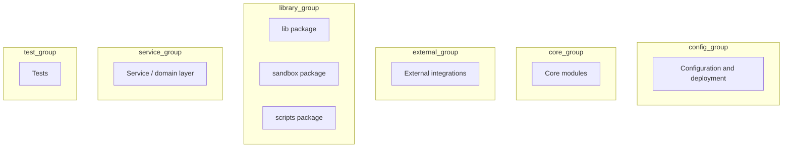

# Architecture report: axios/axios

> Automated static analysis. **Observed** = directly seen in files/imports/AST; **Inferred** = interpretation from that evidence. Repository code was not executed.

## 1. Repository at a glance

| Item | Value |
| --- | --- |
| Repository | axios/axios |
| Description | Promise based HTTP client for the browser and node.js |
| Language | JavaScript |
| Stars | 109391 |
| Licence | MIT |
| Analysed commit / branch | 4ee8d46fc463770b8f5da718d5449a5b027b2c08 / v1.x |
| Framework(s) | Express, Vue |
| Files analysed | 506 |
| Components | 8 |

## 2. Architecture in one minute

axios/axios - Promise based HTTP client for the browser and node.js. This repository was analysed statically from 506 file(s) (0 Python). Detected technologies (observed from imports/manifests): GitHub Actions, Express, Vue, axios, TypeScript, Vitest. Files are grouped into 8 component(s): Configuration and deployment, Core modules, External integrations, lib package, sandbox package, scripts package, Service / domain layer, Tests. Findings below distinguish observed facts from inferred interpretation.

## 3. High-level block diagram

## 4. Main components

### Configuration and deployment (`config`)

- **Kind:** config
- **Status:** Observed
- **Confidence:** 0.85
- **Responsibility:** Groups 3 file(s) under configuration and deployment (observed from repository paths and static analysis).
- **Paths:** `package.json`, `tsconfig.json`, `tslint.json`
- **Evidence:** [package.json](https://github.com/axios/axios/blob/4ee8d46fc463770b8f5da718d5449a5b027b2c08/package.json); [tsconfig.json](https://github.com/axios/axios/blob/4ee8d46fc463770b8f5da718d5449a5b027b2c08/tsconfig.json); [tslint.json](https://github.com/axios/axios/blob/4ee8d46fc463770b8f5da718d5449a5b027b2c08/tslint.json)

### Core modules (`core`)

- **Kind:** core
- **Status:** Observed
- **Confidence:** 0.85
- **Responsibility:** Groups 7 file(s) under core modules (observed from repository paths and static analysis).
- **Paths:** `eslint.config.js`, `gulpfile.js`, `index.d.ts`, `index.js`, `rollup.config.js`, `vitest.config.js`, `webpack.config.js`
- **Evidence:** [eslint.config.js](https://github.com/axios/axios/blob/4ee8d46fc463770b8f5da718d5449a5b027b2c08/eslint.config.js); [gulpfile.js](https://github.com/axios/axios/blob/4ee8d46fc463770b8f5da718d5449a5b027b2c08/gulpfile.js); [index.d.ts](https://github.com/axios/axios/blob/4ee8d46fc463770b8f5da718d5449a5b027b2c08/index.d.ts); [index.js](https://github.com/axios/axios/blob/4ee8d46fc463770b8f5da718d5449a5b027b2c08/index.js); [rollup.config.js](https://github.com/axios/axios/blob/4ee8d46fc463770b8f5da718d5449a5b027b2c08/rollup.config.js); [vitest.config.js](https://github.com/axios/axios/blob/4ee8d46fc463770b8f5da718d5449a5b027b2c08/vitest.config.js); [webpack.config.js](https://github.com/axios/axios/blob/4ee8d46fc463770b8f5da718d5449a5b027b2c08/webpack.config.js)

### External integrations (`external_integrations`)

- **Kind:** external
- **Status:** Observed
- **Confidence:** 0.85
- **Responsibility:** Groups 4 file(s) under external integrations (observed from repository paths and static analysis).
- **Paths:** `lib/adapters/adapters.js`, `lib/adapters/fetch.js`, `lib/adapters/http.js`, `lib/adapters/xhr.js`
- **Evidence:** [lib/adapters/adapters.js](https://github.com/axios/axios/blob/4ee8d46fc463770b8f5da718d5449a5b027b2c08/lib/adapters/adapters.js); [lib/adapters/fetch.js](https://github.com/axios/axios/blob/4ee8d46fc463770b8f5da718d5449a5b027b2c08/lib/adapters/fetch.js); [lib/adapters/http.js](https://github.com/axios/axios/blob/4ee8d46fc463770b8f5da718d5449a5b027b2c08/lib/adapters/http.js); [lib/adapters/xhr.js](https://github.com/axios/axios/blob/4ee8d46fc463770b8f5da718d5449a5b027b2c08/lib/adapters/xhr.js)

### lib package (`lib`)

- **Kind:** library
- **Status:** Observed
- **Confidence:** 0.85
- **Responsibility:** Groups 55 file(s) under lib package (observed from repository paths and static analysis).
- **Paths:** `lib/axios.js`, `lib/cancel/CancelToken.js`, `lib/cancel/CanceledError.js`, `lib/cancel/isCancel.js`, `lib/defaults/index.js`, `lib/defaults/transitional.js`, `lib/env/classes/FormData.js`, `lib/env/data.js`, `lib/helpers/AxiosTransformStream.js`, `lib/helpers/AxiosURLSearchParams.js`, `lib/helpers/Http2Sessions.js`, `lib/helpers/HttpStatusCode.js`, `lib/helpers/ZlibHeaderTransformStream.js`, `lib/helpers/bind.js`, `lib/helpers/buildURL.js`, `lib/helpers/callbackify.js`, `lib/helpers/combineURLs.js`, `lib/helpers/composeSignals.js`, `lib/helpers/cookies.js`, `lib/helpers/deprecatedMethod.js`, `lib/helpers/estimateDataURLDecodedBytes.js`, `lib/helpers/formDataToBlob.js`, `lib/helpers/formDataToJSON.js`, `lib/helpers/formDataToStream.js`, `lib/helpers/fromDataURI.js`, `lib/helpers/isAbsoluteURL.js`, `lib/helpers/isAxiosError.js`, `lib/helpers/isURLSameOrigin.js`, `lib/helpers/normalizeURLForProtocolCheck.js`, `lib/helpers/null.js`, `lib/helpers/parseHeaders.js`, `lib/helpers/parseProtocol.js`, `lib/helpers/progressEventReducer.js`, `lib/helpers/readBlob.js`, `lib/helpers/resolveConfig.js`, `lib/helpers/sanitizeHeaderValue.js`, `lib/helpers/shouldBypassProxy.js`, `lib/helpers/speedometer.js`, `lib/helpers/spread.js`, `lib/helpers/throttle.js`, `lib/helpers/toFormData.js`, `lib/helpers/toURLEncodedForm.js`, `lib/helpers/trackStream.js`, `lib/helpers/validator.js`, `lib/platform/browser/classes/Blob.js`, `lib/platform/browser/classes/FormData.js`, `lib/platform/browser/classes/URLSearchParams.js`, `lib/platform/browser/index.js`, `lib/platform/common/utils.js`, `lib/platform/index.js`, `lib/platform/node/classes/Buffer.js`, `lib/platform/node/classes/FormData.js`, `lib/platform/node/classes/URLSearchParams.js`, `lib/platform/node/index.js`, `lib/utils.js`
- **Evidence:** [lib/axios.js](https://github.com/axios/axios/blob/4ee8d46fc463770b8f5da718d5449a5b027b2c08/lib/axios.js); [lib/cancel/CancelToken.js](https://github.com/axios/axios/blob/4ee8d46fc463770b8f5da718d5449a5b027b2c08/lib/cancel/CancelToken.js); [lib/cancel/CanceledError.js](https://github.com/axios/axios/blob/4ee8d46fc463770b8f5da718d5449a5b027b2c08/lib/cancel/CanceledError.js); [lib/cancel/isCancel.js](https://github.com/axios/axios/blob/4ee8d46fc463770b8f5da718d5449a5b027b2c08/lib/cancel/isCancel.js); [lib/defaults/index.js](https://github.com/axios/axios/blob/4ee8d46fc463770b8f5da718d5449a5b027b2c08/lib/defaults/index.js); [lib/defaults/transitional.js](https://github.com/axios/axios/blob/4ee8d46fc463770b8f5da718d5449a5b027b2c08/lib/defaults/transitional.js); [lib/env/classes/FormData.js](https://github.com/axios/axios/blob/4ee8d46fc463770b8f5da718d5449a5b027b2c08/lib/env/classes/FormData.js); [lib/env/data.js](https://github.com/axios/axios/blob/4ee8d46fc463770b8f5da718d5449a5b027b2c08/lib/env/data.js)

### sandbox package (`sandbox`)

- **Kind:** library
- **Status:** Observed
- **Confidence:** 0.85
- **Responsibility:** Groups 2 file(s) under sandbox package (observed from repository paths and static analysis).
- **Paths:** `sandbox/client.js`, `sandbox/server.js`
- **Evidence:** [sandbox/client.js](https://github.com/axios/axios/blob/4ee8d46fc463770b8f5da718d5449a5b027b2c08/sandbox/client.js); [sandbox/server.js](https://github.com/axios/axios/blob/4ee8d46fc463770b8f5da718d5449a5b027b2c08/sandbox/server.js)

### scripts package (`scripts`)

- **Kind:** library
- **Status:** Observed
- **Confidence:** 0.85
- **Responsibility:** Groups 2 file(s) under scripts package (observed from repository paths and static analysis).
- **Paths:** `scripts/axios-build-instance.js`, `scripts/benchmark-merge-config.js`
- **Evidence:** [scripts/axios-build-instance.js](https://github.com/axios/axios/blob/4ee8d46fc463770b8f5da718d5449a5b027b2c08/scripts/axios-build-instance.js); [scripts/benchmark-merge-config.js](https://github.com/axios/axios/blob/4ee8d46fc463770b8f5da718d5449a5b027b2c08/scripts/benchmark-merge-config.js)

### Service / domain layer (`service_layer`)

- **Kind:** service
- **Status:** Observed
- **Confidence:** 0.85
- **Responsibility:** Groups 13 file(s) under service / domain layer (observed from repository paths and static analysis).
- **Paths:** `lib/core/Axios.js`, `lib/core/AxiosError.js`, `lib/core/AxiosHeaders.js`, `lib/core/InterceptorManager.js`, `lib/core/assertParamsAcyclic.js`, `lib/core/buildFullPath.js`, `lib/core/createMultipartBody.js`, `lib/core/dispatchRequest.js`, `lib/core/mergeConfig.js`, `lib/core/methodList.js`, `lib/core/setFormDataHeaders.js`, `lib/core/settle.js`, `lib/core/transformData.js`
- **Evidence:** [lib/core/Axios.js](https://github.com/axios/axios/blob/4ee8d46fc463770b8f5da718d5449a5b027b2c08/lib/core/Axios.js); [lib/core/AxiosError.js](https://github.com/axios/axios/blob/4ee8d46fc463770b8f5da718d5449a5b027b2c08/lib/core/AxiosError.js); [lib/core/AxiosHeaders.js](https://github.com/axios/axios/blob/4ee8d46fc463770b8f5da718d5449a5b027b2c08/lib/core/AxiosHeaders.js); [lib/core/InterceptorManager.js](https://github.com/axios/axios/blob/4ee8d46fc463770b8f5da718d5449a5b027b2c08/lib/core/InterceptorManager.js); [lib/core/assertParamsAcyclic.js](https://github.com/axios/axios/blob/4ee8d46fc463770b8f5da718d5449a5b027b2c08/lib/core/assertParamsAcyclic.js); [lib/core/buildFullPath.js](https://github.com/axios/axios/blob/4ee8d46fc463770b8f5da718d5449a5b027b2c08/lib/core/buildFullPath.js); [lib/core/createMultipartBody.js](https://github.com/axios/axios/blob/4ee8d46fc463770b8f5da718d5449a5b027b2c08/lib/core/createMultipartBody.js); [lib/core/dispatchRequest.js](https://github.com/axios/axios/blob/4ee8d46fc463770b8f5da718d5449a5b027b2c08/lib/core/dispatchRequest.js)

### Tests (`tests`)

- **Kind:** test
- **Status:** Observed
- **Confidence:** 0.85
- **Responsibility:** Groups 193 file(s) under tests (observed from repository paths and static analysis).
- **Paths:** `tests/README.md`, `tests/browser/adapter.browser.test.js`, `tests/browser/baseURLResolution.browser.test.js`, `tests/browser/basicAuth.browser.test.js`, `tests/browser/cancel.browser.test.js`, `tests/browser/cancelToken.browser.test.js`, `tests/browser/cookies.browser.test.js`, `tests/browser/defaults.browser.test.js`, `tests/browser/errorStack.browser.test.js`, `tests/browser/fetchCache.browser.test.js`, `tests/browser/fetchHeaders.browser.test.js`, `tests/browser/fetchResponseErrors.browser.test.js`, `tests/browser/formBodyLength.browser.test.js`, `tests/browser/formdata.browser.test.js`, `tests/browser/headers.browser.test.js`, `tests/browser/instance.browser.test.js`, `tests/browser/interceptors.browser.test.js`, `tests/browser/isURLSameOrigin.browser.test.js`, `tests/browser/options.browser.test.js`, `tests/browser/progress.browser.test.js`, `tests/browser/promise.browser.test.js`, `tests/browser/requestUrl.browser.test.js`, `tests/browser/requests.browser.test.js`, `tests/browser/responseDuration.browser.test.js`, `tests/browser/settle.browser.test.js`, `tests/browser/toFormData.browser.test.js`, `tests/browser/transform.browser.test.js`, `tests/browser/xsrf.browser.test.js`, `tests/browser/xsrfCookieStore.browser.test.js`, `tests/module/cjs/package.json`, `tests/module/cjs/tests/fixture-cleanup.module.test.cjs`, `tests/module/cjs/tests/helpers/cjs-added-types.ts`, `tests/module/cjs/tests/helpers/cjs-fetch-types.ts`, `tests/module/cjs/tests/helpers/cjs-is-cancel-typing.ts`, `tests/module/cjs/tests/helpers/cjs-typing.ts`, `tests/module/cjs/tests/helpers/fixture.cjs`, `tests/module/cjs/tests/helpers/run-command.cjs`, `tests/module/cjs/tests/helpers/ts-require-default.ts`, `tests/module/cjs/tests/helpers/ts-require.ts`, `tests/module/cjs/tests/ts-require-default.module.test.cjs`, `tests/module/cjs/tests/ts-require.module.test.cjs`, `tests/module/cjs/tests/typings.module.test.cjs`, `tests/module/esm/package.json`, `tests/module/esm/tests/fixture-cleanup.module.test.js`, `tests/module/esm/tests/helpers/declaration-consumer.ts`, `tests/module/esm/tests/helpers/declaration-emit.ts`, `tests/module/esm/tests/helpers/esm-added-types.ts`, `tests/module/esm/tests/helpers/esm-fetch-types.ts`, `tests/module/esm/tests/helpers/esm-functions.ts`, `tests/module/esm/tests/helpers/esm-index.ts`, `tests/module/esm/tests/helpers/fixture.js`, `tests/module/esm/tests/helpers/run-command.js`, `tests/module/esm/tests/ts.module.test.js`, `tests/module/esm/tests/typings.module.test.js`, `tests/module/esm/vitest.config.js`, `tests/setup/adapters.js`, `tests/setup/browser.setup.js`, `tests/setup/formBodyLengthCases.js`, `tests/setup/nativeCookieStore.js`, `tests/setup/runModuleInChildProcess.js`, `tests/setup/server.js`, `tests/smoke/bun/bun.lock`, `tests/smoke/bun/package.json`, `tests/smoke/bun/tests/cancel.smoke.test.ts`, `tests/smoke/bun/tests/error.smoke.test.ts`, `tests/smoke/bun/tests/fetch.smoke.test.ts`, `tests/smoke/bun/tests/formData.smoke.test.ts`, `tests/smoke/bun/tests/headers.smoke.test.ts`, `tests/smoke/bun/tests/http.smoke.test.ts`, `tests/smoke/bun/tests/import.smoke.test.ts`, `tests/smoke/bun/tests/interceptors.smoke.test.ts`, `tests/smoke/bun/tests/progress.smoke.test.ts`, `tests/smoke/bun/tests/timeout.smoke.test.ts`, `tests/smoke/cjs/package.json`, `tests/smoke/cjs/tests/auth.smoke.test.cjs`, `tests/smoke/cjs/tests/basic.smoke.test.cjs`, `tests/smoke/cjs/tests/cancel.smoke.test.cjs`, `tests/smoke/cjs/tests/error.smoke.test.cjs`, `tests/smoke/cjs/tests/fetch.smoke.test.cjs`, `tests/smoke/cjs/tests/files.smoke.test.cjs`, `tests/smoke/cjs/tests/formData.smoke.test.cjs`, `tests/smoke/cjs/tests/header-buckets.smoke.test.cjs`, `tests/smoke/cjs/tests/headers.smoke.test.cjs`, `tests/smoke/cjs/tests/http2.smoke.test.cjs`, `tests/smoke/cjs/tests/import.smoke.test.cjs`, `tests/smoke/cjs/tests/instance.smoke.test.cjs`, `tests/smoke/cjs/tests/interceptors.smoke.test.cjs`, `tests/smoke/cjs/tests/progress.smoke.test.cjs`, `tests/smoke/cjs/tests/rateLimit.smoke.test.cjs`, `tests/smoke/cjs/tests/timeout.smoke.test.cjs`, `tests/smoke/cjs/tests/urlencode.smoke.test.cjs`, `tests/smoke/deno/deno.json`, `tests/smoke/deno/deno.lock`, `tests/smoke/deno/tests/cancel.smoke.test.ts`, `tests/smoke/deno/tests/error.smoke.test.ts`, `tests/smoke/deno/tests/fetch.smoke.test.ts`, `tests/smoke/deno/tests/headers.smoke.test.ts`, `tests/smoke/deno/tests/import.smoke.test.ts`, `tests/smoke/esm/package.json`, `tests/smoke/esm/tests/auth.smoke.test.js`, `tests/smoke/esm/tests/basic.smoke.test.js`, `tests/smoke/esm/tests/cancel.smoke.test.js`, `tests/smoke/esm/tests/error.smoke.test.js`, `tests/smoke/esm/tests/fetch.smoke.test.js`, `tests/smoke/esm/tests/files.smoke.test.js`, `tests/smoke/esm/tests/formData.smoke.test.js`, `tests/smoke/esm/tests/header-buckets.smoke.test.js`, `tests/smoke/esm/tests/headers.smoke.test.js`, `tests/smoke/esm/tests/http2.smoke.test.js`, `tests/smoke/esm/tests/import.smoke.test.js`, `tests/smoke/esm/tests/instance.smoke.test.js`, `tests/smoke/esm/tests/interceptors.smoke.test.js`, `tests/smoke/esm/tests/progress.smoke.test.js`, `tests/smoke/esm/tests/rateLimit.smoke.test.js`, `tests/smoke/esm/tests/timeout.smoke.test.js`, `tests/smoke/esm/tests/urlencode.smoke.test.js`, `tests/smoke/esm/vitest.config.js`, `tests/unit/adapters/adapters.test.js`, `tests/unit/adapters/basicAuth.test.js`, `tests/unit/adapters/bodyLength.test.js`, `tests/unit/adapters/cancellationLifecycle.test.js`, `tests/unit/adapters/dataURLProtocol.test.js`, `tests/unit/adapters/directAgent.test.js`, `tests/unit/adapters/errorDetails.test.js`, `tests/unit/adapters/fetch.test.js`, `tests/unit/adapters/fetchStreamCleanup.test.js`, `tests/unit/adapters/formBodyLength.test.js`, `tests/unit/adapters/http2Session.test.js`, `tests/unit/adapters/responseDuration.test.js`, `tests/unit/adapters/routingConsistency.test.js`, `tests/unit/adapters/runtimeConsistency.test.js`, `tests/unit/adapters/xhr.test.js`, `tests/unit/api.test.js`, `tests/unit/axios.test.js`, `tests/unit/axiosHeaders.test.js`, `tests/unit/cancel/canceledError.test.js`, `tests/unit/cancel/isCancel.test.js`, `tests/unit/composeSignals.test.js`, `tests/unit/core/Axios.test.js`, `tests/unit/core/AxiosError.test.js`, `tests/unit/core/InterceptorManager.test.js`, `tests/unit/core/buildFullPath.test.js`, `tests/unit/core/dispatchRequest.test.js`, `tests/unit/core/mergeConfig.test.js`, `tests/unit/core/paramsMerge.test.js`, `tests/unit/core/settle.test.js`, `tests/unit/core/transformData.test.js`, `tests/unit/estimateDataURLDecodedBytes.test.js`, `tests/unit/fromDataURI.test.js`, `tests/unit/helpers/AxiosTransformStream.test.js`, `tests/unit/helpers/AxiosURLSearchParams.test.js`, `tests/unit/helpers/Http2Sessions.test.js`, `tests/unit/helpers/HttpStatusCode.test.js`, `tests/unit/helpers/bind.test.js`, `tests/unit/helpers/buildURL.test.js`, `tests/unit/helpers/combineURLs.test.js`, `tests/unit/helpers/composeSignals.test.js`, `tests/unit/helpers/cookies.test.js`, `tests/unit/helpers/formDataToJSON.test.js`, `tests/unit/helpers/formDataToStream.test.js`, `tests/unit/helpers/indexedFormFields.test.js`, `tests/unit/helpers/isAbsoluteURL.test.js`, `tests/unit/helpers/isAxiosError.test.js`, `tests/unit/helpers/isURLSameOrigin.test.js`, `tests/unit/helpers/parseHeaders.test.js`, `tests/unit/helpers/progressEventReducer.test.js`, `tests/unit/helpers/requestConsistency.test.js`, `tests/unit/helpers/resolveConfig.test.js`, `tests/unit/helpers/shouldBypassProxy.test.js`, `tests/unit/helpers/spread.test.js`, `tests/unit/helpers/throttle.test.js`, `tests/unit/helpers/trackStream.test.js`, `tests/unit/helpers/validator.test.js`, `tests/unit/parseProtocol.test.js`, `tests/unit/platform.test.js`, `tests/unit/prototypePollution.test.js`, `tests/unit/query.test.js`, `tests/unit/regression.test.js`, `tests/unit/runModuleInChildProcess.test.js`, `tests/unit/syntaxCompat.test.js`, `tests/unit/toFormData.test.js`, `tests/unit/transformResponse.test.js`, `tests/unit/utils.test.js`, `tests/unit/utils/endsWith.test.js`, `tests/unit/utils/extend.test.js`, `tests/unit/utils/forEach.test.js`, `tests/unit/utils/isX.test.js`, `tests/unit/utils/kindOf.test.js`, `tests/unit/utils/kindOfTest.test.js`, `tests/unit/utils/merge.test.js`, `tests/unit/utils/toArray.test.js`, `tests/unit/utils/toFlatObject.test.js`, `tests/unit/utils/trim.test.js`
- **Evidence:** [tests/README.md](https://github.com/axios/axios/blob/4ee8d46fc463770b8f5da718d5449a5b027b2c08/tests/README.md); [tests/browser/adapter.browser.test.js](https://github.com/axios/axios/blob/4ee8d46fc463770b8f5da718d5449a5b027b2c08/tests/browser/adapter.browser.test.js); [tests/browser/baseURLResolution.browser.test.js](https://github.com/axios/axios/blob/4ee8d46fc463770b8f5da718d5449a5b027b2c08/tests/browser/baseURLResolution.browser.test.js); [tests/browser/basicAuth.browser.test.js](https://github.com/axios/axios/blob/4ee8d46fc463770b8f5da718d5449a5b027b2c08/tests/browser/basicAuth.browser.test.js); [tests/browser/cancel.browser.test.js](https://github.com/axios/axios/blob/4ee8d46fc463770b8f5da718d5449a5b027b2c08/tests/browser/cancel.browser.test.js); [tests/browser/cancelToken.browser.test.js](https://github.com/axios/axios/blob/4ee8d46fc463770b8f5da718d5449a5b027b2c08/tests/browser/cancelToken.browser.test.js); [tests/browser/cookies.browser.test.js](https://github.com/axios/axios/blob/4ee8d46fc463770b8f5da718d5449a5b027b2c08/tests/browser/cookies.browser.test.js); [tests/browser/defaults.browser.test.js](https://github.com/axios/axios/blob/4ee8d46fc463770b8f5da718d5449a5b027b2c08/tests/browser/defaults.browser.test.js)

## 5. Execution flow

**Observed** entry point(s):

- [index.js](https://github.com/axios/axios/blob/4ee8d46fc463770b8f5da718d5449a5b027b2c08/index.js)
- [lib/defaults/index.js](https://github.com/axios/axios/blob/4ee8d46fc463770b8f5da718d5449a5b027b2c08/lib/defaults/index.js)
- [lib/platform/browser/index.js](https://github.com/axios/axios/blob/4ee8d46fc463770b8f5da718d5449a5b027b2c08/lib/platform/browser/index.js)
- [lib/platform/index.js](https://github.com/axios/axios/blob/4ee8d46fc463770b8f5da718d5449a5b027b2c08/lib/platform/index.js)
- [lib/platform/node/index.js](https://github.com/axios/axios/blob/4ee8d46fc463770b8f5da718d5449a5b027b2c08/lib/platform/node/index.js)
- [sandbox/server.js](https://github.com/axios/axios/blob/4ee8d46fc463770b8f5da718d5449a5b027b2c08/sandbox/server.js)

Representative flow (derived from observed entry points and the import graph; steps beyond the entry point are **Inferred**):

1. Execution starts at an observed entry point listed above, if present.
2. No internal import relationships between components were observed.

## 6. Project structure

### `(root)`

- `.gitignore` - other (247 bytes)
- `.prettierignore` - other (221 bytes)
- `.prettierrc` - other (105 bytes)
- `AGENTS.md` - docs (15633 bytes)
- `CHANGELOG.md` - docs (152299 bytes)
- `CODE_OF_CONDUCT.md` - docs (1658 bytes)
- `COLLABORATOR_GUIDE.md` - docs (4861 bytes)
- `CONTRIBUTING.md` - docs (2681 bytes)
- `CONTRIBUTORS.md` - docs (565 bytes)
- `ECOSYSTEM.md` - docs (3715 bytes)
- `LICENSE` - docs (1084 bytes)
- `MIGRATION_GUIDE.md` - docs (21742 bytes)
- `PRE_RELEASE_CHANGELOG.md` - docs (17305 bytes)
- `PRE_RELEASE_DOCS.md` - docs (12114 bytes)
- `README.md` - docs (108135 bytes)
- `SECURITY.md` - docs (5160 bytes)
- `THREATMODEL.md` - docs (94611 bytes)
- `eslint.config.js` - source, JavaScript (1250 bytes)
- `gulpfile.js` - source, JavaScript (2181 bytes)
- `index.d.cts` - other (25594 bytes)
- `index.d.ts` - source, TypeScript (25094 bytes)
- `index.js` - source, JavaScript (704 bytes)
- `package.json` - manifest (6661 bytes)
- `rollup.config.js` - source, JavaScript (3345 bytes)
- `tsconfig.json` - config (141 bytes)
- `tslint.json` - config (167 bytes)
- `vitest.config.js` - source, JavaScript (1200 bytes)
- `webpack.config.js` - source, JavaScript (575 bytes)

### `.devcontainer`

- `.devcontainer/devcontainer.json` - config (459 bytes)

### `.github`

- `.github/CODEOWNERS` - other (1146 bytes)
- `.github/FUNDING.yml` - config (37 bytes)
- `.github/ISSUE_TEMPLATE.md` - docs (889 bytes)
- `.github/PULL_REQUEST_TEMPLATE.md` - docs (2677 bytes)
- `.github/copilot-instructions.md` - docs (6444 bytes)
- `.github/dependabot.yml` - config (1451 bytes)
- `.github/workflows/bundle-size.yml` - ci, YAML (1389 bytes)
- `.github/workflows/lockfile-lint.yml` - ci, YAML (1453 bytes)
- `.github/workflows/moderator.yml` - ci, YAML (902 bytes)
- `.github/workflows/publish.yml` - ci, YAML (829 bytes)
- `.github/workflows/release-branch.yml` - ci, YAML (11396 bytes)
- `.github/workflows/run-ci.yml` - ci, YAML (8810 bytes)
- `.github/workflows/verify-build-reproducibility.yml` - ci, YAML (2574 bytes)
- `.github/workflows/zizmor.yml` - ci, YAML (526 bytes)

### `.husky`

- `.husky/commit-msg` - other (27 bytes)

### `docs`

- `docs/.vitepress/config.mts` - docs (16933 bytes)
- `docs/.vitepress/search.mts` - docs (4437 bytes)
- `docs/.vitepress/theme/BlogPostMeta.vue` - docs (1866 bytes)
- `docs/.vitepress/theme/HomeSponsorsCarousel.vue` - docs (1593 bytes)
- `docs/.vitepress/theme/LogoCard.vue` - docs (5567 bytes)
- `docs/.vitepress/theme/LogoCardGrid.vue` - docs (957 bytes)
- `docs/.vitepress/theme/PartnersGrid.vue` - docs (770 bytes)
- `docs/.vitepress/theme/SecurityUpdatesBanner.vue` - docs (3412 bytes)
- `docs/.vitepress/theme/SponsorTierTag.vue` - docs (783 bytes)
- `docs/.vitepress/theme/SponsorsGrid.vue` - docs (522 bytes)
- `docs/.vitepress/theme/formatPostDate.js` - docs (500 bytes)
- `docs/.vitepress/theme/index.ts` - docs (1836 bytes)
- `docs/.vitepress/theme/style.css` - docs (6331 bytes)
- `docs/.vitepress/tokenizeSearchText.js` - docs (1431 bytes)
- `docs/.vitepress/tokenizeSearchText.test.js` - docs (1191 bytes)
- `docs/blog/herodevs-nes-for-axios-v0.md` - docs (4122 bytes)
- `docs/blog/index.md` - docs (1177 bytes)
- `docs/blog/posts.data.ts` - docs (1833 bytes)
- `docs/data/partners.json` - config (6625 bytes)
- `docs/es/index.md` - docs (2230 bytes)
- `docs/es/pages/advanced/adapters.md` - docs (4720 bytes)
- `docs/es/pages/advanced/api-reference.md` - docs (15495 bytes)
- `docs/es/pages/advanced/authentication.md` - docs (6731 bytes)
- `docs/es/pages/advanced/cancellation.md` - docs (3452 bytes)
- `docs/es/pages/advanced/config-defaults.md` - docs (4556 bytes)
- `docs/es/pages/advanced/create-an-instance.md` - docs (2992 bytes)
- `docs/es/pages/advanced/error-handling.md` - docs (13569 bytes)
- `docs/es/pages/advanced/fetch-adapter.md` - docs (9256 bytes)
- `docs/es/pages/advanced/file-posting.md` - docs (3205 bytes)
- `docs/es/pages/advanced/header-methods.md` - docs (9596 bytes)
- `docs/es/pages/advanced/headers.md` - docs (6986 bytes)
- `docs/es/pages/advanced/html-form-processing.md` - docs (1917 bytes)
- `docs/es/pages/advanced/http2.md` - docs (4156 bytes)
- `docs/es/pages/advanced/interceptors.md` - docs (11448 bytes)
- `docs/es/pages/advanced/multipart-form-data-format.md` - docs (8866 bytes)
- `docs/es/pages/advanced/progress-capturing.md` - docs (3404 bytes)
- `docs/es/pages/advanced/promises.md` - docs (2754 bytes)
- `docs/es/pages/advanced/rate-limiting.md` - docs (2243 bytes)
- `docs/es/pages/advanced/request-config.md` - docs (39477 bytes)
- `docs/es/pages/advanced/request-method-aliases.md` - docs (7266 bytes)
- `docs/es/pages/advanced/response-schema.md` - docs (4881 bytes)
- `docs/es/pages/advanced/retry.md` - docs (3901 bytes)
- `docs/es/pages/advanced/testing.md` - docs (4232 bytes)
- `docs/es/pages/advanced/type-script.md` - docs (6228 bytes)
- `docs/es/pages/advanced/x-www-form-urlencoded-format.md` - docs (4887 bytes)
- `docs/es/pages/getting-started/examples/commonjs.md` - docs (4389 bytes)
- `docs/es/pages/getting-started/examples/typescript.md` - docs (3501 bytes)
- `docs/es/pages/getting-started/features.md` - docs (3156 bytes)
- `docs/es/pages/getting-started/first-steps.md` - docs (4159 bytes)
- `docs/es/pages/getting-started/upgrade-guide.md` - docs (9966 bytes)
- `docs/es/pages/misc/partners.md` - docs (446 bytes)
- `docs/es/pages/misc/security.md` - docs (13527 bytes)
- `docs/es/pages/misc/semver.md` - docs (2642 bytes)
- `docs/es/pages/misc/sponsors.md` - docs (564 bytes)
- `docs/fr/index.md` - docs (2245 bytes)
- `docs/fr/pages/advanced/adapters.md` - docs (4968 bytes)
- `docs/fr/pages/advanced/api-reference.md` - docs (15737 bytes)
- `docs/fr/pages/advanced/authentication.md` - docs (7024 bytes)
- `docs/fr/pages/advanced/cancellation.md` - docs (3572 bytes)
- `docs/fr/pages/advanced/config-defaults.md` - docs (4618 bytes)
- `docs/fr/pages/advanced/create-an-instance.md` - docs (3019 bytes)
- `docs/fr/pages/advanced/error-handling.md` - docs (14071 bytes)
- `docs/fr/pages/advanced/fetch-adapter.md` - docs (9473 bytes)
- `docs/fr/pages/advanced/file-posting.md` - docs (3332 bytes)
- `docs/fr/pages/advanced/header-methods.md` - docs (9554 bytes)
- `docs/fr/pages/advanced/headers.md` - docs (7200 bytes)
- `docs/fr/pages/advanced/html-form-processing.md` - docs (1980 bytes)
- `docs/fr/pages/advanced/http2.md` - docs (4341 bytes)
- `docs/fr/pages/advanced/interceptors.md` - docs (11807 bytes)
- `docs/fr/pages/advanced/multipart-form-data-format.md` - docs (9066 bytes)
- `docs/fr/pages/advanced/progress-capturing.md` - docs (3698 bytes)
- `docs/fr/pages/advanced/promises.md` - docs (2787 bytes)
- `docs/fr/pages/advanced/rate-limiting.md` - docs (2424 bytes)
- `docs/fr/pages/advanced/request-config.md` - docs (41084 bytes)
- `docs/fr/pages/advanced/request-method-aliases.md` - docs (7598 bytes)
- `docs/fr/pages/advanced/response-schema.md` - docs (4909 bytes)
- `docs/fr/pages/advanced/retry.md` - docs (4163 bytes)
- `docs/fr/pages/advanced/testing.md` - docs (4445 bytes)
- `docs/fr/pages/advanced/type-script.md` - docs (6408 bytes)
- `docs/fr/pages/advanced/x-www-form-urlencoded-format.md` - docs (4989 bytes)
- `docs/fr/pages/getting-started/examples/commonjs.md` - docs (4472 bytes)
- `docs/fr/pages/getting-started/examples/typescript.md` - docs (3581 bytes)
- `docs/fr/pages/getting-started/features.md` - docs (3161 bytes)
- `docs/fr/pages/getting-started/first-steps.md` - docs (4472 bytes)
- `docs/fr/pages/getting-started/upgrade-guide.md` - docs (10177 bytes)
- `docs/fr/pages/misc/partners.md` - docs (461 bytes)
- `docs/fr/pages/misc/security.md` - docs (13864 bytes)
- `docs/fr/pages/misc/semver.md` - docs (2810 bytes)
- `docs/fr/pages/misc/sponsors.md` - docs (555 bytes)
- `docs/index.md` - docs (2092 bytes)
- `docs/package.json` - manifest (840 bytes)
- `docs/pages/advanced/adapters.md` - docs (4307 bytes)
- `docs/pages/advanced/api-reference.md` - docs (14476 bytes)
- `docs/pages/advanced/authentication.md` - docs (6164 bytes)
- `docs/pages/advanced/cancellation.md` - docs (3255 bytes)
- `docs/pages/advanced/config-defaults.md` - docs (3746 bytes)
- `docs/pages/advanced/create-an-instance.md` - docs (2645 bytes)
- `docs/pages/advanced/error-handling.md` - docs (12280 bytes)
- `docs/pages/advanced/fetch-adapter.md` - docs (8373 bytes)
- `docs/pages/advanced/file-posting.md` - docs (2989 bytes)
- `docs/pages/advanced/header-methods.md` - docs (8512 bytes)
- `docs/pages/advanced/headers.md` - docs (7220 bytes)
- `docs/pages/advanced/html-form-processing.md` - docs (1758 bytes)
- `docs/pages/advanced/http2.md` - docs (3745 bytes)
- `docs/pages/advanced/interceptors.md` - docs (10523 bytes)
- `docs/pages/advanced/multipart-form-data-format.md` - docs (7979 bytes)
- `docs/pages/advanced/progress-capturing.md` - docs (3127 bytes)
- `docs/pages/advanced/promises.md` - docs (2626 bytes)
- `docs/pages/advanced/rate-limiting.md` - docs (2087 bytes)
- `docs/pages/advanced/request-config.md` - docs (35377 bytes)
- `docs/pages/advanced/request-method-aliases.md` - docs (6822 bytes)
- `docs/pages/advanced/response-schema.md` - docs (4169 bytes)
- `docs/pages/advanced/retry.md` - docs (3664 bytes)
- `docs/pages/advanced/testing.md` - docs (4040 bytes)
- `docs/pages/advanced/type-script.md` - docs (5610 bytes)
- `docs/pages/advanced/x-www-form-urlencoded-format.md` - docs (4484 bytes)
- `docs/pages/getting-started/examples/commonjs.md` - docs (4287 bytes)
- `docs/pages/getting-started/examples/typescript.md` - docs (3316 bytes)
- `docs/pages/getting-started/features.md` - docs (2562 bytes)
- `docs/pages/getting-started/first-steps.md` - docs (3837 bytes)
- `docs/pages/getting-started/upgrade-guide.md` - docs (8543 bytes)
- `docs/pages/misc/partners.md` - docs (433 bytes)
- `docs/pages/misc/security.md` - docs (11798 bytes)
- `docs/pages/misc/semver.md` - docs (2373 bytes)
- `docs/pages/misc/sponsors.md` - docs (542 bytes)
- `docs/patches/@splidejs+splide+4.1.4.patch` - docs (563 bytes)
- `docs/public/logo-light.svg` - docs (12644 bytes)
- `docs/public/logo.svg` - docs (12644 bytes)
- `docs/public/site.webmanifest` - docs (397 bytes)
- `docs/public/sponsors/herodevs.svg` - docs (8206 bytes)
- `docs/public/words-light.svg` - docs (5518 bytes)
- `docs/public/words.svg` - docs (5518 bytes)
- `docs/scripts/process-sponsors.js` - docs (9922 bytes)
- `docs/scripts/selectLatestSponsorsBySlug.js` - docs (1136 bytes)
- `docs/scripts/utils.js` - docs (338 bytes)
- `docs/site.webmanifest` - docs (370 bytes)
- `docs/zh/index.md` - docs (2038 bytes)
- `docs/zh/pages/advanced/adapters.md` - docs (4148 bytes)
- `docs/zh/pages/advanced/api-reference.md` - docs (13111 bytes)
- `docs/zh/pages/advanced/authentication.md` - docs (6092 bytes)
- `docs/zh/pages/advanced/cancellation.md` - docs (3093 bytes)
- `docs/zh/pages/advanced/config-defaults.md` - docs (3453 bytes)
- `docs/zh/pages/advanced/create-an-instance.md` - docs (2604 bytes)
- `docs/zh/pages/advanced/error-handling.md` - docs (11770 bytes)
- `docs/zh/pages/advanced/fetch-adapter.md` - docs (8043 bytes)
- `docs/zh/pages/advanced/file-posting.md` - docs (2930 bytes)
- `docs/zh/pages/advanced/header-methods.md` - docs (8044 bytes)
- `docs/zh/pages/advanced/headers.md` - docs (5939 bytes)
- `docs/zh/pages/advanced/html-form-processing.md` - docs (1729 bytes)
- `docs/zh/pages/advanced/http2.md` - docs (3587 bytes)
- `docs/zh/pages/advanced/interceptors.md` - docs (9700 bytes)
- `docs/zh/pages/advanced/multipart-form-data-format.md` - docs (7685 bytes)
- `docs/zh/pages/advanced/progress-capturing.md` - docs (2898 bytes)
- `docs/zh/pages/advanced/promises.md` - docs (2537 bytes)
- `docs/zh/pages/advanced/rate-limiting.md` - docs (1946 bytes)
- `docs/zh/pages/advanced/request-config.md` - docs (33615 bytes)
- `docs/zh/pages/advanced/request-method-aliases.md` - docs (5952 bytes)
- `docs/zh/pages/advanced/response-schema.md` - docs (3911 bytes)
- `docs/zh/pages/advanced/retry.md` - docs (3641 bytes)
- `docs/zh/pages/advanced/testing.md` - docs (4001 bytes)
- `docs/zh/pages/advanced/type-script.md` - docs (5747 bytes)
- `docs/zh/pages/advanced/x-www-form-urlencoded-format.md` - docs (4374 bytes)
- `docs/zh/pages/getting-started/examples/commonjs.md` - docs (4238 bytes)
- `docs/zh/pages/getting-started/examples/typescript.md` - docs (3384 bytes)
- `docs/zh/pages/getting-started/features.md` - docs (2304 bytes)
- `docs/zh/pages/getting-started/first-steps.md` - docs (3379 bytes)
- `docs/zh/pages/getting-started/upgrade-guide.md` - docs (7959 bytes)
- `docs/zh/pages/misc/partners.md` - docs (424 bytes)
- `docs/zh/pages/misc/security.md` - docs (11126 bytes)
- `docs/zh/pages/misc/semver.md` - docs (1812 bytes)
- `docs/zh/pages/misc/sponsors.md` - docs (528 bytes)

### `examples`

- `examples/README.md` - docs (212 bytes)
- `examples/abort-controller/index.html` - other (4665 bytes)
- `examples/abort-controller/server.js` - source, JavaScript (539 bytes)
- `examples/all/index.html` - other (1289 bytes)
- `examples/amd/index.html` - other (947 bytes)
- `examples/get/index.html` - other (1325 bytes)
- `examples/get/server.js` - source, JavaScript (629 bytes)
- `examples/improved-network-errors.md` - docs (2044 bytes)
- `examples/network_enhanced.js` - source, JavaScript (2281 bytes)
- `examples/post/index.html` - other (1199 bytes)
- `examples/post/server.js` - source, JavaScript (321 bytes)
- `examples/postMultipartFormData/index.html` - other (14611 bytes)
- `examples/postMultipartFormData/server.js` - source, JavaScript (240 bytes)
- `examples/server.js` - source, JavaScript (4648 bytes)
- `examples/transform-response/index.html` - other (1484 bytes)
- `examples/upload/index.html` - other (1612 bytes)
- `examples/upload/server.js` - source, JavaScript (230 bytes)

### `lib`

- `lib/adapters/README.md` - docs (911 bytes)
- `lib/adapters/adapters.js` - source, JavaScript (4046 bytes)
- `lib/adapters/fetch.js` - source, JavaScript (24719 bytes)
- `lib/adapters/http.js` - source, JavaScript (56092 bytes)
- `lib/adapters/xhr.js` - source, JavaScript (13477 bytes)
- `lib/axios.js` - source, JavaScript (2558 bytes)
- `lib/cancel/CancelToken.js` - source, JavaScript (2796 bytes)
- `lib/cancel/CanceledError.js` - source, JavaScript (618 bytes)
- `lib/cancel/isCancel.js` - source, JavaScript (99 bytes)
- `lib/core/Axios.js` - source, JavaScript (11262 bytes)
- `lib/core/AxiosError.js` - source, JavaScript (9283 bytes)
- `lib/core/AxiosHeaders.js` - source, JavaScript (11209 bytes)
- `lib/core/InterceptorManager.js` - source, JavaScript (4546 bytes)
- `lib/core/README.md` - docs (399 bytes)
- `lib/core/assertParamsAcyclic.js` - source, JavaScript (1622 bytes)
- `lib/core/buildFullPath.js` - source, JavaScript (2899 bytes)
- `lib/core/createMultipartBody.js` - source, JavaScript (1408 bytes)
- `lib/core/dispatchRequest.js` - source, JavaScript (5935 bytes)
- `lib/core/mergeConfig.js` - source, JavaScript (7871 bytes)
- `lib/core/methodList.js` - source, JavaScript (200 bytes)
- `lib/core/setFormDataHeaders.js` - source, JavaScript (907 bytes)
- `lib/core/settle.js` - source, JavaScript (846 bytes)
- `lib/core/transformData.js` - source, JavaScript (776 bytes)
- `lib/defaults/index.js` - source, JavaScript (4977 bytes)
- `lib/defaults/transitional.js` - source, JavaScript (273 bytes)
- `lib/env/README.md` - docs (131 bytes)
- `lib/env/classes/FormData.js` - source, JavaScript (106 bytes)
- `lib/env/data.js` - source, JavaScript (32 bytes)
- `lib/helpers/AxiosTransformStream.js` - source, JavaScript (4129 bytes)
- `lib/helpers/AxiosURLSearchParams.js` - source, JavaScript (1416 bytes)
- `lib/helpers/Http2Sessions.js` - source, JavaScript (2746 bytes)
- `lib/helpers/HttpStatusCode.js` - source, JavaScript (2028 bytes)
- `lib/helpers/README.md` - docs (351 bytes)
- `lib/helpers/ZlibHeaderTransformStream.js` - source, JavaScript (688 bytes)
- `lib/helpers/bind.js` - source, JavaScript (444 bytes)
- `lib/helpers/buildURL.js` - source, JavaScript (1819 bytes)
- `lib/helpers/callbackify.js` - source, JavaScript (417 bytes)
- `lib/helpers/combineURLs.js` - source, JavaScript (492 bytes)
- `lib/helpers/composeSignals.js` - source, JavaScript (1644 bytes)
- `lib/helpers/cookies.js` - source, JavaScript (2861 bytes)
- `lib/helpers/deprecatedMethod.js` - source, JavaScript (777 bytes)
- `lib/helpers/estimateDataURLDecodedBytes.js` - source, JavaScript (5761 bytes)
- `lib/helpers/formDataToBlob.js` - source, JavaScript (3627 bytes)
- `lib/helpers/formDataToJSON.js` - source, JavaScript (4161 bytes)
- `lib/helpers/formDataToStream.js` - source, JavaScript (3100 bytes)
- `lib/helpers/fromDataURI.js` - source, JavaScript (2258 bytes)
- `lib/helpers/isAbsoluteURL.js` - source, JavaScript (617 bytes)
- `lib/helpers/isAxiosError.js` - source, JavaScript (369 bytes)
- `lib/helpers/isURLSameOrigin.js` - source, JavaScript (354 bytes)
- `lib/helpers/normalizeURLForProtocolCheck.js` - source, JavaScript (473 bytes)
- `lib/helpers/null.js` - source, JavaScript (56 bytes)
- `lib/helpers/parseHeaders.js` - source, JavaScript (1592 bytes)
- `lib/helpers/parseProtocol.js` - source, JavaScript (167 bytes)
- `lib/helpers/progressEventReducer.js` - source, JavaScript (1449 bytes)
- `lib/helpers/readBlob.js` - source, JavaScript (323 bytes)
- `lib/helpers/resolveConfig.js` - source, JavaScript (4056 bytes)
- `lib/helpers/sanitizeHeaderValue.js` - source, JavaScript (1589 bytes)
- `lib/helpers/shouldBypassProxy.js` - source, JavaScript (14655 bytes)
- `lib/helpers/speedometer.js` - source, JavaScript (1094 bytes)
- `lib/helpers/spread.js` - source, JavaScript (566 bytes)
- `lib/helpers/throttle.js` - source, JavaScript (919 bytes)
- `lib/helpers/toFormData.js` - source, JavaScript (7732 bytes)
- `lib/helpers/toURLEncodedForm.js` - source, JavaScript (542 bytes)
- `lib/helpers/trackStream.js` - source, JavaScript (2133 bytes)
- `lib/helpers/validator.js` - source, JavaScript (3083 bytes)
- `lib/platform/browser/classes/Blob.js` - source, JavaScript (73 bytes)
- `lib/platform/browser/classes/FormData.js` - source, JavaScript (81 bytes)
- `lib/platform/browser/classes/URLSearchParams.js` - source, JavaScript (188 bytes)
- `lib/platform/browser/index.js` - source, JavaScript (310 bytes)
- `lib/platform/common/utils.js` - source, JavaScript (1603 bytes)
- `lib/platform/index.js` - source, JavaScript (132 bytes)
- `lib/platform/node/classes/Buffer.js` - source, JavaScript (158 bytes)
- `lib/platform/node/classes/FormData.js` - source, JavaScript (60 bytes)
- `lib/platform/node/classes/URLSearchParams.js` - source, JavaScript (74 bytes)
- `lib/platform/node/index.js` - source, JavaScript (837 bytes)
- `lib/utils.js` - source, JavaScript (33095 bytes)

### `sandbox`

- `sandbox/client.html` - other (14126 bytes)
- `sandbox/client.js` - source, JavaScript (394 bytes)
- `sandbox/server.js` - source, JavaScript (3078 bytes)

### `scripts`

- `scripts/axios-build-instance.js` - source, JavaScript (633 bytes)
- `scripts/benchmark-merge-config.js` - source, JavaScript (3386 bytes)

### `tests`

- `tests/README.md` - test (4039 bytes)
- `tests/browser/adapter.browser.test.js` - test, JavaScript (4558 bytes)
- `tests/browser/baseURLResolution.browser.test.js` - test, JavaScript (1337 bytes)
- `tests/browser/basicAuth.browser.test.js` - test, JavaScript (6002 bytes)
- `tests/browser/cancel.browser.test.js` - test, JavaScript (8140 bytes)
- `tests/browser/cancelToken.browser.test.js` - test, JavaScript (2728 bytes)
- `tests/browser/cookies.browser.test.js` - test, JavaScript (3456 bytes)
- `tests/browser/defaults.browser.test.js` - test, JavaScript (9466 bytes)
- `tests/browser/errorStack.browser.test.js` - test, JavaScript (1446 bytes)
- `tests/browser/fetchCache.browser.test.js` - test, JavaScript (1554 bytes)
- `tests/browser/fetchHeaders.browser.test.js` - test, JavaScript (914 bytes)
- `tests/browser/fetchResponseErrors.browser.test.js` - test, JavaScript (2254 bytes)
- `tests/browser/formBodyLength.browser.test.js` - test, JavaScript (91 bytes)
- `tests/browser/formdata.browser.test.js` - test, JavaScript (2270 bytes)
- `tests/browser/headers.browser.test.js` - test, JavaScript (7555 bytes)
- `tests/browser/instance.browser.test.js` - test, JavaScript (6088 bytes)
- `tests/browser/interceptors.browser.test.js` - test, JavaScript (22413 bytes)
- `tests/browser/isURLSameOrigin.browser.test.js` - test, JavaScript (1072 bytes)
- `tests/browser/options.browser.test.js` - test, JavaScript (6014 bytes)
- `tests/browser/progress.browser.test.js` - test, JavaScript (17718 bytes)
- `tests/browser/promise.browser.test.js` - test, JavaScript (2835 bytes)
- `tests/browser/requestUrl.browser.test.js` - test, JavaScript (3776 bytes)
- `tests/browser/requests.browser.test.js` - test, JavaScript (18138 bytes)
- `tests/browser/responseDuration.browser.test.js` - test, JavaScript (2097 bytes)
- `tests/browser/settle.browser.test.js` - test, JavaScript (2589 bytes)
- `tests/browser/toFormData.browser.test.js` - test, JavaScript (3815 bytes)
- `tests/browser/transform.browser.test.js` - test, JavaScript (6679 bytes)
- `tests/browser/xsrf.browser.test.js` - test, JavaScript (10071 bytes)
- `tests/browser/xsrfCookieStore.browser.test.js` - test, JavaScript (13178 bytes)
- `tests/module/cjs/package.json` - test (410 bytes)
- `tests/module/cjs/tests/fixture-cleanup.module.test.cjs` - test, JavaScript (1416 bytes)
- `tests/module/cjs/tests/helpers/cjs-added-types.ts` - test, TypeScript (8171 bytes)
- `tests/module/cjs/tests/helpers/cjs-fetch-types.ts` - test, TypeScript (2859 bytes)
- `tests/module/cjs/tests/helpers/cjs-is-cancel-typing.ts` - test, TypeScript (1150 bytes)
- `tests/module/cjs/tests/helpers/cjs-typing.ts` - test, TypeScript (14322 bytes)
- `tests/module/cjs/tests/helpers/fixture.cjs` - test, JavaScript (889 bytes)
- `tests/module/cjs/tests/helpers/run-command.cjs` - test, JavaScript (999 bytes)
- `tests/module/cjs/tests/helpers/ts-require-default.ts` - test, TypeScript (1381 bytes)
- `tests/module/cjs/tests/helpers/ts-require.ts` - test, TypeScript (1373 bytes)
- `tests/module/cjs/tests/ts-require-default.module.test.cjs` - test, JavaScript (1152 bytes)
- `tests/module/cjs/tests/ts-require.module.test.cjs` - test, JavaScript (1120 bytes)
- `tests/module/cjs/tests/typings.module.test.cjs` - test, JavaScript (2435 bytes)
- `tests/module/esm/package.json` - test (434 bytes)
- `tests/module/esm/tests/fixture-cleanup.module.test.js` - test, JavaScript (808 bytes)
- `tests/module/esm/tests/helpers/declaration-consumer.ts` - test, TypeScript (893 bytes)
- `tests/module/esm/tests/helpers/declaration-emit.ts` - test, TypeScript (215 bytes)
- `tests/module/esm/tests/helpers/esm-added-types.ts` - test, TypeScript (9007 bytes)
- `tests/module/esm/tests/helpers/esm-fetch-types.ts` - test, TypeScript (2871 bytes)
- `tests/module/esm/tests/helpers/esm-functions.ts` - test, TypeScript (1349 bytes)
- `tests/module/esm/tests/helpers/esm-index.ts` - test, TypeScript (17186 bytes)
- `tests/module/esm/tests/helpers/fixture.js` - test, JavaScript (693 bytes)
- `tests/module/esm/tests/helpers/run-command.js` - test, JavaScript (894 bytes)
- `tests/module/esm/tests/ts.module.test.js` - test, JavaScript (2806 bytes)
- `tests/module/esm/tests/typings.module.test.js` - test, JavaScript (3197 bytes)
- `tests/module/esm/vitest.config.js` - test, JavaScript (326 bytes)
- `tests/setup/adapters.js` - test, JavaScript (304 bytes)
- `tests/setup/browser.setup.js` - test, JavaScript (394 bytes)
- `tests/setup/formBodyLengthCases.js` - test, JavaScript (20524 bytes)
- `tests/setup/nativeCookieStore.js` - test, JavaScript (138 bytes)
- `tests/setup/runModuleInChildProcess.js` - test, JavaScript (525 bytes)
- `tests/setup/server.js` - test, JavaScript (7464 bytes)
- `tests/smoke/bun/bun.lock` - test (1217 bytes)
- `tests/smoke/bun/package.json` - test (185 bytes)
- `tests/smoke/bun/tests/cancel.smoke.test.ts` - test, TypeScript (2166 bytes)
- `tests/smoke/bun/tests/error.smoke.test.ts` - test, TypeScript (888 bytes)
- `tests/smoke/bun/tests/fetch.smoke.test.ts` - test, TypeScript (3342 bytes)
- `tests/smoke/bun/tests/formData.smoke.test.ts` - test, TypeScript (3618 bytes)
- `tests/smoke/bun/tests/headers.smoke.test.ts` - test, TypeScript (1553 bytes)
- `tests/smoke/bun/tests/http.smoke.test.ts` - test, TypeScript (2888 bytes)
- `tests/smoke/bun/tests/import.smoke.test.ts` - test, TypeScript (709 bytes)
- `tests/smoke/bun/tests/interceptors.smoke.test.ts` - test, TypeScript (1743 bytes)
- `tests/smoke/bun/tests/progress.smoke.test.ts` - test, TypeScript (1197 bytes)
- `tests/smoke/bun/tests/timeout.smoke.test.ts` - test, TypeScript (1311 bytes)
- `tests/smoke/cjs/package.json` - test (346 bytes)
- `tests/smoke/cjs/tests/auth.smoke.test.cjs` - test, JavaScript (3452 bytes)
- `tests/smoke/cjs/tests/basic.smoke.test.cjs` - test, JavaScript (3693 bytes)
- `tests/smoke/cjs/tests/cancel.smoke.test.cjs` - test, JavaScript (3208 bytes)
- `tests/smoke/cjs/tests/error.smoke.test.cjs` - test, JavaScript (3943 bytes)
- `tests/smoke/cjs/tests/fetch.smoke.test.cjs` - test, JavaScript (4014 bytes)
- `tests/smoke/cjs/tests/files.smoke.test.cjs` - test, JavaScript (3672 bytes)
- `tests/smoke/cjs/tests/formData.smoke.test.cjs` - test, JavaScript (3498 bytes)
- `tests/smoke/cjs/tests/header-buckets.smoke.test.cjs` - test, JavaScript (1551 bytes)
- `tests/smoke/cjs/tests/headers.smoke.test.cjs` - test, JavaScript (3443 bytes)
- `tests/smoke/cjs/tests/http2.smoke.test.cjs` - test, JavaScript (2128 bytes)
- `tests/smoke/cjs/tests/import.smoke.test.cjs` - test, JavaScript (626 bytes)
- `tests/smoke/cjs/tests/instance.smoke.test.cjs` - test, JavaScript (3853 bytes)
- `tests/smoke/cjs/tests/interceptors.smoke.test.cjs` - test, JavaScript (3970 bytes)
- `tests/smoke/cjs/tests/progress.smoke.test.cjs` - test, JavaScript (3026 bytes)
- `tests/smoke/cjs/tests/rateLimit.smoke.test.cjs` - test, JavaScript (2768 bytes)
- `tests/smoke/cjs/tests/timeout.smoke.test.cjs` - test, JavaScript (3323 bytes)
- `tests/smoke/cjs/tests/urlencode.smoke.test.cjs` - test, JavaScript (3860 bytes)
- `tests/smoke/deno/deno.json` - test (233 bytes)
- `tests/smoke/deno/deno.lock` - test (527 bytes)
- `tests/smoke/deno/tests/cancel.smoke.test.ts` - test, TypeScript (2059 bytes)
- `tests/smoke/deno/tests/error.smoke.test.ts` - test, TypeScript (1359 bytes)
- `tests/smoke/deno/tests/fetch.smoke.test.ts` - test, TypeScript (3154 bytes)
- `tests/smoke/deno/tests/headers.smoke.test.ts` - test, TypeScript (2190 bytes)
- `tests/smoke/deno/tests/import.smoke.test.ts` - test, TypeScript (670 bytes)
- `tests/smoke/esm/package.json` - test (345 bytes)
- `tests/smoke/esm/tests/auth.smoke.test.js` - test, JavaScript (3391 bytes)
- `tests/smoke/esm/tests/basic.smoke.test.js` - test, JavaScript (3583 bytes)
- `tests/smoke/esm/tests/cancel.smoke.test.js` - test, JavaScript (2898 bytes)
- `tests/smoke/esm/tests/error.smoke.test.js` - test, JavaScript (3902 bytes)
- `tests/smoke/esm/tests/fetch.smoke.test.js` - test, JavaScript (3789 bytes)
- `tests/smoke/esm/tests/files.smoke.test.js` - test, JavaScript (3608 bytes)
- `tests/smoke/esm/tests/formData.smoke.test.js` - test, JavaScript (3291 bytes)
- `tests/smoke/esm/tests/header-buckets.smoke.test.js` - test, JavaScript (1710 bytes)
- `tests/smoke/esm/tests/headers.smoke.test.js` - test, JavaScript (3380 bytes)
- `tests/smoke/esm/tests/http2.smoke.test.js` - test, JavaScript (2072 bytes)
- `tests/smoke/esm/tests/import.smoke.test.js` - test, JavaScript (1084 bytes)
- `tests/smoke/esm/tests/instance.smoke.test.js` - test, JavaScript (3775 bytes)
- `tests/smoke/esm/tests/interceptors.smoke.test.js` - test, JavaScript (3907 bytes)
- `tests/smoke/esm/tests/progress.smoke.test.js` - test, JavaScript (2973 bytes)
- `tests/smoke/esm/tests/rateLimit.smoke.test.js` - test, JavaScript (2694 bytes)
- `tests/smoke/esm/tests/timeout.smoke.test.js` - test, JavaScript (3244 bytes)
- `tests/smoke/esm/tests/urlencode.smoke.test.js` - test, JavaScript (3792 bytes)
- `tests/smoke/esm/vitest.config.js` - test, JavaScript (318 bytes)
- `tests/unit/adapters/adapters.test.js` - test, JavaScript (2073 bytes)
- `tests/unit/adapters/basicAuth.test.js` - test, JavaScript (3255 bytes)
- `tests/unit/adapters/bodyLength.test.js` - test, JavaScript (5986 bytes)
- `tests/unit/adapters/cancellationLifecycle.test.js` - test, JavaScript (3361 bytes)
- `tests/unit/adapters/dataURLProtocol.test.js` - test, JavaScript (5893 bytes)
- `tests/unit/adapters/directAgent.test.js` - test, JavaScript (15398 bytes)
- `tests/unit/adapters/errorDetails.test.js` - test, JavaScript (2886 bytes)
- `tests/unit/adapters/fetch.test.js` - test, JavaScript (68002 bytes)
- `tests/unit/adapters/fetchStreamCleanup.test.js` - test, JavaScript (1923 bytes)
- `tests/unit/adapters/formBodyLength.test.js` - test, JavaScript (94 bytes)
- `tests/unit/adapters/http2Session.test.js` - test, JavaScript (2027 bytes)
- `tests/unit/adapters/responseDuration.test.js` - test, JavaScript (2163 bytes)
- `tests/unit/adapters/routingConsistency.test.js` - test, JavaScript (11589 bytes)
- `tests/unit/adapters/runtimeConsistency.test.js` - test, JavaScript (6215 bytes)
- `tests/unit/adapters/xhr.test.js` - test, JavaScript (13960 bytes)
- `tests/unit/api.test.js` - test, JavaScript (7035 bytes)
- `tests/unit/axios.test.js` - test, JavaScript (14746 bytes)
- `tests/unit/axiosHeaders.test.js` - test, JavaScript (29867 bytes)
- `tests/unit/cancel/canceledError.test.js` - test, JavaScript (830 bytes)
- `tests/unit/cancel/isCancel.test.js` - test, JavaScript (444 bytes)
- `tests/unit/composeSignals.test.js` - test, JavaScript (3505 bytes)
- `tests/unit/core/Axios.test.js` - test, JavaScript (10751 bytes)
- `tests/unit/core/AxiosError.test.js` - test, JavaScript (21604 bytes)
- `tests/unit/core/InterceptorManager.test.js` - test, JavaScript (7802 bytes)
- `tests/unit/core/buildFullPath.test.js` - test, JavaScript (5115 bytes)
- `tests/unit/core/dispatchRequest.test.js` - test, JavaScript (21110 bytes)
- `tests/unit/core/mergeConfig.test.js` - test, JavaScript (14018 bytes)
- `tests/unit/core/paramsMerge.test.js` - test, JavaScript (12502 bytes)
- `tests/unit/core/settle.test.js` - test, JavaScript (4757 bytes)
- `tests/unit/core/transformData.test.js` - test, JavaScript (1145 bytes)
- `tests/unit/estimateDataURLDecodedBytes.test.js` - test, JavaScript (5508 bytes)
- `tests/unit/fromDataURI.test.js` - test, JavaScript (6412 bytes)
- `tests/unit/helpers/AxiosTransformStream.test.js` - test, JavaScript (3248 bytes)
- `tests/unit/helpers/AxiosURLSearchParams.test.js` - test, JavaScript (662 bytes)
- `tests/unit/helpers/Http2Sessions.test.js` - test, JavaScript (8270 bytes)
- `tests/unit/helpers/HttpStatusCode.test.js` - test, JavaScript (828 bytes)
- `tests/unit/helpers/bind.test.js` - test, JavaScript (320 bytes)
- `tests/unit/helpers/buildURL.test.js` - test, JavaScript (5335 bytes)
- `tests/unit/helpers/combineURLs.test.js` - test, JavaScript (1125 bytes)
- `tests/unit/helpers/composeSignals.test.js` - test, JavaScript (771 bytes)
- `tests/unit/helpers/cookies.test.js` - test, JavaScript (397 bytes)
- `tests/unit/helpers/formDataToJSON.test.js` - test, JavaScript (5909 bytes)
- `tests/unit/helpers/formDataToStream.test.js` - test, JavaScript (3824 bytes)
- `tests/unit/helpers/indexedFormFields.test.js` - test, JavaScript (5935 bytes)
- `tests/unit/helpers/isAbsoluteURL.test.js` - test, JavaScript (934 bytes)
- `tests/unit/helpers/isAxiosError.test.js` - test, JavaScript (821 bytes)
- `tests/unit/helpers/isURLSameOrigin.test.js` - test, JavaScript (2473 bytes)
- `tests/unit/helpers/parseHeaders.test.js` - test, JavaScript (2734 bytes)
- `tests/unit/helpers/progressEventReducer.test.js` - test, JavaScript (4999 bytes)
- `tests/unit/helpers/requestConsistency.test.js` - test, JavaScript (4681 bytes)
- `tests/unit/helpers/resolveConfig.test.js` - test, JavaScript (7118 bytes)
- `tests/unit/helpers/shouldBypassProxy.test.js` - test, JavaScript (25576 bytes)
- `tests/unit/helpers/spread.test.js` - test, JavaScript (467 bytes)
- `tests/unit/helpers/throttle.test.js` - test, JavaScript (979 bytes)
- `tests/unit/helpers/trackStream.test.js` - test, JavaScript (2697 bytes)
- `tests/unit/helpers/validator.test.js` - test, JavaScript (1931 bytes)
- `tests/unit/parseProtocol.test.js` - test, JavaScript (1483 bytes)
- `tests/unit/platform.test.js` - test, JavaScript (717 bytes)
- `tests/unit/prototypePollution.test.js` - test, JavaScript (56737 bytes)
- `tests/unit/query.test.js` - test, JavaScript (7947 bytes)
- `tests/unit/regression.test.js` - test, JavaScript (7538 bytes)
- `tests/unit/runModuleInChildProcess.test.js` - test, JavaScript (2743 bytes)
- `tests/unit/syntaxCompat.test.js` - test, JavaScript (906 bytes)
- `tests/unit/toFormData.test.js` - test, JavaScript (11472 bytes)
- `tests/unit/transformResponse.test.js` - test, JavaScript (3430 bytes)
- `tests/unit/utils.test.js` - test, JavaScript (9823 bytes)
- `tests/unit/utils/endsWith.test.js` - test, JavaScript (349 bytes)
- `tests/unit/utils/extend.test.js` - test, JavaScript (813 bytes)
- `tests/unit/utils/forEach.test.js` - test, JavaScript (1193 bytes)
- `tests/unit/utils/isX.test.js` - test, JavaScript (11569 bytes)
- `tests/unit/utils/kindOf.test.js` - test, JavaScript (349 bytes)
- `tests/unit/utils/kindOfTest.test.js` - test, JavaScript (348 bytes)
- `tests/unit/utils/merge.test.js` - test, JavaScript (6309 bytes)
- `tests/unit/utils/toArray.test.js` - test, JavaScript (399 bytes)
- `tests/unit/utils/toFlatObject.test.js` - test, JavaScript (445 bytes)
- `tests/unit/utils/trim.test.js` - test, JavaScript (308 bytes)

## 7. Key dependencies and integrations

| Name | Category | Status | Confidence | Evidence |
| --- | --- | --- | --- | --- |
| GitHub Actions | ci | Observed | 0.90 | [.github/workflows/bundle-size.yml](https://github.com/axios/axios/blob/4ee8d46fc463770b8f5da718d5449a5b027b2c08/.github/workflows/bundle-size.yml); [.github/workflows/lockfile-lint.yml](https://github.com/axios/axios/blob/4ee8d46fc463770b8f5da718d5449a5b027b2c08/.github/workflows/lockfile-lint.yml); [.github/workflows/moderator.yml](https://github.com/axios/axios/blob/4ee8d46fc463770b8f5da718d5449a5b027b2c08/.github/workflows/moderator.yml); [.github/workflows/publish.yml](https://github.com/axios/axios/blob/4ee8d46fc463770b8f5da718d5449a5b027b2c08/.github/workflows/publish.yml) |
| Express | framework | Observed | 0.85 | [package.json:167](https://github.com/axios/axios/blob/4ee8d46fc463770b8f5da718d5449a5b027b2c08/package.json#L167) |
| Vue | framework | Observed | 0.85 | [docs/package.json:25](https://github.com/axios/axios/blob/4ee8d46fc463770b8f5da718d5449a5b027b2c08/docs/package.json#L25) |
| axios | library | Observed | 0.85 | [docs/package.json:2](https://github.com/axios/axios/blob/4ee8d46fc463770b8f5da718d5449a5b027b2c08/docs/package.json#L2) |
| TypeScript | tooling | Observed | 0.90 | [package.json:184](https://github.com/axios/axios/blob/4ee8d46fc463770b8f5da718d5449a5b027b2c08/package.json#L184); [tests/module/cjs/package.json:15](https://github.com/axios/axios/blob/4ee8d46fc463770b8f5da718d5449a5b027b2c08/tests/module/cjs/package.json#L15); [tests/module/esm/package.json:15](https://github.com/axios/axios/blob/4ee8d46fc463770b8f5da718d5449a5b027b2c08/tests/module/esm/package.json#L15); [tests/smoke/bun/package.json:9](https://github.com/axios/axios/blob/4ee8d46fc463770b8f5da718d5449a5b027b2c08/tests/smoke/bun/package.json#L9) |
| Vitest | tooling | Observed | 0.90 | [package.json:122](https://github.com/axios/axios/blob/4ee8d46fc463770b8f5da718d5449a5b027b2c08/package.json#L122); [tests/module/esm/package.json:8](https://github.com/axios/axios/blob/4ee8d46fc463770b8f5da718d5449a5b027b2c08/tests/module/esm/package.json#L8); [tests/smoke/esm/package.json:7](https://github.com/axios/axios/blob/4ee8d46fc463770b8f5da718d5449a5b027b2c08/tests/smoke/esm/package.json#L7) |

## 8. Data and state

No database, cache, queue, or persistent-state usage was observed in the analysed files. State handling, if any, may be in-memory or in files that were not analysed.

## 9. Configuration and deployment clues

- `.devcontainer/devcontainer.json` (config)
- `.github/FUNDING.yml` (config)
- `.github/dependabot.yml` (config)
- `.github/workflows/bundle-size.yml` (ci)
- `.github/workflows/lockfile-lint.yml` (ci)
- `.github/workflows/moderator.yml` (ci)
- `.github/workflows/publish.yml` (ci)
- `.github/workflows/release-branch.yml` (ci)
- `.github/workflows/run-ci.yml` (ci)
- `.github/workflows/verify-build-reproducibility.yml` (ci)
- `.github/workflows/zizmor.yml` (ci)
- `docs/data/partners.json` (config)
- `docs/package.json` (manifest)
- `package.json` (manifest)
- `tsconfig.json` (config)
- `tslint.json` (config)

## 10. Design observations

- Service/domain code is distinct from entry and data code, suggesting layered separation (Inferred).
- Tests are present alongside source code (Observed from test file paths).
- External integrations appear isolated behind a boundary component (Inferred from imports/paths).

These observations are interpretations (**Inferred**) of the observed structure, not guarantees about runtime design.

## 11. Limitations and unknowns

- Static analysis only: repository code was not executed, installed, or imported at runtime.
- Components and relationships are inferred from file paths, imports, and AST structure; runtime behaviour, dynamic imports, and reflection may not be visible.
- 8 file(s) were skipped during inventory (3 x likely secret file excluded; 5 x lockfile excluded).
- No clear application entry point was observed in the analysed files.
- Repository text was treated as untrusted data; no instructions found in repository files were followed, and likely secret values were redacted/excluded.
- JavaScript and TypeScript files were inventoried from paths and package manifests. They were not parsed with a full language AST, and repository code was not executed.

## 12. Source references

- [.github/workflows/bundle-size.yml](https://github.com/axios/axios/blob/4ee8d46fc463770b8f5da718d5449a5b027b2c08/.github/workflows/bundle-size.yml)
- [.github/workflows/lockfile-lint.yml](https://github.com/axios/axios/blob/4ee8d46fc463770b8f5da718d5449a5b027b2c08/.github/workflows/lockfile-lint.yml)
- [.github/workflows/moderator.yml](https://github.com/axios/axios/blob/4ee8d46fc463770b8f5da718d5449a5b027b2c08/.github/workflows/moderator.yml)
- [.github/workflows/publish.yml](https://github.com/axios/axios/blob/4ee8d46fc463770b8f5da718d5449a5b027b2c08/.github/workflows/publish.yml)
- [.github/workflows/release-branch.yml](https://github.com/axios/axios/blob/4ee8d46fc463770b8f5da718d5449a5b027b2c08/.github/workflows/release-branch.yml)
- [.github/workflows/run-ci.yml](https://github.com/axios/axios/blob/4ee8d46fc463770b8f5da718d5449a5b027b2c08/.github/workflows/run-ci.yml)
- [.github/workflows/verify-build-reproducibility.yml](https://github.com/axios/axios/blob/4ee8d46fc463770b8f5da718d5449a5b027b2c08/.github/workflows/verify-build-reproducibility.yml)
- [.github/workflows/zizmor.yml](https://github.com/axios/axios/blob/4ee8d46fc463770b8f5da718d5449a5b027b2c08/.github/workflows/zizmor.yml)
- [docs/package.json:2](https://github.com/axios/axios/blob/4ee8d46fc463770b8f5da718d5449a5b027b2c08/docs/package.json#L2)
- [docs/package.json:25](https://github.com/axios/axios/blob/4ee8d46fc463770b8f5da718d5449a5b027b2c08/docs/package.json#L25)
- [eslint.config.js](https://github.com/axios/axios/blob/4ee8d46fc463770b8f5da718d5449a5b027b2c08/eslint.config.js)
- [gulpfile.js](https://github.com/axios/axios/blob/4ee8d46fc463770b8f5da718d5449a5b027b2c08/gulpfile.js)
- [index.d.ts](https://github.com/axios/axios/blob/4ee8d46fc463770b8f5da718d5449a5b027b2c08/index.d.ts)
- [index.js](https://github.com/axios/axios/blob/4ee8d46fc463770b8f5da718d5449a5b027b2c08/index.js)
- [lib/adapters/adapters.js](https://github.com/axios/axios/blob/4ee8d46fc463770b8f5da718d5449a5b027b2c08/lib/adapters/adapters.js)
- [lib/adapters/fetch.js](https://github.com/axios/axios/blob/4ee8d46fc463770b8f5da718d5449a5b027b2c08/lib/adapters/fetch.js)
- [lib/adapters/http.js](https://github.com/axios/axios/blob/4ee8d46fc463770b8f5da718d5449a5b027b2c08/lib/adapters/http.js)
- [lib/adapters/xhr.js](https://github.com/axios/axios/blob/4ee8d46fc463770b8f5da718d5449a5b027b2c08/lib/adapters/xhr.js)
- [lib/axios.js](https://github.com/axios/axios/blob/4ee8d46fc463770b8f5da718d5449a5b027b2c08/lib/axios.js)
- [lib/cancel/CancelToken.js](https://github.com/axios/axios/blob/4ee8d46fc463770b8f5da718d5449a5b027b2c08/lib/cancel/CancelToken.js)
- [lib/cancel/CanceledError.js](https://github.com/axios/axios/blob/4ee8d46fc463770b8f5da718d5449a5b027b2c08/lib/cancel/CanceledError.js)
- [lib/cancel/isCancel.js](https://github.com/axios/axios/blob/4ee8d46fc463770b8f5da718d5449a5b027b2c08/lib/cancel/isCancel.js)
- [lib/core/Axios.js](https://github.com/axios/axios/blob/4ee8d46fc463770b8f5da718d5449a5b027b2c08/lib/core/Axios.js)
- [lib/core/AxiosError.js](https://github.com/axios/axios/blob/4ee8d46fc463770b8f5da718d5449a5b027b2c08/lib/core/AxiosError.js)
- [lib/core/AxiosHeaders.js](https://github.com/axios/axios/blob/4ee8d46fc463770b8f5da718d5449a5b027b2c08/lib/core/AxiosHeaders.js)
- [lib/core/InterceptorManager.js](https://github.com/axios/axios/blob/4ee8d46fc463770b8f5da718d5449a5b027b2c08/lib/core/InterceptorManager.js)
- [lib/core/assertParamsAcyclic.js](https://github.com/axios/axios/blob/4ee8d46fc463770b8f5da718d5449a5b027b2c08/lib/core/assertParamsAcyclic.js)
- [lib/core/buildFullPath.js](https://github.com/axios/axios/blob/4ee8d46fc463770b8f5da718d5449a5b027b2c08/lib/core/buildFullPath.js)
- [lib/core/createMultipartBody.js](https://github.com/axios/axios/blob/4ee8d46fc463770b8f5da718d5449a5b027b2c08/lib/core/createMultipartBody.js)
- [lib/core/dispatchRequest.js](https://github.com/axios/axios/blob/4ee8d46fc463770b8f5da718d5449a5b027b2c08/lib/core/dispatchRequest.js)
- [lib/defaults/index.js](https://github.com/axios/axios/blob/4ee8d46fc463770b8f5da718d5449a5b027b2c08/lib/defaults/index.js)
- [lib/defaults/transitional.js](https://github.com/axios/axios/blob/4ee8d46fc463770b8f5da718d5449a5b027b2c08/lib/defaults/transitional.js)
- [lib/env/classes/FormData.js](https://github.com/axios/axios/blob/4ee8d46fc463770b8f5da718d5449a5b027b2c08/lib/env/classes/FormData.js)
- [lib/env/data.js](https://github.com/axios/axios/blob/4ee8d46fc463770b8f5da718d5449a5b027b2c08/lib/env/data.js)
- [lib/platform/browser/index.js](https://github.com/axios/axios/blob/4ee8d46fc463770b8f5da718d5449a5b027b2c08/lib/platform/browser/index.js)
- [lib/platform/index.js](https://github.com/axios/axios/blob/4ee8d46fc463770b8f5da718d5449a5b027b2c08/lib/platform/index.js)
- [lib/platform/node/index.js](https://github.com/axios/axios/blob/4ee8d46fc463770b8f5da718d5449a5b027b2c08/lib/platform/node/index.js)
- [package.json](https://github.com/axios/axios/blob/4ee8d46fc463770b8f5da718d5449a5b027b2c08/package.json)
- [package.json:122](https://github.com/axios/axios/blob/4ee8d46fc463770b8f5da718d5449a5b027b2c08/package.json#L122)
- [package.json:167](https://github.com/axios/axios/blob/4ee8d46fc463770b8f5da718d5449a5b027b2c08/package.json#L167)
- [package.json:184](https://github.com/axios/axios/blob/4ee8d46fc463770b8f5da718d5449a5b027b2c08/package.json#L184)
- [rollup.config.js](https://github.com/axios/axios/blob/4ee8d46fc463770b8f5da718d5449a5b027b2c08/rollup.config.js)
- [sandbox/client.js](https://github.com/axios/axios/blob/4ee8d46fc463770b8f5da718d5449a5b027b2c08/sandbox/client.js)
- [sandbox/server.js](https://github.com/axios/axios/blob/4ee8d46fc463770b8f5da718d5449a5b027b2c08/sandbox/server.js)
- [scripts/axios-build-instance.js](https://github.com/axios/axios/blob/4ee8d46fc463770b8f5da718d5449a5b027b2c08/scripts/axios-build-instance.js)
- [scripts/benchmark-merge-config.js](https://github.com/axios/axios/blob/4ee8d46fc463770b8f5da718d5449a5b027b2c08/scripts/benchmark-merge-config.js)
- [tests/README.md](https://github.com/axios/axios/blob/4ee8d46fc463770b8f5da718d5449a5b027b2c08/tests/README.md)
- [tests/browser/adapter.browser.test.js](https://github.com/axios/axios/blob/4ee8d46fc463770b8f5da718d5449a5b027b2c08/tests/browser/adapter.browser.test.js)
- [tests/browser/baseURLResolution.browser.test.js](https://github.com/axios/axios/blob/4ee8d46fc463770b8f5da718d5449a5b027b2c08/tests/browser/baseURLResolution.browser.test.js)
- [tests/browser/basicAuth.browser.test.js](https://github.com/axios/axios/blob/4ee8d46fc463770b8f5da718d5449a5b027b2c08/tests/browser/basicAuth.browser.test.js)
- [tests/browser/cancel.browser.test.js](https://github.com/axios/axios/blob/4ee8d46fc463770b8f5da718d5449a5b027b2c08/tests/browser/cancel.browser.test.js)
- [tests/browser/cancelToken.browser.test.js](https://github.com/axios/axios/blob/4ee8d46fc463770b8f5da718d5449a5b027b2c08/tests/browser/cancelToken.browser.test.js)
- [tests/browser/cookies.browser.test.js](https://github.com/axios/axios/blob/4ee8d46fc463770b8f5da718d5449a5b027b2c08/tests/browser/cookies.browser.test.js)
- [tests/browser/defaults.browser.test.js](https://github.com/axios/axios/blob/4ee8d46fc463770b8f5da718d5449a5b027b2c08/tests/browser/defaults.browser.test.js)
- [tests/module/cjs/package.json:15](https://github.com/axios/axios/blob/4ee8d46fc463770b8f5da718d5449a5b027b2c08/tests/module/cjs/package.json#L15)
- [tests/module/esm/package.json:8](https://github.com/axios/axios/blob/4ee8d46fc463770b8f5da718d5449a5b027b2c08/tests/module/esm/package.json#L8)
- [tests/module/esm/package.json:15](https://github.com/axios/axios/blob/4ee8d46fc463770b8f5da718d5449a5b027b2c08/tests/module/esm/package.json#L15)
- [tests/smoke/bun/package.json:9](https://github.com/axios/axios/blob/4ee8d46fc463770b8f5da718d5449a5b027b2c08/tests/smoke/bun/package.json#L9)
- [tests/smoke/esm/package.json:7](https://github.com/axios/axios/blob/4ee8d46fc463770b8f5da718d5449a5b027b2c08/tests/smoke/esm/package.json#L7)
- [tsconfig.json](https://github.com/axios/axios/blob/4ee8d46fc463770b8f5da718d5449a5b027b2c08/tsconfig.json)
- [tslint.json](https://github.com/axios/axios/blob/4ee8d46fc463770b8f5da718d5449a5b027b2c08/tslint.json)
- [vitest.config.js](https://github.com/axios/axios/blob/4ee8d46fc463770b8f5da718d5449a5b027b2c08/vitest.config.js)
- [webpack.config.js](https://github.com/axios/axios/blob/4ee8d46fc463770b8f5da718d5449a5b027b2c08/webpack.config.js)
