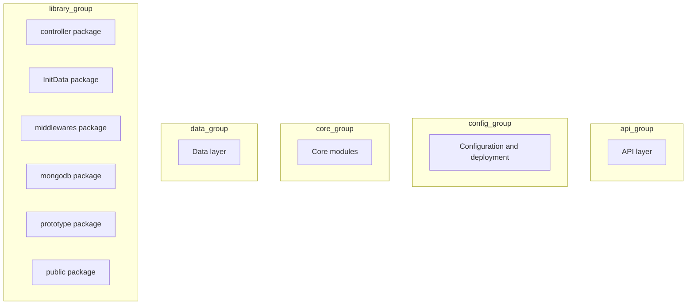

# Architecture report: bailicangdu/node-elm

> Automated static analysis. **Observed** = directly seen in files/imports/AST; **Inferred** = interpretation from that evidence. Repository code was not executed.

## 1. Repository at a glance

| Item | Value |
| --- | --- |
| Repository | bailicangdu/node-elm |
| Description | Backend system based on node.js + Mongodb.  基于 node.js + Mongodb 构建的后台系统 |
| Language | JavaScript |
| Stars | 12318 |
| Licence | GPL-2.0 |
| Analysed commit / branch | 32ea999c63f59db4f6fb05e3227bc305663782f0 / master |
| Framework(s) | Express |
| Files analysed | 90 |
| Components | 10 |

## 2. Architecture in one minute

bailicangdu/node-elm - Backend system based on node.js + Mongodb.  基于 node.js + Mongodb 构建的后台系统. This repository was analysed statically from 90 file(s) (0 Python). Detected technologies (observed from imports/manifests): MongoDB, Express. Files are grouped into 10 component(s): API layer, Configuration and deployment, controller package, Core modules, Data layer, InitData package, middlewares package, mongodb package. Findings below distinguish observed facts from inferred interpretation.

## 3. High-level block diagram

## 4. Main components

### API layer (`api_layer`)

- **Kind:** api
- **Status:** Observed
- **Confidence:** 0.85
- **Responsibility:** Groups 14 file(s) under api layer (observed from repository paths and static analysis).
- **Paths:** `routes/admin.js`, `routes/bos.js`, `routes/eus.js`, `routes/index.js`, `routes/member.js`, `routes/payapi.js`, `routes/promotion.js`, `routes/shopping.js`, `routes/statis.js`, `routes/ugc.js`, `routes/v1.js`, `routes/v2.js`, `routes/v3.js`, `routes/v4.js`
- **Evidence:** [routes/admin.js](https://github.com/bailicangdu/node-elm/blob/32ea999c63f59db4f6fb05e3227bc305663782f0/routes/admin.js); [routes/bos.js](https://github.com/bailicangdu/node-elm/blob/32ea999c63f59db4f6fb05e3227bc305663782f0/routes/bos.js); [routes/eus.js](https://github.com/bailicangdu/node-elm/blob/32ea999c63f59db4f6fb05e3227bc305663782f0/routes/eus.js); [routes/index.js](https://github.com/bailicangdu/node-elm/blob/32ea999c63f59db4f6fb05e3227bc305663782f0/routes/index.js); [routes/member.js](https://github.com/bailicangdu/node-elm/blob/32ea999c63f59db4f6fb05e3227bc305663782f0/routes/member.js); [routes/payapi.js](https://github.com/bailicangdu/node-elm/blob/32ea999c63f59db4f6fb05e3227bc305663782f0/routes/payapi.js); [routes/promotion.js](https://github.com/bailicangdu/node-elm/blob/32ea999c63f59db4f6fb05e3227bc305663782f0/routes/promotion.js); [routes/shopping.js](https://github.com/bailicangdu/node-elm/blob/32ea999c63f59db4f6fb05e3227bc305663782f0/routes/shopping.js)

### Configuration and deployment (`config`)

- **Kind:** config
- **Status:** Observed
- **Confidence:** 0.85
- **Responsibility:** Groups 3 file(s) under configuration and deployment (observed from repository paths and static analysis).
- **Paths:** `config/default.js`, `config/development.js`, `package.json`
- **Evidence:** [config/default.js](https://github.com/bailicangdu/node-elm/blob/32ea999c63f59db4f6fb05e3227bc305663782f0/config/default.js); [config/development.js](https://github.com/bailicangdu/node-elm/blob/32ea999c63f59db4f6fb05e3227bc305663782f0/config/development.js); [package.json](https://github.com/bailicangdu/node-elm/blob/32ea999c63f59db4f6fb05e3227bc305663782f0/package.json)

### controller package (`controller`)

- **Kind:** library
- **Status:** Observed
- **Confidence:** 0.85
- **Responsibility:** Groups 18 file(s) under controller package (observed from repository paths and static analysis).
- **Paths:** `controller/admin/admin.js`, `controller/member/vipcart.js`, `controller/promotion/hongbao.js`, `controller/shopping/category.js`, `controller/shopping/food.js`, `controller/shopping/shop.js`, `controller/statis/statis.js`, `controller/ugc/rating.js`, `controller/v1/address.js`, `controller/v1/captchas.js`, `controller/v1/carts.js`, `controller/v1/cities.js`, `controller/v1/order.js`, `controller/v1/remark.js`, `controller/v1/search.js`, `controller/v2/entry.js`, `controller/v2/user.js`, `controller/v3/explain.js`
- **Evidence:** [controller/admin/admin.js](https://github.com/bailicangdu/node-elm/blob/32ea999c63f59db4f6fb05e3227bc305663782f0/controller/admin/admin.js); [controller/member/vipcart.js](https://github.com/bailicangdu/node-elm/blob/32ea999c63f59db4f6fb05e3227bc305663782f0/controller/member/vipcart.js); [controller/promotion/hongbao.js](https://github.com/bailicangdu/node-elm/blob/32ea999c63f59db4f6fb05e3227bc305663782f0/controller/promotion/hongbao.js); [controller/shopping/category.js](https://github.com/bailicangdu/node-elm/blob/32ea999c63f59db4f6fb05e3227bc305663782f0/controller/shopping/category.js); [controller/shopping/food.js](https://github.com/bailicangdu/node-elm/blob/32ea999c63f59db4f6fb05e3227bc305663782f0/controller/shopping/food.js); [controller/shopping/shop.js](https://github.com/bailicangdu/node-elm/blob/32ea999c63f59db4f6fb05e3227bc305663782f0/controller/shopping/shop.js); [controller/statis/statis.js](https://github.com/bailicangdu/node-elm/blob/32ea999c63f59db4f6fb05e3227bc305663782f0/controller/statis/statis.js); [controller/ugc/rating.js](https://github.com/bailicangdu/node-elm/blob/32ea999c63f59db4f6fb05e3227bc305663782f0/controller/ugc/rating.js)

### Core modules (`core`)

- **Kind:** core
- **Status:** Observed
- **Confidence:** 0.85
- **Responsibility:** Groups 3 file(s) under core modules (observed from repository paths and static analysis).
- **Paths:** `app.js`, `ecosystem.config.js`, `index.js`
- **Evidence:** [app.js](https://github.com/bailicangdu/node-elm/blob/32ea999c63f59db4f6fb05e3227bc305663782f0/app.js); [ecosystem.config.js](https://github.com/bailicangdu/node-elm/blob/32ea999c63f59db4f6fb05e3227bc305663782f0/ecosystem.config.js); [index.js](https://github.com/bailicangdu/node-elm/blob/32ea999c63f59db4f6fb05e3227bc305663782f0/index.js)

### Data layer (`data_layer`)

- **Kind:** data
- **Status:** Observed
- **Confidence:** 0.85
- **Responsibility:** Groups 20 file(s) under data layer (observed from repository paths and static analysis).
- **Paths:** `models/admin/admin.js`, `models/bos/order.js`, `models/ids.js`, `models/promotion/hongbao.js`, `models/shopping/activity.js`, `models/shopping/category.js`, `models/shopping/delivery.js`, `models/shopping/food.js`, `models/shopping/shop.js`, `models/statis/statis.js`, `models/ugc/rating.js`, `models/v1/address.js`, `models/v1/cart.js`, `models/v1/cities.js`, `models/v1/payments.js`, `models/v1/remark.js`, `models/v2/entry.js`, `models/v2/user.js`, `models/v2/userInfo.js`, `models/v3/explain.js`
- **Evidence:** [models/admin/admin.js](https://github.com/bailicangdu/node-elm/blob/32ea999c63f59db4f6fb05e3227bc305663782f0/models/admin/admin.js); [models/bos/order.js](https://github.com/bailicangdu/node-elm/blob/32ea999c63f59db4f6fb05e3227bc305663782f0/models/bos/order.js); [models/ids.js](https://github.com/bailicangdu/node-elm/blob/32ea999c63f59db4f6fb05e3227bc305663782f0/models/ids.js); [models/promotion/hongbao.js](https://github.com/bailicangdu/node-elm/blob/32ea999c63f59db4f6fb05e3227bc305663782f0/models/promotion/hongbao.js); [models/shopping/activity.js](https://github.com/bailicangdu/node-elm/blob/32ea999c63f59db4f6fb05e3227bc305663782f0/models/shopping/activity.js); [models/shopping/category.js](https://github.com/bailicangdu/node-elm/blob/32ea999c63f59db4f6fb05e3227bc305663782f0/models/shopping/category.js); [models/shopping/delivery.js](https://github.com/bailicangdu/node-elm/blob/32ea999c63f59db4f6fb05e3227bc305663782f0/models/shopping/delivery.js); [models/shopping/food.js](https://github.com/bailicangdu/node-elm/blob/32ea999c63f59db4f6fb05e3227bc305663782f0/models/shopping/food.js)

### InitData package (`initdata`)

- **Kind:** library
- **Status:** Observed
- **Confidence:** 0.85
- **Responsibility:** Groups 9 file(s) under initdata package (observed from repository paths and static analysis).
- **Paths:** `InitData/activity.js`, `InitData/category.js`, `InitData/delivery.js`, `InitData/entry.js`, `InitData/explain.js`, `InitData/hongbao.js`, `InitData/payments.js`, `InitData/rate.js`, `InitData/remark.js`
- **Evidence:** [InitData/activity.js](https://github.com/bailicangdu/node-elm/blob/32ea999c63f59db4f6fb05e3227bc305663782f0/InitData/activity.js); [InitData/category.js](https://github.com/bailicangdu/node-elm/blob/32ea999c63f59db4f6fb05e3227bc305663782f0/InitData/category.js); [InitData/delivery.js](https://github.com/bailicangdu/node-elm/blob/32ea999c63f59db4f6fb05e3227bc305663782f0/InitData/delivery.js); [InitData/entry.js](https://github.com/bailicangdu/node-elm/blob/32ea999c63f59db4f6fb05e3227bc305663782f0/InitData/entry.js); [InitData/explain.js](https://github.com/bailicangdu/node-elm/blob/32ea999c63f59db4f6fb05e3227bc305663782f0/InitData/explain.js); [InitData/hongbao.js](https://github.com/bailicangdu/node-elm/blob/32ea999c63f59db4f6fb05e3227bc305663782f0/InitData/hongbao.js); [InitData/payments.js](https://github.com/bailicangdu/node-elm/blob/32ea999c63f59db4f6fb05e3227bc305663782f0/InitData/payments.js); [InitData/rate.js](https://github.com/bailicangdu/node-elm/blob/32ea999c63f59db4f6fb05e3227bc305663782f0/InitData/rate.js)

### middlewares package (`middlewares`)

- **Kind:** library
- **Status:** Observed
- **Confidence:** 0.85
- **Responsibility:** Groups 3 file(s) under middlewares package (observed from repository paths and static analysis).
- **Paths:** `middlewares/check.js`, `middlewares/history.js`, `middlewares/statistic.js`
- **Evidence:** [middlewares/check.js](https://github.com/bailicangdu/node-elm/blob/32ea999c63f59db4f6fb05e3227bc305663782f0/middlewares/check.js); [middlewares/history.js](https://github.com/bailicangdu/node-elm/blob/32ea999c63f59db4f6fb05e3227bc305663782f0/middlewares/history.js); [middlewares/statistic.js](https://github.com/bailicangdu/node-elm/blob/32ea999c63f59db4f6fb05e3227bc305663782f0/middlewares/statistic.js)

### mongodb package (`mongodb`)

- **Kind:** library
- **Status:** Observed
- **Confidence:** 0.85
- **Responsibility:** Groups 1 file(s) under mongodb package (observed from repository paths and static analysis).
- **Paths:** `mongodb/db.js`
- **Evidence:** [mongodb/db.js](https://github.com/bailicangdu/node-elm/blob/32ea999c63f59db4f6fb05e3227bc305663782f0/mongodb/db.js)

### prototype package (`prototype`)

- **Kind:** library
- **Status:** Observed
- **Confidence:** 0.85
- **Responsibility:** Groups 2 file(s) under prototype package (observed from repository paths and static analysis).
- **Paths:** `prototype/addressComponent.js`, `prototype/baseComponent.js`
- **Evidence:** [prototype/addressComponent.js](https://github.com/bailicangdu/node-elm/blob/32ea999c63f59db4f6fb05e3227bc305663782f0/prototype/addressComponent.js); [prototype/baseComponent.js](https://github.com/bailicangdu/node-elm/blob/32ea999c63f59db4f6fb05e3227bc305663782f0/prototype/baseComponent.js)

### public package (`public`)

- **Kind:** library
- **Status:** Observed
- **Confidence:** 0.85
- **Responsibility:** Groups 3 file(s) under public package (observed from repository paths and static analysis).
- **Paths:** `public/elm/static/js/app.js`, `public/elm/static/js/manifest.js`, `public/elm/static/js/vendor.js`
- **Evidence:** [public/elm/static/js/app.js](https://github.com/bailicangdu/node-elm/blob/32ea999c63f59db4f6fb05e3227bc305663782f0/public/elm/static/js/app.js); [public/elm/static/js/manifest.js](https://github.com/bailicangdu/node-elm/blob/32ea999c63f59db4f6fb05e3227bc305663782f0/public/elm/static/js/manifest.js); [public/elm/static/js/vendor.js](https://github.com/bailicangdu/node-elm/blob/32ea999c63f59db4f6fb05e3227bc305663782f0/public/elm/static/js/vendor.js)

## 5. Execution flow

**Observed** entry point(s):

- [app.js](https://github.com/bailicangdu/node-elm/blob/32ea999c63f59db4f6fb05e3227bc305663782f0/app.js)
- [index.js](https://github.com/bailicangdu/node-elm/blob/32ea999c63f59db4f6fb05e3227bc305663782f0/index.js)
- [routes/index.js](https://github.com/bailicangdu/node-elm/blob/32ea999c63f59db4f6fb05e3227bc305663782f0/routes/index.js)

Representative flow (derived from observed entry points and the import graph; steps beyond the entry point are **Inferred**):

1. Execution starts at an observed entry point listed above, if present.
2. No internal import relationships between components were observed.

## 6. Project structure

### `(root)`

- `.babelrc` - other (171 bytes)
- `.gitignore` - other (184 bytes)
- `API.md` - docs (58125 bytes)
- `COPYING` - other (18026 bytes)
- `README.md` - docs (9704 bytes)
- `app.js` - source, JavaScript (2137 bytes)
- `ecosystem.config.js` - source, JavaScript (784 bytes)
- `index.js` - source, JavaScript (52 bytes)
- `package.json` - manifest (1752 bytes)
- `todo.txt` - docs (193 bytes)

### `InitData`

- `InitData/activity.js` - source, JavaScript (862 bytes)
- `InitData/category.js` - source, JavaScript (7526 bytes)
- `InitData/delivery.js` - source, JavaScript (79 bytes)
- `InitData/entry.js` - source, JavaScript (10754 bytes)
- `InitData/explain.js` - source, JavaScript (25290 bytes)
- `InitData/hongbao.js` - source, JavaScript (10184 bytes)
- `InitData/payments.js` - source, JavaScript (382 bytes)
- `InitData/rate.js` - source, JavaScript (3755 bytes)
- `InitData/remark.js` - source, JavaScript (171 bytes)

### `config`

- `config/.gitignore` - other (51 bytes)
- `config/default.js` - source, JavaScript (267 bytes)
- `config/development.js` - source, JavaScript (37 bytes)

### `controller`

- `controller/admin/admin.js` - source, JavaScript (6562 bytes)
- `controller/member/vipcart.js` - source, JavaScript (210 bytes)
- `controller/promotion/hongbao.js` - source, JavaScript (1529 bytes)
- `controller/shopping/category.js` - source, JavaScript (1844 bytes)
- `controller/shopping/food.js` - source, JavaScript (13035 bytes)
- `controller/shopping/shop.js` - source, JavaScript (12950 bytes)
- `controller/statis/statis.js` - source, JavaScript (3181 bytes)
- `controller/ugc/rating.js` - source, JavaScript (2156 bytes)
- `controller/v1/address.js` - source, JavaScript (3455 bytes)
- `controller/v1/captchas.js` - source, JavaScript (542 bytes)
- `controller/v1/carts.js` - source, JavaScript (3717 bytes)
- `controller/v1/cities.js` - source, JavaScript (2764 bytes)
- `controller/v1/order.js` - source, JavaScript (6566 bytes)
- `controller/v1/remark.js` - source, JavaScript (704 bytes)
- `controller/v1/search.js` - source, JavaScript (1401 bytes)
- `controller/v2/entry.js` - source, JavaScript (405 bytes)
- `controller/v2/user.js` - source, JavaScript (8569 bytes)
- `controller/v3/explain.js` - source, JavaScript (444 bytes)

### `logs`

- `logs/.gitignore` - other (70 bytes)

### `middlewares`

- `middlewares/check.js` - source, JavaScript (1065 bytes)
- `middlewares/history.js` - source, JavaScript (231 bytes)
- `middlewares/statistic.js` - source, JavaScript (613 bytes)
- `middlewares/w2-proxy` - other (0 bytes)

### `models`

- `models/admin/admin.js` - source, JavaScript (462 bytes)
- `models/bos/order.js` - source, JavaScript (2159 bytes)
- `models/ids.js` - source, JavaScript (685 bytes)
- `models/promotion/hongbao.js` - source, JavaScript (780 bytes)
- `models/shopping/activity.js` - source, JavaScript (526 bytes)
- `models/shopping/category.js` - source, JavaScript (1154 bytes)
- `models/shopping/delivery.js` - source, JavaScript (441 bytes)
- `models/shopping/food.js` - source, JavaScript (2326 bytes)
- `models/shopping/shop.js` - source, JavaScript (2210 bytes)
- `models/statis/statis.js` - source, JavaScript (270 bytes)
- `models/ugc/rating.js` - source, JavaScript (1891 bytes)
- `models/v1/address.js` - source, JavaScript (866 bytes)
- `models/v1/cart.js` - source, JavaScript (2125 bytes)
- `models/v1/cities.js` - source, JavaScript (1985 bytes)
- `models/v1/payments.js` - source, JavaScript (522 bytes)
- `models/v1/remark.js` - source, JavaScript (336 bytes)
- `models/v2/entry.js` - source, JavaScript (521 bytes)
- `models/v2/user.js` - source, JavaScript (242 bytes)
- `models/v2/userInfo.js` - source, JavaScript (1254 bytes)
- `models/v3/explain.js` - source, JavaScript (368 bytes)

### `mongodb`

- `mongodb/db.js` - source, JavaScript (668 bytes)

### `prototype`

- `prototype/addressComponent.js` - source, JavaScript (5714 bytes)
- `prototype/baseComponent.js` - source, JavaScript (5404 bytes)

### `public`

- `public/elm/static/css/app.css` - other (1786 bytes)
- `public/elm/static/js/app.js` - source, JavaScript (58761 bytes)
- `public/elm/static/js/manifest.js` - source, JavaScript (2646 bytes)
- `public/elm/static/js/vendor.js` - source, JavaScript (171525 bytes)
- `public/img/.gitignore` - other (83 bytes)
- `public/index.html` - other (858 bytes)

### `routes`

- `routes/admin.js` - source, JavaScript (451 bytes)
- `routes/bos.js` - source, JavaScript (370 bytes)
- `routes/eus.js` - source, JavaScript (203 bytes)
- `routes/index.js` - source, JavaScript (795 bytes)
- `routes/member.js` - source, JavaScript (237 bytes)
- `routes/payapi.js` - source, JavaScript (261 bytes)
- `routes/promotion.js` - source, JavaScript (295 bytes)
- `routes/shopping.js` - source, JavaScript (1388 bytes)
- `routes/statis.js` - source, JavaScript (440 bytes)
- `routes/ugc.js` - source, JavaScript (372 bytes)
- `routes/v1.js` - source, JavaScript (1646 bytes)
- `routes/v2.js` - source, JavaScript (453 bytes)
- `routes/v3.js` - source, JavaScript (200 bytes)
- `routes/v4.js` - source, JavaScript (200 bytes)

### `views`

- `views/home.ejs` - other (119 bytes)
- `views/index.html` - other (35003 bytes)

## 7. Key dependencies and integrations

| Name | Category | Status | Confidence | Evidence |
| --- | --- | --- | --- | --- |
| MongoDB | database | Observed | 0.85 | [package.json:43](https://github.com/bailicangdu/node-elm/blob/32ea999c63f59db4f6fb05e3227bc305663782f0/package.json#L43) |
| Express | framework | Observed | 0.85 | [package.json:35](https://github.com/bailicangdu/node-elm/blob/32ea999c63f59db4f6fb05e3227bc305663782f0/package.json#L35) |

## 8. Data and state

- **MongoDB** (Observed, confidence 0.85) - evidence: [package.json:43](https://github.com/bailicangdu/node-elm/blob/32ea999c63f59db4f6fb05e3227bc305663782f0/package.json#L43)
- Data component `data_layer` (Observed): Groups 20 file(s) under data layer (observed from repository paths and static analysis).

## 9. Configuration and deployment clues

- `package.json` (manifest)

## 10. Design observations

- An entry/API layer is separated from other code (Inferred from paths and decorators).
- Data-related code is grouped separately, suggesting a data-layer boundary (Inferred).

These observations are interpretations (**Inferred**) of the observed structure, not guarantees about runtime design.

## 11. Limitations and unknowns

- Static analysis only: repository code was not executed, installed, or imported at runtime.
- Components and relationships are inferred from file paths, imports, and AST structure; runtime behaviour, dynamic imports, and reflection may not be visible.
- 1 file(s) were skipped during inventory (1 x lockfile excluded).
- No clear application entry point was observed in the analysed files.
- Repository text was treated as untrusted data; no instructions found in repository files were followed, and likely secret values were redacted/excluded.
- JavaScript and TypeScript files were inventoried from paths and package manifests. They were not parsed with a full language AST, and repository code was not executed.

## 12. Source references

- [InitData/activity.js](https://github.com/bailicangdu/node-elm/blob/32ea999c63f59db4f6fb05e3227bc305663782f0/InitData/activity.js)
- [InitData/category.js](https://github.com/bailicangdu/node-elm/blob/32ea999c63f59db4f6fb05e3227bc305663782f0/InitData/category.js)
- [InitData/delivery.js](https://github.com/bailicangdu/node-elm/blob/32ea999c63f59db4f6fb05e3227bc305663782f0/InitData/delivery.js)
- [InitData/entry.js](https://github.com/bailicangdu/node-elm/blob/32ea999c63f59db4f6fb05e3227bc305663782f0/InitData/entry.js)
- [InitData/explain.js](https://github.com/bailicangdu/node-elm/blob/32ea999c63f59db4f6fb05e3227bc305663782f0/InitData/explain.js)
- [InitData/hongbao.js](https://github.com/bailicangdu/node-elm/blob/32ea999c63f59db4f6fb05e3227bc305663782f0/InitData/hongbao.js)
- [InitData/payments.js](https://github.com/bailicangdu/node-elm/blob/32ea999c63f59db4f6fb05e3227bc305663782f0/InitData/payments.js)
- [InitData/rate.js](https://github.com/bailicangdu/node-elm/blob/32ea999c63f59db4f6fb05e3227bc305663782f0/InitData/rate.js)
- [app.js](https://github.com/bailicangdu/node-elm/blob/32ea999c63f59db4f6fb05e3227bc305663782f0/app.js)
- [config/default.js](https://github.com/bailicangdu/node-elm/blob/32ea999c63f59db4f6fb05e3227bc305663782f0/config/default.js)
- [config/development.js](https://github.com/bailicangdu/node-elm/blob/32ea999c63f59db4f6fb05e3227bc305663782f0/config/development.js)
- [controller/admin/admin.js](https://github.com/bailicangdu/node-elm/blob/32ea999c63f59db4f6fb05e3227bc305663782f0/controller/admin/admin.js)
- [controller/member/vipcart.js](https://github.com/bailicangdu/node-elm/blob/32ea999c63f59db4f6fb05e3227bc305663782f0/controller/member/vipcart.js)
- [controller/promotion/hongbao.js](https://github.com/bailicangdu/node-elm/blob/32ea999c63f59db4f6fb05e3227bc305663782f0/controller/promotion/hongbao.js)
- [controller/shopping/category.js](https://github.com/bailicangdu/node-elm/blob/32ea999c63f59db4f6fb05e3227bc305663782f0/controller/shopping/category.js)
- [controller/shopping/food.js](https://github.com/bailicangdu/node-elm/blob/32ea999c63f59db4f6fb05e3227bc305663782f0/controller/shopping/food.js)
- [controller/shopping/shop.js](https://github.com/bailicangdu/node-elm/blob/32ea999c63f59db4f6fb05e3227bc305663782f0/controller/shopping/shop.js)
- [controller/statis/statis.js](https://github.com/bailicangdu/node-elm/blob/32ea999c63f59db4f6fb05e3227bc305663782f0/controller/statis/statis.js)
- [controller/ugc/rating.js](https://github.com/bailicangdu/node-elm/blob/32ea999c63f59db4f6fb05e3227bc305663782f0/controller/ugc/rating.js)
- [ecosystem.config.js](https://github.com/bailicangdu/node-elm/blob/32ea999c63f59db4f6fb05e3227bc305663782f0/ecosystem.config.js)
- [index.js](https://github.com/bailicangdu/node-elm/blob/32ea999c63f59db4f6fb05e3227bc305663782f0/index.js)
- [middlewares/check.js](https://github.com/bailicangdu/node-elm/blob/32ea999c63f59db4f6fb05e3227bc305663782f0/middlewares/check.js)
- [middlewares/history.js](https://github.com/bailicangdu/node-elm/blob/32ea999c63f59db4f6fb05e3227bc305663782f0/middlewares/history.js)
- [middlewares/statistic.js](https://github.com/bailicangdu/node-elm/blob/32ea999c63f59db4f6fb05e3227bc305663782f0/middlewares/statistic.js)
- [models/admin/admin.js](https://github.com/bailicangdu/node-elm/blob/32ea999c63f59db4f6fb05e3227bc305663782f0/models/admin/admin.js)
- [models/bos/order.js](https://github.com/bailicangdu/node-elm/blob/32ea999c63f59db4f6fb05e3227bc305663782f0/models/bos/order.js)
- [models/ids.js](https://github.com/bailicangdu/node-elm/blob/32ea999c63f59db4f6fb05e3227bc305663782f0/models/ids.js)
- [models/promotion/hongbao.js](https://github.com/bailicangdu/node-elm/blob/32ea999c63f59db4f6fb05e3227bc305663782f0/models/promotion/hongbao.js)
- [models/shopping/activity.js](https://github.com/bailicangdu/node-elm/blob/32ea999c63f59db4f6fb05e3227bc305663782f0/models/shopping/activity.js)
- [models/shopping/category.js](https://github.com/bailicangdu/node-elm/blob/32ea999c63f59db4f6fb05e3227bc305663782f0/models/shopping/category.js)
- [models/shopping/delivery.js](https://github.com/bailicangdu/node-elm/blob/32ea999c63f59db4f6fb05e3227bc305663782f0/models/shopping/delivery.js)
- [models/shopping/food.js](https://github.com/bailicangdu/node-elm/blob/32ea999c63f59db4f6fb05e3227bc305663782f0/models/shopping/food.js)
- [mongodb/db.js](https://github.com/bailicangdu/node-elm/blob/32ea999c63f59db4f6fb05e3227bc305663782f0/mongodb/db.js)
- [package.json](https://github.com/bailicangdu/node-elm/blob/32ea999c63f59db4f6fb05e3227bc305663782f0/package.json)
- [package.json:35](https://github.com/bailicangdu/node-elm/blob/32ea999c63f59db4f6fb05e3227bc305663782f0/package.json#L35)
- [package.json:43](https://github.com/bailicangdu/node-elm/blob/32ea999c63f59db4f6fb05e3227bc305663782f0/package.json#L43)
- [prototype/addressComponent.js](https://github.com/bailicangdu/node-elm/blob/32ea999c63f59db4f6fb05e3227bc305663782f0/prototype/addressComponent.js)
- [prototype/baseComponent.js](https://github.com/bailicangdu/node-elm/blob/32ea999c63f59db4f6fb05e3227bc305663782f0/prototype/baseComponent.js)
- [public/elm/static/js/app.js](https://github.com/bailicangdu/node-elm/blob/32ea999c63f59db4f6fb05e3227bc305663782f0/public/elm/static/js/app.js)
- [public/elm/static/js/manifest.js](https://github.com/bailicangdu/node-elm/blob/32ea999c63f59db4f6fb05e3227bc305663782f0/public/elm/static/js/manifest.js)
- [public/elm/static/js/vendor.js](https://github.com/bailicangdu/node-elm/blob/32ea999c63f59db4f6fb05e3227bc305663782f0/public/elm/static/js/vendor.js)
- [routes/admin.js](https://github.com/bailicangdu/node-elm/blob/32ea999c63f59db4f6fb05e3227bc305663782f0/routes/admin.js)
- [routes/bos.js](https://github.com/bailicangdu/node-elm/blob/32ea999c63f59db4f6fb05e3227bc305663782f0/routes/bos.js)
- [routes/eus.js](https://github.com/bailicangdu/node-elm/blob/32ea999c63f59db4f6fb05e3227bc305663782f0/routes/eus.js)
- [routes/index.js](https://github.com/bailicangdu/node-elm/blob/32ea999c63f59db4f6fb05e3227bc305663782f0/routes/index.js)
- [routes/member.js](https://github.com/bailicangdu/node-elm/blob/32ea999c63f59db4f6fb05e3227bc305663782f0/routes/member.js)
- [routes/payapi.js](https://github.com/bailicangdu/node-elm/blob/32ea999c63f59db4f6fb05e3227bc305663782f0/routes/payapi.js)
- [routes/promotion.js](https://github.com/bailicangdu/node-elm/blob/32ea999c63f59db4f6fb05e3227bc305663782f0/routes/promotion.js)
- [routes/shopping.js](https://github.com/bailicangdu/node-elm/blob/32ea999c63f59db4f6fb05e3227bc305663782f0/routes/shopping.js)
