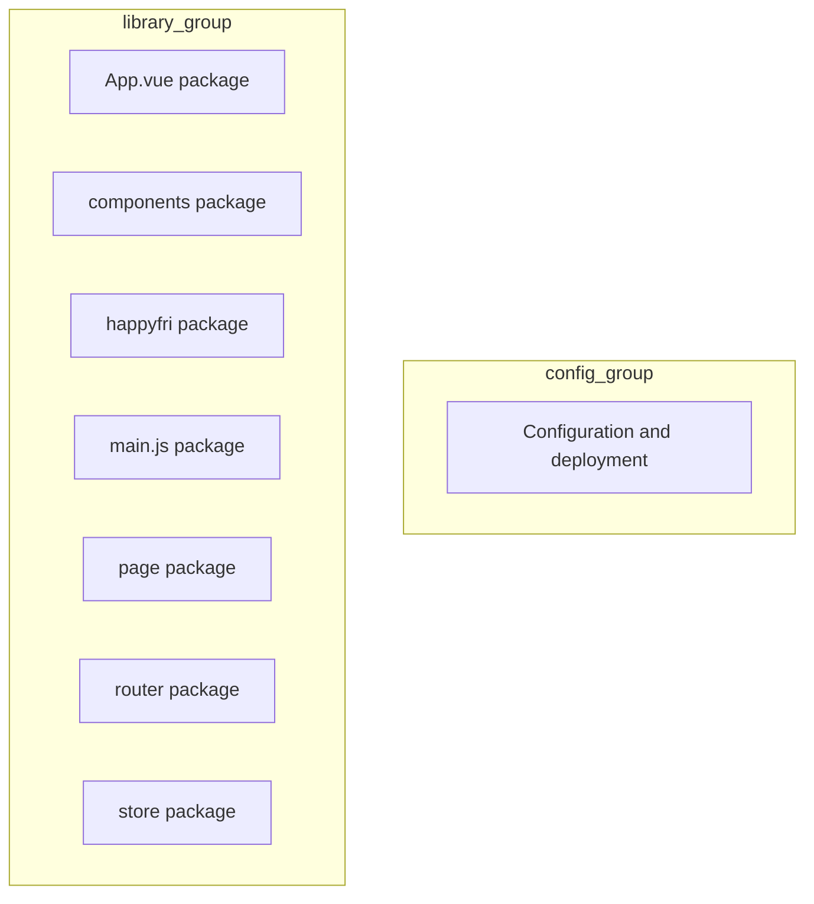

# Architecture report: bailicangdu/vue2-happyfri

> Automated static analysis. **Observed** = directly seen in files/imports/AST; **Inferred** = interpretation from that evidence. Repository code was not executed.

## 1. Repository at a glance

| Item | Value |
| --- | --- |
| Repository | bailicangdu/vue2-happyfri |
| Description | vue2 + vue-router + vuex  入门项目 |
| Language | JavaScript |
| Stars | 10527 |
| Licence | MIT |
| Analysed commit / branch | ac17b45a11b5d7abcf6a0f446d7844decd9fc7d8 / master |
| Framework(s) | Express, Vue |
| Files analysed | 26 |
| Components | 8 |

## 2. Architecture in one minute

bailicangdu/vue2-happyfri - vue2 + vue-router + vuex  入门项目. This repository was analysed statically from 26 file(s) (0 Python). Detected technologies (observed from imports/manifests): Express, Vue, webpack. Files are grouped into 8 component(s): App.vue package, components package, Configuration and deployment, happyfri package, main.js package, page package, router package, store package. Findings below distinguish observed facts from inferred interpretation.

## 3. High-level block diagram

## 4. Main components

### App.vue package (`app_vue`)

- **Kind:** library
- **Status:** Observed
- **Confidence:** 0.85
- **Responsibility:** Groups 1 file(s) under app.vue package (observed from repository paths and static analysis).
- **Paths:** `src/App.vue`
- **Evidence:** [src/App.vue](https://github.com/bailicangdu/vue2-happyfri/blob/ac17b45a11b5d7abcf6a0f446d7844decd9fc7d8/src/App.vue)

### components package (`components`)

- **Kind:** library
- **Status:** Observed
- **Confidence:** 0.85
- **Responsibility:** Groups 1 file(s) under components package (observed from repository paths and static analysis).
- **Paths:** `src/components/itemcontainer.vue`
- **Evidence:** [src/components/itemcontainer.vue](https://github.com/bailicangdu/vue2-happyfri/blob/ac17b45a11b5d7abcf6a0f446d7844decd9fc7d8/src/components/itemcontainer.vue)

### Configuration and deployment (`config`)

- **Kind:** config
- **Status:** Observed
- **Confidence:** 0.85
- **Responsibility:** Groups 4 file(s) under configuration and deployment (observed from repository paths and static analysis).
- **Paths:** `config/index.js`, `package.json`, `src/config/ajax.js`, `src/config/rem.js`
- **Evidence:** [config/index.js](https://github.com/bailicangdu/vue2-happyfri/blob/ac17b45a11b5d7abcf6a0f446d7844decd9fc7d8/config/index.js); [package.json](https://github.com/bailicangdu/vue2-happyfri/blob/ac17b45a11b5d7abcf6a0f446d7844decd9fc7d8/package.json); [src/config/ajax.js](https://github.com/bailicangdu/vue2-happyfri/blob/ac17b45a11b5d7abcf6a0f446d7844decd9fc7d8/src/config/ajax.js); [src/config/rem.js](https://github.com/bailicangdu/vue2-happyfri/blob/ac17b45a11b5d7abcf6a0f446d7844decd9fc7d8/src/config/rem.js)

### happyfri package (`happyfri`)

- **Kind:** library
- **Status:** Observed
- **Confidence:** 0.85
- **Responsibility:** Groups 3 file(s) under happyfri package (observed from repository paths and static analysis).
- **Paths:** `happyfri/static/js/app.js`, `happyfri/static/js/manifest.js`, `happyfri/static/js/vendor.js`
- **Evidence:** [happyfri/static/js/app.js](https://github.com/bailicangdu/vue2-happyfri/blob/ac17b45a11b5d7abcf6a0f446d7844decd9fc7d8/happyfri/static/js/app.js); [happyfri/static/js/manifest.js](https://github.com/bailicangdu/vue2-happyfri/blob/ac17b45a11b5d7abcf6a0f446d7844decd9fc7d8/happyfri/static/js/manifest.js); [happyfri/static/js/vendor.js](https://github.com/bailicangdu/vue2-happyfri/blob/ac17b45a11b5d7abcf6a0f446d7844decd9fc7d8/happyfri/static/js/vendor.js)

### main.js package (`main_js`)

- **Kind:** library
- **Status:** Observed
- **Confidence:** 0.85
- **Responsibility:** Groups 1 file(s) under main.js package (observed from repository paths and static analysis).
- **Paths:** `src/main.js`
- **Evidence:** [src/main.js](https://github.com/bailicangdu/vue2-happyfri/blob/ac17b45a11b5d7abcf6a0f446d7844decd9fc7d8/src/main.js)

### page package (`page`)

- **Kind:** library
- **Status:** Observed
- **Confidence:** 0.85
- **Responsibility:** Groups 3 file(s) under page package (observed from repository paths and static analysis).
- **Paths:** `src/page/home/index.vue`, `src/page/item/index.vue`, `src/page/score/index.vue`
- **Evidence:** [src/page/home/index.vue](https://github.com/bailicangdu/vue2-happyfri/blob/ac17b45a11b5d7abcf6a0f446d7844decd9fc7d8/src/page/home/index.vue); [src/page/item/index.vue](https://github.com/bailicangdu/vue2-happyfri/blob/ac17b45a11b5d7abcf6a0f446d7844decd9fc7d8/src/page/item/index.vue); [src/page/score/index.vue](https://github.com/bailicangdu/vue2-happyfri/blob/ac17b45a11b5d7abcf6a0f446d7844decd9fc7d8/src/page/score/index.vue)

### router package (`router`)

- **Kind:** library
- **Status:** Observed
- **Confidence:** 0.85
- **Responsibility:** Groups 1 file(s) under router package (observed from repository paths and static analysis).
- **Paths:** `src/router/router.js`
- **Evidence:** [src/router/router.js](https://github.com/bailicangdu/vue2-happyfri/blob/ac17b45a11b5d7abcf6a0f446d7844decd9fc7d8/src/router/router.js)

### store package (`store`)

- **Kind:** library
- **Status:** Observed
- **Confidence:** 0.85
- **Responsibility:** Groups 3 file(s) under store package (observed from repository paths and static analysis).
- **Paths:** `src/store/action.js`, `src/store/index.js`, `src/store/mutations.js`
- **Evidence:** [src/store/action.js](https://github.com/bailicangdu/vue2-happyfri/blob/ac17b45a11b5d7abcf6a0f446d7844decd9fc7d8/src/store/action.js); [src/store/index.js](https://github.com/bailicangdu/vue2-happyfri/blob/ac17b45a11b5d7abcf6a0f446d7844decd9fc7d8/src/store/index.js); [src/store/mutations.js](https://github.com/bailicangdu/vue2-happyfri/blob/ac17b45a11b5d7abcf6a0f446d7844decd9fc7d8/src/store/mutations.js)

## 5. Execution flow

**Observed** entry point(s):

- [config/index.js](https://github.com/bailicangdu/vue2-happyfri/blob/ac17b45a11b5d7abcf6a0f446d7844decd9fc7d8/config/index.js)
- [happyfri/static/js/app.js](https://github.com/bailicangdu/vue2-happyfri/blob/ac17b45a11b5d7abcf6a0f446d7844decd9fc7d8/happyfri/static/js/app.js)
- [src/main.js](https://github.com/bailicangdu/vue2-happyfri/blob/ac17b45a11b5d7abcf6a0f446d7844decd9fc7d8/src/main.js)
- [src/store/index.js](https://github.com/bailicangdu/vue2-happyfri/blob/ac17b45a11b5d7abcf6a0f446d7844decd9fc7d8/src/store/index.js)

Representative flow (derived from observed entry points and the import graph; steps beyond the entry point are **Inferred**):

1. Execution starts at an observed entry point listed above, if present.
2. No internal import relationships between components were observed.

## 6. Project structure

### `(root)`

- `.babelrc` - other (96 bytes)
- `.editorconfig` - config (147 bytes)
- `.gitignore` - other (68 bytes)
- `LICENSE` - docs (1064 bytes)
- `README.md` - docs (3347 bytes)
- `index.html` - other (602 bytes)
- `package.json` - manifest (1588 bytes)

### `config`

- `config/index.js` - source, JavaScript (1349 bytes)

### `happyfri`

- `happyfri/index.html` - other (890 bytes)
- `happyfri/static/css/app.css` - other (970 bytes)
- `happyfri/static/js/app.js` - source, JavaScript (6496 bytes)
- `happyfri/static/js/manifest.js` - source, JavaScript (962 bytes)
- `happyfri/static/js/vendor.js` - source, JavaScript (139465 bytes)

### `src`

- `src/App.vue` - source, Vue (148 bytes)
- `src/components/itemcontainer.vue` - source, Vue (4932 bytes)
- `src/config/ajax.js` - source, JavaScript (1200 bytes)
- `src/config/rem.js` - source, JavaScript (523 bytes)
- `src/main.js` - source, JavaScript (309 bytes)
- `src/page/home/index.vue` - source, Vue (380 bytes)
- `src/page/item/index.vue` - source, Vue (396 bytes)
- `src/page/score/index.vue` - source, Vue (4112 bytes)
- `src/router/router.js` - source, JavaScript (445 bytes)
- `src/store/action.js` - source, JavaScript (384 bytes)
- `src/store/index.js` - source, JavaScript (4031 bytes)
- `src/store/mutations.js` - source, JavaScript (575 bytes)
- `src/style/common.less` - other (961 bytes)

## 7. Key dependencies and integrations

| Name | Category | Status | Confidence | Evidence |
| --- | --- | --- | --- | --- |
| Express | framework | Observed | 0.85 | [package.json:30](https://github.com/bailicangdu/vue2-happyfri/blob/ac17b45a11b5d7abcf6a0f446d7844decd9fc7d8/package.json#L30) |
| Vue | framework | Observed | 0.85 | [package.json:4](https://github.com/bailicangdu/vue2-happyfri/blob/ac17b45a11b5d7abcf6a0f446d7844decd9fc7d8/package.json#L4) |
| webpack | tooling | Observed | 0.85 | [package.json:31](https://github.com/bailicangdu/vue2-happyfri/blob/ac17b45a11b5d7abcf6a0f446d7844decd9fc7d8/package.json#L31) |

## 8. Data and state

No database, cache, queue, or persistent-state usage was observed in the analysed files. State handling, if any, may be in-memory or in files that were not analysed.

## 9. Configuration and deployment clues

- `.editorconfig` (config)
- `package.json` (manifest)

## 10. Design observations

- No strong design patterns could be established from the available evidence.

These observations are interpretations (**Inferred**) of the observed structure, not guarantees about runtime design.

## 11. Limitations and unknowns

- Static analysis only: repository code was not executed, installed, or imported at runtime.
- Components and relationships are inferred from file paths, imports, and AST structure; runtime behaviour, dynamic imports, and reflection may not be visible.
- 7 file(s) were skipped during inventory (7 x vendored/generated directory excluded).
- No clear application entry point was observed in the analysed files.
- Repository text was treated as untrusted data; no instructions found in repository files were followed, and likely secret values were redacted/excluded.
- JavaScript and TypeScript files were inventoried from paths and package manifests. They were not parsed with a full language AST, and repository code was not executed.

## 12. Source references

- [config/index.js](https://github.com/bailicangdu/vue2-happyfri/blob/ac17b45a11b5d7abcf6a0f446d7844decd9fc7d8/config/index.js)
- [happyfri/static/js/app.js](https://github.com/bailicangdu/vue2-happyfri/blob/ac17b45a11b5d7abcf6a0f446d7844decd9fc7d8/happyfri/static/js/app.js)
- [happyfri/static/js/manifest.js](https://github.com/bailicangdu/vue2-happyfri/blob/ac17b45a11b5d7abcf6a0f446d7844decd9fc7d8/happyfri/static/js/manifest.js)
- [happyfri/static/js/vendor.js](https://github.com/bailicangdu/vue2-happyfri/blob/ac17b45a11b5d7abcf6a0f446d7844decd9fc7d8/happyfri/static/js/vendor.js)
- [package.json](https://github.com/bailicangdu/vue2-happyfri/blob/ac17b45a11b5d7abcf6a0f446d7844decd9fc7d8/package.json)
- [package.json:4](https://github.com/bailicangdu/vue2-happyfri/blob/ac17b45a11b5d7abcf6a0f446d7844decd9fc7d8/package.json#L4)
- [package.json:30](https://github.com/bailicangdu/vue2-happyfri/blob/ac17b45a11b5d7abcf6a0f446d7844decd9fc7d8/package.json#L30)
- [package.json:31](https://github.com/bailicangdu/vue2-happyfri/blob/ac17b45a11b5d7abcf6a0f446d7844decd9fc7d8/package.json#L31)
- [src/App.vue](https://github.com/bailicangdu/vue2-happyfri/blob/ac17b45a11b5d7abcf6a0f446d7844decd9fc7d8/src/App.vue)
- [src/components/itemcontainer.vue](https://github.com/bailicangdu/vue2-happyfri/blob/ac17b45a11b5d7abcf6a0f446d7844decd9fc7d8/src/components/itemcontainer.vue)
- [src/config/ajax.js](https://github.com/bailicangdu/vue2-happyfri/blob/ac17b45a11b5d7abcf6a0f446d7844decd9fc7d8/src/config/ajax.js)
- [src/config/rem.js](https://github.com/bailicangdu/vue2-happyfri/blob/ac17b45a11b5d7abcf6a0f446d7844decd9fc7d8/src/config/rem.js)
- [src/main.js](https://github.com/bailicangdu/vue2-happyfri/blob/ac17b45a11b5d7abcf6a0f446d7844decd9fc7d8/src/main.js)
- [src/page/home/index.vue](https://github.com/bailicangdu/vue2-happyfri/blob/ac17b45a11b5d7abcf6a0f446d7844decd9fc7d8/src/page/home/index.vue)
- [src/page/item/index.vue](https://github.com/bailicangdu/vue2-happyfri/blob/ac17b45a11b5d7abcf6a0f446d7844decd9fc7d8/src/page/item/index.vue)
- [src/page/score/index.vue](https://github.com/bailicangdu/vue2-happyfri/blob/ac17b45a11b5d7abcf6a0f446d7844decd9fc7d8/src/page/score/index.vue)
- [src/router/router.js](https://github.com/bailicangdu/vue2-happyfri/blob/ac17b45a11b5d7abcf6a0f446d7844decd9fc7d8/src/router/router.js)
- [src/store/action.js](https://github.com/bailicangdu/vue2-happyfri/blob/ac17b45a11b5d7abcf6a0f446d7844decd9fc7d8/src/store/action.js)
- [src/store/index.js](https://github.com/bailicangdu/vue2-happyfri/blob/ac17b45a11b5d7abcf6a0f446d7844decd9fc7d8/src/store/index.js)
- [src/store/mutations.js](https://github.com/bailicangdu/vue2-happyfri/blob/ac17b45a11b5d7abcf6a0f446d7844decd9fc7d8/src/store/mutations.js)
