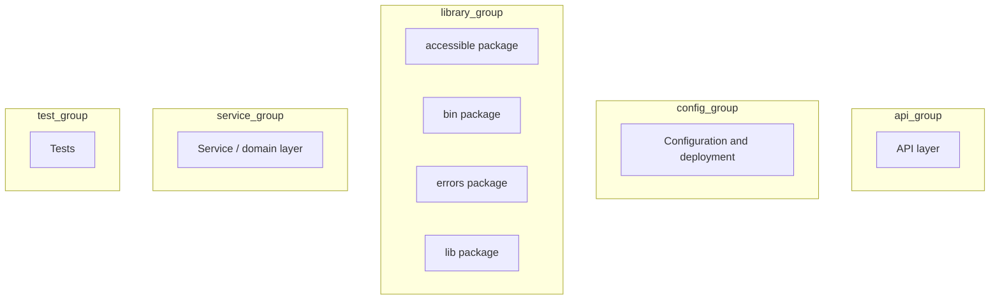

# Architecture report: balderdashy/sails

> Automated static analysis. **Observed** = directly seen in files/imports/AST; **Inferred** = interpretation from that evidence. Repository code was not executed.

## 1. Repository at a glance

| Item | Value |
| --- | --- |
| Repository | balderdashy/sails |
| Description | Realtime MVC Framework for Node.js |
| Language | JavaScript |
| Stars | 22773 |
| Licence | MIT |
| Analysed commit / branch | 7b76422cc27823df033572bdda5c4910a68b697f / master |
| Framework(s) | Express |
| Files analysed | 716 |
| Components | 8 |

## 2. Architecture in one minute

balderdashy/sails - Realtime MVC Framework for Node.js. This repository was analysed statically from 716 file(s) (0 Python). Detected technologies (observed from imports/manifests): Express. Files are grouped into 8 component(s): accessible package, API layer, bin package, Configuration and deployment, errors package, lib package, Service / domain layer, Tests. Findings below distinguish observed facts from inferred interpretation.

## 3. High-level block diagram

## 4. Main components

### accessible package (`accessible`)

- **Kind:** library
- **Status:** Observed
- **Confidence:** 0.85
- **Responsibility:** Groups 2 file(s) under accessible package (observed from repository paths and static analysis).
- **Paths:** `accessible/generate.js`, `accessible/rc.js`
- **Evidence:** [accessible/generate.js](https://github.com/balderdashy/sails/blob/7b76422cc27823df033572bdda5c4910a68b697f/accessible/generate.js); [accessible/rc.js](https://github.com/balderdashy/sails/blob/7b76422cc27823df033572bdda5c4910a68b697f/accessible/rc.js)

### API layer (`api_layer`)

- **Kind:** api
- **Status:** Observed
- **Confidence:** 0.85
- **Responsibility:** Groups 11 file(s) under api layer (observed from repository paths and static analysis).
- **Paths:** `lib/hooks/views/configure.js`, `lib/hooks/views/default-view-rendering-fn.js`, `lib/hooks/views/escape-html-entities-deep.js`, `lib/hooks/views/get-implicit-defaults.js`, `lib/hooks/views/html-scriptify.js`, `lib/hooks/views/index.js`, `lib/hooks/views/onRoute.js`, `lib/hooks/views/render.js`, `lib/hooks/views/res.view.js`, `lib/hooks/views/stat-views.js`, `lib/hooks/views/unescape-html-entities-deep-lite.min.string.js`
- **Evidence:** [lib/hooks/views/configure.js](https://github.com/balderdashy/sails/blob/7b76422cc27823df033572bdda5c4910a68b697f/lib/hooks/views/configure.js); [lib/hooks/views/default-view-rendering-fn.js](https://github.com/balderdashy/sails/blob/7b76422cc27823df033572bdda5c4910a68b697f/lib/hooks/views/default-view-rendering-fn.js); [lib/hooks/views/escape-html-entities-deep.js](https://github.com/balderdashy/sails/blob/7b76422cc27823df033572bdda5c4910a68b697f/lib/hooks/views/escape-html-entities-deep.js); [lib/hooks/views/get-implicit-defaults.js](https://github.com/balderdashy/sails/blob/7b76422cc27823df033572bdda5c4910a68b697f/lib/hooks/views/get-implicit-defaults.js); [lib/hooks/views/html-scriptify.js](https://github.com/balderdashy/sails/blob/7b76422cc27823df033572bdda5c4910a68b697f/lib/hooks/views/html-scriptify.js); [lib/hooks/views/index.js](https://github.com/balderdashy/sails/blob/7b76422cc27823df033572bdda5c4910a68b697f/lib/hooks/views/index.js); [lib/hooks/views/onRoute.js](https://github.com/balderdashy/sails/blob/7b76422cc27823df033572bdda5c4910a68b697f/lib/hooks/views/onRoute.js); [lib/hooks/views/render.js](https://github.com/balderdashy/sails/blob/7b76422cc27823df033572bdda5c4910a68b697f/lib/hooks/views/render.js)

### bin package (`bin`)

- **Kind:** library
- **Status:** Observed
- **Confidence:** 0.85
- **Responsibility:** Groups 15 file(s) under bin package (observed from repository paths and static analysis).
- **Paths:** `bin/private/patched-commander.js`, `bin/private/read-repl-history-and-start-transcribing.js`, `bin/sails-console.js`, `bin/sails-debug-console.js`, `bin/sails-debug.js`, `bin/sails-deploy.js`, `bin/sails-generate.js`, `bin/sails-inspect.js`, `bin/sails-lift.js`, `bin/sails-migrate.js`, `bin/sails-new.js`, `bin/sails-run.js`, `bin/sails-upgrade.js`, `bin/sails-www.js`, `bin/sails.js`
- **Evidence:** [bin/private/patched-commander.js](https://github.com/balderdashy/sails/blob/7b76422cc27823df033572bdda5c4910a68b697f/bin/private/patched-commander.js); [bin/private/read-repl-history-and-start-transcribing.js](https://github.com/balderdashy/sails/blob/7b76422cc27823df033572bdda5c4910a68b697f/bin/private/read-repl-history-and-start-transcribing.js); [bin/sails-console.js](https://github.com/balderdashy/sails/blob/7b76422cc27823df033572bdda5c4910a68b697f/bin/sails-console.js); [bin/sails-debug-console.js](https://github.com/balderdashy/sails/blob/7b76422cc27823df033572bdda5c4910a68b697f/bin/sails-debug-console.js); [bin/sails-debug.js](https://github.com/balderdashy/sails/blob/7b76422cc27823df033572bdda5c4910a68b697f/bin/sails-debug.js); [bin/sails-deploy.js](https://github.com/balderdashy/sails/blob/7b76422cc27823df033572bdda5c4910a68b697f/bin/sails-deploy.js); [bin/sails-generate.js](https://github.com/balderdashy/sails/blob/7b76422cc27823df033572bdda5c4910a68b697f/bin/sails-generate.js); [bin/sails-inspect.js](https://github.com/balderdashy/sails/blob/7b76422cc27823df033572bdda5c4910a68b697f/bin/sails-inspect.js)

### Configuration and deployment (`config`)

- **Kind:** config
- **Status:** Observed
- **Confidence:** 0.85
- **Responsibility:** Groups 2 file(s) under configuration and deployment (observed from repository paths and static analysis).
- **Paths:** `appveyor.yml`, `package.json`
- **Evidence:** [appveyor.yml](https://github.com/balderdashy/sails/blob/7b76422cc27823df033572bdda5c4910a68b697f/appveyor.yml); [package.json](https://github.com/balderdashy/sails/blob/7b76422cc27823df033572bdda5c4910a68b697f/package.json)

### errors package (`errors`)

- **Kind:** library
- **Status:** Observed
- **Confidence:** 0.85
- **Responsibility:** Groups 3 file(s) under errors package (observed from repository paths and static analysis).
- **Paths:** `errors/fatal.js`, `errors/index.js`, `errors/warn.js`
- **Evidence:** [errors/fatal.js](https://github.com/balderdashy/sails/blob/7b76422cc27823df033572bdda5c4910a68b697f/errors/fatal.js); [errors/index.js](https://github.com/balderdashy/sails/blob/7b76422cc27823df033572bdda5c4910a68b697f/errors/index.js); [errors/warn.js](https://github.com/balderdashy/sails/blob/7b76422cc27823df033572bdda5c4910a68b697f/errors/warn.js)

### lib package (`lib`)

- **Kind:** library
- **Status:** Observed
- **Confidence:** 0.85
- **Responsibility:** Groups 94 file(s) under lib package (observed from repository paths and static analysis).
- **Paths:** `lib/app/Sails.js`, `lib/app/configuration/default-hooks.js`, `lib/app/configuration/index.js`, `lib/app/configuration/load.js`, `lib/app/configuration/rc.js`, `lib/app/get-actions.js`, `lib/app/get-route-for.js`, `lib/app/get-url-for.js`, `lib/app/index.js`, `lib/app/lift.js`, `lib/app/load.js`, `lib/app/lower.js`, `lib/app/private/after.js`, `lib/app/private/bootstrap.js`, `lib/app/private/checkGruntConfig.js`, `lib/app/private/controller/help-register-action.js`, `lib/app/private/controller/load-action-modules.js`, `lib/app/private/exposeGlobals.js`, `lib/app/private/initialize.js`, `lib/app/private/inspect.js`, `lib/app/private/isLocalSailsValid.js`, `lib/app/private/isSailsAppSync.js`, `lib/app/private/loadHooks.js`, `lib/app/private/toJSON.js`, `lib/app/private/toString.js`, `lib/app/register-action-middleware.js`, `lib/app/register-action.js`, `lib/app/reload-actions.js`, `lib/app/request.js`, `lib/hooks/blueprints/actionUtil.js`, `lib/hooks/blueprints/actions/add.js`, `lib/hooks/blueprints/actions/create.js`, `lib/hooks/blueprints/actions/destroy.js`, `lib/hooks/blueprints/actions/find.js`, `lib/hooks/blueprints/actions/findOne.js`, `lib/hooks/blueprints/actions/populate.js`, `lib/hooks/blueprints/actions/remove.js`, `lib/hooks/blueprints/actions/replace.js`, `lib/hooks/blueprints/actions/update.js`, `lib/hooks/blueprints/formatUsageError.js`, `lib/hooks/blueprints/index.js`, `lib/hooks/blueprints/onRoute.js`, `lib/hooks/blueprints/parse-blueprint-options.js`, `lib/hooks/helpers/index.js`, `lib/hooks/helpers/private/iterate-helpers.js`, `lib/hooks/helpers/private/load-helpers.js`, `lib/hooks/http/get-configured-http-middleware-fns.js`, `lib/hooks/http/index.js`, `lib/hooks/http/initialize.js`, `lib/hooks/http/start.js`, `lib/hooks/http/view.js`, `lib/hooks/i18n/index.js`, `lib/hooks/index.js`, `lib/hooks/logger/index.js`, `lib/hooks/logger/ship.js`, `lib/hooks/moduleloader/index.js`, `lib/hooks/policies/index.js`, `lib/hooks/pubsub/index.js`, `lib/hooks/request/index.js`, `lib/hooks/request/locals.js`, `lib/hooks/request/metadata.js`, `lib/hooks/request/param.js`, `lib/hooks/request/params.all.js`, `lib/hooks/request/qualifiers.js`, `lib/hooks/request/validate.js`, `lib/hooks/responses/defaults/badRequest.js`, `lib/hooks/responses/defaults/forbidden.js`, `lib/hooks/responses/defaults/negotiate.js`, `lib/hooks/responses/defaults/notFound.js`, `lib/hooks/responses/defaults/ok.js`, `lib/hooks/responses/defaults/serverError.js`, `lib/hooks/responses/index.js`, `lib/hooks/responses/onRoute.js`, `lib/hooks/security/cors/index.js`, `lib/hooks/security/cors/set-headers.js`, `lib/hooks/security/cors/set-preflight-config.js`, `lib/hooks/security/csrf/grant-csrf-token.js`, `lib/hooks/security/csrf/index.js`, `lib/hooks/security/index.js`, `lib/hooks/session/index.js`, `lib/hooks/userconfig/index.js`, `lib/hooks/userhooks/index.js`, `lib/index.js`, `lib/router/bind.js`, `lib/router/bindDefaultHandlers.js`, `lib/router/index.js`, `lib/router/mock-req.js`, `lib/router/mock-res.js`, `lib/router/req.js`, `lib/router/res.js`, `lib/util/check-origin-url.js`, `lib/util/deep-extend.js`, `lib/util/detect-verb.js`, `lib/util/rc.js`
- **Evidence:** [lib/app/Sails.js](https://github.com/balderdashy/sails/blob/7b76422cc27823df033572bdda5c4910a68b697f/lib/app/Sails.js); [lib/app/configuration/default-hooks.js](https://github.com/balderdashy/sails/blob/7b76422cc27823df033572bdda5c4910a68b697f/lib/app/configuration/default-hooks.js); [lib/app/configuration/index.js](https://github.com/balderdashy/sails/blob/7b76422cc27823df033572bdda5c4910a68b697f/lib/app/configuration/index.js); [lib/app/configuration/load.js](https://github.com/balderdashy/sails/blob/7b76422cc27823df033572bdda5c4910a68b697f/lib/app/configuration/load.js); [lib/app/configuration/rc.js](https://github.com/balderdashy/sails/blob/7b76422cc27823df033572bdda5c4910a68b697f/lib/app/configuration/rc.js); [lib/app/get-actions.js](https://github.com/balderdashy/sails/blob/7b76422cc27823df033572bdda5c4910a68b697f/lib/app/get-actions.js); [lib/app/get-route-for.js](https://github.com/balderdashy/sails/blob/7b76422cc27823df033572bdda5c4910a68b697f/lib/app/get-route-for.js); [lib/app/get-url-for.js](https://github.com/balderdashy/sails/blob/7b76422cc27823df033572bdda5c4910a68b697f/lib/app/get-url-for.js)

### Service / domain layer (`service_layer`)

- **Kind:** service
- **Status:** Observed
- **Confidence:** 0.85
- **Responsibility:** Groups 1 file(s) under service / domain layer (observed from repository paths and static analysis).
- **Paths:** `lib/hooks/services/index.js`
- **Evidence:** [lib/hooks/services/index.js](https://github.com/balderdashy/sails/blob/7b76422cc27823df033572bdda5c4910a68b697f/lib/hooks/services/index.js)

### Tests (`tests`)

- **Kind:** test
- **Status:** Observed
- **Confidence:** 0.85
- **Responsibility:** Groups 121 file(s) under tests (observed from repository paths and static analysis).
- **Paths:** `test/.eslintrc`, `test/README.md`, `test/benchmarks/README.md`, `test/benchmarks/helpers/benchmarx.js`, `test/benchmarks/sails.load.test.js`, `test/benchmarks/sails.request.generic.test.js`, `test/fixtures/constants.js`, `test/fixtures/customHooks.js`, `test/fixtures/middleware.js`, `test/helpers/RouteFactory.helper.js`, `test/helpers/router.js`, `test/helpers/sails.js`, `test/helpers/test-spawning-sails-child-process-in-cwd.js`, `test/helpers/test-spawning-sails-lift-child-process-in-cwd.js`, `test/hooks/blueprints/initialize.test.js`, `test/hooks/http/initialize.test.js`, `test/hooks/pubsub/initialize.test.js`, `test/hooks/request/initialize.test.js`, `test/hooks/request/req.metadata.test.js`, `test/hooks/request/req.options.sticky.test.js`, `test/hooks/views/ejs/index.i18n.ejs`, `test/hooks/views/intialize.test.js`, `test/hooks/views/locales/en.json`, `test/hooks/views/locales/es.json`, `test/hooks/views/locales/eu.json`, `test/hooks/views/res.render.i18n.js`, `test/hooks/views/res.view.test.js`, `test/hooks/views/skipAssets.test.js`, `test/init.js`, `test/integration/README.md`, `test/integration/fixtures/hooks/installable/add-policy/index.js`, `test/integration/fixtures/hooks/installable/add-policy/package.json`, `test/integration/fixtures/hooks/installable/async/index.js.txt`, `test/integration/fixtures/hooks/installable/shout/index.js`, `test/integration/fixtures/hooks/installable/shout/package.json`, `test/integration/fixtures/sampleapp/api/controllers/EmptyController.js`, `test/integration/fixtures/sampleapp/api/controllers/PetController.js`, `test/integration/fixtures/sampleapp/api/controllers/QuizController.js`, `test/integration/fixtures/sampleapp/api/controllers/TestController.js`, `test/integration/fixtures/sampleapp/api/controllers/UserController.js`, `test/integration/fixtures/sampleapp/api/controllers/UserProfileController.js`, `test/integration/fixtures/sampleapp/api/controllers/ViewTestController.js`, `test/integration/fixtures/sampleapp/api/models/Empty.js`, `test/integration/fixtures/sampleapp/api/models/Pet.js`, `test/integration/fixtures/sampleapp/api/models/Quiz.js`, `test/integration/fixtures/sampleapp/api/models/Test.js`, `test/integration/fixtures/sampleapp/api/models/User.js`, `test/integration/fixtures/sampleapp/api/models/UserProfile.js`, `test/integration/fixtures/sampleapp/api/policies/error_policy.js`, `test/integration/fixtures/sampleapp/api/policies/fake_auth.js`, `test/integration/fixtures/sampleapp/api/services/TestService.js`, `test/integration/fixtures/sampleapp/config/local.js`, `test/integration/fixtures/sampleapp/views/app/index.ejs`, `test/integration/fixtures/sampleapp/views/app/user/homepage.ejs`, `test/integration/fixtures/sampleapp/views/pages/homepage.ejs`, `test/integration/fixtures/sampleapp/views/viewtest/create.ejs`, `test/integration/fixtures/sampleapp/views/viewtest/csrf.ejs`, `test/integration/fixtures/sampleapp/views/viewtest/index.ejs`, `test/integration/fixtures/sampleapp/views/viewtest/viewOptions.ejs`, `test/integration/fixtures/users.js`, `test/integration/generate.test.js`, `test/integration/globals.test.js`, `test/integration/helpers/appHelper.js`, `test/integration/helpers/httpHelper.js`, `test/integration/helpers/socketHelper.js`, `test/integration/hook.3rdparty.test.js`, `test/integration/hook.blueprints.action.routes.test.js`, `test/integration/hook.blueprints.blacklist.test.js`, `test/integration/hook.blueprints.index.routes.test.js`, `test/integration/hook.blueprints.restful.routes.test.js`, `test/integration/hook.blueprints.shortcut.routes.test.js`, `test/integration/hook.cors.test.js`, `test/integration/hook.csrf.test.js`, `test/integration/hook.helpers.test.js`, `test/integration/hook.i18n.test.js`, `test/integration/hook.policies.test.js`, `test/integration/hook.pubsub.modelEvents.noSubscribers.test.js`, `test/integration/hook.pubsub.modelEvents.subscribers.test.js`, `test/integration/hook.sockets.interpreter.test.js`, `test/integration/hook.userconfig.test.js`, `test/integration/hook.views.test.js`, `test/integration/hooks.user.test.js`, `test/integration/lift.https.test.js`, `test/integration/lift.lower.test.js`, `test/integration/lift.test.js`, `test/integration/middleware.404.test.js`, `test/integration/middleware.500.test.js`, `test/integration/middleware.compression.test.js`, `test/integration/middleware.cookieParser.test.js`, `test/integration/middleware.favicon.test.js`, `test/integration/middleware.handleBodyParserError.test.js`, `test/integration/middleware.sails.test.js`, `test/integration/middleware.session.redis.test.js`, `test/integration/middleware.session.test.js`, `test/integration/middleware.startRequestTimer.test.js`, `test/integration/middleware.static.test.js`, `test/integration/new.test.js`, `test/integration/router.params.test.js`, `test/integration/router.specifiedRoutes.test.js`, `test/integration/router.viewRendering.test.js`, `test/integration/www.test.js`, `test/mocha.opts`, `test/unit/App.prototype.load.test.js`, `test/unit/README.md`, `test/unit/app.getRouteFor.test.js`, `test/unit/app.getUrlFor.test.js`, `test/unit/app.initializeHooks.test.js`, `test/unit/app.lower.test.js`, `test/unit/app.registerAction.test.js`, `test/unit/app.reloadActions.test.js`, `test/unit/bootstrap.test.js`, `test/unit/controller.test.js`, `test/unit/req.errors.test.js`, `test/unit/req.session.test.js`, `test/unit/req.test.js`, `test/unit/res.test.js`, `test/unit/router.bind.test.js`, `test/unit/router.ordering.test.js`, `test/unit/router.test.js`, `test/unit/router.unbind.test.js`, `test/unit/virtual-request-interpreter.test.js`
- **Evidence:** [test/.eslintrc](https://github.com/balderdashy/sails/blob/7b76422cc27823df033572bdda5c4910a68b697f/test/.eslintrc); [test/README.md](https://github.com/balderdashy/sails/blob/7b76422cc27823df033572bdda5c4910a68b697f/test/README.md); [test/benchmarks/README.md](https://github.com/balderdashy/sails/blob/7b76422cc27823df033572bdda5c4910a68b697f/test/benchmarks/README.md); [test/benchmarks/helpers/benchmarx.js](https://github.com/balderdashy/sails/blob/7b76422cc27823df033572bdda5c4910a68b697f/test/benchmarks/helpers/benchmarx.js); [test/benchmarks/sails.load.test.js](https://github.com/balderdashy/sails/blob/7b76422cc27823df033572bdda5c4910a68b697f/test/benchmarks/sails.load.test.js); [test/benchmarks/sails.request.generic.test.js](https://github.com/balderdashy/sails/blob/7b76422cc27823df033572bdda5c4910a68b697f/test/benchmarks/sails.request.generic.test.js); [test/fixtures/constants.js](https://github.com/balderdashy/sails/blob/7b76422cc27823df033572bdda5c4910a68b697f/test/fixtures/constants.js); [test/fixtures/customHooks.js](https://github.com/balderdashy/sails/blob/7b76422cc27823df033572bdda5c4910a68b697f/test/fixtures/customHooks.js)

## 5. Execution flow

**Observed** entry point(s):

- [bin/sails.js](https://github.com/balderdashy/sails/blob/7b76422cc27823df033572bdda5c4910a68b697f/bin/sails.js)
- [errors/index.js](https://github.com/balderdashy/sails/blob/7b76422cc27823df033572bdda5c4910a68b697f/errors/index.js)
- [lib/app/configuration/index.js](https://github.com/balderdashy/sails/blob/7b76422cc27823df033572bdda5c4910a68b697f/lib/app/configuration/index.js)
- [lib/app/index.js](https://github.com/balderdashy/sails/blob/7b76422cc27823df033572bdda5c4910a68b697f/lib/app/index.js)
- [lib/hooks/blueprints/index.js](https://github.com/balderdashy/sails/blob/7b76422cc27823df033572bdda5c4910a68b697f/lib/hooks/blueprints/index.js)
- [lib/hooks/helpers/index.js](https://github.com/balderdashy/sails/blob/7b76422cc27823df033572bdda5c4910a68b697f/lib/hooks/helpers/index.js)
- [lib/hooks/http/index.js](https://github.com/balderdashy/sails/blob/7b76422cc27823df033572bdda5c4910a68b697f/lib/hooks/http/index.js)
- [lib/hooks/i18n/index.js](https://github.com/balderdashy/sails/blob/7b76422cc27823df033572bdda5c4910a68b697f/lib/hooks/i18n/index.js)
- [lib/hooks/index.js](https://github.com/balderdashy/sails/blob/7b76422cc27823df033572bdda5c4910a68b697f/lib/hooks/index.js)
- [lib/index.js](https://github.com/balderdashy/sails/blob/7b76422cc27823df033572bdda5c4910a68b697f/lib/index.js)
- [test/integration/fixtures/hooks/installable/add-policy/index.js](https://github.com/balderdashy/sails/blob/7b76422cc27823df033572bdda5c4910a68b697f/test/integration/fixtures/hooks/installable/add-policy/index.js)
- [test/integration/fixtures/hooks/installable/shout/index.js](https://github.com/balderdashy/sails/blob/7b76422cc27823df033572bdda5c4910a68b697f/test/integration/fixtures/hooks/installable/shout/index.js)

Representative flow (derived from observed entry points and the import graph; steps beyond the entry point are **Inferred**):

1. Execution starts at an observed entry point listed above, if present.
2. No internal import relationships between components were observed.

## 6. Project structure

### `(root)`

- `.editorconfig` - config (657 bytes)
- `.eslintrc` - other (3302 bytes)
- `.gitignore` - other (1117 bytes)
- `.npmignore` - other (298 bytes)
- `.travis.yml` - ci, YAML (976 bytes)
- `CHANGELOG.md` - docs (77349 bytes)
- `CODE-OF-CONDUCT.md` - docs (211 bytes)
- `CONTRIBUTING.md` - docs (175 bytes)
- `LICENSE.md` - docs (1097 bytes)
- `MODULES.md` - docs (25002 bytes)
- `README.md` - docs (10405 bytes)
- `ROADMAP.md` - docs (12483 bytes)
- `appveyor.yml` - config (1634 bytes)
- `package.json` - manifest (2864 bytes)

### `.github`

- `.github/ISSUE_TEMPLATE` - other (409 bytes)
- `.github/PULL_REQUEST_TEMPLATE` - other (1 bytes)

### `accessible`

- `accessible/generate.js` - source, JavaScript (1249 bytes)
- `accessible/rc.js` - source, JavaScript (380 bytes)

### `bin`

- `bin/private/patched-commander.js` - source, JavaScript (783 bytes)
- `bin/private/read-repl-history-and-start-transcribing.js` - source, JavaScript (2324 bytes)
- `bin/sails-console.js` - source, JavaScript (8632 bytes)
- `bin/sails-debug-console.js` - source, JavaScript (1447 bytes)
- `bin/sails-debug.js` - source, JavaScript (1233 bytes)
- `bin/sails-deploy.js` - source, JavaScript (1887 bytes)
- `bin/sails-generate.js` - source, JavaScript (3645 bytes)
- `bin/sails-inspect.js` - source, JavaScript (1316 bytes)
- `bin/sails-lift.js` - source, JavaScript (3139 bytes)
- `bin/sails-migrate.js` - source, JavaScript (3836 bytes)
- `bin/sails-new.js` - source, JavaScript (2959 bytes)
- `bin/sails-run.js` - source, JavaScript (16445 bytes)
- `bin/sails-upgrade.js` - source, JavaScript (8766 bytes)
- `bin/sails-www.js` - source, JavaScript (4410 bytes)
- `bin/sails.js` - source, JavaScript (4960 bytes)

### `docs`

- `docs/PAGE_NEEDED.md` - docs (628 bytes)
- `docs/README.md` - docs (5467 bytes)
- `docs/anatomy/.editorconfig.md` - docs (239 bytes)
- `docs/anatomy/.eslintignore.md` - docs (215 bytes)
- `docs/anatomy/.eslintrc.md` - docs (254 bytes)
- `docs/anatomy/.htmlhintrc.md` - docs (208 bytes)
- `docs/anatomy/Gruntfile.js.md` - docs (910 bytes)
- `docs/anatomy/README.md` - docs (573 bytes)
- `docs/anatomy/README.md.md` - docs (127 bytes)
- `docs/anatomy/anatomy.md` - docs (312 bytes)
- `docs/anatomy/api/api.md` - docs (1999 bytes)
- `docs/anatomy/api/controllers/controllers.md` - docs (774 bytes)
- `docs/anatomy/api/controllers/gitkeep.md` - docs (312 bytes)
- `docs/anatomy/api/helpers/.gitkeep.md` - docs (308 bytes)
- `docs/anatomy/api/helpers/helpers.md` - docs (523 bytes)
- `docs/anatomy/api/models/.gitkeep.md` - docs (308 bytes)
- `docs/anatomy/api/models/models.md` - docs (483 bytes)
- `docs/anatomy/api/policies/.gitkeep.md` - docs (310 bytes)
- `docs/anatomy/api/policies/policies.md` - docs (602 bytes)
- `docs/anatomy/app.js.md` - docs (1084 bytes)
- `docs/anatomy/assets/.eslintrc.md` - docs (418 bytes)
- `docs/anatomy/assets/assets.md` - docs (334 bytes)
- `docs/anatomy/assets/dependencies/dependencies.md` - docs (807 bytes)
- `docs/anatomy/assets/dependencies/sails.io.js.md` - docs (614 bytes)
- `docs/anatomy/assets/favicon.ico.md` - docs (153 bytes)
- `docs/anatomy/assets/images/gitkeep.md` - docs (311 bytes)
- `docs/anatomy/assets/images/images.md` - docs (267 bytes)
- `docs/anatomy/assets/js/gitkeep.md` - docs (306 bytes)
- `docs/anatomy/assets/js/js.md` - docs (233 bytes)
- `docs/anatomy/assets/styles/importer.less.md` - docs (650 bytes)
- `docs/anatomy/assets/styles/styles.md` - docs (171 bytes)
- `docs/anatomy/assets/templates/gitkeep.md` - docs (313 bytes)
- `docs/anatomy/assets/templates/templates.md` - docs (1765 bytes)
- `docs/anatomy/config/blueprints.js.md` - docs (626 bytes)
- `docs/anatomy/config/bootstrap.js.md` - docs (409 bytes)
- `docs/anatomy/config/config.md` - docs (157 bytes)
- `docs/anatomy/config/custom.js.md` - docs (623 bytes)
- `docs/anatomy/config/datastores.js.md` - docs (522 bytes)
- `docs/anatomy/config/env/env.md` - docs (463 bytes)
- `docs/anatomy/config/env/production.js.md` - docs (227 bytes)
- `docs/anatomy/config/globals.js.md` - docs (293 bytes)
- `docs/anatomy/config/http.js.md` - docs (323 bytes)
- `docs/anatomy/config/i18n.js.md` - docs (275 bytes)
- `docs/anatomy/config/local.js.md` - docs (640 bytes)
- `docs/anatomy/config/locales/de.json.md` - docs (129 bytes)
- `docs/anatomy/config/locales/en.json.md` - docs (127 bytes)
- `docs/anatomy/config/locales/es.json.md` - docs (127 bytes)
- `docs/anatomy/config/locales/fr.json.md` - docs (126 bytes)
- `docs/anatomy/config/locales/locales.md` - docs (337 bytes)
- `docs/anatomy/config/log.js.md` - docs (466 bytes)
- `docs/anatomy/config/models.js.md` - docs (320 bytes)
- `docs/anatomy/config/policies.js.md` - docs (650 bytes)
- `docs/anatomy/config/routes.js.md` - docs (1164 bytes)
- `docs/anatomy/config/security.js.md` - docs (924 bytes)
- `docs/anatomy/config/session.js.md` - docs (1045 bytes)
- `docs/anatomy/config/sockets.js.md` - docs (816 bytes)
- `docs/anatomy/config/views.js.md` - docs (567 bytes)
- `docs/anatomy/gitignore.md` - docs (726 bytes)
- `docs/anatomy/package.json.md` - docs (362 bytes)
- `docs/anatomy/sailsrc.md` - docs (386 bytes)
- `docs/anatomy/tasks/config/babel.js.md` - docs (716 bytes)
- `docs/anatomy/tasks/config/clean.js.md` - docs (548 bytes)
- `docs/anatomy/tasks/config/coffee.js.md` - docs (1201 bytes)
- `docs/anatomy/tasks/config/concat.js.md` - docs (648 bytes)
- `docs/anatomy/tasks/config/config.md` - docs (357 bytes)
- `docs/anatomy/tasks/config/copy.js.md` - docs (758 bytes)
- `docs/anatomy/tasks/config/cssmin.js.md` - docs (576 bytes)
- `docs/anatomy/tasks/config/hash.js.md` - docs (461 bytes)
- `docs/anatomy/tasks/config/jst.js.md` - docs (2092 bytes)
- `docs/anatomy/tasks/config/less.js.md` - docs (1358 bytes)
- `docs/anatomy/tasks/config/sails-linker.js.md` - docs (1844 bytes)
- `docs/anatomy/tasks/config/sync.js.md` - docs (615 bytes)
- `docs/anatomy/tasks/config/uglify.js.md` - docs (1043 bytes)
- `docs/anatomy/tasks/config/watch.js.md` - docs (485 bytes)
- `docs/anatomy/tasks/pipeline.js.md` - docs (608 bytes)
- `docs/anatomy/tasks/register/build.js.md` - docs (572 bytes)
- `docs/anatomy/tasks/register/buildProd.js.md` - docs (494 bytes)
- `docs/anatomy/tasks/register/compileAssets.js.md` - docs (248 bytes)
- `docs/anatomy/tasks/register/default.js.md` - docs (811 bytes)
- `docs/anatomy/tasks/register/linkAssets.js.md` - docs (286 bytes)
- `docs/anatomy/tasks/register/linkAssetsBuild.js.md` - docs (216 bytes)
- `docs/anatomy/tasks/register/linkAssetsBuildProd.js.md` - docs (227 bytes)
- `docs/anatomy/tasks/register/polyfill.js.md` - docs (1198 bytes)
- `docs/anatomy/tasks/register/prod.js.md` - docs (233 bytes)
- `docs/anatomy/tasks/register/register.md` - docs (769 bytes)
- `docs/anatomy/tasks/register/syncAssets.js.md` - docs (228 bytes)
- `docs/anatomy/tasks/tasks.md` - docs (4105 bytes)
- `docs/anatomy/views/.eslintrc.md` - docs (927 bytes)
- `docs/anatomy/views/404.ejs.md` - docs (502 bytes)
- `docs/anatomy/views/500.ejs.md` - docs (592 bytes)
- `docs/anatomy/views/layouts/layout.ejs.md` - docs (552 bytes)
- `docs/anatomy/views/layouts/layouts.md` - docs (367 bytes)
- `docs/anatomy/views/pages/homepage.ejs.md` - docs (672 bytes)
- `docs/anatomy/views/pages/pages.md` - docs (269 bytes)
- `docs/anatomy/views/views.md` - docs (376 bytes)
- `docs/concepts/ActionsAndControllers/ActionsAndControllers.md` - docs (12441 bytes)
- `docs/concepts/ActionsAndControllers/GeneratingActions.md` - docs (1949 bytes)
- `docs/concepts/ActionsAndControllers/RoutingToActions.md` - docs (2132 bytes)
- `docs/concepts/Assets/Assets.md` - docs (2563 bytes)
- `docs/concepts/Assets/DefaultTasks.md` - docs (4833 bytes)
- `docs/concepts/Assets/DisablingGrunt.md` - docs (1549 bytes)
- `docs/concepts/Assets/TaskAutomation.md` - docs (9060 bytes)
- `docs/concepts/Blueprints/Blueprint Actions.md` - docs (4896 bytes)
- `docs/concepts/Blueprints/Blueprint Routes.md` - docs (11602 bytes)
- `docs/concepts/Blueprints/Blueprints.md` - docs (1600 bytes)
- `docs/concepts/Configuration/Configuration.md` - docs (13940 bytes)
- `docs/concepts/Configuration/localjsfile.md` - docs (1200 bytes)
- `docs/concepts/Configuration/usingsailsrcfiles.md` - docs (1197 bytes)
- `docs/concepts/Deployment/Deployment.md` - docs (11033 bytes)
- `docs/concepts/Deployment/FAQ.md` - docs (4580 bytes)
- `docs/concepts/Deployment/Hosting.md` - docs (9236 bytes)
- `docs/concepts/Deployment/Scaling.md` - docs (6678 bytes)
- `docs/concepts/E-commerce/E-commerce.md` - docs (1025 bytes)
- `docs/concepts/File Uploads/File Uploads.md` - docs (8862 bytes)
- `docs/concepts/File Uploads/uploading-to-amazon-s3.md` - docs (934 bytes)
- `docs/concepts/File Uploads/uploading-to-mongo-gridfs.md` - docs (770 bytes)
- `docs/concepts/Globals/DisablingGlobals.md` - docs (1109 bytes)
- `docs/concepts/Globals/Globals.md` - docs (1774 bytes)
- `docs/concepts/Helpers/ExampleHelper.md` - docs (5116 bytes)
- `docs/concepts/Helpers/Helpers.md` - docs (16118 bytes)
- `docs/concepts/Internationalization/Internationalization.md` - docs (5560 bytes)
- `docs/concepts/Internationalization/Locales.md` - docs (3247 bytes)
- `docs/concepts/Internationalization/TranslatingDynamicContent.md` - docs (1156 bytes)
- `docs/concepts/Logging/Custom log messages.md` - docs (3920 bytes)
- `docs/concepts/Logging/Logging.md` - docs (2934 bytes)
- `docs/concepts/Middleware/ConventionalDefaults.md` - docs (2554 bytes)
- `docs/concepts/Middleware/Middleware.md` - docs (8537 bytes)
- `docs/concepts/ORM/Associations/Associations.md` - docs (3549 bytes)
- `docs/concepts/ORM/Associations/ManytoMany.md` - docs (5923 bytes)
- `docs/concepts/ORM/Associations/OneWayAssociation.md` - docs (1871 bytes)
- `docs/concepts/ORM/Associations/OnetoMany.md` - docs (2294 bytes)
- `docs/concepts/ORM/Associations/OnetoOne.md` - docs (2436 bytes)
- `docs/concepts/ORM/Associations/Reflexive.md` - docs (2570 bytes)
- `docs/concepts/ORM/Associations/ThroughAssociations.md` - docs (1767 bytes)
- `docs/concepts/ORM/Attributes.md` - docs (12079 bytes)
- `docs/concepts/ORM/Lifecyclecallbacks.md` - docs (2374 bytes)
- `docs/concepts/ORM/Models.md` - docs (7749 bytes)
- `docs/concepts/ORM/ORM.md` - docs (10498 bytes)
- `docs/concepts/ORM/Querylanguage.md` - docs (8531 bytes)
- `docs/concepts/ORM/Records.md` - docs (3803 bytes)
- `docs/concepts/ORM/Validations.md` - docs (21381 bytes)
- `docs/concepts/ORM/errors.md` - docs (5826 bytes)
- `docs/concepts/ORM/model-settings.md` - docs (24994 bytes)
- `docs/concepts/ORM/standalone-usage.md` - docs (13455 bytes)
- `docs/concepts/Policies/Permissions.md` - docs (3566 bytes)
- `docs/concepts/Policies/Policies.md` - docs (7599 bytes)
- `docs/concepts/Programmatic Usage/Programmatic Usage.md` - docs (7853 bytes)
- `docs/concepts/Programmatic Usage/Tips and Tricks.md` - docs (1270 bytes)
- `docs/concepts/README.md` - docs (645 bytes)
- `docs/concepts/Realtime/Multi-server environments.md` - docs (2973 bytes)
- `docs/concepts/Realtime/On the client.md` - docs (3415 bytes)
- `docs/concepts/Realtime/On the server.md` - docs (3297 bytes)
- `docs/concepts/Realtime/Realtime.md` - docs (7148 bytes)
- `docs/concepts/Routes/RouteTargetSyntax.md` - docs (17467 bytes)
- `docs/concepts/Routes/Routes.md` - docs (6495 bytes)
- `docs/concepts/Security/CORS.md` - docs (4177 bytes)
- `docs/concepts/Security/CSRF.md` - docs (8608 bytes)
- `docs/concepts/Security/Clickjacking.md` - docs (1068 bytes)
- `docs/concepts/Security/ContentSecurityPolicy.md` - docs (3645 bytes)
- `docs/concepts/Security/DDOS.md` - docs (2849 bytes)
- `docs/concepts/Security/P3P.md` - docs (3614 bytes)
- `docs/concepts/Security/Security.md` - docs (1284 bytes)
- `docs/concepts/Security/SocketHijacking.md` - docs (1643 bytes)
- `docs/concepts/Security/StrictTransportSecurity.md` - docs (1499 bytes)
- `docs/concepts/Security/XSS.md` - docs (3548 bytes)
- `docs/concepts/Services/Services.md` - docs (1271 bytes)
- `docs/concepts/Sessions/sessions.md` - docs (8807 bytes)
- `docs/concepts/Testing/Testing.md` - docs (9582 bytes)
- `docs/concepts/Views/Layouts.md` - docs (3278 bytes)
- `docs/concepts/Views/Locals.md` - docs (6528 bytes)
- `docs/concepts/Views/Partials.md` - docs (5311 bytes)
- `docs/concepts/Views/ViewEngines.md` - docs (1870 bytes)
- `docs/concepts/Views/Views.md` - docs (3674 bytes)
- `docs/concepts/concepts.md` - docs (268 bytes)
- `docs/concepts/extending-sails/Adapters/Adapters.md` - docs (2308 bytes)
- `docs/concepts/extending-sails/Adapters/adapterList.md` - docs (14228 bytes)
- `docs/concepts/extending-sails/Adapters/customAdapters.md` - docs (9180 bytes)
- `docs/concepts/extending-sails/Custom Responses/AddingCustomResponse.md` - docs (1259 bytes)
- `docs/concepts/extending-sails/Custom Responses/Custom Responses.md` - docs (4404 bytes)
- `docs/concepts/extending-sails/Generators/Generators.md` - docs (3159 bytes)
- `docs/concepts/extending-sails/Generators/customGenerators.md` - docs (3613 bytes)
- `docs/concepts/extending-sails/Generators/generatorList.md` - docs (3157 bytes)
- `docs/concepts/extending-sails/Hooks/Hooks.md` - docs (1946 bytes)
- `docs/concepts/extending-sails/Hooks/available-hooks.md` - docs (6901 bytes)
- `docs/concepts/extending-sails/Hooks/events.md` - docs (2257 bytes)
- `docs/concepts/extending-sails/Hooks/hookspec/configure.md` - docs (1725 bytes)
- `docs/concepts/extending-sails/Hooks/hookspec/defaults.md` - docs (2607 bytes)
- `docs/concepts/extending-sails/Hooks/hookspec/hookspec.md` - docs (2690 bytes)
- `docs/concepts/extending-sails/Hooks/hookspec/initialize.md` - docs (2957 bytes)
- `docs/concepts/extending-sails/Hooks/hookspec/register-actions.md` - docs (1345 bytes)
- `docs/concepts/extending-sails/Hooks/hookspec/routes.md` - docs (2476 bytes)
- `docs/concepts/extending-sails/Hooks/installablehooks.md` - docs (6078 bytes)
- `docs/concepts/extending-sails/Hooks/projecthooks.md` - docs (2209 bytes)
- `docs/concepts/extending-sails/Hooks/usinghooks.md` - docs (3142 bytes)
- `docs/concepts/extending-sails/extending-sails.md` - docs (1740 bytes)
- `docs/concepts/shell-scripts/shell-scripts.md` - docs (2044 bytes)
- `docs/contributing/adapter-specification.md` - docs (11067 bytes)
- `docs/contributing/code-of-conduct.md` - docs (2790 bytes)
- `docs/contributing/code-submission-guidelines/best-practices.md` - docs (3657 bytes)
- `docs/contributing/code-submission-guidelines/code-submission-guidelines.md` - docs (6466 bytes)
- `docs/contributing/code-submission-guidelines/sending-pull-requests.md` - docs (3429 bytes)
- `docs/contributing/code-submission-guidelines/writing-tests.md` - docs (3956 bytes)
- `docs/contributing/contributing-to-the-documentation.md` - docs (4849 bytes)
- `docs/contributing/contributors-pledge.md` - docs (1004 bytes)
- `docs/contributing/core-maintainers.md` - docs (1881 bytes)
- `docs/contributing/intro-to-custom-adapters.md` - docs (9286 bytes)
- `docs/contributing/issue-contributions.md` - docs (8540 bytes)
- `docs/contributing/preface.md` - docs (1299 bytes)
- `docs/contributing/proposing-features/proposing-features.md` - docs (1790 bytes)
- `docs/contributing/proposing-features/submitting-a-proposal.md` - docs (10639 bytes)
- `docs/contributing/stability-index.md` - docs (2667 bytes)
- `docs/faq/README.md` - docs (212 bytes)
- `docs/faq/faq.md` - docs (23652 bytes)
- `docs/irc/irc.md` - docs (2075 bytes)
- `docs/reference/README.md` - docs (590 bytes)
- `docs/reference/application/advanced-usage/advanced-usage.md` - docs (4597 bytes)
- `docs/reference/application/advanced-usage/lifecycle.md` - docs (2707 bytes)
- `docs/reference/application/advanced-usage/sails.LOOKS_LIKE_ASSET_RX.md` - docs (1184 bytes)
- `docs/reference/application/advanced-usage/sails.getActions.md` - docs (650 bytes)
- `docs/reference/application/advanced-usage/sails.getBaseUrl.md` - docs (1757 bytes)
- `docs/reference/application/advanced-usage/sails.getRouteFor.md` - docs (1860 bytes)
- `docs/reference/application/advanced-usage/sails.lift.md` - docs (3136 bytes)
- `docs/reference/application/advanced-usage/sails.load.md` - docs (3359 bytes)
- `docs/reference/application/advanced-usage/sails.lower.md` - docs (1150 bytes)
- `docs/reference/application/advanced-usage/sails.registerAction.md` - docs (1713 bytes)
- `docs/reference/application/advanced-usage/sails.registerActionMiddleware.md` - docs (3503 bytes)
- `docs/reference/application/advanced-usage/sails.reloadActions.md` - docs (1943 bytes)
- `docs/reference/application/advanced-usage/sails.renderView.md` - docs (1075 bytes)
- `docs/reference/application/advanced-usage/sails.request.md` - docs (3875 bytes)
- `docs/reference/application/application.md` - docs (2373 bytes)
- `docs/reference/application/sails.config.custom.md` - docs (666 bytes)
- `docs/reference/application/sails.getDatastore.md` - docs (811 bytes)
- `docs/reference/application/sails.getUrlFor.md` - docs (1684 bytes)
- `docs/reference/application/sails.log.md` - docs (2749 bytes)
- `docs/reference/blueprint-api/Add.md` - docs (6782 bytes)
- `docs/reference/blueprint-api/Create.md` - docs (4727 bytes)
- `docs/reference/blueprint-api/Destroy.md` - docs (3369 bytes)
- `docs/reference/blueprint-api/Find.md` - docs (5195 bytes)
- `docs/reference/blueprint-api/FindOne.md` - docs (2811 bytes)
- `docs/reference/blueprint-api/Populate.md` - docs (4988 bytes)
- `docs/reference/blueprint-api/Remove.md` - docs (5512 bytes)
- `docs/reference/blueprint-api/Replace.md` - docs (6227 bytes)
- `docs/reference/blueprint-api/Update.md` - docs (4431 bytes)
- `docs/reference/blueprint-api/blueprint-api.md` - docs (4948 bytes)
- `docs/reference/cli/cli.md` - docs (401 bytes)
- `docs/reference/cli/sailsconsole.md` - docs (3483 bytes)
- `docs/reference/cli/sailsdebug.md` - docs (2270 bytes)
- `docs/reference/cli/sailsgenerate.md` - docs (3840 bytes)
- `docs/reference/cli/sailsinspect.md` - docs (1457 bytes)
- `docs/reference/cli/sailslift.md` - docs (2063 bytes)
- `docs/reference/cli/sailsnew.md` - docs (2179 bytes)
- `docs/reference/cli/sailsversion.md` - docs (624 bytes)
- `docs/reference/reference.md` - docs (268 bytes)
- `docs/reference/req/req._startTime.md` - docs (509 bytes)
- `docs/reference/req/req.accepts.md` - docs (1394 bytes)
- `docs/reference/req/req.acceptsCharsets.md` - docs (1366 bytes)
- `docs/reference/req/req.acceptsLanguages.md` - docs (1821 bytes)
- `docs/reference/req/req.allParams.md` - docs (1390 bytes)
- `docs/reference/req/req.body.md` - docs (763 bytes)
- `docs/reference/req/req.cookies.md` - docs (459 bytes)
- `docs/reference/req/req.file.md` - docs (3966 bytes)
- `docs/reference/req/req.fresh.md` - docs (1018 bytes)
- `docs/reference/req/req.get.md` - docs (553 bytes)
- `docs/reference/req/req.headers.md` - docs (1038 bytes)
- `docs/reference/req/req.host.md` - docs (617 bytes)
- `docs/reference/req/req.hostname.md` - docs (414 bytes)
- `docs/reference/req/req.ip.md` - docs (719 bytes)
- `docs/reference/req/req.ips.md` - docs (629 bytes)
- `docs/reference/req/req.is.md` - docs (540 bytes)
- `docs/reference/req/req.isSocket.md` - docs (951 bytes)
- `docs/reference/req/req.md` - docs (3890 bytes)
- `docs/reference/req/req.method.md` - docs (412 bytes)
- `docs/reference/req/req.options/req.options.md` - docs (5063 bytes)
- `docs/reference/req/req.originalUrl.md` - docs (743 bytes)
- `docs/reference/req/req.param.md` - docs (1840 bytes)
- `docs/reference/req/req.params.md` - docs (635 bytes)
- `docs/reference/req/req.path.md` - docs (801 bytes)
- `docs/reference/req/req.protocol.md` - docs (373 bytes)
- `docs/reference/req/req.query.md` - docs (312 bytes)
- `docs/reference/req/req.secure.md` - docs (312 bytes)
- `docs/reference/req/req.setLocale.md` - docs (847 bytes)
- `docs/reference/req/req.setTimeout.md` - docs (632 bytes)
- `docs/reference/req/req.signedCookies.md` - docs (901 bytes)
- `docs/reference/req/req.socket.md` - docs (1948 bytes)
- `docs/reference/req/req.subdomains.md` - docs (346 bytes)
- `docs/reference/req/req.url.md` - docs (1022 bytes)
- `docs/reference/req/req.wantsJSON.md` - docs (2594 bytes)
- `docs/reference/req/req.xhr.md` - docs (573 bytes)
- `docs/reference/res/res.attachment.md` - docs (1883 bytes)
- `docs/reference/res/res.badRequest.md` - docs (1762 bytes)
- `docs/reference/res/res.clearCookie.md` - docs (398 bytes)
- `docs/reference/res/res.cookie.md` - docs (1237 bytes)
- `docs/reference/res/res.forbidden.md` - docs (1320 bytes)
- `docs/reference/res/res.get.md` - docs (525 bytes)
- `docs/reference/res/res.json.md` - docs (1069 bytes)
- `docs/reference/res/res.jsonp.md` - docs (1260 bytes)
- `docs/reference/res/res.location.md` - docs (493 bytes)
- `docs/reference/res/res.md` - docs (2876 bytes)
- `docs/reference/res/res.negotiate.md` - docs (3045 bytes)
- `docs/reference/res/res.notFound.md` - docs (2300 bytes)
- `docs/reference/res/res.ok.md` - docs (1184 bytes)
- `docs/reference/res/res.redirect.md` - docs (3186 bytes)
- `docs/reference/res/res.send.md` - docs (2080 bytes)
- `docs/reference/res/res.serverError.md` - docs (2198 bytes)
- `docs/reference/res/res.set.md` - docs (634 bytes)
- `docs/reference/res/res.status.md` - docs (443 bytes)
- `docs/reference/res/res.type.md` - docs (514 bytes)
- `docs/reference/res/res.view.md` - docs (3702 bytes)
- `docs/reference/sails.config/miscellaneous.md` - docs (8164 bytes)
- `docs/reference/sails.config/sails.config.blueprints.md` - docs (6295 bytes)
- `docs/reference/sails.config/sails.config.bootstrap.md` - docs (1334 bytes)
- `docs/reference/sails.config/sails.config.connections.md` - docs (11071 bytes)
- `docs/reference/sails.config/sails.config.custom.md` - docs (1071 bytes)
- `docs/reference/sails.config/sails.config.globals.md` - docs (3808 bytes)
- `docs/reference/sails.config/sails.config.http.md` - docs (8741 bytes)
- `docs/reference/sails.config/sails.config.i18n.md` - docs (1399 bytes)
- `docs/reference/sails.config/sails.config.log.md` - docs (4048 bytes)
- `docs/reference/sails.config/sails.config.md` - docs (923 bytes)
- `docs/reference/sails.config/sails.config.models.md` - docs (2973 bytes)
- `docs/reference/sails.config/sails.config.policies.md` - docs (1485 bytes)
- `docs/reference/sails.config/sails.config.routes.md` - docs (842 bytes)
- `docs/reference/sails.config/sails.config.security.md` - docs (6043 bytes)
- `docs/reference/sails.config/sails.config.session.md` - docs (11325 bytes)
- `docs/reference/sails.config/sails.config.sockets.md` - docs (15522 bytes)
- `docs/reference/sails.config/sails.config.views.md` - docs (2442 bytes)
- `docs/reference/waterline/datastores/datastores.md` - docs (2024 bytes)
- `docs/reference/waterline/datastores/driver.md` - docs (1640 bytes)
- `docs/reference/waterline/datastores/leaseConnection.md` - docs (3348 bytes)
- `docs/reference/waterline/datastores/manager.md` - docs (742 bytes)
- `docs/reference/waterline/datastores/sendNativeQuery.md` - docs (5590 bytes)
- `docs/reference/waterline/datastores/transaction.md` - docs (4022 bytes)
- `docs/reference/waterline/models/addToCollection.md` - docs (6296 bytes)
- `docs/reference/waterline/models/archive.md` - docs (2917 bytes)
- `docs/reference/waterline/models/archiveOne.md` - docs (2271 bytes)
- `docs/reference/waterline/models/avg.md` - docs (2563 bytes)
- `docs/reference/waterline/models/count.md` - docs (1976 bytes)
- `docs/reference/waterline/models/create.md` - docs (3697 bytes)
- `docs/reference/waterline/models/createEach.md` - docs (4565 bytes)
- `docs/reference/waterline/models/destroy.md` - docs (3915 bytes)
- `docs/reference/waterline/models/destroyOne.md` - docs (1898 bytes)
- `docs/reference/waterline/models/find.md` - docs (2778 bytes)
- `docs/reference/waterline/models/findOne.md` - docs (2416 bytes)
- `docs/reference/waterline/models/findOrCreate.md` - docs (3125 bytes)
- `docs/reference/waterline/models/getDatastore.md` - docs (551 bytes)
- `docs/reference/waterline/models/models.md` - docs (4063 bytes)
- `docs/reference/waterline/models/native.md` - docs (1487 bytes)
- `docs/reference/waterline/models/query.md` - docs (4805 bytes)
- `docs/reference/waterline/models/removeFromCollection.md` - docs (3741 bytes)
- `docs/reference/waterline/models/replaceCollection.md` - docs (4288 bytes)
- `docs/reference/waterline/models/stream.md` - docs (8368 bytes)
- `docs/reference/waterline/models/sum.md` - docs (2592 bytes)
- `docs/reference/waterline/models/update.md` - docs (4708 bytes)
- `docs/reference/waterline/models/updateOne.md` - docs (3110 bytes)
- `docs/reference/waterline/models/validate.md` - docs (2820 bytes)
- `docs/reference/waterline/queries/catch.md` - docs (2378 bytes)
- `docs/reference/waterline/queries/decrypt.md` - docs (898 bytes)
- `docs/reference/waterline/queries/exec.md` - docs (1880 bytes)
- `docs/reference/waterline/queries/fetch.md` - docs (1231 bytes)
- `docs/reference/waterline/queries/intercept.md` - docs (3533 bytes)
- `docs/reference/waterline/queries/limit.md` - docs (1028 bytes)
- `docs/reference/waterline/queries/meta.md` - docs (5841 bytes)
- `docs/reference/waterline/queries/populate.md` - docs (4512 bytes)
- `docs/reference/waterline/queries/queries.md` - docs (7649 bytes)
- `docs/reference/waterline/queries/skip.md` - docs (1006 bytes)
- `docs/reference/waterline/queries/sort.md` - docs (1565 bytes)
- `docs/reference/waterline/queries/then.md` - docs (1851 bytes)
- `docs/reference/waterline/queries/toPromise.md` - docs (457 bytes)
- `docs/reference/waterline/queries/tolerate.md` - docs (2083 bytes)
- `docs/reference/waterline/queries/usingConnection.md` - docs (1070 bytes)
- `docs/reference/waterline/queries/where.md` - docs (1015 bytes)
- `docs/reference/waterline/records/records.md` - docs (681 bytes)
- `docs/reference/waterline/records/toJSON.md` - docs (2490 bytes)
- `docs/reference/waterline/waterline.md` - docs (755 bytes)
- `docs/reference/websockets/resourceful-pubsub/get-room-name.md` - docs (1146 bytes)
- `docs/reference/websockets/resourceful-pubsub/publish.md` - docs (2476 bytes)
- `docs/reference/websockets/resourceful-pubsub/resourceful-pubsub.md` - docs (8005 bytes)
- `docs/reference/websockets/resourceful-pubsub/subscribe.md` - docs (4987 bytes)
- `docs/reference/websockets/resourceful-pubsub/unsubscribe.md` - docs (1266 bytes)
- `docs/reference/websockets/sails.io.js/SailsSocket/SailsSocket.md` - docs (1865 bytes)
- `docs/reference/websockets/sails.io.js/SailsSocket/methods.md` - docs (3761 bytes)
- `docs/reference/websockets/sails.io.js/SailsSocket/properties.md` - docs (5836 bytes)
- `docs/reference/websockets/sails.io.js/io.sails.md` - docs (4430 bytes)
- `docs/reference/websockets/sails.io.js/io.socket.md` - docs (1958 bytes)
- `docs/reference/websockets/sails.io.js/io.socket.off.md` - docs (2075 bytes)
- `docs/reference/websockets/sails.io.js/io.socket.on.md` - docs (7098 bytes)
- `docs/reference/websockets/sails.io.js/sails.io.js.md` - docs (11390 bytes)
- `docs/reference/websockets/sails.io.js/socket.delete.md` - docs (1722 bytes)
- `docs/reference/websockets/sails.io.js/socket.get.md` - docs (1737 bytes)
- `docs/reference/websockets/sails.io.js/socket.patch.md` - docs (1678 bytes)
- `docs/reference/websockets/sails.io.js/socket.post.md` - docs (1688 bytes)
- `docs/reference/websockets/sails.io.js/socket.put.md` - docs (1674 bytes)
- `docs/reference/websockets/sails.io.js/socket.request.md` - docs (2492 bytes)
- `docs/reference/websockets/sails.sockets/sails.sockets.addRoomMembersToRooms.md` - docs (1487 bytes)
- `docs/reference/websockets/sails.sockets/sails.sockets.blast.md` - docs (1616 bytes)
- `docs/reference/websockets/sails.sockets/sails.sockets.broadcast.md` - docs (3044 bytes)
- `docs/reference/websockets/sails.sockets/sails.sockets.getid.md` - docs (1076 bytes)
- `docs/reference/websockets/sails.sockets/sails.sockets.id.md` - docs (405 bytes)
- `docs/reference/websockets/sails.sockets/sails.sockets.join.md` - docs (2488 bytes)
- `docs/reference/websockets/sails.sockets/sails.sockets.leave.md` - docs (2706 bytes)
- `docs/reference/websockets/sails.sockets/sails.sockets.leaveAll.md` - docs (1496 bytes)
- `docs/reference/websockets/sails.sockets/sails.sockets.md` - docs (3301 bytes)
- `docs/reference/websockets/sails.sockets/sails.sockets.removeRoomMembersFromRoom.md` - docs (1619 bytes)
- `docs/reference/websockets/websockets.md` - docs (1009 bytes)
- `docs/security/README.md` - docs (623 bytes)
- `docs/security/SAILS-SECURITY-POLICY.md` - docs (4239 bytes)
- `docs/tutorials/coffeeScript.md` - docs (1410 bytes)
- `docs/tutorials/full-stack-javascript.md` - docs (677 bytes)
- `docs/tutorials/low-level-mysql-access.md` - docs (2930 bytes)
- `docs/tutorials/mongo.md` - docs (4290 bytes)
- `docs/tutorials/tutorials.md` - docs (1125 bytes)
- `docs/tutorials/typeScript.md` - docs (1456 bytes)
- `docs/upgrading/To0.10.md` - docs (13755 bytes)
- `docs/upgrading/To0.11.md` - docs (12961 bytes)
- `docs/upgrading/To0.12.md` - docs (11141 bytes)
- `docs/upgrading/To1.0.md` - docs (50274 bytes)
- `docs/upgrading/upgrading.md` - docs (2221 bytes)
- `docs/version-notes/0.10.x/0.10.x.md` - docs (84 bytes)
- `docs/version-notes/0.10.x/Changelog0.10.0-rc9.md` - docs (3022 bytes)
- `docs/version-notes/0.10.x/Changelog0.10x.md` - docs (13832 bytes)
- `docs/version-notes/0.11.x/0.11.x.md` - docs (84 bytes)
- `docs/version-notes/0.11.x/MigrationGuide0.11.md` - docs (12968 bytes)
- `docs/version-notes/0.12.x/0.12.x.md` - docs (84 bytes)
- `docs/version-notes/0.12.x/migration-guide-0.12.md` - docs (11148 bytes)
- `docs/version-notes/0.8.x/0.8.x.md` - docs (82 bytes)
- `docs/version-notes/0.8.x/Changelog0.8.7x.md` - docs (945 bytes)
- `docs/version-notes/0.8.x/Changelog0.8.8x.md` - docs (4289 bytes)
- `docs/version-notes/0.8.x/Changelog0.8.9.md` - docs (2138 bytes)
- `docs/version-notes/0.8.x/ChangelogPre-0.8.77.md` - docs (335 bytes)
- `docs/version-notes/0.9.x/0.9.x.md` - docs (82 bytes)
- `docs/version-notes/0.9.x/Changelog0.9.0.md` - docs (2842 bytes)
- `docs/version-notes/0.9.x/Changelog0.9.16.md` - docs (967 bytes)
- `docs/version-notes/0.9.x/Changelog0.9.4.md` - docs (1255 bytes)
- `docs/version-notes/0.9.x/Changelog0.9.7.md` - docs (1643 bytes)
- `docs/version-notes/1.0.x/migration-guide-1.0.md` - docs (146 bytes)

### `errors`

- `errors/README.md` - docs (531 bytes)
- `errors/fatal.js` - source, JavaScript (8015 bytes)
- `errors/index.js` - source, JavaScript (113 bytes)
- `errors/warn.js` - source, JavaScript (1842 bytes)

### `lib`

- `lib/EVENTS.md` - docs (7642 bytes)
- `lib/README.md` - docs (1002 bytes)
- `lib/app/README.md` - docs (2215 bytes)
- `lib/app/Sails.js` - source, JavaScript (5140 bytes)
- `lib/app/configuration/default-hooks.js` - source, JavaScript (2409 bytes)
- `lib/app/configuration/index.js` - source, JavaScript (3592 bytes)
- `lib/app/configuration/load.js` - source, JavaScript (7280 bytes)
- `lib/app/configuration/rc.js` - source, JavaScript (2417 bytes)
- `lib/app/get-actions.js` - source, JavaScript (690 bytes)
- `lib/app/get-route-for.js` - source, JavaScript (3678 bytes)
- `lib/app/get-url-for.js` - source, JavaScript (956 bytes)
- `lib/app/index.js` - source, JavaScript (536 bytes)
- `lib/app/lift.js` - source, JavaScript (4999 bytes)
- `lib/app/load.js` - source, JavaScript (14414 bytes)
- `lib/app/lower.js` - source, JavaScript (6782 bytes)
- `lib/app/private/after.js` - source, JavaScript (3631 bytes)
- `lib/app/private/bootstrap.js` - source, JavaScript (5273 bytes)
- `lib/app/private/checkGruntConfig.js` - source, JavaScript (3391 bytes)
- `lib/app/private/controller/README.md` - docs (7479 bytes)
- `lib/app/private/controller/help-register-action.js` - source, JavaScript (3592 bytes)
- `lib/app/private/controller/load-action-modules.js` - source, JavaScript (11127 bytes)
- `lib/app/private/exposeGlobals.js` - source, JavaScript (4420 bytes)
- `lib/app/private/initialize.js` - source, JavaScript (2296 bytes)
- `lib/app/private/inspect.js` - source, JavaScript (1534 bytes)
- `lib/app/private/isLocalSailsValid.js` - source, JavaScript (3364 bytes)
- `lib/app/private/isSailsAppSync.js` - source, JavaScript (758 bytes)
- `lib/app/private/loadHooks.js` - source, JavaScript (16701 bytes)
- `lib/app/private/toJSON.js` - source, JavaScript (2789 bytes)
- `lib/app/private/toString.js` - source, JavaScript (385 bytes)
- `lib/app/register-action-middleware.js` - source, JavaScript (2405 bytes)
- `lib/app/register-action.js` - source, JavaScript (1299 bytes)
- `lib/app/reload-actions.js` - source, JavaScript (1437 bytes)
- `lib/app/request.js` - source, JavaScript (4758 bytes)
- `lib/hooks/README.md` - docs (1580 bytes)
- `lib/hooks/blueprints/README.md` - docs (1618 bytes)
- `lib/hooks/blueprints/actionUtil.js` - source, JavaScript (12453 bytes)
- `lib/hooks/blueprints/actions/add.js` - source, JavaScript (4771 bytes)
- `lib/hooks/blueprints/actions/create.js` - source, JavaScript (5430 bytes)
- `lib/hooks/blueprints/actions/destroy.js` - source, JavaScript (2877 bytes)
- `lib/hooks/blueprints/actions/find.js` - source, JavaScript (1847 bytes)
- `lib/hooks/blueprints/actions/findOne.js` - source, JavaScript (1998 bytes)
- `lib/hooks/blueprints/actions/populate.js` - source, JavaScript (2450 bytes)
- `lib/hooks/blueprints/actions/remove.js` - source, JavaScript (3414 bytes)
- `lib/hooks/blueprints/actions/replace.js` - source, JavaScript (8569 bytes)
- `lib/hooks/blueprints/actions/update.js` - source, JavaScript (4120 bytes)
- `lib/hooks/blueprints/formatUsageError.js` - source, JavaScript (1431 bytes)
- `lib/hooks/blueprints/index.js` - source, JavaScript (21046 bytes)
- `lib/hooks/blueprints/onRoute.js` - source, JavaScript (1729 bytes)
- `lib/hooks/blueprints/parse-blueprint-options.js` - source, JavaScript (28076 bytes)
- `lib/hooks/helpers/index.js` - source, JavaScript (18614 bytes)
- `lib/hooks/helpers/private/iterate-helpers.js` - source, JavaScript (2333 bytes)
- `lib/hooks/helpers/private/load-helpers.js` - source, JavaScript (4416 bytes)
- `lib/hooks/http/README.md` - docs (2663 bytes)
- `lib/hooks/http/get-configured-http-middleware-fns.js` - source, JavaScript (7342 bytes)
- `lib/hooks/http/index.js` - source, JavaScript (14274 bytes)
- `lib/hooks/http/initialize.js` - source, JavaScript (21920 bytes)
- `lib/hooks/http/start.js` - source, JavaScript (6618 bytes)
- `lib/hooks/http/view.js` - source, JavaScript (1354 bytes)
- `lib/hooks/i18n/index.js` - source, JavaScript (8289 bytes)
- `lib/hooks/index.js` - source, JavaScript (8064 bytes)
- `lib/hooks/logger/README.md` - docs (2011 bytes)
- `lib/hooks/logger/index.js` - source, JavaScript (782 bytes)
- `lib/hooks/logger/ship.js` - source, JavaScript (891 bytes)
- `lib/hooks/moduleloader/README.md` - docs (662 bytes)
- `lib/hooks/moduleloader/index.js` - source, JavaScript (24300 bytes)
- `lib/hooks/policies/README.md` - docs (854 bytes)
- `lib/hooks/policies/index.js` - source, JavaScript (12338 bytes)
- `lib/hooks/pubsub/README.md` - docs (116 bytes)
- `lib/hooks/pubsub/index.js` - source, JavaScript (41072 bytes)
- `lib/hooks/request/README.md` - docs (727 bytes)
- `lib/hooks/request/index.js` - source, JavaScript (3077 bytes)
- `lib/hooks/request/locals.js` - source, JavaScript (913 bytes)
- `lib/hooks/request/metadata.js` - source, JavaScript (3131 bytes)
- `lib/hooks/request/param.js` - source, JavaScript (866 bytes)
- `lib/hooks/request/params.all.js` - source, JavaScript (2701 bytes)
- `lib/hooks/request/qualifiers.js` - source, JavaScript (2518 bytes)
- `lib/hooks/request/validate.js` - source, JavaScript (892 bytes)
- `lib/hooks/responses/README.md` - docs (3170 bytes)
- `lib/hooks/responses/defaults/badRequest.js` - source, JavaScript (1584 bytes)
- `lib/hooks/responses/defaults/forbidden.js` - source, JavaScript (341 bytes)
- `lib/hooks/responses/defaults/negotiate.js` - source, JavaScript (1380 bytes)
- `lib/hooks/responses/defaults/notFound.js` - source, JavaScript (1545 bytes)
- `lib/hooks/responses/defaults/ok.js` - source, JavaScript (1786 bytes)
- `lib/hooks/responses/defaults/serverError.js` - source, JavaScript (2546 bytes)
- `lib/hooks/responses/index.js` - source, JavaScript (8499 bytes)
- `lib/hooks/responses/onRoute.js` - source, JavaScript (1387 bytes)
- `lib/hooks/security/README.md` - docs (2247 bytes)
- `lib/hooks/security/cors/index.js` - source, JavaScript (5150 bytes)
- `lib/hooks/security/cors/set-headers.js` - source, JavaScript (8878 bytes)
- `lib/hooks/security/cors/set-preflight-config.js` - source, JavaScript (2308 bytes)
- `lib/hooks/security/csrf/grant-csrf-token.js` - source, JavaScript (531 bytes)
- `lib/hooks/security/csrf/index.js` - source, JavaScript (5335 bytes)
- `lib/hooks/security/index.js` - source, JavaScript (22625 bytes)
- `lib/hooks/services/index.js` - source, JavaScript (2433 bytes)
- `lib/hooks/session/README.md` - docs (644 bytes)
- `lib/hooks/session/index.js` - source, JavaScript (27293 bytes)
- `lib/hooks/userconfig/README.md` - docs (315 bytes)
- `lib/hooks/userconfig/index.js` - source, JavaScript (1638 bytes)
- `lib/hooks/userhooks/README.md` - docs (340 bytes)
- `lib/hooks/userhooks/index.js` - source, JavaScript (1657 bytes)
- `lib/hooks/views/configure.js` - source, JavaScript (3060 bytes)
- `lib/hooks/views/default-view-rendering-fn.js` - source, JavaScript (12972 bytes)
- `lib/hooks/views/escape-html-entities-deep.js` - source, JavaScript (981 bytes)
- `lib/hooks/views/get-implicit-defaults.js` - source, JavaScript (903 bytes)
- `lib/hooks/views/html-scriptify.js` - source, JavaScript (11545 bytes)
- `lib/hooks/views/index.js` - source, JavaScript (2651 bytes)
- `lib/hooks/views/onRoute.js` - source, JavaScript (3001 bytes)
- `lib/hooks/views/render.js` - source, JavaScript (6584 bytes)
- `lib/hooks/views/res.view.js` - source, JavaScript (16752 bytes)
- `lib/hooks/views/stat-views.js` - source, JavaScript (566 bytes)
- `lib/hooks/views/unescape-html-entities-deep-lite.min.string.js` - source, JavaScript (10464 bytes)
- `lib/index.js` - source, JavaScript (554 bytes)
- `lib/router/README.md` - docs (2257 bytes)
- `lib/router/bind.js` - source, JavaScript (21981 bytes)
- `lib/router/bindDefaultHandlers.js` - source, JavaScript (4365 bytes)
- `lib/router/index.js` - source, JavaScript (18432 bytes)
- `lib/router/mock-req.js` - source, JavaScript (2910 bytes)
- `lib/router/mock-res.js` - source, JavaScript (3029 bytes)
- `lib/router/req.js` - source, JavaScript (5736 bytes)
- `lib/router/res.js` - source, JavaScript (13596 bytes)
- `lib/util/check-origin-url.js` - source, JavaScript (1986 bytes)
- `lib/util/deep-extend.js` - source, JavaScript (4747 bytes)
- `lib/util/detect-verb.js` - source, JavaScript (706 bytes)
- `lib/util/rc.js` - source, JavaScript (5785 bytes)

### `test`

- `test/.eslintrc` - test (1117 bytes)
- `test/README.md` - test (986 bytes)
- `test/benchmarks/README.md` - test (4091 bytes)
- `test/benchmarks/helpers/benchmarx.js` - test, JavaScript (1397 bytes)
- `test/benchmarks/sails.load.test.js` - test, JavaScript (6798 bytes)
- `test/benchmarks/sails.request.generic.test.js` - test, JavaScript (11550 bytes)
- `test/fixtures/constants.js` - test, JavaScript (191 bytes)
- `test/fixtures/customHooks.js` - test, JavaScript (3001 bytes)
- `test/fixtures/middleware.js` - test, JavaScript (503 bytes)
- `test/helpers/RouteFactory.helper.js` - test, JavaScript (473 bytes)
- `test/helpers/router.js` - test, JavaScript (7930 bytes)
- `test/helpers/sails.js` - test, JavaScript (4171 bytes)
- `test/helpers/test-spawning-sails-child-process-in-cwd.js` - test, JavaScript (9364 bytes)
- `test/helpers/test-spawning-sails-lift-child-process-in-cwd.js` - test, JavaScript (2703 bytes)
- `test/hooks/blueprints/initialize.test.js` - test, JavaScript (3915 bytes)
- `test/hooks/http/initialize.test.js` - test, JavaScript (2247 bytes)
- `test/hooks/pubsub/initialize.test.js` - test, JavaScript (2199 bytes)
- `test/hooks/request/initialize.test.js` - test, JavaScript (1585 bytes)
- `test/hooks/request/req.metadata.test.js` - test, JavaScript (5990 bytes)
- `test/hooks/request/req.options.sticky.test.js` - test, JavaScript (1289 bytes)
- `test/hooks/views/ejs/index.i18n.ejs` - test (28 bytes)
- `test/hooks/views/intialize.test.js` - test, JavaScript (1626 bytes)
- `test/hooks/views/locales/en.json` - test (23 bytes)
- `test/hooks/views/locales/es.json` - test (22 bytes)
- `test/hooks/views/locales/eu.json` - test (23 bytes)
- `test/hooks/views/res.render.i18n.js` - test, JavaScript (2626 bytes)
- `test/hooks/views/res.view.test.js` - test, JavaScript (1468 bytes)
- `test/hooks/views/skipAssets.test.js` - test, JavaScript (7376 bytes)
- `test/init.js` - test, JavaScript (1076 bytes)
- `test/integration/README.md` - test (1500 bytes)
- `test/integration/fixtures/hooks/installable/add-policy/index.js` - test, JavaScript (1271 bytes)
- `test/integration/fixtures/hooks/installable/add-policy/package.json` - test (97 bytes)
- `test/integration/fixtures/hooks/installable/async/index.js.txt` - test (464 bytes)
- `test/integration/fixtures/hooks/installable/shout/index.js` - test, JavaScript (424 bytes)
- `test/integration/fixtures/hooks/installable/shout/package.json` - test (92 bytes)
- `test/integration/fixtures/sampleapp/api/controllers/EmptyController.js` - test, JavaScript (21 bytes)
- `test/integration/fixtures/sampleapp/api/controllers/PetController.js` - test, JavaScript (121 bytes)
- `test/integration/fixtures/sampleapp/api/controllers/QuizController.js` - test, JavaScript (21 bytes)
- `test/integration/fixtures/sampleapp/api/controllers/TestController.js` - test, JavaScript (605 bytes)
- `test/integration/fixtures/sampleapp/api/controllers/UserController.js` - test, JavaScript (783 bytes)
- `test/integration/fixtures/sampleapp/api/controllers/UserProfileController.js` - test, JavaScript (20 bytes)
- `test/integration/fixtures/sampleapp/api/controllers/ViewTestController.js` - test, JavaScript (387 bytes)
- `test/integration/fixtures/sampleapp/api/models/Empty.js` - test, JavaScript (60 bytes)
- `test/integration/fixtures/sampleapp/api/models/Pet.js` - test, JavaScript (575 bytes)
- `test/integration/fixtures/sampleapp/api/models/Quiz.js` - test, JavaScript (60 bytes)
- `test/integration/fixtures/sampleapp/api/models/Test.js` - test, JavaScript (20 bytes)
- `test/integration/fixtures/sampleapp/api/models/User.js` - test, JavaScript (351 bytes)
- `test/integration/fixtures/sampleapp/api/models/UserProfile.js` - test, JavaScript (104 bytes)
- `test/integration/fixtures/sampleapp/api/policies/error_policy.js` - test, JavaScript (164 bytes)
- `test/integration/fixtures/sampleapp/api/policies/fake_auth.js` - test, JavaScript (159 bytes)
- `test/integration/fixtures/sampleapp/api/services/TestService.js` - test, JavaScript (21 bytes)
- `test/integration/fixtures/sampleapp/config/local.js` - test, JavaScript (184 bytes)
- `test/integration/fixtures/sampleapp/views/app/index.ejs` - test (15 bytes)
- `test/integration/fixtures/sampleapp/views/app/user/homepage.ejs` - test (19 bytes)
- `test/integration/fixtures/sampleapp/views/pages/homepage.ejs` - test (27 bytes)
- `test/integration/fixtures/sampleapp/views/viewtest/create.ejs` - test (11 bytes)
- `test/integration/fixtures/sampleapp/views/viewtest/csrf.ejs` - test (54 bytes)
- `test/integration/fixtures/sampleapp/views/viewtest/index.ejs` - test (10 bytes)
- `test/integration/fixtures/sampleapp/views/viewtest/viewOptions.ejs` - test (8 bytes)
- `test/integration/fixtures/users.js` - test, JavaScript (546 bytes)
- `test/integration/generate.test.js` - test, JavaScript (5449 bytes)
- `test/integration/globals.test.js` - test, JavaScript (19965 bytes)
- `test/integration/helpers/appHelper.js` - test, JavaScript (6874 bytes)
- `test/integration/helpers/httpHelper.js` - test, JavaScript (1281 bytes)
- `test/integration/helpers/socketHelper.js` - test, JavaScript (806 bytes)
- `test/integration/hook.3rdparty.test.js` - test, JavaScript (20925 bytes)
- `test/integration/hook.blueprints.action.routes.test.js` - test, JavaScript (11687 bytes)
- `test/integration/hook.blueprints.blacklist.test.js` - test, JavaScript (2560 bytes)
- `test/integration/hook.blueprints.index.routes.test.js` - test, JavaScript (3805 bytes)
- `test/integration/hook.blueprints.restful.routes.test.js` - test, JavaScript (80321 bytes)
- `test/integration/hook.blueprints.shortcut.routes.test.js` - test, JavaScript (31775 bytes)
- `test/integration/hook.cors.test.js` - test, JavaScript (37328 bytes)
- `test/integration/hook.csrf.test.js` - test, JavaScript (14021 bytes)
- `test/integration/hook.helpers.test.js` - test, JavaScript (3729 bytes)
- `test/integration/hook.i18n.test.js` - test, JavaScript (8252 bytes)
- `test/integration/hook.policies.test.js` - test, JavaScript (23965 bytes)
- `test/integration/hook.pubsub.modelEvents.noSubscribers.test.js` - test, JavaScript (3222 bytes)
- `test/integration/hook.pubsub.modelEvents.subscribers.test.js` - test, JavaScript (32452 bytes)
- `test/integration/hook.sockets.interpreter.test.js` - test, JavaScript (1334 bytes)
- `test/integration/hook.userconfig.test.js` - test, JavaScript (4216 bytes)
- `test/integration/hook.views.test.js` - test, JavaScript (17729 bytes)
- `test/integration/hooks.user.test.js` - test, JavaScript (6522 bytes)
- `test/integration/lift.https.test.js` - test, JavaScript (3181 bytes)
- `test/integration/lift.lower.test.js` - test, JavaScript (9396 bytes)
- `test/integration/lift.test.js` - test, JavaScript (8318 bytes)
- `test/integration/middleware.404.test.js` - test, JavaScript (4836 bytes)
- `test/integration/middleware.500.test.js` - test, JavaScript (4984 bytes)
- `test/integration/middleware.compression.test.js` - test, JavaScript (5654 bytes)
- `test/integration/middleware.cookieParser.test.js` - test, JavaScript (9573 bytes)
- `test/integration/middleware.favicon.test.js` - test, JavaScript (1614 bytes)
- `test/integration/middleware.handleBodyParserError.test.js` - test, JavaScript (1535 bytes)
- `test/integration/middleware.sails.test.js` - test, JavaScript (1398 bytes)
- `test/integration/middleware.session.redis.test.js` - test, JavaScript (7488 bytes)
- `test/integration/middleware.session.test.js` - test, JavaScript (17928 bytes)
- `test/integration/middleware.startRequestTimer.test.js` - test, JavaScript (1528 bytes)
- `test/integration/middleware.static.test.js` - test, JavaScript (3938 bytes)
- `test/integration/new.test.js` - test, JavaScript (4886 bytes)
- `test/integration/router.params.test.js` - test, JavaScript (5629 bytes)
- `test/integration/router.specifiedRoutes.test.js` - test, JavaScript (15825 bytes)
- `test/integration/router.viewRendering.test.js` - test, JavaScript (5019 bytes)
- `test/integration/www.test.js` - test, JavaScript (4606 bytes)
- `test/mocha.opts` - test (56 bytes)
- `test/unit/App.prototype.load.test.js` - test, JavaScript (1540 bytes)
- `test/unit/README.md` - test (1213 bytes)
- `test/unit/app.getRouteFor.test.js` - test, JavaScript (6350 bytes)
- `test/unit/app.getUrlFor.test.js` - test, JavaScript (1208 bytes)
- `test/unit/app.initializeHooks.test.js` - test, JavaScript (8256 bytes)
- `test/unit/app.lower.test.js` - test, JavaScript (1729 bytes)
- `test/unit/app.registerAction.test.js` - test, JavaScript (1590 bytes)
- `test/unit/app.reloadActions.test.js` - test, JavaScript (3877 bytes)
- `test/unit/bootstrap.test.js` - test, JavaScript (1918 bytes)
- `test/unit/controller.test.js` - test, JavaScript (16841 bytes)
- `test/unit/req.errors.test.js` - test, JavaScript (2269 bytes)
- `test/unit/req.session.test.js` - test, JavaScript (4259 bytes)
- `test/unit/req.test.js` - test, JavaScript (2202 bytes)
- `test/unit/res.test.js` - test, JavaScript (1791 bytes)
- `test/unit/router.bind.test.js` - test, JavaScript (13737 bytes)
- `test/unit/router.ordering.test.js` - test, JavaScript (5557 bytes)
- `test/unit/router.test.js` - test, JavaScript (392 bytes)
- `test/unit/router.unbind.test.js` - test, JavaScript (567 bytes)
- `test/unit/virtual-request-interpreter.test.js` - test, JavaScript (21499 bytes)

## 7. Key dependencies and integrations

| Name | Category | Status | Confidence | Evidence |
| --- | --- | --- | --- | --- |
| Express | framework | Observed | 0.85 | [package.json:5](https://github.com/balderdashy/sails/blob/7b76422cc27823df033572bdda5c4910a68b697f/package.json#L5) |

## 8. Data and state

No database, cache, queue, or persistent-state usage was observed in the analysed files. State handling, if any, may be in-memory or in files that were not analysed.

## 9. Configuration and deployment clues

- `.editorconfig` (config)
- `.travis.yml` (ci)
- `appveyor.yml` (config)
- `package.json` (manifest)

## 10. Design observations

- An entry/API layer is separated from other code (Inferred from paths and decorators).
- Service/domain code is distinct from entry and data code, suggesting layered separation (Inferred).
- Tests are present alongside source code (Observed from test file paths).

These observations are interpretations (**Inferred**) of the observed structure, not guarantees about runtime design.

## 11. Limitations and unknowns

- Static analysis only: repository code was not executed, installed, or imported at runtime.
- Components and relationships are inferred from file paths, imports, and AST structure; runtime behaviour, dynamic imports, and reflection may not be visible.
- 2 file(s) were skipped during inventory (2 x likely secret file excluded).
- No clear application entry point was observed in the analysed files.
- Repository text was treated as untrusted data; no instructions found in repository files were followed, and likely secret values were redacted/excluded.
- JavaScript and TypeScript files were inventoried from paths and package manifests. They were not parsed with a full language AST, and repository code was not executed.

## 12. Source references

- [accessible/generate.js](https://github.com/balderdashy/sails/blob/7b76422cc27823df033572bdda5c4910a68b697f/accessible/generate.js)
- [accessible/rc.js](https://github.com/balderdashy/sails/blob/7b76422cc27823df033572bdda5c4910a68b697f/accessible/rc.js)
- [appveyor.yml](https://github.com/balderdashy/sails/blob/7b76422cc27823df033572bdda5c4910a68b697f/appveyor.yml)
- [bin/private/patched-commander.js](https://github.com/balderdashy/sails/blob/7b76422cc27823df033572bdda5c4910a68b697f/bin/private/patched-commander.js)
- [bin/private/read-repl-history-and-start-transcribing.js](https://github.com/balderdashy/sails/blob/7b76422cc27823df033572bdda5c4910a68b697f/bin/private/read-repl-history-and-start-transcribing.js)
- [bin/sails-console.js](https://github.com/balderdashy/sails/blob/7b76422cc27823df033572bdda5c4910a68b697f/bin/sails-console.js)
- [bin/sails-debug-console.js](https://github.com/balderdashy/sails/blob/7b76422cc27823df033572bdda5c4910a68b697f/bin/sails-debug-console.js)
- [bin/sails-debug.js](https://github.com/balderdashy/sails/blob/7b76422cc27823df033572bdda5c4910a68b697f/bin/sails-debug.js)
- [bin/sails-deploy.js](https://github.com/balderdashy/sails/blob/7b76422cc27823df033572bdda5c4910a68b697f/bin/sails-deploy.js)
- [bin/sails-generate.js](https://github.com/balderdashy/sails/blob/7b76422cc27823df033572bdda5c4910a68b697f/bin/sails-generate.js)
- [bin/sails-inspect.js](https://github.com/balderdashy/sails/blob/7b76422cc27823df033572bdda5c4910a68b697f/bin/sails-inspect.js)
- [bin/sails.js](https://github.com/balderdashy/sails/blob/7b76422cc27823df033572bdda5c4910a68b697f/bin/sails.js)
- [errors/fatal.js](https://github.com/balderdashy/sails/blob/7b76422cc27823df033572bdda5c4910a68b697f/errors/fatal.js)
- [errors/index.js](https://github.com/balderdashy/sails/blob/7b76422cc27823df033572bdda5c4910a68b697f/errors/index.js)
- [errors/warn.js](https://github.com/balderdashy/sails/blob/7b76422cc27823df033572bdda5c4910a68b697f/errors/warn.js)
- [lib/app/Sails.js](https://github.com/balderdashy/sails/blob/7b76422cc27823df033572bdda5c4910a68b697f/lib/app/Sails.js)
- [lib/app/configuration/default-hooks.js](https://github.com/balderdashy/sails/blob/7b76422cc27823df033572bdda5c4910a68b697f/lib/app/configuration/default-hooks.js)
- [lib/app/configuration/index.js](https://github.com/balderdashy/sails/blob/7b76422cc27823df033572bdda5c4910a68b697f/lib/app/configuration/index.js)
- [lib/app/configuration/load.js](https://github.com/balderdashy/sails/blob/7b76422cc27823df033572bdda5c4910a68b697f/lib/app/configuration/load.js)
- [lib/app/configuration/rc.js](https://github.com/balderdashy/sails/blob/7b76422cc27823df033572bdda5c4910a68b697f/lib/app/configuration/rc.js)
- [lib/app/get-actions.js](https://github.com/balderdashy/sails/blob/7b76422cc27823df033572bdda5c4910a68b697f/lib/app/get-actions.js)
- [lib/app/get-route-for.js](https://github.com/balderdashy/sails/blob/7b76422cc27823df033572bdda5c4910a68b697f/lib/app/get-route-for.js)
- [lib/app/get-url-for.js](https://github.com/balderdashy/sails/blob/7b76422cc27823df033572bdda5c4910a68b697f/lib/app/get-url-for.js)
- [lib/app/index.js](https://github.com/balderdashy/sails/blob/7b76422cc27823df033572bdda5c4910a68b697f/lib/app/index.js)
- [lib/hooks/blueprints/index.js](https://github.com/balderdashy/sails/blob/7b76422cc27823df033572bdda5c4910a68b697f/lib/hooks/blueprints/index.js)
- [lib/hooks/helpers/index.js](https://github.com/balderdashy/sails/blob/7b76422cc27823df033572bdda5c4910a68b697f/lib/hooks/helpers/index.js)
- [lib/hooks/http/index.js](https://github.com/balderdashy/sails/blob/7b76422cc27823df033572bdda5c4910a68b697f/lib/hooks/http/index.js)
- [lib/hooks/i18n/index.js](https://github.com/balderdashy/sails/blob/7b76422cc27823df033572bdda5c4910a68b697f/lib/hooks/i18n/index.js)
- [lib/hooks/index.js](https://github.com/balderdashy/sails/blob/7b76422cc27823df033572bdda5c4910a68b697f/lib/hooks/index.js)
- [lib/hooks/services/index.js](https://github.com/balderdashy/sails/blob/7b76422cc27823df033572bdda5c4910a68b697f/lib/hooks/services/index.js)
- [lib/hooks/views/configure.js](https://github.com/balderdashy/sails/blob/7b76422cc27823df033572bdda5c4910a68b697f/lib/hooks/views/configure.js)
- [lib/hooks/views/default-view-rendering-fn.js](https://github.com/balderdashy/sails/blob/7b76422cc27823df033572bdda5c4910a68b697f/lib/hooks/views/default-view-rendering-fn.js)
- [lib/hooks/views/escape-html-entities-deep.js](https://github.com/balderdashy/sails/blob/7b76422cc27823df033572bdda5c4910a68b697f/lib/hooks/views/escape-html-entities-deep.js)
- [lib/hooks/views/get-implicit-defaults.js](https://github.com/balderdashy/sails/blob/7b76422cc27823df033572bdda5c4910a68b697f/lib/hooks/views/get-implicit-defaults.js)
- [lib/hooks/views/html-scriptify.js](https://github.com/balderdashy/sails/blob/7b76422cc27823df033572bdda5c4910a68b697f/lib/hooks/views/html-scriptify.js)
- [lib/hooks/views/index.js](https://github.com/balderdashy/sails/blob/7b76422cc27823df033572bdda5c4910a68b697f/lib/hooks/views/index.js)
- [lib/hooks/views/onRoute.js](https://github.com/balderdashy/sails/blob/7b76422cc27823df033572bdda5c4910a68b697f/lib/hooks/views/onRoute.js)
- [lib/hooks/views/render.js](https://github.com/balderdashy/sails/blob/7b76422cc27823df033572bdda5c4910a68b697f/lib/hooks/views/render.js)
- [lib/index.js](https://github.com/balderdashy/sails/blob/7b76422cc27823df033572bdda5c4910a68b697f/lib/index.js)
- [package.json](https://github.com/balderdashy/sails/blob/7b76422cc27823df033572bdda5c4910a68b697f/package.json)
- [package.json:5](https://github.com/balderdashy/sails/blob/7b76422cc27823df033572bdda5c4910a68b697f/package.json#L5)
- [test/.eslintrc](https://github.com/balderdashy/sails/blob/7b76422cc27823df033572bdda5c4910a68b697f/test/.eslintrc)
- [test/README.md](https://github.com/balderdashy/sails/blob/7b76422cc27823df033572bdda5c4910a68b697f/test/README.md)
- [test/benchmarks/README.md](https://github.com/balderdashy/sails/blob/7b76422cc27823df033572bdda5c4910a68b697f/test/benchmarks/README.md)
- [test/benchmarks/helpers/benchmarx.js](https://github.com/balderdashy/sails/blob/7b76422cc27823df033572bdda5c4910a68b697f/test/benchmarks/helpers/benchmarx.js)
- [test/benchmarks/sails.load.test.js](https://github.com/balderdashy/sails/blob/7b76422cc27823df033572bdda5c4910a68b697f/test/benchmarks/sails.load.test.js)
- [test/benchmarks/sails.request.generic.test.js](https://github.com/balderdashy/sails/blob/7b76422cc27823df033572bdda5c4910a68b697f/test/benchmarks/sails.request.generic.test.js)
- [test/fixtures/constants.js](https://github.com/balderdashy/sails/blob/7b76422cc27823df033572bdda5c4910a68b697f/test/fixtures/constants.js)
- [test/fixtures/customHooks.js](https://github.com/balderdashy/sails/blob/7b76422cc27823df033572bdda5c4910a68b697f/test/fixtures/customHooks.js)
- [test/integration/fixtures/hooks/installable/add-policy/index.js](https://github.com/balderdashy/sails/blob/7b76422cc27823df033572bdda5c4910a68b697f/test/integration/fixtures/hooks/installable/add-policy/index.js)
- [test/integration/fixtures/hooks/installable/shout/index.js](https://github.com/balderdashy/sails/blob/7b76422cc27823df033572bdda5c4910a68b697f/test/integration/fixtures/hooks/installable/shout/index.js)
