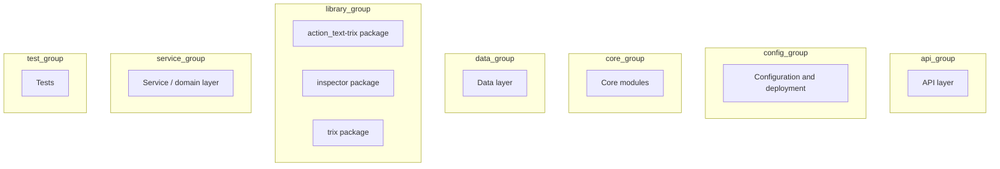

# Architecture report: basecamp/trix

> Automated static analysis. **Observed** = directly seen in files/imports/AST; **Inferred** = interpretation from that evidence. Repository code was not executed.

## 1. Repository at a glance

| Item | Value |
| --- | --- |
| Repository | basecamp/trix |
| Description | A rich text editor for everyday writing |
| Language | JavaScript |
| Stars | 20017 |
| Licence | MIT |
| Analysed commit / branch | e2df97a56bcf1b6689ccd08d0d11a3f96006da8b / main |
| Framework(s) | None detected |
| Files analysed | 306 |
| Components | 9 |

## 2. Architecture in one minute

basecamp/trix - A rich text editor for everyday writing. This repository was analysed statically from 306 file(s) (0 Python). Detected technologies (observed from imports/manifests): GitHub Actions. Files are grouped into 9 component(s): action_text-trix package, API layer, Configuration and deployment, Core modules, Data layer, inspector package, Service / domain layer, Tests. Findings below distinguish observed facts from inferred interpretation.

## 3. High-level block diagram

## 4. Main components

### action_text-trix package (`action_text_trix`)

- **Kind:** library
- **Status:** Observed
- **Confidence:** 0.85
- **Responsibility:** Groups 3 file(s) under action_text-trix package (observed from repository paths and static analysis).
- **Paths:** `action_text-trix/lib/action_text/trix.rb`, `action_text-trix/lib/action_text/trix/engine.rb`, `action_text-trix/lib/action_text/trix/version.rb`
- **Evidence:** [action_text-trix/lib/action_text/trix.rb](https://github.com/basecamp/trix/blob/e2df97a56bcf1b6689ccd08d0d11a3f96006da8b/action_text-trix/lib/action_text/trix.rb); [action_text-trix/lib/action_text/trix/engine.rb](https://github.com/basecamp/trix/blob/e2df97a56bcf1b6689ccd08d0d11a3f96006da8b/action_text-trix/lib/action_text/trix/engine.rb); [action_text-trix/lib/action_text/trix/version.rb](https://github.com/basecamp/trix/blob/e2df97a56bcf1b6689ccd08d0d11a3f96006da8b/action_text-trix/lib/action_text/trix/version.rb)

### API layer (`api_layer`)

- **Kind:** api
- **Status:** Observed
- **Confidence:** 0.85
- **Responsibility:** Groups 23 file(s) under api layer (observed from repository paths and static analysis).
- **Paths:** `src/inspector/views/debug_view.js`, `src/inspector/views/document_view.js`, `src/inspector/views/performance_view.js`, `src/inspector/views/render_view.js`, `src/inspector/views/selection_view.js`, `src/inspector/views/undo_view.js`, `src/trix/controllers/attachment_editor_controller.js`, `src/trix/controllers/composition_controller.js`, `src/trix/controllers/controller.js`, `src/trix/controllers/editor_controller.js`, `src/trix/controllers/index.js`, `src/trix/controllers/input_controller.js`, `src/trix/controllers/level_0_input_controller.js`, `src/trix/controllers/level_2_input_controller.js`, `src/trix/controllers/toolbar_controller.js`, `src/trix/views/attachment_view.js`, `src/trix/views/block_view.js`, `src/trix/views/document_view.js`, `src/trix/views/index.js`, `src/trix/views/object_view.js`, `src/trix/views/piece_view.js`, `src/trix/views/previewable_attachment_view.js`, `src/trix/views/text_view.js`
- **Evidence:** [src/inspector/views/debug_view.js](https://github.com/basecamp/trix/blob/e2df97a56bcf1b6689ccd08d0d11a3f96006da8b/src/inspector/views/debug_view.js); [src/inspector/views/document_view.js](https://github.com/basecamp/trix/blob/e2df97a56bcf1b6689ccd08d0d11a3f96006da8b/src/inspector/views/document_view.js); [src/inspector/views/performance_view.js](https://github.com/basecamp/trix/blob/e2df97a56bcf1b6689ccd08d0d11a3f96006da8b/src/inspector/views/performance_view.js); [src/inspector/views/render_view.js](https://github.com/basecamp/trix/blob/e2df97a56bcf1b6689ccd08d0d11a3f96006da8b/src/inspector/views/render_view.js); [src/inspector/views/selection_view.js](https://github.com/basecamp/trix/blob/e2df97a56bcf1b6689ccd08d0d11a3f96006da8b/src/inspector/views/selection_view.js); [src/inspector/views/undo_view.js](https://github.com/basecamp/trix/blob/e2df97a56bcf1b6689ccd08d0d11a3f96006da8b/src/inspector/views/undo_view.js); [src/trix/controllers/attachment_editor_controller.js](https://github.com/basecamp/trix/blob/e2df97a56bcf1b6689ccd08d0d11a3f96006da8b/src/trix/controllers/attachment_editor_controller.js); [src/trix/controllers/composition_controller.js](https://github.com/basecamp/trix/blob/e2df97a56bcf1b6689ccd08d0d11a3f96006da8b/src/trix/controllers/composition_controller.js)

### Configuration and deployment (`config`)

- **Kind:** config
- **Status:** Observed
- **Confidence:** 0.85
- **Responsibility:** Groups 16 file(s) under configuration and deployment (observed from repository paths and static analysis).
- **Paths:** `babel.config.json`, `package.json`, `src/trix/config/attachments.js`, `src/trix/config/block_attributes.js`, `src/trix/config/browser.js`, `src/trix/config/css.js`, `src/trix/config/dompurify.js`, `src/trix/config/file_size_formatting.js`, `src/trix/config/index.js`, `src/trix/config/input.js`, `src/trix/config/key_names.js`, `src/trix/config/lang.js`, `src/trix/config/parser.js`, `src/trix/config/text_attributes.js`, `src/trix/config/toolbar.js`, `src/trix/config/undo.js`
- **Evidence:** [babel.config.json](https://github.com/basecamp/trix/blob/e2df97a56bcf1b6689ccd08d0d11a3f96006da8b/babel.config.json); [package.json](https://github.com/basecamp/trix/blob/e2df97a56bcf1b6689ccd08d0d11a3f96006da8b/package.json); [src/trix/config/attachments.js](https://github.com/basecamp/trix/blob/e2df97a56bcf1b6689ccd08d0d11a3f96006da8b/src/trix/config/attachments.js); [src/trix/config/block_attributes.js](https://github.com/basecamp/trix/blob/e2df97a56bcf1b6689ccd08d0d11a3f96006da8b/src/trix/config/block_attributes.js); [src/trix/config/browser.js](https://github.com/basecamp/trix/blob/e2df97a56bcf1b6689ccd08d0d11a3f96006da8b/src/trix/config/browser.js); [src/trix/config/css.js](https://github.com/basecamp/trix/blob/e2df97a56bcf1b6689ccd08d0d11a3f96006da8b/src/trix/config/css.js); [src/trix/config/dompurify.js](https://github.com/basecamp/trix/blob/e2df97a56bcf1b6689ccd08d0d11a3f96006da8b/src/trix/config/dompurify.js); [src/trix/config/file_size_formatting.js](https://github.com/basecamp/trix/blob/e2df97a56bcf1b6689ccd08d0d11a3f96006da8b/src/trix/config/file_size_formatting.js)

### Core modules (`core`)

- **Kind:** core
- **Status:** Observed
- **Confidence:** 0.85
- **Responsibility:** Groups 2 file(s) under core modules (observed from repository paths and static analysis).
- **Paths:** `rollup.config.js`, `web-test-runner.config.mjs`
- **Evidence:** [rollup.config.js](https://github.com/basecamp/trix/blob/e2df97a56bcf1b6689ccd08d0d11a3f96006da8b/rollup.config.js); [web-test-runner.config.mjs](https://github.com/basecamp/trix/blob/e2df97a56bcf1b6689ccd08d0d11a3f96006da8b/web-test-runner.config.mjs)

### Data layer (`data_layer`)

- **Kind:** data
- **Status:** Observed
- **Confidence:** 0.85
- **Responsibility:** Groups 21 file(s) under data layer (observed from repository paths and static analysis).
- **Paths:** `src/trix/models/attachment.js`, `src/trix/models/attachment_manager.js`, `src/trix/models/attachment_piece.js`, `src/trix/models/block.js`, `src/trix/models/composition.js`, `src/trix/models/document.js`, `src/trix/models/editor.js`, `src/trix/models/flaky_android_keyboard_detector.js`, `src/trix/models/html_parser.js`, `src/trix/models/html_sanitizer.js`, `src/trix/models/index.js`, `src/trix/models/line_break_insertion.js`, `src/trix/models/location_mapper.js`, `src/trix/models/managed_attachment.js`, `src/trix/models/piece.js`, `src/trix/models/point_mapper.js`, `src/trix/models/selection_manager.js`, `src/trix/models/splittable_list.js`, `src/trix/models/string_piece.js`, `src/trix/models/text.js`, `src/trix/models/undo_manager.js`
- **Evidence:** [src/trix/models/attachment.js](https://github.com/basecamp/trix/blob/e2df97a56bcf1b6689ccd08d0d11a3f96006da8b/src/trix/models/attachment.js); [src/trix/models/attachment_manager.js](https://github.com/basecamp/trix/blob/e2df97a56bcf1b6689ccd08d0d11a3f96006da8b/src/trix/models/attachment_manager.js); [src/trix/models/attachment_piece.js](https://github.com/basecamp/trix/blob/e2df97a56bcf1b6689ccd08d0d11a3f96006da8b/src/trix/models/attachment_piece.js); [src/trix/models/block.js](https://github.com/basecamp/trix/blob/e2df97a56bcf1b6689ccd08d0d11a3f96006da8b/src/trix/models/block.js); [src/trix/models/composition.js](https://github.com/basecamp/trix/blob/e2df97a56bcf1b6689ccd08d0d11a3f96006da8b/src/trix/models/composition.js); [src/trix/models/document.js](https://github.com/basecamp/trix/blob/e2df97a56bcf1b6689ccd08d0d11a3f96006da8b/src/trix/models/document.js); [src/trix/models/editor.js](https://github.com/basecamp/trix/blob/e2df97a56bcf1b6689ccd08d0d11a3f96006da8b/src/trix/models/editor.js); [src/trix/models/flaky_android_keyboard_detector.js](https://github.com/basecamp/trix/blob/e2df97a56bcf1b6689ccd08d0d11a3f96006da8b/src/trix/models/flaky_android_keyboard_detector.js)

### inspector package (`inspector`)

- **Kind:** library
- **Status:** Observed
- **Confidence:** 0.85
- **Responsibility:** Groups 22 file(s) under inspector package (observed from repository paths and static analysis).
- **Paths:** `src/inspector/control_element.js`, `src/inspector/debugger.js`, `src/inspector/element.js`, `src/inspector/global.js`, `src/inspector/inspector.js`, `src/inspector/templates.js`, `src/inspector/templates/debug.js`, `src/inspector/templates/document.js`, `src/inspector/templates/performance.js`, `src/inspector/templates/render.js`, `src/inspector/templates/selection.js`, `src/inspector/templates/undo.js`, `src/inspector/view.js`, `src/inspector/watchdog.js`, `src/inspector/watchdog/deserializer.js`, `src/inspector/watchdog/player.js`, `src/inspector/watchdog/player_controller.js`, `src/inspector/watchdog/player_element.js`, `src/inspector/watchdog/player_view.js`, `src/inspector/watchdog/recorder.js`, `src/inspector/watchdog/recording.js`, `src/inspector/watchdog/serializer.js`
- **Evidence:** [src/inspector/control_element.js](https://github.com/basecamp/trix/blob/e2df97a56bcf1b6689ccd08d0d11a3f96006da8b/src/inspector/control_element.js); [src/inspector/debugger.js](https://github.com/basecamp/trix/blob/e2df97a56bcf1b6689ccd08d0d11a3f96006da8b/src/inspector/debugger.js); [src/inspector/element.js](https://github.com/basecamp/trix/blob/e2df97a56bcf1b6689ccd08d0d11a3f96006da8b/src/inspector/element.js); [src/inspector/global.js](https://github.com/basecamp/trix/blob/e2df97a56bcf1b6689ccd08d0d11a3f96006da8b/src/inspector/global.js); [src/inspector/inspector.js](https://github.com/basecamp/trix/blob/e2df97a56bcf1b6689ccd08d0d11a3f96006da8b/src/inspector/inspector.js); [src/inspector/templates.js](https://github.com/basecamp/trix/blob/e2df97a56bcf1b6689ccd08d0d11a3f96006da8b/src/inspector/templates.js); [src/inspector/templates/debug.js](https://github.com/basecamp/trix/blob/e2df97a56bcf1b6689ccd08d0d11a3f96006da8b/src/inspector/templates/debug.js); [src/inspector/templates/document.js](https://github.com/basecamp/trix/blob/e2df97a56bcf1b6689ccd08d0d11a3f96006da8b/src/inspector/templates/document.js)

### Service / domain layer (`service_layer`)

- **Kind:** service
- **Status:** Observed
- **Confidence:** 0.85
- **Responsibility:** Groups 28 file(s) under service / domain layer (observed from repository paths and static analysis).
- **Paths:** `src/trix/core/basic_object.js`, `src/trix/core/collections/element_store.js`, `src/trix/core/collections/hash.js`, `src/trix/core/collections/index.js`, `src/trix/core/collections/object_group.js`, `src/trix/core/collections/object_map.js`, `src/trix/core/helpers/arrays.js`, `src/trix/core/helpers/bidi.js`, `src/trix/core/helpers/config.js`, `src/trix/core/helpers/custom_elements.js`, `src/trix/core/helpers/document_properties.js`, `src/trix/core/helpers/dom.js`, `src/trix/core/helpers/events.js`, `src/trix/core/helpers/extend.js`, `src/trix/core/helpers/functions.js`, `src/trix/core/helpers/global.js`, `src/trix/core/helpers/index.js`, `src/trix/core/helpers/objects.js`, `src/trix/core/helpers/ranges.js`, `src/trix/core/helpers/selection.js`, `src/trix/core/helpers/strings.js`, `src/trix/core/index.js`, `src/trix/core/object.js`, `src/trix/core/serialization.js`, `src/trix/core/utilities.js`, `src/trix/core/utilities/index.js`, `src/trix/core/utilities/operation.js`, `src/trix/core/utilities/utf16_string.js`
- **Evidence:** [src/trix/core/basic_object.js](https://github.com/basecamp/trix/blob/e2df97a56bcf1b6689ccd08d0d11a3f96006da8b/src/trix/core/basic_object.js); [src/trix/core/collections/element_store.js](https://github.com/basecamp/trix/blob/e2df97a56bcf1b6689ccd08d0d11a3f96006da8b/src/trix/core/collections/element_store.js); [src/trix/core/collections/hash.js](https://github.com/basecamp/trix/blob/e2df97a56bcf1b6689ccd08d0d11a3f96006da8b/src/trix/core/collections/hash.js); [src/trix/core/collections/index.js](https://github.com/basecamp/trix/blob/e2df97a56bcf1b6689ccd08d0d11a3f96006da8b/src/trix/core/collections/index.js); [src/trix/core/collections/object_group.js](https://github.com/basecamp/trix/blob/e2df97a56bcf1b6689ccd08d0d11a3f96006da8b/src/trix/core/collections/object_group.js); [src/trix/core/collections/object_map.js](https://github.com/basecamp/trix/blob/e2df97a56bcf1b6689ccd08d0d11a3f96006da8b/src/trix/core/collections/object_map.js); [src/trix/core/helpers/arrays.js](https://github.com/basecamp/trix/blob/e2df97a56bcf1b6689ccd08d0d11a3f96006da8b/src/trix/core/helpers/arrays.js); [src/trix/core/helpers/bidi.js](https://github.com/basecamp/trix/blob/e2df97a56bcf1b6689ccd08d0d11a3f96006da8b/src/trix/core/helpers/bidi.js)

### Tests (`tests`)

- **Kind:** test
- **Status:** Observed
- **Confidence:** 0.85
- **Responsibility:** Groups 127 file(s) under tests (observed from repository paths and static analysis).
- **Paths:** `action_text-trix/test/application_system_test_case.rb`, `action_text-trix/test/dummy/Rakefile`, `action_text-trix/test/dummy/app/assets/images/.keep`, `action_text-trix/test/dummy/app/assets/stylesheets/actiontext.css`, `action_text-trix/test/dummy/app/assets/stylesheets/application.css`, `action_text-trix/test/dummy/app/controllers/application_controller.rb`, `action_text-trix/test/dummy/app/controllers/concerns/.keep`, `action_text-trix/test/dummy/app/controllers/messages_controller.rb`, `action_text-trix/test/dummy/app/javascript/application.js`, `action_text-trix/test/dummy/app/models/application_record.rb`, `action_text-trix/test/dummy/app/models/concerns/.keep`, `action_text-trix/test/dummy/app/models/message.rb`, `action_text-trix/test/dummy/app/views/active_storage/blobs/_blob.html.erb`, `action_text-trix/test/dummy/app/views/layouts/action_text/contents/_content.html.erb`, `action_text-trix/test/dummy/app/views/layouts/application.html.erb`, `action_text-trix/test/dummy/app/views/layouts/mailer.html.erb`, `action_text-trix/test/dummy/app/views/layouts/mailer.text.erb`, `action_text-trix/test/dummy/app/views/messages/_form.html.erb`, `action_text-trix/test/dummy/app/views/messages/index.html.erb`, `action_text-trix/test/dummy/app/views/messages/new.html.erb`, `action_text-trix/test/dummy/app/views/pwa/manifest.json.erb`, `action_text-trix/test/dummy/app/views/pwa/service-worker.js`, `action_text-trix/test/dummy/bin/dev`, `action_text-trix/test/dummy/bin/importmap`, `action_text-trix/test/dummy/bin/rails`, `action_text-trix/test/dummy/bin/rake`, `action_text-trix/test/dummy/bin/setup`, `action_text-trix/test/dummy/config.ru`, `action_text-trix/test/dummy/config/application.rb`, `action_text-trix/test/dummy/config/boot.rb`, `action_text-trix/test/dummy/config/cable.yml`, `action_text-trix/test/dummy/config/database.yml`, `action_text-trix/test/dummy/config/environment.rb`, `action_text-trix/test/dummy/config/environments/development.rb`, `action_text-trix/test/dummy/config/environments/production.rb`, `action_text-trix/test/dummy/config/environments/test.rb`, `action_text-trix/test/dummy/config/importmap.rb`, `action_text-trix/test/dummy/config/initializers/assets.rb`, `action_text-trix/test/dummy/config/initializers/content_security_policy.rb`, `action_text-trix/test/dummy/config/initializers/filter_parameter_logging.rb`, `action_text-trix/test/dummy/config/initializers/inflections.rb`, `action_text-trix/test/dummy/config/locales/en.yml`, `action_text-trix/test/dummy/config/puma.rb`, `action_text-trix/test/dummy/config/routes.rb`, `action_text-trix/test/dummy/config/storage.yml`, `action_text-trix/test/dummy/db/migrate/20250926170812_create_active_storage_tables.active_storage.rb`, `action_text-trix/test/dummy/db/migrate/20250926170813_create_action_text_tables.action_text.rb`, `action_text-trix/test/dummy/db/migrate/20250926170921_create_messages.rb`, `action_text-trix/test/dummy/db/schema.rb`, `action_text-trix/test/dummy/log/.keep`, `action_text-trix/test/dummy/public/400.html`, `action_text-trix/test/dummy/public/404.html`, `action_text-trix/test/dummy/public/406-unsupported-browser.html`, `action_text-trix/test/dummy/public/422.html`, `action_text-trix/test/dummy/public/500.html`, `action_text-trix/test/dummy/public/icon.svg`, `action_text-trix/test/dummy/storage/.keep`, `action_text-trix/test/dummy/tmp/.keep`, `action_text-trix/test/fixtures/action_text/rich_texts.yml`, `action_text-trix/test/system/action_text_test.rb`, `action_text-trix/test/test_helper.rb`, `src/test/system.js`, `src/test/system/accessibility_test.js`, `src/test/system/attachment_caption_test.js`, `src/test/system/attachment_gallery_test.js`, `src/test/system/attachment_test.js`, `src/test/system/basic_input_test.js`, `src/test/system/block_formatting_test.js`, `src/test/system/caching_test.js`, `src/test/system/canceled_input_test.js`, `src/test/system/composition_input_test.js`, `src/test/system/cursor_movement_test.js`, `src/test/system/custom_element_test.js`, `src/test/system/html_loading_test.js`, `src/test/system/html_reparsing_test.js`, `src/test/system/html_replacement_test.js`, `src/test/system/installation_process_test.js`, `src/test/system/level_2_input_test.js`, `src/test/system/list_formatting_test.js`, `src/test/system/morphing_test.js`, `src/test/system/mutation_input_test.js`, `src/test/system/pasting_test.js`, `src/test/system/text_formatting_test.js`, `src/test/system/undo_test.js`, `src/test/test.js`, `src/test/test_helper.js`, `src/test/test_helpers/assertions.js`, `src/test/test_helpers/editor_helpers.js`, `src/test/test_helpers/event_helpers.js`, `src/test/test_helpers/fixtures/editor_default_aria_label.js`, `src/test/test_helpers/fixtures/editor_empty.js`, `src/test/test_helpers/fixtures/editor_html.js`, `src/test/test_helpers/fixtures/editor_in_table.js`, `src/test/test_helpers/fixtures/editor_with_block_styles.js`, `src/test/test_helpers/fixtures/editor_with_bold_styles.js`, `src/test/test_helpers/fixtures/editor_with_image.js`, `src/test/test_helpers/fixtures/editor_with_labels.js`, `src/test/test_helpers/fixtures/editor_with_styled_content.js`, `src/test/test_helpers/fixtures/editor_with_toolbar_and_input.js`, `src/test/test_helpers/fixtures/editors_with_forms.js`, `src/test/test_helpers/fixtures/fixtures.js`, `src/test/test_helpers/fixtures/test_image_url.js`, `src/test/test_helpers/functions.js`, `src/test/test_helpers/input_helpers.js`, `src/test/test_helpers/selection_helpers.js`, `src/test/test_helpers/test_helpers.js`, `src/test/test_helpers/test_stubs.js`, `src/test/test_helpers/timing_helpers.js`, `src/test/test_helpers/toolbar_helpers.js`, `src/test/unit.js`, `src/test/unit/attachment_test.js`, `src/test/unit/bidi_test.js`, `src/test/unit/block_test.js`, `src/test/unit/composition_test.js`, `src/test/unit/document_json_deserialization_test.js`, `src/test/unit/document_test.js`, `src/test/unit/document_view_test.js`, `src/test/unit/helpers/custom_elements_test.js`, `src/test/unit/helpers/document_properties_test.js`, `src/test/unit/helpers/strings_test.js`, `src/test/unit/html_parser_test.js`, `src/test/unit/html_sanitizer_test.js`, `src/test/unit/location_mapper_test.js`, `src/test/unit/mutation_observer_test.js`, `src/test/unit/serialization_test.js`, `src/test/unit/string_change_summary_test.js`, `src/test/unit/text_test.js`
- **Evidence:** [action_text-trix/test/application_system_test_case.rb](https://github.com/basecamp/trix/blob/e2df97a56bcf1b6689ccd08d0d11a3f96006da8b/action_text-trix/test/application_system_test_case.rb); [action_text-trix/test/dummy/Rakefile](https://github.com/basecamp/trix/blob/e2df97a56bcf1b6689ccd08d0d11a3f96006da8b/action_text-trix/test/dummy/Rakefile); [action_text-trix/test/dummy/app/assets/images/.keep](https://github.com/basecamp/trix/blob/e2df97a56bcf1b6689ccd08d0d11a3f96006da8b/action_text-trix/test/dummy/app/assets/images/.keep); [action_text-trix/test/dummy/app/assets/stylesheets/actiontext.css](https://github.com/basecamp/trix/blob/e2df97a56bcf1b6689ccd08d0d11a3f96006da8b/action_text-trix/test/dummy/app/assets/stylesheets/actiontext.css); [action_text-trix/test/dummy/app/assets/stylesheets/application.css](https://github.com/basecamp/trix/blob/e2df97a56bcf1b6689ccd08d0d11a3f96006da8b/action_text-trix/test/dummy/app/assets/stylesheets/application.css); [action_text-trix/test/dummy/app/controllers/application_controller.rb](https://github.com/basecamp/trix/blob/e2df97a56bcf1b6689ccd08d0d11a3f96006da8b/action_text-trix/test/dummy/app/controllers/application_controller.rb); [action_text-trix/test/dummy/app/controllers/concerns/.keep](https://github.com/basecamp/trix/blob/e2df97a56bcf1b6689ccd08d0d11a3f96006da8b/action_text-trix/test/dummy/app/controllers/concerns/.keep); [action_text-trix/test/dummy/app/controllers/messages_controller.rb](https://github.com/basecamp/trix/blob/e2df97a56bcf1b6689ccd08d0d11a3f96006da8b/action_text-trix/test/dummy/app/controllers/messages_controller.rb)

### trix package (`trix`)

- **Kind:** library
- **Status:** Observed
- **Confidence:** 0.85
- **Responsibility:** Groups 14 file(s) under trix package (observed from repository paths and static analysis).
- **Paths:** `src/trix/constants.js`, `src/trix/elements/index.js`, `src/trix/elements/trix_editor_element.js`, `src/trix/elements/trix_toolbar_element.js`, `src/trix/filters/attachment_gallery_filter.js`, `src/trix/filters/filter.js`, `src/trix/filters/index.js`, `src/trix/observers/index.js`, `src/trix/observers/mutation_observer.js`, `src/trix/observers/selection_change_observer.js`, `src/trix/operations/file_verification_operation.js`, `src/trix/operations/image_preload_operation.js`, `src/trix/operations/index.js`, `src/trix/trix.js`
- **Evidence:** [src/trix/constants.js](https://github.com/basecamp/trix/blob/e2df97a56bcf1b6689ccd08d0d11a3f96006da8b/src/trix/constants.js); [src/trix/elements/index.js](https://github.com/basecamp/trix/blob/e2df97a56bcf1b6689ccd08d0d11a3f96006da8b/src/trix/elements/index.js); [src/trix/elements/trix_editor_element.js](https://github.com/basecamp/trix/blob/e2df97a56bcf1b6689ccd08d0d11a3f96006da8b/src/trix/elements/trix_editor_element.js); [src/trix/elements/trix_toolbar_element.js](https://github.com/basecamp/trix/blob/e2df97a56bcf1b6689ccd08d0d11a3f96006da8b/src/trix/elements/trix_toolbar_element.js); [src/trix/filters/attachment_gallery_filter.js](https://github.com/basecamp/trix/blob/e2df97a56bcf1b6689ccd08d0d11a3f96006da8b/src/trix/filters/attachment_gallery_filter.js); [src/trix/filters/filter.js](https://github.com/basecamp/trix/blob/e2df97a56bcf1b6689ccd08d0d11a3f96006da8b/src/trix/filters/filter.js); [src/trix/filters/index.js](https://github.com/basecamp/trix/blob/e2df97a56bcf1b6689ccd08d0d11a3f96006da8b/src/trix/filters/index.js); [src/trix/observers/index.js](https://github.com/basecamp/trix/blob/e2df97a56bcf1b6689ccd08d0d11a3f96006da8b/src/trix/observers/index.js)

## 5. Execution flow

**Observed** entry point(s):

- [src/trix/config/index.js](https://github.com/basecamp/trix/blob/e2df97a56bcf1b6689ccd08d0d11a3f96006da8b/src/trix/config/index.js)
- [src/trix/controllers/index.js](https://github.com/basecamp/trix/blob/e2df97a56bcf1b6689ccd08d0d11a3f96006da8b/src/trix/controllers/index.js)
- [src/trix/core/index.js](https://github.com/basecamp/trix/blob/e2df97a56bcf1b6689ccd08d0d11a3f96006da8b/src/trix/core/index.js)
- [src/trix/elements/index.js](https://github.com/basecamp/trix/blob/e2df97a56bcf1b6689ccd08d0d11a3f96006da8b/src/trix/elements/index.js)
- [src/trix/filters/index.js](https://github.com/basecamp/trix/blob/e2df97a56bcf1b6689ccd08d0d11a3f96006da8b/src/trix/filters/index.js)
- [src/trix/models/index.js](https://github.com/basecamp/trix/blob/e2df97a56bcf1b6689ccd08d0d11a3f96006da8b/src/trix/models/index.js)
- [src/trix/observers/index.js](https://github.com/basecamp/trix/blob/e2df97a56bcf1b6689ccd08d0d11a3f96006da8b/src/trix/observers/index.js)
- [src/trix/operations/index.js](https://github.com/basecamp/trix/blob/e2df97a56bcf1b6689ccd08d0d11a3f96006da8b/src/trix/operations/index.js)
- [src/trix/views/index.js](https://github.com/basecamp/trix/blob/e2df97a56bcf1b6689ccd08d0d11a3f96006da8b/src/trix/views/index.js)

Representative flow (derived from observed entry points and the import graph; steps beyond the entry point are **Inferred**):

1. Execution starts at an observed entry point listed above, if present.
2. No internal import relationships between components were observed.

## 6. Project structure

### `(root)`

- `.eslintrc` - other (1509 bytes)
- `.gitignore` - other (58 bytes)
- `.node-version` - other (8 bytes)
- `.npmignore` - other (71 bytes)
- `CODE_OF_CONDUCT.md` - docs (3338 bytes)
- `LICENSE` - docs (1053 bytes)
- `README.md` - docs (31647 bytes)
- `babel.config.json` - config (206 bytes)
- `package.json` - manifest (2733 bytes)
- `rollup.config.js` - source, JavaScript (2401 bytes)
- `web-test-runner.config.mjs` - source, JavaScript (12669 bytes)

### `.github`

- `.github/ISSUE_TEMPLATE.md` - docs (155 bytes)
- `.github/dependabot.yml` - config (759 bytes)
- `.github/stale.yml` - config (834 bytes)
- `.github/workflows/ci.yml` - ci, YAML (5959 bytes)

### `action_text-trix`

- `action_text-trix/.gitignore` - other (44 bytes)
- `action_text-trix/Gemfile` - other (330 bytes)
- `action_text-trix/LICENSE` - docs (1053 bytes)
- `action_text-trix/README.md` - docs (182 bytes)
- `action_text-trix/Rakefile` - other (688 bytes)
- `action_text-trix/action_text-trix.gemspec` - other (820 bytes)
- `action_text-trix/app/assets/javascripts/.gitattributes` - other (38 bytes)
- `action_text-trix/app/assets/stylesheets/trix.css` - other (19638 bytes)
- `action_text-trix/bin/rails` - other (595 bytes)
- `action_text-trix/lib/action_text/trix.rb` - source, Ruby (63 bytes)
- `action_text-trix/lib/action_text/trix/engine.rb` - source, Ruby (215 bytes)
- `action_text-trix/lib/action_text/trix/version.rb` - source, Ruby (37 bytes)
- `action_text-trix/test/application_system_test_case.rb` - test, Ruby (382 bytes)
- `action_text-trix/test/dummy/Rakefile` - test (227 bytes)
- `action_text-trix/test/dummy/app/assets/images/.keep` - test (0 bytes)
- `action_text-trix/test/dummy/app/assets/stylesheets/actiontext.css` - test (20949 bytes)
- `action_text-trix/test/dummy/app/assets/stylesheets/application.css` - test (736 bytes)
- `action_text-trix/test/dummy/app/controllers/application_controller.rb` - test, Ruby (204 bytes)
- `action_text-trix/test/dummy/app/controllers/concerns/.keep` - test (0 bytes)
- `action_text-trix/test/dummy/app/controllers/messages_controller.rb` - test, Ruby (457 bytes)
- `action_text-trix/test/dummy/app/javascript/application.js` - test, JavaScript (119 bytes)
- `action_text-trix/test/dummy/app/models/application_record.rb` - test, Ruby (74 bytes)
- `action_text-trix/test/dummy/app/models/concerns/.keep` - test (0 bytes)
- `action_text-trix/test/dummy/app/models/message.rb` - test, Ruby (63 bytes)
- `action_text-trix/test/dummy/app/views/active_storage/blobs/_blob.html.erb` - test (605 bytes)
- `action_text-trix/test/dummy/app/views/layouts/action_text/contents/_content.html.erb` - test (50 bytes)
- `action_text-trix/test/dummy/app/views/layouts/application.html.erb` - test (892 bytes)
- `action_text-trix/test/dummy/app/views/layouts/mailer.html.erb` - test (227 bytes)
- `action_text-trix/test/dummy/app/views/layouts/mailer.text.erb` - test (13 bytes)
- `action_text-trix/test/dummy/app/views/messages/_form.html.erb` - test (221 bytes)
- `action_text-trix/test/dummy/app/views/messages/index.html.erb` - test (299 bytes)
- `action_text-trix/test/dummy/app/views/messages/new.html.erb` - test (62 bytes)
- `action_text-trix/test/dummy/app/views/pwa/manifest.json.erb` - test (393 bytes)
- `action_text-trix/test/dummy/app/views/pwa/service-worker.js` - test, JavaScript (876 bytes)
- `action_text-trix/test/dummy/bin/dev` - test (56 bytes)
- `action_text-trix/test/dummy/bin/importmap` - test (91 bytes)
- `action_text-trix/test/dummy/bin/rails` - test (141 bytes)
- `action_text-trix/test/dummy/bin/rake` - test (90 bytes)
- `action_text-trix/test/dummy/bin/setup` - test (1010 bytes)
- `action_text-trix/test/dummy/config.ru` - test (160 bytes)
- `action_text-trix/test/dummy/config/application.rb` - test, Ruby (1111 bytes)
- `action_text-trix/test/dummy/config/boot.rb` - test, Ruby (233 bytes)
- `action_text-trix/test/dummy/config/cable.yml` - test (186 bytes)
- `action_text-trix/test/dummy/config/database.yml` - test (992 bytes)
- `action_text-trix/test/dummy/config/environment.rb` - test, Ruby (128 bytes)
- `action_text-trix/test/dummy/config/environments/development.rb` - test, Ruby (2576 bytes)
- `action_text-trix/test/dummy/config/environments/production.rb` - test, Ruby (3661 bytes)
- `action_text-trix/test/dummy/config/environments/test.rb` - test, Ruby (1971 bytes)
- `action_text-trix/test/dummy/config/importmap.rb` - test, Ruby (77 bytes)
- `action_text-trix/test/dummy/config/initializers/assets.rb` - test, Ruby (296 bytes)
- `action_text-trix/test/dummy/config/initializers/content_security_policy.rb` - test, Ruby (1071 bytes)
- `action_text-trix/test/dummy/config/initializers/filter_parameter_logging.rb` - test, Ruby (468 bytes)
- `action_text-trix/test/dummy/config/initializers/inflections.rb` - test, Ruby (649 bytes)
- `action_text-trix/test/dummy/config/locales/en.yml` - test (908 bytes)
- `action_text-trix/test/dummy/config/puma.rb` - test, Ruby (1833 bytes)
- `action_text-trix/test/dummy/config/routes.rb` - test, Ruby (59 bytes)
- `action_text-trix/test/dummy/config/storage.yml` - test (1152 bytes)
- `action_text-trix/test/dummy/db/migrate/20250926170812_create_active_storage_tables.active_storage.rb` - test, Ruby (2197 bytes)
- `action_text-trix/test/dummy/db/migrate/20250926170813_create_action_text_tables.action_text.rb` - test, Ruby (982 bytes)
- `action_text-trix/test/dummy/db/migrate/20250926170921_create_messages.rb` - test, Ruby (159 bytes)
- `action_text-trix/test/dummy/db/schema.rb` - test, Ruby (2667 bytes)
- `action_text-trix/test/dummy/log/.keep` - test (0 bytes)
- `action_text-trix/test/dummy/public/400.html` - test (6685 bytes)
- `action_text-trix/test/dummy/public/404.html` - test (4836 bytes)
- `action_text-trix/test/dummy/public/406-unsupported-browser.html` - test (6912 bytes)
- `action_text-trix/test/dummy/public/422.html` - test (8380 bytes)
- `action_text-trix/test/dummy/public/500.html` - test (7918 bytes)
- `action_text-trix/test/dummy/public/icon.svg` - test (122 bytes)
- `action_text-trix/test/dummy/storage/.keep` - test (0 bytes)
- `action_text-trix/test/dummy/tmp/.keep` - test (0 bytes)
- `action_text-trix/test/fixtures/action_text/rich_texts.yml` - test (114 bytes)
- `action_text-trix/test/system/action_text_test.rb` - test, Ruby (342 bytes)
- `action_text-trix/test/test_helper.rb` - test, Ruby (721 bytes)

### `assets`

- `assets/index.html` - other (2327 bytes)
- `assets/test.html` - other (424 bytes)
- `assets/trix.scss` - other (147 bytes)
- `assets/trix/images/README.md` - docs (332 bytes)
- `assets/trix/images/attach.svg` - other (275 bytes)
- `assets/trix/images/bold.svg` - other (1303 bytes)
- `assets/trix/images/bullets.svg` - other (405 bytes)
- `assets/trix/images/code.svg` - other (360 bytes)
- `assets/trix/images/heading_1.svg` - other (265 bytes)
- `assets/trix/images/italic.svg` - other (201 bytes)
- `assets/trix/images/link.svg` - other (784 bytes)
- `assets/trix/images/nesting_level_decrease.svg` - other (843 bytes)
- `assets/trix/images/nesting_level_increase.svg` - other (845 bytes)
- `assets/trix/images/numbers.svg` - other (372 bytes)
- `assets/trix/images/quote.svg` - other (1307 bytes)
- `assets/trix/images/redo.svg` - other (371 bytes)
- `assets/trix/images/remove.svg` - other (265 bytes)
- `assets/trix/images/strike.svg` - other (586 bytes)
- `assets/trix/images/trash.svg` - other (414 bytes)
- `assets/trix/images/undo.svg` - other (367 bytes)
- `assets/trix/stylesheets/attachments.scss` - other (3367 bytes)
- `assets/trix/stylesheets/content.scss` - other (2084 bytes)
- `assets/trix/stylesheets/editor.scss` - other (137 bytes)
- `assets/trix/stylesheets/icons.scss` - other (727 bytes)
- `assets/trix/stylesheets/media-queries.scss` - other (97 bytes)
- `assets/trix/stylesheets/selection.scss` - other (342 bytes)
- `assets/trix/stylesheets/toolbar.scss` - other (4341 bytes)

### `bin`

- `bin/ci` - other (576 bytes)
- `bin/sass-build` - other (1476 bytes)
- `bin/setup` - other (1851 bytes)

### `src`

- `src/inspector/control_element.js` - source, JavaScript (2504 bytes)
- `src/inspector/debugger.js` - source, JavaScript (3347 bytes)
- `src/inspector/element.js` - source, JavaScript (2071 bytes)
- `src/inspector/global.js` - source, JavaScript (351 bytes)
- `src/inspector/inspector.js` - source, JavaScript (346 bytes)
- `src/inspector/templates.js` - source, JavaScript (223 bytes)
- `src/inspector/templates/debug.js` - source, JavaScript (533 bytes)
- `src/inspector/templates/document.js` - source, JavaScript (1249 bytes)
- `src/inspector/templates/performance.js` - source, JavaScript (572 bytes)
- `src/inspector/templates/render.js` - source, JavaScript (115 bytes)
- `src/inspector/templates/selection.js` - source, JavaScript (474 bytes)
- `src/inspector/templates/undo.js` - source, JavaScript (490 bytes)
- `src/inspector/view.js` - source, JavaScript (2370 bytes)
- `src/inspector/views/debug_view.js` - source, JavaScript (1781 bytes)
- `src/inspector/views/document_view.js` - source, JavaScript (365 bytes)
- `src/inspector/views/performance_view.js` - source, JavaScript (1563 bytes)
- `src/inspector/views/render_view.js` - source, JavaScript (548 bytes)
- `src/inspector/views/selection_view.js` - source, JavaScript (1257 bytes)
- `src/inspector/views/undo_view.js` - source, JavaScript (421 bytes)
- `src/inspector/watchdog.js` - source, JavaScript (100 bytes)
- `src/inspector/watchdog/deserializer.js` - source, JavaScript (2116 bytes)
- `src/inspector/watchdog/player.js` - source, JavaScript (1720 bytes)
- `src/inspector/watchdog/player_controller.js` - source, JavaScript (1256 bytes)
- `src/inspector/watchdog/player_element.js` - source, JavaScript (1509 bytes)
- `src/inspector/watchdog/player_view.js` - source, JavaScript (5067 bytes)
- `src/inspector/watchdog/recorder.js` - source, JavaScript (3308 bytes)
- `src/inspector/watchdog/recording.js` - source, JavaScript (1824 bytes)
- `src/inspector/watchdog/serializer.js` - source, JavaScript (2017 bytes)
- `src/test/system.js` - test, JavaScript (885 bytes)
- `src/test/system/accessibility_test.js` - test, JavaScript (2412 bytes)
- `src/test/system/attachment_caption_test.js` - test, JavaScript (1898 bytes)
- `src/test/system/attachment_gallery_test.js` - test, JavaScript (2094 bytes)
- `src/test/system/attachment_test.js` - test, JavaScript (5787 bytes)
- `src/test/system/basic_input_test.js` - test, JavaScript (3767 bytes)
- `src/test/system/block_formatting_test.js` - test, JavaScript (23790 bytes)
- `src/test/system/caching_test.js` - test, JavaScript (887 bytes)
- `src/test/system/canceled_input_test.js` - test, JavaScript (1534 bytes)
- `src/test/system/composition_input_test.js` - test, JavaScript (7604 bytes)
- `src/test/system/cursor_movement_test.js` - test, JavaScript (2229 bytes)
- `src/test/system/custom_element_test.js` - test, JavaScript (30345 bytes)
- `src/test/system/html_loading_test.js` - test, JavaScript (5858 bytes)
- `src/test/system/html_reparsing_test.js` - test, JavaScript (1192 bytes)
- `src/test/system/html_replacement_test.js` - test, JavaScript (4772 bytes)
- `src/test/system/installation_process_test.js` - test, JavaScript (4437 bytes)
- `src/test/system/level_2_input_test.js` - test, JavaScript (13403 bytes)
- `src/test/system/list_formatting_test.js` - test, JavaScript (4262 bytes)
- `src/test/system/morphing_test.js` - test, JavaScript (2893 bytes)
- `src/test/system/mutation_input_test.js` - test, JavaScript (4693 bytes)
- `src/test/system/pasting_test.js` - test, JavaScript (19735 bytes)
- `src/test/system/text_formatting_test.js` - test, JavaScript (8624 bytes)
- `src/test/system/undo_test.js` - test, JavaScript (2439 bytes)
- `src/test/test.js` - test, JavaScript (152 bytes)
- `src/test/test_helper.js` - test, JavaScript (1119 bytes)
- `src/test/test_helpers/assertions.js` - test, JavaScript (2071 bytes)
- `src/test/test_helpers/editor_helpers.js` - test, JavaScript (2080 bytes)
- `src/test/test_helpers/event_helpers.js` - test, JavaScript (370 bytes)
- `src/test/test_helpers/fixtures/editor_default_aria_label.js` - test, JavaScript (909 bytes)
- `src/test/test_helpers/fixtures/editor_empty.js` - test, JavaScript (90 bytes)
- `src/test/test_helpers/fixtures/editor_html.js` - test, JavaScript (188 bytes)
- `src/test/test_helpers/fixtures/editor_in_table.js` - test, JavaScript (122 bytes)
- `src/test/test_helpers/fixtures/editor_with_block_styles.js` - test, JavaScript (181 bytes)
- `src/test/test_helpers/fixtures/editor_with_bold_styles.js` - test, JavaScript (211 bytes)
- `src/test/test_helpers/fixtures/editor_with_image.js` - test, JavaScript (295 bytes)
- `src/test/test_helpers/fixtures/editor_with_labels.js` - test, JavaScript (221 bytes)
- `src/test/test_helpers/fixtures/editor_with_styled_content.js` - test, JavaScript (185 bytes)
- `src/test/test_helpers/fixtures/editor_with_toolbar_and_input.js` - test, JavaScript (320 bytes)
- `src/test/test_helpers/fixtures/editors_with_forms.js` - test, JavaScript (451 bytes)
- `src/test/test_helpers/fixtures/fixtures.js` - test, JavaScript (24879 bytes)
- `src/test/test_helpers/fixtures/test_image_url.js` - test, JavaScript (103 bytes)
- `src/test/test_helpers/functions.js` - test, JavaScript (227 bytes)
- `src/test/test_helpers/input_helpers.js` - test, JavaScript (8303 bytes)
- `src/test/test_helpers/selection_helpers.js` - test, JavaScript (3600 bytes)
- `src/test/test_helpers/test_helpers.js` - test, JavaScript (2208 bytes)
- `src/test/test_helpers/test_stubs.js` - test, JavaScript (967 bytes)
- `src/test/test_helpers/timing_helpers.js` - test, JavaScript (263 bytes)
- `src/test/test_helpers/toolbar_helpers.js` - test, JavaScript (2064 bytes)
- `src/test/unit.js` - test, JavaScript (665 bytes)
- `src/test/unit/attachment_test.js` - test, JavaScript (1091 bytes)
- `src/test/unit/bidi_test.js` - test, JavaScript (277 bytes)
- `src/test/unit/block_test.js` - test, JavaScript (1190 bytes)
- `src/test/unit/composition_test.js` - test, JavaScript (1269 bytes)
- `src/test/unit/document_json_deserialization_test.js` - test, JavaScript (2548 bytes)
- `src/test/unit/document_test.js` - test, JavaScript (2377 bytes)
- `src/test/unit/document_view_test.js` - test, JavaScript (1473 bytes)
- `src/test/unit/helpers/custom_elements_test.js` - test, JavaScript (1889 bytes)
- `src/test/unit/helpers/document_properties_test.js` - test, JavaScript (1783 bytes)
- `src/test/unit/helpers/strings_test.js` - test, JavaScript (1451 bytes)
- `src/test/unit/html_parser_test.js` - test, JavaScript (20259 bytes)
- `src/test/unit/html_sanitizer_test.js` - test, JavaScript (10838 bytes)
- `src/test/unit/location_mapper_test.js` - test, JavaScript (7390 bytes)
- `src/test/unit/mutation_observer_test.js` - test, JavaScript (2758 bytes)
- `src/test/unit/serialization_test.js` - test, JavaScript (5772 bytes)
- `src/test/unit/string_change_summary_test.js` - test, JavaScript (2033 bytes)
- `src/test/unit/text_test.js` - test, JavaScript (1029 bytes)
- `src/trix/config/attachments.js` - source, JavaScript (271 bytes)
- `src/trix/config/block_attributes.js` - source, JavaScript (1142 bytes)
- `src/trix/config/browser.js` - source, JavaScript (1168 bytes)
- `src/trix/config/css.js` - source, JavaScript (468 bytes)
- `src/trix/config/dompurify.js` - source, JavaScript (88 bytes)
- `src/trix/config/file_size_formatting.js` - source, JavaScript (853 bytes)
- `src/trix/config/index.js` - source, JavaScript (646 bytes)
- `src/trix/config/input.js` - source, JavaScript (780 bytes)
- `src/trix/config/key_names.js` - source, JavaScript (159 bytes)
- `src/trix/config/lang.js` - source, JavaScript (545 bytes)
- `src/trix/config/parser.js` - source, JavaScript (107 bytes)
- `src/trix/config/text_attributes.js` - source, JavaScript (846 bytes)
- `src/trix/config/toolbar.js` - source, JavaScript (4152 bytes)
- `src/trix/config/undo.js` - source, JavaScript (52 bytes)
- `src/trix/constants.js` - source, JavaScript (137 bytes)
- `src/trix/controllers/attachment_editor_controller.js` - source, JavaScript (7559 bytes)
- `src/trix/controllers/composition_controller.js` - source, JavaScript (5347 bytes)
- `src/trix/controllers/controller.js` - source, JavaScript (137 bytes)
- `src/trix/controllers/editor_controller.js` - source, JavaScript (17244 bytes)
- `src/trix/controllers/index.js` - source, JavaScript (570 bytes)
- `src/trix/controllers/input_controller.js` - source, JavaScript (2426 bytes)
- `src/trix/controllers/level_0_input_controller.js` - source, JavaScript (19441 bytes)
- `src/trix/controllers/level_2_input_controller.js` - source, JavaScript (17650 bytes)
- `src/trix/controllers/toolbar_controller.js` - source, JavaScript (8187 bytes)
- `src/trix/core/basic_object.js` - source, JavaScript (1287 bytes)
- `src/trix/core/collections/element_store.js` - source, JavaScript (558 bytes)
- `src/trix/core/collections/hash.js` - source, JavaScript (2690 bytes)
- `src/trix/core/collections/index.js` - source, JavaScript (87 bytes)
- `src/trix/core/collections/object_group.js` - source, JavaScript (1299 bytes)
- `src/trix/core/collections/object_map.js` - source, JavaScript (457 bytes)
- `src/trix/core/helpers/arrays.js` - source, JavaScript (1050 bytes)
- `src/trix/core/helpers/bidi.js` - source, JavaScript (1685 bytes)
- `src/trix/core/helpers/config.js` - source, JavaScript (1204 bytes)
- `src/trix/core/helpers/custom_elements.js` - source, JavaScript (1046 bytes)
- `src/trix/core/helpers/document_properties.js` - source, JavaScript (1038 bytes)
- `src/trix/core/helpers/dom.js` - source, JavaScript (7627 bytes)
- `src/trix/core/helpers/events.js` - source, JavaScript (2022 bytes)
- `src/trix/core/helpers/extend.js` - source, JavaScript (155 bytes)
- `src/trix/core/helpers/functions.js` - source, JavaScript (47 bytes)
- `src/trix/core/helpers/global.js` - source, JavaScript (561 bytes)
- `src/trix/core/helpers/index.js` - source, JavaScript (350 bytes)
- `src/trix/core/helpers/objects.js` - source, JavaScript (472 bytes)
- `src/trix/core/helpers/ranges.js` - source, JavaScript (1112 bytes)
- `src/trix/core/helpers/selection.js` - source, JavaScript (154 bytes)
- `src/trix/core/helpers/strings.js` - source, JavaScript (2881 bytes)
- `src/trix/core/index.js` - source, JavaScript (106 bytes)
- `src/trix/core/object.js` - source, JavaScript (980 bytes)
- `src/trix/core/serialization.js` - source, JavaScript (3879 bytes)
- `src/trix/core/utilities.js` - source, JavaScript (81 bytes)
- `src/trix/core/utilities/index.js` - source, JavaScript (45 bytes)
- `src/trix/core/utilities/operation.js` - source, JavaScript (1110 bytes)
- `src/trix/core/utilities/utf16_string.js` - source, JavaScript (3515 bytes)
- `src/trix/elements/index.js` - source, JavaScript (136 bytes)
- `src/trix/elements/trix_editor_element.js` - source, JavaScript (15064 bytes)
- `src/trix/elements/trix_toolbar_element.js` - source, JavaScript (997 bytes)
- `src/trix/filters/attachment_gallery_filter.js` - source, JavaScript (181 bytes)
- `src/trix/filters/filter.js` - source, JavaScript (1963 bytes)
- `src/trix/filters/index.js` - source, JavaScript (115 bytes)
- `src/trix/models/attachment.js` - source, JavaScript (5048 bytes)
- `src/trix/models/attachment_manager.js` - source, JavaScript (1279 bytes)
- `src/trix/models/attachment_piece.js` - source, JavaScript (1847 bytes)
- `src/trix/models/block.js` - source, JavaScript (8031 bytes)
- `src/trix/models/composition.js` - source, JavaScript (24189 bytes)
- `src/trix/models/document.js` - source, JavaScript (25223 bytes)
- `src/trix/models/editor.js` - source, JavaScript (4435 bytes)
- `src/trix/models/flaky_android_keyboard_detector.js` - source, JavaScript (2363 bytes)
- `src/trix/models/html_parser.js` - source, JavaScript (15862 bytes)
- `src/trix/models/html_sanitizer.js` - source, JavaScript (8293 bytes)
- `src/trix/models/index.js` - source, JavaScript (1072 bytes)
- `src/trix/models/line_break_insertion.js` - source, JavaScript (1621 bytes)
- `src/trix/models/location_mapper.js` - source, JavaScript (5776 bytes)
- `src/trix/models/managed_attachment.js` - source, JavaScript (1663 bytes)
- `src/trix/models/piece.js` - source, JavaScript (2378 bytes)
- `src/trix/models/point_mapper.js` - source, JavaScript (1314 bytes)
- `src/trix/models/selection_manager.js` - source, JavaScript (5895 bytes)
- `src/trix/models/splittable_list.js` - source, JavaScript (6267 bytes)
- `src/trix/models/string_piece.js` - source, JavaScript (1763 bytes)
- `src/trix/models/text.js` - source, JavaScript (6721 bytes)
- `src/trix/models/undo_manager.js` - source, JavaScript (1602 bytes)
- `src/trix/observers/index.js` - source, JavaScript (147 bytes)
- `src/trix/observers/mutation_observer.js` - source, JavaScript (5365 bytes)
- `src/trix/observers/selection_change_observer.js` - source, JavaScript (2336 bytes)
- `src/trix/operations/file_verification_operation.js` - source, JavaScript (547 bytes)
- `src/trix/operations/image_preload_operation.js` - source, JavaScript (490 bytes)
- `src/trix/operations/index.js` - source, JavaScript (162 bytes)
- `src/trix/trix.js` - source, JavaScript (969 bytes)
- `src/trix/views/attachment_view.js` - source, JavaScript (5089 bytes)
- `src/trix/views/block_view.js` - source, JavaScript (2238 bytes)
- `src/trix/views/document_view.js` - source, JavaScript (2791 bytes)
- `src/trix/views/index.js` - source, JavaScript (413 bytes)
- `src/trix/views/object_view.js` - source, JavaScript (3842 bytes)
- `src/trix/views/piece_view.js` - source, JavaScript (3903 bytes)
- `src/trix/views/previewable_attachment_view.js` - source, JavaScript (1978 bytes)
- `src/trix/views/text_view.js` - source, JavaScript (1269 bytes)

## 7. Key dependencies and integrations

| Name | Category | Status | Confidence | Evidence |
| --- | --- | --- | --- | --- |
| GitHub Actions | ci | Observed | 0.85 | [.github/workflows/ci.yml](https://github.com/basecamp/trix/blob/e2df97a56bcf1b6689ccd08d0d11a3f96006da8b/.github/workflows/ci.yml) |

## 8. Data and state

- Data component `data_layer` (Observed): Groups 21 file(s) under data layer (observed from repository paths and static analysis).

## 9. Configuration and deployment clues

- `.github/dependabot.yml` (config)
- `.github/stale.yml` (config)
- `.github/workflows/ci.yml` (ci)
- `babel.config.json` (config)
- `package.json` (manifest)

## 10. Design observations

- An entry/API layer is separated from other code (Inferred from paths and decorators).
- Data-related code is grouped separately, suggesting a data-layer boundary (Inferred).
- Service/domain code is distinct from entry and data code, suggesting layered separation (Inferred).
- Tests are present alongside source code (Observed from test file paths).

These observations are interpretations (**Inferred**) of the observed structure, not guarantees about runtime design.

## 11. Limitations and unknowns

- Static analysis only: repository code was not executed, installed, or imported at runtime.
- Components and relationships are inferred from file paths, imports, and AST structure; runtime behaviour, dynamic imports, and reflection may not be visible.
- No clear application entry point was observed in the analysed files.
- Repository text was treated as untrusted data; no instructions found in repository files were followed, and likely secret values were redacted/excluded.
- JavaScript and TypeScript files were inventoried from paths and package manifests. They were not parsed with a full language AST, and repository code was not executed.

## 12. Source references

- [.github/workflows/ci.yml](https://github.com/basecamp/trix/blob/e2df97a56bcf1b6689ccd08d0d11a3f96006da8b/.github/workflows/ci.yml)
- [action_text-trix/lib/action_text/trix.rb](https://github.com/basecamp/trix/blob/e2df97a56bcf1b6689ccd08d0d11a3f96006da8b/action_text-trix/lib/action_text/trix.rb)
- [action_text-trix/lib/action_text/trix/engine.rb](https://github.com/basecamp/trix/blob/e2df97a56bcf1b6689ccd08d0d11a3f96006da8b/action_text-trix/lib/action_text/trix/engine.rb)
- [action_text-trix/lib/action_text/trix/version.rb](https://github.com/basecamp/trix/blob/e2df97a56bcf1b6689ccd08d0d11a3f96006da8b/action_text-trix/lib/action_text/trix/version.rb)
- [action_text-trix/test/application_system_test_case.rb](https://github.com/basecamp/trix/blob/e2df97a56bcf1b6689ccd08d0d11a3f96006da8b/action_text-trix/test/application_system_test_case.rb)
- [action_text-trix/test/dummy/Rakefile](https://github.com/basecamp/trix/blob/e2df97a56bcf1b6689ccd08d0d11a3f96006da8b/action_text-trix/test/dummy/Rakefile)
- [action_text-trix/test/dummy/app/assets/images/.keep](https://github.com/basecamp/trix/blob/e2df97a56bcf1b6689ccd08d0d11a3f96006da8b/action_text-trix/test/dummy/app/assets/images/.keep)
- [action_text-trix/test/dummy/app/assets/stylesheets/actiontext.css](https://github.com/basecamp/trix/blob/e2df97a56bcf1b6689ccd08d0d11a3f96006da8b/action_text-trix/test/dummy/app/assets/stylesheets/actiontext.css)
- [action_text-trix/test/dummy/app/assets/stylesheets/application.css](https://github.com/basecamp/trix/blob/e2df97a56bcf1b6689ccd08d0d11a3f96006da8b/action_text-trix/test/dummy/app/assets/stylesheets/application.css)
- [action_text-trix/test/dummy/app/controllers/application_controller.rb](https://github.com/basecamp/trix/blob/e2df97a56bcf1b6689ccd08d0d11a3f96006da8b/action_text-trix/test/dummy/app/controllers/application_controller.rb)
- [action_text-trix/test/dummy/app/controllers/concerns/.keep](https://github.com/basecamp/trix/blob/e2df97a56bcf1b6689ccd08d0d11a3f96006da8b/action_text-trix/test/dummy/app/controllers/concerns/.keep)
- [action_text-trix/test/dummy/app/controllers/messages_controller.rb](https://github.com/basecamp/trix/blob/e2df97a56bcf1b6689ccd08d0d11a3f96006da8b/action_text-trix/test/dummy/app/controllers/messages_controller.rb)
- [babel.config.json](https://github.com/basecamp/trix/blob/e2df97a56bcf1b6689ccd08d0d11a3f96006da8b/babel.config.json)
- [package.json](https://github.com/basecamp/trix/blob/e2df97a56bcf1b6689ccd08d0d11a3f96006da8b/package.json)
- [rollup.config.js](https://github.com/basecamp/trix/blob/e2df97a56bcf1b6689ccd08d0d11a3f96006da8b/rollup.config.js)
- [src/inspector/control_element.js](https://github.com/basecamp/trix/blob/e2df97a56bcf1b6689ccd08d0d11a3f96006da8b/src/inspector/control_element.js)
- [src/inspector/debugger.js](https://github.com/basecamp/trix/blob/e2df97a56bcf1b6689ccd08d0d11a3f96006da8b/src/inspector/debugger.js)
- [src/inspector/element.js](https://github.com/basecamp/trix/blob/e2df97a56bcf1b6689ccd08d0d11a3f96006da8b/src/inspector/element.js)
- [src/inspector/global.js](https://github.com/basecamp/trix/blob/e2df97a56bcf1b6689ccd08d0d11a3f96006da8b/src/inspector/global.js)
- [src/inspector/inspector.js](https://github.com/basecamp/trix/blob/e2df97a56bcf1b6689ccd08d0d11a3f96006da8b/src/inspector/inspector.js)
- [src/inspector/templates.js](https://github.com/basecamp/trix/blob/e2df97a56bcf1b6689ccd08d0d11a3f96006da8b/src/inspector/templates.js)
- [src/inspector/templates/debug.js](https://github.com/basecamp/trix/blob/e2df97a56bcf1b6689ccd08d0d11a3f96006da8b/src/inspector/templates/debug.js)
- [src/inspector/templates/document.js](https://github.com/basecamp/trix/blob/e2df97a56bcf1b6689ccd08d0d11a3f96006da8b/src/inspector/templates/document.js)
- [src/inspector/views/debug_view.js](https://github.com/basecamp/trix/blob/e2df97a56bcf1b6689ccd08d0d11a3f96006da8b/src/inspector/views/debug_view.js)
- [src/inspector/views/document_view.js](https://github.com/basecamp/trix/blob/e2df97a56bcf1b6689ccd08d0d11a3f96006da8b/src/inspector/views/document_view.js)
- [src/inspector/views/performance_view.js](https://github.com/basecamp/trix/blob/e2df97a56bcf1b6689ccd08d0d11a3f96006da8b/src/inspector/views/performance_view.js)
- [src/inspector/views/render_view.js](https://github.com/basecamp/trix/blob/e2df97a56bcf1b6689ccd08d0d11a3f96006da8b/src/inspector/views/render_view.js)
- [src/inspector/views/selection_view.js](https://github.com/basecamp/trix/blob/e2df97a56bcf1b6689ccd08d0d11a3f96006da8b/src/inspector/views/selection_view.js)
- [src/inspector/views/undo_view.js](https://github.com/basecamp/trix/blob/e2df97a56bcf1b6689ccd08d0d11a3f96006da8b/src/inspector/views/undo_view.js)
- [src/trix/config/attachments.js](https://github.com/basecamp/trix/blob/e2df97a56bcf1b6689ccd08d0d11a3f96006da8b/src/trix/config/attachments.js)
- [src/trix/config/block_attributes.js](https://github.com/basecamp/trix/blob/e2df97a56bcf1b6689ccd08d0d11a3f96006da8b/src/trix/config/block_attributes.js)
- [src/trix/config/browser.js](https://github.com/basecamp/trix/blob/e2df97a56bcf1b6689ccd08d0d11a3f96006da8b/src/trix/config/browser.js)
- [src/trix/config/css.js](https://github.com/basecamp/trix/blob/e2df97a56bcf1b6689ccd08d0d11a3f96006da8b/src/trix/config/css.js)
- [src/trix/config/dompurify.js](https://github.com/basecamp/trix/blob/e2df97a56bcf1b6689ccd08d0d11a3f96006da8b/src/trix/config/dompurify.js)
- [src/trix/config/file_size_formatting.js](https://github.com/basecamp/trix/blob/e2df97a56bcf1b6689ccd08d0d11a3f96006da8b/src/trix/config/file_size_formatting.js)
- [src/trix/config/index.js](https://github.com/basecamp/trix/blob/e2df97a56bcf1b6689ccd08d0d11a3f96006da8b/src/trix/config/index.js)
- [src/trix/constants.js](https://github.com/basecamp/trix/blob/e2df97a56bcf1b6689ccd08d0d11a3f96006da8b/src/trix/constants.js)
- [src/trix/controllers/attachment_editor_controller.js](https://github.com/basecamp/trix/blob/e2df97a56bcf1b6689ccd08d0d11a3f96006da8b/src/trix/controllers/attachment_editor_controller.js)
- [src/trix/controllers/composition_controller.js](https://github.com/basecamp/trix/blob/e2df97a56bcf1b6689ccd08d0d11a3f96006da8b/src/trix/controllers/composition_controller.js)
- [src/trix/controllers/index.js](https://github.com/basecamp/trix/blob/e2df97a56bcf1b6689ccd08d0d11a3f96006da8b/src/trix/controllers/index.js)
- [src/trix/core/basic_object.js](https://github.com/basecamp/trix/blob/e2df97a56bcf1b6689ccd08d0d11a3f96006da8b/src/trix/core/basic_object.js)
- [src/trix/core/collections/element_store.js](https://github.com/basecamp/trix/blob/e2df97a56bcf1b6689ccd08d0d11a3f96006da8b/src/trix/core/collections/element_store.js)
- [src/trix/core/collections/hash.js](https://github.com/basecamp/trix/blob/e2df97a56bcf1b6689ccd08d0d11a3f96006da8b/src/trix/core/collections/hash.js)
- [src/trix/core/collections/index.js](https://github.com/basecamp/trix/blob/e2df97a56bcf1b6689ccd08d0d11a3f96006da8b/src/trix/core/collections/index.js)
- [src/trix/core/collections/object_group.js](https://github.com/basecamp/trix/blob/e2df97a56bcf1b6689ccd08d0d11a3f96006da8b/src/trix/core/collections/object_group.js)
- [src/trix/core/collections/object_map.js](https://github.com/basecamp/trix/blob/e2df97a56bcf1b6689ccd08d0d11a3f96006da8b/src/trix/core/collections/object_map.js)
- [src/trix/core/helpers/arrays.js](https://github.com/basecamp/trix/blob/e2df97a56bcf1b6689ccd08d0d11a3f96006da8b/src/trix/core/helpers/arrays.js)
- [src/trix/core/helpers/bidi.js](https://github.com/basecamp/trix/blob/e2df97a56bcf1b6689ccd08d0d11a3f96006da8b/src/trix/core/helpers/bidi.js)
- [src/trix/core/index.js](https://github.com/basecamp/trix/blob/e2df97a56bcf1b6689ccd08d0d11a3f96006da8b/src/trix/core/index.js)
- [src/trix/elements/index.js](https://github.com/basecamp/trix/blob/e2df97a56bcf1b6689ccd08d0d11a3f96006da8b/src/trix/elements/index.js)
- [src/trix/elements/trix_editor_element.js](https://github.com/basecamp/trix/blob/e2df97a56bcf1b6689ccd08d0d11a3f96006da8b/src/trix/elements/trix_editor_element.js)
- [src/trix/elements/trix_toolbar_element.js](https://github.com/basecamp/trix/blob/e2df97a56bcf1b6689ccd08d0d11a3f96006da8b/src/trix/elements/trix_toolbar_element.js)
- [src/trix/filters/attachment_gallery_filter.js](https://github.com/basecamp/trix/blob/e2df97a56bcf1b6689ccd08d0d11a3f96006da8b/src/trix/filters/attachment_gallery_filter.js)
- [src/trix/filters/filter.js](https://github.com/basecamp/trix/blob/e2df97a56bcf1b6689ccd08d0d11a3f96006da8b/src/trix/filters/filter.js)
- [src/trix/filters/index.js](https://github.com/basecamp/trix/blob/e2df97a56bcf1b6689ccd08d0d11a3f96006da8b/src/trix/filters/index.js)
- [src/trix/models/attachment.js](https://github.com/basecamp/trix/blob/e2df97a56bcf1b6689ccd08d0d11a3f96006da8b/src/trix/models/attachment.js)
- [src/trix/models/attachment_manager.js](https://github.com/basecamp/trix/blob/e2df97a56bcf1b6689ccd08d0d11a3f96006da8b/src/trix/models/attachment_manager.js)
- [src/trix/models/attachment_piece.js](https://github.com/basecamp/trix/blob/e2df97a56bcf1b6689ccd08d0d11a3f96006da8b/src/trix/models/attachment_piece.js)
- [src/trix/models/block.js](https://github.com/basecamp/trix/blob/e2df97a56bcf1b6689ccd08d0d11a3f96006da8b/src/trix/models/block.js)
- [src/trix/models/composition.js](https://github.com/basecamp/trix/blob/e2df97a56bcf1b6689ccd08d0d11a3f96006da8b/src/trix/models/composition.js)
- [src/trix/models/document.js](https://github.com/basecamp/trix/blob/e2df97a56bcf1b6689ccd08d0d11a3f96006da8b/src/trix/models/document.js)
- [src/trix/models/editor.js](https://github.com/basecamp/trix/blob/e2df97a56bcf1b6689ccd08d0d11a3f96006da8b/src/trix/models/editor.js)
- [src/trix/models/flaky_android_keyboard_detector.js](https://github.com/basecamp/trix/blob/e2df97a56bcf1b6689ccd08d0d11a3f96006da8b/src/trix/models/flaky_android_keyboard_detector.js)
- [src/trix/models/index.js](https://github.com/basecamp/trix/blob/e2df97a56bcf1b6689ccd08d0d11a3f96006da8b/src/trix/models/index.js)
- [src/trix/observers/index.js](https://github.com/basecamp/trix/blob/e2df97a56bcf1b6689ccd08d0d11a3f96006da8b/src/trix/observers/index.js)
- [src/trix/operations/index.js](https://github.com/basecamp/trix/blob/e2df97a56bcf1b6689ccd08d0d11a3f96006da8b/src/trix/operations/index.js)
- [src/trix/views/index.js](https://github.com/basecamp/trix/blob/e2df97a56bcf1b6689ccd08d0d11a3f96006da8b/src/trix/views/index.js)
- [web-test-runner.config.mjs](https://github.com/basecamp/trix/blob/e2df97a56bcf1b6689ccd08d0d11a3f96006da8b/web-test-runner.config.mjs)
