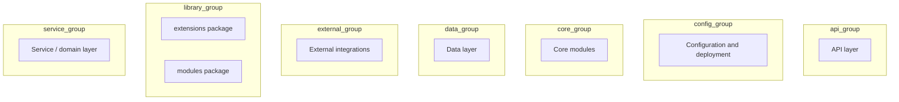

# Architecture report: beefproject/beef

> Automated static analysis. **Observed** = directly seen in files/imports/AST; **Inferred** = interpretation from that evidence. Repository code was not executed.

## 1. Repository at a glance

| Item | Value |
| --- | --- |
| Repository | beefproject/beef |
| Description | The Browser Exploitation Framework Project |
| Language | JavaScript |
| Stars | 11096 |
| Licence | Not detected |
| Analysed commit / branch | 9194fb84841bc3bdb9abc3384fa47bab100a5a30 / master |
| Framework(s) | None detected |
| Files analysed | 797 |
| Components | 8 |

## 2. Architecture in one minute

beefproject/beef - The Browser Exploitation Framework Project. This repository was analysed statically from 797 file(s) (0 Python). Detected technologies (observed from imports/manifests): GitHub Actions, Docker. Files are grouped into 8 component(s): API layer, Configuration and deployment, Core modules, Data layer, extensions package, External integrations, modules package, Service / domain layer. Findings below distinguish observed facts from inferred interpretation.

## 3. High-level block diagram

## 4. Main components

### API layer (`api_layer`)

- **Kind:** api
- **Status:** Observed
- **Confidence:** 0.85
- **Responsibility:** Groups 34 file(s) under api layer (observed from repository paths and static analysis).
- **Paths:** `core/api/extension.rb`, `core/api/extensions.rb`, `core/api/main/configuration.rb`, `core/api/main/migration.rb`, `core/api/main/network_stack/assethandler.rb`, `core/api/main/server.rb`, `core/api/main/server/hook.rb`, `core/api/module.rb`, `core/api/modules.rb`, `core/main/handlers/browserdetails.rb`, `core/main/handlers/commands.rb`, `core/main/handlers/hookedbrowsers.rb`, `core/main/handlers/modules/beefjs.rb`, `core/main/handlers/modules/command.rb`, `core/main/handlers/modules/legacybeefjs.rb`, `core/main/handlers/modules/multistagebeefjs.rb`, `core/main/network_stack/handlers/dynamicreconstruction.rb`, `core/main/network_stack/handlers/raw.rb`, `core/main/network_stack/handlers/redirector.rb`, `core/main/rest/handlers/admin.rb`, `core/main/rest/handlers/browserdetails.rb`, `core/main/rest/handlers/categories.rb`, `core/main/rest/handlers/hookedbrowsers.rb`, `core/main/rest/handlers/logs.rb`, `core/main/rest/handlers/modules.rb`, `core/main/rest/handlers/server.rb`, `extensions/admin_ui/api/handler.rb`, `extensions/admin_ui/controllers/authentication/authentication.rb`, `extensions/admin_ui/controllers/modules/modules.rb`, `extensions/admin_ui/controllers/panel/panel.rb`, `extensions/admin_ui/handlers/ui.rb`, `extensions/requester/api/hook.rb`, `extensions/webrtc/api/hook.rb`, `extensions/xssrays/api/scan.rb`
- **Evidence:** [core/api/extension.rb](https://github.com/beefproject/beef/blob/9194fb84841bc3bdb9abc3384fa47bab100a5a30/core/api/extension.rb); [core/api/extensions.rb](https://github.com/beefproject/beef/blob/9194fb84841bc3bdb9abc3384fa47bab100a5a30/core/api/extensions.rb); [core/api/main/configuration.rb](https://github.com/beefproject/beef/blob/9194fb84841bc3bdb9abc3384fa47bab100a5a30/core/api/main/configuration.rb); [core/api/main/migration.rb](https://github.com/beefproject/beef/blob/9194fb84841bc3bdb9abc3384fa47bab100a5a30/core/api/main/migration.rb); [core/api/main/network_stack/assethandler.rb](https://github.com/beefproject/beef/blob/9194fb84841bc3bdb9abc3384fa47bab100a5a30/core/api/main/network_stack/assethandler.rb); [core/api/main/server.rb](https://github.com/beefproject/beef/blob/9194fb84841bc3bdb9abc3384fa47bab100a5a30/core/api/main/server.rb); [core/api/main/server/hook.rb](https://github.com/beefproject/beef/blob/9194fb84841bc3bdb9abc3384fa47bab100a5a30/core/api/main/server/hook.rb); [core/api/module.rb](https://github.com/beefproject/beef/blob/9194fb84841bc3bdb9abc3384fa47bab100a5a30/core/api/module.rb)

### Configuration and deployment (`config`)

- **Kind:** config
- **Status:** Observed
- **Confidence:** 0.85
- **Responsibility:** Groups 72 file(s) under configuration and deployment (observed from repository paths and static analysis).
- **Paths:** `Dockerfile`, `_config.yml`, `conf.json`, `config.yaml`, `extensions/admin_ui/config.yaml`, `extensions/autoloader/config.yaml`, `extensions/customhook/config.yaml`, `extensions/demos/config.yaml`, `extensions/dns/config.yaml`, `extensions/dns_rebinding/config.yaml`, `extensions/etag/config.yaml`, `extensions/evasion/config.yaml`, `extensions/events/config.yaml`, `extensions/metasploit/config.yaml`, `extensions/network/config.yaml`, `extensions/notifications/config.yaml`, `extensions/proxy/config.yaml`, `extensions/qrcode/config.yaml`, `extensions/requester/config.yaml`, `extensions/s2c_dns_tunnel/config.yaml`, `extensions/social_engineering/config.yaml`, `extensions/webrtc/config.yaml`, `extensions/xssrays/config.yaml`, `modules/browser/avant_steal_history/config.yaml`, `modules/browser/browser_fingerprinting/config.yaml`, `modules/browser/detect_activex/config.yaml`, `modules/browser/detect_evernote_clipper/config.yaml`, `modules/browser/detect_extensions/config.yaml`, `modules/browser/detect_firebug/config.yaml`, `modules/browser/detect_foxit/config.yaml`, `modules/browser/detect_lastpass/config.yaml`, `modules/browser/detect_media_devices/config.yaml`, `modules/browser/detect_mime_types/config.yaml`, `modules/browser/detect_office/config.yaml`, `modules/browser/detect_popup_blocker/config.yaml`, `modules/browser/detect_quicktime/config.yaml`, `modules/browser/detect_realplayer/config.yaml`, `modules/browser/detect_silverlight/config.yaml`, `modules/browser/detect_simple_adblock/config.yaml`, `modules/browser/detect_toolbars/config.yaml`, `modules/browser/detect_unity/config.yaml`, `modules/browser/detect_unsafe_activex/config.yaml`, `modules/browser/detect_vlc/config.yaml`, `modules/browser/detect_wmp/config.yaml`, `modules/browser/fingerprint_browser/config.yaml`, `modules/browser/get_visited_domains/config.yaml`, `modules/browser/get_visited_urls/config.yaml`, `modules/browser/hooked_origin/ajax_fingerprint/config.yaml`, `modules/browser/hooked_origin/alert_dialog/config.yaml`, `modules/browser/hooked_origin/apache_tomcat_examples_cookie_disclosure/config.yaml`, `modules/browser/hooked_origin/cisco_asa_password_disclosure/config.yaml`, `modules/browser/hooked_origin/clear_console/config.yaml`, `modules/browser/hooked_origin/deface_web_page/config.yaml`, `modules/browser/hooked_origin/deface_web_page_component/config.yaml`, `modules/browser/hooked_origin/disable_developer_tools/config.yaml`, `modules/browser/hooked_origin/get_autocomplete_creds/config.yaml`, `modules/browser/hooked_origin/get_cookie/config.yaml`, `modules/browser/hooked_origin/get_form_values/config.yaml`, `modules/browser/hooked_origin/get_local_storage/config.yaml`, `modules/browser/hooked_origin/get_page_html/config.yaml`, `modules/browser/hooked_origin/get_page_html_iframe/config.yaml`, `modules/browser/hooked_origin/get_page_links/config.yaml`, `modules/browser/hooked_origin/get_session_storage/config.yaml`, `modules/browser/hooked_origin/get_stored_credentials/config.yaml`, `modules/browser/hooked_origin/link_rewrite/config.yaml`, `modules/browser/hooked_origin/link_rewrite_click_events/config.yaml`, `modules/browser/hooked_origin/link_rewrite_sslstrip/config.yaml`, `modules/browser/hooked_origin/link_rewrite_tel/config.yaml`, `modules/browser/hooked_origin/mobilesafari_address_spoofing/config.yaml`, `modules/browser/hooked_origin/overflow_cookiejar/config.yaml`, `modules/browser/hooked_origin/prompt_dialog/config.yaml`, `modules/browser/hooked_origin/remove_stuck_iframes/config.yaml`
- **Evidence:** [Dockerfile](https://github.com/beefproject/beef/blob/9194fb84841bc3bdb9abc3384fa47bab100a5a30/Dockerfile); [_config.yml](https://github.com/beefproject/beef/blob/9194fb84841bc3bdb9abc3384fa47bab100a5a30/_config.yml); [conf.json](https://github.com/beefproject/beef/blob/9194fb84841bc3bdb9abc3384fa47bab100a5a30/conf.json); [config.yaml](https://github.com/beefproject/beef/blob/9194fb84841bc3bdb9abc3384fa47bab100a5a30/config.yaml); [extensions/admin_ui/config.yaml](https://github.com/beefproject/beef/blob/9194fb84841bc3bdb9abc3384fa47bab100a5a30/extensions/admin_ui/config.yaml); [extensions/autoloader/config.yaml](https://github.com/beefproject/beef/blob/9194fb84841bc3bdb9abc3384fa47bab100a5a30/extensions/autoloader/config.yaml); [extensions/customhook/config.yaml](https://github.com/beefproject/beef/blob/9194fb84841bc3bdb9abc3384fa47bab100a5a30/extensions/customhook/config.yaml); [extensions/demos/config.yaml](https://github.com/beefproject/beef/blob/9194fb84841bc3bdb9abc3384fa47bab100a5a30/extensions/demos/config.yaml)

### Core modules (`core`)

- **Kind:** core
- **Status:** Observed
- **Confidence:** 0.85
- **Responsibility:** Groups 1 file(s) under core modules (observed from repository paths and static analysis).
- **Paths:** `eslint.config.js`
- **Evidence:** [eslint.config.js](https://github.com/beefproject/beef/blob/9194fb84841bc3bdb9abc3384fa47bab100a5a30/eslint.config.js)

### Data layer (`data_layer`)

- **Kind:** data
- **Status:** Observed
- **Confidence:** 0.85
- **Responsibility:** Groups 19 file(s) under data layer (observed from repository paths and static analysis).
- **Paths:** `core/main/models/browserdetails.rb`, `core/main/models/command.rb`, `core/main/models/commandmodule.rb`, `core/main/models/hookedbrowser.rb`, `core/main/models/legacybrowseruseragents.rb`, `core/main/models/log.rb`, `core/main/models/optioncache.rb`, `core/main/models/result.rb`, `extensions/network/models/network_host.rb`, `extensions/network/models/network_service.rb`, `extensions/requester/models/http.rb`, `extensions/social_engineering/models/interceptor.rb`, `extensions/social_engineering/models/web_cloner.rb`, `extensions/webrtc/models/rtcmanage.rb`, `extensions/webrtc/models/rtcmodulestatus.rb`, `extensions/webrtc/models/rtcsignal.rb`, `extensions/webrtc/models/rtcstatus.rb`, `extensions/xssrays/models/xssraysdetail.rb`, `extensions/xssrays/models/xssraysscan.rb`
- **Evidence:** [core/main/models/browserdetails.rb](https://github.com/beefproject/beef/blob/9194fb84841bc3bdb9abc3384fa47bab100a5a30/core/main/models/browserdetails.rb); [core/main/models/command.rb](https://github.com/beefproject/beef/blob/9194fb84841bc3bdb9abc3384fa47bab100a5a30/core/main/models/command.rb); [core/main/models/commandmodule.rb](https://github.com/beefproject/beef/blob/9194fb84841bc3bdb9abc3384fa47bab100a5a30/core/main/models/commandmodule.rb); [core/main/models/hookedbrowser.rb](https://github.com/beefproject/beef/blob/9194fb84841bc3bdb9abc3384fa47bab100a5a30/core/main/models/hookedbrowser.rb); [core/main/models/legacybrowseruseragents.rb](https://github.com/beefproject/beef/blob/9194fb84841bc3bdb9abc3384fa47bab100a5a30/core/main/models/legacybrowseruseragents.rb); [core/main/models/log.rb](https://github.com/beefproject/beef/blob/9194fb84841bc3bdb9abc3384fa47bab100a5a30/core/main/models/log.rb); [core/main/models/optioncache.rb](https://github.com/beefproject/beef/blob/9194fb84841bc3bdb9abc3384fa47bab100a5a30/core/main/models/optioncache.rb); [core/main/models/result.rb](https://github.com/beefproject/beef/blob/9194fb84841bc3bdb9abc3384fa47bab100a5a30/core/main/models/result.rb)

### extensions package (`extensions`)

- **Kind:** library
- **Status:** Observed
- **Confidence:** 0.85
- **Responsibility:** Groups 104 file(s) under extensions package (observed from repository paths and static analysis).
- **Paths:** `extensions/admin_ui/classes/httpcontroller.rb`, `extensions/admin_ui/classes/session.rb`, `extensions/admin_ui/constants/icons.rb`, `extensions/admin_ui/extension.rb`, `extensions/admin_ui/media/javascript/esapi/Class.create.js`, `extensions/admin_ui/media/javascript/esapi/jquery-encoder-0.1.0.js`, `extensions/admin_ui/media/javascript/ext-base.js`, `extensions/admin_ui/media/javascript/ui/authentication.js`, `extensions/admin_ui/media/javascript/ui/common/beef_common.js`, `extensions/admin_ui/media/javascript/ui/panel/BrowserDetailsDataGrid.js`, `extensions/admin_ui/media/javascript/ui/panel/HooksTab.js`, `extensions/admin_ui/media/javascript/ui/panel/Logout.js`, `extensions/admin_ui/media/javascript/ui/panel/LogsDataGrid.js`, `extensions/admin_ui/media/javascript/ui/panel/MainPanel.js`, `extensions/admin_ui/media/javascript/ui/panel/ModuleSearching.js`, `extensions/admin_ui/media/javascript/ui/panel/PanelStatusBar.js`, `extensions/admin_ui/media/javascript/ui/panel/PanelViewer.js`, `extensions/admin_ui/media/javascript/ui/panel/WelcomeTab.js`, `extensions/admin_ui/media/javascript/ui/panel/ZombieDataGrid.js`, `extensions/admin_ui/media/javascript/ui/panel/ZombieTab.js`, `extensions/admin_ui/media/javascript/ui/panel/ZombieTabs.js`, `extensions/admin_ui/media/javascript/ui/panel/ZombiesMgr.js`, `extensions/admin_ui/media/javascript/ui/panel/common.js`, `extensions/admin_ui/media/javascript/ui/panel/tabs/ZombieTabCommands.js`, `extensions/admin_ui/media/javascript/ui/panel/tabs/ZombieTabDetails.js`, `extensions/admin_ui/media/javascript/ui/panel/tabs/ZombieTabLogs.js`, `extensions/admin_ui/media/javascript/ui/panel/tabs/ZombieTabNetwork.js`, `extensions/admin_ui/media/javascript/ui/panel/tabs/ZombieTabRTC.js`, `extensions/admin_ui/media/javascript/ui/panel/tabs/ZombieTabRider.js`, `extensions/admin_ui/media/javascript/ui/panel/tabs/ZombieTabXssRays.js`, `extensions/admin_ui/media/javascript/ui/panel/zombiesTreeList.js`, `extensions/admin_ui/media/javascript/ux/PagingStore.js`, `extensions/admin_ui/media/javascript/ux/StatusBar.js`, `extensions/admin_ui/media/javascript/ux/TabCloseMenu.js`, `extensions/autoloader/extension.rb`, `extensions/autoloader/model.rb`, `extensions/customhook/api.rb`, `extensions/customhook/extension.rb`, `extensions/customhook/handler.rb`, `extensions/demos/api.rb`, `extensions/demos/extension.rb`, `extensions/demos/handler.rb`, `extensions/dns/api.rb`, `extensions/dns/dns.rb`, `extensions/dns/extension.rb`, `extensions/dns/logger.rb`, `extensions/dns/model.rb`, `extensions/dns/rest/dns.rb`, `extensions/dns_rebinding/api.rb`, `extensions/dns_rebinding/dns_rebinding.rb`, `extensions/dns_rebinding/extension.rb`, `extensions/etag/api.rb`, `extensions/etag/etag.rb`, `extensions/etag/extension.rb`, `extensions/evasion/evasion.rb`, `extensions/evasion/extension.rb`, `extensions/evasion/obfuscation/base_64.rb`, `extensions/evasion/obfuscation/minify.rb`, `extensions/evasion/obfuscation/scramble.rb`, `extensions/evasion/obfuscation/whitespace.rb`, `extensions/events/api.rb`, `extensions/events/extension.rb`, `extensions/events/handler.rb`, `extensions/metasploit/api.rb`, `extensions/metasploit/extension.rb`, `extensions/metasploit/module.rb`, `extensions/metasploit/rest/msf.rb`, `extensions/metasploit/rpcclient.rb`, `extensions/network/api.rb`, `extensions/network/extension.rb`, `extensions/network/rest/network.rb`, `extensions/notifications/channels/email.rb`, `extensions/notifications/channels/ntfy.rb`, `extensions/notifications/channels/pushover.rb`, `extensions/notifications/channels/slack_workspace.rb`, `extensions/notifications/extension.rb`, `extensions/notifications/notifications.rb`, `extensions/proxy/api.rb`, `extensions/proxy/extension.rb`, `extensions/proxy/proxy.rb`, `extensions/proxy/rest/proxy.rb`, `extensions/qrcode/extension.rb`, `extensions/qrcode/qrcode.rb`, `extensions/requester/api.rb`, `extensions/requester/extension.rb`, `extensions/requester/handler.rb`, `extensions/requester/rest/requester.rb`, `extensions/s2c_dns_tunnel/api.rb`, `extensions/s2c_dns_tunnel/dnsd.rb`, `extensions/s2c_dns_tunnel/extension.rb`, `extensions/s2c_dns_tunnel/httpd.rb`, `extensions/social_engineering/extension.rb`, `extensions/social_engineering/powershell/bind_powershell.rb`, `extensions/social_engineering/rest/socialengineering.rb`, `extensions/social_engineering/web_cloner/interceptor.rb`, `extensions/social_engineering/web_cloner/web_cloner.rb`, `extensions/webrtc/api.rb`, `extensions/webrtc/extension.rb`, `extensions/webrtc/handlers.rb`, `extensions/webrtc/rest/webrtc.rb`, `extensions/xssrays/api.rb`, `extensions/xssrays/extension.rb`, `extensions/xssrays/handler.rb`, `extensions/xssrays/rest/xssrays.rb`
- **Evidence:** [extensions/admin_ui/classes/httpcontroller.rb](https://github.com/beefproject/beef/blob/9194fb84841bc3bdb9abc3384fa47bab100a5a30/extensions/admin_ui/classes/httpcontroller.rb); [extensions/admin_ui/classes/session.rb](https://github.com/beefproject/beef/blob/9194fb84841bc3bdb9abc3384fa47bab100a5a30/extensions/admin_ui/classes/session.rb); [extensions/admin_ui/constants/icons.rb](https://github.com/beefproject/beef/blob/9194fb84841bc3bdb9abc3384fa47bab100a5a30/extensions/admin_ui/constants/icons.rb); [extensions/admin_ui/extension.rb](https://github.com/beefproject/beef/blob/9194fb84841bc3bdb9abc3384fa47bab100a5a30/extensions/admin_ui/extension.rb); [extensions/admin_ui/media/javascript/esapi/Class.create.js](https://github.com/beefproject/beef/blob/9194fb84841bc3bdb9abc3384fa47bab100a5a30/extensions/admin_ui/media/javascript/esapi/Class.create.js); [extensions/admin_ui/media/javascript/esapi/jquery-encoder-0.1.0.js](https://github.com/beefproject/beef/blob/9194fb84841bc3bdb9abc3384fa47bab100a5a30/extensions/admin_ui/media/javascript/esapi/jquery-encoder-0.1.0.js); [extensions/admin_ui/media/javascript/ext-base.js](https://github.com/beefproject/beef/blob/9194fb84841bc3bdb9abc3384fa47bab100a5a30/extensions/admin_ui/media/javascript/ext-base.js); [extensions/admin_ui/media/javascript/ui/authentication.js](https://github.com/beefproject/beef/blob/9194fb84841bc3bdb9abc3384fa47bab100a5a30/extensions/admin_ui/media/javascript/ui/authentication.js)

### External integrations (`external_integrations`)

- **Kind:** external
- **Status:** Observed
- **Confidence:** 0.85
- **Responsibility:** Groups 34 file(s) under external integrations (observed from repository paths and static analysis).
- **Paths:** `core/main/client/beef.js`, `core/main/client/browser.js`, `core/main/client/browser/cookie.js`, `core/main/client/browser/popup.js`, `core/main/client/dom.js`, `core/main/client/encode/base64.js`, `core/main/client/encode/json.js`, `core/main/client/geolocation.js`, `core/main/client/hardware.js`, `core/main/client/init.js`, `core/main/client/lib/evercookie.js`, `core/main/client/lib/jquery-migrate-1.4.1.js`, `core/main/client/lib/jquery.blockUI.js`, `core/main/client/lib/json2.js`, `core/main/client/lib/mdetect.js`, `core/main/client/lib/platform.js`, `core/main/client/lib/webrtcadapter.js`, `core/main/client/logger.js`, `core/main/client/mitb.js`, `core/main/client/net.js`, `core/main/client/net/connection.js`, `core/main/client/net/cors.js`, `core/main/client/net/dns.js`, `core/main/client/net/local.js`, `core/main/client/net/portscanner.js`, `core/main/client/net/requester.js`, `core/main/client/net/xssrays.js`, `core/main/client/os.js`, `core/main/client/session.js`, `core/main/client/status.js`, `core/main/client/timeout.js`, `core/main/client/updater.js`, `core/main/client/webrtc.js`, `core/main/client/websocket.js`
- **Evidence:** [core/main/client/beef.js](https://github.com/beefproject/beef/blob/9194fb84841bc3bdb9abc3384fa47bab100a5a30/core/main/client/beef.js); [core/main/client/browser.js](https://github.com/beefproject/beef/blob/9194fb84841bc3bdb9abc3384fa47bab100a5a30/core/main/client/browser.js); [core/main/client/browser/cookie.js](https://github.com/beefproject/beef/blob/9194fb84841bc3bdb9abc3384fa47bab100a5a30/core/main/client/browser/cookie.js); [core/main/client/browser/popup.js](https://github.com/beefproject/beef/blob/9194fb84841bc3bdb9abc3384fa47bab100a5a30/core/main/client/browser/popup.js); [core/main/client/dom.js](https://github.com/beefproject/beef/blob/9194fb84841bc3bdb9abc3384fa47bab100a5a30/core/main/client/dom.js); [core/main/client/encode/base64.js](https://github.com/beefproject/beef/blob/9194fb84841bc3bdb9abc3384fa47bab100a5a30/core/main/client/encode/base64.js); [core/main/client/encode/json.js](https://github.com/beefproject/beef/blob/9194fb84841bc3bdb9abc3384fa47bab100a5a30/core/main/client/encode/json.js); [core/main/client/geolocation.js](https://github.com/beefproject/beef/blob/9194fb84841bc3bdb9abc3384fa47bab100a5a30/core/main/client/geolocation.js)

### modules package (`modules`)

- **Kind:** library
- **Status:** Observed
- **Confidence:** 0.85
- **Responsibility:** Groups 99 file(s) under modules package (observed from repository paths and static analysis).
- **Paths:** `modules/browser/avant_steal_history/command.js`, `modules/browser/avant_steal_history/module.rb`, `modules/browser/browser_fingerprinting/command.js`, `modules/browser/browser_fingerprinting/module.rb`, `modules/browser/detect_activex/command.js`, `modules/browser/detect_activex/module.rb`, `modules/browser/detect_evernote_clipper/command.js`, `modules/browser/detect_evernote_clipper/module.rb`, `modules/browser/detect_extensions/command.js`, `modules/browser/detect_extensions/module.rb`, `modules/browser/detect_firebug/command.js`, `modules/browser/detect_firebug/module.rb`, `modules/browser/detect_foxit/command.js`, `modules/browser/detect_foxit/module.rb`, `modules/browser/detect_lastpass/command.js`, `modules/browser/detect_lastpass/module.rb`, `modules/browser/detect_media_devices/command.js`, `modules/browser/detect_media_devices/module.rb`, `modules/browser/detect_mime_types/command.js`, `modules/browser/detect_mime_types/module.rb`, `modules/browser/detect_office/command.js`, `modules/browser/detect_office/module.rb`, `modules/browser/detect_popup_blocker/command.js`, `modules/browser/detect_popup_blocker/module.rb`, `modules/browser/detect_quicktime/command.js`, `modules/browser/detect_quicktime/module.rb`, `modules/browser/detect_realplayer/command.js`, `modules/browser/detect_realplayer/module.rb`, `modules/browser/detect_silverlight/command.js`, `modules/browser/detect_silverlight/module.rb`, `modules/browser/detect_simple_adblock/command.js`, `modules/browser/detect_simple_adblock/module.rb`, `modules/browser/detect_toolbars/command.js`, `modules/browser/detect_toolbars/module.rb`, `modules/browser/detect_unity/command.js`, `modules/browser/detect_unity/module.rb`, `modules/browser/detect_unsafe_activex/command.js`, `modules/browser/detect_unsafe_activex/module.rb`, `modules/browser/detect_vlc/command.js`, `modules/browser/detect_vlc/module.rb`, `modules/browser/detect_wmp/command.js`, `modules/browser/detect_wmp/module.rb`, `modules/browser/fingerprint_browser/command.js`, `modules/browser/fingerprint_browser/fingerprint2.js`, `modules/browser/fingerprint_browser/module.rb`, `modules/browser/get_visited_domains/command.js`, `modules/browser/get_visited_domains/module.rb`, `modules/browser/get_visited_urls/command.js`, `modules/browser/get_visited_urls/module.rb`, `modules/browser/hooked_origin/ajax_fingerprint/command.js`, `modules/browser/hooked_origin/ajax_fingerprint/module.rb`, `modules/browser/hooked_origin/alert_dialog/command.js`, `modules/browser/hooked_origin/alert_dialog/module.rb`, `modules/browser/hooked_origin/apache_tomcat_examples_cookie_disclosure/command.js`, `modules/browser/hooked_origin/apache_tomcat_examples_cookie_disclosure/module.rb`, `modules/browser/hooked_origin/cisco_asa_password_disclosure/command.js`, `modules/browser/hooked_origin/cisco_asa_password_disclosure/module.rb`, `modules/browser/hooked_origin/clear_console/command.js`, `modules/browser/hooked_origin/clear_console/module.rb`, `modules/browser/hooked_origin/deface_web_page/command.js`, `modules/browser/hooked_origin/deface_web_page/module.rb`, `modules/browser/hooked_origin/deface_web_page_component/command.js`, `modules/browser/hooked_origin/deface_web_page_component/module.rb`, `modules/browser/hooked_origin/disable_developer_tools/command.js`, `modules/browser/hooked_origin/disable_developer_tools/module.rb`, `modules/browser/hooked_origin/get_autocomplete_creds/command.js`, `modules/browser/hooked_origin/get_autocomplete_creds/module.rb`, `modules/browser/hooked_origin/get_cookie/command.js`, `modules/browser/hooked_origin/get_cookie/module.rb`, `modules/browser/hooked_origin/get_form_values/command.js`, `modules/browser/hooked_origin/get_form_values/module.rb`, `modules/browser/hooked_origin/get_local_storage/command.js`, `modules/browser/hooked_origin/get_local_storage/module.rb`, `modules/browser/hooked_origin/get_page_html/command.js`, `modules/browser/hooked_origin/get_page_html/module.rb`, `modules/browser/hooked_origin/get_page_html_iframe/command.js`, `modules/browser/hooked_origin/get_page_html_iframe/module.rb`, `modules/browser/hooked_origin/get_page_links/command.js`, `modules/browser/hooked_origin/get_page_links/module.rb`, `modules/browser/hooked_origin/get_session_storage/command.js`, `modules/browser/hooked_origin/get_session_storage/module.rb`, `modules/browser/hooked_origin/get_stored_credentials/command.js`, `modules/browser/hooked_origin/get_stored_credentials/module.rb`, `modules/browser/hooked_origin/link_rewrite/command.js`, `modules/browser/hooked_origin/link_rewrite/module.rb`, `modules/browser/hooked_origin/link_rewrite_click_events/command.js`, `modules/browser/hooked_origin/link_rewrite_click_events/module.rb`, `modules/browser/hooked_origin/link_rewrite_sslstrip/command.js`, `modules/browser/hooked_origin/link_rewrite_sslstrip/module.rb`, `modules/browser/hooked_origin/link_rewrite_tel/command.js`, `modules/browser/hooked_origin/link_rewrite_tel/module.rb`, `modules/browser/hooked_origin/mobilesafari_address_spoofing/command.js`, `modules/browser/hooked_origin/mobilesafari_address_spoofing/module.rb`, `modules/browser/hooked_origin/overflow_cookiejar/command.js`, `modules/browser/hooked_origin/overflow_cookiejar/module.rb`, `modules/browser/hooked_origin/prompt_dialog/command.js`, `modules/browser/hooked_origin/prompt_dialog/module.rb`, `modules/browser/hooked_origin/remove_stuck_iframes/command.js`, `modules/browser/hooked_origin/remove_stuck_iframes/module.rb`
- **Evidence:** [modules/browser/avant_steal_history/command.js](https://github.com/beefproject/beef/blob/9194fb84841bc3bdb9abc3384fa47bab100a5a30/modules/browser/avant_steal_history/command.js); [modules/browser/avant_steal_history/module.rb](https://github.com/beefproject/beef/blob/9194fb84841bc3bdb9abc3384fa47bab100a5a30/modules/browser/avant_steal_history/module.rb); [modules/browser/browser_fingerprinting/command.js](https://github.com/beefproject/beef/blob/9194fb84841bc3bdb9abc3384fa47bab100a5a30/modules/browser/browser_fingerprinting/command.js); [modules/browser/browser_fingerprinting/module.rb](https://github.com/beefproject/beef/blob/9194fb84841bc3bdb9abc3384fa47bab100a5a30/modules/browser/browser_fingerprinting/module.rb); [modules/browser/detect_activex/command.js](https://github.com/beefproject/beef/blob/9194fb84841bc3bdb9abc3384fa47bab100a5a30/modules/browser/detect_activex/command.js); [modules/browser/detect_activex/module.rb](https://github.com/beefproject/beef/blob/9194fb84841bc3bdb9abc3384fa47bab100a5a30/modules/browser/detect_activex/module.rb); [modules/browser/detect_evernote_clipper/command.js](https://github.com/beefproject/beef/blob/9194fb84841bc3bdb9abc3384fa47bab100a5a30/modules/browser/detect_evernote_clipper/command.js); [modules/browser/detect_evernote_clipper/module.rb](https://github.com/beefproject/beef/blob/9194fb84841bc3bdb9abc3384fa47bab100a5a30/modules/browser/detect_evernote_clipper/module.rb)

### Service / domain layer (`service_layer`)

- **Kind:** service
- **Status:** Observed
- **Confidence:** 0.85
- **Responsibility:** Groups 66 file(s) under service / domain layer (observed from repository paths and static analysis).
- **Paths:** `core/api.rb`, `core/bootstrap.rb`, `core/core.rb`, `core/extension.rb`, `core/extensions.rb`, `core/filters.rb`, `core/filters/base.rb`, `core/filters/browser.rb`, `core/filters/command.rb`, `core/filters/http.rb`, `core/filters/page.rb`, `core/hbmanager.rb`, `core/loader.rb`, `core/logger.rb`, `core/main/ar-migrations/001_create_command_modules.rb`, `core/main/ar-migrations/002_create_hooked_browsers.rb`, `core/main/ar-migrations/003_create_logs.rb`, `core/main/ar-migrations/004_create_commands.rb`, `core/main/ar-migrations/005_create_results.rb`, `core/main/ar-migrations/006_create_option_caches.rb`, `core/main/ar-migrations/007_create_browser_details.rb`, `core/main/ar-migrations/008_create_executions.rb`, `core/main/ar-migrations/009_create_rules.rb`, `core/main/ar-migrations/010_create_interceptor.rb`, `core/main/ar-migrations/011_create_web_cloner.rb`, `core/main/ar-migrations/013_create_network_host.rb`, `core/main/ar-migrations/014_create_network_service.rb`, `core/main/ar-migrations/015_create_http.rb`, `core/main/ar-migrations/016_create_rtc_status.rb`, `core/main/ar-migrations/017_create_rtc_manage.rb`, `core/main/ar-migrations/018_create_rtc_signal.rb`, `core/main/ar-migrations/019_create_rtc_module_status.rb`, `core/main/ar-migrations/020_create_xssrays_detail.rb`, `core/main/ar-migrations/021_create_dns_rule.rb`, `core/main/ar-migrations/024_create_autoloader.rb`, `core/main/ar-migrations/025_create_xssrays_scan.rb`, `core/main/ar-migrations/026_remove_autorun_tables.rb`, `core/main/command.rb`, `core/main/configuration.rb`, `core/main/console/banners.rb`, `core/main/console/commandline.rb`, `core/main/constants/browsers.rb`, `core/main/constants/commandmodule.rb`, `core/main/constants/hardware.rb`, `core/main/constants/os.rb`, `core/main/crypto.rb`, `core/main/geoip.rb`, `core/main/logger.rb`, `core/main/migration.rb`, `core/main/model.rb`, `core/main/network_stack/api.rb`, `core/main/network_stack/assethandler.rb`, `core/main/network_stack/websocket/websocket.rb`, `core/main/rest/api.rb`, `core/main/router/api.rb`, `core/main/router/router.rb`, `core/main/server.rb`, `core/module.rb`, `core/modules.rb`, `core/ruby.rb`, `core/ruby/hash.rb`, `core/ruby/module.rb`, `core/ruby/print.rb`, `core/ruby/security.rb`, `core/ruby/string.rb`, `core/settings.rb`
- **Evidence:** [core/api.rb](https://github.com/beefproject/beef/blob/9194fb84841bc3bdb9abc3384fa47bab100a5a30/core/api.rb); [core/bootstrap.rb](https://github.com/beefproject/beef/blob/9194fb84841bc3bdb9abc3384fa47bab100a5a30/core/bootstrap.rb); [core/core.rb](https://github.com/beefproject/beef/blob/9194fb84841bc3bdb9abc3384fa47bab100a5a30/core/core.rb); [core/extension.rb](https://github.com/beefproject/beef/blob/9194fb84841bc3bdb9abc3384fa47bab100a5a30/core/extension.rb); [core/extensions.rb](https://github.com/beefproject/beef/blob/9194fb84841bc3bdb9abc3384fa47bab100a5a30/core/extensions.rb); [core/filters.rb](https://github.com/beefproject/beef/blob/9194fb84841bc3bdb9abc3384fa47bab100a5a30/core/filters.rb); [core/filters/base.rb](https://github.com/beefproject/beef/blob/9194fb84841bc3bdb9abc3384fa47bab100a5a30/core/filters/base.rb); [core/filters/browser.rb](https://github.com/beefproject/beef/blob/9194fb84841bc3bdb9abc3384fa47bab100a5a30/core/filters/browser.rb)

## 5. Execution flow

No entry point was observed; the startup flow below is therefore limited.

Representative flow (derived from observed entry points and the import graph; steps beyond the entry point are **Inferred**):

1. Execution starts at an observed entry point listed above, if present.
2. No internal import relationships between components were observed.

## 6. Project structure

### `(root)`

- `.dockerignore` - container (78 bytes)
- `.gitignore` - other (1812 bytes)
- `.rspec` - other (110 bytes)
- `.rubocop.yml` - config (699 bytes)
- `.ruby-gemset` - other (5 bytes)
- `.ruby-version` - other (6 bytes)
- `.simplecov` - other (775 bytes)
- `Dockerfile` - container (4422 bytes)
- `Gemfile` - other (2274 bytes)
- `Gemfile.lock` - other (8555 bytes)
- `INSTALL.txt` - docs (1912 bytes)
- `README.md` - docs (2865 bytes)
- `Rakefile` - other (8035 bytes)
- `VERSION` - other (190 bytes)
- `_config.yml` - config (27 bytes)
- `beef` - other (7808 bytes)
- `conf.json` - config (316 bytes)
- `config.yaml` - config (5476 bytes)
- `eslint.config.js` - source, JavaScript (1221 bytes)
- `googlef1d5ff5151333109.html` - other (53 bytes)
- `install` - other (7694 bytes)

### `.bundle`

- `.bundle/config` - other (70 bytes)

### `.github`

- `.github/CONTRIBUTING.md` - docs (4117 bytes)
- `.github/ISSUE_TEMPLATE/bug_report.md` - docs (1498 bytes)
- `.github/ISSUE_TEMPLATE/config.yml` - config (180 bytes)
- `.github/PULL_REQUEST_TEMPLATE.md` - docs (635 bytes)
- `.github/SECURITY.md` - docs (274 bytes)
- `.github/dependabot.yml` - config (438 bytes)
- `.github/labels.yml` - config (2924 bytes)
- `.github/workflows/codeql.yml` - ci, YAML (2740 bytes)
- `.github/workflows/dependabot-auto-merge.yml` - ci, YAML (857 bytes)
- `.github/workflows/eslint.yml` - ci, YAML (2470 bytes)
- `.github/workflows/github_actions.yml` - ci, YAML (2909 bytes)
- `.github/workflows/stale.yml` - ci, YAML (1125 bytes)

### `core`

- `core/api.rb` - source, Ruby (6944 bytes)
- `core/api/extension.rb` - source, Ruby (372 bytes)
- `core/api/extensions.rb` - source, Ruby (434 bytes)
- `core/api/main/configuration.rb` - source, Ruby (535 bytes)
- `core/api/main/migration.rb` - source, Ruby (440 bytes)
- `core/api/main/network_stack/assethandler.rb` - source, Ruby (1658 bytes)
- `core/api/main/server.rb` - source, Ruby (1357 bytes)
- `core/api/main/server/hook.rb` - source, Ruby (557 bytes)
- `core/api/module.rb` - source, Ruby (2126 bytes)
- `core/api/modules.rb` - source, Ruby (438 bytes)
- `core/bootstrap.rb` - source, Ruby (1590 bytes)
- `core/core.rb` - source, Ruby (1191 bytes)
- `core/extension.rb` - source, Ruby (1829 bytes)
- `core/extensions.rb` - source, Ruby (1479 bytes)
- `core/filters.rb` - source, Ruby (395 bytes)
- `core/filters/base.rb` - source, Ruby (8121 bytes)
- `core/filters/browser.rb` - source, Ruby (6213 bytes)
- `core/filters/command.rb` - source, Ruby (2305 bytes)
- `core/filters/http.rb` - source, Ruby (1958 bytes)
- `core/filters/page.rb` - source, Ruby (967 bytes)
- `core/hbmanager.rb` - source, Ruby (772 bytes)
- `core/loader.rb` - source, Ruby (1248 bytes)
- `core/logger.rb` - source, Ruby (430 bytes)
- `core/main/ar-migrations/001_create_command_modules.rb` - source, Ruby (168 bytes)
- `core/main/ar-migrations/002_create_hooked_browsers.rb` - source, Ruby (334 bytes)
- `core/main/ar-migrations/003_create_logs.rb` - source, Ruby (209 bytes)
- `core/main/ar-migrations/004_create_commands.rb` - source, Ruby (308 bytes)
- `core/main/ar-migrations/005_create_results.rb` - source, Ruby (244 bytes)
- `core/main/ar-migrations/006_create_option_caches.rb` - source, Ruby (165 bytes)
- `core/main/ar-migrations/007_create_browser_details.rb` - source, Ruby (207 bytes)
- `core/main/ar-migrations/008_create_executions.rb` - source, Ruby (327 bytes)
- `core/main/ar-migrations/009_create_rules.rb` - source, Ruby (352 bytes)
- `core/main/ar-migrations/010_create_interceptor.rb` - source, Ruby (165 bytes)
- `core/main/ar-migrations/011_create_web_cloner.rb` - source, Ruby (159 bytes)
- `core/main/ar-migrations/013_create_network_host.rb` - source, Ruby (278 bytes)
- `core/main/ar-migrations/014_create_network_service.rb` - source, Ruby (242 bytes)
- `core/main/ar-migrations/015_create_http.rb` - source, Ruby (1542 bytes)
- `core/main/ar-migrations/016_create_rtc_status.rb` - source, Ruby (219 bytes)
- `core/main/ar-migrations/017_create_rtc_manage.rb` - source, Ruby (221 bytes)
- `core/main/ar-migrations/018_create_rtc_signal.rb` - source, Ruby (262 bytes)
- `core/main/ar-migrations/019_create_rtc_module_status.rb` - source, Ruby (267 bytes)
- `core/main/ar-migrations/020_create_xssrays_detail.rb` - source, Ruby (242 bytes)
- `core/main/ar-migrations/021_create_dns_rule.rb` - source, Ruby (208 bytes)
- `core/main/ar-migrations/024_create_autoloader.rb` - source, Ruby (174 bytes)
- `core/main/ar-migrations/025_create_xssrays_scan.rb` - source, Ruby (354 bytes)
- `core/main/ar-migrations/026_remove_autorun_tables.rb` - source, Ruby (316 bytes)
- `core/main/client/beef.js` - source, JavaScript (2995 bytes)
- `core/main/client/browser.js` - source, JavaScript (189816 bytes)
- `core/main/client/browser/cookie.js` - source, JavaScript (3293 bytes)
- `core/main/client/browser/popup.js` - source, JavaScript (855 bytes)
- `core/main/client/dom.js` - source, JavaScript (19330 bytes)
- `core/main/client/encode/base64.js` - source, JavaScript (4659 bytes)
- `core/main/client/encode/json.js` - source, JavaScript (4167 bytes)
- `core/main/client/geolocation.js` - source, JavaScript (4022 bytes)
- `core/main/client/hardware.js` - source, JavaScript (9575 bytes)
- `core/main/client/init.js` - source, JavaScript (2614 bytes)
- `core/main/client/lib/evercookie.js` - source, JavaScript (25951 bytes)
- `core/main/client/lib/jquery-migrate-1.4.1.js` - source, JavaScript (23516 bytes)
- `core/main/client/lib/jquery.blockUI.js` - source, JavaScript (19966 bytes)
- `core/main/client/lib/json2.js` - source, JavaScript (12399 bytes)
- `core/main/client/lib/mdetect.js` - source, JavaScript (35698 bytes)
- `core/main/client/lib/platform.js` - source, JavaScript (42688 bytes)
- `core/main/client/lib/webrtcadapter.js` - source, JavaScript (13578 bytes)
- `core/main/client/logger.js` - source, JavaScript (9209 bytes)
- `core/main/client/mitb.js` - source, JavaScript (9403 bytes)
- `core/main/client/net.js` - source, JavaScript (22861 bytes)
- `core/main/client/net/connection.js` - source, JavaScript (1682 bytes)
- `core/main/client/net/cors.js` - source, JavaScript (2570 bytes)
- `core/main/client/net/dns.js` - source, JavaScript (3457 bytes)
- `core/main/client/net/local.js` - source, JavaScript (2217 bytes)
- `core/main/client/net/portscanner.js` - source, JavaScript (1357 bytes)
- `core/main/client/net/requester.js` - source, JavaScript (1873 bytes)
- `core/main/client/net/xssrays.js` - source, JavaScript (26704 bytes)
- `core/main/client/os.js` - source, JavaScript (7920 bytes)
- `core/main/client/session.js` - source, JavaScript (2200 bytes)
- `core/main/client/status.js` - source, JavaScript (841 bytes)
- `core/main/client/timeout.js` - source, JavaScript (708 bytes)
- `core/main/client/updater.js` - source, JavaScript (2705 bytes)
- `core/main/client/webrtc.js` - source, JavaScript (27242 bytes)
- `core/main/client/websocket.js` - source, JavaScript (3512 bytes)
- `core/main/command.rb` - source, Ruby (8699 bytes)
- `core/main/configuration.rb` - source, Ruby (9080 bytes)
- `core/main/console/banners.rb` - source, Ruby (6284 bytes)
- `core/main/console/beef.ascii` - other (2911 bytes)
- `core/main/console/commandline.rb` - source, Ruby (2507 bytes)
- `core/main/constants/browsers.rb` - source, Ruby (2272 bytes)
- `core/main/constants/commandmodule.rb` - source, Ruby (530 bytes)
- `core/main/constants/hardware.rb` - source, Ruby (2514 bytes)
- `core/main/constants/os.rb` - source, Ruby (2467 bytes)
- `core/main/crypto.rb` - source, Ruby (2931 bytes)
- `core/main/geoip.rb` - source, Ruby (1564 bytes)
- `core/main/handlers/browserdetails.rb` - source, Ruby (25897 bytes)
- `core/main/handlers/commands.rb` - source, Ruby (3684 bytes)
- `core/main/handlers/hookedbrowsers.rb` - source, Ruby (7057 bytes)
- `core/main/handlers/modules/beefjs.rb` - source, Ruby (8975 bytes)
- `core/main/handlers/modules/command.rb` - source, Ruby (4014 bytes)
- `core/main/handlers/modules/legacybeefjs.rb` - source, Ruby (9002 bytes)
- `core/main/handlers/modules/multistagebeefjs.rb` - source, Ruby (9005 bytes)
- `core/main/logger.rb` - source, Ruby (1917 bytes)
- `core/main/migration.rb` - source, Ruby (1556 bytes)
- `core/main/model.rb` - source, Ruby (347 bytes)
- `core/main/models/browserdetails.rb` - source, Ruby (1934 bytes)
- `core/main/models/command.rb` - source, Ruby (2992 bytes)
- `core/main/models/commandmodule.rb` - source, Ruby (326 bytes)
- `core/main/models/hookedbrowser.rb` - source, Ruby (511 bytes)
- `core/main/models/legacybrowseruseragents.rb` - source, Ruby (576 bytes)
- `core/main/models/log.rb` - source, Ruby (321 bytes)
- `core/main/models/optioncache.rb` - source, Ruby (297 bytes)
- `core/main/models/result.rb` - source, Ruby (349 bytes)
- `core/main/network_stack/api.rb` - source, Ruby (727 bytes)
- `core/main/network_stack/assethandler.rb` - source, Ruby (10663 bytes)
- `core/main/network_stack/handlers/dynamicreconstruction.rb` - source, Ruby (4908 bytes)
- `core/main/network_stack/handlers/raw.rb` - source, Ruby (736 bytes)
- `core/main/network_stack/handlers/redirector.rb` - source, Ruby (926 bytes)
- `core/main/network_stack/websocket/websocket.rb` - source, Ruby (11213 bytes)
- `core/main/rest/api.rb` - source, Ruby (3881 bytes)
- `core/main/rest/handlers/admin.rb` - source, Ruby (2708 bytes)
- `core/main/rest/handlers/browserdetails.rb` - source, Ruby (1370 bytes)
- `core/main/rest/handlers/categories.rb` - source, Ruby (1069 bytes)
- `core/main/rest/handlers/hookedbrowsers.rb` - source, Ruby (6865 bytes)
- `core/main/rest/handlers/logs.rb` - source, Ruby (2749 bytes)
- `core/main/rest/handlers/modules.rb` - source, Ruby (11741 bytes)
- `core/main/rest/handlers/server.rb` - source, Ruby (2183 bytes)
- `core/main/router/api.rb` - source, Ruby (524 bytes)
- `core/main/router/router.rb` - source, Ruby (17602 bytes)
- `core/main/server.rb` - source, Ruby (5710 bytes)
- `core/module.rb` - source, Ruby (17640 bytes)
- `core/modules.rb` - source, Ruby (2268 bytes)
- `core/ruby.rb` - source, Ruby (370 bytes)
- `core/ruby/hash.rb` - source, Ruby (754 bytes)
- `core/ruby/module.rb` - source, Ruby (1160 bytes)
- `core/ruby/print.rb` - source, Ruby (2761 bytes)
- `core/ruby/security.rb` - source, Ruby (757 bytes)
- `core/ruby/string.rb` - source, Ruby (319 bytes)
- `core/settings.rb` - source, Ruby (942 bytes)

### `doc`

- `doc/COPYING` - other (18746 bytes)
- `doc/boilerplate` - other (170 bytes)

### `docs`

- `docs/BeefJS.html` - docs (7745 bytes)
- `docs/beef.browser.cookie.html` - docs (7012 bytes)
- `docs/beef.browser.popup.html` - docs (3932 bytes)
- `docs/beef.dom.html` - docs (42212 bytes)
- `docs/beef.encode.base64.html` - docs (8653 bytes)
- `docs/beef.encode.json.html` - docs (5388 bytes)
- `docs/beef.geolocation.html` - docs (7620 bytes)
- `docs/beef.hardware.html` - docs (18408 bytes)
- `docs/beef.init.html` - docs (6079 bytes)
- `docs/beef.js.html` - docs (5533 bytes)
- `docs/beef.logger.html` - docs (19425 bytes)
- `docs/beef.mitb.html` - docs (8905 bytes)
- `docs/beef.net.connection.html` - docs (5593 bytes)
- `docs/beef.net.cors.html` - docs (6529 bytes)
- `docs/beef.net.dns.html` - docs (5365 bytes)
- `docs/beef.net.html` - docs (27306 bytes)
- `docs/beef.net.local.html` - docs (5984 bytes)
- `docs/beef.net.portscanner.html` - docs (7210 bytes)
- `docs/beef.net.requester.html` - docs (4763 bytes)
- `docs/beef.net.xssrays.html` - docs (10198 bytes)
- `docs/beef.os.html` - docs (32333 bytes)
- `docs/beef.session.html` - docs (5258 bytes)
- `docs/beef.status.html` - docs (5722 bytes)
- `docs/beef.timeout.html` - docs (4035 bytes)
- `docs/beef.updater.html` - docs (8790 bytes)
- `docs/beef.webrtc.html` - docs (29081 bytes)
- `docs/beef.websocket.html` - docs (6657 bytes)
- `docs/browser_cookie.js.html` - docs (5835 bytes)
- `docs/browser_popup.js.html` - docs (3378 bytes)
- `docs/dom.js.html` - docs (21900 bytes)
- `docs/encode_base64.js.html` - docs (7322 bytes)
- `docs/encode_json.js.html` - docs (6718 bytes)
- `docs/fonts/OpenSans-Bold-webfont.svg` - docs (118259 bytes)
- `docs/fonts/OpenSans-BoldItalic-webfont.svg` - docs (121112 bytes)
- `docs/fonts/OpenSans-Italic-webfont.svg` - docs (122495 bytes)
- `docs/fonts/OpenSans-Light-webfont.svg` - docs (117270 bytes)
- `docs/fonts/OpenSans-LightItalic-webfont.svg` - docs (122968 bytes)
- `docs/fonts/OpenSans-Regular-webfont.svg` - docs (119399 bytes)
- `docs/geolocation.js.html` - docs (6633 bytes)
- `docs/global.html` - docs (3483 bytes)
- `docs/hardware.js.html` - docs (12104 bytes)
- `docs/index.html` - docs (5811 bytes)
- `docs/init.js.html` - docs (5133 bytes)
- `docs/lib_platform.js.html` - docs (46481 bytes)
- `docs/logger.js.html` - docs (11737 bytes)
- `docs/mitb.js.html` - docs (11981 bytes)
- `docs/net.js.html` - docs (25452 bytes)
- `docs/net_connection.js.html` - docs (4207 bytes)
- `docs/net_cors.js.html` - docs (5083 bytes)
- `docs/net_dns.js.html` - docs (5974 bytes)
- `docs/net_local.js.html` - docs (4732 bytes)
- `docs/net_portscanner.js.html` - docs (3887 bytes)
- `docs/net_requester.js.html` - docs (4399 bytes)
- `docs/net_xssrays.js.html` - docs (29460 bytes)
- `docs/os.js.html` - docs (10421 bytes)
- `docs/scripts/linenumber.js` - docs (671 bytes)
- `docs/scripts/prettify/Apache-License-2.0.txt` - docs (11358 bytes)
- `docs/scripts/prettify/lang-css.js` - docs (861 bytes)
- `docs/scripts/prettify/prettify.js` - docs (13632 bytes)
- `docs/session.js.html` - docs (4717 bytes)
- `docs/status.js.html` - docs (3350 bytes)
- `docs/styles/jsdoc-default.css` - docs (5962 bytes)
- `docs/styles/prettify-jsdoc.css` - docs (1535 bytes)
- `docs/styles/prettify-tomorrow.css` - docs (2026 bytes)
- `docs/timeout.js.html` - docs (3219 bytes)
- `docs/updater.js.html` - docs (5230 bytes)
- `docs/webrtc.js.html` - docs (29858 bytes)
- `docs/websocket.js.html` - docs (6058 bytes)

### `extensions`

- `extensions/admin_ui/api/handler.rb` - source, Ruby (6487 bytes)
- `extensions/admin_ui/classes/httpcontroller.rb` - source, Ruby (5586 bytes)
- `extensions/admin_ui/classes/session.rb` - source, Ruby (2535 bytes)
- `extensions/admin_ui/config.yaml` - config (593 bytes)
- `extensions/admin_ui/constants/icons.rb` - source, Ruby (567 bytes)
- `extensions/admin_ui/controllers/authentication/authentication.rb` - source, Ruby (4879 bytes)
- `extensions/admin_ui/controllers/authentication/index.html` - other (859 bytes)
- `extensions/admin_ui/controllers/modules/modules.rb` - source, Ruby (25021 bytes)
- `extensions/admin_ui/controllers/panel/index.html` - other (873 bytes)
- `extensions/admin_ui/controllers/panel/panel.rb` - source, Ruby (635 bytes)
- `extensions/admin_ui/extension.rb` - source, Ruby (695 bytes)
- `extensions/admin_ui/handlers/ui.rb` - source, Ruby (1039 bytes)
- `extensions/admin_ui/media/css/base.css` - other (5890 bytes)
- `extensions/admin_ui/media/css/ext-all.css` - other (139211 bytes)
- `extensions/admin_ui/media/images/icons/README` - other (91 bytes)
- `extensions/admin_ui/media/images/icons/country-squared/ad.svg` - other (39314 bytes)
- `extensions/admin_ui/media/images/icons/country-squared/ae.svg` - other (2145 bytes)
- `extensions/admin_ui/media/images/icons/country-squared/af.svg` - other (135693 bytes)
- `extensions/admin_ui/media/images/icons/country-squared/ag.svg` - other (1656 bytes)
- `extensions/admin_ui/media/images/icons/country-squared/ai.svg` - other (52235 bytes)
- `extensions/admin_ui/media/images/icons/country-squared/al.svg` - other (6812 bytes)
- `extensions/admin_ui/media/images/icons/country-squared/am.svg` - other (790 bytes)
- `extensions/admin_ui/media/images/icons/country-squared/ao.svg` - other (5075 bytes)
- `extensions/admin_ui/media/images/icons/country-squared/aq.svg` - other (6301 bytes)
- `extensions/admin_ui/media/images/icons/country-squared/ar.svg` - other (39273 bytes)
- `extensions/admin_ui/media/images/icons/country-squared/as.svg` - other (17899 bytes)
- `extensions/admin_ui/media/images/icons/country-squared/at.svg` - other (936 bytes)
- `extensions/admin_ui/media/images/icons/country-squared/au.svg` - other (2813 bytes)
- `extensions/admin_ui/media/images/icons/country-squared/aw.svg` - other (13458 bytes)
- `extensions/admin_ui/media/images/icons/country-squared/ax.svg` - other (1222 bytes)
- `extensions/admin_ui/media/images/icons/country-squared/az.svg` - other (2694 bytes)
- `extensions/admin_ui/media/images/icons/country-squared/ba.svg` - other (4023 bytes)
- `extensions/admin_ui/media/images/icons/country-squared/bb.svg` - other (2578 bytes)
- `extensions/admin_ui/media/images/icons/country-squared/bd.svg` - other (1112 bytes)
- `extensions/admin_ui/media/images/icons/country-squared/be.svg` - other (1915 bytes)
- `extensions/admin_ui/media/images/icons/country-squared/bf.svg` - other (1193 bytes)
- `extensions/admin_ui/media/images/icons/country-squared/bg.svg` - other (885 bytes)
- `extensions/admin_ui/media/images/icons/country-squared/bh.svg` - other (1322 bytes)
- `extensions/admin_ui/media/images/icons/country-squared/bi.svg` - other (3256 bytes)
- `extensions/admin_ui/media/images/icons/country-squared/bj.svg` - other (2173 bytes)
- `extensions/admin_ui/media/images/icons/country-squared/bl.svg` - other (937 bytes)
- `extensions/admin_ui/media/images/icons/country-squared/bm.svg` - other (82124 bytes)
- `extensions/admin_ui/media/images/icons/country-squared/bn.svg` - other (30002 bytes)
- `extensions/admin_ui/media/images/icons/country-squared/bo.svg` - other (1809 bytes)
- `extensions/admin_ui/media/images/icons/country-squared/bq.svg` - other (846 bytes)
- `extensions/admin_ui/media/images/icons/country-squared/br.svg` - other (26052 bytes)
- `extensions/admin_ui/media/images/icons/country-squared/brl.svg` - other (17149 bytes)
- `extensions/admin_ui/media/images/icons/country-squared/bs.svg` - other (1479 bytes)
- `extensions/admin_ui/media/images/icons/country-squared/bt.svg` - other (105138 bytes)
- `extensions/admin_ui/media/images/icons/country-squared/bv.svg` - other (1501 bytes)
- `extensions/admin_ui/media/images/icons/country-squared/bw.svg` - other (1850 bytes)
- `extensions/admin_ui/media/images/icons/country-squared/by.svg` - other (30953 bytes)
- `extensions/admin_ui/media/images/icons/country-squared/bz.svg` - other (67868 bytes)
- `extensions/admin_ui/media/images/icons/country-squared/ca.svg` - other (1971 bytes)
- `extensions/admin_ui/media/images/icons/country-squared/cc.svg` - other (2813 bytes)
- `extensions/admin_ui/media/images/icons/country-squared/cd.svg` - other (1081 bytes)
- `extensions/admin_ui/media/images/icons/country-squared/cf.svg` - other (1778 bytes)
- `extensions/admin_ui/media/images/icons/country-squared/cg.svg` - other (1189 bytes)
- `extensions/admin_ui/media/images/icons/country-squared/ch.svg` - other (1150 bytes)
- `extensions/admin_ui/media/images/icons/country-squared/ci.svg` - other (1893 bytes)
- `extensions/admin_ui/media/images/icons/country-squared/ck.svg` - other (7963 bytes)
- `extensions/admin_ui/media/images/icons/country-squared/cl.svg` - other (1576 bytes)
- `extensions/admin_ui/media/images/icons/country-squared/cm.svg` - other (1175 bytes)
- `extensions/admin_ui/media/images/icons/country-squared/cn.svg` - other (3506 bytes)
- `extensions/admin_ui/media/images/icons/country-squared/co.svg` - other (943 bytes)
- `extensions/admin_ui/media/images/icons/country-squared/cr.svg` - other (942 bytes)
- `extensions/admin_ui/media/images/icons/country-squared/cu.svg` - other (1465 bytes)
- `extensions/admin_ui/media/images/icons/country-squared/cv.svg` - other (6107 bytes)
- `extensions/admin_ui/media/images/icons/country-squared/cw.svg` - other (1844 bytes)
- `extensions/admin_ui/media/images/icons/country-squared/cx.svg` - other (7044 bytes)
- `extensions/admin_ui/media/images/icons/country-squared/cy.svg` - other (30078 bytes)
- `extensions/admin_ui/media/images/icons/country-squared/cz.svg` - other (1222 bytes)
- `extensions/admin_ui/media/images/icons/country-squared/de.svg` - other (1671 bytes)
- `extensions/admin_ui/media/images/icons/country-squared/dj.svg` - other (1523 bytes)
- `extensions/admin_ui/media/images/icons/country-squared/dk.svg` - other (1286 bytes)
- `extensions/admin_ui/media/images/icons/country-squared/dm.svg` - other (39006 bytes)
- `extensions/admin_ui/media/images/icons/country-squared/dz.svg` - other (1558 bytes)
- `extensions/admin_ui/media/images/icons/country-squared/ec.svg` - other (48107 bytes)
- `extensions/admin_ui/media/images/icons/country-squared/ee.svg` - other (1862 bytes)
- `extensions/admin_ui/media/images/icons/country-squared/eg.svg` - other (12585 bytes)
- `extensions/admin_ui/media/images/icons/country-squared/eh.svg` - other (2871 bytes)
- `extensions/admin_ui/media/images/icons/country-squared/eo.svg` - other (1773 bytes)
- `extensions/admin_ui/media/images/icons/country-squared/er.svg` - other (6926 bytes)
- `extensions/admin_ui/media/images/icons/country-squared/et.svg` - other (2626 bytes)
- `extensions/admin_ui/media/images/icons/country-squared/eu.svg` - other (4335 bytes)
- `extensions/admin_ui/media/images/icons/country-squared/fi.svg` - other (3138 bytes)
- `extensions/admin_ui/media/images/icons/country-squared/fj.svg` - other (28081 bytes)
- `extensions/admin_ui/media/images/icons/country-squared/fk.svg` - other (67393 bytes)
- `extensions/admin_ui/media/images/icons/country-squared/fm.svg` - other (2062 bytes)
- `extensions/admin_ui/media/images/icons/country-squared/fo.svg` - other (2013 bytes)
- `extensions/admin_ui/media/images/icons/country-squared/fr.svg` - other (937 bytes)
- `extensions/admin_ui/media/images/icons/country-squared/ga.svg` - other (2033 bytes)
- `extensions/admin_ui/media/images/icons/country-squared/gb.svg` - other (2541 bytes)
- `extensions/admin_ui/media/images/icons/country-squared/gd.svg` - other (4962 bytes)
- `extensions/admin_ui/media/images/icons/country-squared/ge.svg` - other (1867 bytes)
- `extensions/admin_ui/media/images/icons/country-squared/gf.svg` - other (939 bytes)
- `extensions/admin_ui/media/images/icons/country-squared/gg.svg` - other (1434 bytes)
- `extensions/admin_ui/media/images/icons/country-squared/gh.svg` - other (1500 bytes)
- `extensions/admin_ui/media/images/icons/country-squared/gi.svg` - other (33603 bytes)
- `extensions/admin_ui/media/images/icons/country-squared/gl.svg` - other (2390 bytes)
- `extensions/admin_ui/media/images/icons/country-squared/gm.svg` - other (2059 bytes)
- `extensions/admin_ui/media/images/icons/country-squared/gn.svg` - other (1925 bytes)
- `extensions/admin_ui/media/images/icons/country-squared/gp.svg` - other (939 bytes)
- `extensions/admin_ui/media/images/icons/country-squared/gq.svg` - other (24927 bytes)
- `extensions/admin_ui/media/images/icons/country-squared/gr.svg` - other (2908 bytes)
- `extensions/admin_ui/media/images/icons/country-squared/gs.svg` - other (63697 bytes)
- `extensions/admin_ui/media/images/icons/country-squared/gt.svg` - other (48687 bytes)
- `extensions/admin_ui/media/images/icons/country-squared/gu.svg` - other (8756 bytes)
- `extensions/admin_ui/media/images/icons/country-squared/gw.svg` - other (1371 bytes)
- `extensions/admin_ui/media/images/icons/country-squared/gy.svg` - other (1247 bytes)
- `extensions/admin_ui/media/images/icons/country-squared/hk.svg` - other (6526 bytes)
- `extensions/admin_ui/media/images/icons/country-squared/hm.svg` - other (2828 bytes)
- `extensions/admin_ui/media/images/icons/country-squared/hn.svg` - other (2698 bytes)
- `extensions/admin_ui/media/images/icons/country-squared/hr.svg` - other (37763 bytes)
- `extensions/admin_ui/media/images/icons/country-squared/ht.svg` - other (928 bytes)
- `extensions/admin_ui/media/images/icons/country-squared/hu.svg` - other (1101 bytes)
- `extensions/admin_ui/media/images/icons/country-squared/id.svg` - other (1006 bytes)
- `extensions/admin_ui/media/images/icons/country-squared/ie.svg` - other (951 bytes)
- `extensions/admin_ui/media/images/icons/country-squared/il.svg` - other (2290 bytes)
- `extensions/admin_ui/media/images/icons/country-squared/im.svg` - other (20962 bytes)
- `extensions/admin_ui/media/images/icons/country-squared/in.svg` - other (13770 bytes)
- `extensions/admin_ui/media/images/icons/country-squared/io.svg` - other (39763 bytes)
- `extensions/admin_ui/media/images/icons/country-squared/iq.svg` - other (5332 bytes)
- `extensions/admin_ui/media/images/icons/country-squared/ir.svg` - other (46879 bytes)
- `extensions/admin_ui/media/images/icons/country-squared/is.svg` - other (1245 bytes)
- `extensions/admin_ui/media/images/icons/country-squared/it.svg` - other (939 bytes)
- `extensions/admin_ui/media/images/icons/country-squared/je.svg` - other (11103 bytes)
- `extensions/admin_ui/media/images/icons/country-squared/jm.svg` - other (2118 bytes)
- `extensions/admin_ui/media/images/icons/country-squared/jo.svg` - other (2480 bytes)
- `extensions/admin_ui/media/images/icons/country-squared/jp.svg` - other (1402 bytes)
- `extensions/admin_ui/media/images/icons/country-squared/ke.svg` - other (3017 bytes)
- `extensions/admin_ui/media/images/icons/country-squared/kg.svg` - other (6801 bytes)
- `extensions/admin_ui/media/images/icons/country-squared/kh.svg` - other (20001 bytes)
- `extensions/admin_ui/media/images/icons/country-squared/ki.svg` - other (10580 bytes)
- `extensions/admin_ui/media/images/icons/country-squared/km.svg` - other (4011 bytes)
- `extensions/admin_ui/media/images/icons/country-squared/kn.svg` - other (1935 bytes)
- `extensions/admin_ui/media/images/icons/country-squared/kp.svg` - other (1984 bytes)
- `extensions/admin_ui/media/images/icons/country-squared/kr.svg` - other (4189 bytes)
- `extensions/admin_ui/media/images/icons/country-squared/kw.svg` - other (1262 bytes)
- `extensions/admin_ui/media/images/icons/country-squared/ky.svg` - other (45427 bytes)
- `extensions/admin_ui/media/images/icons/country-squared/kz.svg` - other (20924 bytes)
- `extensions/admin_ui/media/images/icons/country-squared/la.svg` - other (1365 bytes)
- `extensions/admin_ui/media/images/icons/country-squared/lb.svg` - other (7549 bytes)
- `extensions/admin_ui/media/images/icons/country-squared/lc.svg` - other (963 bytes)
- `extensions/admin_ui/media/images/icons/country-squared/li.svg` - other (17704 bytes)
- `extensions/admin_ui/media/images/icons/country-squared/lk.svg` - other (28160 bytes)
- `extensions/admin_ui/media/images/icons/country-squared/lr.svg` - other (2019 bytes)
- `extensions/admin_ui/media/images/icons/country-squared/ls.svg` - other (6630 bytes)
- `extensions/admin_ui/media/images/icons/country-squared/lt.svg` - other (1080 bytes)
- `extensions/admin_ui/media/images/icons/country-squared/lu.svg` - other (1870 bytes)
- `extensions/admin_ui/media/images/icons/country-squared/lv.svg` - other (1702 bytes)
- `extensions/admin_ui/media/images/icons/country-squared/ly.svg` - other (1174 bytes)
- `extensions/admin_ui/media/images/icons/country-squared/ma.svg` - other (1266 bytes)
- `extensions/admin_ui/media/images/icons/country-squared/mc.svg` - other (855 bytes)
- `extensions/admin_ui/media/images/icons/country-squared/md.svg` - other (18695 bytes)
- `extensions/admin_ui/media/images/icons/country-squared/me.svg` - other (131025 bytes)
- `extensions/admin_ui/media/images/icons/country-squared/mf.svg` - other (28042 bytes)
- `extensions/admin_ui/media/images/icons/country-squared/mg.svg` - other (1710 bytes)
- `extensions/admin_ui/media/images/icons/country-squared/mh.svg` - other (2350 bytes)
- `extensions/admin_ui/media/images/icons/country-squared/mk.svg` - other (2053 bytes)
- `extensions/admin_ui/media/images/icons/country-squared/ml.svg` - other (1857 bytes)
- `extensions/admin_ui/media/images/icons/country-squared/mm.svg` - other (3868 bytes)
- `extensions/admin_ui/media/images/icons/country-squared/mn.svg` - other (3543 bytes)
- `extensions/admin_ui/media/images/icons/country-squared/mo.svg` - other (5533 bytes)
- `extensions/admin_ui/media/images/icons/country-squared/mp.svg` - other (49787 bytes)
- `extensions/admin_ui/media/images/icons/country-squared/mq.svg` - other (939 bytes)
- `extensions/admin_ui/media/images/icons/country-squared/mr.svg` - other (1429 bytes)
- `extensions/admin_ui/media/images/icons/country-squared/ms.svg` - other (10839 bytes)
- `extensions/admin_ui/media/images/icons/country-squared/mt.svg` - other (20646 bytes)
- `extensions/admin_ui/media/images/icons/country-squared/mu.svg` - other (1952 bytes)
- `extensions/admin_ui/media/images/icons/country-squared/mv.svg` - other (1423 bytes)
- `extensions/admin_ui/media/images/icons/country-squared/mw.svg` - other (10024 bytes)
- `extensions/admin_ui/media/images/icons/country-squared/mx.svg` - other (72353 bytes)
- `extensions/admin_ui/media/images/icons/country-squared/my.svg` - other (2361 bytes)
- `extensions/admin_ui/media/images/icons/country-squared/mz.svg` - other (5242 bytes)
- `extensions/admin_ui/media/images/icons/country-squared/na.svg` - other (2756 bytes)
- `extensions/admin_ui/media/images/icons/country-squared/nc.svg` - other (936 bytes)
- `extensions/admin_ui/media/images/icons/country-squared/ne.svg` - other (1571 bytes)
- `extensions/admin_ui/media/images/icons/country-squared/nf.svg` - other (13862 bytes)
- `extensions/admin_ui/media/images/icons/country-squared/ng.svg` - other (1021 bytes)
- `extensions/admin_ui/media/images/icons/country-squared/ni.svg` - other (30041 bytes)
- `extensions/admin_ui/media/images/icons/country-squared/nl.svg` - other (1703 bytes)
- `extensions/admin_ui/media/images/icons/country-squared/no.svg` - other (1825 bytes)
- `extensions/admin_ui/media/images/icons/country-squared/np.svg` - other (3758 bytes)
- `extensions/admin_ui/media/images/icons/country-squared/nr.svg` - other (2020 bytes)
- `extensions/admin_ui/media/images/icons/country-squared/nu.svg` - other (4061 bytes)
- `extensions/admin_ui/media/images/icons/country-squared/nz.svg` - other (6674 bytes)
- `extensions/admin_ui/media/images/icons/country-squared/om.svg` - other (53058 bytes)
- `extensions/admin_ui/media/images/icons/country-squared/pa.svg` - other (1604 bytes)
- `extensions/admin_ui/media/images/icons/country-squared/pe.svg` - other (2164 bytes)
- `extensions/admin_ui/media/images/icons/country-squared/pf.svg` - other (10667 bytes)
- `extensions/admin_ui/media/images/icons/country-squared/pg.svg` - other (4626 bytes)
- `extensions/admin_ui/media/images/icons/country-squared/ph.svg` - other (5075 bytes)
- `extensions/admin_ui/media/images/icons/country-squared/pk.svg` - other (1591 bytes)
- `extensions/admin_ui/media/images/icons/country-squared/pl.svg` - other (847 bytes)
- `extensions/admin_ui/media/images/icons/country-squared/pm.svg` - other (939 bytes)
- `extensions/admin_ui/media/images/icons/country-squared/pn.svg` - other (25741 bytes)
- `extensions/admin_ui/media/images/icons/country-squared/pr.svg` - other (2341 bytes)
- `extensions/admin_ui/media/images/icons/country-squared/ps.svg` - other (1247 bytes)
- `extensions/admin_ui/media/images/icons/country-squared/pt.svg` - other (56555 bytes)
- `extensions/admin_ui/media/images/icons/country-squared/pw.svg` - other (1317 bytes)
- `extensions/admin_ui/media/images/icons/country-squared/py.svg` - other (52611 bytes)
- `extensions/admin_ui/media/images/icons/country-squared/qa.svg` - other (1331 bytes)
- `extensions/admin_ui/media/images/icons/country-squared/re.svg` - other (939 bytes)
- `extensions/admin_ui/media/images/icons/country-squared/ro.svg` - other (1934 bytes)
- `extensions/admin_ui/media/images/icons/country-squared/ru.svg` - other (940 bytes)
- `extensions/admin_ui/media/images/icons/country-squared/rw.svg` - other (3384 bytes)
- `extensions/admin_ui/media/images/icons/country-squared/sa.svg` - other (19085 bytes)
- `extensions/admin_ui/media/images/icons/country-squared/sb.svg` - other (2510 bytes)
- `extensions/admin_ui/media/images/icons/country-squared/sc.svg` - other (2272 bytes)
- `extensions/admin_ui/media/images/icons/country-squared/sd.svg` - other (1249 bytes)
- `extensions/admin_ui/media/images/icons/country-squared/se.svg` - other (1593 bytes)
- `extensions/admin_ui/media/images/icons/country-squared/sg.svg` - other (2835 bytes)
- `extensions/admin_ui/media/images/icons/country-squared/sh.svg` - other (75691 bytes)
- `extensions/admin_ui/media/images/icons/country-squared/si.svg` - other (4274 bytes)
- `extensions/admin_ui/media/images/icons/country-squared/sj.svg` - other (1828 bytes)
- `extensions/admin_ui/media/images/icons/country-squared/sk.svg` - other (2338 bytes)
- `extensions/admin_ui/media/images/icons/country-squared/sl.svg` - other (3588 bytes)
- `extensions/admin_ui/media/images/icons/country-squared/sm.svg` - other (37203 bytes)
- `extensions/admin_ui/media/images/icons/country-squared/sn.svg` - other (1172 bytes)
- `extensions/admin_ui/media/images/icons/country-squared/so.svg` - other (1276 bytes)
- `extensions/admin_ui/media/images/icons/country-squared/sr.svg` - other (1582 bytes)
- `extensions/admin_ui/media/images/icons/country-squared/ss.svg` - other (1260 bytes)
- `extensions/admin_ui/media/images/icons/country-squared/st.svg` - other (1869 bytes)
- `extensions/admin_ui/media/images/icons/country-squared/sv.svg` - other (74907 bytes)
- `extensions/admin_ui/media/images/icons/country-squared/sx.svg` - other (28042 bytes)
- `extensions/admin_ui/media/images/icons/country-squared/sy.svg` - other (2177 bytes)
- `extensions/admin_ui/media/images/icons/country-squared/sz.svg` - other (13325 bytes)
- `extensions/admin_ui/media/images/icons/country-squared/tc.svg` - other (23281 bytes)
- `extensions/admin_ui/media/images/icons/country-squared/td.svg` - other (3193 bytes)
- `extensions/admin_ui/media/images/icons/country-squared/tf.svg` - other (939 bytes)
- `extensions/admin_ui/media/images/icons/country-squared/tg.svg` - other (1722 bytes)
- `extensions/admin_ui/media/images/icons/country-squared/th.svg` - other (943 bytes)
- `extensions/admin_ui/media/images/icons/country-squared/tj.svg` - other (6053 bytes)
- `extensions/admin_ui/media/images/icons/country-squared/tk.svg` - other (3183 bytes)
- `extensions/admin_ui/media/images/icons/country-squared/tl.svg` - other (1402 bytes)
- `extensions/admin_ui/media/images/icons/country-squared/tm.svg` - other (74425 bytes)
- `extensions/admin_ui/media/images/icons/country-squared/tn.svg` - other (2000 bytes)
- `extensions/admin_ui/media/images/icons/country-squared/to.svg` - other (1145 bytes)
- `extensions/admin_ui/media/images/icons/country-squared/tr.svg` - other (1608 bytes)
- `extensions/admin_ui/media/images/icons/country-squared/tt.svg` - other (1233 bytes)
- `extensions/admin_ui/media/images/icons/country-squared/tv.svg` - other (5081 bytes)
- `extensions/admin_ui/media/images/icons/country-squared/tw.svg` - other (3121 bytes)
- `extensions/admin_ui/media/images/icons/country-squared/tz.svg` - other (2185 bytes)
- `extensions/admin_ui/media/images/icons/country-squared/ua.svg` - other (854 bytes)
- `extensions/admin_ui/media/images/icons/country-squared/ug.svg` - other (6860 bytes)
- `extensions/admin_ui/media/images/icons/country-squared/um.svg` - other (24601 bytes)
- `extensions/admin_ui/media/images/icons/country-squared/us.svg` - other (24606 bytes)
- `extensions/admin_ui/media/images/icons/country-squared/uy.svg` - other (10123 bytes)
- `extensions/admin_ui/media/images/icons/country-squared/uz.svg` - other (7084 bytes)
- `extensions/admin_ui/media/images/icons/country-squared/va.svg` - other (124509 bytes)
- `extensions/admin_ui/media/images/icons/country-squared/vc.svg` - other (1340 bytes)
- `extensions/admin_ui/media/images/icons/country-squared/ve.svg` - other (2863 bytes)
- `extensions/admin_ui/media/images/icons/country-squared/vg.svg` - other (50378 bytes)
- `extensions/admin_ui/media/images/icons/country-squared/vi.svg` - other (50378 bytes)
- `extensions/admin_ui/media/images/icons/country-squared/vn.svg` - other (1278 bytes)
- `extensions/admin_ui/media/images/icons/country-squared/vu.svg` - other (6961 bytes)
- `extensions/admin_ui/media/images/icons/country-squared/wf.svg` - other (925 bytes)
- `extensions/admin_ui/media/images/icons/country-squared/ws.svg` - other (3025 bytes)
- `extensions/admin_ui/media/images/icons/country-squared/ye.svg` - other (937 bytes)
- `extensions/admin_ui/media/images/icons/country-squared/yt.svg` - other (939 bytes)
- `extensions/admin_ui/media/images/icons/country-squared/za.svg` - other (3116 bytes)
- `extensions/admin_ui/media/images/icons/country-squared/zm.svg` - other (10833 bytes)
- `extensions/admin_ui/media/images/icons/country-squared/zw.svg` - other (5323 bytes)
- `extensions/admin_ui/media/images/icons/country-squared/zz.svg` - other (1915 bytes)
- `extensions/admin_ui/media/javascript-min/readme` - other (147 bytes)
- `extensions/admin_ui/media/javascript/esapi/Class.create.js` - source, JavaScript (2505 bytes)
- `extensions/admin_ui/media/javascript/esapi/jquery-encoder-0.1.0.js` - source, JavaScript (22459 bytes)
- `extensions/admin_ui/media/javascript/ext-base.js` - source, JavaScript (27254 bytes)
- `extensions/admin_ui/media/javascript/ui/authentication.js` - source, JavaScript (1800 bytes)
- `extensions/admin_ui/media/javascript/ui/common/beef_common.js` - source, JavaScript (3701 bytes)
- `extensions/admin_ui/media/javascript/ui/panel/BrowserDetailsDataGrid.js` - source, JavaScript (2323 bytes)
- `extensions/admin_ui/media/javascript/ui/panel/HooksTab.js` - source, JavaScript (1476 bytes)
- `extensions/admin_ui/media/javascript/ui/panel/Logout.js` - source, JavaScript (622 bytes)
- `extensions/admin_ui/media/javascript/ui/panel/LogsDataGrid.js` - source, JavaScript (2668 bytes)
- `extensions/admin_ui/media/javascript/ui/panel/MainPanel.js` - source, JavaScript (2135 bytes)
- `extensions/admin_ui/media/javascript/ui/panel/ModuleSearching.js` - source, JavaScript (2327 bytes)
- `extensions/admin_ui/media/javascript/ui/panel/PanelStatusBar.js` - source, JavaScript (1857 bytes)
- `extensions/admin_ui/media/javascript/ui/panel/PanelViewer.js` - source, JavaScript (3287 bytes)
- `extensions/admin_ui/media/javascript/ui/panel/WelcomeTab.js` - source, JavaScript (7513 bytes)
- `extensions/admin_ui/media/javascript/ui/panel/ZombieDataGrid.js` - source, JavaScript (8117 bytes)
- `extensions/admin_ui/media/javascript/ui/panel/ZombieTab.js` - source, JavaScript (1618 bytes)
- `extensions/admin_ui/media/javascript/ui/panel/ZombieTabs.js` - source, JavaScript (2002 bytes)
- `extensions/admin_ui/media/javascript/ui/panel/ZombiesMgr.js` - source, JavaScript (3357 bytes)
- `extensions/admin_ui/media/javascript/ui/panel/common.js` - source, JavaScript (13834 bytes)
- `extensions/admin_ui/media/javascript/ui/panel/tabs/ZombieTabCommands.js` - source, JavaScript (7028 bytes)
- `extensions/admin_ui/media/javascript/ui/panel/tabs/ZombieTabDetails.js` - source, JavaScript (713 bytes)
- `extensions/admin_ui/media/javascript/ui/panel/tabs/ZombieTabLogs.js` - source, JavaScript (637 bytes)
- `extensions/admin_ui/media/javascript/ui/panel/tabs/ZombieTabNetwork.js` - source, JavaScript (88524 bytes)
- `extensions/admin_ui/media/javascript/ui/panel/tabs/ZombieTabRTC.js` - source, JavaScript (13679 bytes)
- `extensions/admin_ui/media/javascript/ui/panel/tabs/ZombieTabRider.js` - source, JavaScript (13855 bytes)
- `extensions/admin_ui/media/javascript/ui/panel/tabs/ZombieTabXssRays.js` - source, JavaScript (4995 bytes)
- `extensions/admin_ui/media/javascript/ui/panel/zombiesTreeList.js` - source, JavaScript (22337 bytes)
- `extensions/admin_ui/media/javascript/ux/PagingStore.js` - source, JavaScript (18620 bytes)
- `extensions/admin_ui/media/javascript/ux/StatusBar.js` - source, JavaScript (16424 bytes)
- `extensions/admin_ui/media/javascript/ux/TabCloseMenu.js` - source, JavaScript (1906 bytes)
- `extensions/autoloader/config.yaml` - config (280 bytes)
- `extensions/autoloader/extension.rb` - source, Ruby (291 bytes)
- `extensions/autoloader/model.rb` - source, Ruby (325 bytes)
- `extensions/customhook/api.rb` - source, Ruby (1395 bytes)
- `extensions/customhook/config.yaml` - config (863 bytes)
- `extensions/customhook/extension.rb` - source, Ruby (589 bytes)
- `extensions/customhook/handler.rb` - source, Ruby (1864 bytes)
- `extensions/customhook/html/index.html` - other (847 bytes)
- `extensions/demos/api.rb` - source, Ruby (703 bytes)
- `extensions/demos/config.yaml` - config (270 bytes)
- `extensions/demos/extension.rb` - source, Ruby (465 bytes)
- `extensions/demos/handler.rb` - source, Ruby (386 bytes)
- `extensions/demos/html/basic.html` - other (1525 bytes)
- `extensions/demos/html/butcher/butch.css` - other (1184 bytes)
- `extensions/demos/html/butcher/index.html` - other (2701 bytes)
- `extensions/demos/html/clickjacking/clickjack_attack.html` - other (4512 bytes)
- `extensions/demos/html/clickjacking/clickjack_victim.html` - other (759 bytes)
- `extensions/demos/html/plain.html` - other (270 bytes)
- `extensions/demos/html/report.html` - other (415 bytes)
- `extensions/demos/html/secret_page.html` - other (818 bytes)
- `extensions/dns/api.rb` - source, Ruby (2960 bytes)
- `extensions/dns/config.yaml` - config (510 bytes)
- `extensions/dns/dns.rb` - source, Ruby (11029 bytes)
- `extensions/dns/extension.rb` - source, Ruby (685 bytes)
- `extensions/dns/logger.rb` - source, Ruby (375 bytes)
- `extensions/dns/model.rb` - source, Ruby (9302 bytes)
- `extensions/dns/rest/dns.rb` - source, Ruby (5506 bytes)
- `extensions/dns_rebinding/api.rb` - source, Ruby (1076 bytes)
- `extensions/dns_rebinding/config.yaml` - config (705 bytes)
- `extensions/dns_rebinding/dns_rebinding.rb` - source, Ruby (8321 bytes)
- `extensions/dns_rebinding/extension.rb` - source, Ruby (499 bytes)
- `extensions/dns_rebinding/views/index.html` - other (205 bytes)
- `extensions/etag/api.rb` - source, Ruby (673 bytes)
- `extensions/etag/config.yaml` - config (342 bytes)
- `extensions/etag/etag.rb` - source, Ruby (1980 bytes)
- `extensions/etag/extension.rb` - source, Ruby (689 bytes)
- `extensions/evasion/config.yaml` - config (924 bytes)
- `extensions/evasion/evasion.rb` - source, Ruby (3320 bytes)
- `extensions/evasion/extension.rb` - source, Ruby (702 bytes)
- `extensions/evasion/obfuscation/base_64.rb` - source, Ruby (2504 bytes)
- `extensions/evasion/obfuscation/minify.rb` - source, Ruby (1376 bytes)
- `extensions/evasion/obfuscation/scramble.rb` - source, Ruby (2024 bytes)
- `extensions/evasion/obfuscation/whitespace.rb` - source, Ruby (1515 bytes)
- `extensions/events/api.rb` - source, Ruby (684 bytes)
- `extensions/events/config.yaml` - config (272 bytes)
- `extensions/events/extension.rb` - source, Ruby (522 bytes)
- `extensions/events/handler.rb` - source, Ruby (3510 bytes)
- `extensions/metasploit/api.rb` - source, Ruby (9899 bytes)
- `extensions/metasploit/config.yaml` - config (1898 bytes)
- `extensions/metasploit/extension.rb` - source, Ruby (3022 bytes)
- `extensions/metasploit/module.rb` - source, Ruby (734 bytes)
- `extensions/metasploit/rest/msf.rb` - source, Ruby (4775 bytes)
- `extensions/metasploit/rpcclient.rb` - source, Ruby (8116 bytes)
- `extensions/network/api.rb` - source, Ruby (710 bytes)
- `extensions/network/config.yaml` - config (916 bytes)
- `extensions/network/extension.rb` - source, Ruby (795 bytes)
- `extensions/network/models/network_host.rb` - source, Ruby (3311 bytes)
- `extensions/network/models/network_service.rb` - source, Ruby (2728 bytes)
- `extensions/network/rest/network.rb` - source, Ruby (6020 bytes)
- `extensions/notifications/channels/email.rb` - source, Ruby (1500 bytes)
- `extensions/notifications/channels/ntfy.rb` - source, Ruby (1244 bytes)
- `extensions/notifications/channels/pushover.rb` - source, Ruby (744 bytes)
- `extensions/notifications/channels/slack_workspace.rb` - source, Ruby (1449 bytes)
- `extensions/notifications/config.yaml` - config (1274 bytes)
- `extensions/notifications/extension.rb` - source, Ruby (486 bytes)
- `extensions/notifications/notifications.rb` - source, Ruby (1597 bytes)
- `extensions/proxy/api.rb` - source, Ruby (1025 bytes)
- `extensions/proxy/config.yaml` - config (439 bytes)
- `extensions/proxy/extension.rb` - source, Ruby (651 bytes)
- `extensions/proxy/proxy.rb` - source, Ruby (8130 bytes)
- `extensions/proxy/rest/proxy.rb` - source, Ruby (3000 bytes)
- `extensions/qrcode/config.yaml` - config (441 bytes)
- `extensions/qrcode/extension.rb` - source, Ruby (509 bytes)
- `extensions/qrcode/qrcode.rb` - source, Ruby (4114 bytes)
- `extensions/requester/api.rb` - source, Ruby (1053 bytes)
- `extensions/requester/api/hook.rb` - source, Ruby (6524 bytes)
- `extensions/requester/config.yaml` - config (325 bytes)
- `extensions/requester/extension.rb` - source, Ruby (455 bytes)
- `extensions/requester/handler.rb` - source, Ruby (2943 bytes)
- `extensions/requester/models/http.rb` - source, Ruby (859 bytes)
- `extensions/requester/rest/requester.rb` - source, Ruby (9489 bytes)
- `extensions/s2c_dns_tunnel/api.rb` - source, Ruby (2355 bytes)
- `extensions/s2c_dns_tunnel/config.yaml` - config (751 bytes)
- `extensions/s2c_dns_tunnel/dnsd.rb` - source, Ruby (3919 bytes)
- `extensions/s2c_dns_tunnel/extension.rb` - source, Ruby (730 bytes)
- `extensions/s2c_dns_tunnel/httpd.rb` - source, Ruby (471 bytes)
- `extensions/social_engineering/config.yaml` - config (842 bytes)
- `extensions/social_engineering/droppers/readme.txt` - docs (461 bytes)
- `extensions/social_engineering/extension.rb` - source, Ruby (1379 bytes)
- `extensions/social_engineering/models/interceptor.rb` - source, Ruby (327 bytes)
- `extensions/social_engineering/models/web_cloner.rb` - source, Ruby (326 bytes)
- `extensions/social_engineering/powershell/bind_powershell.rb` - source, Ruby (2510 bytes)
- `extensions/social_engineering/rest/socialengineering.rb` - source, Ruby (2532 bytes)
- `extensions/social_engineering/web_cloner/cloned_pages/readme.txt` - docs (543 bytes)
- `extensions/social_engineering/web_cloner/interceptor.rb` - source, Ruby (1688 bytes)
- `extensions/social_engineering/web_cloner/web_cloner.rb` - source, Ruby (8951 bytes)
- `extensions/webrtc/api.rb` - source, Ruby (1544 bytes)
- `extensions/webrtc/api/hook.rb` - source, Ruby (4013 bytes)
- `extensions/webrtc/config.yaml` - config (674 bytes)
- `extensions/webrtc/extension.rb` - source, Ruby (753 bytes)
- `extensions/webrtc/handlers.rb` - source, Ruby (6950 bytes)
- `extensions/webrtc/models/rtcmanage.rb` - source, Ruby (2117 bytes)
- `extensions/webrtc/models/rtcmodulestatus.rb` - source, Ruby (495 bytes)
- `extensions/webrtc/models/rtcsignal.rb` - source, Ruby (414 bytes)
- `extensions/webrtc/models/rtcstatus.rb` - source, Ruby (447 bytes)
- `extensions/webrtc/rest/webrtc.rb` - source, Ruby (18275 bytes)
- `extensions/xssrays/api.rb` - source, Ruby (1496 bytes)
- `extensions/xssrays/api/scan.rb` - source, Ruby (3700 bytes)
- `extensions/xssrays/config.yaml` - config (374 bytes)
- `extensions/xssrays/extension.rb` - source, Ruby (498 bytes)
- `extensions/xssrays/handler.rb` - source, Ruby (3132 bytes)
- `extensions/xssrays/models/xssraysdetail.rb` - source, Ruby (453 bytes)
- `extensions/xssrays/models/xssraysscan.rb` - source, Ruby (418 bytes)
- `extensions/xssrays/rest/xssrays.rb` - source, Ruby (7091 bytes)

### `modules`

- `modules/browser/avant_steal_history/command.js` - source, JavaScript (1862 bytes)
- `modules/browser/avant_steal_history/config.yaml` - config (1060 bytes)
- `modules/browser/avant_steal_history/module.rb` - source, Ruby (904 bytes)
- `modules/browser/browser_fingerprinting/command.js` - source, JavaScript (2741 bytes)
- `modules/browser/browser_fingerprinting/config.yaml` - config (643 bytes)
- `modules/browser/browser_fingerprinting/module.rb` - source, Ruby (698 bytes)
- `modules/browser/detect_activex/command.js` - source, JavaScript (356 bytes)
- `modules/browser/detect_activex/config.yaml` - config (526 bytes)
- `modules/browser/detect_activex/module.rb` - source, Ruby (546 bytes)
- `modules/browser/detect_evernote_clipper/command.js` - source, JavaScript (1191 bytes)
- `modules/browser/detect_evernote_clipper/config.yaml` - config (567 bytes)
- `modules/browser/detect_evernote_clipper/module.rb` - source, Ruby (404 bytes)
- `modules/browser/detect_extensions/command.js` - source, JavaScript (74136 bytes)
- `modules/browser/detect_extensions/config.yaml` - config (748 bytes)
- `modules/browser/detect_extensions/module.rb` - source, Ruby (508 bytes)
- `modules/browser/detect_firebug/command.js` - source, JavaScript (450 bytes)
- `modules/browser/detect_firebug/config.yaml` - config (569 bytes)
- `modules/browser/detect_firebug/module.rb` - source, Ruby (368 bytes)
- `modules/browser/detect_foxit/command.js` - source, JavaScript (354 bytes)
- `modules/browser/detect_foxit/config.yaml` - config (493 bytes)
- `modules/browser/detect_foxit/module.rb` - source, Ruby (475 bytes)
- `modules/browser/detect_lastpass/command.js` - source, JavaScript (3459 bytes)
- `modules/browser/detect_lastpass/config.yaml` - config (546 bytes)
- `modules/browser/detect_lastpass/module.rb` - source, Ruby (372 bytes)
- `modules/browser/detect_media_devices/command.js` - source, JavaScript (2018 bytes)
- `modules/browser/detect_media_devices/config.yaml` - config (654 bytes)
- `modules/browser/detect_media_devices/module.rb` - source, Ruby (1071 bytes)
- `modules/browser/detect_mime_types/command.js` - source, JavaScript (697 bytes)
- `modules/browser/detect_mime_types/config.yaml` - config (527 bytes)
- `modules/browser/detect_mime_types/module.rb` - source, Ruby (381 bytes)
- `modules/browser/detect_office/command.js` - source, JavaScript (1554 bytes)
- `modules/browser/detect_office/config.yaml` - config (521 bytes)
- `modules/browser/detect_office/module.rb` - source, Ruby (487 bytes)
- `modules/browser/detect_popup_blocker/command.js` - source, JavaScript (342 bytes)
- `modules/browser/detect_popup_blocker/config.yaml` - config (477 bytes)
- `modules/browser/detect_popup_blocker/module.rb` - source, Ruby (368 bytes)
- `modules/browser/detect_quicktime/command.js` - source, JavaScript (360 bytes)
- `modules/browser/detect_quicktime/config.yaml` - config (492 bytes)
- `modules/browser/detect_quicktime/module.rb` - source, Ruby (340 bytes)
- `modules/browser/detect_realplayer/command.js` - source, JavaScript (364 bytes)
- `modules/browser/detect_realplayer/config.yaml` - config (497 bytes)
- `modules/browser/detect_realplayer/module.rb` - source, Ruby (343 bytes)
- `modules/browser/detect_silverlight/command.js` - source, JavaScript (364 bytes)
- `modules/browser/detect_silverlight/config.yaml` - config (498 bytes)
- `modules/browser/detect_silverlight/module.rb` - source, Ruby (346 bytes)
- `modules/browser/detect_simple_adblock/command.js` - source, JavaScript (1310 bytes)
- `modules/browser/detect_simple_adblock/config.yaml` - config (540 bytes)
- `modules/browser/detect_simple_adblock/module.rb` - source, Ruby (396 bytes)
- `modules/browser/detect_toolbars/command.js` - source, JavaScript (1311 bytes)
- `modules/browser/detect_toolbars/config.yaml` - config (477 bytes)
- `modules/browser/detect_toolbars/module.rb` - source, Ruby (337 bytes)
- `modules/browser/detect_unity/command.js` - source, JavaScript (1326 bytes)
- `modules/browser/detect_unity/config.yaml` - config (462 bytes)
- `modules/browser/detect_unity/module.rb` - source, Ruby (328 bytes)
- `modules/browser/detect_unsafe_activex/command.js` - source, JavaScript (614 bytes)
- `modules/browser/detect_unsafe_activex/config.yaml` - config (844 bytes)
- `modules/browser/detect_unsafe_activex/module.rb` - source, Ruby (355 bytes)
- `modules/browser/detect_vlc/command.js` - source, JavaScript (350 bytes)
- `modules/browser/detect_vlc/config.yaml` - config (483 bytes)
- `modules/browser/detect_vlc/module.rb` - source, Ruby (483 bytes)
- `modules/browser/detect_wmp/command.js` - source, JavaScript (349 bytes)
- `modules/browser/detect_wmp/config.yaml` - config (523 bytes)
- `modules/browser/detect_wmp/module.rb` - source, Ruby (483 bytes)
- `modules/browser/fingerprint_browser/command.js` - source, JavaScript (1198 bytes)
- `modules/browser/fingerprint_browser/config.yaml` - config (586 bytes)
- `modules/browser/fingerprint_browser/fingerprint2.js` - source, JavaScript (57869 bytes)
- `modules/browser/fingerprint_browser/module.rb` - source, Ruby (549 bytes)
- `modules/browser/get_visited_domains/command.js` - source, JavaScript (22636 bytes)
- `modules/browser/get_visited_domains/config.yaml` - config (1045 bytes)
- `modules/browser/get_visited_domains/module.rb` - source, Ruby (912 bytes)
- `modules/browser/get_visited_urls/command.js` - source, JavaScript (476 bytes)
- `modules/browser/get_visited_urls/config.yaml` - config (1034 bytes)
- `modules/browser/get_visited_urls/module.rb` - source, Ruby (552 bytes)
- `modules/browser/hooked_origin/ajax_fingerprint/command.js` - source, JavaScript (4216 bytes)
- `modules/browser/hooked_origin/ajax_fingerprint/config.yaml` - config (552 bytes)
- `modules/browser/hooked_origin/ajax_fingerprint/module.rb` - source, Ruby (453 bytes)
- `modules/browser/hooked_origin/alert_dialog/command.js` - source, JavaScript (344 bytes)
- `modules/browser/hooked_origin/alert_dialog/config.yaml` - config (502 bytes)
- `modules/browser/hooked_origin/alert_dialog/module.rb` - source, Ruby (683 bytes)
- `modules/browser/hooked_origin/apache_tomcat_examples_cookie_disclosure/command.js` - source, JavaScript (1744 bytes)
- `modules/browser/hooked_origin/apache_tomcat_examples_cookie_disclosure/config.yaml` - config (658 bytes)
- `modules/browser/hooked_origin/apache_tomcat_examples_cookie_disclosure/module.rb` - source, Ruby (557 bytes)
- `modules/browser/hooked_origin/cisco_asa_password_disclosure/command.js` - source, JavaScript (1057 bytes)
- `modules/browser/hooked_origin/cisco_asa_password_disclosure/config.yaml` - config (628 bytes)
- `modules/browser/hooked_origin/cisco_asa_password_disclosure/module.rb` - source, Ruby (362 bytes)
- `modules/browser/hooked_origin/clear_console/command.js` - source, JavaScript (529 bytes)
- `modules/browser/hooked_origin/clear_console/config.yaml` - config (540 bytes)
- `modules/browser/hooked_origin/clear_console/module.rb` - source, Ruby (331 bytes)
- `modules/browser/hooked_origin/deface_web_page/command.js` - source, JavaScript (551 bytes)
- `modules/browser/hooked_origin/deface_web_page/config.yaml` - config (531 bytes)
- `modules/browser/hooked_origin/deface_web_page/module.rb` - source, Ruby (1199 bytes)
- `modules/browser/hooked_origin/deface_web_page_component/command.js` - source, JavaScript (532 bytes)
- `modules/browser/hooked_origin/deface_web_page_component/config.yaml` - config (542 bytes)
- `modules/browser/hooked_origin/deface_web_page_component/module.rb` - source, Ruby (769 bytes)
- `modules/browser/hooked_origin/disable_developer_tools/command.js` - source, JavaScript (874 bytes)
- `modules/browser/hooked_origin/disable_developer_tools/config.yaml` - config (710 bytes)
- `modules/browser/hooked_origin/disable_developer_tools/module.rb` - source, Ruby (341 bytes)
- `modules/browser/hooked_origin/get_autocomplete_creds/command.js` - source, JavaScript (2473 bytes)
- `modules/browser/hooked_origin/get_autocomplete_creds/config.yaml` - config (669 bytes)
- `modules/browser/hooked_origin/get_autocomplete_creds/module.rb` - source, Ruby (375 bytes)
- `modules/browser/hooked_origin/get_cookie/command.js` - source, JavaScript (569 bytes)
- `modules/browser/hooked_origin/get_cookie/config.yaml` - config (506 bytes)
- `modules/browser/hooked_origin/get_cookie/module.rb` - source, Ruby (328 bytes)
- `modules/browser/hooked_origin/get_form_values/command.js` - source, JavaScript (1166 bytes)
- `modules/browser/hooked_origin/get_form_values/config.yaml` - config (529 bytes)
- `modules/browser/hooked_origin/get_form_values/module.rb` - source, Ruby (333 bytes)
- `modules/browser/hooked_origin/get_local_storage/command.js` - source, JavaScript (546 bytes)
- `modules/browser/hooked_origin/get_local_storage/config.yaml` - config (1104 bytes)
- `modules/browser/hooked_origin/get_local_storage/module.rb` - source, Ruby (453 bytes)
- `modules/browser/hooked_origin/get_page_html/command.js` - source, JavaScript (483 bytes)
- `modules/browser/hooked_origin/get_page_html/config.yaml` - config (502 bytes)
- `modules/browser/hooked_origin/get_page_html/module.rb` - source, Ruby (368 bytes)
- `modules/browser/hooked_origin/get_page_html_iframe/command.js` - source, JavaScript (958 bytes)
- `modules/browser/hooked_origin/get_page_html_iframe/config.yaml` - config (574 bytes)
- `modules/browser/hooked_origin/get_page_html_iframe/module.rb` - source, Ruby (422 bytes)
- `modules/browser/hooked_origin/get_page_links/command.js` - source, JavaScript (309 bytes)
- `modules/browser/hooked_origin/get_page_links/config.yaml` - config (496 bytes)
- `modules/browser/hooked_origin/get_page_links/module.rb` - source, Ruby (331 bytes)
- `modules/browser/hooked_origin/get_session_storage/command.js` - source, JavaScript (558 bytes)
- `modules/browser/hooked_origin/get_session_storage/config.yaml` - config (1109 bytes)
- `modules/browser/hooked_origin/get_session_storage/module.rb` - source, Ruby (459 bytes)
- `modules/browser/hooked_origin/get_stored_credentials/command.js` - source, JavaScript (2588 bytes)
- `modules/browser/hooked_origin/get_stored_credentials/config.yaml` - config (693 bytes)
- `modules/browser/hooked_origin/get_stored_credentials/module.rb` - source, Ruby (791 bytes)
- `modules/browser/hooked_origin/link_rewrite/command.js` - source, JavaScript (362 bytes)
- `modules/browser/hooked_origin/link_rewrite/config.yaml` - config (513 bytes)
- `modules/browser/hooked_origin/link_rewrite/module.rb` - source, Ruby (473 bytes)
- `modules/browser/hooked_origin/link_rewrite_click_events/command.js` - source, JavaScript (373 bytes)
- `modules/browser/hooked_origin/link_rewrite_click_events/config.yaml` - config (714 bytes)
- `modules/browser/hooked_origin/link_rewrite_click_events/module.rb` - source, Ruby (486 bytes)
- `modules/browser/hooked_origin/link_rewrite_sslstrip/command.js` - source, JavaScript (478 bytes)
- `modules/browser/hooked_origin/link_rewrite_sslstrip/config.yaml` - config (603 bytes)
- `modules/browser/hooked_origin/link_rewrite_sslstrip/module.rb` - source, Ruby (307 bytes)
- `modules/browser/hooked_origin/link_rewrite_tel/command.js` - source, JavaScript (451 bytes)
- `modules/browser/hooked_origin/link_rewrite_tel/config.yaml` - config (571 bytes)
- `modules/browser/hooked_origin/link_rewrite_tel/module.rb` - source, Ruby (480 bytes)
- `modules/browser/hooked_origin/mobilesafari_address_spoofing/command.js` - source, JavaScript (914 bytes)
- `modules/browser/hooked_origin/mobilesafari_address_spoofing/config.yaml` - config (760 bytes)
- `modules/browser/hooked_origin/mobilesafari_address_spoofing/module.rb` - source, Ruby (823 bytes)
- `modules/browser/hooked_origin/overflow_cookiejar/command.js` - source, JavaScript (2207 bytes)
- `modules/browser/hooked_origin/overflow_cookiejar/config.yaml` - config (812 bytes)
- `modules/browser/hooked_origin/overflow_cookiejar/module.rb` - source, Ruby (485 bytes)
- `modules/browser/hooked_origin/prompt_dialog/command.js` - source, JavaScript (344 bytes)
- `modules/browser/hooked_origin/prompt_dialog/config.yaml` - config (504 bytes)
- `modules/browser/hooked_origin/prompt_dialog/module.rb` - source, Ruby (571 bytes)
- `modules/browser/hooked_origin/remove_stuck_iframes/command.js` - source, JavaScript (1116 bytes)
- `modules/browser/hooked_origin/remove_stuck_iframes/config.yaml` - config (550 bytes)
- `modules/browser/hooked_origin/remove_stuck_iframes/module.rb` - source, Ruby (422 bytes)

## 7. Key dependencies and integrations

| Name | Category | Status | Confidence | Evidence |
| --- | --- | --- | --- | --- |
| GitHub Actions | ci | Observed | 0.90 | [.github/workflows/codeql.yml](https://github.com/beefproject/beef/blob/9194fb84841bc3bdb9abc3384fa47bab100a5a30/.github/workflows/codeql.yml); [.github/workflows/dependabot-auto-merge.yml](https://github.com/beefproject/beef/blob/9194fb84841bc3bdb9abc3384fa47bab100a5a30/.github/workflows/dependabot-auto-merge.yml); [.github/workflows/eslint.yml](https://github.com/beefproject/beef/blob/9194fb84841bc3bdb9abc3384fa47bab100a5a30/.github/workflows/eslint.yml); [.github/workflows/github_actions.yml](https://github.com/beefproject/beef/blob/9194fb84841bc3bdb9abc3384fa47bab100a5a30/.github/workflows/github_actions.yml) |
| Docker | tooling | Observed | 0.85 | [Dockerfile](https://github.com/beefproject/beef/blob/9194fb84841bc3bdb9abc3384fa47bab100a5a30/Dockerfile) |

## 8. Data and state

- Data component `data_layer` (Observed): Groups 19 file(s) under data layer (observed from repository paths and static analysis).

## 9. Configuration and deployment clues

- `.dockerignore` (container)
- `.github/ISSUE_TEMPLATE/config.yml` (config)
- `.github/dependabot.yml` (config)
- `.github/labels.yml` (config)
- `.github/workflows/codeql.yml` (ci)
- `.github/workflows/dependabot-auto-merge.yml` (ci)
- `.github/workflows/eslint.yml` (ci)
- `.github/workflows/github_actions.yml` (ci)
- `.github/workflows/stale.yml` (ci)
- `.rubocop.yml` (config)
- `Dockerfile` (container)
- `_config.yml` (config)
- `conf.json` (config)
- `config.yaml` (config)
- `extensions/admin_ui/config.yaml` (config)
- `extensions/autoloader/config.yaml` (config)
- `extensions/customhook/config.yaml` (config)
- `extensions/demos/config.yaml` (config)
- `extensions/dns/config.yaml` (config)
- `extensions/dns_rebinding/config.yaml` (config)
- `extensions/etag/config.yaml` (config)
- `extensions/evasion/config.yaml` (config)
- `extensions/events/config.yaml` (config)
- `extensions/metasploit/config.yaml` (config)
- `extensions/network/config.yaml` (config)
- `extensions/notifications/config.yaml` (config)
- `extensions/proxy/config.yaml` (config)
- `extensions/qrcode/config.yaml` (config)
- `extensions/requester/config.yaml` (config)
- `extensions/s2c_dns_tunnel/config.yaml` (config)
- `extensions/social_engineering/config.yaml` (config)
- `extensions/webrtc/config.yaml` (config)
- `extensions/xssrays/config.yaml` (config)
- `modules/browser/avant_steal_history/config.yaml` (config)
- `modules/browser/browser_fingerprinting/config.yaml` (config)
- `modules/browser/detect_activex/config.yaml` (config)
- `modules/browser/detect_evernote_clipper/config.yaml` (config)
- `modules/browser/detect_extensions/config.yaml` (config)
- `modules/browser/detect_firebug/config.yaml` (config)
- `modules/browser/detect_foxit/config.yaml` (config)
- `modules/browser/detect_lastpass/config.yaml` (config)
- `modules/browser/detect_media_devices/config.yaml` (config)
- `modules/browser/detect_mime_types/config.yaml` (config)
- `modules/browser/detect_office/config.yaml` (config)
- `modules/browser/detect_popup_blocker/config.yaml` (config)
- `modules/browser/detect_quicktime/config.yaml` (config)
- `modules/browser/detect_realplayer/config.yaml` (config)
- `modules/browser/detect_silverlight/config.yaml` (config)
- `modules/browser/detect_simple_adblock/config.yaml` (config)
- `modules/browser/detect_toolbars/config.yaml` (config)
- `modules/browser/detect_unity/config.yaml` (config)
- `modules/browser/detect_unsafe_activex/config.yaml` (config)
- `modules/browser/detect_vlc/config.yaml` (config)
- `modules/browser/detect_wmp/config.yaml` (config)
- `modules/browser/fingerprint_browser/config.yaml` (config)
- `modules/browser/get_visited_domains/config.yaml` (config)
- `modules/browser/get_visited_urls/config.yaml` (config)
- `modules/browser/hooked_origin/ajax_fingerprint/config.yaml` (config)
- `modules/browser/hooked_origin/alert_dialog/config.yaml` (config)
- `modules/browser/hooked_origin/apache_tomcat_examples_cookie_disclosure/config.yaml` (config)
- `modules/browser/hooked_origin/cisco_asa_password_disclosure/config.yaml` (config)
- `modules/browser/hooked_origin/clear_console/config.yaml` (config)
- `modules/browser/hooked_origin/deface_web_page/config.yaml` (config)
- `modules/browser/hooked_origin/deface_web_page_component/config.yaml` (config)
- `modules/browser/hooked_origin/disable_developer_tools/config.yaml` (config)
- `modules/browser/hooked_origin/get_autocomplete_creds/config.yaml` (config)
- `modules/browser/hooked_origin/get_cookie/config.yaml` (config)
- `modules/browser/hooked_origin/get_form_values/config.yaml` (config)
- `modules/browser/hooked_origin/get_local_storage/config.yaml` (config)
- `modules/browser/hooked_origin/get_page_html/config.yaml` (config)
- `modules/browser/hooked_origin/get_page_html_iframe/config.yaml` (config)
- `modules/browser/hooked_origin/get_page_links/config.yaml` (config)
- `modules/browser/hooked_origin/get_session_storage/config.yaml` (config)
- `modules/browser/hooked_origin/get_stored_credentials/config.yaml` (config)
- `modules/browser/hooked_origin/link_rewrite/config.yaml` (config)
- `modules/browser/hooked_origin/link_rewrite_click_events/config.yaml` (config)
- `modules/browser/hooked_origin/link_rewrite_sslstrip/config.yaml` (config)
- `modules/browser/hooked_origin/link_rewrite_tel/config.yaml` (config)
- `modules/browser/hooked_origin/mobilesafari_address_spoofing/config.yaml` (config)
- `modules/browser/hooked_origin/overflow_cookiejar/config.yaml` (config)
- `modules/browser/hooked_origin/prompt_dialog/config.yaml` (config)
- `modules/browser/hooked_origin/remove_stuck_iframes/config.yaml` (config)

## 10. Design observations

- An entry/API layer is separated from other code (Inferred from paths and decorators).
- Data-related code is grouped separately, suggesting a data-layer boundary (Inferred).
- Service/domain code is distinct from entry and data code, suggesting layered separation (Inferred).
- External integrations appear isolated behind a boundary component (Inferred from imports/paths).

These observations are interpretations (**Inferred**) of the observed structure, not guarantees about runtime design.

## 11. Limitations and unknowns

- Static analysis only: repository code was not executed, installed, or imported at runtime.
- Components and relationships are inferred from file paths, imports, and AST structure; runtime behaviour, dynamic imports, and reflection may not be visible.
- 3 file(s) were skipped during inventory (3 x likely secret file excluded).
- No clear application entry point was observed in the analysed files.
- Repository text was treated as untrusted data; no instructions found in repository files were followed, and likely secret values were redacted/excluded.
- JavaScript and TypeScript files were inventoried from paths and package manifests. They were not parsed with a full language AST, and repository code was not executed.

## 12. Source references

- [.github/workflows/codeql.yml](https://github.com/beefproject/beef/blob/9194fb84841bc3bdb9abc3384fa47bab100a5a30/.github/workflows/codeql.yml)
- [.github/workflows/dependabot-auto-merge.yml](https://github.com/beefproject/beef/blob/9194fb84841bc3bdb9abc3384fa47bab100a5a30/.github/workflows/dependabot-auto-merge.yml)
- [.github/workflows/eslint.yml](https://github.com/beefproject/beef/blob/9194fb84841bc3bdb9abc3384fa47bab100a5a30/.github/workflows/eslint.yml)
- [.github/workflows/github_actions.yml](https://github.com/beefproject/beef/blob/9194fb84841bc3bdb9abc3384fa47bab100a5a30/.github/workflows/github_actions.yml)
- [.github/workflows/stale.yml](https://github.com/beefproject/beef/blob/9194fb84841bc3bdb9abc3384fa47bab100a5a30/.github/workflows/stale.yml)
- [Dockerfile](https://github.com/beefproject/beef/blob/9194fb84841bc3bdb9abc3384fa47bab100a5a30/Dockerfile)
- [_config.yml](https://github.com/beefproject/beef/blob/9194fb84841bc3bdb9abc3384fa47bab100a5a30/_config.yml)
- [conf.json](https://github.com/beefproject/beef/blob/9194fb84841bc3bdb9abc3384fa47bab100a5a30/conf.json)
- [config.yaml](https://github.com/beefproject/beef/blob/9194fb84841bc3bdb9abc3384fa47bab100a5a30/config.yaml)
- [core/api.rb](https://github.com/beefproject/beef/blob/9194fb84841bc3bdb9abc3384fa47bab100a5a30/core/api.rb)
- [core/api/extension.rb](https://github.com/beefproject/beef/blob/9194fb84841bc3bdb9abc3384fa47bab100a5a30/core/api/extension.rb)
- [core/api/extensions.rb](https://github.com/beefproject/beef/blob/9194fb84841bc3bdb9abc3384fa47bab100a5a30/core/api/extensions.rb)
- [core/api/main/configuration.rb](https://github.com/beefproject/beef/blob/9194fb84841bc3bdb9abc3384fa47bab100a5a30/core/api/main/configuration.rb)
- [core/api/main/migration.rb](https://github.com/beefproject/beef/blob/9194fb84841bc3bdb9abc3384fa47bab100a5a30/core/api/main/migration.rb)
- [core/api/main/network_stack/assethandler.rb](https://github.com/beefproject/beef/blob/9194fb84841bc3bdb9abc3384fa47bab100a5a30/core/api/main/network_stack/assethandler.rb)
- [core/api/main/server.rb](https://github.com/beefproject/beef/blob/9194fb84841bc3bdb9abc3384fa47bab100a5a30/core/api/main/server.rb)
- [core/api/main/server/hook.rb](https://github.com/beefproject/beef/blob/9194fb84841bc3bdb9abc3384fa47bab100a5a30/core/api/main/server/hook.rb)
- [core/api/module.rb](https://github.com/beefproject/beef/blob/9194fb84841bc3bdb9abc3384fa47bab100a5a30/core/api/module.rb)
- [core/bootstrap.rb](https://github.com/beefproject/beef/blob/9194fb84841bc3bdb9abc3384fa47bab100a5a30/core/bootstrap.rb)
- [core/core.rb](https://github.com/beefproject/beef/blob/9194fb84841bc3bdb9abc3384fa47bab100a5a30/core/core.rb)
- [core/extension.rb](https://github.com/beefproject/beef/blob/9194fb84841bc3bdb9abc3384fa47bab100a5a30/core/extension.rb)
- [core/extensions.rb](https://github.com/beefproject/beef/blob/9194fb84841bc3bdb9abc3384fa47bab100a5a30/core/extensions.rb)
- [core/filters.rb](https://github.com/beefproject/beef/blob/9194fb84841bc3bdb9abc3384fa47bab100a5a30/core/filters.rb)
- [core/filters/base.rb](https://github.com/beefproject/beef/blob/9194fb84841bc3bdb9abc3384fa47bab100a5a30/core/filters/base.rb)
- [core/filters/browser.rb](https://github.com/beefproject/beef/blob/9194fb84841bc3bdb9abc3384fa47bab100a5a30/core/filters/browser.rb)
- [core/main/client/beef.js](https://github.com/beefproject/beef/blob/9194fb84841bc3bdb9abc3384fa47bab100a5a30/core/main/client/beef.js)
- [core/main/client/browser.js](https://github.com/beefproject/beef/blob/9194fb84841bc3bdb9abc3384fa47bab100a5a30/core/main/client/browser.js)
- [core/main/client/browser/cookie.js](https://github.com/beefproject/beef/blob/9194fb84841bc3bdb9abc3384fa47bab100a5a30/core/main/client/browser/cookie.js)
- [core/main/client/browser/popup.js](https://github.com/beefproject/beef/blob/9194fb84841bc3bdb9abc3384fa47bab100a5a30/core/main/client/browser/popup.js)
- [core/main/client/dom.js](https://github.com/beefproject/beef/blob/9194fb84841bc3bdb9abc3384fa47bab100a5a30/core/main/client/dom.js)
- [core/main/client/encode/base64.js](https://github.com/beefproject/beef/blob/9194fb84841bc3bdb9abc3384fa47bab100a5a30/core/main/client/encode/base64.js)
- [core/main/client/encode/json.js](https://github.com/beefproject/beef/blob/9194fb84841bc3bdb9abc3384fa47bab100a5a30/core/main/client/encode/json.js)
- [core/main/client/geolocation.js](https://github.com/beefproject/beef/blob/9194fb84841bc3bdb9abc3384fa47bab100a5a30/core/main/client/geolocation.js)
- [core/main/models/browserdetails.rb](https://github.com/beefproject/beef/blob/9194fb84841bc3bdb9abc3384fa47bab100a5a30/core/main/models/browserdetails.rb)
- [core/main/models/command.rb](https://github.com/beefproject/beef/blob/9194fb84841bc3bdb9abc3384fa47bab100a5a30/core/main/models/command.rb)
- [core/main/models/commandmodule.rb](https://github.com/beefproject/beef/blob/9194fb84841bc3bdb9abc3384fa47bab100a5a30/core/main/models/commandmodule.rb)
- [core/main/models/hookedbrowser.rb](https://github.com/beefproject/beef/blob/9194fb84841bc3bdb9abc3384fa47bab100a5a30/core/main/models/hookedbrowser.rb)
- [core/main/models/legacybrowseruseragents.rb](https://github.com/beefproject/beef/blob/9194fb84841bc3bdb9abc3384fa47bab100a5a30/core/main/models/legacybrowseruseragents.rb)
- [core/main/models/log.rb](https://github.com/beefproject/beef/blob/9194fb84841bc3bdb9abc3384fa47bab100a5a30/core/main/models/log.rb)
- [core/main/models/optioncache.rb](https://github.com/beefproject/beef/blob/9194fb84841bc3bdb9abc3384fa47bab100a5a30/core/main/models/optioncache.rb)
- [core/main/models/result.rb](https://github.com/beefproject/beef/blob/9194fb84841bc3bdb9abc3384fa47bab100a5a30/core/main/models/result.rb)
- [eslint.config.js](https://github.com/beefproject/beef/blob/9194fb84841bc3bdb9abc3384fa47bab100a5a30/eslint.config.js)
- [extensions/admin_ui/classes/httpcontroller.rb](https://github.com/beefproject/beef/blob/9194fb84841bc3bdb9abc3384fa47bab100a5a30/extensions/admin_ui/classes/httpcontroller.rb)
- [extensions/admin_ui/classes/session.rb](https://github.com/beefproject/beef/blob/9194fb84841bc3bdb9abc3384fa47bab100a5a30/extensions/admin_ui/classes/session.rb)
- [extensions/admin_ui/config.yaml](https://github.com/beefproject/beef/blob/9194fb84841bc3bdb9abc3384fa47bab100a5a30/extensions/admin_ui/config.yaml)
- [extensions/admin_ui/constants/icons.rb](https://github.com/beefproject/beef/blob/9194fb84841bc3bdb9abc3384fa47bab100a5a30/extensions/admin_ui/constants/icons.rb)
- [extensions/admin_ui/extension.rb](https://github.com/beefproject/beef/blob/9194fb84841bc3bdb9abc3384fa47bab100a5a30/extensions/admin_ui/extension.rb)
- [extensions/admin_ui/media/javascript/esapi/Class.create.js](https://github.com/beefproject/beef/blob/9194fb84841bc3bdb9abc3384fa47bab100a5a30/extensions/admin_ui/media/javascript/esapi/Class.create.js)
- [extensions/admin_ui/media/javascript/esapi/jquery-encoder-0.1.0.js](https://github.com/beefproject/beef/blob/9194fb84841bc3bdb9abc3384fa47bab100a5a30/extensions/admin_ui/media/javascript/esapi/jquery-encoder-0.1.0.js)
- [extensions/admin_ui/media/javascript/ext-base.js](https://github.com/beefproject/beef/blob/9194fb84841bc3bdb9abc3384fa47bab100a5a30/extensions/admin_ui/media/javascript/ext-base.js)
- [extensions/admin_ui/media/javascript/ui/authentication.js](https://github.com/beefproject/beef/blob/9194fb84841bc3bdb9abc3384fa47bab100a5a30/extensions/admin_ui/media/javascript/ui/authentication.js)
- [extensions/autoloader/config.yaml](https://github.com/beefproject/beef/blob/9194fb84841bc3bdb9abc3384fa47bab100a5a30/extensions/autoloader/config.yaml)
- [extensions/customhook/config.yaml](https://github.com/beefproject/beef/blob/9194fb84841bc3bdb9abc3384fa47bab100a5a30/extensions/customhook/config.yaml)
- [extensions/demos/config.yaml](https://github.com/beefproject/beef/blob/9194fb84841bc3bdb9abc3384fa47bab100a5a30/extensions/demos/config.yaml)
- [modules/browser/avant_steal_history/command.js](https://github.com/beefproject/beef/blob/9194fb84841bc3bdb9abc3384fa47bab100a5a30/modules/browser/avant_steal_history/command.js)
- [modules/browser/avant_steal_history/module.rb](https://github.com/beefproject/beef/blob/9194fb84841bc3bdb9abc3384fa47bab100a5a30/modules/browser/avant_steal_history/module.rb)
- [modules/browser/browser_fingerprinting/command.js](https://github.com/beefproject/beef/blob/9194fb84841bc3bdb9abc3384fa47bab100a5a30/modules/browser/browser_fingerprinting/command.js)
- [modules/browser/browser_fingerprinting/module.rb](https://github.com/beefproject/beef/blob/9194fb84841bc3bdb9abc3384fa47bab100a5a30/modules/browser/browser_fingerprinting/module.rb)
- [modules/browser/detect_activex/command.js](https://github.com/beefproject/beef/blob/9194fb84841bc3bdb9abc3384fa47bab100a5a30/modules/browser/detect_activex/command.js)
- [modules/browser/detect_activex/module.rb](https://github.com/beefproject/beef/blob/9194fb84841bc3bdb9abc3384fa47bab100a5a30/modules/browser/detect_activex/module.rb)
- [modules/browser/detect_evernote_clipper/command.js](https://github.com/beefproject/beef/blob/9194fb84841bc3bdb9abc3384fa47bab100a5a30/modules/browser/detect_evernote_clipper/command.js)
- [modules/browser/detect_evernote_clipper/module.rb](https://github.com/beefproject/beef/blob/9194fb84841bc3bdb9abc3384fa47bab100a5a30/modules/browser/detect_evernote_clipper/module.rb)
