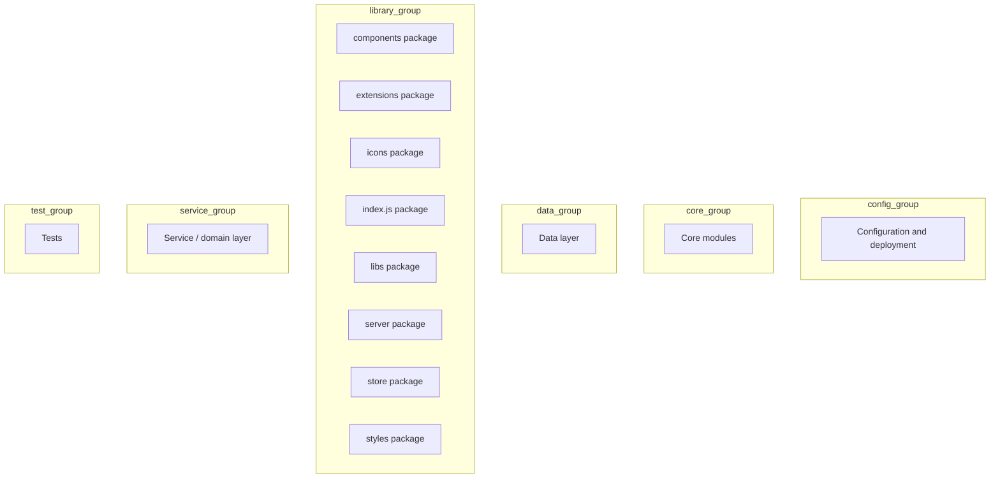

# Architecture report: benweet/stackedit

> Automated static analysis. **Observed** = directly seen in files/imports/AST; **Inferred** = interpretation from that evidence. Repository code was not executed.

## 1. Repository at a glance

| Item | Value |
| --- | --- |
| Repository | benweet/stackedit |
| Description | In-browser Markdown editor |
| Language | JavaScript |
| Stars | 23101 |
| Licence | Apache-2.0 |
| Analysed commit / branch | 6dce2a5e36b755a0c244522b48a06c91a2df0f59 / master |
| Framework(s) | Express, Vue |
| Files analysed | 332 |
| Components | 13 |

## 2. Architecture in one minute

benweet/stackedit - In-browser Markdown editor. This repository was analysed statically from 332 file(s) (0 Python). Detected technologies (observed from imports/manifests): Express, Vue, Docker, Jest, webpack. Files are grouped into 13 component(s): components package, Configuration and deployment, Core modules, Data layer, extensions package, icons package, index.js package, libs package. Findings below distinguish observed facts from inferred interpretation.

## 3. High-level block diagram

## 4. Main components

### components package (`components`)

- **Kind:** library
- **Status:** Observed
- **Confidence:** 0.85
- **Responsibility:** Groups 84 file(s) under components package (observed from repository paths and static analysis).
- **Paths:** `src/components/App.vue`, `src/components/ButtonBar.vue`, `src/components/CodeEditor.vue`, `src/components/ContextMenu.vue`, `src/components/Editor.vue`, `src/components/Explorer.vue`, `src/components/ExplorerNode.vue`, `src/components/FindReplace.vue`, `src/components/Layout.vue`, `src/components/Modal.vue`, `src/components/NavigationBar.vue`, `src/components/Notification.vue`, `src/components/Preview.vue`, `src/components/SideBar.vue`, `src/components/SplashScreen.vue`, `src/components/StatusBar.vue`, `src/components/Toc.vue`, `src/components/Tour.vue`, `src/components/UserImage.vue`, `src/components/UserName.vue`, `src/components/common/EditorClassApplier.js`, `src/components/common/PreviewClassApplier.js`, `src/components/common/vueGlobals.js`, `src/components/gutters/Comment.vue`, `src/components/gutters/CommentList.vue`, `src/components/gutters/CurrentDiscussion.vue`, `src/components/gutters/EditorNewDiscussionButton.vue`, `src/components/gutters/NewComment.vue`, `src/components/gutters/PreviewNewDiscussionButton.vue`, `src/components/gutters/StickyComment.vue`, `src/components/menus/HistoryMenu.vue`, `src/components/menus/ImportExportMenu.vue`, `src/components/menus/MainMenu.vue`, `src/components/menus/PublishMenu.vue`, `src/components/menus/SyncMenu.vue`, `src/components/menus/WorkspaceBackupMenu.vue`, `src/components/menus/WorkspacesMenu.vue`, `src/components/menus/common/MenuEntry.vue`, `src/components/modals/AboutModal.vue`, `src/components/modals/AccountManagementModal.vue`, `src/components/modals/BadgeManagementModal.vue`, `src/components/modals/FilePropertiesModal.vue`, `src/components/modals/HtmlExportModal.vue`, `src/components/modals/ImageModal.vue`, `src/components/modals/LinkModal.vue`, `src/components/modals/PandocExportModal.vue`, `src/components/modals/PdfExportModal.vue`, `src/components/modals/PublishManagementModal.vue`, `src/components/modals/SettingsModal.vue`, `src/components/modals/SponsorModal.vue`, `src/components/modals/SyncManagementModal.vue`, `src/components/modals/TemplatesModal.vue`, `src/components/modals/WorkspaceManagementModal.vue`, `src/components/modals/common/FormEntry.vue`, `src/components/modals/common/ModalInner.vue`, `src/components/modals/common/Tab.vue`, `src/components/modals/common/modalTemplate.js`, `src/components/modals/providers/BloggerPagePublishModal.vue`, `src/components/modals/providers/BloggerPublishModal.vue`, `src/components/modals/providers/CouchdbCredentialsModal.vue`, `src/components/modals/providers/CouchdbWorkspaceModal.vue`, `src/components/modals/providers/DropboxAccountModal.vue`, `src/components/modals/providers/DropboxPublishModal.vue`, `src/components/modals/providers/DropboxSaveModal.vue`, `src/components/modals/providers/GistPublishModal.vue`, `src/components/modals/providers/GistSyncModal.vue`, `src/components/modals/providers/GithubAccountModal.vue`, `src/components/modals/providers/GithubOpenModal.vue`, `src/components/modals/providers/GithubPublishModal.vue`, `src/components/modals/providers/GithubSaveModal.vue`, `src/components/modals/providers/GithubWorkspaceModal.vue`, `src/components/modals/providers/GitlabAccountModal.vue`, `src/components/modals/providers/GitlabOpenModal.vue`, `src/components/modals/providers/GitlabPublishModal.vue`, `src/components/modals/providers/GitlabSaveModal.vue`, `src/components/modals/providers/GitlabWorkspaceModal.vue`, `src/components/modals/providers/GoogleDriveAccountModal.vue`, `src/components/modals/providers/GoogleDrivePublishModal.vue`, `src/components/modals/providers/GoogleDriveSaveModal.vue`, `src/components/modals/providers/GoogleDriveWorkspaceModal.vue`, `src/components/modals/providers/GooglePhotoModal.vue`, `src/components/modals/providers/WordpressPublishModal.vue`, `src/components/modals/providers/ZendeskAccountModal.vue`, `src/components/modals/providers/ZendeskPublishModal.vue`
- **Evidence:** [src/components/App.vue](https://github.com/benweet/stackedit/blob/6dce2a5e36b755a0c244522b48a06c91a2df0f59/src/components/App.vue); [src/components/ButtonBar.vue](https://github.com/benweet/stackedit/blob/6dce2a5e36b755a0c244522b48a06c91a2df0f59/src/components/ButtonBar.vue); [src/components/CodeEditor.vue](https://github.com/benweet/stackedit/blob/6dce2a5e36b755a0c244522b48a06c91a2df0f59/src/components/CodeEditor.vue); [src/components/ContextMenu.vue](https://github.com/benweet/stackedit/blob/6dce2a5e36b755a0c244522b48a06c91a2df0f59/src/components/ContextMenu.vue); [src/components/Editor.vue](https://github.com/benweet/stackedit/blob/6dce2a5e36b755a0c244522b48a06c91a2df0f59/src/components/Editor.vue); [src/components/Explorer.vue](https://github.com/benweet/stackedit/blob/6dce2a5e36b755a0c244522b48a06c91a2df0f59/src/components/Explorer.vue); [src/components/ExplorerNode.vue](https://github.com/benweet/stackedit/blob/6dce2a5e36b755a0c244522b48a06c91a2df0f59/src/components/ExplorerNode.vue); [src/components/FindReplace.vue](https://github.com/benweet/stackedit/blob/6dce2a5e36b755a0c244522b48a06c91a2df0f59/src/components/FindReplace.vue)

### Configuration and deployment (`config`)

- **Kind:** config
- **Status:** Observed
- **Confidence:** 0.85
- **Responsibility:** Groups 12 file(s) under configuration and deployment (observed from repository paths and static analysis).
- **Paths:** `Dockerfile`, `chart/Chart.yaml`, `chart/templates/deployment.yaml`, `chart/templates/ingress.yaml`, `chart/templates/service.yaml`, `chart/values.yaml`, `chrome-app/manifest.json`, `config/dev.env.js`, `config/index.js`, `config/prod.env.js`, `package.json`, `src/data/defaults/defaultSettings.yml`
- **Evidence:** [Dockerfile](https://github.com/benweet/stackedit/blob/6dce2a5e36b755a0c244522b48a06c91a2df0f59/Dockerfile); [chart/Chart.yaml](https://github.com/benweet/stackedit/blob/6dce2a5e36b755a0c244522b48a06c91a2df0f59/chart/Chart.yaml); [chart/templates/deployment.yaml](https://github.com/benweet/stackedit/blob/6dce2a5e36b755a0c244522b48a06c91a2df0f59/chart/templates/deployment.yaml); [chart/templates/ingress.yaml](https://github.com/benweet/stackedit/blob/6dce2a5e36b755a0c244522b48a06c91a2df0f59/chart/templates/ingress.yaml); [chart/templates/service.yaml](https://github.com/benweet/stackedit/blob/6dce2a5e36b755a0c244522b48a06c91a2df0f59/chart/templates/service.yaml); [chart/values.yaml](https://github.com/benweet/stackedit/blob/6dce2a5e36b755a0c244522b48a06c91a2df0f59/chart/values.yaml); [chrome-app/manifest.json](https://github.com/benweet/stackedit/blob/6dce2a5e36b755a0c244522b48a06c91a2df0f59/chrome-app/manifest.json); [config/dev.env.js](https://github.com/benweet/stackedit/blob/6dce2a5e36b755a0c244522b48a06c91a2df0f59/config/dev.env.js)

### Core modules (`core`)

- **Kind:** core
- **Status:** Observed
- **Confidence:** 0.85
- **Responsibility:** Groups 2 file(s) under core modules (observed from repository paths and static analysis).
- **Paths:** `gulpfile.js`, `index.js`
- **Evidence:** [gulpfile.js](https://github.com/benweet/stackedit/blob/6dce2a5e36b755a0c244522b48a06c91a2df0f59/gulpfile.js); [index.js](https://github.com/benweet/stackedit/blob/6dce2a5e36b755a0c244522b48a06c91a2df0f59/index.js)

### Data layer (`data_layer`)

- **Kind:** data
- **Status:** Observed
- **Confidence:** 0.85
- **Responsibility:** Groups 16 file(s) under data layer (observed from repository paths and static analysis).
- **Paths:** `src/data/constants.js`, `src/data/defaults/defaultLayoutSettings.js`, `src/data/defaults/defaultLocalSettings.js`, `src/data/defaults/defaultWorkspaces.js`, `src/data/empties/emptyContent.js`, `src/data/empties/emptyContentState.js`, `src/data/empties/emptyFile.js`, `src/data/empties/emptyFolder.js`, `src/data/empties/emptyPublishLocation.js`, `src/data/empties/emptySyncLocation.js`, `src/data/empties/emptySyncedContent.js`, `src/data/empties/emptyTemplateHelpers.js`, `src/data/features.js`, `src/data/pagedownButtons.js`, `src/data/presets.js`, `src/data/simpleModals.js`
- **Evidence:** [src/data/constants.js](https://github.com/benweet/stackedit/blob/6dce2a5e36b755a0c244522b48a06c91a2df0f59/src/data/constants.js); [src/data/defaults/defaultLayoutSettings.js](https://github.com/benweet/stackedit/blob/6dce2a5e36b755a0c244522b48a06c91a2df0f59/src/data/defaults/defaultLayoutSettings.js); [src/data/defaults/defaultLocalSettings.js](https://github.com/benweet/stackedit/blob/6dce2a5e36b755a0c244522b48a06c91a2df0f59/src/data/defaults/defaultLocalSettings.js); [src/data/defaults/defaultWorkspaces.js](https://github.com/benweet/stackedit/blob/6dce2a5e36b755a0c244522b48a06c91a2df0f59/src/data/defaults/defaultWorkspaces.js); [src/data/empties/emptyContent.js](https://github.com/benweet/stackedit/blob/6dce2a5e36b755a0c244522b48a06c91a2df0f59/src/data/empties/emptyContent.js); [src/data/empties/emptyContentState.js](https://github.com/benweet/stackedit/blob/6dce2a5e36b755a0c244522b48a06c91a2df0f59/src/data/empties/emptyContentState.js); [src/data/empties/emptyFile.js](https://github.com/benweet/stackedit/blob/6dce2a5e36b755a0c244522b48a06c91a2df0f59/src/data/empties/emptyFile.js); [src/data/empties/emptyFolder.js](https://github.com/benweet/stackedit/blob/6dce2a5e36b755a0c244522b48a06c91a2df0f59/src/data/empties/emptyFolder.js)

### extensions package (`extensions`)

- **Kind:** library
- **Status:** Observed
- **Confidence:** 0.85
- **Responsibility:** Groups 9 file(s) under extensions package (observed from repository paths and static analysis).
- **Paths:** `src/extensions/abcExtension.js`, `src/extensions/emojiExtension.js`, `src/extensions/index.js`, `src/extensions/katexExtension.js`, `src/extensions/libs/markdownItAnchor.js`, `src/extensions/libs/markdownItMath.js`, `src/extensions/libs/markdownItTasklist.js`, `src/extensions/markdownExtension.js`, `src/extensions/mermaidExtension.js`
- **Evidence:** [src/extensions/abcExtension.js](https://github.com/benweet/stackedit/blob/6dce2a5e36b755a0c244522b48a06c91a2df0f59/src/extensions/abcExtension.js); [src/extensions/emojiExtension.js](https://github.com/benweet/stackedit/blob/6dce2a5e36b755a0c244522b48a06c91a2df0f59/src/extensions/emojiExtension.js); [src/extensions/index.js](https://github.com/benweet/stackedit/blob/6dce2a5e36b755a0c244522b48a06c91a2df0f59/src/extensions/index.js); [src/extensions/katexExtension.js](https://github.com/benweet/stackedit/blob/6dce2a5e36b755a0c244522b48a06c91a2df0f59/src/extensions/katexExtension.js); [src/extensions/libs/markdownItAnchor.js](https://github.com/benweet/stackedit/blob/6dce2a5e36b755a0c244522b48a06c91a2df0f59/src/extensions/libs/markdownItAnchor.js); [src/extensions/libs/markdownItMath.js](https://github.com/benweet/stackedit/blob/6dce2a5e36b755a0c244522b48a06c91a2df0f59/src/extensions/libs/markdownItMath.js); [src/extensions/libs/markdownItTasklist.js](https://github.com/benweet/stackedit/blob/6dce2a5e36b755a0c244522b48a06c91a2df0f59/src/extensions/libs/markdownItTasklist.js); [src/extensions/markdownExtension.js](https://github.com/benweet/stackedit/blob/6dce2a5e36b755a0c244522b48a06c91a2df0f59/src/extensions/markdownExtension.js)

### icons package (`icons`)

- **Kind:** library
- **Status:** Observed
- **Confidence:** 0.85
- **Responsibility:** Groups 58 file(s) under icons package (observed from repository paths and static analysis).
- **Paths:** `src/icons/Alert.vue`, `src/icons/ArrowLeft.vue`, `src/icons/CheckCircle.vue`, `src/icons/Close.vue`, `src/icons/CodeBraces.vue`, `src/icons/CodeTags.vue`, `src/icons/ContentCopy.vue`, `src/icons/ContentSave.vue`, `src/icons/Database.vue`, `src/icons/Delete.vue`, `src/icons/DotsHorizontal.vue`, `src/icons/Download.vue`, `src/icons/Eye.vue`, `src/icons/FileImage.vue`, `src/icons/FileMultiple.vue`, `src/icons/FilePlus.vue`, `src/icons/Folder.vue`, `src/icons/FolderMultiple.vue`, `src/icons/FolderPlus.vue`, `src/icons/FormatBold.vue`, `src/icons/FormatItalic.vue`, `src/icons/FormatListBulleted.vue`, `src/icons/FormatListChecks.vue`, `src/icons/FormatListNumbers.vue`, `src/icons/FormatQuoteClose.vue`, `src/icons/FormatSize.vue`, `src/icons/FormatStrikethrough.vue`, `src/icons/HelpCircle.vue`, `src/icons/History.vue`, `src/icons/Information.vue`, `src/icons/Key.vue`, `src/icons/LinkVariant.vue`, `src/icons/Login.vue`, `src/icons/Logout.vue`, `src/icons/Magnify.vue`, `src/icons/Menu.vue`, `src/icons/Message.vue`, `src/icons/NavigationBar.vue`, `src/icons/OpenInNew.vue`, `src/icons/Pen.vue`, `src/icons/Printer.vue`, `src/icons/Provider.vue`, `src/icons/Redo.vue`, `src/icons/ScrollSync.vue`, `src/icons/Seal.vue`, `src/icons/Settings.vue`, `src/icons/SidePreview.vue`, `src/icons/SignalOff.vue`, `src/icons/StatusBar.vue`, `src/icons/Sync.vue`, `src/icons/SyncOff.vue`, `src/icons/Table.vue`, `src/icons/Target.vue`, `src/icons/Toc.vue`, `src/icons/Undo.vue`, `src/icons/Upload.vue`, `src/icons/ViewList.vue`, `src/icons/index.js`
- **Evidence:** [src/icons/Alert.vue](https://github.com/benweet/stackedit/blob/6dce2a5e36b755a0c244522b48a06c91a2df0f59/src/icons/Alert.vue); [src/icons/ArrowLeft.vue](https://github.com/benweet/stackedit/blob/6dce2a5e36b755a0c244522b48a06c91a2df0f59/src/icons/ArrowLeft.vue); [src/icons/CheckCircle.vue](https://github.com/benweet/stackedit/blob/6dce2a5e36b755a0c244522b48a06c91a2df0f59/src/icons/CheckCircle.vue); [src/icons/Close.vue](https://github.com/benweet/stackedit/blob/6dce2a5e36b755a0c244522b48a06c91a2df0f59/src/icons/Close.vue); [src/icons/CodeBraces.vue](https://github.com/benweet/stackedit/blob/6dce2a5e36b755a0c244522b48a06c91a2df0f59/src/icons/CodeBraces.vue); [src/icons/CodeTags.vue](https://github.com/benweet/stackedit/blob/6dce2a5e36b755a0c244522b48a06c91a2df0f59/src/icons/CodeTags.vue); [src/icons/ContentCopy.vue](https://github.com/benweet/stackedit/blob/6dce2a5e36b755a0c244522b48a06c91a2df0f59/src/icons/ContentCopy.vue); [src/icons/ContentSave.vue](https://github.com/benweet/stackedit/blob/6dce2a5e36b755a0c244522b48a06c91a2df0f59/src/icons/ContentSave.vue)

### index.js package (`index_js`)

- **Kind:** library
- **Status:** Observed
- **Confidence:** 0.85
- **Responsibility:** Groups 1 file(s) under index.js package (observed from repository paths and static analysis).
- **Paths:** `src/index.js`
- **Evidence:** [src/index.js](https://github.com/benweet/stackedit/blob/6dce2a5e36b755a0c244522b48a06c91a2df0f59/src/index.js)

### libs package (`libs`)

- **Kind:** library
- **Status:** Observed
- **Confidence:** 0.85
- **Responsibility:** Groups 3 file(s) under libs package (observed from repository paths and static analysis).
- **Paths:** `src/libs/clunderscore.js`, `src/libs/htmlSanitizer.js`, `src/libs/pagedown.js`
- **Evidence:** [src/libs/clunderscore.js](https://github.com/benweet/stackedit/blob/6dce2a5e36b755a0c244522b48a06c91a2df0f59/src/libs/clunderscore.js); [src/libs/htmlSanitizer.js](https://github.com/benweet/stackedit/blob/6dce2a5e36b755a0c244522b48a06c91a2df0f59/src/libs/htmlSanitizer.js); [src/libs/pagedown.js](https://github.com/benweet/stackedit/blob/6dce2a5e36b755a0c244522b48a06c91a2df0f59/src/libs/pagedown.js)

### server package (`server`)

- **Kind:** library
- **Status:** Observed
- **Confidence:** 0.85
- **Responsibility:** Groups 6 file(s) under server package (observed from repository paths and static analysis).
- **Paths:** `server/conf.js`, `server/github.js`, `server/index.js`, `server/pandoc.js`, `server/pdf.js`, `server/user.js`
- **Evidence:** [server/conf.js](https://github.com/benweet/stackedit/blob/6dce2a5e36b755a0c244522b48a06c91a2df0f59/server/conf.js); [server/github.js](https://github.com/benweet/stackedit/blob/6dce2a5e36b755a0c244522b48a06c91a2df0f59/server/github.js); [server/index.js](https://github.com/benweet/stackedit/blob/6dce2a5e36b755a0c244522b48a06c91a2df0f59/server/index.js); [server/pandoc.js](https://github.com/benweet/stackedit/blob/6dce2a5e36b755a0c244522b48a06c91a2df0f59/server/pandoc.js); [server/pdf.js](https://github.com/benweet/stackedit/blob/6dce2a5e36b755a0c244522b48a06c91a2df0f59/server/pdf.js); [server/user.js](https://github.com/benweet/stackedit/blob/6dce2a5e36b755a0c244522b48a06c91a2df0f59/server/user.js)

### Service / domain layer (`service_layer`)

- **Kind:** service
- **Status:** Observed
- **Confidence:** 0.85
- **Responsibility:** Groups 61 file(s) under service / domain layer (observed from repository paths and static analysis).
- **Paths:** `src/services/animationSvc.js`, `src/services/backupSvc.js`, `src/services/badgeSvc.js`, `src/services/diffUtils.js`, `src/services/editor/cledit/cleditCore.js`, `src/services/editor/cledit/cleditHighlighter.js`, `src/services/editor/cledit/cleditKeystroke.js`, `src/services/editor/cledit/cleditMarker.js`, `src/services/editor/cledit/cleditSelectionMgr.js`, `src/services/editor/cledit/cleditUndoMgr.js`, `src/services/editor/cledit/cleditUtils.js`, `src/services/editor/cledit/cleditWatcher.js`, `src/services/editor/cledit/index.js`, `src/services/editor/editorSvcDiscussions.js`, `src/services/editor/editorSvcUtils.js`, `src/services/editor/sectionUtils.js`, `src/services/editorSvc.js`, `src/services/explorerSvc.js`, `src/services/exportSvc.js`, `src/services/extensionSvc.js`, `src/services/gitWorkspaceSvc.js`, `src/services/localDbSvc.js`, `src/services/markdownConversionSvc.js`, `src/services/markdownGrammarSvc.js`, `src/services/networkSvc.js`, `src/services/optional/index.js`, `src/services/optional/keystrokes.js`, `src/services/optional/scrollSync.js`, `src/services/optional/shortcuts.js`, `src/services/optional/taskChange.js`, `src/services/providers/bloggerPageProvider.js`, `src/services/providers/bloggerProvider.js`, `src/services/providers/common/Provider.js`, `src/services/providers/common/providerRegistry.js`, `src/services/providers/couchdbWorkspaceProvider.js`, `src/services/providers/dropboxProvider.js`, `src/services/providers/gistProvider.js`, `src/services/providers/githubProvider.js`, `src/services/providers/githubWorkspaceProvider.js`, `src/services/providers/gitlabProvider.js`, `src/services/providers/gitlabWorkspaceProvider.js`, `src/services/providers/googleDriveAppDataProvider.js`, `src/services/providers/googleDriveProvider.js`, `src/services/providers/googleDriveWorkspaceProvider.js`, `src/services/providers/helpers/couchdbHelper.js`, `src/services/providers/helpers/dropboxHelper.js`, `src/services/providers/helpers/githubHelper.js`, `src/services/providers/helpers/gitlabHelper.js`, `src/services/providers/helpers/googleHelper.js`, `src/services/providers/helpers/wordpressHelper.js`, `src/services/providers/helpers/zendeskHelper.js`, `src/services/providers/wordpressProvider.js`, `src/services/providers/zendeskProvider.js`, `src/services/publishSvc.js`, `src/services/syncSvc.js`, `src/services/tempFileSvc.js`, `src/services/templateWorker.js`, `src/services/timeSvc.js`, `src/services/userSvc.js`, `src/services/utils.js`, `src/services/workspaceSvc.js`
- **Evidence:** [src/services/animationSvc.js](https://github.com/benweet/stackedit/blob/6dce2a5e36b755a0c244522b48a06c91a2df0f59/src/services/animationSvc.js); [src/services/backupSvc.js](https://github.com/benweet/stackedit/blob/6dce2a5e36b755a0c244522b48a06c91a2df0f59/src/services/backupSvc.js); [src/services/badgeSvc.js](https://github.com/benweet/stackedit/blob/6dce2a5e36b755a0c244522b48a06c91a2df0f59/src/services/badgeSvc.js); [src/services/diffUtils.js](https://github.com/benweet/stackedit/blob/6dce2a5e36b755a0c244522b48a06c91a2df0f59/src/services/diffUtils.js); [src/services/editor/cledit/cleditCore.js](https://github.com/benweet/stackedit/blob/6dce2a5e36b755a0c244522b48a06c91a2df0f59/src/services/editor/cledit/cleditCore.js); [src/services/editor/cledit/cleditHighlighter.js](https://github.com/benweet/stackedit/blob/6dce2a5e36b755a0c244522b48a06c91a2df0f59/src/services/editor/cledit/cleditHighlighter.js); [src/services/editor/cledit/cleditKeystroke.js](https://github.com/benweet/stackedit/blob/6dce2a5e36b755a0c244522b48a06c91a2df0f59/src/services/editor/cledit/cleditKeystroke.js); [src/services/editor/cledit/cleditMarker.js](https://github.com/benweet/stackedit/blob/6dce2a5e36b755a0c244522b48a06c91a2df0f59/src/services/editor/cledit/cleditMarker.js)

### store package (`store`)

- **Kind:** library
- **Status:** Observed
- **Confidence:** 0.85
- **Responsibility:** Groups 19 file(s) under store package (observed from repository paths and static analysis).
- **Paths:** `src/store/content.js`, `src/store/contentState.js`, `src/store/contextMenu.js`, `src/store/data.js`, `src/store/discussion.js`, `src/store/explorer.js`, `src/store/file.js`, `src/store/findReplace.js`, `src/store/folder.js`, `src/store/index.js`, `src/store/layout.js`, `src/store/locationTemplate.js`, `src/store/modal.js`, `src/store/moduleTemplate.js`, `src/store/notification.js`, `src/store/queue.js`, `src/store/syncedContent.js`, `src/store/userInfo.js`, `src/store/workspace.js`
- **Evidence:** [src/store/content.js](https://github.com/benweet/stackedit/blob/6dce2a5e36b755a0c244522b48a06c91a2df0f59/src/store/content.js); [src/store/contentState.js](https://github.com/benweet/stackedit/blob/6dce2a5e36b755a0c244522b48a06c91a2df0f59/src/store/contentState.js); [src/store/contextMenu.js](https://github.com/benweet/stackedit/blob/6dce2a5e36b755a0c244522b48a06c91a2df0f59/src/store/contextMenu.js); [src/store/data.js](https://github.com/benweet/stackedit/blob/6dce2a5e36b755a0c244522b48a06c91a2df0f59/src/store/data.js); [src/store/discussion.js](https://github.com/benweet/stackedit/blob/6dce2a5e36b755a0c244522b48a06c91a2df0f59/src/store/discussion.js); [src/store/explorer.js](https://github.com/benweet/stackedit/blob/6dce2a5e36b755a0c244522b48a06c91a2df0f59/src/store/explorer.js); [src/store/file.js](https://github.com/benweet/stackedit/blob/6dce2a5e36b755a0c244522b48a06c91a2df0f59/src/store/file.js); [src/store/findReplace.js](https://github.com/benweet/stackedit/blob/6dce2a5e36b755a0c244522b48a06c91a2df0f59/src/store/findReplace.js)

### styles package (`styles`)

- **Kind:** library
- **Status:** Observed
- **Confidence:** 0.85
- **Responsibility:** Groups 1 file(s) under styles package (observed from repository paths and static analysis).
- **Paths:** `src/styles/index.js`
- **Evidence:** [src/styles/index.js](https://github.com/benweet/stackedit/blob/6dce2a5e36b755a0c244522b48a06c91a2df0f59/src/styles/index.js)

### Tests (`tests`)

- **Kind:** test
- **Status:** Observed
- **Confidence:** 0.85
- **Responsibility:** Groups 15 file(s) under tests (observed from repository paths and static analysis).
- **Paths:** `chart/templates/tests/test-connection.yaml`, `test/unit/.eslintrc`, `test/unit/jest.conf.js`, `test/unit/mocks/cryptoMock.js`, `test/unit/mocks/localStorageMock.js`, `test/unit/mocks/mutationObserverMock.js`, `test/unit/mocks/templateWorkerMock.js`, `test/unit/setup.js`, `test/unit/specs/components/ButtonBar.spec.js`, `test/unit/specs/components/ContextMenu.spec.js`, `test/unit/specs/components/Explorer.spec.js`, `test/unit/specs/components/ExplorerNode.spec.js`, `test/unit/specs/components/NavigationBar.spec.js`, `test/unit/specs/components/Notification.spec.js`, `test/unit/specs/specUtils.js`
- **Evidence:** [chart/templates/tests/test-connection.yaml](https://github.com/benweet/stackedit/blob/6dce2a5e36b755a0c244522b48a06c91a2df0f59/chart/templates/tests/test-connection.yaml); [test/unit/.eslintrc](https://github.com/benweet/stackedit/blob/6dce2a5e36b755a0c244522b48a06c91a2df0f59/test/unit/.eslintrc); [test/unit/jest.conf.js](https://github.com/benweet/stackedit/blob/6dce2a5e36b755a0c244522b48a06c91a2df0f59/test/unit/jest.conf.js); [test/unit/mocks/cryptoMock.js](https://github.com/benweet/stackedit/blob/6dce2a5e36b755a0c244522b48a06c91a2df0f59/test/unit/mocks/cryptoMock.js); [test/unit/mocks/localStorageMock.js](https://github.com/benweet/stackedit/blob/6dce2a5e36b755a0c244522b48a06c91a2df0f59/test/unit/mocks/localStorageMock.js); [test/unit/mocks/mutationObserverMock.js](https://github.com/benweet/stackedit/blob/6dce2a5e36b755a0c244522b48a06c91a2df0f59/test/unit/mocks/mutationObserverMock.js); [test/unit/mocks/templateWorkerMock.js](https://github.com/benweet/stackedit/blob/6dce2a5e36b755a0c244522b48a06c91a2df0f59/test/unit/mocks/templateWorkerMock.js); [test/unit/setup.js](https://github.com/benweet/stackedit/blob/6dce2a5e36b755a0c244522b48a06c91a2df0f59/test/unit/setup.js)

## 5. Execution flow

**Observed** entry point(s):

- [config/index.js](https://github.com/benweet/stackedit/blob/6dce2a5e36b755a0c244522b48a06c91a2df0f59/config/index.js)
- [index.js](https://github.com/benweet/stackedit/blob/6dce2a5e36b755a0c244522b48a06c91a2df0f59/index.js)
- [server/index.js](https://github.com/benweet/stackedit/blob/6dce2a5e36b755a0c244522b48a06c91a2df0f59/server/index.js)
- [src/extensions/index.js](https://github.com/benweet/stackedit/blob/6dce2a5e36b755a0c244522b48a06c91a2df0f59/src/extensions/index.js)
- [src/icons/index.js](https://github.com/benweet/stackedit/blob/6dce2a5e36b755a0c244522b48a06c91a2df0f59/src/icons/index.js)
- [src/index.js](https://github.com/benweet/stackedit/blob/6dce2a5e36b755a0c244522b48a06c91a2df0f59/src/index.js)
- [src/services/optional/index.js](https://github.com/benweet/stackedit/blob/6dce2a5e36b755a0c244522b48a06c91a2df0f59/src/services/optional/index.js)
- [src/store/index.js](https://github.com/benweet/stackedit/blob/6dce2a5e36b755a0c244522b48a06c91a2df0f59/src/store/index.js)
- [src/styles/index.js](https://github.com/benweet/stackedit/blob/6dce2a5e36b755a0c244522b48a06c91a2df0f59/src/styles/index.js)

Representative flow (derived from observed entry points and the import graph; steps beyond the entry point are **Inferred**):

1. Execution starts at an observed entry point listed above, if present.
2. No internal import relationships between components were observed.

## 6. Project structure

### `(root)`

- `.babelrc` - other (280 bytes)
- `.dockerignore` - container (32 bytes)
- `.editorconfig` - config (147 bytes)
- `.eslintignore` - other (37 bytes)
- `.eslintrc.js` - source, JavaScript (1010 bytes)
- `.gitignore` - other (119 bytes)
- `.postcssrc.js` - source, JavaScript (196 bytes)
- `.stylelintrc` - other (136 bytes)
- `.travis.yml` - ci, YAML (373 bytes)
- `Dockerfile` - container (307 bytes)
- `LICENSE` - docs (11357 bytes)
- `README.md` - docs (3083 bytes)
- `gulpfile.js` - source, JavaScript (695 bytes)
- `index.html` - other (642 bytes)
- `index.js` - source, JavaScript (597 bytes)
- `package.json` - manifest (4764 bytes)

### `chart`

- `chart/.helmignore` - other (342 bytes)
- `chart/Chart.yaml` - config (129 bytes)
- `chart/templates/NOTES.txt` - docs (1519 bytes)
- `chart/templates/_helpers.tpl` - other (1427 bytes)
- `chart/templates/deployment.yaml` - config (2807 bytes)
- `chart/templates/ingress.yaml` - config (910 bytes)
- `chart/templates/service.yaml` - config (414 bytes)
- `chart/templates/tests/test-connection.yaml` - test (388 bytes)
- `chart/values.yaml` - config (1427 bytes)

### `chrome-app`

- `chrome-app/manifest.json` - config (578 bytes)

### `config`

- `config/dev.env.js` - source, JavaScript (139 bytes)
- `config/index.js` - source, JavaScript (1464 bytes)
- `config/prod.env.js` - source, JavaScript (48 bytes)

### `server`

- `server/conf.js` - source, JavaScript (1162 bytes)
- `server/github.js` - source, JavaScript (931 bytes)
- `server/index.js` - source, JavaScript (2165 bytes)
- `server/pandoc.js` - source, JavaScript (4253 bytes)
- `server/pdf.js` - source, JavaScript (5679 bytes)
- `server/user.js` - source, JavaScript (3163 bytes)

### `src`

- `src/assets/iconBlogger.svg` - other (2186 bytes)
- `src/assets/iconCouchdb.svg` - other (1239 bytes)
- `src/assets/iconDropbox.svg` - other (338 bytes)
- `src/assets/iconGithub.svg` - other (1011 bytes)
- `src/assets/iconGitlab.svg` - other (1005 bytes)
- `src/assets/iconGoogle.svg` - other (729 bytes)
- `src/assets/iconGoogleDrive.svg` - other (363 bytes)
- `src/assets/iconGooglePhotos.svg` - other (2420 bytes)
- `src/assets/iconStackedit.svg` - other (3316 bytes)
- `src/assets/iconWordpress.svg` - other (1443 bytes)
- `src/assets/iconZendesk.svg` - other (605 bytes)
- `src/assets/logo.svg` - other (9155 bytes)
- `src/components/App.vue` - source, Vue (1683 bytes)
- `src/components/ButtonBar.vue` - source, Vue (3077 bytes)
- `src/components/CodeEditor.vue` - source, Vue (1246 bytes)
- `src/components/ContextMenu.vue` - source, Vue (1820 bytes)
- `src/components/Editor.vue` - source, Vue (3239 bytes)
- `src/components/Explorer.vue` - source, Vue (2706 bytes)
- `src/components/ExplorerNode.vue` - source, Vue (8611 bytes)
- `src/components/FindReplace.vue` - source, Vue (11742 bytes)
- `src/components/Layout.vue` - source, Vue (7455 bytes)
- `src/components/Modal.vue` - source, Vue (11888 bytes)
- `src/components/NavigationBar.vue` - source, Vue (14493 bytes)
- `src/components/Notification.vue` - source, Vue (1580 bytes)
- `src/components/Preview.vue` - source, Vue (4514 bytes)
- `src/components/SideBar.vue` - source, Vue (4286 bytes)
- `src/components/SplashScreen.vue` - source, Vue (344 bytes)
- `src/components/StatusBar.vue` - source, Vue (3410 bytes)
- `src/components/Toc.vue` - source, Vue (3479 bytes)
- `src/components/Tour.vue` - source, Vue (6130 bytes)
- `src/components/UserImage.vue` - source, Vue (832 bytes)
- `src/components/UserName.vue` - source, Vue (587 bytes)
- `src/components/common/EditorClassApplier.js` - source, JavaScript (2622 bytes)
- `src/components/common/PreviewClassApplier.js` - source, JavaScript (2616 bytes)
- `src/components/common/vueGlobals.js` - source, JavaScript (1704 bytes)
- `src/components/gutters/Comment.vue` - source, Vue (2768 bytes)
- `src/components/gutters/CommentList.vue` - source, Vue (8828 bytes)
- `src/components/gutters/CurrentDiscussion.vue` - source, Vue (5357 bytes)
- `src/components/gutters/EditorNewDiscussionButton.vue` - source, Vue (1771 bytes)
- `src/components/gutters/NewComment.vue` - source, Vue (5749 bytes)
- `src/components/gutters/PreviewNewDiscussionButton.vue` - source, Vue (1674 bytes)
- `src/components/gutters/StickyComment.vue` - source, Vue (963 bytes)
- `src/components/menus/HistoryMenu.vue` - source, Vue (13298 bytes)
- `src/components/menus/ImportExportMenu.vue` - source, Vue (4598 bytes)
- `src/components/menus/MainMenu.vue` - source, Vue (8638 bytes)
- `src/components/menus/PublishMenu.vue` - source, Vue (10282 bytes)
- `src/components/menus/SyncMenu.vue` - source, Vue (10109 bytes)
- `src/components/menus/WorkspaceBackupMenu.vue` - source, Vue (1960 bytes)
- `src/components/menus/WorkspacesMenu.vue` - source, Vue (3487 bytes)
- `src/components/menus/common/MenuEntry.vue` - source, Vue (1531 bytes)
- `src/components/modals/AboutModal.vue` - source, Vue (2441 bytes)
- `src/components/modals/AccountManagementModal.vue` - source, Vue (9016 bytes)
- `src/components/modals/BadgeManagementModal.vue` - source, Vue (3217 bytes)
- `src/components/modals/FilePropertiesModal.vue` - source, Vue (9176 bytes)
- `src/components/modals/HtmlExportModal.vue` - source, Vue (2172 bytes)
- `src/components/modals/ImageModal.vue` - source, Vue (2541 bytes)
- `src/components/modals/LinkModal.vue` - source, Vue (1094 bytes)
- `src/components/modals/PandocExportModal.vue` - source, Vue (2996 bytes)
- `src/components/modals/PdfExportModal.vue` - source, Vue (2737 bytes)
- `src/components/modals/PublishManagementModal.vue` - source, Vue (4178 bytes)
- `src/components/modals/SettingsModal.vue` - source, Vue (3636 bytes)
- `src/components/modals/SponsorModal.vue` - source, Vue (2483 bytes)
- `src/components/modals/SyncManagementModal.vue` - source, Vue (4267 bytes)
- `src/components/modals/TemplatesModal.vue` - source, Vue (6637 bytes)
- `src/components/modals/WorkspaceManagementModal.vue` - source, Vue (6869 bytes)
- `src/components/modals/common/FormEntry.vue` - source, Vue (556 bytes)
- `src/components/modals/common/ModalInner.vue` - source, Vue (745 bytes)
- `src/components/modals/common/Tab.vue` - source, Vue (310 bytes)
- `src/components/modals/common/modalTemplate.js` - source, JavaScript (2484 bytes)
- `src/components/modals/providers/BloggerPagePublishModal.vue` - source, Vue (2392 bytes)
- `src/components/modals/providers/BloggerPublishModal.vue` - source, Vue (2440 bytes)
- `src/components/modals/providers/CouchdbCredentialsModal.vue` - source, Vue (1603 bytes)
- `src/components/modals/providers/CouchdbWorkspaceModal.vue` - source, Vue (1576 bytes)
- `src/components/modals/providers/DropboxAccountModal.vue` - source, Vue (1084 bytes)
- `src/components/modals/providers/DropboxPublishModal.vue` - source, Vue (2101 bytes)
- `src/components/modals/providers/DropboxSaveModal.vue` - source, Vue (1526 bytes)
- `src/components/modals/providers/GistPublishModal.vue` - source, Vue (2671 bytes)
- `src/components/modals/providers/GistSyncModal.vue` - source, Vue (1935 bytes)
- `src/components/modals/providers/GithubAccountModal.vue` - source, Vue (933 bytes)
- `src/components/modals/providers/GithubOpenModal.vue` - source, Vue (2293 bytes)
- `src/components/modals/providers/GithubPublishModal.vue` - source, Vue (2972 bytes)
- `src/components/modals/providers/GithubSaveModal.vue` - source, Vue (2403 bytes)
- `src/components/modals/providers/GithubWorkspaceModal.vue` - source, Vue (2211 bytes)
- `src/components/modals/providers/GitlabAccountModal.vue` - source, Vue (2384 bytes)
- `src/components/modals/providers/GitlabOpenModal.vue` - source, Vue (2290 bytes)
- `src/components/modals/providers/GitlabPublishModal.vue` - source, Vue (2969 bytes)
- `src/components/modals/providers/GitlabSaveModal.vue` - source, Vue (2400 bytes)
- `src/components/modals/providers/GitlabWorkspaceModal.vue` - source, Vue (2325 bytes)
- `src/components/modals/providers/GoogleDriveAccountModal.vue` - source, Vue (1107 bytes)
- `src/components/modals/providers/GoogleDrivePublishModal.vue` - source, Vue (3511 bytes)
- `src/components/modals/providers/GoogleDriveSaveModal.vue` - source, Vue (2321 bytes)
- `src/components/modals/providers/GoogleDriveWorkspaceModal.vue` - source, Vue (1977 bytes)
- `src/components/modals/providers/GooglePhotoModal.vue` - source, Vue (1925 bytes)
- `src/components/modals/providers/WordpressPublishModal.vue` - source, Vue (2620 bytes)
- `src/components/modals/providers/ZendeskAccountModal.vue` - source, Vue (2143 bytes)
- `src/components/modals/providers/ZendeskPublishModal.vue` - source, Vue (2847 bytes)
- `src/data/constants.js` - source, JavaScript (551 bytes)
- `src/data/defaults/defaultLayoutSettings.js` - source, JavaScript (314 bytes)
- `src/data/defaults/defaultLocalSettings.js` - source, JavaScript (1030 bytes)
- `src/data/defaults/defaultSettings.yml` - config (2035 bytes)
- `src/data/defaults/defaultWorkspaces.js` - source, JavaScript (157 bytes)
- `src/data/empties/emptyContent.js` - source, JavaScript (142 bytes)
- `src/data/empties/emptyContentState.js` - source, JavaScript (142 bytes)
- `src/data/empties/emptyFile.js` - source, JavaScript (100 bytes)
- `src/data/empties/emptyFolder.js` - source, JavaScript (102 bytes)
- `src/data/empties/emptyPublishLocation.js` - source, JavaScript (137 bytes)
- `src/data/empties/emptySyncLocation.js` - source, JavaScript (114 bytes)
- `src/data/empties/emptySyncedContent.js` - source, JavaScript (125 bytes)
- `src/data/empties/emptyTemplateHelpers.js` - source, JavaScript (359 bytes)
- `src/data/empties/emptyTemplateValue.html` - other (815 bytes)
- `src/data/faq.md` - docs (575 bytes)
- `src/data/features.js` - source, JavaScript (15239 bytes)
- `src/data/markdownSample.md` - docs (1413 bytes)
- `src/data/pagedownButtons.js` - source, JavaScript (888 bytes)
- `src/data/presets.js` - source, JavaScript (1802 bytes)
- `src/data/simpleModals.js` - source, JavaScript (3086 bytes)
- `src/data/templates/jekyllSiteTemplate.html` - other (73 bytes)
- `src/data/templates/plainHtmlTemplate.html` - other (27 bytes)
- `src/data/templates/styledHtmlTemplate.html` - other (413 bytes)
- `src/data/templates/styledHtmlWithTocTemplate.html` - other (611 bytes)
- `src/data/welcomeFile.md` - docs (7173 bytes)
- `src/extensions/abcExtension.js` - source, JavaScript (684 bytes)
- `src/extensions/emojiExtension.js` - source, JavaScript (454 bytes)
- `src/extensions/index.js` - source, JavaScript (138 bytes)
- `src/extensions/katexExtension.js` - source, JavaScript (1148 bytes)
- `src/extensions/libs/markdownItAnchor.js` - source, JavaScript (1842 bytes)
- `src/extensions/libs/markdownItMath.js` - source, JavaScript (1809 bytes)
- `src/extensions/libs/markdownItTasklist.js` - source, JavaScript (1420 bytes)
- `src/extensions/markdownExtension.js` - source, JavaScript (4581 bytes)
- `src/extensions/mermaidExtension.js` - source, JavaScript (1728 bytes)
- `src/icons/Alert.vue` - source, Vue (225 bytes)
- `src/icons/ArrowLeft.vue` - source, Vue (253 bytes)
- `src/icons/CheckCircle.vue` - source, Vue (366 bytes)
- `src/icons/Close.vue` - source, Vue (235 bytes)
- `src/icons/CodeBraces.vue` - source, Vue (640 bytes)
- `src/icons/CodeTags.vue` - source, Vue (246 bytes)
- `src/icons/ContentCopy.vue` - source, Vue (323 bytes)
- `src/icons/ContentSave.vue` - source, Vue (316 bytes)
- `src/icons/Database.vue` - source, Vue (415 bytes)
- `src/icons/Delete.vue` - source, Vue (217 bytes)
- `src/icons/DotsHorizontal.vue` - source, Vue (494 bytes)
- `src/icons/Download.vue` - source, Vue (327 bytes)
- `src/icons/Eye.vue` - source, Vue (774 bytes)
- `src/icons/FileImage.vue` - source, Vue (613 bytes)
- `src/icons/FileMultiple.vue` - source, Vue (263 bytes)
- `src/icons/FilePlus.vue` - source, Vue (264 bytes)
- `src/icons/Folder.vue` - source, Vue (229 bytes)
- `src/icons/FolderMultiple.vue` - source, Vue (269 bytes)
- `src/icons/FolderPlus.vue` - source, Vue (269 bytes)
- `src/icons/FormatBold.vue` - source, Vue (529 bytes)
- `src/icons/FormatItalic.vue` - source, Vue (272 bytes)
- `src/icons/FormatListBulleted.vue` - source, Vue (730 bytes)
- `src/icons/FormatListChecks.vue` - source, Vue (240 bytes)
- `src/icons/FormatListNumbers.vue` - source, Vue (535 bytes)
- `src/icons/FormatQuoteClose.vue` - source, Vue (302 bytes)
- `src/icons/FormatSize.vue` - source, Vue (307 bytes)
- `src/icons/FormatStrikethrough.vue` - source, Vue (623 bytes)
- `src/icons/HelpCircle.vue` - source, Vue (903 bytes)
- `src/icons/History.vue` - source, Vue (411 bytes)
- `src/icons/Information.vue` - source, Vue (468 bytes)
- `src/icons/Key.vue` - source, Vue (374 bytes)
- `src/icons/LinkVariant.vue` - source, Vue (1206 bytes)
- `src/icons/Login.vue` - source, Vue (598 bytes)
- `src/icons/Logout.vue` - source, Vue (552 bytes)
- `src/icons/Magnify.vue` - source, Vue (529 bytes)
- `src/icons/Menu.vue` - source, Vue (300 bytes)
- `src/icons/Message.vue` - source, Vue (372 bytes)
- `src/icons/NavigationBar.vue` - source, Vue (319 bytes)
- `src/icons/OpenInNew.vue` - source, Vue (333 bytes)
- `src/icons/Pen.vue` - source, Vue (555 bytes)
- `src/icons/Printer.vue` - source, Vue (322 bytes)
- `src/icons/Provider.vue` - source, Vue (1922 bytes)
- `src/icons/Redo.vue` - source, Vue (283 bytes)
- `src/icons/ScrollSync.vue` - source, Vue (308 bytes)
- `src/icons/Seal.vue` - source, Vue (612 bytes)
- `src/icons/Settings.vue` - source, Vue (1588 bytes)
- `src/icons/SidePreview.vue` - source, Vue (328 bytes)
- `src/icons/SignalOff.vue` - source, Vue (388 bytes)
- `src/icons/StatusBar.vue` - source, Vue (323 bytes)
- `src/icons/Sync.vue` - source, Vue (376 bytes)
- `src/icons/SyncOff.vue` - source, Vue (623 bytes)
- `src/icons/Table.vue` - source, Vue (406 bytes)
- `src/icons/Target.vue` - source, Vue (1131 bytes)
- `src/icons/Toc.vue` - source, Vue (215 bytes)
- `src/icons/Undo.vue` - source, Vue (280 bytes)
- `src/icons/Upload.vue` - source, Vue (349 bytes)
- `src/icons/ViewList.vue` - source, Vue (276 bytes)
- `src/icons/index.js` - source, JavaScript (4352 bytes)
- `src/index.js` - source, JavaScript (1602 bytes)
- `src/libs/clunderscore.js` - source, JavaScript (4624 bytes)
- `src/libs/htmlSanitizer.js` - source, JavaScript (13494 bytes)
- `src/libs/pagedown.js` - source, JavaScript (44076 bytes)
- `src/services/animationSvc.js` - source, JavaScript (6696 bytes)
- `src/services/backupSvc.js` - source, JavaScript (2338 bytes)
- `src/services/badgeSvc.js` - source, JavaScript (1157 bytes)
- `src/services/diffUtils.js` - source, JavaScript (6657 bytes)
- `src/services/editor/cledit/cleditCore.js` - source, JavaScript (14107 bytes)
- `src/services/editor/cledit/cleditHighlighter.js` - source, JavaScript (6609 bytes)
- `src/services/editor/cledit/cleditKeystroke.js` - source, JavaScript (5556 bytes)
- `src/services/editor/cledit/cleditMarker.js` - source, JavaScript (1081 bytes)
- `src/services/editor/cledit/cleditSelectionMgr.js` - source, JavaScript (14328 bytes)
- `src/services/editor/cledit/cleditUndoMgr.js` - source, JavaScript (4569 bytes)
- `src/services/editor/cledit/cleditUtils.js` - source, JavaScript (3169 bytes)
- `src/services/editor/cledit/cleditWatcher.js` - source, JavaScript (765 bytes)
- `src/services/editor/cledit/index.js` - source, JavaScript (286 bytes)
- `src/services/editor/editorSvcDiscussions.js` - source, JavaScript (8608 bytes)
- `src/services/editor/editorSvcUtils.js` - source, JavaScript (5025 bytes)
- `src/services/editor/sectionUtils.js` - source, JavaScript (4019 bytes)
- `src/services/editorSvc.js` - source, JavaScript (19795 bytes)
- `src/services/explorerSvc.js` - source, JavaScript (3005 bytes)
- `src/services/exportSvc.js` - source, JavaScript (3992 bytes)
- `src/services/extensionSvc.js` - source, JavaScript (898 bytes)
- `src/services/gitWorkspaceSvc.js` - source, JavaScript (7358 bytes)
- `src/services/localDbSvc.js` - source, JavaScript (14457 bytes)
- `src/services/markdownConversionSvc.js` - source, JavaScript (8351 bytes)
- `src/services/markdownGrammarSvc.js` - source, JavaScript (10838 bytes)
- `src/services/networkSvc.js` - source, JavaScript (11168 bytes)
- `src/services/optional/index.js` - source, JavaScript (91 bytes)
- `src/services/optional/keystrokes.js` - source, JavaScript (5675 bytes)
- `src/services/optional/scrollSync.js` - source, JavaScript (4996 bytes)
- `src/services/optional/shortcuts.js` - source, JavaScript (2761 bytes)
- `src/services/optional/taskChange.js` - source, JavaScript (1823 bytes)
- `src/services/providers/bloggerPageProvider.js` - source, JavaScript (1193 bytes)
- `src/services/providers/bloggerProvider.js` - source, JavaScript (1179 bytes)
- `src/services/providers/common/Provider.js` - source, JavaScript (3172 bytes)
- `src/services/providers/common/providerRegistry.js` - source, JavaScript (138 bytes)
- `src/services/providers/couchdbWorkspaceProvider.js` - source, JavaScript (6772 bytes)
- `src/services/providers/dropboxProvider.js` - source, JavaScript (4688 bytes)
- `src/services/providers/gistProvider.js` - source, JavaScript (2444 bytes)
- `src/services/providers/githubProvider.js` - source, JavaScript (4537 bytes)
- `src/services/providers/githubWorkspaceProvider.js` - source, JavaScript (7880 bytes)
- `src/services/providers/gitlabProvider.js` - source, JavaScript (4939 bytes)
- `src/services/providers/gitlabWorkspaceProvider.js` - source, JavaScript (8311 bytes)
- `src/services/providers/googleDriveAppDataProvider.js` - source, JavaScript (5002 bytes)
- `src/services/providers/googleDriveProvider.js` - source, JavaScript (7205 bytes)
- `src/services/providers/googleDriveWorkspaceProvider.js` - source, JavaScript (16349 bytes)
- `src/services/providers/helpers/couchdbHelper.js` - source, JavaScript (4608 bytes)
- `src/services/providers/helpers/dropboxHelper.js` - source, JavaScript (5059 bytes)
- `src/services/providers/helpers/githubHelper.js` - source, JavaScript (7355 bytes)
- `src/services/providers/helpers/gitlabHelper.js` - source, JavaScript (5188 bytes)
- `src/services/providers/helpers/googleHelper.js` - source, JavaScript (22202 bytes)
- `src/services/providers/helpers/wordpressHelper.js` - source, JavaScript (2976 bytes)
- `src/services/providers/helpers/zendeskHelper.js` - source, JavaScript (2884 bytes)
- `src/services/providers/wordpressProvider.js` - source, JavaScript (986 bytes)
- `src/services/providers/zendeskProvider.js` - source, JavaScript (1144 bytes)
- `src/services/publishSvc.js` - source, JavaScript (4751 bytes)
- `src/services/syncSvc.js` - source, JavaScript (32594 bytes)
- `src/services/tempFileSvc.js` - source, JavaScript (2873 bytes)
- `src/services/templateWorker.js` - source, JavaScript (2291 bytes)
- `src/services/timeSvc.js` - source, JavaScript (4592 bytes)
- `src/services/userSvc.js` - source, JavaScript (2703 bytes)
- `src/services/utils.js` - source, JavaScript (11104 bytes)
- `src/services/workspaceSvc.js` - source, JavaScript (9044 bytes)
- `src/store/content.js` - source, JavaScript (3377 bytes)
- `src/store/contentState.js` - source, JavaScript (528 bytes)
- `src/store/contextMenu.js` - source, JavaScript (1528 bytes)
- `src/store/data.js` - source, JavaScript (11354 bytes)
- `src/store/discussion.js` - source, JavaScript (6402 bytes)
- `src/store/explorer.js` - source, JavaScript (6663 bytes)
- `src/store/file.js` - source, JavaScript (835 bytes)
- `src/store/findReplace.js` - source, JavaScript (639 bytes)
- `src/store/folder.js` - source, JavaScript (159 bytes)
- `src/store/index.js` - source, JavaScript (5605 bytes)
- `src/store/layout.js` - source, JavaScript (6411 bytes)
- `src/store/locationTemplate.js` - source, JavaScript (2858 bytes)
- `src/store/modal.js` - source, JavaScript (981 bytes)
- `src/store/moduleTemplate.js` - source, JavaScript (1079 bytes)
- `src/store/notification.js` - source, JavaScript (2397 bytes)
- `src/store/queue.js` - source, JavaScript (2327 bytes)
- `src/store/syncedContent.js` - source, JavaScript (356 bytes)
- `src/store/userInfo.js` - source, JavaScript (531 bytes)
- `src/store/workspace.js` - source, JavaScript (4940 bytes)
- `src/styles/app.scss` - other (6967 bytes)
- `src/styles/base.scss` - other (4134 bytes)
- `src/styles/fonts.scss` - other (900 bytes)
- `src/styles/index.js` - source, JavaScript (99 bytes)
- `src/styles/markdownHighlighting.scss` - other (4632 bytes)
- `src/styles/prism.scss` - other (971 bytes)
- `src/styles/variables.scss` - other (1228 bytes)

### `static`

- `static/landing/index.html` - other (21336 bytes)
- `static/landing/logo.svg` - other (9155 bytes)
- `static/oauth2/callback.html` - other (232 bytes)
- `static/sitemap.xml` - other (683 bytes)

### `test`

- `test/unit/.eslintrc` - test (81 bytes)
- `test/unit/jest.conf.js` - test, JavaScript (872 bytes)
- `test/unit/mocks/cryptoMock.js` - test, JavaScript (161 bytes)
- `test/unit/mocks/localStorageMock.js` - test, JavaScript (162 bytes)
- `test/unit/mocks/mutationObserverMock.js` - test, JavaScript (133 bytes)
- `test/unit/mocks/templateWorkerMock.js` - test, JavaScript (35 bytes)
- `test/unit/setup.js` - test, JavaScript (126 bytes)
- `test/unit/specs/components/ButtonBar.spec.js` - test, JavaScript (1801 bytes)
- `test/unit/specs/components/ContextMenu.spec.js` - test, JavaScript (995 bytes)
- `test/unit/specs/components/Explorer.spec.js` - test, JavaScript (7216 bytes)
- `test/unit/specs/components/ExplorerNode.spec.js` - test, JavaScript (12783 bytes)
- `test/unit/specs/components/NavigationBar.spec.js` - test, JavaScript (726 bytes)
- `test/unit/specs/components/Notification.spec.js` - test, JavaScript (1394 bytes)
- `test/unit/specs/specUtils.js` - test, JavaScript (1896 bytes)

## 7. Key dependencies and integrations

| Name | Category | Status | Confidence | Evidence |
| --- | --- | --- | --- | --- |
| Express | framework | Observed | 0.85 | [package.json:89](https://github.com/benweet/stackedit/blob/6dce2a5e36b755a0c244522b48a06c91a2df0f59/package.json#L89) |
| Vue | framework | Observed | 0.85 | [package.json:16](https://github.com/benweet/stackedit/blob/6dce2a5e36b755a0c244522b48a06c91a2df0f59/package.json#L16) |
| Docker | tooling | Observed | 0.85 | [Dockerfile](https://github.com/benweet/stackedit/blob/6dce2a5e36b755a0c244522b48a06c91a2df0f59/Dockerfile) |
| Jest | tooling | Observed | 0.85 | [package.json:17](https://github.com/benweet/stackedit/blob/6dce2a5e36b755a0c244522b48a06c91a2df0f59/package.json#L17) |
| webpack | tooling | Observed | 0.85 | [package.json:15](https://github.com/benweet/stackedit/blob/6dce2a5e36b755a0c244522b48a06c91a2df0f59/package.json#L15) |

## 8. Data and state

- Data component `data_layer` (Observed): Groups 16 file(s) under data layer (observed from repository paths and static analysis).

## 9. Configuration and deployment clues

- `.dockerignore` (container)
- `.editorconfig` (config)
- `.travis.yml` (ci)
- `Dockerfile` (container)
- `chart/Chart.yaml` (config)
- `chart/templates/deployment.yaml` (config)
- `chart/templates/ingress.yaml` (config)
- `chart/templates/service.yaml` (config)
- `chart/values.yaml` (config)
- `chrome-app/manifest.json` (config)
- `package.json` (manifest)
- `src/data/defaults/defaultSettings.yml` (config)

## 10. Design observations

- Data-related code is grouped separately, suggesting a data-layer boundary (Inferred).
- Service/domain code is distinct from entry and data code, suggesting layered separation (Inferred).
- Tests are present alongside source code (Observed from test file paths).

These observations are interpretations (**Inferred**) of the observed structure, not guarantees about runtime design.

## 11. Limitations and unknowns

- Static analysis only: repository code was not executed, installed, or imported at runtime.
- Components and relationships are inferred from file paths, imports, and AST structure; runtime behaviour, dynamic imports, and reflection may not be visible.
- 11 file(s) were skipped during inventory (11 x vendored/generated directory excluded).
- No clear application entry point was observed in the analysed files.
- Repository text was treated as untrusted data; no instructions found in repository files were followed, and likely secret values were redacted/excluded.
- JavaScript and TypeScript files were inventoried from paths and package manifests. They were not parsed with a full language AST, and repository code was not executed.

## 12. Source references

- [Dockerfile](https://github.com/benweet/stackedit/blob/6dce2a5e36b755a0c244522b48a06c91a2df0f59/Dockerfile)
- [chart/Chart.yaml](https://github.com/benweet/stackedit/blob/6dce2a5e36b755a0c244522b48a06c91a2df0f59/chart/Chart.yaml)
- [chart/templates/deployment.yaml](https://github.com/benweet/stackedit/blob/6dce2a5e36b755a0c244522b48a06c91a2df0f59/chart/templates/deployment.yaml)
- [chart/templates/ingress.yaml](https://github.com/benweet/stackedit/blob/6dce2a5e36b755a0c244522b48a06c91a2df0f59/chart/templates/ingress.yaml)
- [chart/templates/service.yaml](https://github.com/benweet/stackedit/blob/6dce2a5e36b755a0c244522b48a06c91a2df0f59/chart/templates/service.yaml)
- [chart/templates/tests/test-connection.yaml](https://github.com/benweet/stackedit/blob/6dce2a5e36b755a0c244522b48a06c91a2df0f59/chart/templates/tests/test-connection.yaml)
- [chart/values.yaml](https://github.com/benweet/stackedit/blob/6dce2a5e36b755a0c244522b48a06c91a2df0f59/chart/values.yaml)
- [chrome-app/manifest.json](https://github.com/benweet/stackedit/blob/6dce2a5e36b755a0c244522b48a06c91a2df0f59/chrome-app/manifest.json)
- [config/dev.env.js](https://github.com/benweet/stackedit/blob/6dce2a5e36b755a0c244522b48a06c91a2df0f59/config/dev.env.js)
- [config/index.js](https://github.com/benweet/stackedit/blob/6dce2a5e36b755a0c244522b48a06c91a2df0f59/config/index.js)
- [gulpfile.js](https://github.com/benweet/stackedit/blob/6dce2a5e36b755a0c244522b48a06c91a2df0f59/gulpfile.js)
- [index.js](https://github.com/benweet/stackedit/blob/6dce2a5e36b755a0c244522b48a06c91a2df0f59/index.js)
- [package.json:15](https://github.com/benweet/stackedit/blob/6dce2a5e36b755a0c244522b48a06c91a2df0f59/package.json#L15)
- [package.json:16](https://github.com/benweet/stackedit/blob/6dce2a5e36b755a0c244522b48a06c91a2df0f59/package.json#L16)
- [package.json:17](https://github.com/benweet/stackedit/blob/6dce2a5e36b755a0c244522b48a06c91a2df0f59/package.json#L17)
- [package.json:89](https://github.com/benweet/stackedit/blob/6dce2a5e36b755a0c244522b48a06c91a2df0f59/package.json#L89)
- [server/conf.js](https://github.com/benweet/stackedit/blob/6dce2a5e36b755a0c244522b48a06c91a2df0f59/server/conf.js)
- [server/github.js](https://github.com/benweet/stackedit/blob/6dce2a5e36b755a0c244522b48a06c91a2df0f59/server/github.js)
- [server/index.js](https://github.com/benweet/stackedit/blob/6dce2a5e36b755a0c244522b48a06c91a2df0f59/server/index.js)
- [server/pandoc.js](https://github.com/benweet/stackedit/blob/6dce2a5e36b755a0c244522b48a06c91a2df0f59/server/pandoc.js)
- [server/pdf.js](https://github.com/benweet/stackedit/blob/6dce2a5e36b755a0c244522b48a06c91a2df0f59/server/pdf.js)
- [server/user.js](https://github.com/benweet/stackedit/blob/6dce2a5e36b755a0c244522b48a06c91a2df0f59/server/user.js)
- [src/components/App.vue](https://github.com/benweet/stackedit/blob/6dce2a5e36b755a0c244522b48a06c91a2df0f59/src/components/App.vue)
- [src/components/ButtonBar.vue](https://github.com/benweet/stackedit/blob/6dce2a5e36b755a0c244522b48a06c91a2df0f59/src/components/ButtonBar.vue)
- [src/components/CodeEditor.vue](https://github.com/benweet/stackedit/blob/6dce2a5e36b755a0c244522b48a06c91a2df0f59/src/components/CodeEditor.vue)
- [src/components/ContextMenu.vue](https://github.com/benweet/stackedit/blob/6dce2a5e36b755a0c244522b48a06c91a2df0f59/src/components/ContextMenu.vue)
- [src/components/Editor.vue](https://github.com/benweet/stackedit/blob/6dce2a5e36b755a0c244522b48a06c91a2df0f59/src/components/Editor.vue)
- [src/components/Explorer.vue](https://github.com/benweet/stackedit/blob/6dce2a5e36b755a0c244522b48a06c91a2df0f59/src/components/Explorer.vue)
- [src/components/ExplorerNode.vue](https://github.com/benweet/stackedit/blob/6dce2a5e36b755a0c244522b48a06c91a2df0f59/src/components/ExplorerNode.vue)
- [src/components/FindReplace.vue](https://github.com/benweet/stackedit/blob/6dce2a5e36b755a0c244522b48a06c91a2df0f59/src/components/FindReplace.vue)
- [src/data/constants.js](https://github.com/benweet/stackedit/blob/6dce2a5e36b755a0c244522b48a06c91a2df0f59/src/data/constants.js)
- [src/data/defaults/defaultLayoutSettings.js](https://github.com/benweet/stackedit/blob/6dce2a5e36b755a0c244522b48a06c91a2df0f59/src/data/defaults/defaultLayoutSettings.js)
- [src/data/defaults/defaultLocalSettings.js](https://github.com/benweet/stackedit/blob/6dce2a5e36b755a0c244522b48a06c91a2df0f59/src/data/defaults/defaultLocalSettings.js)
- [src/data/defaults/defaultWorkspaces.js](https://github.com/benweet/stackedit/blob/6dce2a5e36b755a0c244522b48a06c91a2df0f59/src/data/defaults/defaultWorkspaces.js)
- [src/data/empties/emptyContent.js](https://github.com/benweet/stackedit/blob/6dce2a5e36b755a0c244522b48a06c91a2df0f59/src/data/empties/emptyContent.js)
- [src/data/empties/emptyContentState.js](https://github.com/benweet/stackedit/blob/6dce2a5e36b755a0c244522b48a06c91a2df0f59/src/data/empties/emptyContentState.js)
- [src/data/empties/emptyFile.js](https://github.com/benweet/stackedit/blob/6dce2a5e36b755a0c244522b48a06c91a2df0f59/src/data/empties/emptyFile.js)
- [src/data/empties/emptyFolder.js](https://github.com/benweet/stackedit/blob/6dce2a5e36b755a0c244522b48a06c91a2df0f59/src/data/empties/emptyFolder.js)
- [src/extensions/abcExtension.js](https://github.com/benweet/stackedit/blob/6dce2a5e36b755a0c244522b48a06c91a2df0f59/src/extensions/abcExtension.js)
- [src/extensions/emojiExtension.js](https://github.com/benweet/stackedit/blob/6dce2a5e36b755a0c244522b48a06c91a2df0f59/src/extensions/emojiExtension.js)
- [src/extensions/index.js](https://github.com/benweet/stackedit/blob/6dce2a5e36b755a0c244522b48a06c91a2df0f59/src/extensions/index.js)
- [src/extensions/katexExtension.js](https://github.com/benweet/stackedit/blob/6dce2a5e36b755a0c244522b48a06c91a2df0f59/src/extensions/katexExtension.js)
- [src/extensions/libs/markdownItAnchor.js](https://github.com/benweet/stackedit/blob/6dce2a5e36b755a0c244522b48a06c91a2df0f59/src/extensions/libs/markdownItAnchor.js)
- [src/extensions/libs/markdownItMath.js](https://github.com/benweet/stackedit/blob/6dce2a5e36b755a0c244522b48a06c91a2df0f59/src/extensions/libs/markdownItMath.js)
- [src/extensions/libs/markdownItTasklist.js](https://github.com/benweet/stackedit/blob/6dce2a5e36b755a0c244522b48a06c91a2df0f59/src/extensions/libs/markdownItTasklist.js)
- [src/extensions/markdownExtension.js](https://github.com/benweet/stackedit/blob/6dce2a5e36b755a0c244522b48a06c91a2df0f59/src/extensions/markdownExtension.js)
- [src/icons/Alert.vue](https://github.com/benweet/stackedit/blob/6dce2a5e36b755a0c244522b48a06c91a2df0f59/src/icons/Alert.vue)
- [src/icons/ArrowLeft.vue](https://github.com/benweet/stackedit/blob/6dce2a5e36b755a0c244522b48a06c91a2df0f59/src/icons/ArrowLeft.vue)
- [src/icons/CheckCircle.vue](https://github.com/benweet/stackedit/blob/6dce2a5e36b755a0c244522b48a06c91a2df0f59/src/icons/CheckCircle.vue)
- [src/icons/Close.vue](https://github.com/benweet/stackedit/blob/6dce2a5e36b755a0c244522b48a06c91a2df0f59/src/icons/Close.vue)
- [src/icons/CodeBraces.vue](https://github.com/benweet/stackedit/blob/6dce2a5e36b755a0c244522b48a06c91a2df0f59/src/icons/CodeBraces.vue)
- [src/icons/CodeTags.vue](https://github.com/benweet/stackedit/blob/6dce2a5e36b755a0c244522b48a06c91a2df0f59/src/icons/CodeTags.vue)
- [src/icons/ContentCopy.vue](https://github.com/benweet/stackedit/blob/6dce2a5e36b755a0c244522b48a06c91a2df0f59/src/icons/ContentCopy.vue)
- [src/icons/ContentSave.vue](https://github.com/benweet/stackedit/blob/6dce2a5e36b755a0c244522b48a06c91a2df0f59/src/icons/ContentSave.vue)
- [src/icons/index.js](https://github.com/benweet/stackedit/blob/6dce2a5e36b755a0c244522b48a06c91a2df0f59/src/icons/index.js)
- [src/index.js](https://github.com/benweet/stackedit/blob/6dce2a5e36b755a0c244522b48a06c91a2df0f59/src/index.js)
- [src/libs/clunderscore.js](https://github.com/benweet/stackedit/blob/6dce2a5e36b755a0c244522b48a06c91a2df0f59/src/libs/clunderscore.js)
- [src/libs/htmlSanitizer.js](https://github.com/benweet/stackedit/blob/6dce2a5e36b755a0c244522b48a06c91a2df0f59/src/libs/htmlSanitizer.js)
- [src/libs/pagedown.js](https://github.com/benweet/stackedit/blob/6dce2a5e36b755a0c244522b48a06c91a2df0f59/src/libs/pagedown.js)
- [src/services/animationSvc.js](https://github.com/benweet/stackedit/blob/6dce2a5e36b755a0c244522b48a06c91a2df0f59/src/services/animationSvc.js)
- [src/services/backupSvc.js](https://github.com/benweet/stackedit/blob/6dce2a5e36b755a0c244522b48a06c91a2df0f59/src/services/backupSvc.js)
- [src/services/badgeSvc.js](https://github.com/benweet/stackedit/blob/6dce2a5e36b755a0c244522b48a06c91a2df0f59/src/services/badgeSvc.js)
- [src/services/diffUtils.js](https://github.com/benweet/stackedit/blob/6dce2a5e36b755a0c244522b48a06c91a2df0f59/src/services/diffUtils.js)
- [src/services/editor/cledit/cleditCore.js](https://github.com/benweet/stackedit/blob/6dce2a5e36b755a0c244522b48a06c91a2df0f59/src/services/editor/cledit/cleditCore.js)
- [src/services/editor/cledit/cleditHighlighter.js](https://github.com/benweet/stackedit/blob/6dce2a5e36b755a0c244522b48a06c91a2df0f59/src/services/editor/cledit/cleditHighlighter.js)
- [src/services/editor/cledit/cleditKeystroke.js](https://github.com/benweet/stackedit/blob/6dce2a5e36b755a0c244522b48a06c91a2df0f59/src/services/editor/cledit/cleditKeystroke.js)
- [src/services/editor/cledit/cleditMarker.js](https://github.com/benweet/stackedit/blob/6dce2a5e36b755a0c244522b48a06c91a2df0f59/src/services/editor/cledit/cleditMarker.js)
- [src/services/optional/index.js](https://github.com/benweet/stackedit/blob/6dce2a5e36b755a0c244522b48a06c91a2df0f59/src/services/optional/index.js)
- [src/store/content.js](https://github.com/benweet/stackedit/blob/6dce2a5e36b755a0c244522b48a06c91a2df0f59/src/store/content.js)
- [src/store/contentState.js](https://github.com/benweet/stackedit/blob/6dce2a5e36b755a0c244522b48a06c91a2df0f59/src/store/contentState.js)
- [src/store/contextMenu.js](https://github.com/benweet/stackedit/blob/6dce2a5e36b755a0c244522b48a06c91a2df0f59/src/store/contextMenu.js)
- [src/store/data.js](https://github.com/benweet/stackedit/blob/6dce2a5e36b755a0c244522b48a06c91a2df0f59/src/store/data.js)
- [src/store/discussion.js](https://github.com/benweet/stackedit/blob/6dce2a5e36b755a0c244522b48a06c91a2df0f59/src/store/discussion.js)
- [src/store/explorer.js](https://github.com/benweet/stackedit/blob/6dce2a5e36b755a0c244522b48a06c91a2df0f59/src/store/explorer.js)
- [src/store/file.js](https://github.com/benweet/stackedit/blob/6dce2a5e36b755a0c244522b48a06c91a2df0f59/src/store/file.js)
- [src/store/findReplace.js](https://github.com/benweet/stackedit/blob/6dce2a5e36b755a0c244522b48a06c91a2df0f59/src/store/findReplace.js)
- [src/store/index.js](https://github.com/benweet/stackedit/blob/6dce2a5e36b755a0c244522b48a06c91a2df0f59/src/store/index.js)
- [src/styles/index.js](https://github.com/benweet/stackedit/blob/6dce2a5e36b755a0c244522b48a06c91a2df0f59/src/styles/index.js)
- [test/unit/.eslintrc](https://github.com/benweet/stackedit/blob/6dce2a5e36b755a0c244522b48a06c91a2df0f59/test/unit/.eslintrc)
- [test/unit/jest.conf.js](https://github.com/benweet/stackedit/blob/6dce2a5e36b755a0c244522b48a06c91a2df0f59/test/unit/jest.conf.js)
- [test/unit/mocks/cryptoMock.js](https://github.com/benweet/stackedit/blob/6dce2a5e36b755a0c244522b48a06c91a2df0f59/test/unit/mocks/cryptoMock.js)
- [test/unit/mocks/localStorageMock.js](https://github.com/benweet/stackedit/blob/6dce2a5e36b755a0c244522b48a06c91a2df0f59/test/unit/mocks/localStorageMock.js)
- [test/unit/mocks/mutationObserverMock.js](https://github.com/benweet/stackedit/blob/6dce2a5e36b755a0c244522b48a06c91a2df0f59/test/unit/mocks/mutationObserverMock.js)
- [test/unit/mocks/templateWorkerMock.js](https://github.com/benweet/stackedit/blob/6dce2a5e36b755a0c244522b48a06c91a2df0f59/test/unit/mocks/templateWorkerMock.js)
- [test/unit/setup.js](https://github.com/benweet/stackedit/blob/6dce2a5e36b755a0c244522b48a06c91a2df0f59/test/unit/setup.js)
