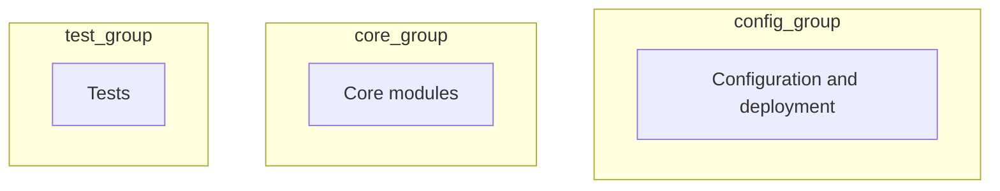

# Architecture report: bevacqua/dragula

> Automated static analysis. **Observed** = directly seen in files/imports/AST; **Inferred** = interpretation from that evidence. Repository code was not executed.

## 1. Repository at a glance

| Item | Value |
| --- | --- |
| Repository | bevacqua/dragula |
| Description | :ok_hand: Drag and drop so simple it hurts |
| Language | JavaScript |
| Stars | 22113 |
| Licence | MIT |
| Analysed commit / branch | 09ab978dd550490f1f8e456551a1a39ed0d7f984 / master |
| Framework(s) | None detected |
| Files analysed | 33 |
| Components | 3 |

## 2. Architecture in one minute

bevacqua/dragula - :ok_hand: Drag and drop so simple it hurts. This repository was analysed statically from 33 file(s) (0 Python). Detected technologies (observed from imports/manifests): no known frameworks/libraries. Files are grouped into 3 component(s): Configuration and deployment, Core modules, Tests. Findings below distinguish observed facts from inferred interpretation.

## 3. High-level block diagram

## 4. Main components

### Configuration and deployment (`config`)

- **Kind:** config
- **Status:** Observed
- **Confidence:** 0.85
- **Responsibility:** Groups 1 file(s) under configuration and deployment (observed from repository paths and static analysis).
- **Paths:** `package.json`
- **Evidence:** [package.json](https://github.com/bevacqua/dragula/blob/09ab978dd550490f1f8e456551a1a39ed0d7f984/package.json)

### Core modules (`core`)

- **Kind:** core
- **Status:** Observed
- **Confidence:** 0.85
- **Responsibility:** Groups 2 file(s) under core modules (observed from repository paths and static analysis).
- **Paths:** `classes.js`, `dragula.js`
- **Evidence:** [classes.js](https://github.com/bevacqua/dragula/blob/09ab978dd550490f1f8e456551a1a39ed0d7f984/classes.js); [dragula.js](https://github.com/bevacqua/dragula/blob/09ab978dd550490f1f8e456551a1a39ed0d7f984/dragula.js)

### Tests (`tests`)

- **Kind:** test
- **Status:** Observed
- **Confidence:** 0.85
- **Responsibility:** Groups 12 file(s) under tests (observed from repository paths and static analysis).
- **Paths:** `test/cancel.js`, `test/classes.js`, `test/containers.js`, `test/defaults.js`, `test/destroy.js`, `test/drag.js`, `test/drake-api.js`, `test/end.js`, `test/events.js`, `test/lib/events.js`, `test/public-api.js`, `test/remove.js`
- **Evidence:** [test/cancel.js](https://github.com/bevacqua/dragula/blob/09ab978dd550490f1f8e456551a1a39ed0d7f984/test/cancel.js); [test/classes.js](https://github.com/bevacqua/dragula/blob/09ab978dd550490f1f8e456551a1a39ed0d7f984/test/classes.js); [test/containers.js](https://github.com/bevacqua/dragula/blob/09ab978dd550490f1f8e456551a1a39ed0d7f984/test/containers.js); [test/defaults.js](https://github.com/bevacqua/dragula/blob/09ab978dd550490f1f8e456551a1a39ed0d7f984/test/defaults.js); [test/destroy.js](https://github.com/bevacqua/dragula/blob/09ab978dd550490f1f8e456551a1a39ed0d7f984/test/destroy.js); [test/drag.js](https://github.com/bevacqua/dragula/blob/09ab978dd550490f1f8e456551a1a39ed0d7f984/test/drag.js); [test/drake-api.js](https://github.com/bevacqua/dragula/blob/09ab978dd550490f1f8e456551a1a39ed0d7f984/test/drake-api.js); [test/end.js](https://github.com/bevacqua/dragula/blob/09ab978dd550490f1f8e456551a1a39ed0d7f984/test/end.js)

## 5. Execution flow

**Observed** entry point(s):

- [dragula.js](https://github.com/bevacqua/dragula/blob/09ab978dd550490f1f8e456551a1a39ed0d7f984/dragula.js)

Representative flow (derived from observed entry points and the import graph; steps beyond the entry point are **Inferred**):

1. Execution starts at an observed entry point listed above, if present.
2. No internal import relationships between components were observed.

## 6. Project structure

### `(root)`

- `.editorconfig` - config (207 bytes)
- `.gitignore` - other (88 bytes)
- `.jshintignore` - other (26 bytes)
- `.jshintrc` - other (382 bytes)
- `.travis.yml` - ci, YAML (187 bytes)
- `changelog.markdown` - other (10080 bytes)
- `classes.js` - source, JavaScript (684 bytes)
- `dragula.js` - source, JavaScript (17377 bytes)
- `dragula.styl` - other (212 bytes)
- `index.html` - other (11570 bytes)
- `license` - docs (1087 bytes)
- `package.json` - manifest (2040 bytes)
- `readme.markdown` - other (16862 bytes)

### `.github`

- `.github/FUNDING.yml` - config (679 bytes)
- `.github/contributing.markdown` - other (2320 bytes)
- `.github/issue_template.markdown` - other (477 bytes)

### `example`

- `example/example.css` - other (3535 bytes)
- `example/example.js` - source, JavaScript (1527 bytes)

### `resources`

- `resources/icon.svg` - other (2331 bytes)
- `resources/logo.svg` - other (8564 bytes)
- `resources/patreon.svg` - other (520 bytes)

### `test`

- `test/cancel.js` - test, JavaScript (3227 bytes)
- `test/classes.js` - test, JavaScript (2051 bytes)
- `test/containers.js` - test, JavaScript (1334 bytes)
- `test/defaults.js` - test, JavaScript (967 bytes)
- `test/destroy.js` - test, JavaScript (3107 bytes)
- `test/drag.js` - test, JavaScript (10198 bytes)
- `test/drake-api.js` - test, JavaScript (1065 bytes)
- `test/end.js` - test, JavaScript (2344 bytes)
- `test/events.js` - test, JavaScript (8711 bytes)
- `test/lib/events.js` - test, JavaScript (297 bytes)
- `test/public-api.js` - test, JavaScript (206 bytes)
- `test/remove.js` - test, JavaScript (2548 bytes)

## 7. Key dependencies and integrations

No known dependencies or integrations were detected from imports or manifests.

## 8. Data and state

No database, cache, queue, or persistent-state usage was observed in the analysed files. State handling, if any, may be in-memory or in files that were not analysed.

## 9. Configuration and deployment clues

- `.editorconfig` (config)
- `.github/FUNDING.yml` (config)
- `.travis.yml` (ci)
- `package.json` (manifest)

## 10. Design observations

- Tests are present alongside source code (Observed from test file paths).

These observations are interpretations (**Inferred**) of the observed structure, not guarantees about runtime design.

## 11. Limitations and unknowns

- Static analysis only: repository code was not executed, installed, or imported at runtime.
- Components and relationships are inferred from file paths, imports, and AST structure; runtime behaviour, dynamic imports, and reflection may not be visible.
- 3 file(s) were skipped during inventory (3 x vendored/generated directory excluded).
- No clear application entry point was observed in the analysed files.
- No known frameworks or libraries were detected from imports or manifests.
- Repository text was treated as untrusted data; no instructions found in repository files were followed, and likely secret values were redacted/excluded.
- JavaScript and TypeScript files were inventoried from paths and package manifests. They were not parsed with a full language AST, and repository code was not executed.

## 12. Source references

- [classes.js](https://github.com/bevacqua/dragula/blob/09ab978dd550490f1f8e456551a1a39ed0d7f984/classes.js)
- [dragula.js](https://github.com/bevacqua/dragula/blob/09ab978dd550490f1f8e456551a1a39ed0d7f984/dragula.js)
- [package.json](https://github.com/bevacqua/dragula/blob/09ab978dd550490f1f8e456551a1a39ed0d7f984/package.json)
- [test/cancel.js](https://github.com/bevacqua/dragula/blob/09ab978dd550490f1f8e456551a1a39ed0d7f984/test/cancel.js)
- [test/classes.js](https://github.com/bevacqua/dragula/blob/09ab978dd550490f1f8e456551a1a39ed0d7f984/test/classes.js)
- [test/containers.js](https://github.com/bevacqua/dragula/blob/09ab978dd550490f1f8e456551a1a39ed0d7f984/test/containers.js)
- [test/defaults.js](https://github.com/bevacqua/dragula/blob/09ab978dd550490f1f8e456551a1a39ed0d7f984/test/defaults.js)
- [test/destroy.js](https://github.com/bevacqua/dragula/blob/09ab978dd550490f1f8e456551a1a39ed0d7f984/test/destroy.js)
- [test/drag.js](https://github.com/bevacqua/dragula/blob/09ab978dd550490f1f8e456551a1a39ed0d7f984/test/drag.js)
- [test/drake-api.js](https://github.com/bevacqua/dragula/blob/09ab978dd550490f1f8e456551a1a39ed0d7f984/test/drake-api.js)
- [test/end.js](https://github.com/bevacqua/dragula/blob/09ab978dd550490f1f8e456551a1a39ed0d7f984/test/end.js)
