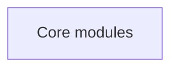

# Architecture report: bgstaal/multipleWindow3dScene

> Automated static analysis. **Observed** = directly seen in files/imports/AST; **Inferred** = interpretation from that evidence. Repository code was not executed.

## 1. Repository at a glance

| Item | Value |
| --- | --- |
| Repository | bgstaal/multipleWindow3dScene |
| Description | A quick example of how one can "synchronize" a 3d scene across multiple windows using three.js and localStorage |
| Language | JavaScript |
| Stars | 18893 |
| Licence | MIT |
| Analysed commit / branch | a99ecb8a865a169864107ccac8b233faf4333582 / main |
| Framework(s) | None detected |
| Files analysed | 6 |
| Components | 1 |

## 2. Architecture in one minute

bgstaal/multipleWindow3dScene - A quick example of how one can "synchronize" a 3d scene across multiple windows using three.js and localStorage. This repository was analysed statically from 6 file(s) (0 Python). Detected technologies (observed from imports/manifests): no known frameworks/libraries. Files are grouped into 1 component(s): Core modules. Findings below distinguish observed facts from inferred interpretation.

## 3. High-level block diagram

## 4. Main components

### Core modules (`core`)

- **Kind:** core
- **Status:** Observed
- **Confidence:** 0.85
- **Responsibility:** Groups 2 file(s) under core modules (observed from repository paths and static analysis).
- **Paths:** `WindowManager.js`, `main.js`
- **Evidence:** [WindowManager.js](https://github.com/bgstaal/multipleWindow3dScene/blob/a99ecb8a865a169864107ccac8b233faf4333582/WindowManager.js); [main.js](https://github.com/bgstaal/multipleWindow3dScene/blob/a99ecb8a865a169864107ccac8b233faf4333582/main.js)

## 5. Execution flow

**Observed** entry point(s):

- [main.js](https://github.com/bgstaal/multipleWindow3dScene/blob/a99ecb8a865a169864107ccac8b233faf4333582/main.js)

Representative flow (derived from observed entry points and the import graph; steps beyond the entry point are **Inferred**):

1. Execution starts at an observed entry point listed above, if present.
2. No internal import relationships between components were observed.

## 6. Project structure

### `(root)`

- `.gitignore` - other (70 bytes)
- `README.md` - docs (2134 bytes)
- `WindowManager.js` - source, JavaScript (3014 bytes)
- `index.html` - other (328 bytes)
- `main.js` - source, JavaScript (4946 bytes)
- `three-LICENSE` - other (1080 bytes)

## 7. Key dependencies and integrations

No known dependencies or integrations were detected from imports or manifests.

## 8. Data and state

No database, cache, queue, or persistent-state usage was observed in the analysed files. State handling, if any, may be in-memory or in files that were not analysed.

## 9. Configuration and deployment clues

No configuration, manifest, CI, or container files were observed.

## 10. Design observations

- The analysed code appears small or monolithic; few component boundaries were observed.

These observations are interpretations (**Inferred**) of the observed structure, not guarantees about runtime design.

## 11. Limitations and unknowns

- Static analysis only: repository code was not executed, installed, or imported at runtime.
- Components and relationships are inferred from file paths, imports, and AST structure; runtime behaviour, dynamic imports, and reflection may not be visible.
- No clear application entry point was observed in the analysed files.
- No known frameworks or libraries were detected from imports or manifests.
- Repository text was treated as untrusted data; no instructions found in repository files were followed, and likely secret values were redacted/excluded.
- JavaScript and TypeScript files were inventoried from paths and package manifests. They were not parsed with a full language AST, and repository code was not executed.

## 12. Source references

- [WindowManager.js](https://github.com/bgstaal/multipleWindow3dScene/blob/a99ecb8a865a169864107ccac8b233faf4333582/WindowManager.js)
- [main.js](https://github.com/bgstaal/multipleWindow3dScene/blob/a99ecb8a865a169864107ccac8b233faf4333582/main.js)
