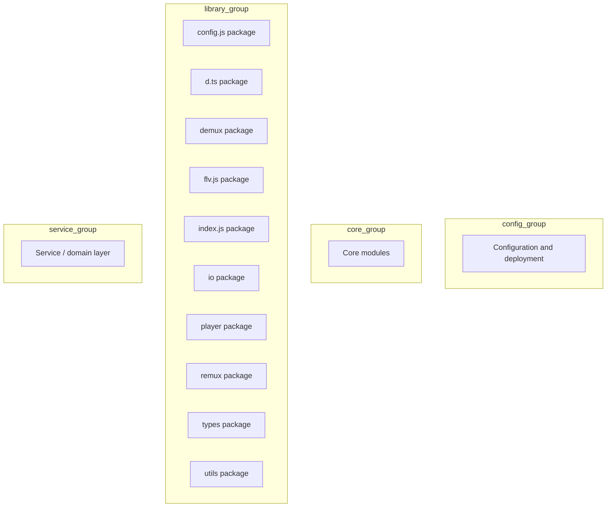

# Architecture report: bilibili/flv.js

> Automated static analysis. **Observed** = directly seen in files/imports/AST; **Inferred** = interpretation from that evidence. Repository code was not executed.

## 1. Repository at a glance

| Item | Value |
| --- | --- |
| Repository | bilibili/flv.js |
| Description | HTML5 FLV Player |
| Language | JavaScript |
| Stars | 23169 |
| Licence | Apache-2.0 |
| Analysed commit / branch | 42343088f22619cf014a057b3878fe3d320016a6 / master |
| Framework(s) | None detected |
| Files analysed | 61 |
| Components | 13 |

## 2. Architecture in one minute

bilibili/flv.js - HTML5 FLV Player. This repository was analysed statically from 61 file(s) (0 Python). Detected technologies (observed from imports/manifests): TypeScript, webpack. Files are grouped into 13 component(s): Configuration and deployment, config.js package, Core modules, d.ts package, demux package, flv.js package, index.js package, io package. Findings below distinguish observed facts from inferred interpretation.

## 3. High-level block diagram

## 4. Main components

### Configuration and deployment (`config`)

- **Kind:** config
- **Status:** Observed
- **Confidence:** 0.85
- **Responsibility:** Groups 4 file(s) under configuration and deployment (observed from repository paths and static analysis).
- **Paths:** `package.json`, `tsconfig.json`, `tslint.json`, `types/tsconfig.json`
- **Evidence:** [package.json](https://github.com/bilibili/flv.js/blob/42343088f22619cf014a057b3878fe3d320016a6/package.json); [tsconfig.json](https://github.com/bilibili/flv.js/blob/42343088f22619cf014a057b3878fe3d320016a6/tsconfig.json); [tslint.json](https://github.com/bilibili/flv.js/blob/42343088f22619cf014a057b3878fe3d320016a6/tslint.json); [types/tsconfig.json](https://github.com/bilibili/flv.js/blob/42343088f22619cf014a057b3878fe3d320016a6/types/tsconfig.json)

### config.js package (`config_js`)

- **Kind:** library
- **Status:** Observed
- **Confidence:** 0.85
- **Responsibility:** Groups 1 file(s) under config.js package (observed from repository paths and static analysis).
- **Paths:** `src/config.js`
- **Evidence:** [src/config.js](https://github.com/bilibili/flv.js/blob/42343088f22619cf014a057b3878fe3d320016a6/src/config.js)

### Core modules (`core`)

- **Kind:** core
- **Status:** Observed
- **Confidence:** 0.85
- **Responsibility:** Groups 1 file(s) under core modules (observed from repository paths and static analysis).
- **Paths:** `webpack.config.js`
- **Evidence:** [webpack.config.js](https://github.com/bilibili/flv.js/blob/42343088f22619cf014a057b3878fe3d320016a6/webpack.config.js)

### d.ts package (`d_ts`)

- **Kind:** library
- **Status:** Observed
- **Confidence:** 0.85
- **Responsibility:** Groups 1 file(s) under d.ts package (observed from repository paths and static analysis).
- **Paths:** `d.ts/flv.d.ts`
- **Evidence:** [d.ts/flv.d.ts](https://github.com/bilibili/flv.js/blob/42343088f22619cf014a057b3878fe3d320016a6/d.ts/flv.d.ts)

### demux package (`demux`)

- **Kind:** library
- **Status:** Observed
- **Confidence:** 0.85
- **Responsibility:** Groups 5 file(s) under demux package (observed from repository paths and static analysis).
- **Paths:** `src/demux/amf-parser.js`, `src/demux/demux-errors.js`, `src/demux/exp-golomb.js`, `src/demux/flv-demuxer.js`, `src/demux/sps-parser.js`
- **Evidence:** [src/demux/amf-parser.js](https://github.com/bilibili/flv.js/blob/42343088f22619cf014a057b3878fe3d320016a6/src/demux/amf-parser.js); [src/demux/demux-errors.js](https://github.com/bilibili/flv.js/blob/42343088f22619cf014a057b3878fe3d320016a6/src/demux/demux-errors.js); [src/demux/exp-golomb.js](https://github.com/bilibili/flv.js/blob/42343088f22619cf014a057b3878fe3d320016a6/src/demux/exp-golomb.js); [src/demux/flv-demuxer.js](https://github.com/bilibili/flv.js/blob/42343088f22619cf014a057b3878fe3d320016a6/src/demux/flv-demuxer.js); [src/demux/sps-parser.js](https://github.com/bilibili/flv.js/blob/42343088f22619cf014a057b3878fe3d320016a6/src/demux/sps-parser.js)

### flv.js package (`flv_js`)

- **Kind:** library
- **Status:** Observed
- **Confidence:** 0.85
- **Responsibility:** Groups 1 file(s) under flv.js package (observed from repository paths and static analysis).
- **Paths:** `src/flv.js`
- **Evidence:** [src/flv.js](https://github.com/bilibili/flv.js/blob/42343088f22619cf014a057b3878fe3d320016a6/src/flv.js)

### index.js package (`index_js`)

- **Kind:** library
- **Status:** Observed
- **Confidence:** 0.85
- **Responsibility:** Groups 1 file(s) under index.js package (observed from repository paths and static analysis).
- **Paths:** `src/index.js`
- **Evidence:** [src/index.js](https://github.com/bilibili/flv.js/blob/42343088f22619cf014a057b3878fe3d320016a6/src/index.js)

### io package (`io`)

- **Kind:** library
- **Status:** Observed
- **Confidence:** 0.85
- **Responsibility:** Groups 10 file(s) under io package (observed from repository paths and static analysis).
- **Paths:** `src/io/fetch-stream-loader.js`, `src/io/io-controller.js`, `src/io/loader.js`, `src/io/param-seek-handler.js`, `src/io/range-seek-handler.js`, `src/io/speed-sampler.js`, `src/io/websocket-loader.js`, `src/io/xhr-moz-chunked-loader.js`, `src/io/xhr-msstream-loader.js`, `src/io/xhr-range-loader.js`
- **Evidence:** [src/io/fetch-stream-loader.js](https://github.com/bilibili/flv.js/blob/42343088f22619cf014a057b3878fe3d320016a6/src/io/fetch-stream-loader.js); [src/io/io-controller.js](https://github.com/bilibili/flv.js/blob/42343088f22619cf014a057b3878fe3d320016a6/src/io/io-controller.js); [src/io/loader.js](https://github.com/bilibili/flv.js/blob/42343088f22619cf014a057b3878fe3d320016a6/src/io/loader.js); [src/io/param-seek-handler.js](https://github.com/bilibili/flv.js/blob/42343088f22619cf014a057b3878fe3d320016a6/src/io/param-seek-handler.js); [src/io/range-seek-handler.js](https://github.com/bilibili/flv.js/blob/42343088f22619cf014a057b3878fe3d320016a6/src/io/range-seek-handler.js); [src/io/speed-sampler.js](https://github.com/bilibili/flv.js/blob/42343088f22619cf014a057b3878fe3d320016a6/src/io/speed-sampler.js); [src/io/websocket-loader.js](https://github.com/bilibili/flv.js/blob/42343088f22619cf014a057b3878fe3d320016a6/src/io/websocket-loader.js); [src/io/xhr-moz-chunked-loader.js](https://github.com/bilibili/flv.js/blob/42343088f22619cf014a057b3878fe3d320016a6/src/io/xhr-moz-chunked-loader.js)

### player package (`player`)

- **Kind:** library
- **Status:** Observed
- **Confidence:** 0.85
- **Responsibility:** Groups 4 file(s) under player package (observed from repository paths and static analysis).
- **Paths:** `src/player/flv-player.js`, `src/player/native-player.js`, `src/player/player-errors.js`, `src/player/player-events.js`
- **Evidence:** [src/player/flv-player.js](https://github.com/bilibili/flv.js/blob/42343088f22619cf014a057b3878fe3d320016a6/src/player/flv-player.js); [src/player/native-player.js](https://github.com/bilibili/flv.js/blob/42343088f22619cf014a057b3878fe3d320016a6/src/player/native-player.js); [src/player/player-errors.js](https://github.com/bilibili/flv.js/blob/42343088f22619cf014a057b3878fe3d320016a6/src/player/player-errors.js); [src/player/player-events.js](https://github.com/bilibili/flv.js/blob/42343088f22619cf014a057b3878fe3d320016a6/src/player/player-events.js)

### remux package (`remux`)

- **Kind:** library
- **Status:** Observed
- **Confidence:** 0.85
- **Responsibility:** Groups 3 file(s) under remux package (observed from repository paths and static analysis).
- **Paths:** `src/remux/aac-silent.js`, `src/remux/mp4-generator.js`, `src/remux/mp4-remuxer.js`
- **Evidence:** [src/remux/aac-silent.js](https://github.com/bilibili/flv.js/blob/42343088f22619cf014a057b3878fe3d320016a6/src/remux/aac-silent.js); [src/remux/mp4-generator.js](https://github.com/bilibili/flv.js/blob/42343088f22619cf014a057b3878fe3d320016a6/src/remux/mp4-generator.js); [src/remux/mp4-remuxer.js](https://github.com/bilibili/flv.js/blob/42343088f22619cf014a057b3878fe3d320016a6/src/remux/mp4-remuxer.js)

### Service / domain layer (`service_layer`)

- **Kind:** service
- **Status:** Observed
- **Confidence:** 0.85
- **Responsibility:** Groups 9 file(s) under service / domain layer (observed from repository paths and static analysis).
- **Paths:** `src/core/features.js`, `src/core/media-info.js`, `src/core/media-segment-info.js`, `src/core/mse-controller.js`, `src/core/mse-events.js`, `src/core/transmuxer.js`, `src/core/transmuxing-controller.js`, `src/core/transmuxing-events.js`, `src/core/transmuxing-worker.js`
- **Evidence:** [src/core/features.js](https://github.com/bilibili/flv.js/blob/42343088f22619cf014a057b3878fe3d320016a6/src/core/features.js); [src/core/media-info.js](https://github.com/bilibili/flv.js/blob/42343088f22619cf014a057b3878fe3d320016a6/src/core/media-info.js); [src/core/media-segment-info.js](https://github.com/bilibili/flv.js/blob/42343088f22619cf014a057b3878fe3d320016a6/src/core/media-segment-info.js); [src/core/mse-controller.js](https://github.com/bilibili/flv.js/blob/42343088f22619cf014a057b3878fe3d320016a6/src/core/mse-controller.js); [src/core/mse-events.js](https://github.com/bilibili/flv.js/blob/42343088f22619cf014a057b3878fe3d320016a6/src/core/mse-events.js); [src/core/transmuxer.js](https://github.com/bilibili/flv.js/blob/42343088f22619cf014a057b3878fe3d320016a6/src/core/transmuxer.js); [src/core/transmuxing-controller.js](https://github.com/bilibili/flv.js/blob/42343088f22619cf014a057b3878fe3d320016a6/src/core/transmuxing-controller.js); [src/core/transmuxing-events.js](https://github.com/bilibili/flv.js/blob/42343088f22619cf014a057b3878fe3d320016a6/src/core/transmuxing-events.js)

### types package (`types`)

- **Kind:** library
- **Status:** Observed
- **Confidence:** 0.85
- **Responsibility:** Groups 2 file(s) under types package (observed from repository paths and static analysis).
- **Paths:** `types/index.d.ts`, `types/test-flv.ts`
- **Evidence:** [types/index.d.ts](https://github.com/bilibili/flv.js/blob/42343088f22619cf014a057b3878fe3d320016a6/types/index.d.ts); [types/test-flv.ts](https://github.com/bilibili/flv.js/blob/42343088f22619cf014a057b3878fe3d320016a6/types/test-flv.ts)

### utils package (`utils`)

- **Kind:** library
- **Status:** Observed
- **Confidence:** 0.85
- **Responsibility:** Groups 6 file(s) under utils package (observed from repository paths and static analysis).
- **Paths:** `src/utils/browser.js`, `src/utils/exception.js`, `src/utils/logger.js`, `src/utils/logging-control.js`, `src/utils/polyfill.js`, `src/utils/utf8-conv.js`
- **Evidence:** [src/utils/browser.js](https://github.com/bilibili/flv.js/blob/42343088f22619cf014a057b3878fe3d320016a6/src/utils/browser.js); [src/utils/exception.js](https://github.com/bilibili/flv.js/blob/42343088f22619cf014a057b3878fe3d320016a6/src/utils/exception.js); [src/utils/logger.js](https://github.com/bilibili/flv.js/blob/42343088f22619cf014a057b3878fe3d320016a6/src/utils/logger.js); [src/utils/logging-control.js](https://github.com/bilibili/flv.js/blob/42343088f22619cf014a057b3878fe3d320016a6/src/utils/logging-control.js); [src/utils/polyfill.js](https://github.com/bilibili/flv.js/blob/42343088f22619cf014a057b3878fe3d320016a6/src/utils/polyfill.js); [src/utils/utf8-conv.js](https://github.com/bilibili/flv.js/blob/42343088f22619cf014a057b3878fe3d320016a6/src/utils/utf8-conv.js)

## 5. Execution flow

**Observed** entry point(s):

- [src/index.js](https://github.com/bilibili/flv.js/blob/42343088f22619cf014a057b3878fe3d320016a6/src/index.js)

Representative flow (derived from observed entry points and the import graph; steps beyond the entry point are **Inferred**):

1. Execution starts at an observed entry point listed above, if present.
2. No internal import relationships between components were observed.

## 6. Project structure

### `(root)`

- `.eslintignore` - other (19 bytes)
- `.eslintrc.json` - config (1313 bytes)
- `.gitignore` - other (2197 bytes)
- `.npmignore` - other (2322 bytes)
- `LICENSE` - docs (11357 bytes)
- `README.md` - docs (3418 bytes)
- `package.json` - manifest (1105 bytes)
- `tsconfig.json` - config (386 bytes)
- `tslint.json` - config (33 bytes)
- `webpack.config.js` - source, JavaScript (1523 bytes)

### `d.ts`

- `d.ts/flv.d.ts` - source, TypeScript (12852 bytes)

### `demo`

- `demo/demo.css` - other (1609 bytes)
- `demo/index.html` - other (8119 bytes)

### `docs`

- `docs/api.md` - docs (11822 bytes)
- `docs/cors.md` - docs (2302 bytes)
- `docs/design.md` - docs (73 bytes)
- `docs/livestream.md` - docs (1652 bytes)
- `docs/multipart.md` - docs (1840 bytes)

### `src`

- `src/config.js` - source, JavaScript (1563 bytes)
- `src/core/features.js` - source, JavaScript (2802 bytes)
- `src/core/media-info.js` - source, JavaScript (3980 bytes)
- `src/core/media-segment-info.js` - source, JavaScript (6552 bytes)
- `src/core/mse-controller.js` - source, JavaScript (20565 bytes)
- `src/core/mse-events.js` - source, JavaScript (819 bytes)
- `src/core/transmuxer.js` - source, JavaScript (8697 bytes)
- `src/core/transmuxing-controller.js` - source, JavaScript (15691 bytes)
- `src/core/transmuxing-events.js` - source, JavaScript (1145 bytes)
- `src/core/transmuxing-worker.js` - source, JavaScript (6178 bytes)
- `src/demux/amf-parser.js` - source, JavaScript (8830 bytes)
- `src/demux/demux-errors.js` - source, JavaScript (844 bytes)
- `src/demux/exp-golomb.js` - source, JavaScript (3750 bytes)
- `src/demux/flv-demuxer.js` - source, JavaScript (40041 bytes)
- `src/demux/sps-parser.js` - source, JavaScript (10234 bytes)
- `src/flv.js` - source, JavaScript (2629 bytes)
- `src/index.js` - source, JavaScript (119 bytes)
- `src/io/fetch-stream-loader.js` - source, JavaScript (9825 bytes)
- `src/io/io-controller.js` - source, JavaScript (22510 bytes)
- `src/io/loader.js` - source, JavaScript (3436 bytes)
- `src/io/param-seek-handler.js` - source, JavaScript (2354 bytes)
- `src/io/range-seek-handler.js` - source, JavaScript (1425 bytes)
- `src/io/speed-sampler.js` - source, JavaScript (2956 bytes)
- `src/io/websocket-loader.js` - source, JavaScript (4230 bytes)
- `src/io/xhr-moz-chunked-loader.js` - source, JavaScript (6732 bytes)
- `src/io/xhr-msstream-loader.js` - source, JavaScript (10259 bytes)
- `src/io/xhr-range-loader.js` - source, JavaScript (11739 bytes)
- `src/player/flv-player.js` - source, JavaScript (21639 bytes)
- `src/player/native-player.js` - source, JavaScript (7834 bytes)
- `src/player/player-errors.js` - source, JavaScript (1375 bytes)
- `src/player/player-events.js` - source, JavaScript (979 bytes)
- `src/remux/aac-silent.js` - source, JavaScript (3892 bytes)
- `src/remux/mp4-generator.js` - source, JavaScript (20909 bytes)
- `src/remux/mp4-remuxer.js` - source, JavaScript (28095 bytes)
- `src/utils/browser.js` - source, JavaScript (3740 bytes)
- `src/utils/exception.js` - source, JavaScript (1521 bytes)
- `src/utils/logger.js` - source, JavaScript (3086 bytes)
- `src/utils/logging-control.js` - source, JavaScript (4403 bytes)
- `src/utils/polyfill.js` - source, JavaScript (1827 bytes)
- `src/utils/utf8-conv.js` - source, JavaScript (2894 bytes)

### `types`

- `types/index.d.ts` - source, TypeScript (55 bytes)
- `types/test-flv.ts` - source, TypeScript (201 bytes)
- `types/tsconfig.json` - config (505 bytes)

## 7. Key dependencies and integrations

| Name | Category | Status | Confidence | Evidence |
| --- | --- | --- | --- | --- |
| TypeScript | tooling | Observed | 0.85 | [package.json:29](https://github.com/bilibili/flv.js/blob/42343088f22619cf014a057b3878fe3d320016a6/package.json#L29) |
| webpack | tooling | Observed | 0.85 | [package.json:18](https://github.com/bilibili/flv.js/blob/42343088f22619cf014a057b3878fe3d320016a6/package.json#L18) |

## 8. Data and state

No database, cache, queue, or persistent-state usage was observed in the analysed files. State handling, if any, may be in-memory or in files that were not analysed.

## 9. Configuration and deployment clues

- `.eslintrc.json` (config)
- `package.json` (manifest)
- `tsconfig.json` (config)
- `tslint.json` (config)
- `types/tsconfig.json` (config)

## 10. Design observations

- Service/domain code is distinct from entry and data code, suggesting layered separation (Inferred).

These observations are interpretations (**Inferred**) of the observed structure, not guarantees about runtime design.

## 11. Limitations and unknowns

- Static analysis only: repository code was not executed, installed, or imported at runtime.
- Components and relationships are inferred from file paths, imports, and AST structure; runtime behaviour, dynamic imports, and reflection may not be visible.
- No clear application entry point was observed in the analysed files.
- Repository text was treated as untrusted data; no instructions found in repository files were followed, and likely secret values were redacted/excluded.
- JavaScript and TypeScript files were inventoried from paths and package manifests. They were not parsed with a full language AST, and repository code was not executed.

## 12. Source references

- [d.ts/flv.d.ts](https://github.com/bilibili/flv.js/blob/42343088f22619cf014a057b3878fe3d320016a6/d.ts/flv.d.ts)
- [package.json](https://github.com/bilibili/flv.js/blob/42343088f22619cf014a057b3878fe3d320016a6/package.json)
- [package.json:18](https://github.com/bilibili/flv.js/blob/42343088f22619cf014a057b3878fe3d320016a6/package.json#L18)
- [package.json:29](https://github.com/bilibili/flv.js/blob/42343088f22619cf014a057b3878fe3d320016a6/package.json#L29)
- [src/config.js](https://github.com/bilibili/flv.js/blob/42343088f22619cf014a057b3878fe3d320016a6/src/config.js)
- [src/core/features.js](https://github.com/bilibili/flv.js/blob/42343088f22619cf014a057b3878fe3d320016a6/src/core/features.js)
- [src/core/media-info.js](https://github.com/bilibili/flv.js/blob/42343088f22619cf014a057b3878fe3d320016a6/src/core/media-info.js)
- [src/core/media-segment-info.js](https://github.com/bilibili/flv.js/blob/42343088f22619cf014a057b3878fe3d320016a6/src/core/media-segment-info.js)
- [src/core/mse-controller.js](https://github.com/bilibili/flv.js/blob/42343088f22619cf014a057b3878fe3d320016a6/src/core/mse-controller.js)
- [src/core/mse-events.js](https://github.com/bilibili/flv.js/blob/42343088f22619cf014a057b3878fe3d320016a6/src/core/mse-events.js)
- [src/core/transmuxer.js](https://github.com/bilibili/flv.js/blob/42343088f22619cf014a057b3878fe3d320016a6/src/core/transmuxer.js)
- [src/core/transmuxing-controller.js](https://github.com/bilibili/flv.js/blob/42343088f22619cf014a057b3878fe3d320016a6/src/core/transmuxing-controller.js)
- [src/core/transmuxing-events.js](https://github.com/bilibili/flv.js/blob/42343088f22619cf014a057b3878fe3d320016a6/src/core/transmuxing-events.js)
- [src/demux/amf-parser.js](https://github.com/bilibili/flv.js/blob/42343088f22619cf014a057b3878fe3d320016a6/src/demux/amf-parser.js)
- [src/demux/demux-errors.js](https://github.com/bilibili/flv.js/blob/42343088f22619cf014a057b3878fe3d320016a6/src/demux/demux-errors.js)
- [src/demux/exp-golomb.js](https://github.com/bilibili/flv.js/blob/42343088f22619cf014a057b3878fe3d320016a6/src/demux/exp-golomb.js)
- [src/demux/flv-demuxer.js](https://github.com/bilibili/flv.js/blob/42343088f22619cf014a057b3878fe3d320016a6/src/demux/flv-demuxer.js)
- [src/demux/sps-parser.js](https://github.com/bilibili/flv.js/blob/42343088f22619cf014a057b3878fe3d320016a6/src/demux/sps-parser.js)
- [src/flv.js](https://github.com/bilibili/flv.js/blob/42343088f22619cf014a057b3878fe3d320016a6/src/flv.js)
- [src/index.js](https://github.com/bilibili/flv.js/blob/42343088f22619cf014a057b3878fe3d320016a6/src/index.js)
- [src/io/fetch-stream-loader.js](https://github.com/bilibili/flv.js/blob/42343088f22619cf014a057b3878fe3d320016a6/src/io/fetch-stream-loader.js)
- [src/io/io-controller.js](https://github.com/bilibili/flv.js/blob/42343088f22619cf014a057b3878fe3d320016a6/src/io/io-controller.js)
- [src/io/loader.js](https://github.com/bilibili/flv.js/blob/42343088f22619cf014a057b3878fe3d320016a6/src/io/loader.js)
- [src/io/param-seek-handler.js](https://github.com/bilibili/flv.js/blob/42343088f22619cf014a057b3878fe3d320016a6/src/io/param-seek-handler.js)
- [src/io/range-seek-handler.js](https://github.com/bilibili/flv.js/blob/42343088f22619cf014a057b3878fe3d320016a6/src/io/range-seek-handler.js)
- [src/io/speed-sampler.js](https://github.com/bilibili/flv.js/blob/42343088f22619cf014a057b3878fe3d320016a6/src/io/speed-sampler.js)
- [src/io/websocket-loader.js](https://github.com/bilibili/flv.js/blob/42343088f22619cf014a057b3878fe3d320016a6/src/io/websocket-loader.js)
- [src/io/xhr-moz-chunked-loader.js](https://github.com/bilibili/flv.js/blob/42343088f22619cf014a057b3878fe3d320016a6/src/io/xhr-moz-chunked-loader.js)
- [src/player/flv-player.js](https://github.com/bilibili/flv.js/blob/42343088f22619cf014a057b3878fe3d320016a6/src/player/flv-player.js)
- [src/player/native-player.js](https://github.com/bilibili/flv.js/blob/42343088f22619cf014a057b3878fe3d320016a6/src/player/native-player.js)
- [src/player/player-errors.js](https://github.com/bilibili/flv.js/blob/42343088f22619cf014a057b3878fe3d320016a6/src/player/player-errors.js)
- [src/player/player-events.js](https://github.com/bilibili/flv.js/blob/42343088f22619cf014a057b3878fe3d320016a6/src/player/player-events.js)
- [src/remux/aac-silent.js](https://github.com/bilibili/flv.js/blob/42343088f22619cf014a057b3878fe3d320016a6/src/remux/aac-silent.js)
- [src/remux/mp4-generator.js](https://github.com/bilibili/flv.js/blob/42343088f22619cf014a057b3878fe3d320016a6/src/remux/mp4-generator.js)
- [src/remux/mp4-remuxer.js](https://github.com/bilibili/flv.js/blob/42343088f22619cf014a057b3878fe3d320016a6/src/remux/mp4-remuxer.js)
- [src/utils/browser.js](https://github.com/bilibili/flv.js/blob/42343088f22619cf014a057b3878fe3d320016a6/src/utils/browser.js)
- [src/utils/exception.js](https://github.com/bilibili/flv.js/blob/42343088f22619cf014a057b3878fe3d320016a6/src/utils/exception.js)
- [src/utils/logger.js](https://github.com/bilibili/flv.js/blob/42343088f22619cf014a057b3878fe3d320016a6/src/utils/logger.js)
- [src/utils/logging-control.js](https://github.com/bilibili/flv.js/blob/42343088f22619cf014a057b3878fe3d320016a6/src/utils/logging-control.js)
- [src/utils/polyfill.js](https://github.com/bilibili/flv.js/blob/42343088f22619cf014a057b3878fe3d320016a6/src/utils/polyfill.js)
- [src/utils/utf8-conv.js](https://github.com/bilibili/flv.js/blob/42343088f22619cf014a057b3878fe3d320016a6/src/utils/utf8-conv.js)
- [tsconfig.json](https://github.com/bilibili/flv.js/blob/42343088f22619cf014a057b3878fe3d320016a6/tsconfig.json)
- [tslint.json](https://github.com/bilibili/flv.js/blob/42343088f22619cf014a057b3878fe3d320016a6/tslint.json)
- [types/index.d.ts](https://github.com/bilibili/flv.js/blob/42343088f22619cf014a057b3878fe3d320016a6/types/index.d.ts)
- [types/test-flv.ts](https://github.com/bilibili/flv.js/blob/42343088f22619cf014a057b3878fe3d320016a6/types/test-flv.ts)
- [types/tsconfig.json](https://github.com/bilibili/flv.js/blob/42343088f22619cf014a057b3878fe3d320016a6/types/tsconfig.json)
- [webpack.config.js](https://github.com/bilibili/flv.js/blob/42343088f22619cf014a057b3878fe3d320016a6/webpack.config.js)
