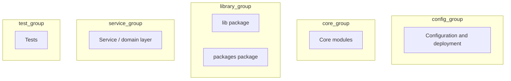

# Architecture report: bower/bower

> Automated static analysis. **Observed** = directly seen in files/imports/AST; **Inferred** = interpretation from that evidence. Repository code was not executed.

## 1. Repository at a glance

| Item | Value |
| --- | --- |
| Repository | bower/bower |
| Description | A package manager for the web |
| Language | JavaScript |
| Stars | 14892 |
| Licence | MIT |
| Analysed commit / branch | 4e0c3c1181c21624c5b3ab5bdf5d3becdb172b5a / master |
| Framework(s) | None detected |
| Files analysed | 246 |
| Components | 6 |

## 2. Architecture in one minute

bower/bower - A package manager for the web. This repository was analysed statically from 246 file(s) (0 Python). Detected technologies (observed from imports/manifests): GitHub Actions. Files are grouped into 6 component(s): Configuration and deployment, Core modules, lib package, packages package, Service / domain layer, Tests. Findings below distinguish observed facts from inferred interpretation.

## 3. High-level block diagram

## 4. Main components

### Configuration and deployment (`config`)

- **Kind:** config
- **Status:** Observed
- **Confidence:** 0.85
- **Responsibility:** Groups 30 file(s) under configuration and deployment (observed from repository paths and static analysis).
- **Paths:** `lib/templates/json/help-cache.json`, `lib/templates/json/help-cache/clean.json`, `lib/templates/json/help-cache/list.json`, `lib/templates/json/help-home.json`, `lib/templates/json/help-info.json`, `lib/templates/json/help-init.json`, `lib/templates/json/help-install.json`, `lib/templates/json/help-link.json`, `lib/templates/json/help-list.json`, `lib/templates/json/help-login.json`, `lib/templates/json/help-lookup.json`, `lib/templates/json/help-prune.json`, `lib/templates/json/help-register.json`, `lib/templates/json/help-search.json`, `lib/templates/json/help-uninstall.json`, `lib/templates/json/help-unregister.json`, `lib/templates/json/help-update.json`, `lib/templates/json/help-version.json`, `lib/templates/json/help.json`, `package.json`, `packages/bower-config/.editorconfig`, `packages/bower-config/package.json`, `packages/bower-endpoint-parser/.editorconfig`, `packages/bower-endpoint-parser/package.json`, `packages/bower-json/.editorconfig`, `packages/bower-json/package.json`, `packages/bower-logger/.editorconfig`, `packages/bower-logger/package.json`, `packages/bower-registry-client/.editorconfig`, `packages/bower-registry-client/package.json`
- **Evidence:** [lib/templates/json/help-cache.json](https://github.com/bower/bower/blob/4e0c3c1181c21624c5b3ab5bdf5d3becdb172b5a/lib/templates/json/help-cache.json); [lib/templates/json/help-cache/clean.json](https://github.com/bower/bower/blob/4e0c3c1181c21624c5b3ab5bdf5d3becdb172b5a/lib/templates/json/help-cache/clean.json); [lib/templates/json/help-cache/list.json](https://github.com/bower/bower/blob/4e0c3c1181c21624c5b3ab5bdf5d3becdb172b5a/lib/templates/json/help-cache/list.json); [lib/templates/json/help-home.json](https://github.com/bower/bower/blob/4e0c3c1181c21624c5b3ab5bdf5d3becdb172b5a/lib/templates/json/help-home.json); [lib/templates/json/help-info.json](https://github.com/bower/bower/blob/4e0c3c1181c21624c5b3ab5bdf5d3becdb172b5a/lib/templates/json/help-info.json); [lib/templates/json/help-init.json](https://github.com/bower/bower/blob/4e0c3c1181c21624c5b3ab5bdf5d3becdb172b5a/lib/templates/json/help-init.json); [lib/templates/json/help-install.json](https://github.com/bower/bower/blob/4e0c3c1181c21624c5b3ab5bdf5d3becdb172b5a/lib/templates/json/help-install.json); [lib/templates/json/help-link.json](https://github.com/bower/bower/blob/4e0c3c1181c21624c5b3ab5bdf5d3becdb172b5a/lib/templates/json/help-link.json)

### Core modules (`core`)

- **Kind:** core
- **Status:** Observed
- **Confidence:** 0.85
- **Responsibility:** Groups 1 file(s) under core modules (observed from repository paths and static analysis).
- **Paths:** `publish.js`
- **Evidence:** [publish.js](https://github.com/bower/bower/blob/4e0c3c1181c21624c5b3ab5bdf5d3becdb172b5a/publish.js)

### lib package (`lib`)

- **Kind:** library
- **Status:** Observed
- **Confidence:** 0.85
- **Responsibility:** Groups 54 file(s) under lib package (observed from repository paths and static analysis).
- **Paths:** `lib/bin/bower.js`, `lib/commands/cache/clean.js`, `lib/commands/cache/list.js`, `lib/commands/help.js`, `lib/commands/home.js`, `lib/commands/index.js`, `lib/commands/info.js`, `lib/commands/init.js`, `lib/commands/install.js`, `lib/commands/link.js`, `lib/commands/list.js`, `lib/commands/login.js`, `lib/commands/lookup.js`, `lib/commands/prune.js`, `lib/commands/register.js`, `lib/commands/search.js`, `lib/commands/uninstall.js`, `lib/commands/unregister.js`, `lib/commands/update.js`, `lib/commands/version.js`, `lib/config.js`, `lib/index.js`, `lib/renderers/JsonRenderer.js`, `lib/renderers/StandardRenderer.js`, `lib/renderers/index.js`, `lib/templates/helpers/colors.js`, `lib/templates/helpers/condense.js`, `lib/templates/helpers/indent.js`, `lib/templates/helpers/index.js`, `lib/templates/helpers/rpad.js`, `lib/templates/helpers/sum.js`, `lib/util/abbreviations.js`, `lib/util/childProcess.js`, `lib/util/cli.js`, `lib/util/cmd.js`, `lib/util/copy.js`, `lib/util/createError.js`, `lib/util/createLink.js`, `lib/util/download.js`, `lib/util/extract.js`, `lib/util/fs.js`, `lib/util/isPathAbsolute.js`, `lib/util/readJson.js`, `lib/util/relativeToBaseDir.js`, `lib/util/removeIgnores.js`, `lib/util/resolve.js`, `lib/util/rimraf.js`, `lib/util/rootCheck.js`, `lib/util/semver.js`, `lib/util/template.js`, `lib/util/userAgent.js`, `lib/util/validLink.js`, `lib/util/which.js`, `lib/version.js`
- **Evidence:** [lib/bin/bower.js](https://github.com/bower/bower/blob/4e0c3c1181c21624c5b3ab5bdf5d3becdb172b5a/lib/bin/bower.js); [lib/commands/cache/clean.js](https://github.com/bower/bower/blob/4e0c3c1181c21624c5b3ab5bdf5d3becdb172b5a/lib/commands/cache/clean.js); [lib/commands/cache/list.js](https://github.com/bower/bower/blob/4e0c3c1181c21624c5b3ab5bdf5d3becdb172b5a/lib/commands/cache/list.js); [lib/commands/help.js](https://github.com/bower/bower/blob/4e0c3c1181c21624c5b3ab5bdf5d3becdb172b5a/lib/commands/help.js); [lib/commands/home.js](https://github.com/bower/bower/blob/4e0c3c1181c21624c5b3ab5bdf5d3becdb172b5a/lib/commands/home.js); [lib/commands/index.js](https://github.com/bower/bower/blob/4e0c3c1181c21624c5b3ab5bdf5d3becdb172b5a/lib/commands/index.js); [lib/commands/info.js](https://github.com/bower/bower/blob/4e0c3c1181c21624c5b3ab5bdf5d3becdb172b5a/lib/commands/info.js); [lib/commands/init.js](https://github.com/bower/bower/blob/4e0c3c1181c21624c5b3ab5bdf5d3becdb172b5a/lib/commands/init.js)

### packages package (`packages`)

- **Kind:** library
- **Status:** Observed
- **Confidence:** 0.85
- **Responsibility:** Groups 22 file(s) under packages package (observed from repository paths and static analysis).
- **Paths:** `packages/bower-config/lib/Config.js`, `packages/bower-config/lib/util/defaults.js`, `packages/bower-config/lib/util/expand.js`, `packages/bower-config/lib/util/paths.js`, `packages/bower-config/lib/util/proxy.js`, `packages/bower-config/lib/util/rc.js`, `packages/bower-endpoint-parser/index.js`, `packages/bower-json/lib/json.js`, `packages/bower-json/lib/util/createError.js`, `packages/bower-json/lib/util/isAsset.js`, `packages/bower-json/lib/util/isComponent.js`, `packages/bower-logger/lib/Logger.js`, `packages/bower-registry-client/Client.js`, `packages/bower-registry-client/lib/index.js`, `packages/bower-registry-client/lib/list.js`, `packages/bower-registry-client/lib/lookup.js`, `packages/bower-registry-client/lib/register.js`, `packages/bower-registry-client/lib/search.js`, `packages/bower-registry-client/lib/unregister.js`, `packages/bower-registry-client/lib/util/Cache.js`, `packages/bower-registry-client/lib/util/createError.js`, `packages/bower-registry-client/lib/util/md5.js`
- **Evidence:** [packages/bower-config/lib/Config.js](https://github.com/bower/bower/blob/4e0c3c1181c21624c5b3ab5bdf5d3becdb172b5a/packages/bower-config/lib/Config.js); [packages/bower-config/lib/util/defaults.js](https://github.com/bower/bower/blob/4e0c3c1181c21624c5b3ab5bdf5d3becdb172b5a/packages/bower-config/lib/util/defaults.js); [packages/bower-config/lib/util/expand.js](https://github.com/bower/bower/blob/4e0c3c1181c21624c5b3ab5bdf5d3becdb172b5a/packages/bower-config/lib/util/expand.js); [packages/bower-config/lib/util/paths.js](https://github.com/bower/bower/blob/4e0c3c1181c21624c5b3ab5bdf5d3becdb172b5a/packages/bower-config/lib/util/paths.js); [packages/bower-config/lib/util/proxy.js](https://github.com/bower/bower/blob/4e0c3c1181c21624c5b3ab5bdf5d3becdb172b5a/packages/bower-config/lib/util/proxy.js); [packages/bower-config/lib/util/rc.js](https://github.com/bower/bower/blob/4e0c3c1181c21624c5b3ab5bdf5d3becdb172b5a/packages/bower-config/lib/util/rc.js); [packages/bower-endpoint-parser/index.js](https://github.com/bower/bower/blob/4e0c3c1181c21624c5b3ab5bdf5d3becdb172b5a/packages/bower-endpoint-parser/index.js); [packages/bower-json/lib/json.js](https://github.com/bower/bower/blob/4e0c3c1181c21624c5b3ab5bdf5d3becdb172b5a/packages/bower-json/lib/json.js)

### Service / domain layer (`service_layer`)

- **Kind:** service
- **Status:** Observed
- **Confidence:** 0.85
- **Responsibility:** Groups 16 file(s) under service / domain layer (observed from repository paths and static analysis).
- **Paths:** `lib/core/Manager.js`, `lib/core/PackageRepository.js`, `lib/core/Project.js`, `lib/core/ResolveCache.js`, `lib/core/resolverFactory.js`, `lib/core/resolvers/FsResolver.js`, `lib/core/resolvers/GitFsResolver.js`, `lib/core/resolvers/GitHubResolver.js`, `lib/core/resolvers/GitRemoteResolver.js`, `lib/core/resolvers/GitResolver.js`, `lib/core/resolvers/Resolver.js`, `lib/core/resolvers/SvnResolver.js`, `lib/core/resolvers/UrlResolver.js`, `lib/core/resolvers/index.js`, `lib/core/resolvers/pluginResolverFactory.js`, `lib/core/scripts.js`
- **Evidence:** [lib/core/Manager.js](https://github.com/bower/bower/blob/4e0c3c1181c21624c5b3ab5bdf5d3becdb172b5a/lib/core/Manager.js); [lib/core/PackageRepository.js](https://github.com/bower/bower/blob/4e0c3c1181c21624c5b3ab5bdf5d3becdb172b5a/lib/core/PackageRepository.js); [lib/core/Project.js](https://github.com/bower/bower/blob/4e0c3c1181c21624c5b3ab5bdf5d3becdb172b5a/lib/core/Project.js); [lib/core/ResolveCache.js](https://github.com/bower/bower/blob/4e0c3c1181c21624c5b3ab5bdf5d3becdb172b5a/lib/core/ResolveCache.js); [lib/core/resolverFactory.js](https://github.com/bower/bower/blob/4e0c3c1181c21624c5b3ab5bdf5d3becdb172b5a/lib/core/resolverFactory.js); [lib/core/resolvers/FsResolver.js](https://github.com/bower/bower/blob/4e0c3c1181c21624c5b3ab5bdf5d3becdb172b5a/lib/core/resolvers/FsResolver.js); [lib/core/resolvers/GitFsResolver.js](https://github.com/bower/bower/blob/4e0c3c1181c21624c5b3ab5bdf5d3becdb172b5a/lib/core/resolvers/GitFsResolver.js); [lib/core/resolvers/GitHubResolver.js](https://github.com/bower/bower/blob/4e0c3c1181c21624c5b3ab5bdf5d3becdb172b5a/lib/core/resolvers/GitHubResolver.js)

### Tests (`tests`)

- **Kind:** test
- **Status:** Observed
- **Confidence:** 0.85
- **Responsibility:** Groups 83 file(s) under tests (observed from repository paths and static analysis).
- **Paths:** `packages/bower-config/test/assets/custom-ca-embed/.bowerrc`, `packages/bower-config/test/assets/custom-ca/.bowerrc`, `packages/bower-config/test/assets/custom-ca/ca-bundle.crt`, `packages/bower-config/test/assets/env-variables-values/.bowerrc`, `packages/bower-config/test/assets/env-variables/.bowerrc`, `packages/bower-config/test/cli.js`, `packages/bower-config/test/helpers.js`, `packages/bower-config/test/test.js`, `packages/bower-config/test/util/index.js`, `packages/bower-config/test/util/rc.js`, `packages/bower-endpoint-parser/test/test.js`, `packages/bower-json/test/pkg-bower-json-invalid/bower.json`, `packages/bower-json/test/pkg-bower-json-malformed/bower.json`, `packages/bower-json/test/pkg-bower-json/bower.json`, `packages/bower-json/test/pkg-component(1)-json/component.json`, `packages/bower-json/test/pkg-component-json/component.json`, `packages/bower-json/test/pkg-dot-bower-json/.bower.json`, `packages/bower-json/test/test.js`, `packages/bower-logger/test/test.js`, `packages/bower-registry-client/test/Client.js`, `packages/bower-registry-client/test/core/index.js`, `packages/bower-registry-client/test/core/list.js`, `packages/bower-registry-client/test/core/lookup.js`, `packages/bower-registry-client/test/core/register.js`, `packages/bower-registry-client/test/core/search.js`, `packages/bower-registry-client/test/core/util/Cache.js`, `packages/bower-registry-client/test/core/util/createError.js`, `packages/bower-registry-client/test/fixtures/search.json`, `packages/bower-registry-client/test/runner.js`, `test/assets/resolve-cache/list-json-1.json`, `test/assets/test-temp-dir/test-exception.js`, `test/assets/test-temp-dir/test.js`, `test/commands/bower.js`, `test/commands/cache/clean.js`, `test/commands/cache/list.js`, `test/commands/help.js`, `test/commands/home.js`, `test/commands/index.js`, `test/commands/info.js`, `test/commands/init.js`, `test/commands/install.js`, `test/commands/link.js`, `test/commands/list.js`, `test/commands/login.js`, `test/commands/lookup.js`, `test/commands/prune.js`, `test/commands/register.js`, `test/commands/search.js`, `test/commands/uninstall.js`, `test/commands/unregister.js`, `test/commands/update.js`, `test/commands/version.js`, `test/core/Manager.js`, `test/core/packageRepository.js`, `test/core/resolveCache.js`, `test/core/resolverFactory.js`, `test/core/resolvers/fsResolver.js`, `test/core/resolvers/gitFsResolver.js`, `test/core/resolvers/gitHubResolver.js`, `test/core/resolvers/gitRemoteResolver.js`, `test/core/resolvers/gitResolver.js`, `test/core/resolvers/pluginResolverFactory.js`, `test/core/resolvers/resolver.js`, `test/core/resolvers/svnResolver.js`, `test/core/resolvers/urlResolver.js`, `test/core/scripts.js`, `test/helpers.js`, `test/packages-svn.js`, `test/packages-svn.json`, `test/packages.js`, `test/packages.json`, `test/renderers/JsonRenderer.js`, `test/renderers/StandardRenderer.js`, `test/sample/bower.json`, `test/test.js`, `test/util/createLink.js`, `test/util/download.js`, `test/util/index.js`, `test/util/isPathAbsolute.js`, `test/util/nock.js`, `test/util/relativeToBaseDir.js`, `test/util/removeIgnores.js`, `test/util/template.js`
- **Evidence:** [packages/bower-config/test/assets/custom-ca-embed/.bowerrc](https://github.com/bower/bower/blob/4e0c3c1181c21624c5b3ab5bdf5d3becdb172b5a/packages/bower-config/test/assets/custom-ca-embed/.bowerrc); [packages/bower-config/test/assets/custom-ca/.bowerrc](https://github.com/bower/bower/blob/4e0c3c1181c21624c5b3ab5bdf5d3becdb172b5a/packages/bower-config/test/assets/custom-ca/.bowerrc); [packages/bower-config/test/assets/custom-ca/ca-bundle.crt](https://github.com/bower/bower/blob/4e0c3c1181c21624c5b3ab5bdf5d3becdb172b5a/packages/bower-config/test/assets/custom-ca/ca-bundle.crt); [packages/bower-config/test/assets/env-variables-values/.bowerrc](https://github.com/bower/bower/blob/4e0c3c1181c21624c5b3ab5bdf5d3becdb172b5a/packages/bower-config/test/assets/env-variables-values/.bowerrc); [packages/bower-config/test/assets/env-variables/.bowerrc](https://github.com/bower/bower/blob/4e0c3c1181c21624c5b3ab5bdf5d3becdb172b5a/packages/bower-config/test/assets/env-variables/.bowerrc); [packages/bower-config/test/cli.js](https://github.com/bower/bower/blob/4e0c3c1181c21624c5b3ab5bdf5d3becdb172b5a/packages/bower-config/test/cli.js); [packages/bower-config/test/helpers.js](https://github.com/bower/bower/blob/4e0c3c1181c21624c5b3ab5bdf5d3becdb172b5a/packages/bower-config/test/helpers.js); [packages/bower-config/test/test.js](https://github.com/bower/bower/blob/4e0c3c1181c21624c5b3ab5bdf5d3becdb172b5a/packages/bower-config/test/test.js)

## 5. Execution flow

**Observed** entry point(s):

- [bin/bower](https://github.com/bower/bower/blob/4e0c3c1181c21624c5b3ab5bdf5d3becdb172b5a/bin/bower)
- [lib/commands/index.js](https://github.com/bower/bower/blob/4e0c3c1181c21624c5b3ab5bdf5d3becdb172b5a/lib/commands/index.js)
- [lib/core/resolvers/index.js](https://github.com/bower/bower/blob/4e0c3c1181c21624c5b3ab5bdf5d3becdb172b5a/lib/core/resolvers/index.js)
- [lib/index.js](https://github.com/bower/bower/blob/4e0c3c1181c21624c5b3ab5bdf5d3becdb172b5a/lib/index.js)
- [lib/renderers/index.js](https://github.com/bower/bower/blob/4e0c3c1181c21624c5b3ab5bdf5d3becdb172b5a/lib/renderers/index.js)
- [lib/templates/helpers/index.js](https://github.com/bower/bower/blob/4e0c3c1181c21624c5b3ab5bdf5d3becdb172b5a/lib/templates/helpers/index.js)
- [packages/bower-endpoint-parser/index.js](https://github.com/bower/bower/blob/4e0c3c1181c21624c5b3ab5bdf5d3becdb172b5a/packages/bower-endpoint-parser/index.js)
- [packages/bower-registry-client/lib/index.js](https://github.com/bower/bower/blob/4e0c3c1181c21624c5b3ab5bdf5d3becdb172b5a/packages/bower-registry-client/lib/index.js)

Representative flow (derived from observed entry points and the import graph; steps beyond the entry point are **Inferred**):

1. Execution starts at an observed entry point listed above, if present.
2. No internal import relationships between components were observed.

## 6. Project structure

### `(root)`

- `.editorconfig` - config (267 bytes)
- `.eslintignore` - other (86 bytes)
- `.eslintrc` - other (1179 bytes)
- `.gitignore` - other (233 bytes)
- `.prettierignore` - other (72 bytes)
- `CHANGELOG.md` - docs (40490 bytes)
- `CONTRIBUTING.md` - docs (6366 bytes)
- `LICENSE` - docs (1082 bytes)
- `README.md` - docs (26032 bytes)
- `SECURITY.md` - docs (118 bytes)
- `package.json` - manifest (2722 bytes)
- `publish.js` - source, JavaScript (3823 bytes)

### `.github`

- `.github/FUNDING.yml` - config (70 bytes)
- `.github/ISSUE_TEMPLATE.md` - docs (989 bytes)
- `.github/workflows/nodejs.yml` - ci, YAML (2619 bytes)

### `bin`

- `bin/bower` - other (50 bytes)

### `lib`

- `lib/bin/bower.js` - source, JavaScript (4033 bytes)
- `lib/commands/cache/clean.js` - source, JavaScript (6238 bytes)
- `lib/commands/cache/list.js` - source, JavaScript (1104 bytes)
- `lib/commands/help.js` - source, JavaScript (975 bytes)
- `lib/commands/home.js` - source, JavaScript (1587 bytes)
- `lib/commands/index.js` - source, JavaScript (2305 bytes)
- `lib/commands/info.js` - source, JavaScript (1932 bytes)
- `lib/commands/init.js` - source, JavaScript (9640 bytes)
- `lib/commands/install.js` - source, JavaScript (1546 bytes)
- `lib/commands/link.js` - source, JavaScript (2342 bytes)
- `lib/commands/list.js` - source, JavaScript (4674 bytes)
- `lib/commands/login.js` - source, JavaScript (4445 bytes)
- `lib/commands/lookup.js` - source, JavaScript (886 bytes)
- `lib/commands/prune.js` - source, JavaScript (1526 bytes)
- `lib/commands/register.js` - source, JavaScript (2909 bytes)
- `lib/commands/search.js` - source, JavaScript (1103 bytes)
- `lib/commands/uninstall.js` - source, JavaScript (3870 bytes)
- `lib/commands/unregister.js` - source, JavaScript (2376 bytes)
- `lib/commands/update.js` - source, JavaScript (846 bytes)
- `lib/commands/version.js` - source, JavaScript (6338 bytes)
- `lib/config.js` - source, JavaScript (1659 bytes)
- `lib/core/Manager.js` - source, JavaScript (41102 bytes)
- `lib/core/PackageRepository.js` - source, JavaScript (10846 bytes)
- `lib/core/Project.js` - source, JavaScript (35697 bytes)
- `lib/core/ResolveCache.js` - source, JavaScript (14459 bytes)
- `lib/core/resolverFactory.js` - source, JavaScript (8904 bytes)
- `lib/core/resolvers/FsResolver.js` - source, JavaScript (4468 bytes)
- `lib/core/resolvers/GitFsResolver.js` - source, JavaScript (2900 bytes)
- `lib/core/resolvers/GitHubResolver.js` - source, JavaScript (5818 bytes)
- `lib/core/resolvers/GitRemoteResolver.js` - source, JavaScript (11467 bytes)
- `lib/core/resolvers/GitResolver.js` - source, JavaScript (13263 bytes)
- `lib/core/resolvers/Resolver.js` - source, JavaScript (6452 bytes)
- `lib/core/resolvers/SvnResolver.js` - source, JavaScript (14446 bytes)
- `lib/core/resolvers/UrlResolver.js` - source, JavaScript (9753 bytes)
- `lib/core/resolvers/index.js` - source, JavaScript (251 bytes)
- `lib/core/resolvers/pluginResolverFactory.js` - source, JavaScript (12369 bytes)
- `lib/core/scripts.js` - source, JavaScript (3714 bytes)
- `lib/index.js` - source, JavaScript (634 bytes)
- `lib/renderers/JsonRenderer.js` - source, JavaScript (3510 bytes)
- `lib/renderers/StandardRenderer.js` - source, JavaScript (14179 bytes)
- `lib/renderers/index.js` - source, JavaScript (103 bytes)
- `lib/templates/helpers/colors.js` - source, JavaScript (344 bytes)
- `lib/templates/helpers/condense.js` - source, JavaScript (597 bytes)
- `lib/templates/helpers/indent.js` - source, JavaScript (330 bytes)
- `lib/templates/helpers/index.js` - source, JavaScript (180 bytes)
- `lib/templates/helpers/rpad.js` - source, JavaScript (332 bytes)
- `lib/templates/helpers/sum.js` - source, JavaScript (148 bytes)
- `lib/templates/json/help-cache.json` - config (242 bytes)
- `lib/templates/json/help-cache/clean.json` - config (430 bytes)
- `lib/templates/json/help-cache/list.json` - config (352 bytes)
- `lib/templates/json/help-home.json` - config (473 bytes)
- `lib/templates/json/help-info.json` - config (455 bytes)
- `lib/templates/json/help-init.json` - config (320 bytes)
- `lib/templates/json/help-install.json` - config (1935 bytes)
- `lib/templates/json/help-link.json` - config (795 bytes)
- `lib/templates/json/help-list.json` - config (680 bytes)
- `lib/templates/json/help-login.json` - config (535 bytes)
- `lib/templates/json/help-lookup.json` - config (312 bytes)
- `lib/templates/json/help-prune.json` - config (303 bytes)
- `lib/templates/json/help-register.json` - config (478 bytes)
- `lib/templates/json/help-search.json` - config (303 bytes)
- `lib/templates/json/help-uninstall.json` - config (926 bytes)
- `lib/templates/json/help-unregister.json` - config (478 bytes)
- `lib/templates/json/help-update.json` - config (1003 bytes)
- `lib/templates/json/help-version.json` - config (797 bytes)
- `lib/templates/json/help.json` - config (2725 bytes)
- `lib/templates/std/conflict-resolved.std` - other (551 bytes)
- `lib/templates/std/conflict.std` - other (544 bytes)
- `lib/templates/std/help-cache.std` - other (252 bytes)
- `lib/templates/std/help-generic.std` - other (429 bytes)
- `lib/templates/std/help.std` - other (480 bytes)
- `lib/templates/std/info.std` - other (361 bytes)
- `lib/templates/std/lookup.std` - other (112 bytes)
- `lib/templates/std/register.std` - other (276 bytes)
- `lib/templates/std/search-results.std` - other (140 bytes)
- `lib/util/abbreviations.js` - source, JavaScript (678 bytes)
- `lib/util/childProcess.js` - source, JavaScript (449 bytes)
- `lib/util/cli.js` - source, JavaScript (1239 bytes)
- `lib/util/cmd.js` - source, JavaScript (3862 bytes)
- `lib/util/copy.js` - source, JavaScript (2796 bytes)
- `lib/util/createError.js` - source, JavaScript (234 bytes)
- `lib/util/createLink.js` - source, JavaScript (2357 bytes)
- `lib/util/download.js` - source, JavaScript (4523 bytes)
- `lib/util/extract.js` - source, JavaScript (7653 bytes)
- `lib/util/fs.js` - source, JavaScript (846 bytes)
- `lib/util/isPathAbsolute.js` - source, JavaScript (111 bytes)
- `lib/util/readJson.js` - source, JavaScript (1831 bytes)
- `lib/util/relativeToBaseDir.js` - source, JavaScript (357 bytes)
- `lib/util/removeIgnores.js` - source, JavaScript (1734 bytes)
- `lib/util/resolve.js` - source, JavaScript (554 bytes)
- `lib/util/rimraf.js` - source, JavaScript (1092 bytes)
- `lib/util/rootCheck.js` - source, JavaScript (1029 bytes)
- `lib/util/semver.js` - source, JavaScript (1991 bytes)
- `lib/util/template.js` - source, JavaScript (979 bytes)
- `lib/util/userAgent.js` - source, JavaScript (192 bytes)
- `lib/util/validLink.js` - source, JavaScript (538 bytes)
- `lib/util/which.js` - source, JavaScript (1335 bytes)
- `lib/version.js` - source, JavaScript (116 bytes)

### `packages`

- `packages/bower-config/.editorconfig` - config (188 bytes)
- `packages/bower-config/.gitignore` - other (127 bytes)
- `packages/bower-config/CHANGELOG.md` - docs (4011 bytes)
- `packages/bower-config/LICENSE` - docs (1074 bytes)
- `packages/bower-config/README.md` - docs (1948 bytes)
- `packages/bower-config/lib/Config.js` - source, JavaScript (2831 bytes)
- `packages/bower-config/lib/util/defaults.js` - source, JavaScript (1497 bytes)
- `packages/bower-config/lib/util/expand.js` - source, JavaScript (3733 bytes)
- `packages/bower-config/lib/util/paths.js` - source, JavaScript (1547 bytes)
- `packages/bower-config/lib/util/proxy.js` - source, JavaScript (2757 bytes)
- `packages/bower-config/lib/util/rc.js` - source, JavaScript (4306 bytes)
- `packages/bower-config/package.json` - manifest (776 bytes)
- `packages/bower-config/test/assets/custom-ca-embed/.bowerrc` - test (2529 bytes)
- `packages/bower-config/test/assets/custom-ca/.bowerrc` - test (52 bytes)
- `packages/bower-config/test/assets/custom-ca/ca-bundle.crt` - test (2474 bytes)
- `packages/bower-config/test/assets/env-variables-values/.bowerrc` - test (324 bytes)
- `packages/bower-config/test/assets/env-variables/.bowerrc` - test (102 bytes)
- `packages/bower-config/test/cli.js` - test, JavaScript (204 bytes)
- `packages/bower-config/test/helpers.js` - test, JavaScript (3447 bytes)
- `packages/bower-config/test/test.js` - test, JavaScript (10058 bytes)
- `packages/bower-config/test/util/index.js` - test, JavaScript (55 bytes)
- `packages/bower-config/test/util/rc.js` - test, JavaScript (2250 bytes)
- `packages/bower-endpoint-parser/.editorconfig` - config (188 bytes)
- `packages/bower-endpoint-parser/.gitignore` - other (26 bytes)
- `packages/bower-endpoint-parser/LICENSE` - docs (1074 bytes)
- `packages/bower-endpoint-parser/README.md` - docs (3357 bytes)
- `packages/bower-endpoint-parser/index.js` - source, JavaScript (3061 bytes)
- `packages/bower-endpoint-parser/package.json` - manifest (586 bytes)
- `packages/bower-endpoint-parser/test/test.js` - test, JavaScript (15789 bytes)
- `packages/bower-json/.editorconfig` - config (188 bytes)
- `packages/bower-json/.gitignore` - other (42 bytes)
- `packages/bower-json/CHANGELOG.md` - docs (456 bytes)
- `packages/bower-json/LICENSE` - docs (1082 bytes)
- `packages/bower-json/README.md` - docs (4042 bytes)
- `packages/bower-json/lib/json.js` - source, JavaScript (8306 bytes)
- `packages/bower-json/lib/util/createError.js` - source, JavaScript (135 bytes)
- `packages/bower-json/lib/util/isAsset.js` - source, JavaScript (395 bytes)
- `packages/bower-json/lib/util/isComponent.js` - source, JavaScript (1192 bytes)
- `packages/bower-json/package.json` - manifest (738 bytes)
- `packages/bower-json/test/pkg-bower-json-invalid/bower.json` - test (3 bytes)
- `packages/bower-json/test/pkg-bower-json-malformed/bower.json` - test (2 bytes)
- `packages/bower-json/test/pkg-bower-json/bower.json` - test (73 bytes)
- `packages/bower-json/test/pkg-component(1)-json/component.json` - test (291 bytes)
- `packages/bower-json/test/pkg-component-json/component.json` - test (51 bytes)
- `packages/bower-json/test/pkg-dot-bower-json/.bower.json` - test (83 bytes)
- `packages/bower-json/test/test.js` - test, JavaScript (17404 bytes)
- `packages/bower-logger/.editorconfig` - config (188 bytes)
- `packages/bower-logger/.gitignore` - other (26 bytes)
- `packages/bower-logger/LICENSE` - docs (1074 bytes)
- `packages/bower-logger/README.md` - docs (2565 bytes)
- `packages/bower-logger/lib/Logger.js` - source, JavaScript (3099 bytes)
- `packages/bower-logger/package.json` - manifest (582 bytes)
- `packages/bower-logger/test/test.js` - test, JavaScript (12849 bytes)
- `packages/bower-registry-client/.editorconfig` - config (188 bytes)
- `packages/bower-registry-client/.gitignore` - other (26 bytes)
- `packages/bower-registry-client/Client.js` - source, JavaScript (2108 bytes)
- `packages/bower-registry-client/LICENSE` - docs (1074 bytes)
- `packages/bower-registry-client/README.md` - docs (4226 bytes)
- `packages/bower-registry-client/lib/index.js` - source, JavaScript (194 bytes)
- `packages/bower-registry-client/lib/list.js` - source, JavaScript (6619 bytes)
- `packages/bower-registry-client/lib/lookup.js` - source, JavaScript (7450 bytes)
- `packages/bower-registry-client/lib/register.js` - source, JavaScript (2129 bytes)
- `packages/bower-registry-client/lib/search.js` - source, JavaScript (7418 bytes)
- `packages/bower-registry-client/lib/unregister.js` - source, JavaScript (1537 bytes)
- `packages/bower-registry-client/lib/util/Cache.js` - source, JavaScript (4735 bytes)
- `packages/bower-registry-client/lib/util/createError.js` - source, JavaScript (135 bytes)
- `packages/bower-registry-client/lib/util/md5.js` - source, JavaScript (178 bytes)
- `packages/bower-registry-client/package.json` - manifest (751 bytes)
- `packages/bower-registry-client/test/Client.js` - test, JavaScript (25449 bytes)
- `packages/bower-registry-client/test/core/index.js` - test, JavaScript (633 bytes)
- `packages/bower-registry-client/test/core/list.js` - test, JavaScript (863 bytes)
- `packages/bower-registry-client/test/core/lookup.js` - test, JavaScript (887 bytes)
- `packages/bower-registry-client/test/core/register.js` - test, JavaScript (326 bytes)
- `packages/bower-registry-client/test/core/search.js` - test, JavaScript (887 bytes)
- `packages/bower-registry-client/test/core/util/Cache.js` - test, JavaScript (1976 bytes)
- `packages/bower-registry-client/test/core/util/createError.js` - test, JavaScript (877 bytes)
- `packages/bower-registry-client/test/fixtures/search.json` - test (27794 bytes)
- `packages/bower-registry-client/test/runner.js` - test, JavaScript (216 bytes)

### `test`

- `test/assets/resolve-cache/list-json-1.json` - test (1172 bytes)
- `test/assets/test-temp-dir/test-exception.js` - test, JavaScript (593 bytes)
- `test/assets/test-temp-dir/test.js` - test, JavaScript (535 bytes)
- `test/commands/bower.js` - test, JavaScript (629 bytes)
- `test/commands/cache/clean.js` - test, JavaScript (3095 bytes)
- `test/commands/cache/list.js` - test, JavaScript (2233 bytes)
- `test/commands/help.js` - test, JavaScript (1547 bytes)
- `test/commands/home.js` - test, JavaScript (1741 bytes)
- `test/commands/index.js` - test, JavaScript (474 bytes)
- `test/commands/info.js` - test, JavaScript (1750 bytes)
- `test/commands/init.js` - test, JavaScript (4987 bytes)
- `test/commands/install.js` - test, JavaScript (24270 bytes)
- `test/commands/link.js` - test, JavaScript (5913 bytes)
- `test/commands/list.js` - test, JavaScript (9353 bytes)
- `test/commands/login.js` - test, JavaScript (5706 bytes)
- `test/commands/lookup.js` - test, JavaScript (1876 bytes)
- `test/commands/prune.js` - test, JavaScript (2449 bytes)
- `test/commands/register.js` - test, JavaScript (5023 bytes)
- `test/commands/search.js` - test, JavaScript (3472 bytes)
- `test/commands/uninstall.js` - test, JavaScript (4834 bytes)
- `test/commands/unregister.js` - test, JavaScript (2478 bytes)
- `test/commands/update.js` - test, JavaScript (12075 bytes)
- `test/commands/version.js` - test, JavaScript (4746 bytes)
- `test/core/Manager.js` - test, JavaScript (9619 bytes)
- `test/core/packageRepository.js` - test, JavaScript (24926 bytes)
- `test/core/resolveCache.js` - test, JavaScript (44051 bytes)
- `test/core/resolverFactory.js` - test, JavaScript (34805 bytes)
- `test/core/resolvers/fsResolver.js` - test, JavaScript (15143 bytes)
- `test/core/resolvers/gitFsResolver.js` - test, JavaScript (10216 bytes)
- `test/core/resolvers/gitHubResolver.js` - test, JavaScript (7113 bytes)
- `test/core/resolvers/gitRemoteResolver.js` - test, JavaScript (24463 bytes)
- `test/core/resolvers/gitResolver.js` - test, JavaScript (64842 bytes)
- `test/core/resolvers/pluginResolverFactory.js` - test, JavaScript (16992 bytes)
- `test/core/resolvers/resolver.js` - test, JavaScript (32630 bytes)
- `test/core/resolvers/svnResolver.js` - test, JavaScript (41652 bytes)
- `test/core/resolvers/urlResolver.js` - test, JavaScript (36271 bytes)
- `test/core/scripts.js` - test, JavaScript (5668 bytes)
- `test/helpers.js` - test, JavaScript (8364 bytes)
- `test/packages-svn.js` - test, JavaScript (7951 bytes)
- `test/packages-svn.json` - test (1447 bytes)
- `test/packages.js` - test, JavaScript (8136 bytes)
- `test/packages.json` - test (1749 bytes)
- `test/renderers/JsonRenderer.js` - test, JavaScript (3689 bytes)
- `test/renderers/StandardRenderer.js` - test, JavaScript (33575 bytes)
- `test/sample/bower.json` - test (1504 bytes)
- `test/test.js` - test, JavaScript (1261 bytes)
- `test/util/createLink.js` - test, JavaScript (1401 bytes)
- `test/util/download.js` - test, JavaScript (7180 bytes)
- `test/util/index.js` - test, JavaScript (191 bytes)
- `test/util/isPathAbsolute.js` - test, JavaScript (408 bytes)
- `test/util/nock.js` - test, JavaScript (153 bytes)
- `test/util/relativeToBaseDir.js` - test, JavaScript (904 bytes)
- `test/util/removeIgnores.js` - test, JavaScript (2033 bytes)
- `test/util/template.js` - test, JavaScript (2084 bytes)

## 7. Key dependencies and integrations

| Name | Category | Status | Confidence | Evidence |
| --- | --- | --- | --- | --- |
| GitHub Actions | ci | Observed | 0.85 | [.github/workflows/nodejs.yml](https://github.com/bower/bower/blob/4e0c3c1181c21624c5b3ab5bdf5d3becdb172b5a/.github/workflows/nodejs.yml) |

## 8. Data and state

No database, cache, queue, or persistent-state usage was observed in the analysed files. State handling, if any, may be in-memory or in files that were not analysed.

## 9. Configuration and deployment clues

- `.editorconfig` (config)
- `.github/FUNDING.yml` (config)
- `.github/workflows/nodejs.yml` (ci)
- `lib/templates/json/help-cache.json` (config)
- `lib/templates/json/help-cache/clean.json` (config)
- `lib/templates/json/help-cache/list.json` (config)
- `lib/templates/json/help-home.json` (config)
- `lib/templates/json/help-info.json` (config)
- `lib/templates/json/help-init.json` (config)
- `lib/templates/json/help-install.json` (config)
- `lib/templates/json/help-link.json` (config)
- `lib/templates/json/help-list.json` (config)
- `lib/templates/json/help-login.json` (config)
- `lib/templates/json/help-lookup.json` (config)
- `lib/templates/json/help-prune.json` (config)
- `lib/templates/json/help-register.json` (config)
- `lib/templates/json/help-search.json` (config)
- `lib/templates/json/help-uninstall.json` (config)
- `lib/templates/json/help-unregister.json` (config)
- `lib/templates/json/help-update.json` (config)
- `lib/templates/json/help-version.json` (config)
- `lib/templates/json/help.json` (config)
- `package.json` (manifest)
- `packages/bower-config/.editorconfig` (config)
- `packages/bower-config/package.json` (manifest)
- `packages/bower-endpoint-parser/.editorconfig` (config)
- `packages/bower-endpoint-parser/package.json` (manifest)
- `packages/bower-json/.editorconfig` (config)
- `packages/bower-json/package.json` (manifest)
- `packages/bower-logger/.editorconfig` (config)
- `packages/bower-logger/package.json` (manifest)
- `packages/bower-registry-client/.editorconfig` (config)
- `packages/bower-registry-client/package.json` (manifest)

## 10. Design observations

- Service/domain code is distinct from entry and data code, suggesting layered separation (Inferred).
- Tests are present alongside source code (Observed from test file paths).

These observations are interpretations (**Inferred**) of the observed structure, not guarantees about runtime design.

## 11. Limitations and unknowns

- Static analysis only: repository code was not executed, installed, or imported at runtime.
- Components and relationships are inferred from file paths, imports, and AST structure; runtime behaviour, dynamic imports, and reflection may not be visible.
- 3 file(s) were skipped during inventory (1 x lockfile excluded; 2 x vendored/generated directory excluded).
- No clear application entry point was observed in the analysed files.
- Repository text was treated as untrusted data; no instructions found in repository files were followed, and likely secret values were redacted/excluded.
- JavaScript and TypeScript files were inventoried from paths and package manifests. They were not parsed with a full language AST, and repository code was not executed.

## 12. Source references

- [.github/workflows/nodejs.yml](https://github.com/bower/bower/blob/4e0c3c1181c21624c5b3ab5bdf5d3becdb172b5a/.github/workflows/nodejs.yml)
- [bin/bower](https://github.com/bower/bower/blob/4e0c3c1181c21624c5b3ab5bdf5d3becdb172b5a/bin/bower)
- [lib/bin/bower.js](https://github.com/bower/bower/blob/4e0c3c1181c21624c5b3ab5bdf5d3becdb172b5a/lib/bin/bower.js)
- [lib/commands/cache/clean.js](https://github.com/bower/bower/blob/4e0c3c1181c21624c5b3ab5bdf5d3becdb172b5a/lib/commands/cache/clean.js)
- [lib/commands/cache/list.js](https://github.com/bower/bower/blob/4e0c3c1181c21624c5b3ab5bdf5d3becdb172b5a/lib/commands/cache/list.js)
- [lib/commands/help.js](https://github.com/bower/bower/blob/4e0c3c1181c21624c5b3ab5bdf5d3becdb172b5a/lib/commands/help.js)
- [lib/commands/home.js](https://github.com/bower/bower/blob/4e0c3c1181c21624c5b3ab5bdf5d3becdb172b5a/lib/commands/home.js)
- [lib/commands/index.js](https://github.com/bower/bower/blob/4e0c3c1181c21624c5b3ab5bdf5d3becdb172b5a/lib/commands/index.js)
- [lib/commands/info.js](https://github.com/bower/bower/blob/4e0c3c1181c21624c5b3ab5bdf5d3becdb172b5a/lib/commands/info.js)
- [lib/commands/init.js](https://github.com/bower/bower/blob/4e0c3c1181c21624c5b3ab5bdf5d3becdb172b5a/lib/commands/init.js)
- [lib/core/Manager.js](https://github.com/bower/bower/blob/4e0c3c1181c21624c5b3ab5bdf5d3becdb172b5a/lib/core/Manager.js)
- [lib/core/PackageRepository.js](https://github.com/bower/bower/blob/4e0c3c1181c21624c5b3ab5bdf5d3becdb172b5a/lib/core/PackageRepository.js)
- [lib/core/Project.js](https://github.com/bower/bower/blob/4e0c3c1181c21624c5b3ab5bdf5d3becdb172b5a/lib/core/Project.js)
- [lib/core/ResolveCache.js](https://github.com/bower/bower/blob/4e0c3c1181c21624c5b3ab5bdf5d3becdb172b5a/lib/core/ResolveCache.js)
- [lib/core/resolverFactory.js](https://github.com/bower/bower/blob/4e0c3c1181c21624c5b3ab5bdf5d3becdb172b5a/lib/core/resolverFactory.js)
- [lib/core/resolvers/FsResolver.js](https://github.com/bower/bower/blob/4e0c3c1181c21624c5b3ab5bdf5d3becdb172b5a/lib/core/resolvers/FsResolver.js)
- [lib/core/resolvers/GitFsResolver.js](https://github.com/bower/bower/blob/4e0c3c1181c21624c5b3ab5bdf5d3becdb172b5a/lib/core/resolvers/GitFsResolver.js)
- [lib/core/resolvers/GitHubResolver.js](https://github.com/bower/bower/blob/4e0c3c1181c21624c5b3ab5bdf5d3becdb172b5a/lib/core/resolvers/GitHubResolver.js)
- [lib/core/resolvers/index.js](https://github.com/bower/bower/blob/4e0c3c1181c21624c5b3ab5bdf5d3becdb172b5a/lib/core/resolvers/index.js)
- [lib/index.js](https://github.com/bower/bower/blob/4e0c3c1181c21624c5b3ab5bdf5d3becdb172b5a/lib/index.js)
- [lib/renderers/index.js](https://github.com/bower/bower/blob/4e0c3c1181c21624c5b3ab5bdf5d3becdb172b5a/lib/renderers/index.js)
- [lib/templates/helpers/index.js](https://github.com/bower/bower/blob/4e0c3c1181c21624c5b3ab5bdf5d3becdb172b5a/lib/templates/helpers/index.js)
- [lib/templates/json/help-cache.json](https://github.com/bower/bower/blob/4e0c3c1181c21624c5b3ab5bdf5d3becdb172b5a/lib/templates/json/help-cache.json)
- [lib/templates/json/help-cache/clean.json](https://github.com/bower/bower/blob/4e0c3c1181c21624c5b3ab5bdf5d3becdb172b5a/lib/templates/json/help-cache/clean.json)
- [lib/templates/json/help-cache/list.json](https://github.com/bower/bower/blob/4e0c3c1181c21624c5b3ab5bdf5d3becdb172b5a/lib/templates/json/help-cache/list.json)
- [lib/templates/json/help-home.json](https://github.com/bower/bower/blob/4e0c3c1181c21624c5b3ab5bdf5d3becdb172b5a/lib/templates/json/help-home.json)
- [lib/templates/json/help-info.json](https://github.com/bower/bower/blob/4e0c3c1181c21624c5b3ab5bdf5d3becdb172b5a/lib/templates/json/help-info.json)
- [lib/templates/json/help-init.json](https://github.com/bower/bower/blob/4e0c3c1181c21624c5b3ab5bdf5d3becdb172b5a/lib/templates/json/help-init.json)
- [lib/templates/json/help-install.json](https://github.com/bower/bower/blob/4e0c3c1181c21624c5b3ab5bdf5d3becdb172b5a/lib/templates/json/help-install.json)
- [lib/templates/json/help-link.json](https://github.com/bower/bower/blob/4e0c3c1181c21624c5b3ab5bdf5d3becdb172b5a/lib/templates/json/help-link.json)
- [packages/bower-config/lib/Config.js](https://github.com/bower/bower/blob/4e0c3c1181c21624c5b3ab5bdf5d3becdb172b5a/packages/bower-config/lib/Config.js)
- [packages/bower-config/lib/util/defaults.js](https://github.com/bower/bower/blob/4e0c3c1181c21624c5b3ab5bdf5d3becdb172b5a/packages/bower-config/lib/util/defaults.js)
- [packages/bower-config/lib/util/expand.js](https://github.com/bower/bower/blob/4e0c3c1181c21624c5b3ab5bdf5d3becdb172b5a/packages/bower-config/lib/util/expand.js)
- [packages/bower-config/lib/util/paths.js](https://github.com/bower/bower/blob/4e0c3c1181c21624c5b3ab5bdf5d3becdb172b5a/packages/bower-config/lib/util/paths.js)
- [packages/bower-config/lib/util/proxy.js](https://github.com/bower/bower/blob/4e0c3c1181c21624c5b3ab5bdf5d3becdb172b5a/packages/bower-config/lib/util/proxy.js)
- [packages/bower-config/lib/util/rc.js](https://github.com/bower/bower/blob/4e0c3c1181c21624c5b3ab5bdf5d3becdb172b5a/packages/bower-config/lib/util/rc.js)
- [packages/bower-config/test/assets/custom-ca-embed/.bowerrc](https://github.com/bower/bower/blob/4e0c3c1181c21624c5b3ab5bdf5d3becdb172b5a/packages/bower-config/test/assets/custom-ca-embed/.bowerrc)
- [packages/bower-config/test/assets/custom-ca/.bowerrc](https://github.com/bower/bower/blob/4e0c3c1181c21624c5b3ab5bdf5d3becdb172b5a/packages/bower-config/test/assets/custom-ca/.bowerrc)
- [packages/bower-config/test/assets/custom-ca/ca-bundle.crt](https://github.com/bower/bower/blob/4e0c3c1181c21624c5b3ab5bdf5d3becdb172b5a/packages/bower-config/test/assets/custom-ca/ca-bundle.crt)
- [packages/bower-config/test/assets/env-variables-values/.bowerrc](https://github.com/bower/bower/blob/4e0c3c1181c21624c5b3ab5bdf5d3becdb172b5a/packages/bower-config/test/assets/env-variables-values/.bowerrc)
- [packages/bower-config/test/assets/env-variables/.bowerrc](https://github.com/bower/bower/blob/4e0c3c1181c21624c5b3ab5bdf5d3becdb172b5a/packages/bower-config/test/assets/env-variables/.bowerrc)
- [packages/bower-config/test/cli.js](https://github.com/bower/bower/blob/4e0c3c1181c21624c5b3ab5bdf5d3becdb172b5a/packages/bower-config/test/cli.js)
- [packages/bower-config/test/helpers.js](https://github.com/bower/bower/blob/4e0c3c1181c21624c5b3ab5bdf5d3becdb172b5a/packages/bower-config/test/helpers.js)
- [packages/bower-config/test/test.js](https://github.com/bower/bower/blob/4e0c3c1181c21624c5b3ab5bdf5d3becdb172b5a/packages/bower-config/test/test.js)
- [packages/bower-endpoint-parser/index.js](https://github.com/bower/bower/blob/4e0c3c1181c21624c5b3ab5bdf5d3becdb172b5a/packages/bower-endpoint-parser/index.js)
- [packages/bower-json/lib/json.js](https://github.com/bower/bower/blob/4e0c3c1181c21624c5b3ab5bdf5d3becdb172b5a/packages/bower-json/lib/json.js)
- [packages/bower-registry-client/lib/index.js](https://github.com/bower/bower/blob/4e0c3c1181c21624c5b3ab5bdf5d3becdb172b5a/packages/bower-registry-client/lib/index.js)
- [publish.js](https://github.com/bower/bower/blob/4e0c3c1181c21624c5b3ab5bdf5d3becdb172b5a/publish.js)
