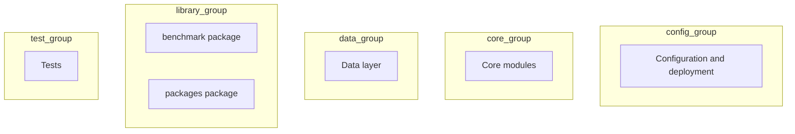

# Architecture report: brianc/node-postgres

> Automated static analysis. **Observed** = directly seen in files/imports/AST; **Inferred** = interpretation from that evidence. Repository code was not executed.

## 1. Repository at a glance

| Item | Value |
| --- | --- |
| Repository | brianc/node-postgres |
| Description | PostgreSQL client for node.js. |
| Language | JavaScript |
| Stars | 13236 |
| Licence | MIT |
| Analysed commit / branch | 2a5850fb0db18f5e40a642bbb4a4743de412ab54 / master |
| Framework(s) | Next.js, React |
| Files analysed | 359 |
| Components | 6 |

## 2. Architecture in one minute

brianc/node-postgres - PostgreSQL client for node.js.. This repository was analysed statically from 359 file(s) (0 Python). Detected technologies (observed from imports/manifests): GitHub Actions, PostgreSQL, Next.js, React, Docker, Docker Compose. Files are grouped into 6 component(s): benchmark package, Configuration and deployment, Core modules, Data layer, packages package, Tests. Findings below distinguish observed facts from inferred interpretation.

## 3. High-level block diagram

## 4. Main components

### benchmark package (`benchmark`)

- **Kind:** library
- **Status:** Observed
- **Confidence:** 0.85
- **Responsibility:** Groups 2 file(s) under benchmark package (observed from repository paths and static analysis).
- **Paths:** `benchmark/compare.js`, `benchmark/worker.js`
- **Evidence:** [benchmark/compare.js](https://github.com/brianc/node-postgres/blob/2a5850fb0db18f5e40a642bbb4a4743de412ab54/benchmark/compare.js); [benchmark/worker.js](https://github.com/brianc/node-postgres/blob/2a5850fb0db18f5e40a642bbb4a4743de412ab54/benchmark/worker.js)

### Configuration and deployment (`config`)

- **Kind:** config
- **Status:** Observed
- **Confidence:** 0.85
- **Responsibility:** Groups 20 file(s) under configuration and deployment (observed from repository paths and static analysis).
- **Paths:** `lerna.json`, `package.json`, `packages/pg-bundler-test/package.json`, `packages/pg-cloudflare/package.json`, `packages/pg-cloudflare/tsconfig.json`, `packages/pg-connection-string/.coveralls.yml`, `packages/pg-connection-string/.mocharc.json`, `packages/pg-connection-string/package.json`, `packages/pg-connection-string/tsconfig.json`, `packages/pg-cursor/package.json`, `packages/pg-esm-test/package.json`, `packages/pg-native/package.json`, `packages/pg-pool/package.json`, `packages/pg-protocol/package.json`, `packages/pg-protocol/tsconfig.json`, `packages/pg-query-stream/package.json`, `packages/pg-query-stream/tsconfig.json`, `packages/pg/package.json`, `tea.yaml`, `tsconfig.json`
- **Evidence:** [lerna.json](https://github.com/brianc/node-postgres/blob/2a5850fb0db18f5e40a642bbb4a4743de412ab54/lerna.json); [package.json](https://github.com/brianc/node-postgres/blob/2a5850fb0db18f5e40a642bbb4a4743de412ab54/package.json); [packages/pg-bundler-test/package.json](https://github.com/brianc/node-postgres/blob/2a5850fb0db18f5e40a642bbb4a4743de412ab54/packages/pg-bundler-test/package.json); [packages/pg-cloudflare/package.json](https://github.com/brianc/node-postgres/blob/2a5850fb0db18f5e40a642bbb4a4743de412ab54/packages/pg-cloudflare/package.json); [packages/pg-cloudflare/tsconfig.json](https://github.com/brianc/node-postgres/blob/2a5850fb0db18f5e40a642bbb4a4743de412ab54/packages/pg-cloudflare/tsconfig.json); [packages/pg-connection-string/.coveralls.yml](https://github.com/brianc/node-postgres/blob/2a5850fb0db18f5e40a642bbb4a4743de412ab54/packages/pg-connection-string/.coveralls.yml); [packages/pg-connection-string/.mocharc.json](https://github.com/brianc/node-postgres/blob/2a5850fb0db18f5e40a642bbb4a4743de412ab54/packages/pg-connection-string/.mocharc.json); [packages/pg-connection-string/package.json](https://github.com/brianc/node-postgres/blob/2a5850fb0db18f5e40a642bbb4a4743de412ab54/packages/pg-connection-string/package.json)

### Core modules (`core`)

- **Kind:** core
- **Status:** Observed
- **Confidence:** 0.85
- **Responsibility:** Groups 1 file(s) under core modules (observed from repository paths and static analysis).
- **Paths:** `eslint.config.mjs`
- **Evidence:** [eslint.config.mjs](https://github.com/brianc/node-postgres/blob/2a5850fb0db18f5e40a642bbb4a4743de412ab54/eslint.config.mjs)

### Data layer (`data_layer`)

- **Kind:** data
- **Status:** Inferred
- **Confidence:** 0.70
- **Responsibility:** Groups 0 file(s) under data layer (observed from repository paths and static analysis).
- **Evidence:** [.devcontainer/docker-compose.yml:28](https://github.com/brianc/node-postgres/blob/2a5850fb0db18f5e40a642bbb4a4743de412ab54/.devcontainer/docker-compose.yml#L28)

### packages package (`packages`)

- **Kind:** library
- **Status:** Observed
- **Confidence:** 0.85
- **Responsibility:** Groups 69 file(s) under packages package (observed from repository paths and static analysis).
- **Paths:** `packages/pg-bundler-test/esbuild-cloudflare.config.mjs`, `packages/pg-bundler-test/esbuild-empty.config.mjs`, `packages/pg-bundler-test/rollup-cloudflare.config.mjs`, `packages/pg-bundler-test/rollup-empty.config.mjs`, `packages/pg-bundler-test/src/index.mjs`, `packages/pg-bundler-test/vite-cloudflare.config.mjs`, `packages/pg-bundler-test/vite-empty.config.mjs`, `packages/pg-bundler-test/webpack-cloudflare.config.mjs`, `packages/pg-bundler-test/webpack-empty.config.mjs`, `packages/pg-cloudflare/esm/index.mjs`, `packages/pg-cloudflare/src/empty.ts`, `packages/pg-cloudflare/src/index.ts`, `packages/pg-cloudflare/src/types.d.ts`, `packages/pg-connection-string/esm/index.mjs`, `packages/pg-connection-string/index.d.ts`, `packages/pg-connection-string/index.js`, `packages/pg-cursor/esm/index.mjs`, `packages/pg-cursor/index.js`, `packages/pg-esm-test/common-js-imports.test.cjs`, `packages/pg-esm-test/pg-cloudflare.test.js`, `packages/pg-esm-test/pg-connection-string.test.js`, `packages/pg-esm-test/pg-cursor.test.js`, `packages/pg-esm-test/pg-native.test.js`, `packages/pg-esm-test/pg-pool.test.js`, `packages/pg-esm-test/pg-protocol.test.js`, `packages/pg-esm-test/pg-query-stream.test.js`, `packages/pg-esm-test/pg.test.js`, `packages/pg-native/bench/index.js`, `packages/pg-native/bench/leaks.js`, `packages/pg-native/esm/index.mjs`, `packages/pg-native/index.js`, `packages/pg-native/lib/build-result.js`, `packages/pg-native/lib/copy-stream.js`, `packages/pg-pool/esm/index.mjs`, `packages/pg-pool/index.js`, `packages/pg-protocol/esm/index.js`, `packages/pg-protocol/src/b.ts`, `packages/pg-protocol/src/buffer-reader.ts`, `packages/pg-protocol/src/buffer-writer.ts`, `packages/pg-protocol/src/inbound-parser.test.ts`, `packages/pg-protocol/src/index.ts`, `packages/pg-protocol/src/messages.ts`, `packages/pg-protocol/src/outbound-serializer.test.ts`, `packages/pg-protocol/src/parser.ts`, `packages/pg-protocol/src/serializer.ts`, `packages/pg-protocol/src/testing/buffer-list.ts`, `packages/pg-protocol/src/testing/test-buffers.ts`, `packages/pg-query-stream/esm/index.mjs`, `packages/pg-query-stream/src/index.ts`, `packages/pg/bench-pipelining.js`, `packages/pg/bench.js`, `packages/pg/esm/index.mjs`, `packages/pg/lib/client.js`, `packages/pg/lib/connection-parameters.js`, `packages/pg/lib/connection.js`, `packages/pg/lib/crypto/cert-signatures.js`, `packages/pg/lib/crypto/sasl.js`, `packages/pg/lib/crypto/utils.js`, `packages/pg/lib/defaults.js`, `packages/pg/lib/index.js`, `packages/pg/lib/native/client.js`, `packages/pg/lib/native/index.js`, `packages/pg/lib/native/query.js`, `packages/pg/lib/query.js`, `packages/pg/lib/result.js`, `packages/pg/lib/stream.js`, `packages/pg/lib/type-overrides.js`, `packages/pg/lib/utils.js`, `packages/pg/script/dump-db-types.js`
- **Evidence:** [packages/pg-bundler-test/esbuild-cloudflare.config.mjs](https://github.com/brianc/node-postgres/blob/2a5850fb0db18f5e40a642bbb4a4743de412ab54/packages/pg-bundler-test/esbuild-cloudflare.config.mjs); [packages/pg-bundler-test/esbuild-empty.config.mjs](https://github.com/brianc/node-postgres/blob/2a5850fb0db18f5e40a642bbb4a4743de412ab54/packages/pg-bundler-test/esbuild-empty.config.mjs); [packages/pg-bundler-test/rollup-cloudflare.config.mjs](https://github.com/brianc/node-postgres/blob/2a5850fb0db18f5e40a642bbb4a4743de412ab54/packages/pg-bundler-test/rollup-cloudflare.config.mjs); [packages/pg-bundler-test/rollup-empty.config.mjs](https://github.com/brianc/node-postgres/blob/2a5850fb0db18f5e40a642bbb4a4743de412ab54/packages/pg-bundler-test/rollup-empty.config.mjs); [packages/pg-bundler-test/src/index.mjs](https://github.com/brianc/node-postgres/blob/2a5850fb0db18f5e40a642bbb4a4743de412ab54/packages/pg-bundler-test/src/index.mjs); [packages/pg-bundler-test/vite-cloudflare.config.mjs](https://github.com/brianc/node-postgres/blob/2a5850fb0db18f5e40a642bbb4a4743de412ab54/packages/pg-bundler-test/vite-cloudflare.config.mjs); [packages/pg-bundler-test/vite-empty.config.mjs](https://github.com/brianc/node-postgres/blob/2a5850fb0db18f5e40a642bbb4a4743de412ab54/packages/pg-bundler-test/vite-empty.config.mjs); [packages/pg-bundler-test/webpack-cloudflare.config.mjs](https://github.com/brianc/node-postgres/blob/2a5850fb0db18f5e40a642bbb4a4743de412ab54/packages/pg-bundler-test/webpack-cloudflare.config.mjs)

### Tests (`tests`)

- **Kind:** test
- **Status:** Observed
- **Confidence:** 0.85
- **Responsibility:** Groups 201 file(s) under tests (observed from repository paths and static analysis).
- **Paths:** `packages/pg-connection-string/test/clientConfig.ts`, `packages/pg-connection-string/test/example.ca`, `packages/pg-connection-string/test/example.cert`, `packages/pg-connection-string/test/parse.ts`, `packages/pg-cursor/test/close.js`, `packages/pg-cursor/test/error-handling.js`, `packages/pg-cursor/test/index.js`, `packages/pg-cursor/test/late-messages.js`, `packages/pg-cursor/test/mocha.opts`, `packages/pg-cursor/test/no-data-handling.js`, `packages/pg-cursor/test/pool.js`, `packages/pg-cursor/test/promises.js`, `packages/pg-cursor/test/query-config.js`, `packages/pg-cursor/test/transactions.js`, `packages/pg-native/test/array-mode.js`, `packages/pg-native/test/async-workflow.js`, `packages/pg-native/test/cancel.js`, `packages/pg-native/test/connection-errors.js`, `packages/pg-native/test/connection.js`, `packages/pg-native/test/copy-from.js`, `packages/pg-native/test/copy-to.js`, `packages/pg-native/test/custom-types.js`, `packages/pg-native/test/domains.js`, `packages/pg-native/test/empty-query.js`, `packages/pg-native/test/huge-query.js`, `packages/pg-native/test/index.js`, `packages/pg-native/test/load.js`, `packages/pg-native/test/many-connections.js`, `packages/pg-native/test/many-errors.js`, `packages/pg-native/test/mocha.opts`, `packages/pg-native/test/multiple-queries.js`, `packages/pg-native/test/multiple-statement-results.js`, `packages/pg-native/test/notify.js`, `packages/pg-native/test/pipeline-connection-loss.js`, `packages/pg-native/test/prepare.js`, `packages/pg-native/test/query-async.js`, `packages/pg-native/test/query-sync.js`, `packages/pg-native/test/version.js`, `packages/pg-pool/test/connection-strings.js`, `packages/pg-pool/test/connection-timeout.js`, `packages/pg-pool/test/ending.js`, `packages/pg-pool/test/error-handling.js`, `packages/pg-pool/test/events.js`, `packages/pg-pool/test/idle-timeout-exit.js`, `packages/pg-pool/test/idle-timeout.js`, `packages/pg-pool/test/index.js`, `packages/pg-pool/test/lifecycle-hooks.js`, `packages/pg-pool/test/lifetime-timeout.js`, `packages/pg-pool/test/logging.js`, `packages/pg-pool/test/max-uses.js`, `packages/pg-pool/test/releasing-clients.js`, `packages/pg-pool/test/setup.js`, `packages/pg-pool/test/sizing.js`, `packages/pg-pool/test/submittable.js`, `packages/pg-pool/test/verify.js`, `packages/pg-query-stream/test/async-iterator.ts`, `packages/pg-query-stream/test/client-options.ts`, `packages/pg-query-stream/test/close.ts`, `packages/pg-query-stream/test/concat.ts`, `packages/pg-query-stream/test/config.ts`, `packages/pg-query-stream/test/empty-query.ts`, `packages/pg-query-stream/test/error.ts`, `packages/pg-query-stream/test/fast-reader.ts`, `packages/pg-query-stream/test/helper.ts`, `packages/pg-query-stream/test/instant.ts`, `packages/pg-query-stream/test/issue-3.ts`, `packages/pg-query-stream/test/passing-options.ts`, `packages/pg-query-stream/test/pauses.ts`, `packages/pg-query-stream/test/pool.ts`, `packages/pg-query-stream/test/slow-reader.ts`, `packages/pg-query-stream/test/stream-tester-timestamp.ts`, `packages/pg-query-stream/test/stream-tester.ts`, `packages/pg/test/buffer-list.js`, `packages/pg/test/cloudflare/vitest-cf.test.ts`, `packages/pg/test/integration/client/api-tests.js`, `packages/pg/test/integration/client/appname-tests.js`, `packages/pg/test/integration/client/array-tests.js`, `packages/pg/test/integration/client/async-stack-trace-tests.js`, `packages/pg/test/integration/client/big-simple-query-tests.js`, `packages/pg/test/integration/client/configuration-tests.js`, `packages/pg/test/integration/client/connection-parameter-tests.js`, `packages/pg/test/integration/client/connection-timeout-tests.js`, `packages/pg/test/integration/client/custom-types-tests.js`, `packages/pg/test/integration/client/empty-query-tests.js`, `packages/pg/test/integration/client/error-handling-tests.js`, `packages/pg/test/integration/client/field-name-escape-tests.js`, `packages/pg/test/integration/client/huge-numeric-tests.js`, `packages/pg/test/integration/client/idle_in_transaction_session_timeout-tests.js`, `packages/pg/test/integration/client/json-type-parsing-tests.js`, `packages/pg/test/integration/client/multiple-results-tests.js`, `packages/pg/test/integration/client/network-partition-tests.js`, `packages/pg/test/integration/client/no-data-tests.js`, `packages/pg/test/integration/client/no-row-result-tests.js`, `packages/pg/test/integration/client/notice-tests.js`, `packages/pg/test/integration/client/parse-int-8-tests.js`, `packages/pg/test/integration/client/pipeline-portal-tests.js`, `packages/pg/test/integration/client/pipelining-tests.js`, `packages/pg/test/integration/client/prepared-statement-tests.js`, `packages/pg/test/integration/client/promise-api-tests.js`, `packages/pg/test/integration/client/query-as-promise-tests.js`, `packages/pg/test/integration/client/query-column-names-tests.js`, `packages/pg/test/integration/client/query-error-handling-prepared-statement-tests.js`, `packages/pg/test/integration/client/query-error-handling-tests.js`, `packages/pg/test/integration/client/quick-disconnect-tests.js`, `packages/pg/test/integration/client/result-metadata-tests.js`, `packages/pg/test/integration/client/results-as-array-tests.js`, `packages/pg/test/integration/client/row-description-on-results-tests.js`, `packages/pg/test/integration/client/sasl-scram-tests.js`, `packages/pg/test/integration/client/simple-query-tests.js`, `packages/pg/test/integration/client/ssl-tests.js`, `packages/pg/test/integration/client/statement_timeout-tests.js`, `packages/pg/test/integration/client/test-helper.js`, `packages/pg/test/integration/client/timezone-tests.js`, `packages/pg/test/integration/client/transaction-tests.js`, `packages/pg/test/integration/client/txstatus-tests.js`, `packages/pg/test/integration/client/type-coercion-tests.js`, `packages/pg/test/integration/client/type-parser-override-tests.js`, `packages/pg/test/integration/connection-pool/connection-pool-size-tests.js`, `packages/pg/test/integration/connection-pool/error-tests.js`, `packages/pg/test/integration/connection-pool/idle-timeout-tests.js`, `packages/pg/test/integration/connection-pool/native-instance-tests.js`, `packages/pg/test/integration/connection-pool/test-helper.js`, `packages/pg/test/integration/connection-pool/tls-tests.js`, `packages/pg/test/integration/connection-pool/yield-support-tests.js`, `packages/pg/test/integration/domain-tests.js`, `packages/pg/test/integration/gh-issues/1105-tests.js`, `packages/pg/test/integration/gh-issues/130-tests.js`, `packages/pg/test/integration/gh-issues/131-tests.js`, `packages/pg/test/integration/gh-issues/1382-tests.js`, `packages/pg/test/integration/gh-issues/1542-tests.js`, `packages/pg/test/integration/gh-issues/1854-tests.js`, `packages/pg/test/integration/gh-issues/199-tests.js`, `packages/pg/test/integration/gh-issues/1992-tests.js`, `packages/pg/test/integration/gh-issues/2056-tests.js`, `packages/pg/test/integration/gh-issues/2064-tests.js`, `packages/pg/test/integration/gh-issues/2079-tests.js`, `packages/pg/test/integration/gh-issues/2085-tests.js`, `packages/pg/test/integration/gh-issues/2108-tests.js`, `packages/pg/test/integration/gh-issues/2303-tests.js`, `packages/pg/test/integration/gh-issues/2307-tests.js`, `packages/pg/test/integration/gh-issues/2416-tests.js`, `packages/pg/test/integration/gh-issues/2556-tests.js`, `packages/pg/test/integration/gh-issues/2627-tests.js`, `packages/pg/test/integration/gh-issues/2716-tests.js`, `packages/pg/test/integration/gh-issues/2862-tests.js`, `packages/pg/test/integration/gh-issues/3062-tests.js`, `packages/pg/test/integration/gh-issues/3174-tests.js`, `packages/pg/test/integration/gh-issues/3487-tests.js`, `packages/pg/test/integration/gh-issues/3772-tests.js`, `packages/pg/test/integration/gh-issues/507-tests.js`, `packages/pg/test/integration/gh-issues/600-tests.js`, `packages/pg/test/integration/gh-issues/675-tests.js`, `packages/pg/test/integration/gh-issues/699-tests.js`, `packages/pg/test/integration/gh-issues/787-tests.js`, `packages/pg/test/integration/gh-issues/882-tests.js`, `packages/pg/test/integration/gh-issues/981-tests.js`, `packages/pg/test/integration/test-helper.js`, `packages/pg/test/native/callback-api-tests.js`, `packages/pg/test/native/evented-api-tests.js`, `packages/pg/test/native/native-connection-string-tests.js`, `packages/pg/test/native/native-vs-js-error-tests.js`, `packages/pg/test/native/stress-tests.js`, `packages/pg/test/suite.js`, `packages/pg/test/test-buffers.js`, `packages/pg/test/test-helper.js`, `packages/pg/test/tls/GNUmakefile`, `packages/pg/test/tls/test-client-ca.crt`, `packages/pg/test/tls/test-client.crt`, `packages/pg/test/tls/test-server-ca.crt`, `packages/pg/test/tls/test-server.crt`, `packages/pg/test/unit/client/cleartext-password-tests.js`, `packages/pg/test/unit/client/configuration-tests.js`, `packages/pg/test/unit/client/early-disconnect-tests.js`, `packages/pg/test/unit/client/escape-tests.js`, `packages/pg/test/unit/client/md5-password-tests.js`, `packages/pg/test/unit/client/notification-tests.js`, `packages/pg/test/unit/client/password-callback-tests.js`, `packages/pg/test/unit/client/pgpass.file`, `packages/pg/test/unit/client/prepared-statement-tests.js`, `packages/pg/test/unit/client/query-queue-tests.js`, `packages/pg/test/unit/client/query-timeout-tests.js`, `packages/pg/test/unit/client/result-metadata-tests.js`, `packages/pg/test/unit/client/sasl-scram-tests.js`, `packages/pg/test/unit/client/set-keepalives-tests.js`, `packages/pg/test/unit/client/simple-query-tests.js`, `packages/pg/test/unit/client/stream-and-query-error-interaction-tests.js`, `packages/pg/test/unit/client/test-helper.js`, `packages/pg/test/unit/client/throw-in-bind-tests.js`, `packages/pg/test/unit/client/throw-in-type-parser-tests.js`, `packages/pg/test/unit/connection-parameters/creation-tests.js`, `packages/pg/test/unit/connection-parameters/environment-variable-tests.js`, `packages/pg/test/unit/connection-pool/configuration-tests.js`, `packages/pg/test/unit/connection/error-tests.js`, `packages/pg/test/unit/connection/ssl-tests.js`, `packages/pg/test/unit/connection/startup-tests.js`, `packages/pg/test/unit/connection/test-helper.js`, `packages/pg/test/unit/result-tests.js`, `packages/pg/test/unit/test-helper.js`, `packages/pg/test/unit/utils-tests.js`, `packages/pg/test/vitest.config.mts`, `packages/pg/test/wrangler.jsonc`
- **Evidence:** [packages/pg-connection-string/test/clientConfig.ts](https://github.com/brianc/node-postgres/blob/2a5850fb0db18f5e40a642bbb4a4743de412ab54/packages/pg-connection-string/test/clientConfig.ts); [packages/pg-connection-string/test/example.ca](https://github.com/brianc/node-postgres/blob/2a5850fb0db18f5e40a642bbb4a4743de412ab54/packages/pg-connection-string/test/example.ca); [packages/pg-connection-string/test/example.cert](https://github.com/brianc/node-postgres/blob/2a5850fb0db18f5e40a642bbb4a4743de412ab54/packages/pg-connection-string/test/example.cert); [packages/pg-connection-string/test/parse.ts](https://github.com/brianc/node-postgres/blob/2a5850fb0db18f5e40a642bbb4a4743de412ab54/packages/pg-connection-string/test/parse.ts); [packages/pg-cursor/test/close.js](https://github.com/brianc/node-postgres/blob/2a5850fb0db18f5e40a642bbb4a4743de412ab54/packages/pg-cursor/test/close.js); [packages/pg-cursor/test/error-handling.js](https://github.com/brianc/node-postgres/blob/2a5850fb0db18f5e40a642bbb4a4743de412ab54/packages/pg-cursor/test/error-handling.js); [packages/pg-cursor/test/index.js](https://github.com/brianc/node-postgres/blob/2a5850fb0db18f5e40a642bbb4a4743de412ab54/packages/pg-cursor/test/index.js); [packages/pg-cursor/test/late-messages.js](https://github.com/brianc/node-postgres/blob/2a5850fb0db18f5e40a642bbb4a4743de412ab54/packages/pg-cursor/test/late-messages.js)

## 5. Execution flow

**Observed** entry point(s):

- [docs/next.config.js](https://github.com/brianc/node-postgres/blob/2a5850fb0db18f5e40a642bbb4a4743de412ab54/docs/next.config.js)
- [packages/pg-cloudflare/src/index.ts](https://github.com/brianc/node-postgres/blob/2a5850fb0db18f5e40a642bbb4a4743de412ab54/packages/pg-cloudflare/src/index.ts)
- [packages/pg-connection-string/index.js](https://github.com/brianc/node-postgres/blob/2a5850fb0db18f5e40a642bbb4a4743de412ab54/packages/pg-connection-string/index.js)
- [packages/pg-cursor/index.js](https://github.com/brianc/node-postgres/blob/2a5850fb0db18f5e40a642bbb4a4743de412ab54/packages/pg-cursor/index.js)
- [packages/pg-native/bench/index.js](https://github.com/brianc/node-postgres/blob/2a5850fb0db18f5e40a642bbb4a4743de412ab54/packages/pg-native/bench/index.js)
- [packages/pg-native/index.js](https://github.com/brianc/node-postgres/blob/2a5850fb0db18f5e40a642bbb4a4743de412ab54/packages/pg-native/index.js)
- [packages/pg-pool/index.js](https://github.com/brianc/node-postgres/blob/2a5850fb0db18f5e40a642bbb4a4743de412ab54/packages/pg-pool/index.js)
- [packages/pg-protocol/esm/index.js](https://github.com/brianc/node-postgres/blob/2a5850fb0db18f5e40a642bbb4a4743de412ab54/packages/pg-protocol/esm/index.js)
- [packages/pg-protocol/src/index.ts](https://github.com/brianc/node-postgres/blob/2a5850fb0db18f5e40a642bbb4a4743de412ab54/packages/pg-protocol/src/index.ts)
- [packages/pg-query-stream/src/index.ts](https://github.com/brianc/node-postgres/blob/2a5850fb0db18f5e40a642bbb4a4743de412ab54/packages/pg-query-stream/src/index.ts)
- [packages/pg/lib/index.js](https://github.com/brianc/node-postgres/blob/2a5850fb0db18f5e40a642bbb4a4743de412ab54/packages/pg/lib/index.js)

Representative flow (derived from observed entry points and the import graph; steps beyond the entry point are **Inferred**):

1. Execution starts at an observed entry point listed above, if present.
2. No internal import relationships between components were observed.

## 6. Project structure

### `(root)`

- `.gitattributes` - other (18 bytes)
- `.gitignore` - other (154 bytes)
- `.yarnrc` - other (29 bytes)
- `CHANGELOG.md` - docs (26741 bytes)
- `LICENSE` - docs (1077 bytes)
- `LOCAL_DEV.md` - docs (1041 bytes)
- `README.md` - docs (6323 bytes)
- `SPONSORS.md` - docs (1966 bytes)
- `eslint.config.mjs` - source, JavaScript (1852 bytes)
- `lerna.json` - config (228 bytes)
- `package.json` - manifest (1243 bytes)
- `tea.yaml` - config (126 bytes)
- `tsconfig.json` - config (263 bytes)

### `.devcontainer`

- `.devcontainer/Dockerfile` - container (3206 bytes)
- `.devcontainer/devcontainer.json` - config (490 bytes)
- `.devcontainer/docker-compose.yml` - container (1723 bytes)

### `.github`

- `.github/CODEOWNERS` - other (37 bytes)
- `.github/FUNDING.yml` - config (64 bytes)
- `.github/dependabot.yaml` - config (108 bytes)
- `.github/workflows/benchmark.yml` - ci, YAML (3169 bytes)
- `.github/workflows/ci.yml` - ci, YAML (3489 bytes)

### `benchmark`

- `benchmark/README.md` - docs (1246 bytes)
- `benchmark/compare.js` - source, JavaScript (7370 bytes)
- `benchmark/worker.js` - source, JavaScript (7598 bytes)

### `docs`

- `docs/.gitignore` - docs (10 bytes)
- `docs/README.md` - docs (591 bytes)
- `docs/components/alert.tsx` - docs (179 bytes)
- `docs/components/info.tsx` - docs (141 bytes)
- `docs/components/logo.tsx` - docs (227 bytes)
- `docs/next.config.js` - docs (211 bytes)
- `docs/package.json` - manifest (422 bytes)
- `docs/pages/_app.js` - docs (137 bytes)
- `docs/pages/_meta.js` - docs (88 bytes)
- `docs/pages/announcements.mdx` - docs (8876 bytes)
- `docs/pages/apis/_meta.js` - docs (151 bytes)
- `docs/pages/apis/client.mdx` - docs (8813 bytes)
- `docs/pages/apis/cursor.mdx` - docs (2371 bytes)
- `docs/pages/apis/pool.mdx` - docs (10334 bytes)
- `docs/pages/apis/result.mdx` - docs (2857 bytes)
- `docs/pages/apis/types.mdx` - docs (150 bytes)
- `docs/pages/apis/utilities.mdx` - docs (1476 bytes)
- `docs/pages/features/_meta.js` - docs (248 bytes)
- `docs/pages/features/callbacks.mdx` - docs (947 bytes)
- `docs/pages/features/connecting.mdx` - docs (4278 bytes)
- `docs/pages/features/esm.mdx` - docs (940 bytes)
- `docs/pages/features/native.mdx` - docs (2637 bytes)
- `docs/pages/features/pipelining.mdx` - docs (4716 bytes)
- `docs/pages/features/pooling.mdx` - docs (4083 bytes)
- `docs/pages/features/queries.mdx` - docs (5875 bytes)
- `docs/pages/features/ssl.mdx` - docs (3352 bytes)
- `docs/pages/features/transactions.mdx` - docs (1371 bytes)
- `docs/pages/features/types.mdx` - docs (4258 bytes)
- `docs/pages/guides/_meta.js` - docs (175 bytes)
- `docs/pages/guides/async-express.md` - docs (2311 bytes)
- `docs/pages/guides/pool-sizing.md` - docs (6065 bytes)
- `docs/pages/guides/project-structure.md` - docs (5089 bytes)
- `docs/pages/guides/upgrading.md` - docs (6468 bytes)
- `docs/pages/index.mdx` - docs (3337 bytes)
- `docs/theme.config.js` - docs (3652 bytes)

### `packages`

- `packages/pg-bundler-test/esbuild-cloudflare.config.mjs` - source, JavaScript (193 bytes)
- `packages/pg-bundler-test/esbuild-empty.config.mjs` - source, JavaScript (151 bytes)
- `packages/pg-bundler-test/package.json` - manifest (1119 bytes)
- `packages/pg-bundler-test/rollup-cloudflare.config.mjs` - source, JavaScript (420 bytes)
- `packages/pg-bundler-test/rollup-empty.config.mjs` - source, JavaScript (314 bytes)
- `packages/pg-bundler-test/src/index.mjs` - source, JavaScript (23 bytes)
- `packages/pg-bundler-test/vite-cloudflare.config.mjs` - source, JavaScript (415 bytes)
- `packages/pg-bundler-test/vite-empty.config.mjs` - source, JavaScript (213 bytes)
- `packages/pg-bundler-test/webpack-cloudflare.config.mjs` - source, JavaScript (354 bytes)
- `packages/pg-bundler-test/webpack-empty.config.mjs` - source, JavaScript (120 bytes)
- `packages/pg-cloudflare/README.md` - docs (4383 bytes)
- `packages/pg-cloudflare/esm/index.mjs` - source, JavaScript (87 bytes)
- `packages/pg-cloudflare/package.json` - manifest (887 bytes)
- `packages/pg-cloudflare/src/empty.ts` - source, TypeScript (144 bytes)
- `packages/pg-cloudflare/src/index.ts` - source, TypeScript (5356 bytes)
- `packages/pg-cloudflare/src/types.d.ts` - source, TypeScript (612 bytes)
- `packages/pg-cloudflare/tsconfig.json` - config (502 bytes)
- `packages/pg-connection-string/.coveralls.yml` - config (71 bytes)
- `packages/pg-connection-string/.gitignore` - other (601 bytes)
- `packages/pg-connection-string/.mocharc.json` - config (52 bytes)
- `packages/pg-connection-string/LICENSE` - docs (1082 bytes)
- `packages/pg-connection-string/README.md` - docs (4932 bytes)
- `packages/pg-connection-string/esm/index.mjs` - source, JavaScript (336 bytes)
- `packages/pg-connection-string/index.d.ts` - source, TypeScript (952 bytes)
- `packages/pg-connection-string/index.js` - source, JavaScript (7497 bytes)
- `packages/pg-connection-string/package.json` - manifest (1292 bytes)
- `packages/pg-connection-string/test/clientConfig.ts` - test, TypeScript (3956 bytes)
- `packages/pg-connection-string/test/example.ca` - test (11 bytes)
- `packages/pg-connection-string/test/example.cert` - test (13 bytes)
- `packages/pg-connection-string/test/parse.ts` - test, TypeScript (20153 bytes)
- `packages/pg-connection-string/tsconfig.json` - config (378 bytes)
- `packages/pg-cursor/README.md` - docs (1498 bytes)
- `packages/pg-cursor/esm/index.mjs` - source, JavaScript (131 bytes)
- `packages/pg-cursor/index.js` - source, JavaScript (6863 bytes)
- `packages/pg-cursor/package.json` - manifest (696 bytes)
- `packages/pg-cursor/test/close.js` - test, JavaScript (2754 bytes)
- `packages/pg-cursor/test/error-handling.js` - test, JavaScript (3042 bytes)
- `packages/pg-cursor/test/index.js` - test, JavaScript (4925 bytes)
- `packages/pg-cursor/test/late-messages.js` - test, JavaScript (3157 bytes)
- `packages/pg-cursor/test/mocha.opts` - test (33 bytes)
- `packages/pg-cursor/test/no-data-handling.js` - test, JavaScript (885 bytes)
- `packages/pg-cursor/test/pool.js` - test, JavaScript (2542 bytes)
- `packages/pg-cursor/test/promises.js` - test, JavaScript (1219 bytes)
- `packages/pg-cursor/test/query-config.js` - test, JavaScript (1071 bytes)
- `packages/pg-cursor/test/transactions.js` - test, JavaScript (1734 bytes)
- `packages/pg-esm-test/README.md` - docs (284 bytes)
- `packages/pg-esm-test/common-js-imports.test.cjs` - source, JavaScript (823 bytes)
- `packages/pg-esm-test/package.json` - manifest (606 bytes)
- `packages/pg-esm-test/pg-cloudflare.test.js` - source, JavaScript (1642 bytes)
- `packages/pg-esm-test/pg-connection-string.test.js` - source, JavaScript (547 bytes)
- `packages/pg-esm-test/pg-cursor.test.js` - source, JavaScript (227 bytes)
- `packages/pg-esm-test/pg-native.test.js` - source, JavaScript (216 bytes)
- `packages/pg-esm-test/pg-pool.test.js` - source, JavaScript (206 bytes)
- `packages/pg-esm-test/pg-protocol.test.js` - source, JavaScript (562 bytes)
- `packages/pg-esm-test/pg-query-stream.test.js` - source, JavaScript (254 bytes)
- `packages/pg-esm-test/pg.test.js` - source, JavaScript (1113 bytes)
- `packages/pg-native/README.md` - docs (10833 bytes)
- `packages/pg-native/bench/index.js` - source, JavaScript (1043 bytes)
- `packages/pg-native/bench/leaks.js` - source, JavaScript (1221 bytes)
- `packages/pg-native/esm/index.mjs` - source, JavaScript (131 bytes)
- `packages/pg-native/index.js` - source, JavaScript (14763 bytes)
- `packages/pg-native/lib/build-result.js` - source, JavaScript (2032 bytes)
- `packages/pg-native/lib/copy-stream.js` - source, JavaScript (3757 bytes)
- `packages/pg-native/package.json` - manifest (1159 bytes)
- `packages/pg-native/test/array-mode.js` - test, JavaScript (870 bytes)
- `packages/pg-native/test/async-workflow.js` - test, JavaScript (2192 bytes)
- `packages/pg-native/test/cancel.js` - test, JavaScript (839 bytes)
- `packages/pg-native/test/connection-errors.js` - test, JavaScript (482 bytes)
- `packages/pg-native/test/connection.js` - test, JavaScript (611 bytes)
- `packages/pg-native/test/copy-from.js` - test, JavaScript (1495 bytes)
- `packages/pg-native/test/copy-to.js` - test, JavaScript (933 bytes)
- `packages/pg-native/test/custom-types.js` - test, JavaScript (648 bytes)
- `packages/pg-native/test/domains.js` - test, JavaScript (1011 bytes)
- `packages/pg-native/test/empty-query.js` - test, JavaScript (445 bytes)
- `packages/pg-native/test/huge-query.js` - test, JavaScript (623 bytes)
- `packages/pg-native/test/index.js` - test, JavaScript (878 bytes)
- `packages/pg-native/test/load.js` - test, JavaScript (657 bytes)
- `packages/pg-native/test/many-connections.js` - test, JavaScript (1164 bytes)
- `packages/pg-native/test/many-errors.js` - test, JavaScript (658 bytes)
- `packages/pg-native/test/mocha.opts` - test (17 bytes)
- `packages/pg-native/test/multiple-queries.js` - test, JavaScript (1228 bytes)
- `packages/pg-native/test/multiple-statement-results.js` - test, JavaScript (725 bytes)
- `packages/pg-native/test/notify.js` - test, JavaScript (1425 bytes)
- `packages/pg-native/test/pipeline-connection-loss.js` - test, JavaScript (2441 bytes)
- `packages/pg-native/test/prepare.js` - test, JavaScript (1250 bytes)
- `packages/pg-native/test/query-async.js` - test, JavaScript (3197 bytes)
- `packages/pg-native/test/query-sync.js` - test, JavaScript (2326 bytes)
- `packages/pg-native/test/version.js` - test, JavaScript (316 bytes)
- `packages/pg-pool/LICENSE` - docs (1073 bytes)
- `packages/pg-pool/README.md` - docs (13087 bytes)
- `packages/pg-pool/esm/index.mjs` - source, JavaScript (125 bytes)
- `packages/pg-pool/index.js` - source, JavaScript (14460 bytes)
- `packages/pg-pool/package.json` - manifest (1026 bytes)
- `packages/pg-pool/test/connection-strings.js` - test, JavaScript (837 bytes)
- `packages/pg-pool/test/connection-timeout.js` - test, JavaScript (6803 bytes)
- `packages/pg-pool/test/ending.js` - test, JavaScript (1210 bytes)
- `packages/pg-pool/test/error-handling.js` - test, JavaScript (7100 bytes)
- `packages/pg-pool/test/events.js` - test, JavaScript (3408 bytes)
- `packages/pg-pool/test/idle-timeout-exit.js` - test, JavaScript (606 bytes)
- `packages/pg-pool/test/idle-timeout.js` - test, JavaScript (4109 bytes)
- `packages/pg-pool/test/index.js` - test, JavaScript (7700 bytes)
- `packages/pg-pool/test/lifecycle-hooks.js` - test, JavaScript (4721 bytes)
- `packages/pg-pool/test/lifetime-timeout.js` - test, JavaScript (1446 bytes)
- `packages/pg-pool/test/logging.js` - test, JavaScript (511 bytes)
- `packages/pg-pool/test/max-uses.js` - test, JavaScript (3190 bytes)
- `packages/pg-pool/test/releasing-clients.js` - test, JavaScript (1684 bytes)
- `packages/pg-pool/test/setup.js` - test, JavaScript (194 bytes)
- `packages/pg-pool/test/sizing.js` - test, JavaScript (4546 bytes)
- `packages/pg-pool/test/submittable.js` - test, JavaScript (532 bytes)
- `packages/pg-pool/test/verify.js` - test, JavaScript (497 bytes)
- `packages/pg-protocol/README.md` - docs (150 bytes)
- `packages/pg-protocol/esm/index.js` - source, JavaScript (325 bytes)
- `packages/pg-protocol/package.json` - manifest (1016 bytes)
- `packages/pg-protocol/src/b.ts` - source, TypeScript (473 bytes)
- `packages/pg-protocol/src/buffer-reader.ts` - source, TypeScript (1409 bytes)
- `packages/pg-protocol/src/buffer-writer.ts` - source, TypeScript (3771 bytes)
- `packages/pg-protocol/src/inbound-parser.test.ts` - source, TypeScript (15695 bytes)
- `packages/pg-protocol/src/index.ts` - source, TypeScript (443 bytes)
- `packages/pg-protocol/src/messages.ts` - source, TypeScript (6458 bytes)
- `packages/pg-protocol/src/outbound-serializer.test.ts` - source, TypeScript (11375 bytes)
- `packages/pg-protocol/src/parser.ts` - source, TypeScript (13057 bytes)
- `packages/pg-protocol/src/serializer.ts` - source, TypeScript (7384 bytes)
- `packages/pg-protocol/src/testing/buffer-list.ts` - source, TypeScript (1727 bytes)
- `packages/pg-protocol/src/testing/test-buffers.ts` - source, TypeScript (4360 bytes)
- `packages/pg-protocol/tsconfig.json` - config (501 bytes)
- `packages/pg-query-stream/LICENSE` - docs (1083 bytes)
- `packages/pg-query-stream/README.md` - docs (2635 bytes)
- `packages/pg-query-stream/esm/index.mjs` - source, JavaScript (152 bytes)
- `packages/pg-query-stream/package.json` - manifest (1301 bytes)
- `packages/pg-query-stream/src/index.ts` - source, TypeScript (2416 bytes)
- `packages/pg-query-stream/test/async-iterator.ts` - test, TypeScript (4138 bytes)
- `packages/pg-query-stream/test/client-options.ts` - test, TypeScript (768 bytes)
- `packages/pg-query-stream/test/close.ts` - test, TypeScript (3323 bytes)
- `packages/pg-query-stream/test/concat.ts` - test, TypeScript (796 bytes)
- `packages/pg-query-stream/test/config.ts` - test, TypeScript (746 bytes)
- `packages/pg-query-stream/test/empty-query.ts` - test, TypeScript (559 bytes)
- `packages/pg-query-stream/test/error.ts` - test, TypeScript (6209 bytes)
- `packages/pg-query-stream/test/fast-reader.ts` - test, TypeScript (1056 bytes)
- `packages/pg-query-stream/test/helper.ts` - test, TypeScript (295 bytes)
- `packages/pg-query-stream/test/instant.ts` - test, TypeScript (419 bytes)
- `packages/pg-query-stream/test/issue-3.ts` - test, TypeScript (950 bytes)
- `packages/pg-query-stream/test/passing-options.ts` - test, TypeScript (1113 bytes)
- `packages/pg-query-stream/test/pauses.ts` - test, TypeScript (868 bytes)
- `packages/pg-query-stream/test/pool.ts` - test, TypeScript (417 bytes)
- `packages/pg-query-stream/test/slow-reader.ts` - test, TypeScript (711 bytes)
- `packages/pg-query-stream/test/stream-tester-timestamp.ts` - test, TypeScript (806 bytes)
- `packages/pg-query-stream/test/stream-tester.ts` - test, TypeScript (413 bytes)
- `packages/pg-query-stream/tsconfig.json` - config (479 bytes)
- `packages/pg/Makefile` - other (1641 bytes)
- `packages/pg/README.md` - docs (4454 bytes)
- `packages/pg/bench-pipelining.js` - source, JavaScript (6432 bytes)
- `packages/pg/bench.js` - source, JavaScript (2879 bytes)
- `packages/pg/esm/index.mjs` - source, JavaScript (579 bytes)
- `packages/pg/lib/client.js` - source, JavaScript (25715 bytes)
- `packages/pg/lib/connection-parameters.js` - source, JavaScript (5957 bytes)
- `packages/pg/lib/connection.js` - source, JavaScript (6399 bytes)
- `packages/pg/lib/crypto/cert-signatures.js` - source, JavaScript (4089 bytes)
- `packages/pg/lib/crypto/sasl.js` - source, JavaScript (9900 bytes)
- `packages/pg/lib/crypto/utils.js` - source, JavaScript (2649 bytes)
- `packages/pg/lib/defaults.js` - source, JavaScript (2612 bytes)
- `packages/pg/lib/index.js` - source, JavaScript (1810 bytes)
- `packages/pg/lib/native/client.js` - source, JavaScript (11601 bytes)
- `packages/pg/lib/native/index.js` - source, JavaScript (50 bytes)
- `packages/pg/lib/native/query.js` - source, JavaScript (4836 bytes)
- `packages/pg/lib/query.js` - source, JavaScript (7710 bytes)
- `packages/pg/lib/result.js` - source, JavaScript (2829 bytes)
- `packages/pg/lib/stream.js` - source, JavaScript (2132 bytes)
- `packages/pg/lib/type-overrides.js` - source, JavaScript (770 bytes)
- `packages/pg/lib/utils.js` - source, JavaScript (5797 bytes)
- `packages/pg/package.json` - manifest (1611 bytes)
- `packages/pg/script/dump-db-types.js` - source, JavaScript (466 bytes)
- `packages/pg/test/buffer-list.js` - test, JavaScript (1510 bytes)
- `packages/pg/test/cloudflare/vitest-cf.test.ts` - test, TypeScript (281 bytes)
- `packages/pg/test/integration/client/api-tests.js` - test, JavaScript (7488 bytes)
- `packages/pg/test/integration/client/appname-tests.js` - test, JavaScript (2477 bytes)
- `packages/pg/test/integration/client/array-tests.js` - test, JavaScript (7062 bytes)
- `packages/pg/test/integration/client/async-stack-trace-tests.js` - test, JavaScript (1227 bytes)
- `packages/pg/test/integration/client/big-simple-query-tests.js` - test, JavaScript (11486 bytes)
- `packages/pg/test/integration/client/configuration-tests.js` - test, JavaScript (1788 bytes)
- `packages/pg/test/integration/client/connection-parameter-tests.js` - test, JavaScript (516 bytes)
- `packages/pg/test/integration/client/connection-timeout-tests.js` - test, JavaScript (2636 bytes)
- `packages/pg/test/integration/client/custom-types-tests.js` - test, JavaScript (1472 bytes)
- `packages/pg/test/integration/client/empty-query-tests.js` - test, JavaScript (831 bytes)
- `packages/pg/test/integration/client/error-handling-tests.js` - test, JavaScript (6338 bytes)
- `packages/pg/test/integration/client/field-name-escape-tests.js` - test, JavaScript (252 bytes)
- `packages/pg/test/integration/client/huge-numeric-tests.js` - test, JavaScript (769 bytes)
- `packages/pg/test/integration/client/idle_in_transaction_session_timeout-tests.js` - test, JavaScript (2598 bytes)
- `packages/pg/test/integration/client/json-type-parsing-tests.js` - test, JavaScript (1241 bytes)
- `packages/pg/test/integration/client/multiple-results-tests.js` - test, JavaScript (2704 bytes)
- `packages/pg/test/integration/client/network-partition-tests.js` - test, JavaScript (2514 bytes)
- `packages/pg/test/integration/client/no-data-tests.js` - test, JavaScript (873 bytes)
- `packages/pg/test/integration/client/no-row-result-tests.js` - test, JavaScript (868 bytes)
- `packages/pg/test/integration/client/notice-tests.js` - test, JavaScript (2341 bytes)
- `packages/pg/test/integration/client/parse-int-8-tests.js` - test, JavaScript (1336 bytes)
- `packages/pg/test/integration/client/pipeline-portal-tests.js` - test, JavaScript (2564 bytes)
- `packages/pg/test/integration/client/pipelining-tests.js` - test, JavaScript (5748 bytes)
- `packages/pg/test/integration/client/prepared-statement-tests.js` - test, JavaScript (6002 bytes)
- `packages/pg/test/integration/client/promise-api-tests.js` - test, JavaScript (747 bytes)
- `packages/pg/test/integration/client/query-as-promise-tests.js` - test, JavaScript (1394 bytes)
- `packages/pg/test/integration/client/query-column-names-tests.js` - test, JavaScript (570 bytes)
- `packages/pg/test/integration/client/query-error-handling-prepared-statement-tests.js` - test, JavaScript (3331 bytes)
- `packages/pg/test/integration/client/query-error-handling-tests.js` - test, JavaScript (3952 bytes)
- `packages/pg/test/integration/client/quick-disconnect-tests.js` - test, JavaScript (161 bytes)
- `packages/pg/test/integration/client/result-metadata-tests.js` - test, JavaScript (1468 bytes)
- `packages/pg/test/integration/client/results-as-array-tests.js` - test, JavaScript (977 bytes)
- `packages/pg/test/integration/client/row-description-on-results-tests.js` - test, JavaScript (1328 bytes)
- `packages/pg/test/integration/client/sasl-scram-tests.js` - test, JavaScript (6762 bytes)
- `packages/pg/test/integration/client/simple-query-tests.js` - test, JavaScript (3069 bytes)
- `packages/pg/test/integration/client/ssl-tests.js` - test, JavaScript (2666 bytes)
- `packages/pg/test/integration/client/statement_timeout-tests.js` - test, JavaScript (2155 bytes)
- `packages/pg/test/integration/client/test-helper.js` - test, JavaScript (81 bytes)
- `packages/pg/test/integration/client/timezone-tests.js` - test, JavaScript (1085 bytes)
- `packages/pg/test/integration/client/transaction-tests.js` - test, JavaScript (1672 bytes)
- `packages/pg/test/integration/client/txstatus-tests.js` - test, JavaScript (2624 bytes)
- `packages/pg/test/integration/client/type-coercion-tests.js` - test, JavaScript (6275 bytes)
- `packages/pg/test/integration/client/type-parser-override-tests.js` - test, JavaScript (1313 bytes)
- `packages/pg/test/integration/connection-pool/connection-pool-size-tests.js` - test, JavaScript (974 bytes)
- `packages/pg/test/integration/connection-pool/error-tests.js` - test, JavaScript (4626 bytes)
- `packages/pg/test/integration/connection-pool/idle-timeout-tests.js` - test, JavaScript (405 bytes)
- `packages/pg/test/integration/connection-pool/native-instance-tests.js` - test, JavaScript (395 bytes)
- `packages/pg/test/integration/connection-pool/test-helper.js` - test, JavaScript (81 bytes)
- `packages/pg/test/integration/connection-pool/tls-tests.js` - test, JavaScript (508 bytes)
- `packages/pg/test/integration/connection-pool/yield-support-tests.js` - test, JavaScript (581 bytes)
- `packages/pg/test/integration/domain-tests.js` - test, JavaScript (1647 bytes)
- `packages/pg/test/integration/gh-issues/1105-tests.js` - test, JavaScript (603 bytes)
- `packages/pg/test/integration/gh-issues/130-tests.js` - test, JavaScript (916 bytes)
- `packages/pg/test/integration/gh-issues/131-tests.js` - test, JavaScript (1071 bytes)
- `packages/pg/test/integration/gh-issues/1382-tests.js` - test, JavaScript (877 bytes)
- `packages/pg/test/integration/gh-issues/1542-tests.js` - test, JavaScript (534 bytes)
- `packages/pg/test/integration/gh-issues/1854-tests.js` - test, JavaScript (946 bytes)
- `packages/pg/test/integration/gh-issues/199-tests.js` - test, JavaScript (641 bytes)
- `packages/pg/test/integration/gh-issues/1992-tests.js` - test, JavaScript (268 bytes)
- `packages/pg/test/integration/gh-issues/2056-tests.js` - test, JavaScript (675 bytes)
- `packages/pg/test/integration/gh-issues/2064-tests.js` - test, JavaScript (1080 bytes)
- `packages/pg/test/integration/gh-issues/2079-tests.js` - test, JavaScript (1731 bytes)
- `packages/pg/test/integration/gh-issues/2085-tests.js` - test, JavaScript (963 bytes)
- `packages/pg/test/integration/gh-issues/2108-tests.js` - test, JavaScript (358 bytes)
- `packages/pg/test/integration/gh-issues/2303-tests.js` - test, JavaScript (1942 bytes)
- `packages/pg/test/integration/gh-issues/2307-tests.js` - test, JavaScript (469 bytes)
- `packages/pg/test/integration/gh-issues/2416-tests.js` - test, JavaScript (443 bytes)
- `packages/pg/test/integration/gh-issues/2556-tests.js` - test, JavaScript (1184 bytes)
- `packages/pg/test/integration/gh-issues/2627-tests.js` - test, JavaScript (1651 bytes)
- `packages/pg/test/integration/gh-issues/2716-tests.js` - test, JavaScript (1279 bytes)
- `packages/pg/test/integration/gh-issues/2862-tests.js` - test, JavaScript (792 bytes)
- `packages/pg/test/integration/gh-issues/3062-tests.js` - test, JavaScript (837 bytes)
- `packages/pg/test/integration/gh-issues/3174-tests.js` - test, JavaScript (5595 bytes)
- `packages/pg/test/integration/gh-issues/3487-tests.js` - test, JavaScript (621 bytes)
- `packages/pg/test/integration/gh-issues/3772-tests.js` - test, JavaScript (6071 bytes)
- `packages/pg/test/integration/gh-issues/507-tests.js` - test, JavaScript (647 bytes)
- `packages/pg/test/integration/gh-issues/600-tests.js` - test, JavaScript (1936 bytes)
- `packages/pg/test/integration/gh-issues/675-tests.js` - test, JavaScript (671 bytes)
- `packages/pg/test/integration/gh-issues/699-tests.js` - test, JavaScript (726 bytes)
- `packages/pg/test/integration/gh-issues/787-tests.js` - test, JavaScript (394 bytes)
- `packages/pg/test/integration/gh-issues/882-tests.js` - test, JavaScript (297 bytes)
- `packages/pg/test/integration/gh-issues/981-tests.js` - test, JavaScript (908 bytes)
- `packages/pg/test/integration/test-helper.js` - test, JavaScript (788 bytes)
- `packages/pg/test/native/callback-api-tests.js` - test, JavaScript (1296 bytes)
- `packages/pg/test/native/evented-api-tests.js` - test, JavaScript (2892 bytes)
- `packages/pg/test/native/native-connection-string-tests.js` - test, JavaScript (1511 bytes)
- `packages/pg/test/native/native-vs-js-error-tests.js` - test, JavaScript (1439 bytes)
- `packages/pg/test/native/stress-tests.js` - test, JavaScript (1438 bytes)
- `packages/pg/test/suite.js` - test, JavaScript (1483 bytes)
- `packages/pg/test/test-buffers.js` - test, JavaScript (3550 bytes)
- `packages/pg/test/test-helper.js` - test, JavaScript (5141 bytes)
- `packages/pg/test/tls/GNUmakefile` - test (1385 bytes)
- `packages/pg/test/tls/test-client-ca.crt` - test (627 bytes)
- `packages/pg/test/tls/test-client.crt` - test (453 bytes)
- `packages/pg/test/tls/test-server-ca.crt` - test (627 bytes)
- `packages/pg/test/tls/test-server.crt` - test (453 bytes)
- `packages/pg/test/unit/client/cleartext-password-tests.js` - test, JavaScript (1010 bytes)
- `packages/pg/test/unit/client/configuration-tests.js` - test, JavaScript (5371 bytes)
- `packages/pg/test/unit/client/early-disconnect-tests.js` - test, JavaScript (477 bytes)
- `packages/pg/test/unit/client/escape-tests.js` - test, JavaScript (2942 bytes)
- `packages/pg/test/unit/client/md5-password-tests.js` - test, JavaScript (1110 bytes)
- `packages/pg/test/unit/client/notification-tests.js` - test, JavaScript (345 bytes)
- `packages/pg/test/unit/client/password-callback-tests.js` - test, JavaScript (1777 bytes)
- `packages/pg/test/unit/client/pgpass.file` - test (21 bytes)
- `packages/pg/test/unit/client/prepared-statement-tests.js` - test, JavaScript (3758 bytes)
- `packages/pg/test/unit/client/query-queue-tests.js` - test, JavaScript (913 bytes)
- `packages/pg/test/unit/client/query-timeout-tests.js` - test, JavaScript (993 bytes)
- `packages/pg/test/unit/client/result-metadata-tests.js` - test, JavaScript (1311 bytes)
- `packages/pg/test/unit/client/sasl-scram-tests.js` - test, JavaScript (15313 bytes)
- `packages/pg/test/unit/client/set-keepalives-tests.js` - test, JavaScript (738 bytes)
- `packages/pg/test/unit/client/simple-query-tests.js` - test, JavaScript (8030 bytes)
- `packages/pg/test/unit/client/stream-and-query-error-interaction-tests.js` - test, JavaScript (983 bytes)
- `packages/pg/test/unit/client/test-helper.js` - test, JavaScript (1034 bytes)
- `packages/pg/test/unit/client/throw-in-bind-tests.js` - test, JavaScript (2202 bytes)
- `packages/pg/test/unit/client/throw-in-type-parser-tests.js` - test, JavaScript (1580 bytes)
- `packages/pg/test/unit/connection-parameters/creation-tests.js` - test, JavaScript (13455 bytes)
- `packages/pg/test/unit/connection-parameters/environment-variable-tests.js` - test, JavaScript (4014 bytes)
- `packages/pg/test/unit/connection-pool/configuration-tests.js` - test, JavaScript (366 bytes)
- `packages/pg/test/unit/connection/error-tests.js` - test, JavaScript (5711 bytes)
- `packages/pg/test/unit/connection/ssl-tests.js` - test, JavaScript (4248 bytes)
- `packages/pg/test/unit/connection/startup-tests.js` - test, JavaScript (2047 bytes)
- `packages/pg/test/unit/connection/test-helper.js` - test, JavaScript (56 bytes)
- `packages/pg/test/unit/result-tests.js` - test, JavaScript (3931 bytes)
- `packages/pg/test/unit/test-helper.js` - test, JavaScript (921 bytes)
- `packages/pg/test/unit/utils-tests.js` - test, JavaScript (11248 bytes)
- `packages/pg/test/vitest.config.mts` - test (257 bytes)
- `packages/pg/test/wrangler.jsonc` - test (1501 bytes)

## 7. Key dependencies and integrations

| Name | Category | Status | Confidence | Evidence |
| --- | --- | --- | --- | --- |
| GitHub Actions | ci | Observed | 0.90 | [.github/workflows/benchmark.yml](https://github.com/brianc/node-postgres/blob/2a5850fb0db18f5e40a642bbb4a4743de412ab54/.github/workflows/benchmark.yml); [.github/workflows/ci.yml](https://github.com/brianc/node-postgres/blob/2a5850fb0db18f5e40a642bbb4a4743de412ab54/.github/workflows/ci.yml) |
| PostgreSQL | database | Observed | 0.80 | [.devcontainer/docker-compose.yml:28](https://github.com/brianc/node-postgres/blob/2a5850fb0db18f5e40a642bbb4a4743de412ab54/.devcontainer/docker-compose.yml#L28) |
| Next.js | framework | Observed | 0.85 | [docs/package.json:5](https://github.com/brianc/node-postgres/blob/2a5850fb0db18f5e40a642bbb4a4743de412ab54/docs/package.json#L5) |
| React | framework | Observed | 0.90 | [docs/package.json:18](https://github.com/brianc/node-postgres/blob/2a5850fb0db18f5e40a642bbb4a4743de412ab54/docs/package.json#L18); [docs/package.json:19](https://github.com/brianc/node-postgres/blob/2a5850fb0db18f5e40a642bbb4a4743de412ab54/docs/package.json#L19) |
| Docker | tooling | Observed | 0.85 | [.devcontainer/Dockerfile](https://github.com/brianc/node-postgres/blob/2a5850fb0db18f5e40a642bbb4a4743de412ab54/.devcontainer/Dockerfile); [.github/workflows/ci.yml:35](https://github.com/brianc/node-postgres/blob/2a5850fb0db18f5e40a642bbb4a4743de412ab54/.github/workflows/ci.yml#L35) |
| Docker Compose | tooling | Observed | 0.85 | [.devcontainer/docker-compose.yml](https://github.com/brianc/node-postgres/blob/2a5850fb0db18f5e40a642bbb4a4743de412ab54/.devcontainer/docker-compose.yml) |
| TypeScript | tooling | Observed | 0.90 | [docs/package.json:20](https://github.com/brianc/node-postgres/blob/2a5850fb0db18f5e40a642bbb4a4743de412ab54/docs/package.json#L20); [package.json:27](https://github.com/brianc/node-postgres/blob/2a5850fb0db18f5e40a642bbb4a4743de412ab54/package.json#L27); [packages/pg-cloudflare/package.json:10](https://github.com/brianc/node-postgres/blob/2a5850fb0db18f5e40a642bbb4a4743de412ab54/packages/pg-cloudflare/package.json#L10); [packages/pg-connection-string/package.json:43](https://github.com/brianc/node-postgres/blob/2a5850fb0db18f5e40a642bbb4a4743de412ab54/packages/pg-connection-string/package.json#L43) |
| Vite | tooling | Observed | 0.85 | [packages/pg-bundler-test/package.json:14](https://github.com/brianc/node-postgres/blob/2a5850fb0db18f5e40a642bbb4a4743de412ab54/packages/pg-bundler-test/package.json#L14) |
| Vitest | tooling | Observed | 0.85 | [packages/pg/package.json:42](https://github.com/brianc/node-postgres/blob/2a5850fb0db18f5e40a642bbb4a4743de412ab54/packages/pg/package.json#L42) |
| webpack | tooling | Observed | 0.85 | [packages/pg-bundler-test/package.json:15](https://github.com/brianc/node-postgres/blob/2a5850fb0db18f5e40a642bbb4a4743de412ab54/packages/pg-bundler-test/package.json#L15) |

## 8. Data and state

- **PostgreSQL** (Observed, confidence 0.80) - evidence: [.devcontainer/docker-compose.yml:28](https://github.com/brianc/node-postgres/blob/2a5850fb0db18f5e40a642bbb4a4743de412ab54/.devcontainer/docker-compose.yml#L28)
- Data component `data_layer` (Inferred): Groups 0 file(s) under data layer (observed from repository paths and static analysis).

## 9. Configuration and deployment clues

- `.devcontainer/Dockerfile` (container)
- `.devcontainer/devcontainer.json` (config)
- `.devcontainer/docker-compose.yml` (container)
- `.github/FUNDING.yml` (config)
- `.github/dependabot.yaml` (config)
- `.github/workflows/benchmark.yml` (ci)
- `.github/workflows/ci.yml` (ci)
- `docs/package.json` (manifest)
- `lerna.json` (config)
- `package.json` (manifest)
- `packages/pg-bundler-test/package.json` (manifest)
- `packages/pg-cloudflare/package.json` (manifest)
- `packages/pg-cloudflare/tsconfig.json` (config)
- `packages/pg-connection-string/.coveralls.yml` (config)
- `packages/pg-connection-string/.mocharc.json` (config)
- `packages/pg-connection-string/package.json` (manifest)
- `packages/pg-connection-string/tsconfig.json` (config)
- `packages/pg-cursor/package.json` (manifest)
- `packages/pg-esm-test/package.json` (manifest)
- `packages/pg-native/package.json` (manifest)
- `packages/pg-pool/package.json` (manifest)
- `packages/pg-protocol/package.json` (manifest)
- `packages/pg-protocol/tsconfig.json` (config)
- `packages/pg-query-stream/package.json` (manifest)
- `packages/pg-query-stream/tsconfig.json` (config)
- `packages/pg/package.json` (manifest)
- `tea.yaml` (config)
- `tsconfig.json` (config)

## 10. Design observations

- Data-related code is grouped separately, suggesting a data-layer boundary (Inferred).
- Tests are present alongside source code (Observed from test file paths).

These observations are interpretations (**Inferred**) of the observed structure, not guarantees about runtime design.

## 11. Limitations and unknowns

- Static analysis only: repository code was not executed, installed, or imported at runtime.
- Components and relationships are inferred from file paths, imports, and AST structure; runtime behaviour, dynamic imports, and reflection may not be visible.
- 6 file(s) were skipped during inventory (5 x likely secret file excluded; 1 x lockfile excluded).
- No clear application entry point was observed in the analysed files.
- Repository text was treated as untrusted data; no instructions found in repository files were followed, and likely secret values were redacted/excluded.
- JavaScript and TypeScript files were inventoried from paths and package manifests. They were not parsed with a full language AST, and repository code was not executed.

## 12. Source references

- [.devcontainer/Dockerfile](https://github.com/brianc/node-postgres/blob/2a5850fb0db18f5e40a642bbb4a4743de412ab54/.devcontainer/Dockerfile)
- [.devcontainer/docker-compose.yml](https://github.com/brianc/node-postgres/blob/2a5850fb0db18f5e40a642bbb4a4743de412ab54/.devcontainer/docker-compose.yml)
- [.devcontainer/docker-compose.yml:28](https://github.com/brianc/node-postgres/blob/2a5850fb0db18f5e40a642bbb4a4743de412ab54/.devcontainer/docker-compose.yml#L28)
- [.github/workflows/benchmark.yml](https://github.com/brianc/node-postgres/blob/2a5850fb0db18f5e40a642bbb4a4743de412ab54/.github/workflows/benchmark.yml)
- [.github/workflows/ci.yml](https://github.com/brianc/node-postgres/blob/2a5850fb0db18f5e40a642bbb4a4743de412ab54/.github/workflows/ci.yml)
- [.github/workflows/ci.yml:35](https://github.com/brianc/node-postgres/blob/2a5850fb0db18f5e40a642bbb4a4743de412ab54/.github/workflows/ci.yml#L35)
- [benchmark/compare.js](https://github.com/brianc/node-postgres/blob/2a5850fb0db18f5e40a642bbb4a4743de412ab54/benchmark/compare.js)
- [benchmark/worker.js](https://github.com/brianc/node-postgres/blob/2a5850fb0db18f5e40a642bbb4a4743de412ab54/benchmark/worker.js)
- [docs/next.config.js](https://github.com/brianc/node-postgres/blob/2a5850fb0db18f5e40a642bbb4a4743de412ab54/docs/next.config.js)
- [docs/package.json:5](https://github.com/brianc/node-postgres/blob/2a5850fb0db18f5e40a642bbb4a4743de412ab54/docs/package.json#L5)
- [docs/package.json:18](https://github.com/brianc/node-postgres/blob/2a5850fb0db18f5e40a642bbb4a4743de412ab54/docs/package.json#L18)
- [docs/package.json:19](https://github.com/brianc/node-postgres/blob/2a5850fb0db18f5e40a642bbb4a4743de412ab54/docs/package.json#L19)
- [docs/package.json:20](https://github.com/brianc/node-postgres/blob/2a5850fb0db18f5e40a642bbb4a4743de412ab54/docs/package.json#L20)
- [eslint.config.mjs](https://github.com/brianc/node-postgres/blob/2a5850fb0db18f5e40a642bbb4a4743de412ab54/eslint.config.mjs)
- [lerna.json](https://github.com/brianc/node-postgres/blob/2a5850fb0db18f5e40a642bbb4a4743de412ab54/lerna.json)
- [package.json](https://github.com/brianc/node-postgres/blob/2a5850fb0db18f5e40a642bbb4a4743de412ab54/package.json)
- [package.json:27](https://github.com/brianc/node-postgres/blob/2a5850fb0db18f5e40a642bbb4a4743de412ab54/package.json#L27)
- [packages/pg-bundler-test/esbuild-cloudflare.config.mjs](https://github.com/brianc/node-postgres/blob/2a5850fb0db18f5e40a642bbb4a4743de412ab54/packages/pg-bundler-test/esbuild-cloudflare.config.mjs)
- [packages/pg-bundler-test/esbuild-empty.config.mjs](https://github.com/brianc/node-postgres/blob/2a5850fb0db18f5e40a642bbb4a4743de412ab54/packages/pg-bundler-test/esbuild-empty.config.mjs)
- [packages/pg-bundler-test/package.json](https://github.com/brianc/node-postgres/blob/2a5850fb0db18f5e40a642bbb4a4743de412ab54/packages/pg-bundler-test/package.json)
- [packages/pg-bundler-test/package.json:14](https://github.com/brianc/node-postgres/blob/2a5850fb0db18f5e40a642bbb4a4743de412ab54/packages/pg-bundler-test/package.json#L14)
- [packages/pg-bundler-test/package.json:15](https://github.com/brianc/node-postgres/blob/2a5850fb0db18f5e40a642bbb4a4743de412ab54/packages/pg-bundler-test/package.json#L15)
- [packages/pg-bundler-test/rollup-cloudflare.config.mjs](https://github.com/brianc/node-postgres/blob/2a5850fb0db18f5e40a642bbb4a4743de412ab54/packages/pg-bundler-test/rollup-cloudflare.config.mjs)
- [packages/pg-bundler-test/rollup-empty.config.mjs](https://github.com/brianc/node-postgres/blob/2a5850fb0db18f5e40a642bbb4a4743de412ab54/packages/pg-bundler-test/rollup-empty.config.mjs)
- [packages/pg-bundler-test/src/index.mjs](https://github.com/brianc/node-postgres/blob/2a5850fb0db18f5e40a642bbb4a4743de412ab54/packages/pg-bundler-test/src/index.mjs)
- [packages/pg-bundler-test/vite-cloudflare.config.mjs](https://github.com/brianc/node-postgres/blob/2a5850fb0db18f5e40a642bbb4a4743de412ab54/packages/pg-bundler-test/vite-cloudflare.config.mjs)
- [packages/pg-bundler-test/vite-empty.config.mjs](https://github.com/brianc/node-postgres/blob/2a5850fb0db18f5e40a642bbb4a4743de412ab54/packages/pg-bundler-test/vite-empty.config.mjs)
- [packages/pg-bundler-test/webpack-cloudflare.config.mjs](https://github.com/brianc/node-postgres/blob/2a5850fb0db18f5e40a642bbb4a4743de412ab54/packages/pg-bundler-test/webpack-cloudflare.config.mjs)
- [packages/pg-cloudflare/package.json](https://github.com/brianc/node-postgres/blob/2a5850fb0db18f5e40a642bbb4a4743de412ab54/packages/pg-cloudflare/package.json)
- [packages/pg-cloudflare/package.json:10](https://github.com/brianc/node-postgres/blob/2a5850fb0db18f5e40a642bbb4a4743de412ab54/packages/pg-cloudflare/package.json#L10)
- [packages/pg-cloudflare/src/index.ts](https://github.com/brianc/node-postgres/blob/2a5850fb0db18f5e40a642bbb4a4743de412ab54/packages/pg-cloudflare/src/index.ts)
- [packages/pg-cloudflare/tsconfig.json](https://github.com/brianc/node-postgres/blob/2a5850fb0db18f5e40a642bbb4a4743de412ab54/packages/pg-cloudflare/tsconfig.json)
- [packages/pg-connection-string/.coveralls.yml](https://github.com/brianc/node-postgres/blob/2a5850fb0db18f5e40a642bbb4a4743de412ab54/packages/pg-connection-string/.coveralls.yml)
- [packages/pg-connection-string/.mocharc.json](https://github.com/brianc/node-postgres/blob/2a5850fb0db18f5e40a642bbb4a4743de412ab54/packages/pg-connection-string/.mocharc.json)
- [packages/pg-connection-string/index.js](https://github.com/brianc/node-postgres/blob/2a5850fb0db18f5e40a642bbb4a4743de412ab54/packages/pg-connection-string/index.js)
- [packages/pg-connection-string/package.json](https://github.com/brianc/node-postgres/blob/2a5850fb0db18f5e40a642bbb4a4743de412ab54/packages/pg-connection-string/package.json)
- [packages/pg-connection-string/package.json:43](https://github.com/brianc/node-postgres/blob/2a5850fb0db18f5e40a642bbb4a4743de412ab54/packages/pg-connection-string/package.json#L43)
- [packages/pg-connection-string/test/clientConfig.ts](https://github.com/brianc/node-postgres/blob/2a5850fb0db18f5e40a642bbb4a4743de412ab54/packages/pg-connection-string/test/clientConfig.ts)
- [packages/pg-connection-string/test/example.ca](https://github.com/brianc/node-postgres/blob/2a5850fb0db18f5e40a642bbb4a4743de412ab54/packages/pg-connection-string/test/example.ca)
- [packages/pg-connection-string/test/example.cert](https://github.com/brianc/node-postgres/blob/2a5850fb0db18f5e40a642bbb4a4743de412ab54/packages/pg-connection-string/test/example.cert)
- [packages/pg-connection-string/test/parse.ts](https://github.com/brianc/node-postgres/blob/2a5850fb0db18f5e40a642bbb4a4743de412ab54/packages/pg-connection-string/test/parse.ts)
- [packages/pg-cursor/index.js](https://github.com/brianc/node-postgres/blob/2a5850fb0db18f5e40a642bbb4a4743de412ab54/packages/pg-cursor/index.js)
- [packages/pg-cursor/test/close.js](https://github.com/brianc/node-postgres/blob/2a5850fb0db18f5e40a642bbb4a4743de412ab54/packages/pg-cursor/test/close.js)
- [packages/pg-cursor/test/error-handling.js](https://github.com/brianc/node-postgres/blob/2a5850fb0db18f5e40a642bbb4a4743de412ab54/packages/pg-cursor/test/error-handling.js)
- [packages/pg-cursor/test/index.js](https://github.com/brianc/node-postgres/blob/2a5850fb0db18f5e40a642bbb4a4743de412ab54/packages/pg-cursor/test/index.js)
- [packages/pg-cursor/test/late-messages.js](https://github.com/brianc/node-postgres/blob/2a5850fb0db18f5e40a642bbb4a4743de412ab54/packages/pg-cursor/test/late-messages.js)
- [packages/pg-native/bench/index.js](https://github.com/brianc/node-postgres/blob/2a5850fb0db18f5e40a642bbb4a4743de412ab54/packages/pg-native/bench/index.js)
- [packages/pg-native/index.js](https://github.com/brianc/node-postgres/blob/2a5850fb0db18f5e40a642bbb4a4743de412ab54/packages/pg-native/index.js)
- [packages/pg-pool/index.js](https://github.com/brianc/node-postgres/blob/2a5850fb0db18f5e40a642bbb4a4743de412ab54/packages/pg-pool/index.js)
- [packages/pg-protocol/esm/index.js](https://github.com/brianc/node-postgres/blob/2a5850fb0db18f5e40a642bbb4a4743de412ab54/packages/pg-protocol/esm/index.js)
- [packages/pg-protocol/package.json:4](https://github.com/brianc/node-postgres/blob/2a5850fb0db18f5e40a642bbb4a4743de412ab54/packages/pg-protocol/package.json#L4)
- [packages/pg-protocol/src/index.ts](https://github.com/brianc/node-postgres/blob/2a5850fb0db18f5e40a642bbb4a4743de412ab54/packages/pg-protocol/src/index.ts)
- [packages/pg-query-stream/package.json:51](https://github.com/brianc/node-postgres/blob/2a5850fb0db18f5e40a642bbb4a4743de412ab54/packages/pg-query-stream/package.json#L51)
- [packages/pg-query-stream/src/index.ts](https://github.com/brianc/node-postgres/blob/2a5850fb0db18f5e40a642bbb4a4743de412ab54/packages/pg-query-stream/src/index.ts)
- [packages/pg/lib/index.js](https://github.com/brianc/node-postgres/blob/2a5850fb0db18f5e40a642bbb4a4743de412ab54/packages/pg/lib/index.js)
- [packages/pg/package.json:42](https://github.com/brianc/node-postgres/blob/2a5850fb0db18f5e40a642bbb4a4743de412ab54/packages/pg/package.json#L42)
- [packages/pg/package.json:48](https://github.com/brianc/node-postgres/blob/2a5850fb0db18f5e40a642bbb4a4743de412ab54/packages/pg/package.json#L48)
