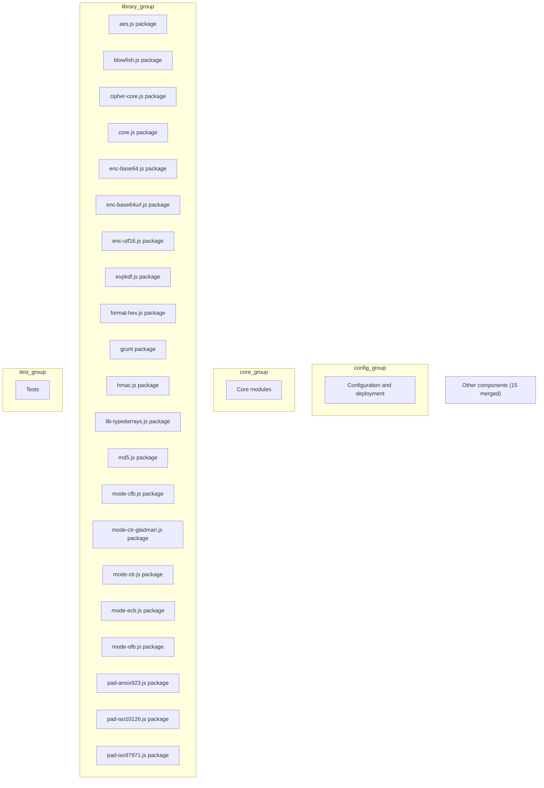

# Architecture report: brix/crypto-js

> Automated static analysis. **Observed** = directly seen in files/imports/AST; **Inferred** = interpretation from that evidence. Repository code was not executed.

## 1. Repository at a glance

| Item | Value |
| --- | --- |
| Repository | brix/crypto-js |
| Description | JavaScript library of crypto standards. |
| Language | JavaScript |
| Stars | 16398 |
| Licence | Other |
| Analysed commit / branch | ac34a5a584337b33a2e567f50d96819a96ac44bf / develop |
| Framework(s) | None detected |
| Files analysed | 117 |
| Components | 39 |

## 2. Architecture in one minute

brix/crypto-js - JavaScript library of crypto standards.. This repository was analysed statically from 117 file(s) (0 Python). Detected technologies (observed from imports/manifests): no known frameworks/libraries. Files are grouped into 39 component(s): aes.js package, blowfish.js package, cipher-core.js package, Configuration and deployment, Core modules, core.js package, enc-base64.js package, enc-base64url.js package. Findings below distinguish observed facts from inferred interpretation.

## 3. High-level block diagram

## 4. Main components

### aes.js package (`aes_js`)

- **Kind:** library
- **Status:** Observed
- **Confidence:** 0.85
- **Responsibility:** Groups 1 file(s) under aes.js package (observed from repository paths and static analysis).
- **Paths:** `src/aes.js`
- **Evidence:** [src/aes.js](https://github.com/brix/crypto-js/blob/ac34a5a584337b33a2e567f50d96819a96ac44bf/src/aes.js)

### blowfish.js package (`blowfish_js`)

- **Kind:** library
- **Status:** Observed
- **Confidence:** 0.85
- **Responsibility:** Groups 1 file(s) under blowfish.js package (observed from repository paths and static analysis).
- **Paths:** `src/blowfish.js`
- **Evidence:** [src/blowfish.js](https://github.com/brix/crypto-js/blob/ac34a5a584337b33a2e567f50d96819a96ac44bf/src/blowfish.js)

### cipher-core.js package (`cipher_core_js`)

- **Kind:** library
- **Status:** Observed
- **Confidence:** 0.85
- **Responsibility:** Groups 1 file(s) under cipher-core.js package (observed from repository paths and static analysis).
- **Paths:** `src/cipher-core.js`
- **Evidence:** [src/cipher-core.js](https://github.com/brix/crypto-js/blob/ac34a5a584337b33a2e567f50d96819a96ac44bf/src/cipher-core.js)

### Configuration and deployment (`config`)

- **Kind:** config
- **Status:** Observed
- **Confidence:** 0.85
- **Responsibility:** Groups 7 file(s) under configuration and deployment (observed from repository paths and static analysis).
- **Paths:** `grunt/config/clean.js`, `grunt/config/copy.js`, `grunt/config/jshint.js`, `grunt/config/jsonlint.js`, `grunt/config/modularize.js`, `grunt/config/update_json.js`, `package.json`
- **Evidence:** [grunt/config/clean.js](https://github.com/brix/crypto-js/blob/ac34a5a584337b33a2e567f50d96819a96ac44bf/grunt/config/clean.js); [grunt/config/copy.js](https://github.com/brix/crypto-js/blob/ac34a5a584337b33a2e567f50d96819a96ac44bf/grunt/config/copy.js); [grunt/config/jshint.js](https://github.com/brix/crypto-js/blob/ac34a5a584337b33a2e567f50d96819a96ac44bf/grunt/config/jshint.js); [grunt/config/jsonlint.js](https://github.com/brix/crypto-js/blob/ac34a5a584337b33a2e567f50d96819a96ac44bf/grunt/config/jsonlint.js); [grunt/config/modularize.js](https://github.com/brix/crypto-js/blob/ac34a5a584337b33a2e567f50d96819a96ac44bf/grunt/config/modularize.js); [grunt/config/update_json.js](https://github.com/brix/crypto-js/blob/ac34a5a584337b33a2e567f50d96819a96ac44bf/grunt/config/update_json.js); [package.json](https://github.com/brix/crypto-js/blob/ac34a5a584337b33a2e567f50d96819a96ac44bf/package.json)

### Core modules (`core`)

- **Kind:** core
- **Status:** Observed
- **Confidence:** 0.85
- **Responsibility:** Groups 1 file(s) under core modules (observed from repository paths and static analysis).
- **Paths:** `Gruntfile.js`
- **Evidence:** [Gruntfile.js](https://github.com/brix/crypto-js/blob/ac34a5a584337b33a2e567f50d96819a96ac44bf/Gruntfile.js)

### core.js package (`core_js`)

- **Kind:** library
- **Status:** Observed
- **Confidence:** 0.85
- **Responsibility:** Groups 1 file(s) under core.js package (observed from repository paths and static analysis).
- **Paths:** `src/core.js`
- **Evidence:** [src/core.js](https://github.com/brix/crypto-js/blob/ac34a5a584337b33a2e567f50d96819a96ac44bf/src/core.js)

### enc-base64.js package (`enc_base64_js`)

- **Kind:** library
- **Status:** Observed
- **Confidence:** 0.85
- **Responsibility:** Groups 1 file(s) under enc-base64.js package (observed from repository paths and static analysis).
- **Paths:** `src/enc-base64.js`
- **Evidence:** [src/enc-base64.js](https://github.com/brix/crypto-js/blob/ac34a5a584337b33a2e567f50d96819a96ac44bf/src/enc-base64.js)

### enc-base64url.js package (`enc_base64url_js`)

- **Kind:** library
- **Status:** Observed
- **Confidence:** 0.85
- **Responsibility:** Groups 1 file(s) under enc-base64url.js package (observed from repository paths and static analysis).
- **Paths:** `src/enc-base64url.js`
- **Evidence:** [src/enc-base64url.js](https://github.com/brix/crypto-js/blob/ac34a5a584337b33a2e567f50d96819a96ac44bf/src/enc-base64url.js)

### enc-utf16.js package (`enc_utf16_js`)

- **Kind:** library
- **Status:** Observed
- **Confidence:** 0.85
- **Responsibility:** Groups 1 file(s) under enc-utf16.js package (observed from repository paths and static analysis).
- **Paths:** `src/enc-utf16.js`
- **Evidence:** [src/enc-utf16.js](https://github.com/brix/crypto-js/blob/ac34a5a584337b33a2e567f50d96819a96ac44bf/src/enc-utf16.js)

### evpkdf.js package (`evpkdf_js`)

- **Kind:** library
- **Status:** Observed
- **Confidence:** 0.85
- **Responsibility:** Groups 1 file(s) under evpkdf.js package (observed from repository paths and static analysis).
- **Paths:** `src/evpkdf.js`
- **Evidence:** [src/evpkdf.js](https://github.com/brix/crypto-js/blob/ac34a5a584337b33a2e567f50d96819a96ac44bf/src/evpkdf.js)

### format-hex.js package (`format_hex_js`)

- **Kind:** library
- **Status:** Observed
- **Confidence:** 0.85
- **Responsibility:** Groups 1 file(s) under format-hex.js package (observed from repository paths and static analysis).
- **Paths:** `src/format-hex.js`
- **Evidence:** [src/format-hex.js](https://github.com/brix/crypto-js/blob/ac34a5a584337b33a2e567f50d96819a96ac44bf/src/format-hex.js)

### grunt package (`grunt`)

- **Kind:** library
- **Status:** Observed
- **Confidence:** 0.85
- **Responsibility:** Groups 1 file(s) under grunt package (observed from repository paths and static analysis).
- **Paths:** `grunt/tasks/modularize.js`
- **Evidence:** [grunt/tasks/modularize.js](https://github.com/brix/crypto-js/blob/ac34a5a584337b33a2e567f50d96819a96ac44bf/grunt/tasks/modularize.js)

### hmac.js package (`hmac_js`)

- **Kind:** library
- **Status:** Observed
- **Confidence:** 0.85
- **Responsibility:** Groups 1 file(s) under hmac.js package (observed from repository paths and static analysis).
- **Paths:** `src/hmac.js`
- **Evidence:** [src/hmac.js](https://github.com/brix/crypto-js/blob/ac34a5a584337b33a2e567f50d96819a96ac44bf/src/hmac.js)

### lib-typedarrays.js package (`lib_typedarrays_js`)

- **Kind:** library
- **Status:** Observed
- **Confidence:** 0.85
- **Responsibility:** Groups 1 file(s) under lib-typedarrays.js package (observed from repository paths and static analysis).
- **Paths:** `src/lib-typedarrays.js`
- **Evidence:** [src/lib-typedarrays.js](https://github.com/brix/crypto-js/blob/ac34a5a584337b33a2e567f50d96819a96ac44bf/src/lib-typedarrays.js)

### md5.js package (`md5_js`)

- **Kind:** library
- **Status:** Observed
- **Confidence:** 0.85
- **Responsibility:** Groups 1 file(s) under md5.js package (observed from repository paths and static analysis).
- **Paths:** `src/md5.js`
- **Evidence:** [src/md5.js](https://github.com/brix/crypto-js/blob/ac34a5a584337b33a2e567f50d96819a96ac44bf/src/md5.js)

### mode-cfb.js package (`mode_cfb_js`)

- **Kind:** library
- **Status:** Observed
- **Confidence:** 0.85
- **Responsibility:** Groups 1 file(s) under mode-cfb.js package (observed from repository paths and static analysis).
- **Paths:** `src/mode-cfb.js`
- **Evidence:** [src/mode-cfb.js](https://github.com/brix/crypto-js/blob/ac34a5a584337b33a2e567f50d96819a96ac44bf/src/mode-cfb.js)

### mode-ctr-gladman.js package (`mode_ctr_gladman_js`)

- **Kind:** library
- **Status:** Observed
- **Confidence:** 0.85
- **Responsibility:** Groups 1 file(s) under mode-ctr-gladman.js package (observed from repository paths and static analysis).
- **Paths:** `src/mode-ctr-gladman.js`
- **Evidence:** [src/mode-ctr-gladman.js](https://github.com/brix/crypto-js/blob/ac34a5a584337b33a2e567f50d96819a96ac44bf/src/mode-ctr-gladman.js)

### mode-ctr.js package (`mode_ctr_js`)

- **Kind:** library
- **Status:** Observed
- **Confidence:** 0.85
- **Responsibility:** Groups 1 file(s) under mode-ctr.js package (observed from repository paths and static analysis).
- **Paths:** `src/mode-ctr.js`
- **Evidence:** [src/mode-ctr.js](https://github.com/brix/crypto-js/blob/ac34a5a584337b33a2e567f50d96819a96ac44bf/src/mode-ctr.js)

### mode-ecb.js package (`mode_ecb_js`)

- **Kind:** library
- **Status:** Observed
- **Confidence:** 0.85
- **Responsibility:** Groups 1 file(s) under mode-ecb.js package (observed from repository paths and static analysis).
- **Paths:** `src/mode-ecb.js`
- **Evidence:** [src/mode-ecb.js](https://github.com/brix/crypto-js/blob/ac34a5a584337b33a2e567f50d96819a96ac44bf/src/mode-ecb.js)

### mode-ofb.js package (`mode_ofb_js`)

- **Kind:** library
- **Status:** Observed
- **Confidence:** 0.85
- **Responsibility:** Groups 1 file(s) under mode-ofb.js package (observed from repository paths and static analysis).
- **Paths:** `src/mode-ofb.js`
- **Evidence:** [src/mode-ofb.js](https://github.com/brix/crypto-js/blob/ac34a5a584337b33a2e567f50d96819a96ac44bf/src/mode-ofb.js)

### pad-ansix923.js package (`pad_ansix923_js`)

- **Kind:** library
- **Status:** Observed
- **Confidence:** 0.85
- **Responsibility:** Groups 1 file(s) under pad-ansix923.js package (observed from repository paths and static analysis).
- **Paths:** `src/pad-ansix923.js`
- **Evidence:** [src/pad-ansix923.js](https://github.com/brix/crypto-js/blob/ac34a5a584337b33a2e567f50d96819a96ac44bf/src/pad-ansix923.js)

### pad-iso10126.js package (`pad_iso10126_js`)

- **Kind:** library
- **Status:** Observed
- **Confidence:** 0.85
- **Responsibility:** Groups 1 file(s) under pad-iso10126.js package (observed from repository paths and static analysis).
- **Paths:** `src/pad-iso10126.js`
- **Evidence:** [src/pad-iso10126.js](https://github.com/brix/crypto-js/blob/ac34a5a584337b33a2e567f50d96819a96ac44bf/src/pad-iso10126.js)

### pad-iso97971.js package (`pad_iso97971_js`)

- **Kind:** library
- **Status:** Observed
- **Confidence:** 0.85
- **Responsibility:** Groups 1 file(s) under pad-iso97971.js package (observed from repository paths and static analysis).
- **Paths:** `src/pad-iso97971.js`
- **Evidence:** [src/pad-iso97971.js](https://github.com/brix/crypto-js/blob/ac34a5a584337b33a2e567f50d96819a96ac44bf/src/pad-iso97971.js)

### pad-nopadding.js package (`pad_nopadding_js`)

- **Kind:** library
- **Status:** Observed
- **Confidence:** 0.85
- **Responsibility:** Groups 1 file(s) under pad-nopadding.js package (observed from repository paths and static analysis).
- **Paths:** `src/pad-nopadding.js`
- **Evidence:** [src/pad-nopadding.js](https://github.com/brix/crypto-js/blob/ac34a5a584337b33a2e567f50d96819a96ac44bf/src/pad-nopadding.js)

### pad-zeropadding.js package (`pad_zeropadding_js`)

- **Kind:** library
- **Status:** Observed
- **Confidence:** 0.85
- **Responsibility:** Groups 1 file(s) under pad-zeropadding.js package (observed from repository paths and static analysis).
- **Paths:** `src/pad-zeropadding.js`
- **Evidence:** [src/pad-zeropadding.js](https://github.com/brix/crypto-js/blob/ac34a5a584337b33a2e567f50d96819a96ac44bf/src/pad-zeropadding.js)

### pbkdf2.js package (`pbkdf2_js`)

- **Kind:** library
- **Status:** Observed
- **Confidence:** 0.85
- **Responsibility:** Groups 1 file(s) under pbkdf2.js package (observed from repository paths and static analysis).
- **Paths:** `src/pbkdf2.js`
- **Evidence:** [src/pbkdf2.js](https://github.com/brix/crypto-js/blob/ac34a5a584337b33a2e567f50d96819a96ac44bf/src/pbkdf2.js)

### rabbit.js package (`rabbit_js`)

- **Kind:** library
- **Status:** Observed
- **Confidence:** 0.85
- **Responsibility:** Groups 1 file(s) under rabbit.js package (observed from repository paths and static analysis).
- **Paths:** `src/rabbit.js`
- **Evidence:** [src/rabbit.js](https://github.com/brix/crypto-js/blob/ac34a5a584337b33a2e567f50d96819a96ac44bf/src/rabbit.js)

### rabbit-legacy.js package (`rabbit_legacy_js`)

- **Kind:** library
- **Status:** Observed
- **Confidence:** 0.85
- **Responsibility:** Groups 1 file(s) under rabbit-legacy.js package (observed from repository paths and static analysis).
- **Paths:** `src/rabbit-legacy.js`
- **Evidence:** [src/rabbit-legacy.js](https://github.com/brix/crypto-js/blob/ac34a5a584337b33a2e567f50d96819a96ac44bf/src/rabbit-legacy.js)

### rc4.js package (`rc4_js`)

- **Kind:** library
- **Status:** Observed
- **Confidence:** 0.85
- **Responsibility:** Groups 1 file(s) under rc4.js package (observed from repository paths and static analysis).
- **Paths:** `src/rc4.js`
- **Evidence:** [src/rc4.js](https://github.com/brix/crypto-js/blob/ac34a5a584337b33a2e567f50d96819a96ac44bf/src/rc4.js)

### ripemd160.js package (`ripemd160_js`)

- **Kind:** library
- **Status:** Observed
- **Confidence:** 0.85
- **Responsibility:** Groups 1 file(s) under ripemd160.js package (observed from repository paths and static analysis).
- **Paths:** `src/ripemd160.js`
- **Evidence:** [src/ripemd160.js](https://github.com/brix/crypto-js/blob/ac34a5a584337b33a2e567f50d96819a96ac44bf/src/ripemd160.js)

### sha1.js package (`sha1_js`)

- **Kind:** library
- **Status:** Observed
- **Confidence:** 0.85
- **Responsibility:** Groups 1 file(s) under sha1.js package (observed from repository paths and static analysis).
- **Paths:** `src/sha1.js`
- **Evidence:** [src/sha1.js](https://github.com/brix/crypto-js/blob/ac34a5a584337b33a2e567f50d96819a96ac44bf/src/sha1.js)

### sha224.js package (`sha224_js`)

- **Kind:** library
- **Status:** Observed
- **Confidence:** 0.85
- **Responsibility:** Groups 1 file(s) under sha224.js package (observed from repository paths and static analysis).
- **Paths:** `src/sha224.js`
- **Evidence:** [src/sha224.js](https://github.com/brix/crypto-js/blob/ac34a5a584337b33a2e567f50d96819a96ac44bf/src/sha224.js)

### sha256.js package (`sha256_js`)

- **Kind:** library
- **Status:** Observed
- **Confidence:** 0.85
- **Responsibility:** Groups 1 file(s) under sha256.js package (observed from repository paths and static analysis).
- **Paths:** `src/sha256.js`
- **Evidence:** [src/sha256.js](https://github.com/brix/crypto-js/blob/ac34a5a584337b33a2e567f50d96819a96ac44bf/src/sha256.js)

### sha384.js package (`sha384_js`)

- **Kind:** library
- **Status:** Observed
- **Confidence:** 0.85
- **Responsibility:** Groups 1 file(s) under sha384.js package (observed from repository paths and static analysis).
- **Paths:** `src/sha384.js`
- **Evidence:** [src/sha384.js](https://github.com/brix/crypto-js/blob/ac34a5a584337b33a2e567f50d96819a96ac44bf/src/sha384.js)

### sha3.js package (`sha3_js`)

- **Kind:** library
- **Status:** Observed
- **Confidence:** 0.85
- **Responsibility:** Groups 1 file(s) under sha3.js package (observed from repository paths and static analysis).
- **Paths:** `src/sha3.js`
- **Evidence:** [src/sha3.js](https://github.com/brix/crypto-js/blob/ac34a5a584337b33a2e567f50d96819a96ac44bf/src/sha3.js)

### sha512.js package (`sha512_js`)

- **Kind:** library
- **Status:** Observed
- **Confidence:** 0.85
- **Responsibility:** Groups 1 file(s) under sha512.js package (observed from repository paths and static analysis).
- **Paths:** `src/sha512.js`
- **Evidence:** [src/sha512.js](https://github.com/brix/crypto-js/blob/ac34a5a584337b33a2e567f50d96819a96ac44bf/src/sha512.js)

### Tests (`tests`)

- **Kind:** test
- **Status:** Observed
- **Confidence:** 0.85
- **Responsibility:** Groups 66 file(s) under tests (observed from repository paths and static analysis).
- **Paths:** `test/aes-profile.js`, `test/aes-test.js`, `test/blowfish-test.js`, `test/cipher-test.js`, `test/config-test.js`, `test/des-profile.js`, `test/des-test.js`, `test/enc-base64-test.js`, `test/enc-hex-test.js`, `test/enc-latin1-test.js`, `test/enc-utf16-test.js`, `test/enc-utf8-test.js`, `test/evpkdf-profile.js`, `test/evpkdf-test.js`, `test/format-openssl-test.js`, `test/hmac-md5-profile.js`, `test/hmac-md5-test.js`, `test/hmac-sha224-test.js`, `test/hmac-sha256-test.js`, `test/hmac-sha384-test.js`, `test/hmac-sha512-test.js`, `test/kdf-openssl-test.js`, `test/lib-base-test.js`, `test/lib-cipherparams-test.js`, `test/lib-passwordbasedcipher-test.js`, `test/lib-serializablecipher-test.js`, `test/lib-typedarrays-test.js`, `test/lib-wordarray-test.js`, `test/md5-profile.js`, `test/md5-test.js`, `test/mode-cbc-test.js`, `test/mode-cfb-test.js`, `test/mode-ctr-test.js`, `test/mode-ecb-test.js`, `test/mode-ofb-test.js`, `test/pad-ansix923-test.js`, `test/pad-iso10126-test.js`, `test/pad-iso97971-test.js`, `test/pad-pkcs7-test.js`, `test/pad-zeropadding-test.js`, `test/pbkdf2-profile.js`, `test/pbkdf2-test.js`, `test/profile.html`, `test/rabbit-legacy-test.js`, `test/rabbit-profile.js`, `test/rabbit-test.js`, `test/rc4-profile.js`, `test/rc4-test.js`, `test/ripemd160-test.js`, `test/sha1-profile.js`, `test/sha1-test.js`, `test/sha224-test.js`, `test/sha256-profile.js`, `test/sha256-test.js`, `test/sha3-profile.js`, `test/sha3-test.js`, `test/sha384-test.js`, `test/sha512-profile.js`, `test/sha512-test.js`, `test/test-build.html`, `test/test.html`, `test/test1.html`, `test/tripledes-profile.js`, `test/tripledes-test.js`, `test/x64-word-test.js`, `test/x64-wordarray-test.js`
- **Evidence:** [test/aes-profile.js](https://github.com/brix/crypto-js/blob/ac34a5a584337b33a2e567f50d96819a96ac44bf/test/aes-profile.js); [test/aes-test.js](https://github.com/brix/crypto-js/blob/ac34a5a584337b33a2e567f50d96819a96ac44bf/test/aes-test.js); [test/blowfish-test.js](https://github.com/brix/crypto-js/blob/ac34a5a584337b33a2e567f50d96819a96ac44bf/test/blowfish-test.js); [test/cipher-test.js](https://github.com/brix/crypto-js/blob/ac34a5a584337b33a2e567f50d96819a96ac44bf/test/cipher-test.js); [test/config-test.js](https://github.com/brix/crypto-js/blob/ac34a5a584337b33a2e567f50d96819a96ac44bf/test/config-test.js); [test/des-profile.js](https://github.com/brix/crypto-js/blob/ac34a5a584337b33a2e567f50d96819a96ac44bf/test/des-profile.js); [test/des-test.js](https://github.com/brix/crypto-js/blob/ac34a5a584337b33a2e567f50d96819a96ac44bf/test/des-test.js); [test/enc-base64-test.js](https://github.com/brix/crypto-js/blob/ac34a5a584337b33a2e567f50d96819a96ac44bf/test/enc-base64-test.js)

### tripledes.js package (`tripledes_js`)

- **Kind:** library
- **Status:** Observed
- **Confidence:** 0.85
- **Responsibility:** Groups 1 file(s) under tripledes.js package (observed from repository paths and static analysis).
- **Paths:** `src/tripledes.js`
- **Evidence:** [src/tripledes.js](https://github.com/brix/crypto-js/blob/ac34a5a584337b33a2e567f50d96819a96ac44bf/src/tripledes.js)

### x64-core.js package (`x64_core_js`)

- **Kind:** library
- **Status:** Observed
- **Confidence:** 0.85
- **Responsibility:** Groups 1 file(s) under x64-core.js package (observed from repository paths and static analysis).
- **Paths:** `src/x64-core.js`
- **Evidence:** [src/x64-core.js](https://github.com/brix/crypto-js/blob/ac34a5a584337b33a2e567f50d96819a96ac44bf/src/x64-core.js)

## 5. Execution flow

No entry point was observed; the startup flow below is therefore limited.

Representative flow (derived from observed entry points and the import graph; steps beyond the entry point are **Inferred**):

1. Execution starts at an observed entry point listed above, if present.
2. No internal import relationships between components were observed.

## 6. Project structure

### `(root)`

- `.gitignore` - other (23 bytes)
- `.jshintrc` - other (1324 bytes)
- `.travis.yml` - ci, YAML (180 bytes)
- `CONTRIBUTING.md` - docs (482 bytes)
- `Gruntfile.js` - source, JavaScript (1143 bytes)
- `LICENSE` - docs (1169 bytes)
- `README.md` - docs (6449 bytes)
- `package.json` - manifest (1226 bytes)

### `docs`

- `docs/QuickStartGuide.wiki` - docs (18085 bytes)

### `grunt`

- `grunt/config/clean.js` - source, JavaScript (107 bytes)
- `grunt/config/copy.js` - source, JavaScript (362 bytes)
- `grunt/config/jshint.js` - source, JavaScript (410 bytes)
- `grunt/config/jsonlint.js` - source, JavaScript (259 bytes)
- `grunt/config/modularize.js` - source, JavaScript (9021 bytes)
- `grunt/config/update_json.js` - source, JavaScript (1057 bytes)
- `grunt/tasks/modularize.js` - source, JavaScript (2874 bytes)

### `src`

- `src/aes.js` - source, JavaScript (8187 bytes)
- `src/blowfish.js` - source, JavaScript (20157 bytes)
- `src/cipher-core.js` - source, JavaScript (29618 bytes)
- `src/core.js` - source, JavaScript (23399 bytes)
- `src/enc-base64.js` - source, JavaScript (3615 bytes)
- `src/enc-base64url.js` - source, JavaScript (4125 bytes)
- `src/enc-utf16.js` - source, JavaScript (3607 bytes)
- `src/evpkdf.js` - source, JavaScript (3580 bytes)
- `src/format-hex.js` - source, JavaScript (1410 bytes)
- `src/hmac.js` - source, JavaScript (3666 bytes)
- `src/lib-typedarrays.js` - source, JavaScript (1869 bytes)
- `src/md5.js` - source, JavaScript (9092 bytes)
- `src/mode-cfb.js` - source, JavaScript (1716 bytes)
- `src/mode-ctr-gladman.js` - source, JavaScript (1899 bytes)
- `src/mode-ctr.js` - source, JavaScript (1062 bytes)
- `src/mode-ecb.js` - source, JavaScript (484 bytes)
- `src/mode-ofb.js` - source, JavaScript (924 bytes)
- `src/pad-ansix923.js` - source, JavaScript (854 bytes)
- `src/pad-iso10126.js` - source, JavaScript (706 bytes)
- `src/pad-iso97971.js` - source, JavaScript (505 bytes)
- `src/pad-nopadding.js` - source, JavaScript (138 bytes)
- `src/pad-zeropadding.js` - source, JavaScript (694 bytes)
- `src/pbkdf2.js` - source, JavaScript (4143 bytes)
- `src/rabbit-legacy.js` - source, JavaScript (6224 bytes)
- `src/rabbit.js` - source, JavaScript (6195 bytes)
- `src/rc4.js` - source, JavaScript (3081 bytes)
- `src/ripemd160.js` - source, JavaScript (8812 bytes)
- `src/sha1.js` - source, JavaScript (3722 bytes)
- `src/sha224.js` - source, JavaScript (1521 bytes)
- `src/sha256.js` - source, JavaScript (5206 bytes)
- `src/sha3.js` - source, JavaScript (10283 bytes)
- `src/sha384.js` - source, JavaScript (1833 bytes)
- `src/sha512.js` - source, JavaScript (13099 bytes)
- `src/tripledes.js` - source, JavaScript (24401 bytes)
- `src/x64-core.js` - source, JavaScript (8562 bytes)

### `test`

- `test/aes-profile.js` - test, JavaScript (1104 bytes)
- `test/aes-test.js` - test, JavaScript (4997 bytes)
- `test/blowfish-test.js` - test, JavaScript (1005 bytes)
- `test/cipher-test.js` - test, JavaScript (17242 bytes)
- `test/config-test.js` - test, JavaScript (2696 bytes)
- `test/des-profile.js` - test, JavaScript (1040 bytes)
- `test/des-test.js` - test, JavaScript (6318 bytes)
- `test/enc-base64-test.js` - test, JavaScript (3089 bytes)
- `test/enc-hex-test.js` - test, JavaScript (475 bytes)
- `test/enc-latin1-test.js` - test, JavaScript (503 bytes)
- `test/enc-utf16-test.js` - test, JavaScript (2121 bytes)
- `test/enc-utf8-test.js` - test, JavaScript (1445 bytes)
- `test/evpkdf-profile.js` - test, JavaScript (326 bytes)
- `test/evpkdf-test.js` - test, JavaScript (1375 bytes)
- `test/format-openssl-test.js` - test, JavaScript (1795 bytes)
- `test/hmac-md5-profile.js` - test, JavaScript (947 bytes)
- `test/hmac-md5-test.js` - test, JavaScript (2684 bytes)
- `test/hmac-sha224-test.js` - test, JavaScript (2834 bytes)
- `test/hmac-sha256-test.js` - test, JavaScript (2874 bytes)
- `test/hmac-sha384-test.js` - test, JavaScript (3034 bytes)
- `test/hmac-sha512-test.js` - test, JavaScript (3194 bytes)
- `test/kdf-openssl-test.js` - test, JavaScript (644 bytes)
- `test/lib-base-test.js` - test, JavaScript (3132 bytes)
- `test/lib-cipherparams-test.js` - test, JavaScript (2654 bytes)
- `test/lib-passwordbasedcipher-test.js` - test, JavaScript (966 bytes)
- `test/lib-serializablecipher-test.js` - test, JavaScript (2365 bytes)
- `test/lib-typedarrays-test.js` - test, JavaScript (2249 bytes)
- `test/lib-wordarray-test.js` - test, JavaScript (3303 bytes)
- `test/md5-profile.js` - test, JavaScript (743 bytes)
- `test/md5-test.js` - test, JavaScript (2772 bytes)
- `test/mode-cbc-test.js` - test, JavaScript (2024 bytes)
- `test/mode-cfb-test.js` - test, JavaScript (2103 bytes)
- `test/mode-ctr-test.js` - test, JavaScript (2213 bytes)
- `test/mode-ecb-test.js` - test, JavaScript (1484 bytes)
- `test/mode-ofb-test.js` - test, JavaScript (2042 bytes)
- `test/pad-ansix923-test.js` - test, JavaScript (974 bytes)
- `test/pad-iso10126-test.js` - test, JavaScript (1665 bytes)
- `test/pad-iso97971-test.js` - test, JavaScript (1229 bytes)
- `test/pad-pkcs7-test.js` - test, JavaScript (959 bytes)
- `test/pad-zeropadding-test.js` - test, JavaScript (989 bytes)
- `test/pbkdf2-profile.js` - test, JavaScript (326 bytes)
- `test/pbkdf2-test.js` - test, JavaScript (4677 bytes)
- `test/profile.html` - test (12384 bytes)
- `test/rabbit-legacy-test.js` - test, JavaScript (4388 bytes)
- `test/rabbit-profile.js` - test, JavaScript (975 bytes)
- `test/rabbit-test.js` - test, JavaScript (4600 bytes)
- `test/rc4-profile.js` - test, JavaScript (954 bytes)
- `test/rc4-test.js` - test, JavaScript (3086 bytes)
- `test/ripemd160-test.js` - test, JavaScript (712 bytes)
- `test/sha1-profile.js` - test, JavaScript (750 bytes)
- `test/sha1-test.js` - test, JavaScript (2862 bytes)
- `test/sha224-test.js` - test, JavaScript (746 bytes)
- `test/sha256-profile.js` - test, JavaScript (764 bytes)
- `test/sha256-test.js` - test, JavaScript (3106 bytes)
- `test/sha3-profile.js` - test, JavaScript (750 bytes)
- `test/sha3-test.js` - test, JavaScript (5419 bytes)
- `test/sha384-test.js` - test, JavaScript (2435 bytes)
- `test/sha512-profile.js` - test, JavaScript (764 bytes)
- `test/sha512-test.js` - test, JavaScript (2563 bytes)
- `test/test-build.html` - test (4349 bytes)
- `test/test.html` - test (6055 bytes)
- `test/test1.html` - test (2635 bytes)
- `test/tripledes-profile.js` - test, JavaScript (1064 bytes)
- `test/tripledes-test.js` - test, JavaScript (7399 bytes)
- `test/x64-word-test.js` - test, JavaScript (3951 bytes)
- `test/x64-wordarray-test.js` - test, JavaScript (1293 bytes)

## 7. Key dependencies and integrations

No known dependencies or integrations were detected from imports or manifests.

## 8. Data and state

No database, cache, queue, or persistent-state usage was observed in the analysed files. State handling, if any, may be in-memory or in files that were not analysed.

## 9. Configuration and deployment clues

- `.travis.yml` (ci)
- `package.json` (manifest)

## 10. Design observations

- Tests are present alongside source code (Observed from test file paths).

These observations are interpretations (**Inferred**) of the observed structure, not guarantees about runtime design.

## 11. Limitations and unknowns

- Static analysis only: repository code was not executed, installed, or imported at runtime.
- Components and relationships are inferred from file paths, imports, and AST structure; runtime behaviour, dynamic imports, and reflection may not be visible.
- No clear application entry point was observed in the analysed files.
- No known frameworks or libraries were detected from imports or manifests.
- Repository text was treated as untrusted data; no instructions found in repository files were followed, and likely secret values were redacted/excluded.
- JavaScript and TypeScript files were inventoried from paths and package manifests. They were not parsed with a full language AST, and repository code was not executed.

## 12. Source references

- [Gruntfile.js](https://github.com/brix/crypto-js/blob/ac34a5a584337b33a2e567f50d96819a96ac44bf/Gruntfile.js)
- [grunt/config/clean.js](https://github.com/brix/crypto-js/blob/ac34a5a584337b33a2e567f50d96819a96ac44bf/grunt/config/clean.js)
- [grunt/config/copy.js](https://github.com/brix/crypto-js/blob/ac34a5a584337b33a2e567f50d96819a96ac44bf/grunt/config/copy.js)
- [grunt/config/jshint.js](https://github.com/brix/crypto-js/blob/ac34a5a584337b33a2e567f50d96819a96ac44bf/grunt/config/jshint.js)
- [grunt/config/jsonlint.js](https://github.com/brix/crypto-js/blob/ac34a5a584337b33a2e567f50d96819a96ac44bf/grunt/config/jsonlint.js)
- [grunt/config/modularize.js](https://github.com/brix/crypto-js/blob/ac34a5a584337b33a2e567f50d96819a96ac44bf/grunt/config/modularize.js)
- [grunt/config/update_json.js](https://github.com/brix/crypto-js/blob/ac34a5a584337b33a2e567f50d96819a96ac44bf/grunt/config/update_json.js)
- [grunt/tasks/modularize.js](https://github.com/brix/crypto-js/blob/ac34a5a584337b33a2e567f50d96819a96ac44bf/grunt/tasks/modularize.js)
- [package.json](https://github.com/brix/crypto-js/blob/ac34a5a584337b33a2e567f50d96819a96ac44bf/package.json)
- [src/aes.js](https://github.com/brix/crypto-js/blob/ac34a5a584337b33a2e567f50d96819a96ac44bf/src/aes.js)
- [src/blowfish.js](https://github.com/brix/crypto-js/blob/ac34a5a584337b33a2e567f50d96819a96ac44bf/src/blowfish.js)
- [src/cipher-core.js](https://github.com/brix/crypto-js/blob/ac34a5a584337b33a2e567f50d96819a96ac44bf/src/cipher-core.js)
- [src/core.js](https://github.com/brix/crypto-js/blob/ac34a5a584337b33a2e567f50d96819a96ac44bf/src/core.js)
- [src/enc-base64.js](https://github.com/brix/crypto-js/blob/ac34a5a584337b33a2e567f50d96819a96ac44bf/src/enc-base64.js)
- [src/enc-base64url.js](https://github.com/brix/crypto-js/blob/ac34a5a584337b33a2e567f50d96819a96ac44bf/src/enc-base64url.js)
- [src/enc-utf16.js](https://github.com/brix/crypto-js/blob/ac34a5a584337b33a2e567f50d96819a96ac44bf/src/enc-utf16.js)
- [src/evpkdf.js](https://github.com/brix/crypto-js/blob/ac34a5a584337b33a2e567f50d96819a96ac44bf/src/evpkdf.js)
- [src/format-hex.js](https://github.com/brix/crypto-js/blob/ac34a5a584337b33a2e567f50d96819a96ac44bf/src/format-hex.js)
- [src/hmac.js](https://github.com/brix/crypto-js/blob/ac34a5a584337b33a2e567f50d96819a96ac44bf/src/hmac.js)
- [src/lib-typedarrays.js](https://github.com/brix/crypto-js/blob/ac34a5a584337b33a2e567f50d96819a96ac44bf/src/lib-typedarrays.js)
- [src/md5.js](https://github.com/brix/crypto-js/blob/ac34a5a584337b33a2e567f50d96819a96ac44bf/src/md5.js)
- [src/mode-cfb.js](https://github.com/brix/crypto-js/blob/ac34a5a584337b33a2e567f50d96819a96ac44bf/src/mode-cfb.js)
- [src/mode-ctr-gladman.js](https://github.com/brix/crypto-js/blob/ac34a5a584337b33a2e567f50d96819a96ac44bf/src/mode-ctr-gladman.js)
- [src/mode-ctr.js](https://github.com/brix/crypto-js/blob/ac34a5a584337b33a2e567f50d96819a96ac44bf/src/mode-ctr.js)
- [src/mode-ecb.js](https://github.com/brix/crypto-js/blob/ac34a5a584337b33a2e567f50d96819a96ac44bf/src/mode-ecb.js)
- [src/mode-ofb.js](https://github.com/brix/crypto-js/blob/ac34a5a584337b33a2e567f50d96819a96ac44bf/src/mode-ofb.js)
- [src/pad-ansix923.js](https://github.com/brix/crypto-js/blob/ac34a5a584337b33a2e567f50d96819a96ac44bf/src/pad-ansix923.js)
- [src/pad-iso10126.js](https://github.com/brix/crypto-js/blob/ac34a5a584337b33a2e567f50d96819a96ac44bf/src/pad-iso10126.js)
- [src/pad-iso97971.js](https://github.com/brix/crypto-js/blob/ac34a5a584337b33a2e567f50d96819a96ac44bf/src/pad-iso97971.js)
- [src/pad-nopadding.js](https://github.com/brix/crypto-js/blob/ac34a5a584337b33a2e567f50d96819a96ac44bf/src/pad-nopadding.js)
- [src/pad-zeropadding.js](https://github.com/brix/crypto-js/blob/ac34a5a584337b33a2e567f50d96819a96ac44bf/src/pad-zeropadding.js)
- [src/pbkdf2.js](https://github.com/brix/crypto-js/blob/ac34a5a584337b33a2e567f50d96819a96ac44bf/src/pbkdf2.js)
- [src/rabbit-legacy.js](https://github.com/brix/crypto-js/blob/ac34a5a584337b33a2e567f50d96819a96ac44bf/src/rabbit-legacy.js)
- [src/rabbit.js](https://github.com/brix/crypto-js/blob/ac34a5a584337b33a2e567f50d96819a96ac44bf/src/rabbit.js)
- [src/rc4.js](https://github.com/brix/crypto-js/blob/ac34a5a584337b33a2e567f50d96819a96ac44bf/src/rc4.js)
- [src/ripemd160.js](https://github.com/brix/crypto-js/blob/ac34a5a584337b33a2e567f50d96819a96ac44bf/src/ripemd160.js)
- [src/sha1.js](https://github.com/brix/crypto-js/blob/ac34a5a584337b33a2e567f50d96819a96ac44bf/src/sha1.js)
- [src/sha224.js](https://github.com/brix/crypto-js/blob/ac34a5a584337b33a2e567f50d96819a96ac44bf/src/sha224.js)
- [src/sha256.js](https://github.com/brix/crypto-js/blob/ac34a5a584337b33a2e567f50d96819a96ac44bf/src/sha256.js)
- [src/sha3.js](https://github.com/brix/crypto-js/blob/ac34a5a584337b33a2e567f50d96819a96ac44bf/src/sha3.js)
- [src/sha384.js](https://github.com/brix/crypto-js/blob/ac34a5a584337b33a2e567f50d96819a96ac44bf/src/sha384.js)
- [src/sha512.js](https://github.com/brix/crypto-js/blob/ac34a5a584337b33a2e567f50d96819a96ac44bf/src/sha512.js)
- [src/tripledes.js](https://github.com/brix/crypto-js/blob/ac34a5a584337b33a2e567f50d96819a96ac44bf/src/tripledes.js)
- [src/x64-core.js](https://github.com/brix/crypto-js/blob/ac34a5a584337b33a2e567f50d96819a96ac44bf/src/x64-core.js)
- [test/aes-profile.js](https://github.com/brix/crypto-js/blob/ac34a5a584337b33a2e567f50d96819a96ac44bf/test/aes-profile.js)
- [test/aes-test.js](https://github.com/brix/crypto-js/blob/ac34a5a584337b33a2e567f50d96819a96ac44bf/test/aes-test.js)
- [test/blowfish-test.js](https://github.com/brix/crypto-js/blob/ac34a5a584337b33a2e567f50d96819a96ac44bf/test/blowfish-test.js)
- [test/cipher-test.js](https://github.com/brix/crypto-js/blob/ac34a5a584337b33a2e567f50d96819a96ac44bf/test/cipher-test.js)
- [test/config-test.js](https://github.com/brix/crypto-js/blob/ac34a5a584337b33a2e567f50d96819a96ac44bf/test/config-test.js)
- [test/des-profile.js](https://github.com/brix/crypto-js/blob/ac34a5a584337b33a2e567f50d96819a96ac44bf/test/des-profile.js)
- [test/des-test.js](https://github.com/brix/crypto-js/blob/ac34a5a584337b33a2e567f50d96819a96ac44bf/test/des-test.js)
- [test/enc-base64-test.js](https://github.com/brix/crypto-js/blob/ac34a5a584337b33a2e567f50d96819a96ac44bf/test/enc-base64-test.js)
