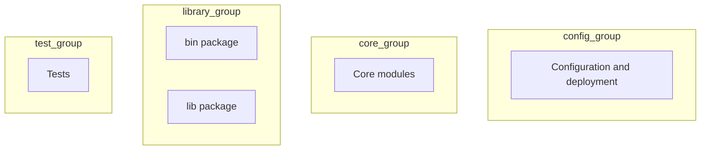

# Architecture report: browserify/browserify

> Automated static analysis. **Observed** = directly seen in files/imports/AST; **Inferred** = interpretation from that evidence. Repository code was not executed.

## 1. Repository at a glance

| Item | Value |
| --- | --- |
| Repository | browserify/browserify |
| Description | browser-side require() the node.js way |
| Language | JavaScript |
| Stars | 14690 |
| Licence | MIT |
| Analysed commit / branch | cd60f059d7a8432f2c3acea7d4dfcb81b97e7a3d / master |
| Framework(s) | None detected |
| Files analysed | 433 |
| Components | 5 |

## 2. Architecture in one minute

browserify/browserify - browser-side require() the node.js way. This repository was analysed statically from 433 file(s) (0 Python). Detected technologies (observed from imports/manifests): GitHub Actions. Files are grouped into 5 component(s): bin package, Configuration and deployment, Core modules, lib package, Tests. Findings below distinguish observed facts from inferred interpretation.

## 3. High-level block diagram

## 4. Main components

### bin package (`bin`)

- **Kind:** library
- **Status:** Observed
- **Confidence:** 0.85
- **Responsibility:** Groups 2 file(s) under bin package (observed from repository paths and static analysis).
- **Paths:** `bin/args.js`, `bin/cmd.js`
- **Evidence:** [bin/args.js](https://github.com/browserify/browserify/blob/cd60f059d7a8432f2c3acea7d4dfcb81b97e7a3d/bin/args.js); [bin/cmd.js](https://github.com/browserify/browserify/blob/cd60f059d7a8432f2c3acea7d4dfcb81b97e7a3d/bin/cmd.js)

### Configuration and deployment (`config`)

- **Kind:** config
- **Status:** Observed
- **Confidence:** 0.85
- **Responsibility:** Groups 2 file(s) under configuration and deployment (observed from repository paths and static analysis).
- **Paths:** `appveyor.yml`, `package.json`
- **Evidence:** [appveyor.yml](https://github.com/browserify/browserify/blob/cd60f059d7a8432f2c3acea7d4dfcb81b97e7a3d/appveyor.yml); [package.json](https://github.com/browserify/browserify/blob/cd60f059d7a8432f2c3acea7d4dfcb81b97e7a3d/package.json)

### Core modules (`core`)

- **Kind:** core
- **Status:** Observed
- **Confidence:** 0.85
- **Responsibility:** Groups 2 file(s) under core modules (observed from repository paths and static analysis).
- **Paths:** `eslint.config.mjs`, `index.js`
- **Evidence:** [eslint.config.mjs](https://github.com/browserify/browserify/blob/cd60f059d7a8432f2c3acea7d4dfcb81b97e7a3d/eslint.config.mjs); [index.js](https://github.com/browserify/browserify/blob/cd60f059d7a8432f2c3acea7d4dfcb81b97e7a3d/index.js)

### lib package (`lib`)

- **Kind:** library
- **Status:** Observed
- **Confidence:** 0.85
- **Responsibility:** Groups 2 file(s) under lib package (observed from repository paths and static analysis).
- **Paths:** `lib/_empty.js`, `lib/builtins.js`
- **Evidence:** [lib/_empty.js](https://github.com/browserify/browserify/blob/cd60f059d7a8432f2c3acea7d4dfcb81b97e7a3d/lib/_empty.js); [lib/builtins.js](https://github.com/browserify/browserify/blob/cd60f059d7a8432f2c3acea7d4dfcb81b97e7a3d/lib/builtins.js)

### Tests (`tests`)

- **Kind:** test
- **Status:** Observed
- **Confidence:** 0.85
- **Responsibility:** Groups 394 file(s) under tests (observed from repository paths and static analysis).
- **Paths:** `test/_versions.js`, `test/args.js`, `test/array.js`, `test/array/one.js`, `test/array/three.js`, `test/array/two.js`, `test/async.js`, `test/async/src.js`, `test/backbone.js`, `test/bare.js`, `test/bare/dirname-filename.js`, `test/bare/main.js`, `test/bare_shebang.js`, `test/bin.js`, `test/bin_entry.js`, `test/bin_tr_error.js`, `test/bin_tr_error/main.js`, `test/bin_tr_error/tr.js`, `test/bom.js`, `test/bom/hello.js`, `test/browser_field_file.js`, `test/browser_field_file/package.json`, `test/browser_field_file/wow.js`, `test/browser_field_resolve.js`, `test/browser_field_resolve/a/main.js`, `test/browser_field_resolve/a/package.json`, `test/browser_field_resolve/b/main.js`, `test/browser_field_resolve/b/package.json`, `test/browser_field_resolve/b/x.js`, `test/browser_field_resolve/c/main.js`, `test/browser_field_resolve/c/package.json`, `test/browser_field_resolve/c/x.js`, `test/browser_field_resolve/d/main.js`, `test/browser_field_resolve/d/package.json`, `test/browser_field_resolve/d/x.js`, `test/browser_field_resolve/e/main.js`, `test/browser_field_resolve/e/package.json`, `test/browser_field_resolve/e/x.js`, `test/browser_field_resolve/f/main.js`, `test/browser_field_resolve/f/package.json`, `test/browser_field_resolve/f/x.js`, `test/browser_field_resolve/g/main.js`, `test/browser_field_resolve/g/package.json`, `test/browser_field_resolve/g/x.js`, `test/browser_field_resolve/h/main.js`, `test/browser_field_resolve/h/package.json`, `test/browser_field_resolve/h/x.js`, `test/browser_field_resolve/i/browser.js`, `test/browser_field_resolve/i/main.js`, `test/browser_field_resolve/i/package.json`, `test/browser_field_resolve/i/x.js`, `test/browser_field_resolve/j/browser.js`, `test/browser_field_resolve/j/main.js`, `test/browser_field_resolve/j/package.json`, `test/browser_field_resolve/j/x.js`, `test/browser_field_resolve/k/main.js`, `test/browser_field_resolve/l/main.js`, `test/buffer.js`, `test/bundle-bundle-external.js`, `test/bundle-bundle-external/bar.js`, `test/bundle-bundle-external/baz.js`, `test/bundle-bundle-external/foo.js`, `test/bundle-stream.js`, `test/bundle.js`, `test/bundle_external.js`, `test/bundle_external/boop.js`, `test/bundle_external/main.js`, `test/bundle_external/robot.js`, `test/bundle_external_global.js`, `test/bundle_sourcemap.js`, `test/catch.js`, `test/catch/main.js`, `test/circular.js`, `test/circular/a.js`, `test/circular/b.js`, `test/circular/main.js`, `test/coffee_bin.js`, `test/coffee_bin/main.coffee`, `test/coffee_bin/x.coffee`, `test/coffeeify.js`, `test/coffeeify/main.coffee`, `test/comment.js`, `test/comment/main.js`, `test/constants.js`, `test/crypto.js`, `test/crypto_ig.js`, `test/cycle.js`, `test/cycle/README.md`, `test/cycle/entry.js`, `test/cycle/mod1/a.js`, `test/cycle/mod1/b.js`, `test/cycle/mod2/a.js`, `test/cycle/mod2/b.js`, `test/debug_standalone.js`, `test/debug_standalone/x.js`, `test/dedupe-deps.js`, `test/dedupe-nomap.js`, `test/delay.js`, `test/delay/diverted.js`, `test/delay/main.js`, `test/dep.js`, `test/dollar.js`, `test/dollar/dollar/index.js`, `test/double_buffer.js`, `test/double_buffer/explicit.js`, `test/double_buffer/implicit.js`, `test/double_buffer/main.js`, `test/double_bundle.js`, `test/double_bundle_error.js`, `test/double_bundle_error/main.js`, `test/double_bundle_error/needs_three.js`, `test/double_bundle_error/one.js`, `test/double_bundle_error/package.json`, `test/double_bundle_error/three.js`, `test/double_bundle_error/two.js`, `test/double_bundle_json.js`, `test/double_bundle_json/a.json`, `test/double_bundle_json/b.json`, `test/double_bundle_json/index.js`, `test/double_bundle_parallel.js`, `test/double_bundle_parallel_cache.js`, `test/dup/foo-dup.js`, `test/dup/foo.js`, `test/dup/index.js`, `test/entry.js`, `test/entry/main.js`, `test/entry/needs_three.js`, `test/entry/one.js`, `test/entry/package.json`, `test/entry/three.js`, `test/entry/two.js`, `test/entry_exec.js`, `test/entry_exec/fail.js`, `test/entry_exec/main.js`, `test/entry_expose.js`, `test/entry_expose/main.js`, `test/entry_relative.js`, `test/error_code.js`, `test/error_code/src.js`, `test/exclude.js`, `test/exclude/array.js`, `test/exclude/skip.js`, `test/exclude/skip2.js`, `test/export.js`, `test/export/entry.js`, `test/external.js`, `test/external/main.js`, `test/external/x.js`, `test/external_args/main.js`, `test/external_shim.js`, `test/external_shim/bundle1.js`, `test/external_shim/bundle2.js`, `test/external_shim/package.json`, `test/external_shim/shim.js`, `test/externalize.js`, `test/externalize/beep.js`, `test/externalize/boop.js`, `test/externalize/robot.js`, `test/fake.js`, `test/fake/fake_fs.js`, `test/fake/main.js`, `test/field.js`, `test/field/miss.js`, `test/field/object.js`, `test/field/string.js`, `test/field/sub.js`, `test/file_event.js`, `test/five_bundle.js`, `test/full_paths.js`, `test/glob.js`, `test/glob/a.js`, `test/glob/b.js`, `test/glob/lib/z.js`, `test/global.js`, `test/global/buffer.js`, `test/global/filename.js`, `test/global/main.js`, `test/global/tick.js`, `test/global_coffeeify.js`, `test/global_noparse.js`, `test/global_recorder.js`, `test/global_recorder/main.js`, `test/hash.js`, `test/hash/foo/other.js`, `test/hash/foo/two.js`, `test/hash/main.js`, `test/hash/one.js`, `test/hash/other.js`, `test/hash_instance_context.js`, `test/hash_instance_context/main.js`, `test/hash_instance_context/one/dir/f.js`, `test/hash_instance_context/one/dir/g.js`, `test/hash_instance_context/one/f.js`, `test/hash_instance_context/one/g.js`, `test/hash_instance_context/three/dir/f.js`, `test/hash_instance_context/three/dir/g.js`, `test/hash_instance_context/three/dir/h.js`, `test/hash_instance_context/three/f.js`, `test/hash_instance_context/three/g.js`, `test/hash_instance_context/three/h.js`, `test/hash_instance_context/two/dir/f.js`, `test/hash_instance_context/two/dir/g.js`, `test/hash_instance_context/two/dir/h.js`, `test/hash_instance_context/two/f.js`, `test/hash_instance_context/two/g.js`, `test/hash_instance_context/two/h.js`, `test/identical.js`, `test/identical/main.js`, `test/identical/x.js`, `test/identical/y.js`, `test/identical_different.js`, `test/identical_different/main.js`, `test/identical_different/wow/y.js`, `test/identical_different/x.js`, `test/ignore.js`, `test/ignore/array.js`, `test/ignore/by-id.js`, `test/ignore/by-relative.js`, `test/ignore/double-skip.js`, `test/ignore/double-skip/index.js`, `test/ignore/double-skip/skip.js`, `test/ignore/ignored/skip.js`, `test/ignore/main.js`, `test/ignore/relative/index.js`, `test/ignore/skip.js`, `test/ignore/skip2.js`, `test/ignore_browser_field.js`, `test/ignore_browser_field/main.js`, `test/ignore_missing.js`, `test/ignore_missing/main.js`, `test/ignore_transform_key.js`, `test/ignore_transform_key/main.js`, `test/json.js`, `test/json/beep.json`, `test/json/evil-chars.json`, `test/json/evil.js`, `test/json/invalid.js`, `test/json/invalid.json`, `test/json/main.js`, `test/leak.js`, `test/maxlisteners.js`, `test/maxlisteners/main.js`, `test/multi_bundle.js`, `test/multi_bundle/_prelude.js`, `test/multi_bundle/a.js`, `test/multi_bundle/b.js`, `test/multi_bundle/c.js`, `test/multi_bundle_unique.js`, `test/multi_entry.js`, `test/multi_entry/a.js`, `test/multi_entry/b.js`, `test/multi_entry/c.js`, `test/multi_entry_cross_require.js`, `test/multi_entry_cross_require/a.js`, `test/multi_entry_cross_require/c.js`, `test/multi_entry_cross_require/lib/b.js`, `test/multi_require.js`, `test/multi_require/a.js`, `test/multi_require/main.js`, `test/multi_symlink.js`, `test/multi_symlink/main.js`, `test/multi_symlink/x.js`, `test/no_builtins.js`, `test/no_builtins/extra/fs.js`, `test/no_builtins/extra/tls.js`, `test/no_builtins/main.js`, `test/no_builtins/x.txt`, `test/noparse.js`, `test/noparse/a.js`, `test/noparse/b.js`, `test/noparse/dir1/1.js`, `test/noparse/dir1/dir2/2.js`, `test/pack.js`, `test/paths.js`, `test/paths/main.js`, `test/paths/x/aaa/index.js`, `test/paths/x/ccc/index.js`, `test/paths/y/bbb/index.js`, `test/paths/y/ccc/index.js`, `test/paths_transform.js`, `test/pipeline_deps.js`, `test/pipeline_deps/bar.js`, `test/pipeline_deps/foo.js`, `test/pipeline_deps/main.js`, `test/pipeline_deps/xyz.js`, `test/pkg.js`, `test/pkg/main.js`, `test/pkg/package.json`, `test/pkg_event.js`, `test/pkg_event/main.js`, `test/pkg_event/package.json`, `test/plugin.js`, `test/plugin/main.js`, `test/preserve-symlinks.js`, `test/preserve_symlinks/a/index.js`, `test/preserve_symlinks/b/index.js`, `test/process.js`, `test/process/main.js`, `test/process/one.js`, `test/process/two.js`, `test/quotes.js`, `test/quotes/backtick.js`, `test/quotes/main.js`, `test/quotes/one.js`, `test/quotes/three.js`, `test/quotes/two.js`, `test/relative_dedupe.js`, `test/relative_dedupe/a/a.js`, `test/relative_dedupe/a/b.js`, `test/relative_dedupe/a/index.js`, `test/relative_dedupe/b/a.js`, `test/relative_dedupe/b/b.js`, `test/relative_dedupe/b/index.js`, `test/relative_dedupe/index.js`, `test/relative_dedupe/main.js`, `test/require_cache.js`, `test/require_expose.js`, `test/require_expose/main.js`, `test/require_expose/some_dep.js`, `test/reset.js`, `test/resolve_exposed.js`, `test/resolve_exposed/main.js`, `test/resolve_exposed/x.js`, `test/resolve_exposed/y/index.js`, `test/retarget.js`, `test/reverse_multi_bundle.js`, `test/reverse_multi_bundle/app.js`, `test/reverse_multi_bundle/arbitrary.js`, `test/reverse_multi_bundle/lazy.js`, `test/reverse_multi_bundle/shared.js`, `test/shared_symlink.js`, `test/shared_symlink/app/index.js`, `test/shared_symlink/main.js`, `test/shared_symlink/shared/index.js`, `test/shebang.js`, `test/shebang/foo.js`, `test/shebang/main.js`, `test/spread.js`, `test/spread/main.js`, `test/standalone.js`, `test/standalone/main.js`, `test/standalone/one.js`, `test/standalone/two.js`, `test/standalone_events.js`, `test/standalone_sourcemap.js`, `test/stdin.js`, `test/stream.js`, `test/stream/bar.js`, `test/stream/foo.js`, `test/stream/main.js`, `test/stream_file.js`, `test/subdep.js`, `test/subdep/index.js`, `test/subdep/package.json`, `test/symlink_dedupe.js`, `test/symlink_dedupe/main.js`, `test/symlink_dedupe/one/f.js`, `test/symlink_dedupe/one/g.js`, `test/syntax_cache.js`, `test/syntax_cache/invalid.js`, `test/syntax_cache/valid.js`, `test/tr.js`, `test/tr/f.js`, `test/tr/main.js`, `test/tr/package.json`, `test/tr/subdir/g.js`, `test/tr_args.js`, `test/tr_args/main.js`, `test/tr_args/tr.js`, `test/tr_error.js`, `test/tr_flags.js`, `test/tr_global.js`, `test/tr_global/main.js`, `test/tr_no_entry.js`, `test/tr_no_entry/main.js`, `test/tr_once.js`, `test/tr_once/main.js`, `test/tr_order.js`, `test/tr_order/replace_aaa.js`, `test/tr_order/replace_bbb.js`, `test/tr_symlink.js`, `test/tr_symlink/a-module/index.js`, `test/tr_symlink/app/main.js`, `test/tr_symlink/app/package.json`, `test/tr_symlink/b-module/ext.js`, `test/tr_symlink/b-module/index.js`, `test/unicode.js`, `test/unicode/main.js`, `test/unicode/one.js`, `test/unicode/two.js`, `test/util.js`, `test/yield.js`, `test/yield/f.js`, `test/yield/main.js`
- **Evidence:** [test/_versions.js](https://github.com/browserify/browserify/blob/cd60f059d7a8432f2c3acea7d4dfcb81b97e7a3d/test/_versions.js); [test/args.js](https://github.com/browserify/browserify/blob/cd60f059d7a8432f2c3acea7d4dfcb81b97e7a3d/test/args.js); [test/array.js](https://github.com/browserify/browserify/blob/cd60f059d7a8432f2c3acea7d4dfcb81b97e7a3d/test/array.js); [test/array/one.js](https://github.com/browserify/browserify/blob/cd60f059d7a8432f2c3acea7d4dfcb81b97e7a3d/test/array/one.js); [test/array/three.js](https://github.com/browserify/browserify/blob/cd60f059d7a8432f2c3acea7d4dfcb81b97e7a3d/test/array/three.js); [test/array/two.js](https://github.com/browserify/browserify/blob/cd60f059d7a8432f2c3acea7d4dfcb81b97e7a3d/test/array/two.js); [test/async.js](https://github.com/browserify/browserify/blob/cd60f059d7a8432f2c3acea7d4dfcb81b97e7a3d/test/async.js); [test/async/src.js](https://github.com/browserify/browserify/blob/cd60f059d7a8432f2c3acea7d4dfcb81b97e7a3d/test/async/src.js)

## 5. Execution flow

**Observed** entry point(s):

- [bin/cmd.js](https://github.com/browserify/browserify/blob/cd60f059d7a8432f2c3acea7d4dfcb81b97e7a3d/bin/cmd.js)
- [index.js](https://github.com/browserify/browserify/blob/cd60f059d7a8432f2c3acea7d4dfcb81b97e7a3d/index.js)
- [test/subdep/index.js](https://github.com/browserify/browserify/blob/cd60f059d7a8432f2c3acea7d4dfcb81b97e7a3d/test/subdep/index.js)

Representative flow (derived from observed entry points and the import graph; steps beyond the entry point are **Inferred**):

1. Execution starts at an observed entry point listed above, if present.
2. No internal import relationships between components were observed.

## 6. Project structure

### `(root)`

- `.gitignore` - other (31 bytes)
- `.nvmrc` - other (4 bytes)
- `LICENSE` - docs (1071 bytes)
- `appveyor.yml` - config (994 bytes)
- `changelog.markdown` - other (44219 bytes)
- `code-of-conduct.md` - docs (3256 bytes)
- `eslint.config.mjs` - source, JavaScript (4078 bytes)
- `index.js` - source, JavaScript (26675 bytes)
- `package.json` - manifest (2825 bytes)
- `readme.markdown` - other (27144 bytes)
- `security.md` - docs (294 bytes)

### `.github`

- `.github/workflows/node-aught.yml` - ci, YAML (354 bytes)
- `.github/workflows/node-pretest.yml` - ci, YAML (284 bytes)
- `.github/workflows/node-tens.yml` - ci, YAML (359 bytes)
- `.github/workflows/node-twenties.yml` - ci, YAML (350 bytes)
- `.github/workflows/rebase.yml` - ci, YAML (315 bytes)
- `.github/workflows/require-allow-edits.yml` - ci, YAML (333 bytes)

### `bin`

- `bin/advanced.txt` - docs (3204 bytes)
- `bin/args.js` - source, JavaScript (8541 bytes)
- `bin/cmd.js` - source, JavaScript (2428 bytes)
- `bin/usage.txt` - docs (1184 bytes)

### `example`

- `example/api/browser/bar.js` - source, JavaScript (48 bytes)
- `example/api/browser/foo.js` - source, JavaScript (87 bytes)
- `example/api/browser/main.js` - source, JavaScript (49 bytes)
- `example/api/build.js` - source, JavaScript (123 bytes)
- `example/multiple_bundles/beep.js` - source, JavaScript (60 bytes)
- `example/multiple_bundles/boop.js` - source, JavaScript (60 bytes)
- `example/multiple_bundles/build.sh` - source, Shell (156 bytes)
- `example/multiple_bundles/robot.js` - source, JavaScript (64 bytes)
- `example/multiple_bundles/static/beep.html` - other (66 bytes)
- `example/multiple_bundles/static/boop.html` - other (66 bytes)
- `example/source_maps/build.js` - source, JavaScript (378 bytes)
- `example/source_maps/build.sh` - source, Shell (147 bytes)
- `example/source_maps/index.html` - other (208 bytes)
- `example/source_maps/js/foo.js` - source, JavaScript (149 bytes)
- `example/source_maps/js/main.js` - source, JavaScript (67 bytes)
- `example/source_maps/js/wunder/bar.js` - source, JavaScript (171 bytes)

### `lib`

- `lib/_empty.js` - source, JavaScript (0 bytes)
- `lib/builtins.js` - source, JavaScript (2199 bytes)

### `test`

- `test/_versions.js` - test, JavaScript (464 bytes)
- `test/args.js` - test, JavaScript (2027 bytes)
- `test/array.js` - test, JavaScript (2017 bytes)
- `test/array/one.js` - test, JavaScript (20 bytes)
- `test/array/three.js` - test, JavaScript (22 bytes)
- `test/array/two.js` - test, JavaScript (20 bytes)
- `test/async.js` - test, JavaScript (730 bytes)
- `test/async/src.js` - test, JavaScript (201 bytes)
- `test/backbone.js` - test, JavaScript (607 bytes)
- `test/bare.js` - test, JavaScript (4614 bytes)
- `test/bare/dirname-filename.js` - test, JavaScript (44 bytes)
- `test/bare/main.js` - test, JavaScript (96 bytes)
- `test/bare_shebang.js` - test, JavaScript (1058 bytes)
- `test/bin.js` - test, JavaScript (781 bytes)
- `test/bin_entry.js` - test, JavaScript (800 bytes)
- `test/bin_tr_error.js` - test, JavaScript (1037 bytes)
- `test/bin_tr_error/main.js` - test, JavaScript (23 bytes)
- `test/bin_tr_error/tr.js` - test, JavaScript (306 bytes)
- `test/bom.js` - test, JavaScript (500 bytes)
- `test/bom/hello.js` - test, JavaScript (24 bytes)
- `test/browser_field_file.js` - test, JavaScript (406 bytes)
- `test/browser_field_file/package.json` - test (45 bytes)
- `test/browser_field_file/wow.js` - test, JavaScript (27 bytes)
- `test/browser_field_resolve.js` - test, JavaScript (3876 bytes)
- `test/browser_field_resolve/a/main.js` - test, JavaScript (28 bytes)
- `test/browser_field_resolve/a/package.json` - test (40 bytes)
- `test/browser_field_resolve/b/main.js` - test, JavaScript (28 bytes)
- `test/browser_field_resolve/b/package.json` - test (40 bytes)
- `test/browser_field_resolve/b/x.js` - test, JavaScript (21 bytes)
- `test/browser_field_resolve/c/main.js` - test, JavaScript (31 bytes)
- `test/browser_field_resolve/c/package.json` - test (40 bytes)
- `test/browser_field_resolve/c/x.js` - test, JavaScript (21 bytes)
- `test/browser_field_resolve/d/main.js` - test, JavaScript (31 bytes)
- `test/browser_field_resolve/d/package.json` - test (46 bytes)
- `test/browser_field_resolve/d/x.js` - test, JavaScript (21 bytes)
- `test/browser_field_resolve/e/main.js` - test, JavaScript (31 bytes)
- `test/browser_field_resolve/e/package.json` - test (43 bytes)
- `test/browser_field_resolve/e/x.js` - test, JavaScript (21 bytes)
- `test/browser_field_resolve/f/main.js` - test, JavaScript (36 bytes)
- `test/browser_field_resolve/f/package.json` - test (48 bytes)
- `test/browser_field_resolve/f/x.js` - test, JavaScript (21 bytes)
- `test/browser_field_resolve/g/main.js` - test, JavaScript (61 bytes)
- `test/browser_field_resolve/g/package.json` - test (43 bytes)
- `test/browser_field_resolve/g/x.js` - test, JavaScript (22 bytes)
- `test/browser_field_resolve/h/main.js` - test, JavaScript (64 bytes)
- `test/browser_field_resolve/h/package.json` - test (40 bytes)
- `test/browser_field_resolve/h/x.js` - test, JavaScript (22 bytes)
- `test/browser_field_resolve/i/browser.js` - test, JavaScript (22 bytes)
- `test/browser_field_resolve/i/main.js` - test, JavaScript (41 bytes)
- `test/browser_field_resolve/i/package.json` - test (46 bytes)
- `test/browser_field_resolve/i/x.js` - test, JavaScript (22 bytes)
- `test/browser_field_resolve/j/browser.js` - test, JavaScript (22 bytes)
- `test/browser_field_resolve/j/main.js` - test, JavaScript (38 bytes)
- `test/browser_field_resolve/j/package.json` - test (52 bytes)
- `test/browser_field_resolve/j/x.js` - test, JavaScript (22 bytes)
- `test/browser_field_resolve/k/main.js` - test, JavaScript (44 bytes)
- `test/browser_field_resolve/l/main.js` - test, JavaScript (44 bytes)
- `test/buffer.js` - test, JavaScript (4006 bytes)
- `test/bundle-bundle-external.js` - test, JavaScript (703 bytes)
- `test/bundle-bundle-external/bar.js` - test, JavaScript (32 bytes)
- `test/bundle-bundle-external/baz.js` - test, JavaScript (62 bytes)
- `test/bundle-bundle-external/foo.js` - test, JavaScript (87 bytes)
- `test/bundle-stream.js` - test, JavaScript (497 bytes)
- `test/bundle.js` - test, JavaScript (819 bytes)
- `test/bundle_external.js` - test, JavaScript (654 bytes)
- `test/bundle_external/boop.js` - test, JavaScript (123 bytes)
- `test/bundle_external/main.js` - test, JavaScript (88 bytes)
- `test/bundle_external/robot.js` - test, JavaScript (48 bytes)
- `test/bundle_external_global.js` - test, JavaScript (589 bytes)
- `test/bundle_sourcemap.js` - test, JavaScript (932 bytes)
- `test/catch.js` - test, JavaScript (556 bytes)
- `test/catch/main.js` - test, JavaScript (27 bytes)
- `test/circular.js` - test, JavaScript (928 bytes)
- `test/circular/a.js` - test, JavaScript (58 bytes)
- `test/circular/b.js` - test, JavaScript (38 bytes)
- `test/circular/main.js` - test, JavaScript (48 bytes)
- `test/coffee_bin.js` - test, JavaScript (1020 bytes)
- `test/coffee_bin/main.coffee` - test (48 bytes)
- `test/coffee_bin/x.coffee` - test (22 bytes)
- `test/coffeeify.js` - test, JavaScript (543 bytes)
- `test/coffeeify/main.coffee` - test (42 bytes)
- `test/comment.js` - test, JavaScript (396 bytes)
- `test/comment/main.js` - test, JavaScript (16 bytes)
- `test/constants.js` - test, JavaScript (500 bytes)
- `test/crypto.js` - test, JavaScript (1334 bytes)
- `test/crypto_ig.js` - test, JavaScript (1328 bytes)
- `test/cycle.js` - test, JavaScript (315 bytes)
- `test/cycle/README.md` - test (868 bytes)
- `test/cycle/entry.js` - test, JavaScript (413 bytes)
- `test/cycle/mod1/a.js` - test, JavaScript (14 bytes)
- `test/cycle/mod1/b.js` - test, JavaScript (14 bytes)
- `test/cycle/mod2/a.js` - test, JavaScript (14 bytes)
- `test/cycle/mod2/b.js` - test, JavaScript (14 bytes)
- `test/debug_standalone.js` - test, JavaScript (1798 bytes)
- `test/debug_standalone/x.js` - test, JavaScript (21 bytes)
- `test/dedupe-deps.js` - test, JavaScript (1600 bytes)
- `test/dedupe-nomap.js` - test, JavaScript (1895 bytes)
- `test/delay.js` - test, JavaScript (748 bytes)
- `test/delay/diverted.js` - test, JavaScript (17 bytes)
- `test/delay/main.js` - test, JavaScript (17 bytes)
- `test/dep.js` - test, JavaScript (655 bytes)
- `test/dollar.js` - test, JavaScript (475 bytes)
- `test/dollar/dollar/index.js` - test, JavaScript (87 bytes)
- `test/double_buffer.js` - test, JavaScript (463 bytes)
- `test/double_buffer/explicit.js` - test, JavaScript (42 bytes)
- `test/double_buffer/implicit.js` - test, JavaScript (24 bytes)
- `test/double_buffer/main.js` - test, JavaScript (112 bytes)
- `test/double_bundle.js` - test, JavaScript (616 bytes)
- `test/double_bundle_error.js` - test, JavaScript (413 bytes)
- `test/double_bundle_error/main.js` - test, JavaScript (41 bytes)
- `test/double_bundle_error/needs_three.js` - test, JavaScript (18 bytes)
- `test/double_bundle_error/one.js` - test, JavaScript (20 bytes)
- `test/double_bundle_error/package.json` - test (49 bytes)
- `test/double_bundle_error/three.js` - test, JavaScript (49 bytes)
- `test/double_bundle_error/two.js` - test, JavaScript (44 bytes)
- `test/double_bundle_json.js` - test, JavaScript (1124 bytes)
- `test/double_bundle_json/a.json` - test (10 bytes)
- `test/double_bundle_json/b.json` - test (10 bytes)
- `test/double_bundle_json/index.js` - test, JavaScript (109 bytes)
- `test/double_bundle_parallel.js` - test, JavaScript (808 bytes)
- `test/double_bundle_parallel_cache.js` - test, JavaScript (842 bytes)
- `test/dup/foo-dup.js` - test, JavaScript (108 bytes)
- `test/dup/foo.js` - test, JavaScript (108 bytes)
- `test/dup/index.js` - test, JavaScript (81 bytes)
- `test/entry.js` - test, JavaScript (1104 bytes)
- `test/entry/main.js` - test, JavaScript (41 bytes)
- `test/entry/needs_three.js` - test, JavaScript (18 bytes)
- `test/entry/one.js` - test, JavaScript (20 bytes)
- `test/entry/package.json` - test (49 bytes)
- `test/entry/three.js` - test, JavaScript (20 bytes)
- `test/entry/two.js` - test, JavaScript (20 bytes)
- `test/entry_exec.js` - test, JavaScript (389 bytes)
- `test/entry_exec/fail.js` - test, JavaScript (59 bytes)
- `test/entry_exec/main.js` - test, JavaScript (12 bytes)
- `test/entry_expose.js` - test, JavaScript (526 bytes)
- `test/entry_expose/main.js` - test, JavaScript (42 bytes)
- `test/entry_relative.js` - test, JavaScript (1165 bytes)
- `test/error_code.js` - test, JavaScript (819 bytes)
- `test/error_code/src.js` - test, JavaScript (21 bytes)
- `test/exclude.js` - test, JavaScript (401 bytes)
- `test/exclude/array.js` - test, JavaScript (97 bytes)
- `test/exclude/skip.js` - test, JavaScript (46 bytes)
- `test/exclude/skip2.js` - test, JavaScript (46 bytes)
- `test/export.js` - test, JavaScript (900 bytes)
- `test/export/entry.js` - test, JavaScript (7 bytes)
- `test/external.js` - test, JavaScript (521 bytes)
- `test/external/main.js` - test, JavaScript (76 bytes)
- `test/external/x.js` - test, JavaScript (84 bytes)
- `test/external_args/main.js` - test, JavaScript (182 bytes)
- `test/external_shim.js` - test, JavaScript (802 bytes)
- `test/external_shim/bundle1.js` - test, JavaScript (32 bytes)
- `test/external_shim/bundle2.js` - test, JavaScript (32 bytes)
- `test/external_shim/package.json` - test (54 bytes)
- `test/external_shim/shim.js` - test, JavaScript (0 bytes)
- `test/externalize.js` - test, JavaScript (1990 bytes)
- `test/externalize/beep.js` - test, JavaScript (62 bytes)
- `test/externalize/boop.js` - test, JavaScript (62 bytes)
- `test/externalize/robot.js` - test, JavaScript (63 bytes)
- `test/fake.js` - test, JavaScript (378 bytes)
- `test/fake/fake_fs.js` - test, JavaScript (53 bytes)
- `test/fake/main.js` - test, JavaScript (59 bytes)
- `test/field.js` - test, JavaScript (1676 bytes)
- `test/field/miss.js` - test, JavaScript (35 bytes)
- `test/field/object.js` - test, JavaScript (37 bytes)
- `test/field/string.js` - test, JavaScript (37 bytes)
- `test/field/sub.js` - test, JavaScript (34 bytes)
- `test/file_event.js` - test, JavaScript (835 bytes)
- `test/five_bundle.js` - test, JavaScript (771 bytes)
- `test/full_paths.js` - test, JavaScript (1405 bytes)
- `test/glob.js` - test, JavaScript (854 bytes)
- `test/glob/a.js` - test, JavaScript (109 bytes)
- `test/glob/b.js` - test, JavaScript (87 bytes)
- `test/glob/lib/z.js` - test, JavaScript (18 bytes)
- `test/global.js` - test, JavaScript (2419 bytes)
- `test/global/buffer.js` - test, JavaScript (104 bytes)
- `test/global/filename.js` - test, JavaScript (60 bytes)
- `test/global/main.js` - test, JavaScript (39 bytes)
- `test/global/tick.js` - test, JavaScript (51 bytes)
- `test/global_coffeeify.js` - test, JavaScript (546 bytes)
- `test/global_noparse.js` - test, JavaScript (2722 bytes)
- `test/global_recorder.js` - test, JavaScript (630 bytes)
- `test/global_recorder/main.js` - test, JavaScript (20 bytes)
- `test/hash.js` - test, JavaScript (411 bytes)
- `test/hash/foo/other.js` - test, JavaScript (20 bytes)
- `test/hash/foo/two.js` - test, JavaScript (63 bytes)
- `test/hash/main.js` - test, JavaScript (74 bytes)
- `test/hash/one.js` - test, JavaScript (63 bytes)
- `test/hash/other.js` - test, JavaScript (20 bytes)
- `test/hash_instance_context.js` - test, JavaScript (966 bytes)
- `test/hash_instance_context/main.js` - test, JavaScript (372 bytes)
- `test/hash_instance_context/one/dir/f.js` - test, JavaScript (90 bytes)
- `test/hash_instance_context/one/dir/g.js` - test, JavaScript (33 bytes)
- `test/hash_instance_context/one/f.js` - test, JavaScript (90 bytes)
- `test/hash_instance_context/one/g.js` - test, JavaScript (33 bytes)
- `test/hash_instance_context/three/dir/f.js` - test, JavaScript (92 bytes)
- `test/hash_instance_context/three/dir/g.js` - test, JavaScript (56 bytes)
- `test/hash_instance_context/three/dir/h.js` - test, JavaScript (35 bytes)
- `test/hash_instance_context/three/f.js` - test, JavaScript (92 bytes)
- `test/hash_instance_context/three/g.js` - test, JavaScript (56 bytes)
- `test/hash_instance_context/three/h.js` - test, JavaScript (35 bytes)
- `test/hash_instance_context/two/dir/f.js` - test, JavaScript (90 bytes)
- `test/hash_instance_context/two/dir/g.js` - test, JavaScript (54 bytes)
- `test/hash_instance_context/two/dir/h.js` - test, JavaScript (33 bytes)
- `test/hash_instance_context/two/f.js` - test, JavaScript (90 bytes)
- `test/hash_instance_context/two/g.js` - test, JavaScript (54 bytes)
- `test/hash_instance_context/two/h.js` - test, JavaScript (33 bytes)
- `test/identical.js` - test, JavaScript (505 bytes)
- `test/identical/main.js` - test, JavaScript (120 bytes)
- `test/identical/x.js` - test, JavaScript (56 bytes)
- `test/identical/y.js` - test, JavaScript (56 bytes)
- `test/identical_different.js` - test, JavaScript (518 bytes)
- `test/identical_different/main.js` - test, JavaScript (124 bytes)
- `test/identical_different/wow/y.js` - test, JavaScript (89 bytes)
- `test/identical_different/x.js` - test, JavaScript (89 bytes)
- `test/ignore.js` - test, JavaScript (1958 bytes)
- `test/ignore/array.js` - test, JavaScript (79 bytes)
- `test/ignore/by-id.js` - test, JavaScript (105 bytes)
- `test/ignore/by-relative.js` - test, JavaScript (181 bytes)
- `test/ignore/double-skip.js` - test, JavaScript (97 bytes)
- `test/ignore/double-skip/index.js` - test, JavaScript (38 bytes)
- `test/ignore/double-skip/skip.js` - test, JavaScript (74 bytes)
- `test/ignore/ignored/skip.js` - test, JavaScript (46 bytes)
- `test/ignore/main.js` - test, JavaScript (39 bytes)
- `test/ignore/relative/index.js` - test, JavaScript (47 bytes)
- `test/ignore/skip.js` - test, JavaScript (46 bytes)
- `test/ignore/skip2.js` - test, JavaScript (46 bytes)
- `test/ignore_browser_field.js` - test, JavaScript (595 bytes)
- `test/ignore_browser_field/main.js` - test, JavaScript (54 bytes)
- `test/ignore_missing.js` - test, JavaScript (1071 bytes)
- `test/ignore_missing/main.js` - test, JavaScript (27 bytes)
- `test/ignore_transform_key.js` - test, JavaScript (373 bytes)
- `test/ignore_transform_key/main.js` - test, JavaScript (43 bytes)
- `test/json.js` - test, JavaScript (1550 bytes)
- `test/json/beep.json` - test (39 bytes)
- `test/json/evil-chars.json` - test (25 bytes)
- `test/json/evil.js` - test, JavaScript (63 bytes)
- `test/json/invalid.js` - test, JavaScript (57 bytes)
- `test/json/invalid.json` - test (18 bytes)
- `test/json/main.js` - test, JavaScript (51 bytes)
- `test/leak.js` - test, JavaScript (1893 bytes)
- `test/maxlisteners.js` - test, JavaScript (333 bytes)
- `test/maxlisteners/main.js` - test, JavaScript (100 bytes)
- `test/multi_bundle.js` - test, JavaScript (2405 bytes)
- `test/multi_bundle/_prelude.js` - test, JavaScript (436 bytes)
- `test/multi_bundle/a.js` - test, JavaScript (67 bytes)
- `test/multi_bundle/b.js` - test, JavaScript (71 bytes)
- `test/multi_bundle/c.js` - test, JavaScript (86 bytes)
- `test/multi_bundle_unique.js` - test, JavaScript (1543 bytes)
- `test/multi_entry.js` - test, JavaScript (2850 bytes)
- `test/multi_entry/a.js` - test, JavaScript (29 bytes)
- `test/multi_entry/b.js` - test, JavaScript (29 bytes)
- `test/multi_entry/c.js` - test, JavaScript (29 bytes)
- `test/multi_entry_cross_require.js` - test, JavaScript (2189 bytes)
- `test/multi_entry_cross_require/a.js` - test, JavaScript (106 bytes)
- `test/multi_entry_cross_require/c.js` - test, JavaScript (86 bytes)
- `test/multi_entry_cross_require/lib/b.js` - test, JavaScript (58 bytes)
- `test/multi_require.js` - test, JavaScript (452 bytes)
- `test/multi_require/a.js` - test, JavaScript (46 bytes)
- `test/multi_require/main.js` - test, JavaScript (87 bytes)
- `test/multi_symlink.js` - test, JavaScript (432 bytes)
- `test/multi_symlink/main.js` - test, JavaScript (38 bytes)
- `test/multi_symlink/x.js` - test, JavaScript (18 bytes)
- `test/no_builtins.js` - test, JavaScript (1687 bytes)
- `test/no_builtins/extra/fs.js` - test, JavaScript (58 bytes)
- `test/no_builtins/extra/tls.js` - test, JavaScript (37 bytes)
- `test/no_builtins/main.js` - test, JavaScript (111 bytes)
- `test/no_builtins/x.txt` - test (10 bytes)
- `test/noparse.js` - test, JavaScript (1592 bytes)
- `test/noparse/a.js` - test, JavaScript (57 bytes)
- `test/noparse/b.js` - test, JavaScript (91 bytes)
- `test/noparse/dir1/1.js` - test, JavaScript (62 bytes)
- `test/noparse/dir1/dir2/2.js` - test, JavaScript (34 bytes)
- `test/pack.js` - test, JavaScript (902 bytes)
- `test/paths.js` - test, JavaScript (880 bytes)
- `test/paths/main.js` - test, JavaScript (93 bytes)
- `test/paths/x/aaa/index.js` - test, JavaScript (22 bytes)
- `test/paths/x/ccc/index.js` - test, JavaScript (22 bytes)
- `test/paths/y/bbb/index.js` - test, JavaScript (22 bytes)
- `test/paths/y/ccc/index.js` - test, JavaScript (22 bytes)
- `test/paths_transform.js` - test, JavaScript (1869 bytes)
- `test/pipeline_deps.js` - test, JavaScript (607 bytes)
- `test/pipeline_deps/bar.js` - test, JavaScript (55 bytes)
- `test/pipeline_deps/foo.js` - test, JavaScript (93 bytes)
- `test/pipeline_deps/main.js` - test, JavaScript (60 bytes)
- `test/pipeline_deps/xyz.js` - test, JavaScript (59 bytes)
- `test/pkg.js` - test, JavaScript (457 bytes)
- `test/pkg/main.js` - test, JavaScript (17 bytes)
- `test/pkg/package.json` - test (19 bytes)
- `test/pkg_event.js` - test, JavaScript (818 bytes)
- `test/pkg_event/main.js` - test, JavaScript (28 bytes)
- `test/pkg_event/package.json` - test (26 bytes)
- `test/plugin.js` - test, JavaScript (674 bytes)
- `test/plugin/main.js` - test, JavaScript (21 bytes)
- `test/preserve-symlinks.js` - test, JavaScript (842 bytes)
- `test/preserve_symlinks/a/index.js` - test, JavaScript (14 bytes)
- `test/preserve_symlinks/b/index.js` - test, JavaScript (14 bytes)
- `test/process.js` - test, JavaScript (547 bytes)
- `test/process/main.js` - test, JavaScript (81 bytes)
- `test/process/one.js` - test, JavaScript (20 bytes)
- `test/process/two.js` - test, JavaScript (20 bytes)
- `test/quotes.js` - test, JavaScript (1123 bytes)
- `test/quotes/backtick.js` - test, JavaScript (71 bytes)
- `test/quotes/main.js` - test, JavaScript (48 bytes)
- `test/quotes/one.js` - test, JavaScript (28 bytes)
- `test/quotes/three.js` - test, JavaScript (28 bytes)
- `test/quotes/two.js` - test, JavaScript (28 bytes)
- `test/relative_dedupe.js` - test, JavaScript (495 bytes)
- `test/relative_dedupe/a/a.js` - test, JavaScript (53 bytes)
- `test/relative_dedupe/a/b.js` - test, JavaScript (53 bytes)
- `test/relative_dedupe/a/index.js` - test, JavaScript (68 bytes)
- `test/relative_dedupe/b/a.js` - test, JavaScript (53 bytes)
- `test/relative_dedupe/b/b.js` - test, JavaScript (53 bytes)
- `test/relative_dedupe/b/index.js` - test, JavaScript (68 bytes)
- `test/relative_dedupe/index.js` - test, JavaScript (67 bytes)
- `test/relative_dedupe/main.js` - test, JavaScript (64 bytes)
- `test/require_cache.js` - test, JavaScript (428 bytes)
- `test/require_expose.js` - test, JavaScript (1471 bytes)
- `test/require_expose/main.js` - test, JavaScript (22 bytes)
- `test/require_expose/some_dep.js` - test, JavaScript (29 bytes)
- `test/reset.js` - test, JavaScript (683 bytes)
- `test/resolve_exposed.js` - test, JavaScript (2172 bytes)
- `test/resolve_exposed/main.js` - test, JavaScript (50 bytes)
- `test/resolve_exposed/x.js` - test, JavaScript (19 bytes)
- `test/resolve_exposed/y/index.js` - test, JavaScript (19 bytes)
- `test/retarget.js` - test, JavaScript (646 bytes)
- `test/reverse_multi_bundle.js` - test, JavaScript (1553 bytes)
- `test/reverse_multi_bundle/app.js` - test, JavaScript (633 bytes)
- `test/reverse_multi_bundle/arbitrary.js` - test, JavaScript (71 bytes)
- `test/reverse_multi_bundle/lazy.js` - test, JavaScript (172 bytes)
- `test/reverse_multi_bundle/shared.js` - test, JavaScript (71 bytes)
- `test/shared_symlink.js` - test, JavaScript (653 bytes)
- `test/shared_symlink/app/index.js` - test, JavaScript (52 bytes)
- `test/shared_symlink/main.js` - test, JavaScript (30 bytes)
- `test/shared_symlink/shared/index.js` - test, JavaScript (36 bytes)
- `test/shebang.js` - test, JavaScript (294 bytes)
- `test/shebang/foo.js` - test, JavaScript (31 bytes)
- `test/shebang/main.js` - test, JavaScript (69 bytes)
- `test/spread.js` - test, JavaScript (421 bytes)
- `test/spread/main.js` - test, JavaScript (17 bytes)
- `test/standalone.js` - test, JavaScript (2253 bytes)
- `test/standalone/main.js` - test, JavaScript (77 bytes)
- `test/standalone/one.js` - test, JavaScript (20 bytes)
- `test/standalone/two.js` - test, JavaScript (20 bytes)
- `test/standalone_events.js` - test, JavaScript (419 bytes)
- `test/standalone_sourcemap.js` - test, JavaScript (1437 bytes)
- `test/stdin.js` - test, JavaScript (803 bytes)
- `test/stream.js` - test, JavaScript (396 bytes)
- `test/stream/bar.js` - test, JavaScript (45 bytes)
- `test/stream/foo.js` - test, JavaScript (21 bytes)
- `test/stream/main.js` - test, JavaScript (70 bytes)
- `test/stream_file.js` - test, JavaScript (874 bytes)
- `test/subdep.js` - test, JavaScript (388 bytes)
- `test/subdep/index.js` - test, JavaScript (32 bytes)
- `test/subdep/package.json` - test (77 bytes)
- `test/symlink_dedupe.js` - test, JavaScript (553 bytes)
- `test/symlink_dedupe/main.js` - test, JavaScript (120 bytes)
- `test/symlink_dedupe/one/f.js` - test, JavaScript (90 bytes)
- `test/symlink_dedupe/one/g.js` - test, JavaScript (33 bytes)
- `test/syntax_cache.js` - test, JavaScript (1461 bytes)
- `test/syntax_cache/invalid.js` - test, JavaScript (21 bytes)
- `test/syntax_cache/valid.js` - test, JavaScript (23 bytes)
- `test/tr.js` - test, JavaScript (778 bytes)
- `test/tr/f.js` - test, JavaScript (68 bytes)
- `test/tr/main.js` - test, JavaScript (276 bytes)
- `test/tr/package.json` - test (53 bytes)
- `test/tr/subdir/g.js` - test, JavaScript (27 bytes)
- `test/tr_args.js` - test, JavaScript (666 bytes)
- `test/tr_args/main.js` - test, JavaScript (23 bytes)
- `test/tr_args/tr.js` - test, JavaScript (296 bytes)
- `test/tr_error.js` - test, JavaScript (873 bytes)
- `test/tr_flags.js` - test, JavaScript (927 bytes)
- `test/tr_global.js` - test, JavaScript (502 bytes)
- `test/tr_global/main.js` - test, JavaScript (27 bytes)
- `test/tr_no_entry.js` - test, JavaScript (576 bytes)
- `test/tr_no_entry/main.js` - test, JavaScript (20 bytes)
- `test/tr_once.js` - test, JavaScript (608 bytes)
- `test/tr_once/main.js` - test, JavaScript (20 bytes)
- `test/tr_order.js` - test, JavaScript (675 bytes)
- `test/tr_order/replace_aaa.js` - test, JavaScript (197 bytes)
- `test/tr_order/replace_bbb.js` - test, JavaScript (228 bytes)
- `test/tr_symlink.js` - test, JavaScript (871 bytes)
- `test/tr_symlink/a-module/index.js` - test, JavaScript (21 bytes)
- `test/tr_symlink/app/main.js` - test, JavaScript (97 bytes)
- `test/tr_symlink/app/package.json` - test (52 bytes)
- `test/tr_symlink/b-module/ext.js` - test, JavaScript (22 bytes)
- `test/tr_symlink/b-module/index.js` - test, JavaScript (50 bytes)
- `test/unicode.js` - test, JavaScript (461 bytes)
- `test/unicode/main.js` - test, JavaScript (41 bytes)
- `test/unicode/one.js` - test, JavaScript (20 bytes)
- `test/unicode/two.js` - test, JavaScript (20 bytes)
- `test/util.js` - test, JavaScript (1525 bytes)
- `test/yield.js` - test, JavaScript (525 bytes)
- `test/yield/f.js` - test, JavaScript (91 bytes)
- `test/yield/main.js` - test, JavaScript (105 bytes)

## 7. Key dependencies and integrations

| Name | Category | Status | Confidence | Evidence |
| --- | --- | --- | --- | --- |
| GitHub Actions | ci | Observed | 0.90 | [.github/workflows/node-aught.yml](https://github.com/browserify/browserify/blob/cd60f059d7a8432f2c3acea7d4dfcb81b97e7a3d/.github/workflows/node-aught.yml); [.github/workflows/node-pretest.yml](https://github.com/browserify/browserify/blob/cd60f059d7a8432f2c3acea7d4dfcb81b97e7a3d/.github/workflows/node-pretest.yml); [.github/workflows/node-tens.yml](https://github.com/browserify/browserify/blob/cd60f059d7a8432f2c3acea7d4dfcb81b97e7a3d/.github/workflows/node-tens.yml); [.github/workflows/node-twenties.yml](https://github.com/browserify/browserify/blob/cd60f059d7a8432f2c3acea7d4dfcb81b97e7a3d/.github/workflows/node-twenties.yml) |

## 8. Data and state

No database, cache, queue, or persistent-state usage was observed in the analysed files. State handling, if any, may be in-memory or in files that were not analysed.

## 9. Configuration and deployment clues

- `.github/workflows/node-aught.yml` (ci)
- `.github/workflows/node-pretest.yml` (ci)
- `.github/workflows/node-tens.yml` (ci)
- `.github/workflows/node-twenties.yml` (ci)
- `.github/workflows/rebase.yml` (ci)
- `.github/workflows/require-allow-edits.yml` (ci)
- `appveyor.yml` (config)
- `package.json` (manifest)

## 10. Design observations

- Tests are present alongside source code (Observed from test file paths).

These observations are interpretations (**Inferred**) of the observed structure, not guarantees about runtime design.

## 11. Limitations and unknowns

- Static analysis only: repository code was not executed, installed, or imported at runtime.
- Components and relationships are inferred from file paths, imports, and AST structure; runtime behaviour, dynamic imports, and reflection may not be visible.
- 74 file(s) were skipped during inventory (1 x likely secret file excluded; 73 x vendored/generated directory excluded).
- No clear application entry point was observed in the analysed files.
- Repository text was treated as untrusted data; no instructions found in repository files were followed, and likely secret values were redacted/excluded.
- JavaScript and TypeScript files were inventoried from paths and package manifests. They were not parsed with a full language AST, and repository code was not executed.

## 12. Source references

- [.github/workflows/node-aught.yml](https://github.com/browserify/browserify/blob/cd60f059d7a8432f2c3acea7d4dfcb81b97e7a3d/.github/workflows/node-aught.yml)
- [.github/workflows/node-pretest.yml](https://github.com/browserify/browserify/blob/cd60f059d7a8432f2c3acea7d4dfcb81b97e7a3d/.github/workflows/node-pretest.yml)
- [.github/workflows/node-tens.yml](https://github.com/browserify/browserify/blob/cd60f059d7a8432f2c3acea7d4dfcb81b97e7a3d/.github/workflows/node-tens.yml)
- [.github/workflows/node-twenties.yml](https://github.com/browserify/browserify/blob/cd60f059d7a8432f2c3acea7d4dfcb81b97e7a3d/.github/workflows/node-twenties.yml)
- [.github/workflows/rebase.yml](https://github.com/browserify/browserify/blob/cd60f059d7a8432f2c3acea7d4dfcb81b97e7a3d/.github/workflows/rebase.yml)
- [.github/workflows/require-allow-edits.yml](https://github.com/browserify/browserify/blob/cd60f059d7a8432f2c3acea7d4dfcb81b97e7a3d/.github/workflows/require-allow-edits.yml)
- [appveyor.yml](https://github.com/browserify/browserify/blob/cd60f059d7a8432f2c3acea7d4dfcb81b97e7a3d/appveyor.yml)
- [bin/args.js](https://github.com/browserify/browserify/blob/cd60f059d7a8432f2c3acea7d4dfcb81b97e7a3d/bin/args.js)
- [bin/cmd.js](https://github.com/browserify/browserify/blob/cd60f059d7a8432f2c3acea7d4dfcb81b97e7a3d/bin/cmd.js)
- [eslint.config.mjs](https://github.com/browserify/browserify/blob/cd60f059d7a8432f2c3acea7d4dfcb81b97e7a3d/eslint.config.mjs)
- [index.js](https://github.com/browserify/browserify/blob/cd60f059d7a8432f2c3acea7d4dfcb81b97e7a3d/index.js)
- [lib/_empty.js](https://github.com/browserify/browserify/blob/cd60f059d7a8432f2c3acea7d4dfcb81b97e7a3d/lib/_empty.js)
- [lib/builtins.js](https://github.com/browserify/browserify/blob/cd60f059d7a8432f2c3acea7d4dfcb81b97e7a3d/lib/builtins.js)
- [package.json](https://github.com/browserify/browserify/blob/cd60f059d7a8432f2c3acea7d4dfcb81b97e7a3d/package.json)
- [test/_versions.js](https://github.com/browserify/browserify/blob/cd60f059d7a8432f2c3acea7d4dfcb81b97e7a3d/test/_versions.js)
- [test/args.js](https://github.com/browserify/browserify/blob/cd60f059d7a8432f2c3acea7d4dfcb81b97e7a3d/test/args.js)
- [test/array.js](https://github.com/browserify/browserify/blob/cd60f059d7a8432f2c3acea7d4dfcb81b97e7a3d/test/array.js)
- [test/array/one.js](https://github.com/browserify/browserify/blob/cd60f059d7a8432f2c3acea7d4dfcb81b97e7a3d/test/array/one.js)
- [test/array/three.js](https://github.com/browserify/browserify/blob/cd60f059d7a8432f2c3acea7d4dfcb81b97e7a3d/test/array/three.js)
- [test/array/two.js](https://github.com/browserify/browserify/blob/cd60f059d7a8432f2c3acea7d4dfcb81b97e7a3d/test/array/two.js)
- [test/async.js](https://github.com/browserify/browserify/blob/cd60f059d7a8432f2c3acea7d4dfcb81b97e7a3d/test/async.js)
- [test/async/src.js](https://github.com/browserify/browserify/blob/cd60f059d7a8432f2c3acea7d4dfcb81b97e7a3d/test/async/src.js)
- [test/subdep/index.js](https://github.com/browserify/browserify/blob/cd60f059d7a8432f2c3acea7d4dfcb81b97e7a3d/test/subdep/index.js)
