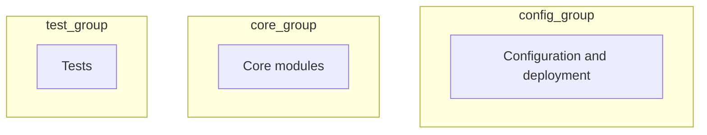

# Architecture report: browserslist/browserslist

> Automated static analysis. **Observed** = directly seen in files/imports/AST; **Inferred** = interpretation from that evidence. Repository code was not executed.

## 1. Repository at a glance

| Item | Value |
| --- | --- |
| Repository | browserslist/browserslist |
| Description | 🦔 Share target browsers between different front-end tools, like Autoprefixer, Stylelint and babel-preset-env |
| Language | JavaScript |
| Stars | 13588 |
| Licence | MIT |
| Analysed commit / branch | 8253b7071aae92f6ea755aee54bc93dee47048a1 / main |
| Framework(s) | None detected |
| Files analysed | 96 |
| Components | 3 |

## 2. Architecture in one minute

browserslist/browserslist - 🦔 Share target browsers between different front-end tools, like Autoprefixer, Stylelint and babel-preset-env. This repository was analysed statically from 96 file(s) (0 Python). Detected technologies (observed from imports/manifests): GitHub Actions. Files are grouped into 3 component(s): Configuration and deployment, Core modules, Tests. Findings below distinguish observed facts from inferred interpretation.

## 3. High-level block diagram

## 4. Main components

### Configuration and deployment (`config`)

- **Kind:** config
- **Status:** Observed
- **Confidence:** 0.85
- **Responsibility:** Groups 2 file(s) under configuration and deployment (observed from repository paths and static analysis).
- **Paths:** `package.json`, `pnpm-workspace.yaml`
- **Evidence:** [package.json](https://github.com/browserslist/browserslist/blob/8253b7071aae92f6ea755aee54bc93dee47048a1/package.json); [pnpm-workspace.yaml](https://github.com/browserslist/browserslist/blob/8253b7071aae92f6ea755aee54bc93dee47048a1/pnpm-workspace.yaml)

### Core modules (`core`)

- **Kind:** core
- **Status:** Observed
- **Confidence:** 0.85
- **Responsibility:** Groups 10 file(s) under core modules (observed from repository paths and static analysis).
- **Paths:** `browser.js`, `cli.js`, `error.d.ts`, `error.js`, `eslint.config.mjs`, `index.d.ts`, `index.js`, `node.js`, `oxfmt.config.ts`, `parse.js`
- **Evidence:** [browser.js](https://github.com/browserslist/browserslist/blob/8253b7071aae92f6ea755aee54bc93dee47048a1/browser.js); [cli.js](https://github.com/browserslist/browserslist/blob/8253b7071aae92f6ea755aee54bc93dee47048a1/cli.js); [error.d.ts](https://github.com/browserslist/browserslist/blob/8253b7071aae92f6ea755aee54bc93dee47048a1/error.d.ts); [error.js](https://github.com/browserslist/browserslist/blob/8253b7071aae92f6ea755aee54bc93dee47048a1/error.js); [eslint.config.mjs](https://github.com/browserslist/browserslist/blob/8253b7071aae92f6ea755aee54bc93dee47048a1/eslint.config.mjs); [index.d.ts](https://github.com/browserslist/browserslist/blob/8253b7071aae92f6ea755aee54bc93dee47048a1/index.d.ts); [index.js](https://github.com/browserslist/browserslist/blob/8253b7071aae92f6ea755aee54bc93dee47048a1/index.js); [node.js](https://github.com/browserslist/browserslist/blob/8253b7071aae92f6ea755aee54bc93dee47048a1/node.js)

### Tests (`tests`)

- **Kind:** test
- **Status:** Observed
- **Confidence:** 0.85
- **Responsibility:** Groups 64 file(s) under tests (observed from repository paths and static analysis).
- **Paths:** `test/all.test.js`, `test/and.test.js`, `test/baseline.test.js`, `test/benchmark/one/app/css/hello.css`, `test/benchmark/one/package.json`, `test/benchmark/run.js`, `test/benchmark/three/app/js/hello.js`, `test/benchmark/two/app/js/hello.js`, `test/benchmark/two/browserslist`, `test/browser.test.js`, `test/cache.test.js`, `test/cli.test.js`, `test/config-query.test.js`, `test/config.test.js`, `test/continuation.test.js`, `test/country.test.js`, `test/cover.test.js`, `test/coverage.test.js`, `test/custom.test.js`, `test/dead.test.js`, `test/defaults.test.js`, `test/direct.test.js`, `test/electron.test.js`, `test/error.test.js`, `test/esr.test.js`, `test/extends.test.js`, `test/feature.test.js`, `test/fixtures/android-stats.json`, `test/fixtures/both1/browserslist`, `test/fixtures/both1/package.json`, `test/fixtures/both2/.browserslistrc`, `test/fixtures/both2/package.json`, `test/fixtures/both3/.browserslistrc`, `test/fixtures/both3/browserslist`, `test/fixtures/browserslist`, `test/fixtures/browserslist-stats.json`, `test/fixtures/dir/test.css`, `test/fixtures/env-config/browserslist`, `test/fixtures/env-config/package.json`, `test/fixtures/env-package/package.json`, `test/fixtures/explorers`, `test/fixtures/package/package.json`, `test/fixtures/package2/package.json`, `test/fixtures/rc/.browserslistrc`, `test/fixtures/stats.json`, `test/fixtures/string/package.json`, `test/fixtures/typo/package.json`, `test/fixtures/wrong1/package.json`, `test/fixtures/wrong2/package.json`, `test/global.test.js`, `test/last.test.js`, `test/main.test.js`, `test/major.test.js`, `test/node.test.js`, `test/opera.test.js`, `test/parse.test.js`, `test/phantomjs.test.js`, `test/range.test.js`, `test/release.test.js`, `test/shareable-stats.test.js`, `test/since.test.js`, `test/unreleased.test.js`, `test/versions.test.js`, `test/years.test.js`
- **Evidence:** [test/all.test.js](https://github.com/browserslist/browserslist/blob/8253b7071aae92f6ea755aee54bc93dee47048a1/test/all.test.js); [test/and.test.js](https://github.com/browserslist/browserslist/blob/8253b7071aae92f6ea755aee54bc93dee47048a1/test/and.test.js); [test/baseline.test.js](https://github.com/browserslist/browserslist/blob/8253b7071aae92f6ea755aee54bc93dee47048a1/test/baseline.test.js); [test/benchmark/one/app/css/hello.css](https://github.com/browserslist/browserslist/blob/8253b7071aae92f6ea755aee54bc93dee47048a1/test/benchmark/one/app/css/hello.css); [test/benchmark/one/package.json](https://github.com/browserslist/browserslist/blob/8253b7071aae92f6ea755aee54bc93dee47048a1/test/benchmark/one/package.json); [test/benchmark/run.js](https://github.com/browserslist/browserslist/blob/8253b7071aae92f6ea755aee54bc93dee47048a1/test/benchmark/run.js); [test/benchmark/three/app/js/hello.js](https://github.com/browserslist/browserslist/blob/8253b7071aae92f6ea755aee54bc93dee47048a1/test/benchmark/three/app/js/hello.js); [test/benchmark/two/app/js/hello.js](https://github.com/browserslist/browserslist/blob/8253b7071aae92f6ea755aee54bc93dee47048a1/test/benchmark/two/app/js/hello.js)

## 5. Execution flow

**Observed** entry point(s):

- [cli.js](https://github.com/browserslist/browserslist/blob/8253b7071aae92f6ea755aee54bc93dee47048a1/cli.js)
- [index.js](https://github.com/browserslist/browserslist/blob/8253b7071aae92f6ea755aee54bc93dee47048a1/index.js)

Representative flow (derived from observed entry points and the import graph; steps beyond the entry point are **Inferred**):

1. Execution starts at an observed entry point listed above, if present.
2. No internal import relationships between components were observed.

## 6. Project structure

### `(root)`

- `.devcontainer.json` - config (48 bytes)
- `.editorconfig` - config (147 bytes)
- `.gitignore` - other (25 bytes)
- `.npmignore` - other (60 bytes)
- `.prettierrc.mjs` - source, JavaScript (87 bytes)
- `CHANGELOG.md` - docs (18495 bytes)
- `LICENSE` - docs (1118 bytes)
- `README.md` - docs (31505 bytes)
- `browser.js` - source, JavaScript (1117 bytes)
- `cli.js` - source, JavaScript (4526 bytes)
- `error.d.ts` - source, TypeScript (155 bytes)
- `error.js` - source, JavaScript (299 bytes)
- `eslint.config.mjs` - source, JavaScript (1710 bytes)
- `grammar.w3c-ebnf` - other (3031 bytes)
- `index.d.ts` - source, TypeScript (4961 bytes)
- `index.js` - source, JavaScript (36832 bytes)
- `node.js` - source, JavaScript (14205 bytes)
- `oxfmt.config.ts` - source, TypeScript (87 bytes)
- `package.json` - manifest (3388 bytes)
- `parse.js` - source, JavaScript (5068 bytes)
- `pnpm-workspace.yaml` - config (53 bytes)

### `.github`

- `.github/FUNDING.yml` - config (68 bytes)
- `.github/workflows/release.yml` - ci, YAML (1100 bytes)
- `.github/workflows/test.yml` - ci, YAML (2083 bytes)

### `docs`

- `docs/INCIDENT_RESPONSE.md` - docs (1100 bytes)
- `docs/SECURITY.md` - docs (480 bytes)
- `docs/THREAT_MODEL.md` - docs (1189 bytes)

### `img`

- `img/complement.svg` - other (610 bytes)
- `img/icon.svg` - other (1127 bytes)
- `img/intersection.svg` - other (610 bytes)
- `img/logo.svg` - other (2044 bytes)
- `img/union.svg` - other (616 bytes)

### `test`

- `test/all.test.js` - test, JavaScript (766 bytes)
- `test/and.test.js` - test, JavaScript (988 bytes)
- `test/baseline.test.js` - test, JavaScript (4440 bytes)
- `test/benchmark/one/app/css/hello.css` - test (0 bytes)
- `test/benchmark/one/package.json` - test (71 bytes)
- `test/benchmark/run.js` - test, JavaScript (606 bytes)
- `test/benchmark/three/app/js/hello.js` - test, JavaScript (9 bytes)
- `test/benchmark/two/app/js/hello.js` - test, JavaScript (0 bytes)
- `test/benchmark/two/browserslist` - test (6 bytes)
- `test/browser.test.js` - test, JavaScript (1420 bytes)
- `test/cache.test.js` - test, JavaScript (1992 bytes)
- `test/cli.test.js` - test, JavaScript (5118 bytes)
- `test/config-query.test.js` - test, JavaScript (643 bytes)
- `test/config.test.js` - test, JavaScript (6823 bytes)
- `test/continuation.test.js` - test, JavaScript (3506 bytes)
- `test/country.test.js` - test, JavaScript (2248 bytes)
- `test/cover.test.js` - test, JavaScript (2384 bytes)
- `test/coverage.test.js` - test, JavaScript (2702 bytes)
- `test/custom.test.js` - test, JavaScript (2756 bytes)
- `test/dead.test.js` - test, JavaScript (379 bytes)
- `test/defaults.test.js` - test, JavaScript (618 bytes)
- `test/direct.test.js` - test, JavaScript (2608 bytes)
- `test/electron.test.js` - test, JavaScript (2089 bytes)
- `test/error.test.js` - test, JavaScript (503 bytes)
- `test/esr.test.js` - test, JavaScript (1003 bytes)
- `test/extends.test.js` - test, JavaScript (5742 bytes)
- `test/feature.test.js` - test, JavaScript (4319 bytes)
- `test/fixtures/android-stats.json` - test (35 bytes)
- `test/fixtures/both1/browserslist` - test (28 bytes)
- `test/fixtures/both1/package.json` - test (71 bytes)
- `test/fixtures/both2/.browserslistrc` - test (28 bytes)
- `test/fixtures/both2/package.json` - test (71 bytes)
- `test/fixtures/both3/.browserslistrc` - test (28 bytes)
- `test/fixtures/both3/browserslist` - test (28 bytes)
- `test/fixtures/browserslist` - test (28 bytes)
- `test/fixtures/browserslist-stats.json` - test (58 bytes)
- `test/fixtures/dir/test.css` - test (0 bytes)
- `test/fixtures/env-config/browserslist` - test (95 bytes)
- `test/fixtures/env-config/package.json` - test (22 bytes)
- `test/fixtures/env-package/package.json` - test (170 bytes)
- `test/fixtures/explorers` - test (10 bytes)
- `test/fixtures/package/package.json` - test (71 bytes)
- `test/fixtures/package2/package.json` - test (68 bytes)
- `test/fixtures/rc/.browserslistrc` - test (6 bytes)
- `test/fixtures/stats.json` - test (222 bytes)
- `test/fixtures/string/package.json` - test (54 bytes)
- `test/fixtures/typo/package.json` - test (43 bytes)
- `test/fixtures/wrong1/package.json` - test (60 bytes)
- `test/fixtures/wrong2/package.json` - test (53 bytes)
- `test/global.test.js` - test, JavaScript (1261 bytes)
- `test/last.test.js` - test, JavaScript (2812 bytes)
- `test/main.test.js` - test, JavaScript (7739 bytes)
- `test/major.test.js` - test, JavaScript (2624 bytes)
- `test/node.test.js` - test, JavaScript (7348 bytes)
- `test/opera.test.js` - test, JavaScript (363 bytes)
- `test/parse.test.js` - test, JavaScript (1490 bytes)
- `test/phantomjs.test.js` - test, JavaScript (480 bytes)
- `test/range.test.js` - test, JavaScript (1651 bytes)
- `test/release.test.js` - test, JavaScript (3333 bytes)
- `test/shareable-stats.test.js` - test, JavaScript (4672 bytes)
- `test/since.test.js` - test, JavaScript (1714 bytes)
- `test/unreleased.test.js` - test, JavaScript (1147 bytes)
- `test/versions.test.js` - test, JavaScript (3205 bytes)
- `test/years.test.js` - test, JavaScript (2005 bytes)

## 7. Key dependencies and integrations

| Name | Category | Status | Confidence | Evidence |
| --- | --- | --- | --- | --- |
| GitHub Actions | ci | Observed | 0.90 | [.github/workflows/release.yml](https://github.com/browserslist/browserslist/blob/8253b7071aae92f6ea755aee54bc93dee47048a1/.github/workflows/release.yml); [.github/workflows/test.yml](https://github.com/browserslist/browserslist/blob/8253b7071aae92f6ea755aee54bc93dee47048a1/.github/workflows/test.yml) |

## 8. Data and state

No database, cache, queue, or persistent-state usage was observed in the analysed files. State handling, if any, may be in-memory or in files that were not analysed.

## 9. Configuration and deployment clues

- `.devcontainer.json` (config)
- `.editorconfig` (config)
- `.github/FUNDING.yml` (config)
- `.github/workflows/release.yml` (ci)
- `.github/workflows/test.yml` (ci)
- `package.json` (manifest)
- `pnpm-workspace.yaml` (config)

## 10. Design observations

- Tests are present alongside source code (Observed from test file paths).

These observations are interpretations (**Inferred**) of the observed structure, not guarantees about runtime design.

## 11. Limitations and unknowns

- Static analysis only: repository code was not executed, installed, or imported at runtime.
- Components and relationships are inferred from file paths, imports, and AST structure; runtime behaviour, dynamic imports, and reflection may not be visible.
- 1 file(s) were skipped during inventory (1 x lockfile excluded).
- No clear application entry point was observed in the analysed files.
- Repository text was treated as untrusted data; no instructions found in repository files were followed, and likely secret values were redacted/excluded.
- JavaScript and TypeScript files were inventoried from paths and package manifests. They were not parsed with a full language AST, and repository code was not executed.

## 12. Source references

- [.github/workflows/release.yml](https://github.com/browserslist/browserslist/blob/8253b7071aae92f6ea755aee54bc93dee47048a1/.github/workflows/release.yml)
- [.github/workflows/test.yml](https://github.com/browserslist/browserslist/blob/8253b7071aae92f6ea755aee54bc93dee47048a1/.github/workflows/test.yml)
- [browser.js](https://github.com/browserslist/browserslist/blob/8253b7071aae92f6ea755aee54bc93dee47048a1/browser.js)
- [cli.js](https://github.com/browserslist/browserslist/blob/8253b7071aae92f6ea755aee54bc93dee47048a1/cli.js)
- [error.d.ts](https://github.com/browserslist/browserslist/blob/8253b7071aae92f6ea755aee54bc93dee47048a1/error.d.ts)
- [error.js](https://github.com/browserslist/browserslist/blob/8253b7071aae92f6ea755aee54bc93dee47048a1/error.js)
- [eslint.config.mjs](https://github.com/browserslist/browserslist/blob/8253b7071aae92f6ea755aee54bc93dee47048a1/eslint.config.mjs)
- [index.d.ts](https://github.com/browserslist/browserslist/blob/8253b7071aae92f6ea755aee54bc93dee47048a1/index.d.ts)
- [index.js](https://github.com/browserslist/browserslist/blob/8253b7071aae92f6ea755aee54bc93dee47048a1/index.js)
- [node.js](https://github.com/browserslist/browserslist/blob/8253b7071aae92f6ea755aee54bc93dee47048a1/node.js)
- [package.json](https://github.com/browserslist/browserslist/blob/8253b7071aae92f6ea755aee54bc93dee47048a1/package.json)
- [pnpm-workspace.yaml](https://github.com/browserslist/browserslist/blob/8253b7071aae92f6ea755aee54bc93dee47048a1/pnpm-workspace.yaml)
- [test/all.test.js](https://github.com/browserslist/browserslist/blob/8253b7071aae92f6ea755aee54bc93dee47048a1/test/all.test.js)
- [test/and.test.js](https://github.com/browserslist/browserslist/blob/8253b7071aae92f6ea755aee54bc93dee47048a1/test/and.test.js)
- [test/baseline.test.js](https://github.com/browserslist/browserslist/blob/8253b7071aae92f6ea755aee54bc93dee47048a1/test/baseline.test.js)
- [test/benchmark/one/app/css/hello.css](https://github.com/browserslist/browserslist/blob/8253b7071aae92f6ea755aee54bc93dee47048a1/test/benchmark/one/app/css/hello.css)
- [test/benchmark/one/package.json](https://github.com/browserslist/browserslist/blob/8253b7071aae92f6ea755aee54bc93dee47048a1/test/benchmark/one/package.json)
- [test/benchmark/run.js](https://github.com/browserslist/browserslist/blob/8253b7071aae92f6ea755aee54bc93dee47048a1/test/benchmark/run.js)
- [test/benchmark/three/app/js/hello.js](https://github.com/browserslist/browserslist/blob/8253b7071aae92f6ea755aee54bc93dee47048a1/test/benchmark/three/app/js/hello.js)
- [test/benchmark/two/app/js/hello.js](https://github.com/browserslist/browserslist/blob/8253b7071aae92f6ea755aee54bc93dee47048a1/test/benchmark/two/app/js/hello.js)
