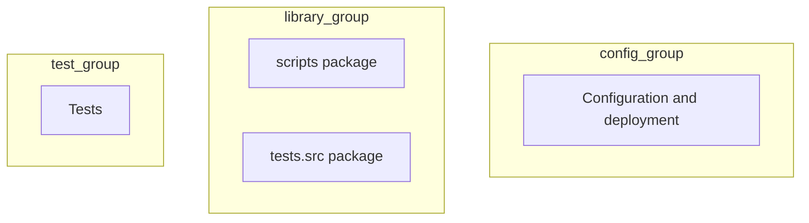

# Architecture report: browserstate/history.js

> Automated static analysis. **Observed** = directly seen in files/imports/AST; **Inferred** = interpretation from that evidence. Repository code was not executed.

## 1. Repository at a glance

| Item | Value |
| --- | --- |
| Repository | browserstate/history.js |
| Description | History.js gracefully supports the HTML5 History/State APIs (pushState, replaceState, onPopState) in all browsers. Including continued support for data, titles, replaceState. Supports jQuery, MooTools and Prototype.  For HTML5 browsers this means that you can modify the URL directly, without needin… |
| Language | JavaScript |
| Stars | 10640 |
| Licence | Other |
| Analysed commit / branch | 8e4c08323f4db50742a54cb276f6f377343dcdd2 / master |
| Framework(s) | None detected |
| Files analysed | 89 |
| Components | 4 |

## 2. Architecture in one minute

browserstate/history.js - History.js gracefully supports the HTML5 History/State APIs (pushState, replaceState, onPopState) in all browsers. Including continued support for data, titles, replaceState. Supports jQuery, MooTool…. This repository was analysed statically from 89 file(s) (0 Python). Detected technologies (observed from imports/manifests): no known frameworks/libraries. Files are grouped into 4 component(s): Configuration and deployment, scripts package, Tests, tests.src package. Findings below distinguish observed facts from inferred interpretation.

## 3. High-level block diagram

## 4. Main components

### Configuration and deployment (`config`)

- **Kind:** config
- **Status:** Observed
- **Confidence:** 0.85
- **Responsibility:** Groups 3 file(s) under configuration and deployment (observed from repository paths and static analysis).
- **Paths:** `bower.json`, `component.json`, `package.json`
- **Evidence:** [bower.json](https://github.com/browserstate/history.js/blob/8e4c08323f4db50742a54cb276f6f377343dcdd2/bower.json); [component.json](https://github.com/browserstate/history.js/blob/8e4c08323f4db50742a54cb276f6f377343dcdd2/component.json); [package.json](https://github.com/browserstate/history.js/blob/8e4c08323f4db50742a54cb276f6f377343dcdd2/package.json)

### scripts package (`scripts`)

- **Kind:** library
- **Status:** Observed
- **Confidence:** 0.85
- **Responsibility:** Groups 48 file(s) under scripts package (observed from repository paths and static analysis).
- **Paths:** `scripts/bundled-uncompressed/html4+html5/dojo.history.js`, `scripts/bundled-uncompressed/html4+html5/extjs.history.js`, `scripts/bundled-uncompressed/html4+html5/jquery.history.js`, `scripts/bundled-uncompressed/html4+html5/mootools.history.js`, `scripts/bundled-uncompressed/html4+html5/native.history.js`, `scripts/bundled-uncompressed/html4+html5/right.history.js`, `scripts/bundled-uncompressed/html4+html5/zepto.history.js`, `scripts/bundled-uncompressed/html5/dojo.history.js`, `scripts/bundled-uncompressed/html5/extjs.history.js`, `scripts/bundled-uncompressed/html5/jquery.history.js`, `scripts/bundled-uncompressed/html5/mootools.history.js`, `scripts/bundled-uncompressed/html5/native.history.js`, `scripts/bundled-uncompressed/html5/right.history.js`, `scripts/bundled-uncompressed/html5/zepto.history.js`, `scripts/bundled/html4+html5/dojo.history.js`, `scripts/bundled/html4+html5/extjs.history.js`, `scripts/bundled/html4+html5/jquery.history.js`, `scripts/bundled/html4+html5/mootools.history.js`, `scripts/bundled/html4+html5/native.history.js`, `scripts/bundled/html4+html5/right.history.js`, `scripts/bundled/html4+html5/zepto.history.js`, `scripts/bundled/html5/dojo.history.js`, `scripts/bundled/html5/extjs.history.js`, `scripts/bundled/html5/jquery.history.js`, `scripts/bundled/html5/mootools.history.js`, `scripts/bundled/html5/native.history.js`, `scripts/bundled/html5/right.history.js`, `scripts/bundled/html5/zepto.history.js`, `scripts/compressed/history.adapter.dojo.js`, `scripts/compressed/history.adapter.extjs.js`, `scripts/compressed/history.adapter.jquery.js`, `scripts/compressed/history.adapter.mootools.js`, `scripts/compressed/history.adapter.native.js`, `scripts/compressed/history.adapter.right.js`, `scripts/compressed/history.adapter.zepto.js`, `scripts/compressed/history.html4.js`, `scripts/compressed/history.js`, `scripts/compressed/json2.js`, `scripts/uncompressed/history.adapter.dojo.js`, `scripts/uncompressed/history.adapter.extjs.js`, `scripts/uncompressed/history.adapter.jquery.js`, `scripts/uncompressed/history.adapter.mootools.js`, `scripts/uncompressed/history.adapter.native.js`, `scripts/uncompressed/history.adapter.right.js`, `scripts/uncompressed/history.adapter.zepto.js`, `scripts/uncompressed/history.html4.js`, `scripts/uncompressed/history.js`, `scripts/uncompressed/json2.js`
- **Evidence:** [scripts/bundled-uncompressed/html4+html5/dojo.history.js](https://github.com/browserstate/history.js/blob/8e4c08323f4db50742a54cb276f6f377343dcdd2/scripts/bundled-uncompressed/html4%2Bhtml5/dojo.history.js); [scripts/bundled-uncompressed/html4+html5/extjs.history.js](https://github.com/browserstate/history.js/blob/8e4c08323f4db50742a54cb276f6f377343dcdd2/scripts/bundled-uncompressed/html4%2Bhtml5/extjs.history.js); [scripts/bundled-uncompressed/html4+html5/jquery.history.js](https://github.com/browserstate/history.js/blob/8e4c08323f4db50742a54cb276f6f377343dcdd2/scripts/bundled-uncompressed/html4%2Bhtml5/jquery.history.js); [scripts/bundled-uncompressed/html4+html5/mootools.history.js](https://github.com/browserstate/history.js/blob/8e4c08323f4db50742a54cb276f6f377343dcdd2/scripts/bundled-uncompressed/html4%2Bhtml5/mootools.history.js); [scripts/bundled-uncompressed/html4+html5/native.history.js](https://github.com/browserstate/history.js/blob/8e4c08323f4db50742a54cb276f6f377343dcdd2/scripts/bundled-uncompressed/html4%2Bhtml5/native.history.js); [scripts/bundled-uncompressed/html4+html5/right.history.js](https://github.com/browserstate/history.js/blob/8e4c08323f4db50742a54cb276f6f377343dcdd2/scripts/bundled-uncompressed/html4%2Bhtml5/right.history.js); [scripts/bundled-uncompressed/html4+html5/zepto.history.js](https://github.com/browserstate/history.js/blob/8e4c08323f4db50742a54cb276f6f377343dcdd2/scripts/bundled-uncompressed/html4%2Bhtml5/zepto.history.js); [scripts/bundled-uncompressed/html5/dojo.history.js](https://github.com/browserstate/history.js/blob/8e4c08323f4db50742a54cb276f6f377343dcdd2/scripts/bundled-uncompressed/html5/dojo.history.js)

### Tests (`tests`)

- **Kind:** test
- **Status:** Observed
- **Confidence:** 0.85
- **Responsibility:** Groups 18 file(s) under tests (observed from repository paths and static analysis).
- **Paths:** `tests/.htaccess`, `tests/html4+html5.dojo.html`, `tests/html4+html5.extjs.html`, `tests/html4+html5.jquery.html`, `tests/html4+html5.mootools.html`, `tests/html4+html5.native.html`, `tests/html4+html5.right.html`, `tests/html4+html5.zepto.html`, `tests/html5.dojo.html`, `tests/html5.extjs.html`, `tests/html5.jquery.html`, `tests/html5.mootools.html`, `tests/html5.native.html`, `tests/html5.right.html`, `tests/html5.zepto.html`, `tests/image.php`, `tests/index.html`, `tests/tests.js`
- **Evidence:** [tests/.htaccess](https://github.com/browserstate/history.js/blob/8e4c08323f4db50742a54cb276f6f377343dcdd2/tests/.htaccess); [tests/html4+html5.dojo.html](https://github.com/browserstate/history.js/blob/8e4c08323f4db50742a54cb276f6f377343dcdd2/tests/html4%2Bhtml5.dojo.html); [tests/html4+html5.extjs.html](https://github.com/browserstate/history.js/blob/8e4c08323f4db50742a54cb276f6f377343dcdd2/tests/html4%2Bhtml5.extjs.html); [tests/html4+html5.jquery.html](https://github.com/browserstate/history.js/blob/8e4c08323f4db50742a54cb276f6f377343dcdd2/tests/html4%2Bhtml5.jquery.html); [tests/html4+html5.mootools.html](https://github.com/browserstate/history.js/blob/8e4c08323f4db50742a54cb276f6f377343dcdd2/tests/html4%2Bhtml5.mootools.html); [tests/html4+html5.native.html](https://github.com/browserstate/history.js/blob/8e4c08323f4db50742a54cb276f6f377343dcdd2/tests/html4%2Bhtml5.native.html); [tests/html4+html5.right.html](https://github.com/browserstate/history.js/blob/8e4c08323f4db50742a54cb276f6f377343dcdd2/tests/html4%2Bhtml5.right.html); [tests/html4+html5.zepto.html](https://github.com/browserstate/history.js/blob/8e4c08323f4db50742a54cb276f6f377343dcdd2/tests/html4%2Bhtml5.zepto.html)

### tests.src package (`tests_src`)

- **Kind:** library
- **Status:** Observed
- **Confidence:** 0.85
- **Responsibility:** Groups 4 file(s) under tests.src package (observed from repository paths and static analysis).
- **Paths:** `tests.src/_header.php`, `tests.src/all.php`, `tests.src/each.php`, `tests.src/index.php`
- **Evidence:** [tests.src/_header.php](https://github.com/browserstate/history.js/blob/8e4c08323f4db50742a54cb276f6f377343dcdd2/tests.src/_header.php); [tests.src/all.php](https://github.com/browserstate/history.js/blob/8e4c08323f4db50742a54cb276f6f377343dcdd2/tests.src/all.php); [tests.src/each.php](https://github.com/browserstate/history.js/blob/8e4c08323f4db50742a54cb276f6f377343dcdd2/tests.src/each.php); [tests.src/index.php](https://github.com/browserstate/history.js/blob/8e4c08323f4db50742a54cb276f6f377343dcdd2/tests.src/index.php)

## 5. Execution flow

No entry point was observed; the startup flow below is therefore limited.

Representative flow (derived from observed entry points and the import graph; steps beyond the entry point are **Inferred**):

1. Execution starts at an observed entry point listed above, if present.
2. No internal import relationships between components were observed.

## 6. Project structure

### `(root)`

- `.gitignore` - other (42 bytes)
- `HISTORY.md` - docs (9697 bytes)
- `LICENSE.md` - docs (1614 bytes)
- `README.md` - docs (21020 bytes)
- `bower.json` - config (49 bytes)
- `buildr-uncompressed.coffee` - other (7952 bytes)
- `buildr.coffee` - other (7812 bytes)
- `component.json` - config (49 bytes)
- `package.json` - manifest (1669 bytes)

### `.github`

- `.github/FUNDING.yml` - config (124 bytes)

### `demo`

- `demo/bcherry-orig.html` - other (3431 bytes)
- `demo/bcherry.html` - other (3773 bytes)
- `demo/chrome.html` - other (1433 bytes)
- `demo/index.html` - other (3495 bytes)
- `demo/native-auto.html` - other (1284 bytes)
- `demo/native.html` - other (1702 bytes)
- `demo/navigator.html` - other (477 bytes)
- `demo/safari.html` - other (2102 bytes)
- `demo/unicode.html` - other (2579 bytes)

### `scripts`

- `scripts/bundled-uncompressed/html4+html5/dojo.history.js` - source, JavaScript (90108 bytes)
- `scripts/bundled-uncompressed/html4+html5/extjs.history.js` - source, JavaScript (89897 bytes)
- `scripts/bundled-uncompressed/html4+html5/jquery.history.js` - source, JavaScript (88899 bytes)
- `scripts/bundled-uncompressed/html4+html5/mootools.history.js` - source, JavaScript (89092 bytes)
- `scripts/bundled-uncompressed/html4+html5/native.history.js` - source, JavaScript (90059 bytes)
- `scripts/bundled-uncompressed/html4+html5/right.history.js` - source, JavaScript (88824 bytes)
- `scripts/bundled-uncompressed/html4+html5/zepto.history.js` - source, JavaScript (88664 bytes)
- `scripts/bundled-uncompressed/html5/dojo.history.js` - source, JavaScript (53805 bytes)
- `scripts/bundled-uncompressed/html5/extjs.history.js` - source, JavaScript (53594 bytes)
- `scripts/bundled-uncompressed/html5/jquery.history.js` - source, JavaScript (52596 bytes)
- `scripts/bundled-uncompressed/html5/mootools.history.js` - source, JavaScript (52789 bytes)
- `scripts/bundled-uncompressed/html5/native.history.js` - source, JavaScript (53756 bytes)
- `scripts/bundled-uncompressed/html5/right.history.js` - source, JavaScript (52521 bytes)
- `scripts/bundled-uncompressed/html5/zepto.history.js` - source, JavaScript (52361 bytes)
- `scripts/bundled/html4+html5/dojo.history.js` - source, JavaScript (23426 bytes)
- `scripts/bundled/html4+html5/extjs.history.js` - source, JavaScript (23191 bytes)
- `scripts/bundled/html4+html5/jquery.history.js` - source, JavaScript (22928 bytes)
- `scripts/bundled/html4+html5/mootools.history.js` - source, JavaScript (23084 bytes)
- `scripts/bundled/html4+html5/native.history.js` - source, JavaScript (23459 bytes)
- `scripts/bundled/html4+html5/right.history.js` - source, JavaScript (22919 bytes)
- `scripts/bundled/html4+html5/zepto.history.js` - source, JavaScript (22897 bytes)
- `scripts/bundled/html5/dojo.history.js` - source, JavaScript (16021 bytes)
- `scripts/bundled/html5/extjs.history.js` - source, JavaScript (15786 bytes)
- `scripts/bundled/html5/jquery.history.js` - source, JavaScript (15523 bytes)
- `scripts/bundled/html5/mootools.history.js` - source, JavaScript (15679 bytes)
- `scripts/bundled/html5/native.history.js` - source, JavaScript (16054 bytes)
- `scripts/bundled/html5/right.history.js` - source, JavaScript (15514 bytes)
- `scripts/bundled/html5/zepto.history.js` - source, JavaScript (15492 bytes)
- `scripts/compressed/history.adapter.dojo.js` - source, JavaScript (931 bytes)
- `scripts/compressed/history.adapter.extjs.js` - source, JavaScript (696 bytes)
- `scripts/compressed/history.adapter.jquery.js` - source, JavaScript (433 bytes)
- `scripts/compressed/history.adapter.mootools.js` - source, JavaScript (589 bytes)
- `scripts/compressed/history.adapter.native.js` - source, JavaScript (964 bytes)
- `scripts/compressed/history.adapter.right.js` - source, JavaScript (424 bytes)
- `scripts/compressed/history.adapter.zepto.js` - source, JavaScript (402 bytes)
- `scripts/compressed/history.html4.js` - source, JavaScript (4443 bytes)
- `scripts/compressed/history.js` - source, JavaScript (15091 bytes)
- `scripts/compressed/json2.js` - source, JavaScript (2964 bytes)
- `scripts/uncompressed/history.adapter.dojo.js` - source, JavaScript (3163 bytes)
- `scripts/uncompressed/history.adapter.extjs.js` - source, JavaScript (2952 bytes)
- `scripts/uncompressed/history.adapter.jquery.js` - source, JavaScript (1954 bytes)
- `scripts/uncompressed/history.adapter.mootools.js` - source, JavaScript (2147 bytes)
- `scripts/uncompressed/history.adapter.native.js` - source, JavaScript (3114 bytes)
- `scripts/uncompressed/history.adapter.right.js` - source, JavaScript (1879 bytes)
- `scripts/uncompressed/history.adapter.zepto.js` - source, JavaScript (1719 bytes)
- `scripts/uncompressed/history.html4.js` - source, JavaScript (18774 bytes)
- `scripts/uncompressed/history.js` - source, JavaScript (50642 bytes)
- `scripts/uncompressed/json2.js` - source, JavaScript (17529 bytes)

### `tests`

- `tests/.htaccess` - test (419 bytes)
- `tests/html4+html5.dojo.html` - test (1709 bytes)
- `tests/html4+html5.extjs.html` - test (1714 bytes)
- `tests/html4+html5.jquery.html` - test (1411 bytes)
- `tests/html4+html5.mootools.html` - test (1419 bytes)
- `tests/html4+html5.native.html` - test (1411 bytes)
- `tests/html4+html5.right.html` - test (1407 bytes)
- `tests/html4+html5.zepto.html` - test (1407 bytes)
- `tests/html5.dojo.html` - test (1386 bytes)
- `tests/html5.extjs.html` - test (1390 bytes)
- `tests/html5.jquery.html` - test (1393 bytes)
- `tests/html5.mootools.html` - test (1401 bytes)
- `tests/html5.native.html` - test (1393 bytes)
- `tests/html5.right.html` - test (1389 bytes)
- `tests/html5.zepto.html` - test (1389 bytes)
- `tests/image.php` - test, PHP (53 bytes)
- `tests/index.html` - test (1835 bytes)
- `tests/tests.js` - test, JavaScript (6223 bytes)

### `tests.src`

- `tests.src/_header.php` - source, PHP (279 bytes)
- `tests.src/all.php` - source, PHP (919 bytes)
- `tests.src/each.php` - source, PHP (1555 bytes)
- `tests.src/index.php` - source, PHP (507 bytes)

## 7. Key dependencies and integrations

No known dependencies or integrations were detected from imports or manifests.

## 8. Data and state

No database, cache, queue, or persistent-state usage was observed in the analysed files. State handling, if any, may be in-memory or in files that were not analysed.

## 9. Configuration and deployment clues

- `.github/FUNDING.yml` (config)
- `bower.json` (config)
- `component.json` (config)
- `package.json` (manifest)

## 10. Design observations

- Tests are present alongside source code (Observed from test file paths).

These observations are interpretations (**Inferred**) of the observed structure, not guarantees about runtime design.

## 11. Limitations and unknowns

- Static analysis only: repository code was not executed, installed, or imported at runtime.
- Components and relationships are inferred from file paths, imports, and AST structure; runtime behaviour, dynamic imports, and reflection may not be visible.
- 26 file(s) were skipped during inventory (26 x vendored/generated directory excluded).
- No clear application entry point was observed in the analysed files.
- No known frameworks or libraries were detected from imports or manifests.
- Repository text was treated as untrusted data; no instructions found in repository files were followed, and likely secret values were redacted/excluded.
- JavaScript and TypeScript files were inventoried from paths and package manifests. They were not parsed with a full language AST, and repository code was not executed.

## 12. Source references

- [bower.json](https://github.com/browserstate/history.js/blob/8e4c08323f4db50742a54cb276f6f377343dcdd2/bower.json)
- [component.json](https://github.com/browserstate/history.js/blob/8e4c08323f4db50742a54cb276f6f377343dcdd2/component.json)
- [package.json](https://github.com/browserstate/history.js/blob/8e4c08323f4db50742a54cb276f6f377343dcdd2/package.json)
- [scripts/bundled-uncompressed/html4+html5/dojo.history.js](https://github.com/browserstate/history.js/blob/8e4c08323f4db50742a54cb276f6f377343dcdd2/scripts/bundled-uncompressed/html4%2Bhtml5/dojo.history.js)
- [scripts/bundled-uncompressed/html4+html5/extjs.history.js](https://github.com/browserstate/history.js/blob/8e4c08323f4db50742a54cb276f6f377343dcdd2/scripts/bundled-uncompressed/html4%2Bhtml5/extjs.history.js)
- [scripts/bundled-uncompressed/html4+html5/jquery.history.js](https://github.com/browserstate/history.js/blob/8e4c08323f4db50742a54cb276f6f377343dcdd2/scripts/bundled-uncompressed/html4%2Bhtml5/jquery.history.js)
- [scripts/bundled-uncompressed/html4+html5/mootools.history.js](https://github.com/browserstate/history.js/blob/8e4c08323f4db50742a54cb276f6f377343dcdd2/scripts/bundled-uncompressed/html4%2Bhtml5/mootools.history.js)
- [scripts/bundled-uncompressed/html4+html5/native.history.js](https://github.com/browserstate/history.js/blob/8e4c08323f4db50742a54cb276f6f377343dcdd2/scripts/bundled-uncompressed/html4%2Bhtml5/native.history.js)
- [scripts/bundled-uncompressed/html4+html5/right.history.js](https://github.com/browserstate/history.js/blob/8e4c08323f4db50742a54cb276f6f377343dcdd2/scripts/bundled-uncompressed/html4%2Bhtml5/right.history.js)
- [scripts/bundled-uncompressed/html4+html5/zepto.history.js](https://github.com/browserstate/history.js/blob/8e4c08323f4db50742a54cb276f6f377343dcdd2/scripts/bundled-uncompressed/html4%2Bhtml5/zepto.history.js)
- [scripts/bundled-uncompressed/html5/dojo.history.js](https://github.com/browserstate/history.js/blob/8e4c08323f4db50742a54cb276f6f377343dcdd2/scripts/bundled-uncompressed/html5/dojo.history.js)
- [tests.src/_header.php](https://github.com/browserstate/history.js/blob/8e4c08323f4db50742a54cb276f6f377343dcdd2/tests.src/_header.php)
- [tests.src/all.php](https://github.com/browserstate/history.js/blob/8e4c08323f4db50742a54cb276f6f377343dcdd2/tests.src/all.php)
- [tests.src/each.php](https://github.com/browserstate/history.js/blob/8e4c08323f4db50742a54cb276f6f377343dcdd2/tests.src/each.php)
- [tests.src/index.php](https://github.com/browserstate/history.js/blob/8e4c08323f4db50742a54cb276f6f377343dcdd2/tests.src/index.php)
- [tests/.htaccess](https://github.com/browserstate/history.js/blob/8e4c08323f4db50742a54cb276f6f377343dcdd2/tests/.htaccess)
- [tests/html4+html5.dojo.html](https://github.com/browserstate/history.js/blob/8e4c08323f4db50742a54cb276f6f377343dcdd2/tests/html4%2Bhtml5.dojo.html)
- [tests/html4+html5.extjs.html](https://github.com/browserstate/history.js/blob/8e4c08323f4db50742a54cb276f6f377343dcdd2/tests/html4%2Bhtml5.extjs.html)
- [tests/html4+html5.jquery.html](https://github.com/browserstate/history.js/blob/8e4c08323f4db50742a54cb276f6f377343dcdd2/tests/html4%2Bhtml5.jquery.html)
- [tests/html4+html5.mootools.html](https://github.com/browserstate/history.js/blob/8e4c08323f4db50742a54cb276f6f377343dcdd2/tests/html4%2Bhtml5.mootools.html)
- [tests/html4+html5.native.html](https://github.com/browserstate/history.js/blob/8e4c08323f4db50742a54cb276f6f377343dcdd2/tests/html4%2Bhtml5.native.html)
- [tests/html4+html5.right.html](https://github.com/browserstate/history.js/blob/8e4c08323f4db50742a54cb276f6f377343dcdd2/tests/html4%2Bhtml5.right.html)
- [tests/html4+html5.zepto.html](https://github.com/browserstate/history.js/blob/8e4c08323f4db50742a54cb276f6f377343dcdd2/tests/html4%2Bhtml5.zepto.html)
