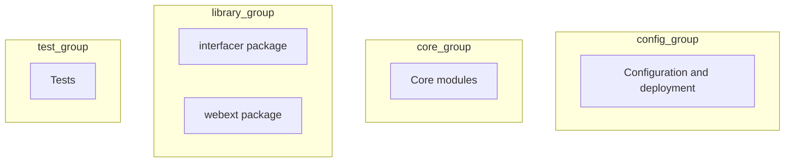

# Architecture report: browsh-org/browsh

> Automated static analysis. **Observed** = directly seen in files/imports/AST; **Inferred** = interpretation from that evidence. Repository code was not executed.

## 1. Repository at a glance

| Item | Value |
| --- | --- |
| Repository | browsh-org/browsh |
| Description | A fully-modern text-based browser, rendering to TTY and browsers |
| Language | JavaScript |
| Stars | 19128 |
| Licence | LGPL-2.1 |
| Analysed commit / branch | e6325957514665db86428088b280fc7909334b91 / master |
| Framework(s) | None detected |
| Files analysed | 88 |
| Components | 5 |

## 2. Architecture in one minute

browsh-org/browsh - A fully-modern text-based browser, rendering to TTY and browsers. This repository was analysed statically from 88 file(s) (1 Python). Detected technologies (observed from imports/manifests): GitHub Actions, Docker, webpack. Files are grouped into 5 component(s): Configuration and deployment, Core modules, interfacer package, Tests, webext package. Findings below distinguish observed facts from inferred interpretation.

## 3. High-level block diagram

## 4. Main components

### Configuration and deployment (`config`)

- **Kind:** config
- **Status:** Observed
- **Confidence:** 0.85
- **Responsibility:** Groups 6 file(s) under configuration and deployment (observed from repository paths and static analysis).
- **Paths:** `Dockerfile`, `goreleaser.yml`, `interfacer/go.mod`, `webext/assets/browsh-schema.json`, `webext/manifest.json`, `webext/package.json`
- **Evidence:** [Dockerfile](https://github.com/browsh-org/browsh/blob/e6325957514665db86428088b280fc7909334b91/Dockerfile); [goreleaser.yml](https://github.com/browsh-org/browsh/blob/e6325957514665db86428088b280fc7909334b91/goreleaser.yml); [interfacer/go.mod](https://github.com/browsh-org/browsh/blob/e6325957514665db86428088b280fc7909334b91/interfacer/go.mod); [webext/assets/browsh-schema.json](https://github.com/browsh-org/browsh/blob/e6325957514665db86428088b280fc7909334b91/webext/assets/browsh-schema.json); [webext/manifest.json](https://github.com/browsh-org/browsh/blob/e6325957514665db86428088b280fc7909334b91/webext/manifest.json); [webext/package.json](https://github.com/browsh-org/browsh/blob/e6325957514665db86428088b280fc7909334b91/webext/package.json)

### Core modules (`core`)

- **Kind:** core
- **Status:** Observed
- **Confidence:** 0.85
- **Responsibility:** Groups 1 file(s) under core modules (observed from repository paths and static analysis).
- **Paths:** `ctl.sh`
- **Evidence:** [ctl.sh](https://github.com/browsh-org/browsh/blob/e6325957514665db86428088b280fc7909334b91/ctl.sh)

### interfacer package (`interfacer`)

- **Kind:** library
- **Status:** Observed
- **Confidence:** 0.85
- **Responsibility:** Groups 24 file(s) under interfacer package (observed from repository paths and static analysis).
- **Paths:** `interfacer/cmd/browsh/main.go`, `interfacer/contrib/upx_compress_binary.sh`, `interfacer/src/browsh/browsh.go`, `interfacer/src/browsh/cells.go`, `interfacer/src/browsh/comms.go`, `interfacer/src/browsh/config.go`, `interfacer/src/browsh/config_sample.go`, `interfacer/src/browsh/firefox.go`, `interfacer/src/browsh/firefox_unix.go`, `interfacer/src/browsh/firefox_windows.go`, `interfacer/src/browsh/frame_builder.go`, `interfacer/src/browsh/frame_builder_test.go`, `interfacer/src/browsh/input_box.go`, `interfacer/src/browsh/input_cursor.go`, `interfacer/src/browsh/input_multiline.go`, `interfacer/src/browsh/input_multiline_test.go`, `interfacer/src/browsh/input_scroll.go`, `interfacer/src/browsh/raw_text_server.go`, `interfacer/src/browsh/raw_text_server_test.go`, `interfacer/src/browsh/tab.go`, `interfacer/src/browsh/tty.go`, `interfacer/src/browsh/ui.go`, `interfacer/src/browsh/unit_test.go`, `interfacer/src/browsh/version.go`
- **Evidence:** [interfacer/cmd/browsh/main.go](https://github.com/browsh-org/browsh/blob/e6325957514665db86428088b280fc7909334b91/interfacer/cmd/browsh/main.go); [interfacer/contrib/upx_compress_binary.sh](https://github.com/browsh-org/browsh/blob/e6325957514665db86428088b280fc7909334b91/interfacer/contrib/upx_compress_binary.sh); [interfacer/src/browsh/browsh.go](https://github.com/browsh-org/browsh/blob/e6325957514665db86428088b280fc7909334b91/interfacer/src/browsh/browsh.go); [interfacer/src/browsh/cells.go](https://github.com/browsh-org/browsh/blob/e6325957514665db86428088b280fc7909334b91/interfacer/src/browsh/cells.go); [interfacer/src/browsh/comms.go](https://github.com/browsh-org/browsh/blob/e6325957514665db86428088b280fc7909334b91/interfacer/src/browsh/comms.go); [interfacer/src/browsh/config.go](https://github.com/browsh-org/browsh/blob/e6325957514665db86428088b280fc7909334b91/interfacer/src/browsh/config.go); [interfacer/src/browsh/config_sample.go](https://github.com/browsh-org/browsh/blob/e6325957514665db86428088b280fc7909334b91/interfacer/src/browsh/config_sample.go); [interfacer/src/browsh/firefox.go](https://github.com/browsh-org/browsh/blob/e6325957514665db86428088b280fc7909334b91/interfacer/src/browsh/firefox.go)

### Tests (`tests`)

- **Kind:** test
- **Status:** Observed
- **Confidence:** 0.85
- **Responsibility:** Groups 16 file(s) under tests (observed from repository paths and static analysis).
- **Paths:** `interfacer/test/http-server/server_test.go`, `interfacer/test/http-server/setup.go`, `interfacer/test/sites/smorgasbord/another.html`, `interfacer/test/sites/smorgasbord/css/main.css`, `interfacer/test/sites/smorgasbord/css/spinner.css`, `interfacer/test/sites/smorgasbord/index.html`, `interfacer/test/sites/smorgasbord/textarea.html`, `interfacer/test/tty/matchers.go`, `interfacer/test/tty/setup.go`, `interfacer/test/tty/tty_test.go`, `webext/test/fixtures/canvas_pixels.js`, `webext/test/fixtures/text_nodes.js`, `webext/test/graphics_builder_spec.js`, `webext/test/helper.js`, `webext/test/mocks/range.js`, `webext/test/text_builder_spec.js`
- **Evidence:** [interfacer/test/http-server/server_test.go](https://github.com/browsh-org/browsh/blob/e6325957514665db86428088b280fc7909334b91/interfacer/test/http-server/server_test.go); [interfacer/test/http-server/setup.go](https://github.com/browsh-org/browsh/blob/e6325957514665db86428088b280fc7909334b91/interfacer/test/http-server/setup.go); [interfacer/test/sites/smorgasbord/another.html](https://github.com/browsh-org/browsh/blob/e6325957514665db86428088b280fc7909334b91/interfacer/test/sites/smorgasbord/another.html); [interfacer/test/sites/smorgasbord/css/main.css](https://github.com/browsh-org/browsh/blob/e6325957514665db86428088b280fc7909334b91/interfacer/test/sites/smorgasbord/css/main.css); [interfacer/test/sites/smorgasbord/css/spinner.css](https://github.com/browsh-org/browsh/blob/e6325957514665db86428088b280fc7909334b91/interfacer/test/sites/smorgasbord/css/spinner.css); [interfacer/test/sites/smorgasbord/index.html](https://github.com/browsh-org/browsh/blob/e6325957514665db86428088b280fc7909334b91/interfacer/test/sites/smorgasbord/index.html); [interfacer/test/sites/smorgasbord/textarea.html](https://github.com/browsh-org/browsh/blob/e6325957514665db86428088b280fc7909334b91/interfacer/test/sites/smorgasbord/textarea.html); [interfacer/test/tty/matchers.go](https://github.com/browsh-org/browsh/blob/e6325957514665db86428088b280fc7909334b91/interfacer/test/tty/matchers.go)

### webext package (`webext`)

- **Kind:** library
- **Status:** Observed
- **Confidence:** 0.85
- **Responsibility:** Groups 23 file(s) under webext package (observed from repository paths and static analysis). Observed top-level functions: generate.
- **Paths:** `webext/.mocharc.cjs`, `webext/background.js`, `webext/content.js`, `webext/contrib/download_xpi.js`, `webext/contrib/firefoxheadless.sh`, `webext/contrib/font_maker.py`, `webext/src/background/common_mixin.js`, `webext/src/background/dimensions.js`, `webext/src/background/manager.js`, `webext/src/background/tab.js`, `webext/src/background/tab_commands_mixin.js`, `webext/src/background/tty_commands_mixin.js`, `webext/src/dom/commands_mixin.js`, `webext/src/dom/common_mixin.js`, `webext/src/dom/dimensions.js`, `webext/src/dom/graphics_builder.js`, `webext/src/dom/manager.js`, `webext/src/dom/serialise_mixin.js`, `webext/src/dom/text_builder.js`, `webext/src/dom/tty_cell.js`, `webext/src/dom/tty_grid.js`, `webext/src/utils.js`, `webext/webpack.config.js`
- **Evidence:** [webext/.mocharc.cjs](https://github.com/browsh-org/browsh/blob/e6325957514665db86428088b280fc7909334b91/webext/.mocharc.cjs); [webext/background.js](https://github.com/browsh-org/browsh/blob/e6325957514665db86428088b280fc7909334b91/webext/background.js); [webext/content.js](https://github.com/browsh-org/browsh/blob/e6325957514665db86428088b280fc7909334b91/webext/content.js); [webext/contrib/download_xpi.js](https://github.com/browsh-org/browsh/blob/e6325957514665db86428088b280fc7909334b91/webext/contrib/download_xpi.js); [webext/contrib/firefoxheadless.sh](https://github.com/browsh-org/browsh/blob/e6325957514665db86428088b280fc7909334b91/webext/contrib/firefoxheadless.sh); [webext/contrib/font_maker.py:7](https://github.com/browsh-org/browsh/blob/e6325957514665db86428088b280fc7909334b91/webext/contrib/font_maker.py#L7); [webext/src/background/common_mixin.js](https://github.com/browsh-org/browsh/blob/e6325957514665db86428088b280fc7909334b91/webext/src/background/common_mixin.js); [webext/src/background/dimensions.js](https://github.com/browsh-org/browsh/blob/e6325957514665db86428088b280fc7909334b91/webext/src/background/dimensions.js)

## 5. Execution flow

No entry point was observed; the startup flow below is therefore limited.

Representative flow (derived from observed entry points and the import graph; steps beyond the entry point are **Inferred**):

1. Execution starts at an observed entry point listed above, if present.
2. No internal import relationships between components were observed.

## 6. Project structure

### `(root)`

- `.dockerignore` - container (11 bytes)
- `.gitignore` - other (680 bytes)
- `Dockerfile` - container (1823 bytes)
- `LICENSE` - docs (24479 bytes)
- `README.md` - docs (3705 bytes)
- `ctl.sh` - source, Shell (576 bytes)
- `goreleaser.yml` - config (1549 bytes)

### `.github`

- `.github/FUNDING.yml` - config (63 bytes)
- `.github/ISSUE_TEMPLATE/bug_report.md` - docs (375 bytes)
- `.github/workflows/lint.yml` - ci, YAML (722 bytes)
- `.github/workflows/main.yml` - ci, YAML (3669 bytes)

### `interfacer`

- `interfacer/cmd/browsh/main.go` - source, Go (111 bytes)
- `interfacer/contrib/upx_compress_binary.sh` - source, Shell (120 bytes)
- `interfacer/go.mod` - manifest (1688 bytes)
- `interfacer/go.sum` - other (16826 bytes)
- `interfacer/src/browsh/browsh.go` - source, Go (4672 bytes)
- `interfacer/src/browsh/cells.go` - source, Go (899 bytes)
- `interfacer/src/browsh/comms.go` - source, Go (5012 bytes)
- `interfacer/src/browsh/config.go` - source, Go (3047 bytes)
- `interfacer/src/browsh/config_sample.go` - source, Go (3281 bytes)
- `interfacer/src/browsh/firefox.go` - source, Go (9900 bytes)
- `interfacer/src/browsh/firefox_unix.go` - source, Go (577 bytes)
- `interfacer/src/browsh/firefox_windows.go` - source, Go (2324 bytes)
- `interfacer/src/browsh/frame_builder.go` - source, Go (9716 bytes)
- `interfacer/src/browsh/frame_builder_test.go` - source, Go (6560 bytes)
- `interfacer/src/browsh/input_box.go` - source, Go (6096 bytes)
- `interfacer/src/browsh/input_cursor.go` - source, Go (3075 bytes)
- `interfacer/src/browsh/input_multiline.go` - source, Go (5158 bytes)
- `interfacer/src/browsh/input_multiline_test.go` - source, Go (2796 bytes)
- `interfacer/src/browsh/input_scroll.go` - source, Go (1429 bytes)
- `interfacer/src/browsh/raw_text_server.go` - source, Go (8579 bytes)
- `interfacer/src/browsh/raw_text_server_test.go` - source, Go (1063 bytes)
- `interfacer/src/browsh/tab.go` - source, Go (3638 bytes)
- `interfacer/src/browsh/tty.go` - source, Go (7333 bytes)
- `interfacer/src/browsh/ui.go` - source, Go (3079 bytes)
- `interfacer/src/browsh/unit_test.go` - source, Go (188 bytes)
- `interfacer/src/browsh/version.go` - source, Go (44 bytes)
- `interfacer/test/http-server/server_test.go` - test, Go (2302 bytes)
- `interfacer/test/http-server/setup.go` - test, Go (2352 bytes)
- `interfacer/test/sites/smorgasbord/another.html` - test (128 bytes)
- `interfacer/test/sites/smorgasbord/css/main.css` - test (197 bytes)
- `interfacer/test/sites/smorgasbord/css/spinner.css` - test (943 bytes)
- `interfacer/test/sites/smorgasbord/index.html` - test (2653 bytes)
- `interfacer/test/sites/smorgasbord/textarea.html` - test (143 bytes)
- `interfacer/test/tty/matchers.go` - test, Go (1190 bytes)
- `interfacer/test/tty/setup.go` - test, Go (7556 bytes)
- `interfacer/test/tty/tty_test.go` - test, Go (6253 bytes)

### `scripts`

- `scripts/bundling.bash` - other (2898 bytes)
- `scripts/common.bash` - other (362 bytes)
- `scripts/docker.bash` - other (974 bytes)
- `scripts/misc.bash` - other (2049 bytes)
- `scripts/releasing.bash` - other (3697 bytes)
- `scripts/tests.bash` - other (1009 bytes)

### `webext`

- `webext/.eslintrc` - other (435 bytes)
- `webext/.mocharc.cjs` - source, JavaScript (102 bytes)
- `webext/.web-extension-id` - other (162 bytes)
- `webext/assets/browsh-schema.json` - config (6010 bytes)
- `webext/assets/styles.css` - other (1221 bytes)
- `webext/background.js` - source, JavaScript (78 bytes)
- `webext/content.js` - source, JavaScript (58 bytes)
- `webext/contrib/download_xpi.js` - source, JavaScript (604 bytes)
- `webext/contrib/firefoxheadless.sh` - source, Shell (251 bytes)
- `webext/contrib/font_maker.py` - source, Python (1759 bytes)
- `webext/manifest.json` - config (684 bytes)
- `webext/package.json` - manifest (771 bytes)
- `webext/src/background/common_mixin.js` - source, JavaScript (1058 bytes)
- `webext/src/background/dimensions.js` - source, JavaScript (3335 bytes)
- `webext/src/background/manager.js` - source, JavaScript (10183 bytes)
- `webext/src/background/tab.js` - source, JavaScript (4450 bytes)
- `webext/src/background/tab_commands_mixin.js` - source, JavaScript (2546 bytes)
- `webext/src/background/tty_commands_mixin.js` - source, JavaScript (6881 bytes)
- `webext/src/dom/commands_mixin.js` - source, JavaScript (8642 bytes)
- `webext/src/dom/common_mixin.js` - source, JavaScript (1197 bytes)
- `webext/src/dom/dimensions.js` - source, JavaScript (9803 bytes)
- `webext/src/dom/graphics_builder.js` - source, JavaScript (8200 bytes)
- `webext/src/dom/manager.js` - source, JavaScript (7651 bytes)
- `webext/src/dom/serialise_mixin.js` - source, JavaScript (12292 bytes)
- `webext/src/dom/text_builder.js` - source, JavaScript (15972 bytes)
- `webext/src/dom/tty_cell.js` - source, JavaScript (551 bytes)
- `webext/src/dom/tty_grid.js` - source, JavaScript (4362 bytes)
- `webext/src/utils.js` - source, JavaScript (989 bytes)
- `webext/test/fixtures/canvas_pixels.js` - test, JavaScript (2558 bytes)
- `webext/test/fixtures/text_nodes.js` - test, JavaScript (1366 bytes)
- `webext/test/graphics_builder_spec.js` - test, JavaScript (2022 bytes)
- `webext/test/helper.js` - test, JavaScript (4392 bytes)
- `webext/test/mocks/range.js` - test, JavaScript (206 bytes)
- `webext/test/text_builder_spec.js` - test, JavaScript (3395 bytes)
- `webext/webpack.config.js` - source, JavaScript (1594 bytes)

## 7. Key dependencies and integrations

| Name | Category | Status | Confidence | Evidence |
| --- | --- | --- | --- | --- |
| GitHub Actions | ci | Observed | 0.90 | [.github/workflows/lint.yml](https://github.com/browsh-org/browsh/blob/e6325957514665db86428088b280fc7909334b91/.github/workflows/lint.yml); [.github/workflows/main.yml](https://github.com/browsh-org/browsh/blob/e6325957514665db86428088b280fc7909334b91/.github/workflows/main.yml) |
| Docker | tooling | Observed | 0.90 | [.github/workflows/main.yml:70](https://github.com/browsh-org/browsh/blob/e6325957514665db86428088b280fc7909334b91/.github/workflows/main.yml#L70); [Dockerfile](https://github.com/browsh-org/browsh/blob/e6325957514665db86428088b280fc7909334b91/Dockerfile) |
| webpack | tooling | Observed | 0.85 | [webext/package.json:4](https://github.com/browsh-org/browsh/blob/e6325957514665db86428088b280fc7909334b91/webext/package.json#L4) |

## 8. Data and state

No database, cache, queue, or persistent-state usage was observed in the analysed files. State handling, if any, may be in-memory or in files that were not analysed.

## 9. Configuration and deployment clues

- `.dockerignore` (container)
- `.github/FUNDING.yml` (config)
- `.github/workflows/lint.yml` (ci)
- `.github/workflows/main.yml` (ci)
- `Dockerfile` (container)
- `goreleaser.yml` (config)
- `interfacer/go.mod` (manifest)
- `webext/assets/browsh-schema.json` (config)
- `webext/manifest.json` (config)
- `webext/package.json` (manifest)

## 10. Design observations

- Tests are present alongside source code (Observed from test file paths).

These observations are interpretations (**Inferred**) of the observed structure, not guarantees about runtime design.

## 11. Limitations and unknowns

- Static analysis only: repository code was not executed, installed, or imported at runtime.
- Components and relationships are inferred from file paths, imports, and AST structure; runtime behaviour, dynamic imports, and reflection may not be visible.
- No clear application entry point was observed in the analysed files.
- Repository text was treated as untrusted data; no instructions found in repository files were followed, and likely secret values were redacted/excluded.

## 12. Source references

- [.github/workflows/lint.yml](https://github.com/browsh-org/browsh/blob/e6325957514665db86428088b280fc7909334b91/.github/workflows/lint.yml)
- [.github/workflows/main.yml](https://github.com/browsh-org/browsh/blob/e6325957514665db86428088b280fc7909334b91/.github/workflows/main.yml)
- [.github/workflows/main.yml:70](https://github.com/browsh-org/browsh/blob/e6325957514665db86428088b280fc7909334b91/.github/workflows/main.yml#L70)
- [Dockerfile](https://github.com/browsh-org/browsh/blob/e6325957514665db86428088b280fc7909334b91/Dockerfile)
- [ctl.sh](https://github.com/browsh-org/browsh/blob/e6325957514665db86428088b280fc7909334b91/ctl.sh)
- [goreleaser.yml](https://github.com/browsh-org/browsh/blob/e6325957514665db86428088b280fc7909334b91/goreleaser.yml)
- [interfacer/cmd/browsh/main.go](https://github.com/browsh-org/browsh/blob/e6325957514665db86428088b280fc7909334b91/interfacer/cmd/browsh/main.go)
- [interfacer/contrib/upx_compress_binary.sh](https://github.com/browsh-org/browsh/blob/e6325957514665db86428088b280fc7909334b91/interfacer/contrib/upx_compress_binary.sh)
- [interfacer/go.mod](https://github.com/browsh-org/browsh/blob/e6325957514665db86428088b280fc7909334b91/interfacer/go.mod)
- [interfacer/src/browsh/browsh.go](https://github.com/browsh-org/browsh/blob/e6325957514665db86428088b280fc7909334b91/interfacer/src/browsh/browsh.go)
- [interfacer/src/browsh/cells.go](https://github.com/browsh-org/browsh/blob/e6325957514665db86428088b280fc7909334b91/interfacer/src/browsh/cells.go)
- [interfacer/src/browsh/comms.go](https://github.com/browsh-org/browsh/blob/e6325957514665db86428088b280fc7909334b91/interfacer/src/browsh/comms.go)
- [interfacer/src/browsh/config.go](https://github.com/browsh-org/browsh/blob/e6325957514665db86428088b280fc7909334b91/interfacer/src/browsh/config.go)
- [interfacer/src/browsh/config_sample.go](https://github.com/browsh-org/browsh/blob/e6325957514665db86428088b280fc7909334b91/interfacer/src/browsh/config_sample.go)
- [interfacer/src/browsh/firefox.go](https://github.com/browsh-org/browsh/blob/e6325957514665db86428088b280fc7909334b91/interfacer/src/browsh/firefox.go)
- [interfacer/test/http-server/server_test.go](https://github.com/browsh-org/browsh/blob/e6325957514665db86428088b280fc7909334b91/interfacer/test/http-server/server_test.go)
- [interfacer/test/http-server/setup.go](https://github.com/browsh-org/browsh/blob/e6325957514665db86428088b280fc7909334b91/interfacer/test/http-server/setup.go)
- [interfacer/test/sites/smorgasbord/another.html](https://github.com/browsh-org/browsh/blob/e6325957514665db86428088b280fc7909334b91/interfacer/test/sites/smorgasbord/another.html)
- [interfacer/test/sites/smorgasbord/css/main.css](https://github.com/browsh-org/browsh/blob/e6325957514665db86428088b280fc7909334b91/interfacer/test/sites/smorgasbord/css/main.css)
- [interfacer/test/sites/smorgasbord/css/spinner.css](https://github.com/browsh-org/browsh/blob/e6325957514665db86428088b280fc7909334b91/interfacer/test/sites/smorgasbord/css/spinner.css)
- [interfacer/test/sites/smorgasbord/index.html](https://github.com/browsh-org/browsh/blob/e6325957514665db86428088b280fc7909334b91/interfacer/test/sites/smorgasbord/index.html)
- [interfacer/test/sites/smorgasbord/textarea.html](https://github.com/browsh-org/browsh/blob/e6325957514665db86428088b280fc7909334b91/interfacer/test/sites/smorgasbord/textarea.html)
- [interfacer/test/tty/matchers.go](https://github.com/browsh-org/browsh/blob/e6325957514665db86428088b280fc7909334b91/interfacer/test/tty/matchers.go)
- [webext/.mocharc.cjs](https://github.com/browsh-org/browsh/blob/e6325957514665db86428088b280fc7909334b91/webext/.mocharc.cjs)
- [webext/assets/browsh-schema.json](https://github.com/browsh-org/browsh/blob/e6325957514665db86428088b280fc7909334b91/webext/assets/browsh-schema.json)
- [webext/background.js](https://github.com/browsh-org/browsh/blob/e6325957514665db86428088b280fc7909334b91/webext/background.js)
- [webext/content.js](https://github.com/browsh-org/browsh/blob/e6325957514665db86428088b280fc7909334b91/webext/content.js)
- [webext/contrib/download_xpi.js](https://github.com/browsh-org/browsh/blob/e6325957514665db86428088b280fc7909334b91/webext/contrib/download_xpi.js)
- [webext/contrib/firefoxheadless.sh](https://github.com/browsh-org/browsh/blob/e6325957514665db86428088b280fc7909334b91/webext/contrib/firefoxheadless.sh)
- [webext/contrib/font_maker.py:7](https://github.com/browsh-org/browsh/blob/e6325957514665db86428088b280fc7909334b91/webext/contrib/font_maker.py#L7)
- [webext/manifest.json](https://github.com/browsh-org/browsh/blob/e6325957514665db86428088b280fc7909334b91/webext/manifest.json)
- [webext/package.json](https://github.com/browsh-org/browsh/blob/e6325957514665db86428088b280fc7909334b91/webext/package.json)
- [webext/package.json:4](https://github.com/browsh-org/browsh/blob/e6325957514665db86428088b280fc7909334b91/webext/package.json#L4)
- [webext/src/background/common_mixin.js](https://github.com/browsh-org/browsh/blob/e6325957514665db86428088b280fc7909334b91/webext/src/background/common_mixin.js)
- [webext/src/background/dimensions.js](https://github.com/browsh-org/browsh/blob/e6325957514665db86428088b280fc7909334b91/webext/src/background/dimensions.js)
