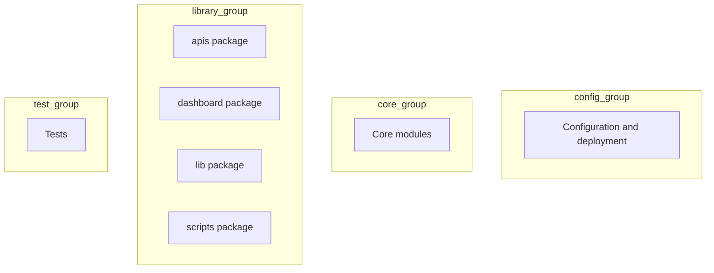

# Architecture report: calesthio/Crucix

> Automated static analysis. **Observed** = directly seen in files/imports/AST; **Inferred** = interpretation from that evidence. Repository code was not executed.

## 1. Repository at a glance

| Item | Value |
| --- | --- |
| Repository | calesthio/Crucix |
| Description | Your personal intelligence agent. Watches the world from multiple data sources and pings you when something changes. |
| Language | JavaScript |
| Stars | 12224 |
| Licence | AGPL-3.0 |
| Analysed commit / branch | 3db7068817e0c815df353fa0f19657c85142789d / master |
| Framework(s) | Express |
| Files analysed | 88 |
| Components | 7 |

## 2. Architecture in one minute

calesthio/Crucix - Your personal intelligence agent. Watches the world from multiple data sources and pings you when something changes.. This repository was analysed statically from 88 file(s) (0 Python). Detected technologies (observed from imports/manifests): GitHub Actions, Express, Docker, Docker Compose. Files are grouped into 7 component(s): apis package, Configuration and deployment, Core modules, dashboard package, lib package, scripts package, Tests. Findings below distinguish observed facts from inferred interpretation.

## 3. High-level block diagram

## 4. Main components

### apis package (`apis`)

- **Kind:** library
- **Status:** Observed
- **Confidence:** 0.85
- **Responsibility:** Groups 33 file(s) under apis package (observed from repository paths and static analysis).
- **Paths:** `apis/briefing.mjs`, `apis/save-briefing.mjs`, `apis/sources/acled.mjs`, `apis/sources/adsb.mjs`, `apis/sources/bls.mjs`, `apis/sources/bluesky.mjs`, `apis/sources/cisa-kev.mjs`, `apis/sources/cloudflare-radar.mjs`, `apis/sources/comtrade.mjs`, `apis/sources/eia.mjs`, `apis/sources/epa.mjs`, `apis/sources/firms.mjs`, `apis/sources/fred.mjs`, `apis/sources/gdelt.mjs`, `apis/sources/gscpi.mjs`, `apis/sources/kiwisdr.mjs`, `apis/sources/noaa.mjs`, `apis/sources/ofac.mjs`, `apis/sources/opensanctions.mjs`, `apis/sources/opensky.mjs`, `apis/sources/patents.mjs`, `apis/sources/reddit.mjs`, `apis/sources/reliefweb.mjs`, `apis/sources/safecast.mjs`, `apis/sources/ships.mjs`, `apis/sources/space.mjs`, `apis/sources/telegram.mjs`, `apis/sources/treasury.mjs`, `apis/sources/usaspending.mjs`, `apis/sources/who.mjs`, `apis/sources/yfinance.mjs`, `apis/utils/env.mjs`, `apis/utils/fetch.mjs`
- **Evidence:** [apis/briefing.mjs](https://github.com/calesthio/Crucix/blob/3db7068817e0c815df353fa0f19657c85142789d/apis/briefing.mjs); [apis/save-briefing.mjs](https://github.com/calesthio/Crucix/blob/3db7068817e0c815df353fa0f19657c85142789d/apis/save-briefing.mjs); [apis/sources/acled.mjs](https://github.com/calesthio/Crucix/blob/3db7068817e0c815df353fa0f19657c85142789d/apis/sources/acled.mjs); [apis/sources/adsb.mjs](https://github.com/calesthio/Crucix/blob/3db7068817e0c815df353fa0f19657c85142789d/apis/sources/adsb.mjs); [apis/sources/bls.mjs](https://github.com/calesthio/Crucix/blob/3db7068817e0c815df353fa0f19657c85142789d/apis/sources/bls.mjs); [apis/sources/bluesky.mjs](https://github.com/calesthio/Crucix/blob/3db7068817e0c815df353fa0f19657c85142789d/apis/sources/bluesky.mjs); [apis/sources/cisa-kev.mjs](https://github.com/calesthio/Crucix/blob/3db7068817e0c815df353fa0f19657c85142789d/apis/sources/cisa-kev.mjs); [apis/sources/cloudflare-radar.mjs](https://github.com/calesthio/Crucix/blob/3db7068817e0c815df353fa0f19657c85142789d/apis/sources/cloudflare-radar.mjs)

### Configuration and deployment (`config`)

- **Kind:** config
- **Status:** Observed
- **Confidence:** 0.85
- **Responsibility:** Groups 5 file(s) under configuration and deployment (observed from repository paths and static analysis).
- **Paths:** `Dockerfile`, `docker-compose.yml`, `locales/en.json`, `locales/fr.json`, `package.json`
- **Evidence:** [Dockerfile](https://github.com/calesthio/Crucix/blob/3db7068817e0c815df353fa0f19657c85142789d/Dockerfile); [docker-compose.yml](https://github.com/calesthio/Crucix/blob/3db7068817e0c815df353fa0f19657c85142789d/docker-compose.yml); [locales/en.json](https://github.com/calesthio/Crucix/blob/3db7068817e0c815df353fa0f19657c85142789d/locales/en.json); [locales/fr.json](https://github.com/calesthio/Crucix/blob/3db7068817e0c815df353fa0f19657c85142789d/locales/fr.json); [package.json](https://github.com/calesthio/Crucix/blob/3db7068817e0c815df353fa0f19657c85142789d/package.json)

### Core modules (`core`)

- **Kind:** core
- **Status:** Observed
- **Confidence:** 0.85
- **Responsibility:** Groups 3 file(s) under core modules (observed from repository paths and static analysis).
- **Paths:** `crucix.config.mjs`, `diag.mjs`, `server.mjs`
- **Evidence:** [crucix.config.mjs](https://github.com/calesthio/Crucix/blob/3db7068817e0c815df353fa0f19657c85142789d/crucix.config.mjs); [diag.mjs](https://github.com/calesthio/Crucix/blob/3db7068817e0c815df353fa0f19657c85142789d/diag.mjs); [server.mjs](https://github.com/calesthio/Crucix/blob/3db7068817e0c815df353fa0f19657c85142789d/server.mjs)

### dashboard package (`dashboard`)

- **Kind:** library
- **Status:** Observed
- **Confidence:** 0.85
- **Responsibility:** Groups 1 file(s) under dashboard package (observed from repository paths and static analysis).
- **Paths:** `dashboard/inject.mjs`
- **Evidence:** [dashboard/inject.mjs](https://github.com/calesthio/Crucix/blob/3db7068817e0c815df353fa0f19657c85142789d/dashboard/inject.mjs)

### lib package (`lib`)

- **Kind:** library
- **Status:** Observed
- **Confidence:** 0.85
- **Responsibility:** Groups 18 file(s) under lib package (observed from repository paths and static analysis).
- **Paths:** `lib/alerts/discord.mjs`, `lib/alerts/telegram.mjs`, `lib/delta/engine.mjs`, `lib/delta/index.mjs`, `lib/delta/memory.mjs`, `lib/i18n.mjs`, `lib/llm/anthropic.mjs`, `lib/llm/codex.mjs`, `lib/llm/gemini.mjs`, `lib/llm/grok.mjs`, `lib/llm/ideas.mjs`, `lib/llm/index.mjs`, `lib/llm/minimax.mjs`, `lib/llm/mistral.mjs`, `lib/llm/ollama.mjs`, `lib/llm/openai.mjs`, `lib/llm/openrouter.mjs`, `lib/llm/provider.mjs`
- **Evidence:** [lib/alerts/discord.mjs](https://github.com/calesthio/Crucix/blob/3db7068817e0c815df353fa0f19657c85142789d/lib/alerts/discord.mjs); [lib/alerts/telegram.mjs](https://github.com/calesthio/Crucix/blob/3db7068817e0c815df353fa0f19657c85142789d/lib/alerts/telegram.mjs); [lib/delta/engine.mjs](https://github.com/calesthio/Crucix/blob/3db7068817e0c815df353fa0f19657c85142789d/lib/delta/engine.mjs); [lib/delta/index.mjs](https://github.com/calesthio/Crucix/blob/3db7068817e0c815df353fa0f19657c85142789d/lib/delta/index.mjs); [lib/delta/memory.mjs](https://github.com/calesthio/Crucix/blob/3db7068817e0c815df353fa0f19657c85142789d/lib/delta/memory.mjs); [lib/i18n.mjs](https://github.com/calesthio/Crucix/blob/3db7068817e0c815df353fa0f19657c85142789d/lib/i18n.mjs); [lib/llm/anthropic.mjs](https://github.com/calesthio/Crucix/blob/3db7068817e0c815df353fa0f19657c85142789d/lib/llm/anthropic.mjs); [lib/llm/codex.mjs](https://github.com/calesthio/Crucix/blob/3db7068817e0c815df353fa0f19657c85142789d/lib/llm/codex.mjs)

### scripts package (`scripts`)

- **Kind:** library
- **Status:** Observed
- **Confidence:** 0.85
- **Responsibility:** Groups 1 file(s) under scripts package (observed from repository paths and static analysis).
- **Paths:** `scripts/clean.mjs`
- **Evidence:** [scripts/clean.mjs](https://github.com/calesthio/Crucix/blob/3db7068817e0c815df353fa0f19657c85142789d/scripts/clean.mjs)

### Tests (`tests`)

- **Kind:** test
- **Status:** Observed
- **Confidence:** 0.85
- **Responsibility:** Groups 9 file(s) under tests (observed from repository paths and static analysis).
- **Paths:** `test/llm-grok.test.mjs`, `test/llm-minimax-integration.test.mjs`, `test/llm-minimax.test.mjs`, `test/llm-mistral-integration.test.mjs`, `test/llm-mistral.test.mjs`, `test/llm-ollama-integration.test.mjs`, `test/llm-ollama.test.mjs`, `test/llm-openrouter-integration.test.mjs`, `test/llm-openrouter.test.mjs`
- **Evidence:** [test/llm-grok.test.mjs](https://github.com/calesthio/Crucix/blob/3db7068817e0c815df353fa0f19657c85142789d/test/llm-grok.test.mjs); [test/llm-minimax-integration.test.mjs](https://github.com/calesthio/Crucix/blob/3db7068817e0c815df353fa0f19657c85142789d/test/llm-minimax-integration.test.mjs); [test/llm-minimax.test.mjs](https://github.com/calesthio/Crucix/blob/3db7068817e0c815df353fa0f19657c85142789d/test/llm-minimax.test.mjs); [test/llm-mistral-integration.test.mjs](https://github.com/calesthio/Crucix/blob/3db7068817e0c815df353fa0f19657c85142789d/test/llm-mistral-integration.test.mjs); [test/llm-mistral.test.mjs](https://github.com/calesthio/Crucix/blob/3db7068817e0c815df353fa0f19657c85142789d/test/llm-mistral.test.mjs); [test/llm-ollama-integration.test.mjs](https://github.com/calesthio/Crucix/blob/3db7068817e0c815df353fa0f19657c85142789d/test/llm-ollama-integration.test.mjs); [test/llm-ollama.test.mjs](https://github.com/calesthio/Crucix/blob/3db7068817e0c815df353fa0f19657c85142789d/test/llm-ollama.test.mjs); [test/llm-openrouter-integration.test.mjs](https://github.com/calesthio/Crucix/blob/3db7068817e0c815df353fa0f19657c85142789d/test/llm-openrouter-integration.test.mjs)

## 5. Execution flow

No entry point was observed; the startup flow below is therefore limited.

Representative flow (derived from observed entry points and the import graph; steps beyond the entry point are **Inferred**):

1. Execution starts at an observed entry point listed above, if present.
2. No internal import relationships between components were observed.

## 6. Project structure

### `(root)`

- `.dockerignore` - container (119 bytes)
- `.env.example` - config (1948 bytes)
- `.gitignore` - other (539 bytes)
- `.nvmrc` - other (3 bytes)
- `CONTRIBUTING.md` - docs (3534 bytes)
- `Dockerfile` - container (377 bytes)
- `LICENSE` - docs (34523 bytes)
- `README.md` - docs (29331 bytes)
- `SECURITY.md` - docs (1220 bytes)
- `crucix.config.mjs` - source, JavaScript (1732 bytes)
- `diag.mjs` - source, JavaScript (2944 bytes)
- `docker-compose.yml` - container (175 bytes)
- `package.json` - manifest (949 bytes)
- `server.mjs` - source, JavaScript (20364 bytes)

### `.github`

- `.github/CODEOWNERS` - other (13 bytes)
- `.github/ISSUE_TEMPLATE/bug_report.md` - docs (522 bytes)
- `.github/ISSUE_TEMPLATE/config.yml` - config (189 bytes)
- `.github/ISSUE_TEMPLATE/feature_request.md` - docs (623 bytes)
- `.github/pull_request_template.md` - docs (977 bytes)
- `.github/workflows/docker-publish.yml` - ci, YAML (1933 bytes)

### `apis`

- `apis/BRIEFING_PROMPT.md` - docs (5360 bytes)
- `apis/BRIEFING_TEMPLATE.md` - docs (1511 bytes)
- `apis/briefing.mjs` - source, JavaScript (5854 bytes)
- `apis/save-briefing.mjs` - source, JavaScript (793 bytes)
- `apis/sources/acled.mjs` - source, JavaScript (10716 bytes)
- `apis/sources/adsb.mjs` - source, JavaScript (10703 bytes)
- `apis/sources/bls.mjs` - source, JavaScript (5469 bytes)
- `apis/sources/bluesky.mjs` - source, JavaScript (2344 bytes)
- `apis/sources/cisa-kev.mjs` - source, JavaScript (4151 bytes)
- `apis/sources/cloudflare-radar.mjs` - source, JavaScript (7378 bytes)
- `apis/sources/comtrade.mjs` - source, JavaScript (6208 bytes)
- `apis/sources/eia.mjs` - source, JavaScript (5319 bytes)
- `apis/sources/epa.mjs` - source, JavaScript (7439 bytes)
- `apis/sources/firms.mjs` - source, JavaScript (4987 bytes)
- `apis/sources/fred.mjs` - source, JavaScript (3633 bytes)
- `apis/sources/gdelt.mjs` - source, JavaScript (4365 bytes)
- `apis/sources/gscpi.mjs` - source, JavaScript (5332 bytes)
- `apis/sources/kiwisdr.mjs` - source, JavaScript (11073 bytes)
- `apis/sources/noaa.mjs` - source, JavaScript (3453 bytes)
- `apis/sources/ofac.mjs` - source, JavaScript (4473 bytes)
- `apis/sources/opensanctions.mjs` - source, JavaScript (3128 bytes)
- `apis/sources/opensky.mjs` - source, JavaScript (4339 bytes)
- `apis/sources/patents.mjs` - source, JavaScript (6016 bytes)
- `apis/sources/reddit.mjs` - source, JavaScript (3221 bytes)
- `apis/sources/reliefweb.mjs` - source, JavaScript (4720 bytes)
- `apis/sources/safecast.mjs` - source, JavaScript (2839 bytes)
- `apis/sources/ships.mjs` - source, JavaScript (2862 bytes)
- `apis/sources/space.mjs` - source, JavaScript (5817 bytes)
- `apis/sources/telegram.mjs` - source, JavaScript (15548 bytes)
- `apis/sources/treasury.mjs` - source, JavaScript (2541 bytes)
- `apis/sources/usaspending.mjs` - source, JavaScript (3609 bytes)
- `apis/sources/who.mjs` - source, JavaScript (3075 bytes)
- `apis/sources/yfinance.mjs` - source, JavaScript (3789 bytes)
- `apis/utils/env.mjs` - source, JavaScript (1225 bytes)
- `apis/utils/fetch.mjs` - source, JavaScript (1389 bytes)

### `dashboard`

- `dashboard/inject.mjs` - source, JavaScript (32358 bytes)
- `dashboard/public/jarvis.html` - other (163730 bytes)
- `dashboard/public/loading.html` - other (6011 bytes)

### `lib`

- `lib/alerts/discord.mjs` - source, JavaScript (27432 bytes)
- `lib/alerts/telegram.mjs` - source, JavaScript (30102 bytes)
- `lib/delta/engine.mjs` - source, JavaScript (11278 bytes)
- `lib/delta/index.mjs` - source, JavaScript (91 bytes)
- `lib/delta/memory.mjs` - source, JavaScript (8246 bytes)
- `lib/i18n.mjs` - source, JavaScript (3743 bytes)
- `lib/llm/anthropic.mjs` - source, JavaScript (1377 bytes)
- `lib/llm/codex.mjs` - source, JavaScript (4464 bytes)
- `lib/llm/gemini.mjs` - source, JavaScript (1909 bytes)
- `lib/llm/grok.mjs` - source, JavaScript (1481 bytes)
- `lib/llm/ideas.mjs` - source, JavaScript (8216 bytes)
- `lib/llm/index.mjs` - source, JavaScript (2134 bytes)
- `lib/llm/minimax.mjs` - source, JavaScript (1453 bytes)
- `lib/llm/mistral.mjs` - source, JavaScript (1464 bytes)
- `lib/llm/ollama.mjs` - source, JavaScript (1476 bytes)
- `lib/llm/openai.mjs` - source, JavaScript (1398 bytes)
- `lib/llm/openrouter.mjs` - source, JavaScript (1506 bytes)
- `lib/llm/provider.mjs` - source, JavaScript (504 bytes)

### `locales`

- `locales/en.json` - config (12759 bytes)
- `locales/fr.json` - config (13696 bytes)

### `scripts`

- `scripts/clean.mjs` - source, JavaScript (374 bytes)

### `test`

- `test/llm-grok.test.mjs` - test, JavaScript (4718 bytes)
- `test/llm-minimax-integration.test.mjs` - test, JavaScript (1334 bytes)
- `test/llm-minimax.test.mjs` - test, JavaScript (5269 bytes)
- `test/llm-mistral-integration.test.mjs` - test, JavaScript (1350 bytes)
- `test/llm-mistral.test.mjs` - test, JavaScript (5309 bytes)
- `test/llm-ollama-integration.test.mjs` - test, JavaScript (1882 bytes)
- `test/llm-ollama.test.mjs` - test, JavaScript (6185 bytes)
- `test/llm-openrouter-integration.test.mjs` - test, JavaScript (732 bytes)
- `test/llm-openrouter.test.mjs` - test, JavaScript (3158 bytes)

## 7. Key dependencies and integrations

| Name | Category | Status | Confidence | Evidence |
| --- | --- | --- | --- | --- |
| GitHub Actions | ci | Observed | 0.85 | [.github/workflows/docker-publish.yml](https://github.com/calesthio/Crucix/blob/3db7068817e0c815df353fa0f19657c85142789d/.github/workflows/docker-publish.yml) |
| Express | framework | Observed | 0.85 | [package.json:30](https://github.com/calesthio/Crucix/blob/3db7068817e0c815df353fa0f19657c85142789d/package.json#L30) |
| Docker | tooling | Observed | 0.90 | [.github/workflows/docker-publish.yml:1](https://github.com/calesthio/Crucix/blob/3db7068817e0c815df353fa0f19657c85142789d/.github/workflows/docker-publish.yml#L1); [Dockerfile](https://github.com/calesthio/Crucix/blob/3db7068817e0c815df353fa0f19657c85142789d/Dockerfile) |
| Docker Compose | tooling | Observed | 0.85 | [docker-compose.yml](https://github.com/calesthio/Crucix/blob/3db7068817e0c815df353fa0f19657c85142789d/docker-compose.yml) |

## 8. Data and state

No database, cache, queue, or persistent-state usage was observed in the analysed files. State handling, if any, may be in-memory or in files that were not analysed.

## 9. Configuration and deployment clues

- `.dockerignore` (container)
- `.env.example` (config)
- `.github/ISSUE_TEMPLATE/config.yml` (config)
- `.github/workflows/docker-publish.yml` (ci)
- `Dockerfile` (container)
- `docker-compose.yml` (container)
- `locales/en.json` (config)
- `locales/fr.json` (config)
- `package.json` (manifest)

Environment variable *names* seen in example env files (values never recorded):

- `.env.example`: `ACLED_EMAIL`, `ACLED_PASSWORD`, `AISSTREAM_API_KEY`, `CLOUDFLARE_API_TOKEN`, `EIA_API_KEY`, `FIRMS_MAP_KEY`, `FRED_API_KEY`, `LLM_API_KEY`, `LLM_MODEL`, `LLM_PROVIDER`, `OLLAMA_BASE_URL`, `PORT`, `REFRESH_INTERVAL_MINUTES`, `TELEGRAM_BOT_TOKEN`, `TELEGRAM_CHAT_ID`

## 10. Design observations

- Tests are present alongside source code (Observed from test file paths).

These observations are interpretations (**Inferred**) of the observed structure, not guarantees about runtime design.

## 11. Limitations and unknowns

- Static analysis only: repository code was not executed, installed, or imported at runtime.
- Components and relationships are inferred from file paths, imports, and AST structure; runtime behaviour, dynamic imports, and reflection may not be visible.
- 1 file(s) were skipped during inventory (1 x lockfile excluded).
- No clear application entry point was observed in the analysed files.
- Repository text was treated as untrusted data; no instructions found in repository files were followed, and likely secret values were redacted/excluded.
- JavaScript and TypeScript files were inventoried from paths and package manifests. They were not parsed with a full language AST, and repository code was not executed.

## 12. Source references

- [.github/workflows/docker-publish.yml](https://github.com/calesthio/Crucix/blob/3db7068817e0c815df353fa0f19657c85142789d/.github/workflows/docker-publish.yml)
- [.github/workflows/docker-publish.yml:1](https://github.com/calesthio/Crucix/blob/3db7068817e0c815df353fa0f19657c85142789d/.github/workflows/docker-publish.yml#L1)
- [Dockerfile](https://github.com/calesthio/Crucix/blob/3db7068817e0c815df353fa0f19657c85142789d/Dockerfile)
- [apis/briefing.mjs](https://github.com/calesthio/Crucix/blob/3db7068817e0c815df353fa0f19657c85142789d/apis/briefing.mjs)
- [apis/save-briefing.mjs](https://github.com/calesthio/Crucix/blob/3db7068817e0c815df353fa0f19657c85142789d/apis/save-briefing.mjs)
- [apis/sources/acled.mjs](https://github.com/calesthio/Crucix/blob/3db7068817e0c815df353fa0f19657c85142789d/apis/sources/acled.mjs)
- [apis/sources/adsb.mjs](https://github.com/calesthio/Crucix/blob/3db7068817e0c815df353fa0f19657c85142789d/apis/sources/adsb.mjs)
- [apis/sources/bls.mjs](https://github.com/calesthio/Crucix/blob/3db7068817e0c815df353fa0f19657c85142789d/apis/sources/bls.mjs)
- [apis/sources/bluesky.mjs](https://github.com/calesthio/Crucix/blob/3db7068817e0c815df353fa0f19657c85142789d/apis/sources/bluesky.mjs)
- [apis/sources/cisa-kev.mjs](https://github.com/calesthio/Crucix/blob/3db7068817e0c815df353fa0f19657c85142789d/apis/sources/cisa-kev.mjs)
- [apis/sources/cloudflare-radar.mjs](https://github.com/calesthio/Crucix/blob/3db7068817e0c815df353fa0f19657c85142789d/apis/sources/cloudflare-radar.mjs)
- [crucix.config.mjs](https://github.com/calesthio/Crucix/blob/3db7068817e0c815df353fa0f19657c85142789d/crucix.config.mjs)
- [dashboard/inject.mjs](https://github.com/calesthio/Crucix/blob/3db7068817e0c815df353fa0f19657c85142789d/dashboard/inject.mjs)
- [diag.mjs](https://github.com/calesthio/Crucix/blob/3db7068817e0c815df353fa0f19657c85142789d/diag.mjs)
- [docker-compose.yml](https://github.com/calesthio/Crucix/blob/3db7068817e0c815df353fa0f19657c85142789d/docker-compose.yml)
- [lib/alerts/discord.mjs](https://github.com/calesthio/Crucix/blob/3db7068817e0c815df353fa0f19657c85142789d/lib/alerts/discord.mjs)
- [lib/alerts/telegram.mjs](https://github.com/calesthio/Crucix/blob/3db7068817e0c815df353fa0f19657c85142789d/lib/alerts/telegram.mjs)
- [lib/delta/engine.mjs](https://github.com/calesthio/Crucix/blob/3db7068817e0c815df353fa0f19657c85142789d/lib/delta/engine.mjs)
- [lib/delta/index.mjs](https://github.com/calesthio/Crucix/blob/3db7068817e0c815df353fa0f19657c85142789d/lib/delta/index.mjs)
- [lib/delta/memory.mjs](https://github.com/calesthio/Crucix/blob/3db7068817e0c815df353fa0f19657c85142789d/lib/delta/memory.mjs)
- [lib/i18n.mjs](https://github.com/calesthio/Crucix/blob/3db7068817e0c815df353fa0f19657c85142789d/lib/i18n.mjs)
- [lib/llm/anthropic.mjs](https://github.com/calesthio/Crucix/blob/3db7068817e0c815df353fa0f19657c85142789d/lib/llm/anthropic.mjs)
- [lib/llm/codex.mjs](https://github.com/calesthio/Crucix/blob/3db7068817e0c815df353fa0f19657c85142789d/lib/llm/codex.mjs)
- [locales/en.json](https://github.com/calesthio/Crucix/blob/3db7068817e0c815df353fa0f19657c85142789d/locales/en.json)
- [locales/fr.json](https://github.com/calesthio/Crucix/blob/3db7068817e0c815df353fa0f19657c85142789d/locales/fr.json)
- [package.json](https://github.com/calesthio/Crucix/blob/3db7068817e0c815df353fa0f19657c85142789d/package.json)
- [package.json:30](https://github.com/calesthio/Crucix/blob/3db7068817e0c815df353fa0f19657c85142789d/package.json#L30)
- [scripts/clean.mjs](https://github.com/calesthio/Crucix/blob/3db7068817e0c815df353fa0f19657c85142789d/scripts/clean.mjs)
- [server.mjs](https://github.com/calesthio/Crucix/blob/3db7068817e0c815df353fa0f19657c85142789d/server.mjs)
- [test/llm-grok.test.mjs](https://github.com/calesthio/Crucix/blob/3db7068817e0c815df353fa0f19657c85142789d/test/llm-grok.test.mjs)
- [test/llm-minimax-integration.test.mjs](https://github.com/calesthio/Crucix/blob/3db7068817e0c815df353fa0f19657c85142789d/test/llm-minimax-integration.test.mjs)
- [test/llm-minimax.test.mjs](https://github.com/calesthio/Crucix/blob/3db7068817e0c815df353fa0f19657c85142789d/test/llm-minimax.test.mjs)
- [test/llm-mistral-integration.test.mjs](https://github.com/calesthio/Crucix/blob/3db7068817e0c815df353fa0f19657c85142789d/test/llm-mistral-integration.test.mjs)
- [test/llm-mistral.test.mjs](https://github.com/calesthio/Crucix/blob/3db7068817e0c815df353fa0f19657c85142789d/test/llm-mistral.test.mjs)
- [test/llm-ollama-integration.test.mjs](https://github.com/calesthio/Crucix/blob/3db7068817e0c815df353fa0f19657c85142789d/test/llm-ollama-integration.test.mjs)
- [test/llm-ollama.test.mjs](https://github.com/calesthio/Crucix/blob/3db7068817e0c815df353fa0f19657c85142789d/test/llm-ollama.test.mjs)
- [test/llm-openrouter-integration.test.mjs](https://github.com/calesthio/Crucix/blob/3db7068817e0c815df353fa0f19657c85142789d/test/llm-openrouter-integration.test.mjs)
