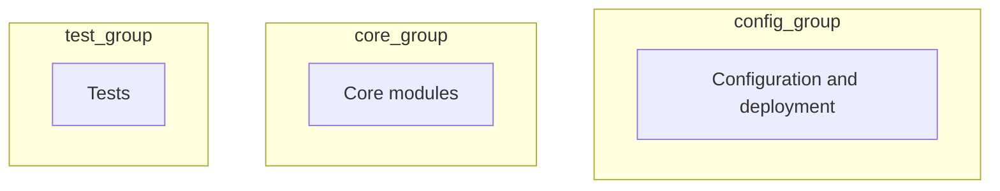

# Architecture report: camsong/You-Dont-Need-jQuery

> Automated static analysis. **Observed** = directly seen in files/imports/AST; **Inferred** = interpretation from that evidence. Repository code was not executed.

## 1. Repository at a glance

| Item | Value |
| --- | --- |
| Repository | camsong/You-Dont-Need-jQuery |
| Description | Examples of how to do query, style, dom, ajax, event etc like jQuery with plain javascript. |
| Language | JavaScript |
| Stars | 20106 |
| Licence | MIT |
| Analysed commit / branch | ebdcec86e906c670ec07dd0260a6d6f0ab8a073c / master |
| Framework(s) | None detected |
| Files analysed | 29 |
| Components | 3 |

## 2. Architecture in one minute

camsong/You-Dont-Need-jQuery - Examples of how to do query, style, dom, ajax, event etc like jQuery with plain javascript.. This repository was analysed statically from 29 file(s) (0 Python). Detected technologies (observed from imports/manifests): GitHub Actions, Vitest. Files are grouped into 3 component(s): Configuration and deployment, Core modules, Tests. Findings below distinguish observed facts from inferred interpretation.

## 3. High-level block diagram

## 4. Main components

### Configuration and deployment (`config`)

- **Kind:** config
- **Status:** Observed
- **Confidence:** 0.85
- **Responsibility:** Groups 1 file(s) under configuration and deployment (observed from repository paths and static analysis).
- **Paths:** `package.json`
- **Evidence:** [package.json](https://github.com/camsong/You-Dont-Need-jQuery/blob/ebdcec86e906c670ec07dd0260a6d6f0ab8a073c/package.json)

### Core modules (`core`)

- **Kind:** core
- **Status:** Observed
- **Confidence:** 0.85
- **Responsibility:** Groups 1 file(s) under core modules (observed from repository paths and static analysis).
- **Paths:** `vitest.config.js`
- **Evidence:** [vitest.config.js](https://github.com/camsong/You-Dont-Need-jQuery/blob/ebdcec86e906c670ec07dd0260a6d6f0ab8a073c/vitest.config.js)

### Tests (`tests`)

- **Kind:** test
- **Status:** Observed
- **Confidence:** 0.85
- **Responsibility:** Groups 8 file(s) under tests (observed from repository paths and static analysis).
- **Paths:** `test/README.md`, `test/ajax.spec.js`, `test/animation.spec.js`, `test/dom.spec.js`, `test/events.spec.js`, `test/promises.spec.js`, `test/query.spec.js`, `test/utilities.spec.js`
- **Evidence:** [test/README.md](https://github.com/camsong/You-Dont-Need-jQuery/blob/ebdcec86e906c670ec07dd0260a6d6f0ab8a073c/test/README.md); [test/ajax.spec.js](https://github.com/camsong/You-Dont-Need-jQuery/blob/ebdcec86e906c670ec07dd0260a6d6f0ab8a073c/test/ajax.spec.js); [test/animation.spec.js](https://github.com/camsong/You-Dont-Need-jQuery/blob/ebdcec86e906c670ec07dd0260a6d6f0ab8a073c/test/animation.spec.js); [test/dom.spec.js](https://github.com/camsong/You-Dont-Need-jQuery/blob/ebdcec86e906c670ec07dd0260a6d6f0ab8a073c/test/dom.spec.js); [test/events.spec.js](https://github.com/camsong/You-Dont-Need-jQuery/blob/ebdcec86e906c670ec07dd0260a6d6f0ab8a073c/test/events.spec.js); [test/promises.spec.js](https://github.com/camsong/You-Dont-Need-jQuery/blob/ebdcec86e906c670ec07dd0260a6d6f0ab8a073c/test/promises.spec.js); [test/query.spec.js](https://github.com/camsong/You-Dont-Need-jQuery/blob/ebdcec86e906c670ec07dd0260a6d6f0ab8a073c/test/query.spec.js); [test/utilities.spec.js](https://github.com/camsong/You-Dont-Need-jQuery/blob/ebdcec86e906c670ec07dd0260a6d6f0ab8a073c/test/utilities.spec.js)

## 5. Execution flow

No entry point was observed; the startup flow below is therefore limited.

Representative flow (derived from observed entry points and the import graph; steps beyond the entry point are **Inferred**):

1. Execution starts at an observed entry point listed above, if present.
2. No internal import relationships between components were observed.

## 6. Project structure

### `(root)`

- `.gitignore` - other (49 bytes)
- `LICENSE` - docs (1075 bytes)
- `README-es.md` - docs (33399 bytes)
- `README-fr.md` - docs (32750 bytes)
- `README-id.md` - docs (17976 bytes)
- `README-it.md` - docs (18542 bytes)
- `README-ja.md` - docs (36626 bytes)
- `README-kg.md` - docs (26025 bytes)
- `README-my.md` - docs (17716 bytes)
- `README-pl.md` - docs (33737 bytes)
- `README-ru.md` - docs (39131 bytes)
- `README-tr.md` - docs (19497 bytes)
- `README-vi.md` - docs (19284 bytes)
- `README.ko-KR.md` - docs (36844 bytes)
- `README.md` - docs (34260 bytes)
- `README.pt-BR.md` - docs (17936 bytes)
- `README.zh-CN.md` - docs (32768 bytes)
- `README.zh-TW.md` - docs (33952 bytes)
- `package.json` - manifest (856 bytes)
- `vitest.config.js` - source, JavaScript (158 bytes)

### `.github`

- `.github/workflows/test.yml` - ci, YAML (290 bytes)

### `test`

- `test/README.md` - test (361 bytes)
- `test/ajax.spec.js` - test, JavaScript (1487 bytes)
- `test/animation.spec.js` - test, JavaScript (1634 bytes)
- `test/dom.spec.js` - test, JavaScript (4085 bytes)
- `test/events.spec.js` - test, JavaScript (1869 bytes)
- `test/promises.spec.js` - test, JavaScript (962 bytes)
- `test/query.spec.js` - test, JavaScript (5054 bytes)
- `test/utilities.spec.js` - test, JavaScript (2803 bytes)

## 7. Key dependencies and integrations

| Name | Category | Status | Confidence | Evidence |
| --- | --- | --- | --- | --- |
| GitHub Actions | ci | Observed | 0.85 | [.github/workflows/test.yml](https://github.com/camsong/You-Dont-Need-jQuery/blob/ebdcec86e906c670ec07dd0260a6d6f0ab8a073c/.github/workflows/test.yml) |
| Vitest | tooling | Observed | 0.85 | [package.json:8](https://github.com/camsong/You-Dont-Need-jQuery/blob/ebdcec86e906c670ec07dd0260a6d6f0ab8a073c/package.json#L8) |

## 8. Data and state

No database, cache, queue, or persistent-state usage was observed in the analysed files. State handling, if any, may be in-memory or in files that were not analysed.

## 9. Configuration and deployment clues

- `.github/workflows/test.yml` (ci)
- `package.json` (manifest)

## 10. Design observations

- Tests are present alongside source code (Observed from test file paths).

These observations are interpretations (**Inferred**) of the observed structure, not guarantees about runtime design.

## 11. Limitations and unknowns

- Static analysis only: repository code was not executed, installed, or imported at runtime.
- Components and relationships are inferred from file paths, imports, and AST structure; runtime behaviour, dynamic imports, and reflection may not be visible.
- 1 file(s) were skipped during inventory (1 x lockfile excluded).
- No clear application entry point was observed in the analysed files.
- Repository text was treated as untrusted data; no instructions found in repository files were followed, and likely secret values were redacted/excluded.
- JavaScript and TypeScript files were inventoried from paths and package manifests. They were not parsed with a full language AST, and repository code was not executed.

## 12. Source references

- [.github/workflows/test.yml](https://github.com/camsong/You-Dont-Need-jQuery/blob/ebdcec86e906c670ec07dd0260a6d6f0ab8a073c/.github/workflows/test.yml)
- [package.json](https://github.com/camsong/You-Dont-Need-jQuery/blob/ebdcec86e906c670ec07dd0260a6d6f0ab8a073c/package.json)
- [package.json:8](https://github.com/camsong/You-Dont-Need-jQuery/blob/ebdcec86e906c670ec07dd0260a6d6f0ab8a073c/package.json#L8)
- [test/README.md](https://github.com/camsong/You-Dont-Need-jQuery/blob/ebdcec86e906c670ec07dd0260a6d6f0ab8a073c/test/README.md)
- [test/ajax.spec.js](https://github.com/camsong/You-Dont-Need-jQuery/blob/ebdcec86e906c670ec07dd0260a6d6f0ab8a073c/test/ajax.spec.js)
- [test/animation.spec.js](https://github.com/camsong/You-Dont-Need-jQuery/blob/ebdcec86e906c670ec07dd0260a6d6f0ab8a073c/test/animation.spec.js)
- [test/dom.spec.js](https://github.com/camsong/You-Dont-Need-jQuery/blob/ebdcec86e906c670ec07dd0260a6d6f0ab8a073c/test/dom.spec.js)
- [test/events.spec.js](https://github.com/camsong/You-Dont-Need-jQuery/blob/ebdcec86e906c670ec07dd0260a6d6f0ab8a073c/test/events.spec.js)
- [test/promises.spec.js](https://github.com/camsong/You-Dont-Need-jQuery/blob/ebdcec86e906c670ec07dd0260a6d6f0ab8a073c/test/promises.spec.js)
- [test/query.spec.js](https://github.com/camsong/You-Dont-Need-jQuery/blob/ebdcec86e906c670ec07dd0260a6d6f0ab8a073c/test/query.spec.js)
- [test/utilities.spec.js](https://github.com/camsong/You-Dont-Need-jQuery/blob/ebdcec86e906c670ec07dd0260a6d6f0ab8a073c/test/utilities.spec.js)
- [vitest.config.js](https://github.com/camsong/You-Dont-Need-jQuery/blob/ebdcec86e906c670ec07dd0260a6d6f0ab8a073c/vitest.config.js)
