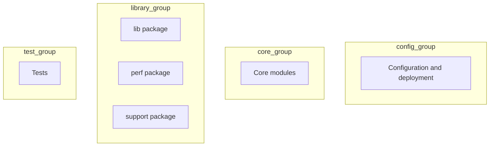

# Architecture report: caolan/async

> Automated static analysis. **Observed** = directly seen in files/imports/AST; **Inferred** = interpretation from that evidence. Repository code was not executed.

## 1. Repository at a glance

| Item | Value |
| --- | --- |
| Repository | caolan/async |
| Description | Async utilities for node and the browser |
| Language | JavaScript |
| Stars | 28117 |
| Licence | MIT |
| Analysed commit / branch | 3921e54bd0704157dbea238fdfcc0c3619abde1a / master |
| Framework(s) | None detected |
| Files analysed | 433 |
| Components | 6 |

## 2. Architecture in one minute

caolan/async - Async utilities for node and the browser. This repository was analysed statically from 433 file(s) (0 Python). Detected technologies (observed from imports/manifests): GitHub Actions. Files are grouped into 6 component(s): Configuration and deployment, Core modules, lib package, perf package, support package, Tests. Findings below distinguish observed facts from inferred interpretation.

## 3. High-level block diagram

## 4. Main components

### Configuration and deployment (`config`)

- **Kind:** config
- **Status:** Observed
- **Confidence:** 0.85
- **Responsibility:** Groups 3 file(s) under configuration and deployment (observed from repository paths and static analysis).
- **Paths:** `bower.json`, `package.json`, `support/jsdoc/jsdoc.json`
- **Evidence:** [bower.json](https://github.com/caolan/async/blob/3921e54bd0704157dbea238fdfcc0c3619abde1a/bower.json); [package.json](https://github.com/caolan/async/blob/3921e54bd0704157dbea238fdfcc0c3619abde1a/package.json); [support/jsdoc/jsdoc.json](https://github.com/caolan/async/blob/3921e54bd0704157dbea238fdfcc0c3619abde1a/support/jsdoc/jsdoc.json)

### Core modules (`core`)

- **Kind:** core
- **Status:** Observed
- **Confidence:** 0.85
- **Responsibility:** Groups 2 file(s) under core modules (observed from repository paths and static analysis).
- **Paths:** `index.js`, `karma.conf.js`
- **Evidence:** [index.js](https://github.com/caolan/async/blob/3921e54bd0704157dbea238fdfcc0c3619abde1a/index.js); [karma.conf.js](https://github.com/caolan/async/blob/3921e54bd0704157dbea238fdfcc0c3619abde1a/karma.conf.js)

### lib package (`lib`)

- **Kind:** library
- **Status:** Observed
- **Confidence:** 0.85
- **Responsibility:** Groups 102 file(s) under lib package (observed from repository paths and static analysis).
- **Paths:** `lib/apply.js`, `lib/applyEach.js`, `lib/applyEachSeries.js`, `lib/asyncify.js`, `lib/auto.js`, `lib/autoInject.js`, `lib/cargo.js`, `lib/cargoQueue.js`, `lib/compose.js`, `lib/concat.js`, `lib/concatLimit.js`, `lib/concatSeries.js`, `lib/constant.js`, `lib/detect.js`, `lib/detectLimit.js`, `lib/detectSeries.js`, `lib/dir.js`, `lib/doUntil.js`, `lib/doWhilst.js`, `lib/each.js`, `lib/eachLimit.js`, `lib/eachOf.js`, `lib/eachOfLimit.js`, `lib/eachOfSeries.js`, `lib/eachSeries.js`, `lib/ensureAsync.js`, `lib/every.js`, `lib/everyLimit.js`, `lib/everySeries.js`, `lib/filter.js`, `lib/filterLimit.js`, `lib/filterSeries.js`, `lib/forever.js`, `lib/groupBy.js`, `lib/groupByLimit.js`, `lib/groupBySeries.js`, `lib/index.js`, `lib/internal/DoublyLinkedList.js`, `lib/internal/Heap.js`, `lib/internal/applyEach.js`, `lib/internal/asyncEachOfLimit.js`, `lib/internal/awaitify.js`, `lib/internal/breakLoop.js`, `lib/internal/consoleFunc.js`, `lib/internal/createTester.js`, `lib/internal/eachOfLimit.js`, `lib/internal/filter.js`, `lib/internal/getIterator.js`, `lib/internal/initialParams.js`, `lib/internal/isArrayLike.js`, `lib/internal/iterator.js`, `lib/internal/map.js`, `lib/internal/once.js`, `lib/internal/onlyOnce.js`, `lib/internal/parallel.js`, `lib/internal/promiseCallback.js`, `lib/internal/queue.js`, `lib/internal/range.js`, `lib/internal/reject.js`, `lib/internal/setImmediate.js`, `lib/internal/withoutIndex.js`, `lib/internal/wrapAsync.js`, `lib/log.js`, `lib/map.js`, `lib/mapLimit.js`, `lib/mapSeries.js`, `lib/mapValues.js`, `lib/mapValuesLimit.js`, `lib/mapValuesSeries.js`, `lib/memoize.js`, `lib/nextTick.js`, `lib/parallel.js`, `lib/parallelLimit.js`, `lib/priorityQueue.js`, `lib/queue.js`, `lib/race.js`, `lib/reduce.js`, `lib/reduceRight.js`, `lib/reflect.js`, `lib/reflectAll.js`, `lib/reject.js`, `lib/rejectLimit.js`, `lib/rejectSeries.js`, `lib/retry.js`, `lib/retryable.js`, `lib/seq.js`, `lib/series.js`, `lib/setImmediate.js`, `lib/some.js`, `lib/someLimit.js`, `lib/someSeries.js`, `lib/sortBy.js`, `lib/timeout.js`, `lib/times.js`, `lib/timesLimit.js`, `lib/timesSeries.js`, `lib/transform.js`, `lib/tryEach.js`, `lib/unmemoize.js`, `lib/until.js`, `lib/waterfall.js`, `lib/whilst.js`
- **Evidence:** [lib/apply.js](https://github.com/caolan/async/blob/3921e54bd0704157dbea238fdfcc0c3619abde1a/lib/apply.js); [lib/applyEach.js](https://github.com/caolan/async/blob/3921e54bd0704157dbea238fdfcc0c3619abde1a/lib/applyEach.js); [lib/applyEachSeries.js](https://github.com/caolan/async/blob/3921e54bd0704157dbea238fdfcc0c3619abde1a/lib/applyEachSeries.js); [lib/asyncify.js](https://github.com/caolan/async/blob/3921e54bd0704157dbea238fdfcc0c3619abde1a/lib/asyncify.js); [lib/auto.js](https://github.com/caolan/async/blob/3921e54bd0704157dbea238fdfcc0c3619abde1a/lib/auto.js); [lib/autoInject.js](https://github.com/caolan/async/blob/3921e54bd0704157dbea238fdfcc0c3619abde1a/lib/autoInject.js); [lib/cargo.js](https://github.com/caolan/async/blob/3921e54bd0704157dbea238fdfcc0c3619abde1a/lib/cargo.js); [lib/cargoQueue.js](https://github.com/caolan/async/blob/3921e54bd0704157dbea238fdfcc0c3619abde1a/lib/cargoQueue.js)

### perf package (`perf`)

- **Kind:** library
- **Status:** Observed
- **Confidence:** 0.85
- **Responsibility:** Groups 3 file(s) under perf package (observed from repository paths and static analysis).
- **Paths:** `perf/benchmark.js`, `perf/memory.js`, `perf/suites.js`
- **Evidence:** [perf/benchmark.js](https://github.com/caolan/async/blob/3921e54bd0704157dbea238fdfcc0c3619abde1a/perf/benchmark.js); [perf/memory.js](https://github.com/caolan/async/blob/3921e54bd0704157dbea238fdfcc0c3619abde1a/perf/memory.js); [perf/suites.js](https://github.com/caolan/async/blob/3921e54bd0704157dbea238fdfcc0c3619abde1a/perf/suites.js)

### support package (`support`)

- **Kind:** library
- **Status:** Observed
- **Confidence:** 0.85
- **Responsibility:** Groups 14 file(s) under support package (observed from repository paths and static analysis).
- **Paths:** `support/build.test.js`, `support/es.test.js`, `support/generate-index.js`, `support/index-template.js`, `support/jsdoc/jsdoc-custom.js`, `support/jsdoc/jsdoc-fix-html.js`, `support/jsdoc/jsdoc-import-path-plugin.js`, `support/jsdoc/theme/publish.js`, `support/jsdoc/theme/static/scripts/linenumber.js`, `support/jsdoc/theme/static/scripts/prettify/lang-css.js`, `support/jsdoc/theme/static/scripts/prettify/prettify.js`, `support/sync-cjs-package.js`, `support/sync-es-package.js`, `support/xyz.sh`
- **Evidence:** [support/build.test.js](https://github.com/caolan/async/blob/3921e54bd0704157dbea238fdfcc0c3619abde1a/support/build.test.js); [support/es.test.js](https://github.com/caolan/async/blob/3921e54bd0704157dbea238fdfcc0c3619abde1a/support/es.test.js); [support/generate-index.js](https://github.com/caolan/async/blob/3921e54bd0704157dbea238fdfcc0c3619abde1a/support/generate-index.js); [support/index-template.js](https://github.com/caolan/async/blob/3921e54bd0704157dbea238fdfcc0c3619abde1a/support/index-template.js); [support/jsdoc/jsdoc-custom.js](https://github.com/caolan/async/blob/3921e54bd0704157dbea238fdfcc0c3619abde1a/support/jsdoc/jsdoc-custom.js); [support/jsdoc/jsdoc-fix-html.js](https://github.com/caolan/async/blob/3921e54bd0704157dbea238fdfcc0c3619abde1a/support/jsdoc/jsdoc-fix-html.js); [support/jsdoc/jsdoc-import-path-plugin.js](https://github.com/caolan/async/blob/3921e54bd0704157dbea238fdfcc0c3619abde1a/support/jsdoc/jsdoc-import-path-plugin.js); [support/jsdoc/theme/publish.js](https://github.com/caolan/async/blob/3921e54bd0704157dbea238fdfcc0c3619abde1a/support/jsdoc/theme/publish.js)

### Tests (`tests`)

- **Kind:** test
- **Status:** Observed
- **Confidence:** 0.85
- **Responsibility:** Groups 52 file(s) under tests (observed from repository paths and static analysis).
- **Paths:** `test/.jshintrc`, `test/apply.js`, `test/applyEach.js`, `test/asyncFunctions.js`, `test/asyncify.js`, `test/auto.js`, `test/autoInject.js`, `test/cargo.js`, `test/cargoQueue.js`, `test/compose.js`, `test/concat.js`, `test/consoleFunctions.js`, `test/constant.js`, `test/detect.js`, `test/each.js`, `test/eachOf.js`, `test/ensureAsync.js`, `test/es2017/asyncFunctions.js`, `test/es2017/asyncGenerators.js`, `test/es2017/awaitableFunctions.js`, `test/every.js`, `test/filter.js`, `test/forever.js`, `test/groupBy.js`, `test/heap.js`, `test/linked_list.js`, `test/map.js`, `test/mapValues.js`, `test/memoize.js`, `test/mocha.opts`, `test/nextTick.js`, `test/parallel.js`, `test/priorityQueue.js`, `test/queue.js`, `test/race.js`, `test/reduce.js`, `test/retry.js`, `test/retryable.js`, `test/seq.js`, `test/series.js`, `test/setImmediate.js`, `test/some.js`, `test/sortBy.js`, `test/support/get_function_object.js`, `test/support/setup.js`, `test/timeout.js`, `test/times.js`, `test/transform.js`, `test/tryEach.js`, `test/until.js`, `test/waterfall.js`, `test/whilst.js`
- **Evidence:** [test/.jshintrc](https://github.com/caolan/async/blob/3921e54bd0704157dbea238fdfcc0c3619abde1a/test/.jshintrc); [test/apply.js](https://github.com/caolan/async/blob/3921e54bd0704157dbea238fdfcc0c3619abde1a/test/apply.js); [test/applyEach.js](https://github.com/caolan/async/blob/3921e54bd0704157dbea238fdfcc0c3619abde1a/test/applyEach.js); [test/asyncFunctions.js](https://github.com/caolan/async/blob/3921e54bd0704157dbea238fdfcc0c3619abde1a/test/asyncFunctions.js); [test/asyncify.js](https://github.com/caolan/async/blob/3921e54bd0704157dbea238fdfcc0c3619abde1a/test/asyncify.js); [test/auto.js](https://github.com/caolan/async/blob/3921e54bd0704157dbea238fdfcc0c3619abde1a/test/auto.js); [test/autoInject.js](https://github.com/caolan/async/blob/3921e54bd0704157dbea238fdfcc0c3619abde1a/test/autoInject.js); [test/cargo.js](https://github.com/caolan/async/blob/3921e54bd0704157dbea238fdfcc0c3619abde1a/test/cargo.js)

## 5. Execution flow

**Observed** entry point(s):

- [index.js](https://github.com/caolan/async/blob/3921e54bd0704157dbea238fdfcc0c3619abde1a/index.js)
- [lib/index.js](https://github.com/caolan/async/blob/3921e54bd0704157dbea238fdfcc0c3619abde1a/lib/index.js)

Representative flow (derived from observed entry points and the import graph; steps beyond the entry point are **Inferred**):

1. Execution starts at an observed entry point listed above, if present.
2. No internal import relationships between components were observed.

## 6. Project structure

### `(root)`

- `.babelrc` - other (160 bytes)
- `.editorconfig` - config (245 bytes)
- `.eslintignore` - other (33 bytes)
- `.eslintrc.json` - config (1320 bytes)
- `.gitattributes` - other (85 bytes)
- `.gitignore` - other (132 bytes)
- `.npmignore` - other (70 bytes)
- `CHANGELOG.md` - docs (33541 bytes)
- `LICENSE` - docs (1063 bytes)
- `Makefile` - other (4804 bytes)
- `README.es.md` - docs (2419 bytes)
- `README.md` - docs (3217 bytes)
- `bower.json` - config (239 bytes)
- `index.js` - source, JavaScript (157 bytes)
- `intro.md` - docs (11743 bytes)
- `karma.conf.js` - source, JavaScript (763 bytes)
- `package.json` - manifest (2278 bytes)

### `.github`

- `.github/ISSUE_TEMPLATE.md` - docs (608 bytes)
- `.github/dependabot.yml` - config (264 bytes)
- `.github/workflows/ci.yml` - ci, YAML (2156 bytes)

### `docs`

- `docs/.nojekyll` - docs (0 bytes)
- `docs/index.html` - docs (51 bytes)
- `docs/v2/apply.js.html` - docs (12287 bytes)
- `docs/v2/applyEach.js.html` - docs (12088 bytes)
- `docs/v2/applyEachSeries.js.html` - docs (11584 bytes)
- `docs/v2/asyncify.js.html` - docs (13732 bytes)
- `docs/v2/auto.js.html` - docs (19938 bytes)
- `docs/v2/autoInject.js.html` - docs (16861 bytes)
- `docs/v2/cargo.js.html` - docs (14594 bytes)
- `docs/v2/compose.js.html` - docs (11861 bytes)
- `docs/v2/concat.js.html` - docs (11899 bytes)
- `docs/v2/concatLimit.js.html` - docs (12338 bytes)
- `docs/v2/concatSeries.js.html` - docs (11565 bytes)
- `docs/v2/constant.js.html` - docs (12146 bytes)
- `docs/v2/data/methodNames.json` - config (1350 bytes)
- `docs/v2/data/sourceFiles.json` - config (1742 bytes)
- `docs/v2/detect.js.html` - docs (12381 bytes)
- `docs/v2/detectLimit.js.html` - docs (11903 bytes)
- `docs/v2/detectSeries.js.html` - docs (11646 bytes)
- `docs/v2/dir.js.html` - docs (11658 bytes)
- `docs/v2/doDuring.js.html` - docs (12332 bytes)
- `docs/v2/doUntil.js.html` - docs (11722 bytes)
- `docs/v2/doWhilst.js.html` - docs (12231 bytes)
- `docs/v2/during.js.html` - docs (12407 bytes)
- `docs/v2/each.js.html` - docs (13096 bytes)
- `docs/v2/eachLimit.js.html` - docs (11766 bytes)
- `docs/v2/eachOf.js.html` - docs (13333 bytes)
- `docs/v2/eachOfLimit.js.html` - docs (11694 bytes)
- `docs/v2/eachOfSeries.js.html` - docs (11430 bytes)
- `docs/v2/eachSeries.js.html` - docs (11499 bytes)
- `docs/v2/ensureAsync.js.html` - docs (12773 bytes)
- `docs/v2/every.js.html` - docs (11914 bytes)
- `docs/v2/everyLimit.js.html` - docs (11749 bytes)
- `docs/v2/everySeries.js.html` - docs (11568 bytes)
- `docs/v2/filter.js.html` - docs (11839 bytes)
- `docs/v2/filterLimit.js.html` - docs (11629 bytes)
- `docs/v2/filterSeries.js.html` - docs (11529 bytes)
- `docs/v2/fonts/OpenSans-Bold-webfont.svg` - docs (118259 bytes)
- `docs/v2/fonts/OpenSans-BoldItalic-webfont.svg` - docs (121112 bytes)
- `docs/v2/fonts/OpenSans-Italic-webfont.svg` - docs (122495 bytes)
- `docs/v2/fonts/OpenSans-Light-webfont.svg` - docs (117270 bytes)
- `docs/v2/fonts/OpenSans-LightItalic-webfont.svg` - docs (122968 bytes)
- `docs/v2/fonts/OpenSans-Regular-webfont.svg` - docs (119399 bytes)
- `docs/v2/fonts/OpenSans-Semibold-webfont.svg` - docs (118464 bytes)
- `docs/v2/fonts/OpenSans-SemiboldItalic-webfont.svg` - docs (122491 bytes)
- `docs/v2/forever.js.html` - docs (12107 bytes)
- `docs/v2/global.html` - docs (13773 bytes)
- `docs/v2/groupBy.js.html` - docs (12477 bytes)
- `docs/v2/groupByLimit.js.html` - docs (12610 bytes)
- `docs/v2/groupBySeries.js.html` - docs (11640 bytes)
- `docs/v2/img/async-logo.svg` - docs (3668 bytes)
- `docs/v2/index.html` - docs (21520 bytes)
- `docs/v2/index.js.html` - docs (22059 bytes)
- `docs/v2/log.js.html` - docs (11568 bytes)
- `docs/v2/map.js.html` - docs (12401 bytes)
- `docs/v2/mapLimit.js.html` - docs (11599 bytes)
- `docs/v2/mapSeries.js.html` - docs (11502 bytes)
- `docs/v2/mapValues.js.html` - docs (12553 bytes)
- `docs/v2/mapValuesLimit.js.html` - docs (12201 bytes)
- `docs/v2/mapValuesSeries.js.html` - docs (11621 bytes)
- `docs/v2/memoize.js.html` - docs (13317 bytes)
- `docs/v2/module-Collections.html` - docs (137361 bytes)
- `docs/v2/module-ControlFlow.html` - docs (124601 bytes)
- `docs/v2/module-Utils.html` - docs (48970 bytes)
- `docs/v2/module-async.html` - docs (11610 bytes)
- `docs/v2/nextTick.js.html` - docs (11998 bytes)
- `docs/v2/parallel.js.html` - docs (13420 bytes)
- `docs/v2/parallelLimit.js.html` - docs (11697 bytes)
- `docs/v2/priorityQueue.js.html` - docs (13298 bytes)
- `docs/v2/queue.js.html` - docs (16273 bytes)
- `docs/v2/race.js.html` - docs (12373 bytes)
- `docs/v2/reduce.js.html` - docs (12833 bytes)
- `docs/v2/reduceRight.js.html` - docs (11828 bytes)
- `docs/v2/reflect.js.html` - docs (12648 bytes)
- `docs/v2/reflectAll.js.html` - docs (13049 bytes)
- `docs/v2/reject.js.html` - docs (11763 bytes)
- `docs/v2/rejectLimit.js.html` - docs (11551 bytes)
- `docs/v2/rejectSeries.js.html` - docs (11451 bytes)
- `docs/v2/retry.js.html` - docs (15829 bytes)
- `docs/v2/retryable.js.html` - docs (12242 bytes)
- `docs/v2/scripts/async.js` - docs (184418 bytes)
- `docs/v2/scripts/jsdoc-custom.js` - docs (4036 bytes)
- `docs/v2/scripts/linenumber.js` - docs (674 bytes)
- `docs/v2/scripts/prettify/Apache-License-2.0.txt` - docs (11358 bytes)
- `docs/v2/scripts/prettify/lang-css.js` - docs (861 bytes)
- `docs/v2/scripts/prettify/prettify.js` - docs (13632 bytes)
- `docs/v2/seq.js.html` - docs (13153 bytes)
- `docs/v2/series.js.html` - docs (13251 bytes)
- `docs/v2/setImmediate.js.html` - docs (11781 bytes)
- `docs/v2/some.js.html` - docs (11994 bytes)
- `docs/v2/someLimit.js.html` - docs (11798 bytes)
- `docs/v2/someSeries.js.html` - docs (11607 bytes)
- `docs/v2/sortBy.js.html` - docs (13002 bytes)
- `docs/v2/styles/jsdoc-default.css` - docs (12566 bytes)
- `docs/v2/styles/prettify-jsdoc.css` - docs (1547 bytes)
- `docs/v2/styles/prettify-tomorrow.css` - docs (2082 bytes)
- `docs/v2/timeout.js.html` - docs (13119 bytes)
- `docs/v2/times.js.html` - docs (11750 bytes)
- `docs/v2/timesLimit.js.html` - docs (11599 bytes)
- `docs/v2/timesSeries.js.html` - docs (11314 bytes)
- `docs/v2/transform.js.html` - docs (12827 bytes)
- `docs/v2/tryEach.js.html` - docs (12719 bytes)
- `docs/v2/unmemoize.js.html` - docs (11178 bytes)
- `docs/v2/until.js.html` - docs (11791 bytes)
- `docs/v2/waterfall.js.html` - docs (13574 bytes)
- `docs/v2/whilst.js.html` - docs (12359 bytes)
- `docs/v3/apply.js.html` - docs (11865 bytes)
- `docs/v3/applyEach.js.html` - docs (12052 bytes)
- `docs/v3/applyEachSeries.js.html` - docs (11350 bytes)
- `docs/v3/asyncify.js.html` - docs (13790 bytes)
- `docs/v3/auto.js.html` - docs (22595 bytes)
- `docs/v3/autoInject.js.html` - docs (17637 bytes)
- `docs/v3/cargo.js.html` - docs (12437 bytes)
- `docs/v3/cargoQueue.js.html` - docs (13073 bytes)
- `docs/v3/compose.js.html` - docs (11661 bytes)
- `docs/v3/concat.js.html` - docs (13882 bytes)
- `docs/v3/concatLimit.js.html` - docs (12077 bytes)
- `docs/v3/concatSeries.js.html` - docs (11508 bytes)
- `docs/v3/constant.js.html` - docs (11750 bytes)
- `docs/v3/data/methodNames.json` - config (1152 bytes)
- `docs/v3/data/sourceFiles.json` - config (1492 bytes)
- `docs/v3/detect.js.html` - docs (13321 bytes)
- `docs/v3/detectLimit.js.html` - docs (11800 bytes)
- `docs/v3/detectSeries.js.html` - docs (11708 bytes)
- `docs/v3/dir.js.html` - docs (11410 bytes)
- `docs/v3/doUntil.js.html` - docs (11742 bytes)
- `docs/v3/doWhilst.js.html` - docs (12254 bytes)
- `docs/v3/each.js.html` - docs (14013 bytes)
- `docs/v3/eachLimit.js.html` - docs (11680 bytes)
- `docs/v3/eachOf.js.html` - docs (15543 bytes)
- `docs/v3/eachOfLimit.js.html` - docs (11609 bytes)
- `docs/v3/eachOfSeries.js.html` - docs (11364 bytes)
- `docs/v3/eachSeries.js.html` - docs (11610 bytes)
- `docs/v3/ensureAsync.js.html` - docs (12397 bytes)
- `docs/v3/every.js.html` - docs (13609 bytes)
- `docs/v3/everyLimit.js.html` - docs (11715 bytes)
- `docs/v3/everySeries.js.html` - docs (11614 bytes)
- `docs/v3/filter.js.html` - docs (12978 bytes)
- `docs/v3/filterLimit.js.html` - docs (11628 bytes)
- `docs/v3/filterSeries.js.html` - docs (11525 bytes)
- `docs/v3/fonts/OpenSans-Bold-webfont.svg` - docs (118259 bytes)
- `docs/v3/fonts/OpenSans-BoldItalic-webfont.svg` - docs (121112 bytes)
- `docs/v3/fonts/OpenSans-Italic-webfont.svg` - docs (122495 bytes)
- `docs/v3/fonts/OpenSans-Light-webfont.svg` - docs (117270 bytes)
- `docs/v3/fonts/OpenSans-LightItalic-webfont.svg` - docs (122968 bytes)
- `docs/v3/fonts/OpenSans-Regular-webfont.svg` - docs (119399 bytes)
- `docs/v3/fonts/OpenSans-Semibold-webfont.svg` - docs (118464 bytes)
- `docs/v3/fonts/OpenSans-SemiboldItalic-webfont.svg` - docs (122491 bytes)
- `docs/v3/forever.js.html` - docs (12027 bytes)
- `docs/v3/global.html` - docs (13523 bytes)
- `docs/v3/groupBy.js.html` - docs (13840 bytes)
- `docs/v3/groupByLimit.js.html` - docs (12425 bytes)
- `docs/v3/groupBySeries.js.html` - docs (11415 bytes)
- `docs/v3/img/async-logo.svg` - docs (3668 bytes)
- `docs/v3/index.html` - docs (24313 bytes)
- `docs/v3/index.js.html` - docs (21217 bytes)
- `docs/v3/log.js.html` - docs (11320 bytes)
- `docs/v3/map.js.html` - docs (14657 bytes)
- `docs/v3/mapLimit.js.html` - docs (11593 bytes)
- `docs/v3/mapSeries.js.html` - docs (11493 bytes)
- `docs/v3/mapValues.js.html` - docs (14743 bytes)
- `docs/v3/mapValuesLimit.js.html` - docs (12041 bytes)
- `docs/v3/mapValuesSeries.js.html` - docs (11459 bytes)
- `docs/v3/memoize.js.html` - docs (13038 bytes)
- `docs/v3/module-Collections.html` - docs (173477 bytes)
- `docs/v3/module-ControlFlow.html` - docs (133667 bytes)
- `docs/v3/module-Utils.html` - docs (48885 bytes)
- `docs/v3/module-async.html` - docs (11360 bytes)
- `docs/v3/nextTick.js.html` - docs (11752 bytes)
- `docs/v3/parallel.js.html` - docs (15744 bytes)
- `docs/v3/parallelLimit.js.html` - docs (11533 bytes)
- `docs/v3/priorityQueue.js.html` - docs (12745 bytes)
- `docs/v3/queue.js.html` - docs (17562 bytes)
- `docs/v3/race.js.html` - docs (12146 bytes)
- `docs/v3/reduce.js.html` - docs (14878 bytes)
- `docs/v3/reduceRight.js.html` - docs (11596 bytes)
- `docs/v3/reflect.js.html` - docs (12349 bytes)
- `docs/v3/reflectAll.js.html` - docs (12658 bytes)
- `docs/v3/reject.js.html` - docs (12726 bytes)
- `docs/v3/rejectLimit.js.html` - docs (11550 bytes)
- `docs/v3/rejectSeries.js.html` - docs (11448 bytes)
- `docs/v3/retry.js.html` - docs (15764 bytes)
- `docs/v3/retryable.js.html` - docs (12496 bytes)
- `docs/v3/scripts/jsdoc-custom.js` - docs (4004 bytes)
- `docs/v3/scripts/linenumber.js` - docs (674 bytes)
- `docs/v3/scripts/prettify/Apache-License-2.0.txt` - docs (11358 bytes)
- `docs/v3/scripts/prettify/lang-css.js` - docs (861 bytes)
- `docs/v3/scripts/prettify/prettify.js` - docs (13632 bytes)
- `docs/v3/seq.js.html` - docs (12754 bytes)
- `docs/v3/series.js.html` - docs (16193 bytes)
- `docs/v3/setImmediate.js.html` - docs (11533 bytes)
- `docs/v3/some.js.html` - docs (13968 bytes)
- `docs/v3/someLimit.js.html` - docs (11745 bytes)
- `docs/v3/someSeries.js.html` - docs (11644 bytes)
- `docs/v3/sortBy.js.html` - docs (16595 bytes)
- `docs/v3/styles/jsdoc-default.css` - docs (12628 bytes)
- `docs/v3/styles/prettify-jsdoc.css` - docs (1547 bytes)
- `docs/v3/styles/prettify-tomorrow.css` - docs (2082 bytes)
- `docs/v3/timeout.js.html` - docs (12855 bytes)
- `docs/v3/times.js.html` - docs (11577 bytes)
- `docs/v3/timesLimit.js.html` - docs (11416 bytes)
- `docs/v3/timesSeries.js.html` - docs (11147 bytes)
- `docs/v3/transform.js.html` - docs (15803 bytes)
- `docs/v3/tryEach.js.html` - docs (12512 bytes)
- `docs/v3/unmemoize.js.html` - docs (10918 bytes)
- `docs/v3/until.js.html` - docs (12123 bytes)
- `docs/v3/waterfall.js.html` - docs (13290 bytes)
- `docs/v3/whilst.js.html` - docs (12293 bytes)

### `lib`

- `lib/apply.js` - source, JavaScript (1371 bytes)
- `lib/applyEach.js` - source, JavaScript (1638 bytes)
- `lib/applyEachSeries.js` - source, JavaScript (940 bytes)
- `lib/asyncify.js` - source, JavaScript (3324 bytes)
- `lib/auto.js` - source, JavaScript (11475 bytes)
- `lib/autoInject.js` - source, JavaScript (7409 bytes)
- `lib/cargo.js` - source, JavaScript (1984 bytes)
- `lib/cargoQueue.js` - source, JavaScript (2590 bytes)
- `lib/compose.js` - source, JavaScript (1277 bytes)
- `lib/concat.js` - source, JavaScript (3282 bytes)
- `lib/concatLimit.js` - source, JavaScript (1653 bytes)
- `lib/concatSeries.js` - source, JavaScript (1104 bytes)
- `lib/constant.js` - source, JavaScript (1334 bytes)
- `lib/detect.js` - source, JavaScript (2811 bytes)
- `lib/detectLimit.js` - source, JavaScript (1382 bytes)
- `lib/detectSeries.js` - source, JavaScript (1288 bytes)
- `lib/dir.js` - source, JavaScript (1001 bytes)
- `lib/doUntil.js` - source, JavaScript (1327 bytes)
- `lib/doWhilst.js` - source, JavaScript (1843 bytes)
- `lib/each.js` - source, JavaScript (3507 bytes)
- `lib/eachLimit.js` - source, JavaScript (1262 bytes)
- `lib/eachOf.js` - source, JavaScript (5005 bytes)
- `lib/eachOfLimit.js` - source, JavaScript (1192 bytes)
- `lib/eachOfSeries.js` - source, JavaScript (960 bytes)
- `lib/eachSeries.js` - source, JavaScript (1210 bytes)
- `lib/ensureAsync.js` - source, JavaScript (1979 bytes)
- `lib/every.js` - source, JavaScript (3122 bytes)
- `lib/everyLimit.js` - source, JavaScript (1299 bytes)
- `lib/everySeries.js` - source, JavaScript (1196 bytes)
- `lib/filter.js` - source, JavaScript (2474 bytes)
- `lib/filterLimit.js` - source, JavaScript (1216 bytes)
- `lib/filterSeries.js` - source, JavaScript (1111 bytes)
- `lib/forever.js` - source, JavaScript (1598 bytes)
- `lib/groupBy.js` - source, JavaScript (3292 bytes)
- `lib/groupByLimit.js` - source, JavaScript (1999 bytes)
- `lib/groupBySeries.js` - source, JavaScript (1019 bytes)
- `lib/index.js` - source, JavaScript (10061 bytes)
- `lib/internal/DoublyLinkedList.js` - source, JavaScript (2208 bytes)
- `lib/internal/Heap.js` - source, JavaScript (2357 bytes)
- `lib/internal/applyEach.js` - source, JavaScript (416 bytes)
- `lib/internal/asyncEachOfLimit.js` - source, JavaScript (1648 bytes)
- `lib/internal/awaitify.js` - source, JavaScript (682 bytes)
- `lib/internal/breakLoop.js` - source, JavaScript (136 bytes)
- `lib/internal/consoleFunc.js` - source, JavaScript (598 bytes)
- `lib/internal/createTester.js` - source, JavaScript (850 bytes)
- `lib/internal/eachOfLimit.js` - source, JavaScript (2056 bytes)
- `lib/internal/filter.js` - source, JavaScript (1264 bytes)
- `lib/internal/getIterator.js` - source, JavaScript (96 bytes)
- `lib/internal/initialParams.js` - source, JavaScript (167 bytes)
- `lib/internal/isArrayLike.js` - source, JavaScript (172 bytes)
- `lib/internal/iterator.js` - source, JavaScript (1073 bytes)
- `lib/internal/map.js` - source, JavaScript (459 bytes)
- `lib/internal/once.js` - source, JavaScript (237 bytes)
- `lib/internal/onlyOnce.js` - source, JavaScript (232 bytes)
- `lib/internal/parallel.js` - source, JavaScript (516 bytes)
- `lib/internal/promiseCallback.js` - source, JavaScript (414 bytes)
- `lib/internal/queue.js` - source, JavaScript (7969 bytes)
- `lib/internal/range.js` - source, JavaScript (145 bytes)
- `lib/internal/reject.js` - source, JavaScript (325 bytes)
- `lib/internal/setImmediate.js` - source, JavaScript (682 bytes)
- `lib/internal/withoutIndex.js` - source, JavaScript (118 bytes)
- `lib/internal/wrapAsync.js` - source, JavaScript (558 bytes)
- `lib/log.js` - source, JavaScript (901 bytes)
- `lib/map.js` - source, JavaScript (4178 bytes)
- `lib/mapLimit.js` - source, JavaScript (1187 bytes)
- `lib/mapSeries.js` - source, JavaScript (1085 bytes)
- `lib/mapValues.js` - source, JavaScript (4277 bytes)
- `lib/mapValuesLimit.js` - source, JavaScript (1604 bytes)
- `lib/mapValuesSeries.js` - source, JavaScript (1059 bytes)
- `lib/memoize.js` - source, JavaScript (2604 bytes)
- `lib/nextTick.js` - source, JavaScript (1326 bytes)
- `lib/parallel.js` - source, JavaScript (5210 bytes)
- `lib/parallelLimit.js` - source, JavaScript (1127 bytes)
- `lib/priorityQueue.js` - source, JavaScript (2333 bytes)
- `lib/queue.js` - source, JavaScript (7027 bytes)
- `lib/race.js` - source, JavaScript (1700 bytes)
- `lib/reduce.js` - source, JavaScript (4364 bytes)
- `lib/reduceRight.js` - source, JavaScript (1204 bytes)
- `lib/reflect.js` - source, JavaScript (1881 bytes)
- `lib/reflectAll.js` - source, JavaScript (2145 bytes)
- `lib/reject.js` - source, JavaScript (2252 bytes)
- `lib/rejectLimit.js` - source, JavaScript (1138 bytes)
- `lib/rejectSeries.js` - source, JavaScript (1034 bytes)
- `lib/retry.js` - source, JavaScript (5236 bytes)
- `lib/retryable.js` - source, JavaScript (2054 bytes)
- `lib/seq.js` - source, JavaScript (2274 bytes)
- `lib/series.js` - source, JavaScript (5655 bytes)
- `lib/setImmediate.js` - source, JavaScript (1099 bytes)
- `lib/some.js` - source, JavaScript (3366 bytes)
- `lib/someLimit.js` - source, JavaScript (1334 bytes)
- `lib/someSeries.js` - source, JavaScript (1231 bytes)
- `lib/sortBy.js` - source, JavaScript (5767 bytes)
- `lib/timeout.js` - source, JavaScript (2386 bytes)
- `lib/times.js` - source, JavaScript (1187 bytes)
- `lib/timesLimit.js` - source, JavaScript (1006 bytes)
- `lib/timesSeries.js` - source, JavaScript (755 bytes)
- `lib/transform.js` - source, JavaScript (5100 bytes)
- `lib/tryEach.js` - source, JavaScript (2252 bytes)
- `lib/unmemoize.js` - source, JavaScript (537 bytes)
- `lib/until.js` - source, JavaScript (1714 bytes)
- `lib/waterfall.js` - source, JavaScript (2697 bytes)
- `lib/whilst.js` - source, JavaScript (1883 bytes)

### `logo`

- `logo/async-logo.svg` - other (3668 bytes)

### `perf`

- `perf/benchmark.js` - source, JavaScript (6896 bytes)
- `perf/memory.js` - source, JavaScript (1018 bytes)
- `perf/suites.js` - source, JavaScript (8919 bytes)

### `support`

- `support/aliases.txt` - docs (519 bytes)
- `support/build.test.js` - source, JavaScript (2328 bytes)
- `support/es.test.js` - source, JavaScript (940 bytes)
- `support/generate-index.js` - source, JavaScript (2249 bytes)
- `support/index-template.js` - source, JavaScript (2973 bytes)
- `support/jsdoc/jsdoc-custom.js` - source, JavaScript (4004 bytes)
- `support/jsdoc/jsdoc-fix-html.js` - source, JavaScript (7161 bytes)
- `support/jsdoc/jsdoc-import-path-plugin.js` - source, JavaScript (463 bytes)
- `support/jsdoc/jsdoc.json` - config (396 bytes)
- `support/jsdoc/theme/LICENSE` - docs (2529 bytes)
- `support/jsdoc/theme/README.md` - docs (1511 bytes)
- `support/jsdoc/theme/publish.js` - source, JavaScript (23241 bytes)
- `support/jsdoc/theme/static/fonts/OpenSans-Bold-webfont.svg` - other (118259 bytes)
- `support/jsdoc/theme/static/fonts/OpenSans-BoldItalic-webfont.svg` - other (121112 bytes)
- `support/jsdoc/theme/static/fonts/OpenSans-Italic-webfont.svg` - other (122495 bytes)
- `support/jsdoc/theme/static/fonts/OpenSans-Light-webfont.svg` - other (117270 bytes)
- `support/jsdoc/theme/static/fonts/OpenSans-LightItalic-webfont.svg` - other (122968 bytes)
- `support/jsdoc/theme/static/fonts/OpenSans-Regular-webfont.svg` - other (119399 bytes)
- `support/jsdoc/theme/static/fonts/OpenSans-Semibold-webfont.svg` - other (118464 bytes)
- `support/jsdoc/theme/static/fonts/OpenSans-SemiboldItalic-webfont.svg` - other (122491 bytes)
- `support/jsdoc/theme/static/scripts/linenumber.js` - source, JavaScript (674 bytes)
- `support/jsdoc/theme/static/scripts/prettify/Apache-License-2.0.txt` - docs (11358 bytes)
- `support/jsdoc/theme/static/scripts/prettify/lang-css.js` - source, JavaScript (861 bytes)
- `support/jsdoc/theme/static/scripts/prettify/prettify.js` - source, JavaScript (13632 bytes)
- `support/jsdoc/theme/static/styles/jsdoc-default.css` - other (12628 bytes)
- `support/jsdoc/theme/static/styles/prettify-jsdoc.css` - other (1547 bytes)
- `support/jsdoc/theme/static/styles/prettify-tomorrow.css` - other (2082 bytes)
- `support/jsdoc/theme/tmpl/augments.tmpl` - other (229 bytes)
- `support/jsdoc/theme/tmpl/container.tmpl` - other (5989 bytes)
- `support/jsdoc/theme/tmpl/details.tmpl` - other (4730 bytes)
- `support/jsdoc/theme/tmpl/example.tmpl` - other (62 bytes)
- `support/jsdoc/theme/tmpl/examples.tmpl` - other (297 bytes)
- `support/jsdoc/theme/tmpl/exceptions.tmpl` - other (703 bytes)
- `support/jsdoc/theme/tmpl/layout.tmpl` - other (3310 bytes)
- `support/jsdoc/theme/tmpl/mainpage.tmpl` - other (171 bytes)
- `support/jsdoc/theme/tmpl/members.tmpl` - other (911 bytes)
- `support/jsdoc/theme/tmpl/method.tmpl` - other (3052 bytes)
- `support/jsdoc/theme/tmpl/params.tmpl` - other (2842 bytes)
- `support/jsdoc/theme/tmpl/properties.tmpl` - other (2881 bytes)
- `support/jsdoc/theme/tmpl/returns.tmpl` - other (315 bytes)
- `support/jsdoc/theme/tmpl/source.tmpl` - other (184 bytes)
- `support/jsdoc/theme/tmpl/tutorial.tmpl` - other (321 bytes)
- `support/jsdoc/theme/tmpl/type.tmpl` - other (220 bytes)
- `support/module_template.md` - docs (883 bytes)
- `support/sync-cjs-package.js` - source, JavaScript (210 bytes)
- `support/sync-es-package.js` - source, JavaScript (282 bytes)
- `support/xyz.sh` - source, Shell (4920 bytes)

### `test`

- `test/.jshintrc` - test (33 bytes)
- `test/apply.js` - test, JavaScript (572 bytes)
- `test/applyEach.js` - test, JavaScript (3485 bytes)
- `test/asyncFunctions.js` - test, JavaScript (1081 bytes)
- `test/asyncify.js` - test, JavaScript (6813 bytes)
- `test/auto.js` - test, JavaScript (15480 bytes)
- `test/autoInject.js` - test, JavaScript (8000 bytes)
- `test/cargo.js` - test, JavaScript (8660 bytes)
- `test/cargoQueue.js` - test, JavaScript (9369 bytes)
- `test/compose.js` - test, JavaScript (3452 bytes)
- `test/concat.js` - test, JavaScript (15320 bytes)
- `test/consoleFunctions.js` - test, JavaScript (2480 bytes)
- `test/constant.js` - test, JavaScript (767 bytes)
- `test/detect.js` - test, JavaScript (6901 bytes)
- `test/each.js` - test, JavaScript (9603 bytes)
- `test/eachOf.js` - test, JavaScript (15659 bytes)
- `test/ensureAsync.js` - test, JavaScript (2575 bytes)
- `test/es2017/asyncFunctions.js` - test, JavaScript (19648 bytes)
- `test/es2017/asyncGenerators.js` - test, JavaScript (4434 bytes)
- `test/es2017/awaitableFunctions.js` - test, JavaScript (22967 bytes)
- `test/every.js` - test, JavaScript (5173 bytes)
- `test/filter.js` - test, JavaScript (8178 bytes)
- `test/forever.js` - test, JavaScript (1768 bytes)
- `test/groupBy.js` - test, JavaScript (13469 bytes)
- `test/heap.js` - test, JavaScript (3138 bytes)
- `test/linked_list.js` - test, JavaScript (1778 bytes)
- `test/map.js` - test, JavaScript (10694 bytes)
- `test/mapValues.js` - test, JavaScript (5054 bytes)
- `test/memoize.js` - test, JavaScript (6837 bytes)
- `test/mocha.opts` - test (63 bytes)
- `test/nextTick.js` - test, JavaScript (841 bytes)
- `test/parallel.js` - test, JavaScript (11445 bytes)
- `test/priorityQueue.js` - test, JavaScript (15201 bytes)
- `test/queue.js` - test, JavaScript (25727 bytes)
- `test/race.js` - test, JavaScript (2170 bytes)
- `test/reduce.js` - test, JavaScript (2653 bytes)
- `test/retry.js` - test, JavaScript (10021 bytes)
- `test/retryable.js` - test, JavaScript (3489 bytes)
- `test/seq.js` - test, JavaScript (3668 bytes)
- `test/series.js` - test, JavaScript (6141 bytes)
- `test/setImmediate.js` - test, JavaScript (554 bytes)
- `test/some.js` - test, JavaScript (5413 bytes)
- `test/sortBy.js` - test, JavaScript (1580 bytes)
- `test/support/get_function_object.js` - test, JavaScript (541 bytes)
- `test/support/setup.js` - test, JavaScript (64 bytes)
- `test/timeout.js` - test, JavaScript (4858 bytes)
- `test/times.js` - test, JavaScript (4001 bytes)
- `test/transform.js` - test, JavaScript (2184 bytes)
- `test/tryEach.js` - test, JavaScript (2995 bytes)
- `test/until.js` - test, JavaScript (3987 bytes)
- `test/waterfall.js` - test, JavaScript (5555 bytes)
- `test/whilst.js` - test, JavaScript (5622 bytes)

## 7. Key dependencies and integrations

| Name | Category | Status | Confidence | Evidence |
| --- | --- | --- | --- | --- |
| GitHub Actions | ci | Observed | 0.85 | [.github/workflows/ci.yml](https://github.com/caolan/async/blob/3921e54bd0704157dbea238fdfcc0c3619abde1a/.github/workflows/ci.yml) |

## 8. Data and state

No database, cache, queue, or persistent-state usage was observed in the analysed files. State handling, if any, may be in-memory or in files that were not analysed.

## 9. Configuration and deployment clues

- `.editorconfig` (config)
- `.eslintrc.json` (config)
- `.github/dependabot.yml` (config)
- `.github/workflows/ci.yml` (ci)
- `bower.json` (config)
- `docs/v2/data/methodNames.json` (config)
- `docs/v2/data/sourceFiles.json` (config)
- `docs/v3/data/methodNames.json` (config)
- `docs/v3/data/sourceFiles.json` (config)
- `package.json` (manifest)
- `support/jsdoc/jsdoc.json` (config)

## 10. Design observations

- Tests are present alongside source code (Observed from test file paths).

These observations are interpretations (**Inferred**) of the observed structure, not guarantees about runtime design.

## 11. Limitations and unknowns

- Static analysis only: repository code was not executed, installed, or imported at runtime.
- Components and relationships are inferred from file paths, imports, and AST structure; runtime behaviour, dynamic imports, and reflection may not be visible.
- 3 file(s) were skipped during inventory (3 x vendored/generated directory excluded).
- No clear application entry point was observed in the analysed files.
- Repository text was treated as untrusted data; no instructions found in repository files were followed, and likely secret values were redacted/excluded.
- JavaScript and TypeScript files were inventoried from paths and package manifests. They were not parsed with a full language AST, and repository code was not executed.

## 12. Source references

- [.github/workflows/ci.yml](https://github.com/caolan/async/blob/3921e54bd0704157dbea238fdfcc0c3619abde1a/.github/workflows/ci.yml)
- [bower.json](https://github.com/caolan/async/blob/3921e54bd0704157dbea238fdfcc0c3619abde1a/bower.json)
- [index.js](https://github.com/caolan/async/blob/3921e54bd0704157dbea238fdfcc0c3619abde1a/index.js)
- [karma.conf.js](https://github.com/caolan/async/blob/3921e54bd0704157dbea238fdfcc0c3619abde1a/karma.conf.js)
- [lib/apply.js](https://github.com/caolan/async/blob/3921e54bd0704157dbea238fdfcc0c3619abde1a/lib/apply.js)
- [lib/applyEach.js](https://github.com/caolan/async/blob/3921e54bd0704157dbea238fdfcc0c3619abde1a/lib/applyEach.js)
- [lib/applyEachSeries.js](https://github.com/caolan/async/blob/3921e54bd0704157dbea238fdfcc0c3619abde1a/lib/applyEachSeries.js)
- [lib/asyncify.js](https://github.com/caolan/async/blob/3921e54bd0704157dbea238fdfcc0c3619abde1a/lib/asyncify.js)
- [lib/auto.js](https://github.com/caolan/async/blob/3921e54bd0704157dbea238fdfcc0c3619abde1a/lib/auto.js)
- [lib/autoInject.js](https://github.com/caolan/async/blob/3921e54bd0704157dbea238fdfcc0c3619abde1a/lib/autoInject.js)
- [lib/cargo.js](https://github.com/caolan/async/blob/3921e54bd0704157dbea238fdfcc0c3619abde1a/lib/cargo.js)
- [lib/cargoQueue.js](https://github.com/caolan/async/blob/3921e54bd0704157dbea238fdfcc0c3619abde1a/lib/cargoQueue.js)
- [lib/index.js](https://github.com/caolan/async/blob/3921e54bd0704157dbea238fdfcc0c3619abde1a/lib/index.js)
- [package.json](https://github.com/caolan/async/blob/3921e54bd0704157dbea238fdfcc0c3619abde1a/package.json)
- [perf/benchmark.js](https://github.com/caolan/async/blob/3921e54bd0704157dbea238fdfcc0c3619abde1a/perf/benchmark.js)
- [perf/memory.js](https://github.com/caolan/async/blob/3921e54bd0704157dbea238fdfcc0c3619abde1a/perf/memory.js)
- [perf/suites.js](https://github.com/caolan/async/blob/3921e54bd0704157dbea238fdfcc0c3619abde1a/perf/suites.js)
- [support/build.test.js](https://github.com/caolan/async/blob/3921e54bd0704157dbea238fdfcc0c3619abde1a/support/build.test.js)
- [support/es.test.js](https://github.com/caolan/async/blob/3921e54bd0704157dbea238fdfcc0c3619abde1a/support/es.test.js)
- [support/generate-index.js](https://github.com/caolan/async/blob/3921e54bd0704157dbea238fdfcc0c3619abde1a/support/generate-index.js)
- [support/index-template.js](https://github.com/caolan/async/blob/3921e54bd0704157dbea238fdfcc0c3619abde1a/support/index-template.js)
- [support/jsdoc/jsdoc-custom.js](https://github.com/caolan/async/blob/3921e54bd0704157dbea238fdfcc0c3619abde1a/support/jsdoc/jsdoc-custom.js)
- [support/jsdoc/jsdoc-fix-html.js](https://github.com/caolan/async/blob/3921e54bd0704157dbea238fdfcc0c3619abde1a/support/jsdoc/jsdoc-fix-html.js)
- [support/jsdoc/jsdoc-import-path-plugin.js](https://github.com/caolan/async/blob/3921e54bd0704157dbea238fdfcc0c3619abde1a/support/jsdoc/jsdoc-import-path-plugin.js)
- [support/jsdoc/jsdoc.json](https://github.com/caolan/async/blob/3921e54bd0704157dbea238fdfcc0c3619abde1a/support/jsdoc/jsdoc.json)
- [support/jsdoc/theme/publish.js](https://github.com/caolan/async/blob/3921e54bd0704157dbea238fdfcc0c3619abde1a/support/jsdoc/theme/publish.js)
- [test/.jshintrc](https://github.com/caolan/async/blob/3921e54bd0704157dbea238fdfcc0c3619abde1a/test/.jshintrc)
- [test/apply.js](https://github.com/caolan/async/blob/3921e54bd0704157dbea238fdfcc0c3619abde1a/test/apply.js)
- [test/applyEach.js](https://github.com/caolan/async/blob/3921e54bd0704157dbea238fdfcc0c3619abde1a/test/applyEach.js)
- [test/asyncFunctions.js](https://github.com/caolan/async/blob/3921e54bd0704157dbea238fdfcc0c3619abde1a/test/asyncFunctions.js)
- [test/asyncify.js](https://github.com/caolan/async/blob/3921e54bd0704157dbea238fdfcc0c3619abde1a/test/asyncify.js)
- [test/auto.js](https://github.com/caolan/async/blob/3921e54bd0704157dbea238fdfcc0c3619abde1a/test/auto.js)
- [test/autoInject.js](https://github.com/caolan/async/blob/3921e54bd0704157dbea238fdfcc0c3619abde1a/test/autoInject.js)
- [test/cargo.js](https://github.com/caolan/async/blob/3921e54bd0704157dbea238fdfcc0c3619abde1a/test/cargo.js)
