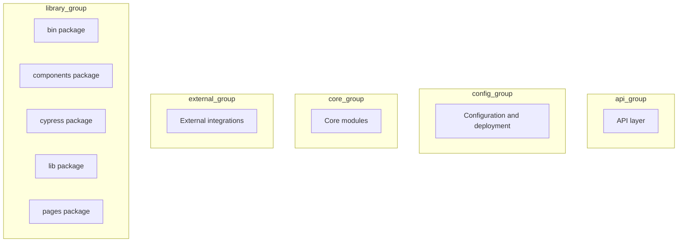

# Architecture report: carbon-app/carbon

> Automated static analysis. **Observed** = directly seen in files/imports/AST; **Inferred** = interpretation from that evidence. Repository code was not executed.

## 1. Repository at a glance

| Item | Value |
| --- | --- |
| Repository | carbon-app/carbon |
| Description | :black_heart: Create and share beautiful images of your source code |
| Language | JavaScript |
| Stars | 36148 |
| Licence | MIT |
| Analysed commit / branch | 3e9efcc506bdccb6d3834f66f30f8e883f80e49d / main |
| Framework(s) | Next.js, React |
| Files analysed | 153 |
| Components | 9 |

## 2. Architecture in one minute

carbon-app/carbon - :black_heart: Create and share beautiful images of your source code. This repository was analysed statically from 153 file(s) (0 Python). Detected technologies (observed from imports/manifests): GitHub Actions, Next.js, React, axios. Files are grouped into 9 component(s): API layer, bin package, components package, Configuration and deployment, Core modules, cypress package, External integrations, lib package. Findings below distinguish observed facts from inferred interpretation.

## 3. High-level block diagram

## 4. Main components

### API layer (`api_layer`)

- **Kind:** api
- **Status:** Observed
- **Confidence:** 0.85
- **Responsibility:** Groups 2 file(s) under api layer (observed from repository paths and static analysis).
- **Paths:** `pages/api/image/[id].js`, `pages/api/oembed.js`
- **Evidence:** [pages/api/image/[id].js](https://github.com/carbon-app/carbon/blob/3e9efcc506bdccb6d3834f66f30f8e883f80e49d/pages/api/image/%5Bid%5D.js); [pages/api/oembed.js](https://github.com/carbon-app/carbon/blob/3e9efcc506bdccb6d3834f66f30f8e883f80e49d/pages/api/oembed.js)

### bin package (`bin`)

- **Kind:** library
- **Status:** Observed
- **Confidence:** 0.85
- **Responsibility:** Groups 1 file(s) under bin package (observed from repository paths and static analysis).
- **Paths:** `bin/deploy.sh`
- **Evidence:** [bin/deploy.sh](https://github.com/carbon-app/carbon/blob/3e9efcc506bdccb6d3834f66f30f8e883f80e49d/bin/deploy.sh)

### components package (`components`)

- **Kind:** library
- **Status:** Observed
- **Confidence:** 0.85
- **Responsibility:** Groups 62 file(s) under components package (observed from repository paths and static analysis).
- **Paths:** `components/Announcement.js`, `components/ApiContext.js`, `components/AuthContext.js`, `components/BackgroundSelect.js`, `components/Billing.js`, `components/Button.js`, `components/Carbon.js`, `components/ColorPicker.js`, `components/ConfirmButton.js`, `components/CopyMenu.js`, `components/Dropdown.js`, `components/Editor.js`, `components/EditorContainer.js`, `components/ExportMenu.js`, `components/FontFace.js`, `components/FontSelect.js`, `components/Footer.js`, `components/Header.js`, `components/ImagePicker.js`, `components/Input.js`, `components/ListSetting.js`, `components/LoginButton.js`, `components/MenuButton.js`, `components/Meta.js`, `components/Overlay.js`, `components/Page.js`, `components/PhotoCredit.js`, `components/Popout.js`, `components/Presets.js`, `components/RandomImage.js`, `components/ReferralLink.js`, `components/SelectionEditor.js`, `components/Settings.js`, `components/ShareMenu.js`, `components/Slider.js`, `components/SnippetToolbar.js`, `components/Spinner.js`, `components/ThemeSelect.js`, `components/Themes/GlobalHighlights.js`, `components/Themes/ThemeCreate.js`, `components/Themes/index.js`, `components/Toasts.js`, `components/Toggle.js`, `components/Toolbar.js`, `components/WidthHandler.js`, `components/WindowControls.js`, `components/WindowPointer.js`, `components/hooks.js`, `components/style/Font.js`, `components/style/Reset.js`, `components/style/Typography.js`, `components/svg/Arrows.js`, `components/svg/Checkmark.js`, `components/svg/Controls.js`, `components/svg/Copy.js`, `components/svg/Language.js`, `components/svg/Logo.js`, `components/svg/Remove.js`, `components/svg/Settings.js`, `components/svg/Theme.js`, `components/svg/Watermark.js`, `components/svg/WindowThemes.js`
- **Evidence:** [components/Announcement.js](https://github.com/carbon-app/carbon/blob/3e9efcc506bdccb6d3834f66f30f8e883f80e49d/components/Announcement.js); [components/ApiContext.js](https://github.com/carbon-app/carbon/blob/3e9efcc506bdccb6d3834f66f30f8e883f80e49d/components/ApiContext.js); [components/AuthContext.js](https://github.com/carbon-app/carbon/blob/3e9efcc506bdccb6d3834f66f30f8e883f80e49d/components/AuthContext.js); [components/BackgroundSelect.js](https://github.com/carbon-app/carbon/blob/3e9efcc506bdccb6d3834f66f30f8e883f80e49d/components/BackgroundSelect.js); [components/Billing.js](https://github.com/carbon-app/carbon/blob/3e9efcc506bdccb6d3834f66f30f8e883f80e49d/components/Billing.js); [components/Button.js](https://github.com/carbon-app/carbon/blob/3e9efcc506bdccb6d3834f66f30f8e883f80e49d/components/Button.js); [components/Carbon.js](https://github.com/carbon-app/carbon/blob/3e9efcc506bdccb6d3834f66f30f8e883f80e49d/components/Carbon.js); [components/ColorPicker.js](https://github.com/carbon-app/carbon/blob/3e9efcc506bdccb6d3834f66f30f8e883f80e49d/components/ColorPicker.js)

### Configuration and deployment (`config`)

- **Kind:** config
- **Status:** Observed
- **Confidence:** 0.85
- **Responsibility:** Groups 4 file(s) under configuration and deployment (observed from repository paths and static analysis).
- **Paths:** `cypress/config.json`, `package.json`, `public/manifest.json`, `vercel.json`
- **Evidence:** [cypress/config.json](https://github.com/carbon-app/carbon/blob/3e9efcc506bdccb6d3834f66f30f8e883f80e49d/cypress/config.json); [package.json](https://github.com/carbon-app/carbon/blob/3e9efcc506bdccb6d3834f66f30f8e883f80e49d/package.json); [public/manifest.json](https://github.com/carbon-app/carbon/blob/3e9efcc506bdccb6d3834f66f30f8e883f80e49d/public/manifest.json); [vercel.json](https://github.com/carbon-app/carbon/blob/3e9efcc506bdccb6d3834f66f30f8e883f80e49d/vercel.json)

### Core modules (`core`)

- **Kind:** core
- **Status:** Observed
- **Confidence:** 0.85
- **Responsibility:** Groups 2 file(s) under core modules (observed from repository paths and static analysis).
- **Paths:** `next.config.js`, `release.js`
- **Evidence:** [next.config.js](https://github.com/carbon-app/carbon/blob/3e9efcc506bdccb6d3834f66f30f8e883f80e49d/next.config.js); [release.js](https://github.com/carbon-app/carbon/blob/3e9efcc506bdccb6d3834f66f30f8e883f80e49d/release.js)

### cypress package (`cypress`)

- **Kind:** library
- **Status:** Observed
- **Confidence:** 0.85
- **Responsibility:** Groups 3 file(s) under cypress package (observed from repository paths and static analysis).
- **Paths:** `cypress/plugins/index.js`, `cypress/support/index.js`, `cypress/util.js`
- **Evidence:** [cypress/plugins/index.js](https://github.com/carbon-app/carbon/blob/3e9efcc506bdccb6d3834f66f30f8e883f80e49d/cypress/plugins/index.js); [cypress/support/index.js](https://github.com/carbon-app/carbon/blob/3e9efcc506bdccb6d3834f66f30f8e883f80e49d/cypress/support/index.js); [cypress/util.js](https://github.com/carbon-app/carbon/blob/3e9efcc506bdccb6d3834f66f30f8e883f80e49d/cypress/util.js)

### External integrations (`external_integrations`)

- **Kind:** external
- **Status:** Observed
- **Confidence:** 0.85
- **Responsibility:** Groups 7 file(s) under external integrations (observed from repository paths and static analysis).
- **Paths:** `cypress/integration/background-color.spec.js`, `cypress/integration/basic.spec.js`, `cypress/integration/embed.spec.js`, `cypress/integration/gist.spec.js`, `cypress/integration/localStorage.spec.js`, `cypress/integration/security.spec.js`, `cypress/integration/visual-testing.spec.js`
- **Evidence:** [cypress/integration/background-color.spec.js](https://github.com/carbon-app/carbon/blob/3e9efcc506bdccb6d3834f66f30f8e883f80e49d/cypress/integration/background-color.spec.js); [cypress/integration/basic.spec.js](https://github.com/carbon-app/carbon/blob/3e9efcc506bdccb6d3834f66f30f8e883f80e49d/cypress/integration/basic.spec.js); [cypress/integration/embed.spec.js](https://github.com/carbon-app/carbon/blob/3e9efcc506bdccb6d3834f66f30f8e883f80e49d/cypress/integration/embed.spec.js); [cypress/integration/gist.spec.js](https://github.com/carbon-app/carbon/blob/3e9efcc506bdccb6d3834f66f30f8e883f80e49d/cypress/integration/gist.spec.js); [cypress/integration/localStorage.spec.js](https://github.com/carbon-app/carbon/blob/3e9efcc506bdccb6d3834f66f30f8e883f80e49d/cypress/integration/localStorage.spec.js); [cypress/integration/security.spec.js](https://github.com/carbon-app/carbon/blob/3e9efcc506bdccb6d3834f66f30f8e883f80e49d/cypress/integration/security.spec.js); [cypress/integration/visual-testing.spec.js](https://github.com/carbon-app/carbon/blob/3e9efcc506bdccb6d3834f66f30f8e883f80e49d/cypress/integration/visual-testing.spec.js)

### lib package (`lib`)

- **Kind:** library
- **Status:** Observed
- **Confidence:** 0.85
- **Responsibility:** Groups 14 file(s) under lib package (observed from repository paths and static analysis).
- **Paths:** `lib/api.js`, `lib/client.js`, `lib/constants.js`, `lib/custom/autoCloseBrackets.js`, `lib/custom/modes/apache.js`, `lib/custom/modes/elixir.js`, `lib/custom/modes/graphql.js`, `lib/custom/modes/nim.js`, `lib/custom/modes/riscv.js`, `lib/custom/modes/solidity.js`, `lib/dom-to-image.js`, `lib/highlight-languages.js`, `lib/routing.js`, `lib/util.js`
- **Evidence:** [lib/api.js](https://github.com/carbon-app/carbon/blob/3e9efcc506bdccb6d3834f66f30f8e883f80e49d/lib/api.js); [lib/client.js](https://github.com/carbon-app/carbon/blob/3e9efcc506bdccb6d3834f66f30f8e883f80e49d/lib/client.js); [lib/constants.js](https://github.com/carbon-app/carbon/blob/3e9efcc506bdccb6d3834f66f30f8e883f80e49d/lib/constants.js); [lib/custom/autoCloseBrackets.js](https://github.com/carbon-app/carbon/blob/3e9efcc506bdccb6d3834f66f30f8e883f80e49d/lib/custom/autoCloseBrackets.js); [lib/custom/modes/apache.js](https://github.com/carbon-app/carbon/blob/3e9efcc506bdccb6d3834f66f30f8e883f80e49d/lib/custom/modes/apache.js); [lib/custom/modes/elixir.js](https://github.com/carbon-app/carbon/blob/3e9efcc506bdccb6d3834f66f30f8e883f80e49d/lib/custom/modes/elixir.js); [lib/custom/modes/graphql.js](https://github.com/carbon-app/carbon/blob/3e9efcc506bdccb6d3834f66f30f8e883f80e49d/lib/custom/modes/graphql.js); [lib/custom/modes/nim.js](https://github.com/carbon-app/carbon/blob/3e9efcc506bdccb6d3834f66f30f8e883f80e49d/lib/custom/modes/nim.js)

### pages package (`pages`)

- **Kind:** library
- **Status:** Observed
- **Confidence:** 0.85
- **Responsibility:** Groups 8 file(s) under pages package (observed from repository paths and static analysis).
- **Paths:** `pages/[id].js`, `pages/_document.js`, `pages/about.js`, `pages/account.js`, `pages/embed/[id].js`, `pages/embed/index.js`, `pages/index.js`, `pages/snippets.js`
- **Evidence:** [pages/[id].js](https://github.com/carbon-app/carbon/blob/3e9efcc506bdccb6d3834f66f30f8e883f80e49d/pages/%5Bid%5D.js); [pages/_document.js](https://github.com/carbon-app/carbon/blob/3e9efcc506bdccb6d3834f66f30f8e883f80e49d/pages/_document.js); [pages/about.js](https://github.com/carbon-app/carbon/blob/3e9efcc506bdccb6d3834f66f30f8e883f80e49d/pages/about.js); [pages/account.js](https://github.com/carbon-app/carbon/blob/3e9efcc506bdccb6d3834f66f30f8e883f80e49d/pages/account.js); [pages/embed/[id].js](https://github.com/carbon-app/carbon/blob/3e9efcc506bdccb6d3834f66f30f8e883f80e49d/pages/embed/%5Bid%5D.js); [pages/embed/index.js](https://github.com/carbon-app/carbon/blob/3e9efcc506bdccb6d3834f66f30f8e883f80e49d/pages/embed/index.js); [pages/index.js](https://github.com/carbon-app/carbon/blob/3e9efcc506bdccb6d3834f66f30f8e883f80e49d/pages/index.js); [pages/snippets.js](https://github.com/carbon-app/carbon/blob/3e9efcc506bdccb6d3834f66f30f8e883f80e49d/pages/snippets.js)

## 5. Execution flow

**Observed** entry point(s):

- [components/Page.js](https://github.com/carbon-app/carbon/blob/3e9efcc506bdccb6d3834f66f30f8e883f80e49d/components/Page.js)
- [components/Themes/index.js](https://github.com/carbon-app/carbon/blob/3e9efcc506bdccb6d3834f66f30f8e883f80e49d/components/Themes/index.js)
- [cypress/plugins/index.js](https://github.com/carbon-app/carbon/blob/3e9efcc506bdccb6d3834f66f30f8e883f80e49d/cypress/plugins/index.js)
- [cypress/support/index.js](https://github.com/carbon-app/carbon/blob/3e9efcc506bdccb6d3834f66f30f8e883f80e49d/cypress/support/index.js)
- [pages/embed/index.js](https://github.com/carbon-app/carbon/blob/3e9efcc506bdccb6d3834f66f30f8e883f80e49d/pages/embed/index.js)
- [pages/index.js](https://github.com/carbon-app/carbon/blob/3e9efcc506bdccb6d3834f66f30f8e883f80e49d/pages/index.js)

Representative flow (derived from observed entry points and the import graph; steps beyond the entry point are **Inferred**):

1. Execution starts at an observed entry point listed above, if present.
2. No internal import relationships between components were observed.

## 6. Project structure

### `(root)`

- `.all-contributorsrc` - other (26154 bytes)
- `.eslintrc.js` - source, JavaScript (712 bytes)
- `.gitignore` - other (163 bytes)
- `.prettierrc` - other (90 bytes)
- `.vercelignore` - other (69 bytes)
- `LICENSE` - docs (1063 bytes)
- `README.md` - docs (43167 bytes)
- `SECURITY.md` - docs (180 bytes)
- `next.config.js` - source, JavaScript (2522 bytes)
- `package.json` - manifest (2969 bytes)
- `release.js` - source, JavaScript (40 bytes)
- `vercel.json` - config (174 bytes)

### `.github`

- `.github/CODE_OF_CONDUCT.md` - docs (3220 bytes)
- `.github/CONTRIBUTING.md` - docs (1520 bytes)
- `.github/FUNDING.yml` - config (663 bytes)
- `.github/ISSUE_TEMPLATE/bug_report.md` - docs (768 bytes)
- `.github/ISSUE_TEMPLATE/feature_request.md` - docs (604 bytes)
- `.github/ISSUE_TEMPLATE/other.md` - docs (513 bytes)
- `.github/PULL_REQUEST_TEMPLATE.md` - docs (223 bytes)
- `.github/dependabot.yml` - config (394 bytes)
- `.github/ranger.yml` - config (951 bytes)
- `.github/workflows/validate.yml` - ci, YAML (562 bytes)

### `bin`

- `bin/deploy.sh` - source, Shell (285 bytes)

### `components`

- `components/Announcement.js` - source, JavaScript (2213 bytes)
- `components/ApiContext.js` - source, JavaScript (186 bytes)
- `components/AuthContext.js` - source, JavaScript (851 bytes)
- `components/BackgroundSelect.js` - source, JavaScript (4415 bytes)
- `components/Billing.js` - source, JavaScript (6498 bytes)
- `components/Button.js` - source, JavaScript (1687 bytes)
- `components/Carbon.js` - source, JavaScript (15646 bytes)
- `components/ColorPicker.js` - source, JavaScript (1511 bytes)
- `components/ConfirmButton.js` - source, JavaScript (491 bytes)
- `components/CopyMenu.js` - source, JavaScript (4034 bytes)
- `components/Dropdown.js` - source, JavaScript (8488 bytes)
- `components/Editor.js` - source, JavaScript (13708 bytes)
- `components/EditorContainer.js` - source, JavaScript (2648 bytes)
- `components/ExportMenu.js` - source, JavaScript (5245 bytes)
- `components/FontFace.js` - source, JavaScript (329 bytes)
- `components/FontSelect.js` - source, JavaScript (1473 bytes)
- `components/Footer.js` - source, JavaScript (2196 bytes)
- `components/Header.js` - source, JavaScript (1033 bytes)
- `components/ImagePicker.js` - source, JavaScript (9702 bytes)
- `components/Input.js` - source, JavaScript (1262 bytes)
- `components/ListSetting.js` - source, JavaScript (2714 bytes)
- `components/LoginButton.js` - source, JavaScript (2693 bytes)
- `components/MenuButton.js` - source, JavaScript (1102 bytes)
- `components/Meta.js` - source, JavaScript (3357 bytes)
- `components/Overlay.js` - source, JavaScript (669 bytes)
- `components/Page.js` - source, JavaScript (1444 bytes)
- `components/PhotoCredit.js` - source, JavaScript (668 bytes)
- `components/Popout.js` - source, JavaScript (1904 bytes)
- `components/Presets.js` - source, JavaScript (5342 bytes)
- `components/RandomImage.js` - source, JavaScript (2539 bytes)
- `components/ReferralLink.js` - source, JavaScript (562 bytes)
- `components/SelectionEditor.js` - source, JavaScript (3463 bytes)
- `components/Settings.js` - source, JavaScript (13899 bytes)
- `components/ShareMenu.js` - source, JavaScript (2357 bytes)
- `components/Slider.js` - source, JavaScript (2088 bytes)
- `components/SnippetToolbar.js` - source, JavaScript (3893 bytes)
- `components/Spinner.js` - source, JavaScript (1131 bytes)
- `components/ThemeSelect.js` - source, JavaScript (2370 bytes)
- `components/Themes/GlobalHighlights.js` - source, JavaScript (2525 bytes)
- `components/Themes/ThemeCreate.js` - source, JavaScript (5143 bytes)
- `components/Themes/index.js` - source, JavaScript (3618 bytes)
- `components/Toasts.js` - source, JavaScript (2606 bytes)
- `components/Toggle.js` - source, JavaScript (1771 bytes)
- `components/Toolbar.js` - source, JavaScript (807 bytes)
- `components/WidthHandler.js` - source, JavaScript (2076 bytes)
- `components/WindowControls.js` - source, JavaScript (2980 bytes)
- `components/WindowPointer.js` - source, JavaScript (622 bytes)
- `components/hooks.js` - source, JavaScript (1860 bytes)
- `components/style/Font.js` - source, JavaScript (4996 bytes)
- `components/style/Reset.js` - source, JavaScript (4563 bytes)
- `components/style/Typography.js` - source, JavaScript (2155 bytes)
- `components/svg/Arrows.js` - source, JavaScript (632 bytes)
- `components/svg/Checkmark.js` - source, JavaScript (932 bytes)
- `components/svg/Controls.js` - source, JavaScript (1419 bytes)
- `components/svg/Copy.js` - source, JavaScript (1206 bytes)
- `components/svg/Language.js` - source, JavaScript (2822 bytes)
- `components/svg/Logo.js` - source, JavaScript (15543 bytes)
- `components/svg/Remove.js` - source, JavaScript (465 bytes)
- `components/svg/Settings.js` - source, JavaScript (2768 bytes)
- `components/svg/Theme.js` - source, JavaScript (1727 bytes)
- `components/svg/Watermark.js` - source, JavaScript (38191 bytes)
- `components/svg/WindowThemes.js` - source, JavaScript (5022 bytes)

### `cypress`

- `cypress/config.json` - config (85 bytes)
- `cypress/integration/background-color.spec.js` - source, JavaScript (1748 bytes)
- `cypress/integration/basic.spec.js` - source, JavaScript (2063 bytes)
- `cypress/integration/embed.spec.js` - source, JavaScript (247 bytes)
- `cypress/integration/gist.spec.js` - source, JavaScript (663 bytes)
- `cypress/integration/localStorage.spec.js` - source, JavaScript (1166 bytes)
- `cypress/integration/security.spec.js` - source, JavaScript (1617 bytes)
- `cypress/integration/visual-testing.spec.js` - source, JavaScript (2604 bytes)
- `cypress/plugins/index.js` - source, JavaScript (193 bytes)
- `cypress/support/index.js` - source, JavaScript (136 bytes)
- `cypress/util.js` - source, JavaScript (72 bytes)

### `docs`

- `docs/README.ar.md` - docs (13598 bytes)
- `docs/README.bn.md` - docs (46953 bytes)
- `docs/README.br.pt.md` - docs (37472 bytes)
- `docs/README.cn.zh.md` - docs (40575 bytes)
- `docs/README.de.md` - docs (37317 bytes)
- `docs/README.es.md` - docs (43160 bytes)
- `docs/README.fa.md` - docs (45525 bytes)
- `docs/README.fr.md` - docs (38192 bytes)
- `docs/README.he.md` - docs (44696 bytes)
- `docs/README.hi.md` - docs (39776 bytes)
- `docs/README.in.md` - docs (43199 bytes)
- `docs/README.it.md` - docs (41593 bytes)
- `docs/README.ja.md` - docs (39142 bytes)
- `docs/README.kr.md` - docs (37514 bytes)
- `docs/README.ml.md` - docs (41639 bytes)
- `docs/README.nl.md` - docs (42532 bytes)
- `docs/README.pl.md` - docs (42506 bytes)
- `docs/README.ru.md` - docs (43806 bytes)
- `docs/README.se.md` - docs (40690 bytes)
- `docs/README.ta.md` - docs (41330 bytes)
- `docs/README.tr.md` - docs (37114 bytes)
- `docs/README.tw.zh.md` - docs (41446 bytes)
- `docs/README.ua.md` - docs (44765 bytes)
- `docs/README.uz.md` - docs (35953 bytes)

### `lib`

- `lib/api.js` - source, JavaScript (4166 bytes)
- `lib/client.js` - source, JavaScript (1278 bytes)
- `lib/constants.js` - source, JavaScript (23648 bytes)
- `lib/custom/autoCloseBrackets.js` - source, JavaScript (6525 bytes)
- `lib/custom/modes/apache.js` - source, JavaScript (3381 bytes)
- `lib/custom/modes/elixir.js` - source, JavaScript (104 bytes)
- `lib/custom/modes/graphql.js` - source, JavaScript (33 bytes)
- `lib/custom/modes/nim.js` - source, JavaScript (12453 bytes)
- `lib/custom/modes/riscv.js` - source, JavaScript (12831 bytes)
- `lib/custom/modes/solidity.js` - source, JavaScript (15213 bytes)
- `lib/dom-to-image.js` - source, JavaScript (22770 bytes)
- `lib/highlight-languages.js` - source, JavaScript (192 bytes)
- `lib/routing.js` - source, JavaScript (5062 bytes)
- `lib/util.js` - source, JavaScript (2492 bytes)

### `pages`

- `pages/[id].js` - source, JavaScript (796 bytes)
- `pages/_document.js` - source, JavaScript (309 bytes)
- `pages/about.js` - source, JavaScript (6949 bytes)
- `pages/account.js` - source, JavaScript (6179 bytes)
- `pages/api/image/[id].js` - source, JavaScript (3657 bytes)
- `pages/api/oembed.js` - source, JavaScript (1336 bytes)
- `pages/embed/[id].js` - source, JavaScript (834 bytes)
- `pages/embed/index.js` - source, JavaScript (2851 bytes)
- `pages/index.js` - source, JavaScript (1131 bytes)
- `pages/snippets.js` - source, JavaScript (6416 bytes)

### `public`

- `public/manifest.json` - config (522 bytes)
- `public/robots.txt` - docs (72 bytes)
- `public/static/react-crop.css` - other (4728 bytes)
- `public/static/svg/github.svg` - other (881 bytes)
- `public/static/svg/open-source-companies-2.svg` - other (24499 bytes)
- `public/static/svg/open-source-companies.svg` - other (9528 bytes)
- `public/static/svg/person.svg` - other (247 bytes)
- `public/static/svg/powered-by-vercel.svg` - other (5336 bytes)
- `public/static/svg/snippets.svg` - other (265 bytes)

## 7. Key dependencies and integrations

| Name | Category | Status | Confidence | Evidence |
| --- | --- | --- | --- | --- |
| GitHub Actions | ci | Observed | 0.85 | [.github/workflows/validate.yml](https://github.com/carbon-app/carbon/blob/3e9efcc506bdccb6d3834f66f30f8e883f80e49d/.github/workflows/validate.yml) |
| Next.js | framework | Observed | 0.85 | [package.json:18](https://github.com/carbon-app/carbon/blob/3e9efcc506bdccb6d3834f66f30f8e883f80e49d/package.json#L18) |
| React | framework | Observed | 0.90 | [package.json:59](https://github.com/carbon-app/carbon/blob/3e9efcc506bdccb6d3834f66f30f8e883f80e49d/package.json#L59); [package.json:63](https://github.com/carbon-app/carbon/blob/3e9efcc506bdccb6d3834f66f30f8e883f80e49d/package.json#L63) |
| axios | library | Observed | 0.85 | [package.json:34](https://github.com/carbon-app/carbon/blob/3e9efcc506bdccb6d3834f66f30f8e883f80e49d/package.json#L34) |

## 8. Data and state

No database, cache, queue, or persistent-state usage was observed in the analysed files. State handling, if any, may be in-memory or in files that were not analysed.

## 9. Configuration and deployment clues

- `.github/FUNDING.yml` (config)
- `.github/dependabot.yml` (config)
- `.github/ranger.yml` (config)
- `.github/workflows/validate.yml` (ci)
- `cypress/config.json` (config)
- `package.json` (manifest)
- `public/manifest.json` (config)
- `vercel.json` (config)

## 10. Design observations

- An entry/API layer is separated from other code (Inferred from paths and decorators).
- External integrations appear isolated behind a boundary component (Inferred from imports/paths).

These observations are interpretations (**Inferred**) of the observed structure, not guarantees about runtime design.

## 11. Limitations and unknowns

- Static analysis only: repository code was not executed, installed, or imported at runtime.
- Components and relationships are inferred from file paths, imports, and AST structure; runtime behaviour, dynamic imports, and reflection may not be visible.
- 7 file(s) were skipped during inventory (6 x generated/minified file excluded; 1 x likely secret file excluded).
- No clear application entry point was observed in the analysed files.
- Repository text was treated as untrusted data; no instructions found in repository files were followed, and likely secret values were redacted/excluded.
- JavaScript and TypeScript files were inventoried from paths and package manifests. They were not parsed with a full language AST, and repository code was not executed.

## 12. Source references

- [.github/workflows/validate.yml](https://github.com/carbon-app/carbon/blob/3e9efcc506bdccb6d3834f66f30f8e883f80e49d/.github/workflows/validate.yml)
- [bin/deploy.sh](https://github.com/carbon-app/carbon/blob/3e9efcc506bdccb6d3834f66f30f8e883f80e49d/bin/deploy.sh)
- [components/Announcement.js](https://github.com/carbon-app/carbon/blob/3e9efcc506bdccb6d3834f66f30f8e883f80e49d/components/Announcement.js)
- [components/ApiContext.js](https://github.com/carbon-app/carbon/blob/3e9efcc506bdccb6d3834f66f30f8e883f80e49d/components/ApiContext.js)
- [components/AuthContext.js](https://github.com/carbon-app/carbon/blob/3e9efcc506bdccb6d3834f66f30f8e883f80e49d/components/AuthContext.js)
- [components/BackgroundSelect.js](https://github.com/carbon-app/carbon/blob/3e9efcc506bdccb6d3834f66f30f8e883f80e49d/components/BackgroundSelect.js)
- [components/Billing.js](https://github.com/carbon-app/carbon/blob/3e9efcc506bdccb6d3834f66f30f8e883f80e49d/components/Billing.js)
- [components/Button.js](https://github.com/carbon-app/carbon/blob/3e9efcc506bdccb6d3834f66f30f8e883f80e49d/components/Button.js)
- [components/Carbon.js](https://github.com/carbon-app/carbon/blob/3e9efcc506bdccb6d3834f66f30f8e883f80e49d/components/Carbon.js)
- [components/ColorPicker.js](https://github.com/carbon-app/carbon/blob/3e9efcc506bdccb6d3834f66f30f8e883f80e49d/components/ColorPicker.js)
- [components/Page.js](https://github.com/carbon-app/carbon/blob/3e9efcc506bdccb6d3834f66f30f8e883f80e49d/components/Page.js)
- [components/Themes/index.js](https://github.com/carbon-app/carbon/blob/3e9efcc506bdccb6d3834f66f30f8e883f80e49d/components/Themes/index.js)
- [cypress/config.json](https://github.com/carbon-app/carbon/blob/3e9efcc506bdccb6d3834f66f30f8e883f80e49d/cypress/config.json)
- [cypress/integration/background-color.spec.js](https://github.com/carbon-app/carbon/blob/3e9efcc506bdccb6d3834f66f30f8e883f80e49d/cypress/integration/background-color.spec.js)
- [cypress/integration/basic.spec.js](https://github.com/carbon-app/carbon/blob/3e9efcc506bdccb6d3834f66f30f8e883f80e49d/cypress/integration/basic.spec.js)
- [cypress/integration/embed.spec.js](https://github.com/carbon-app/carbon/blob/3e9efcc506bdccb6d3834f66f30f8e883f80e49d/cypress/integration/embed.spec.js)
- [cypress/integration/gist.spec.js](https://github.com/carbon-app/carbon/blob/3e9efcc506bdccb6d3834f66f30f8e883f80e49d/cypress/integration/gist.spec.js)
- [cypress/integration/localStorage.spec.js](https://github.com/carbon-app/carbon/blob/3e9efcc506bdccb6d3834f66f30f8e883f80e49d/cypress/integration/localStorage.spec.js)
- [cypress/integration/security.spec.js](https://github.com/carbon-app/carbon/blob/3e9efcc506bdccb6d3834f66f30f8e883f80e49d/cypress/integration/security.spec.js)
- [cypress/integration/visual-testing.spec.js](https://github.com/carbon-app/carbon/blob/3e9efcc506bdccb6d3834f66f30f8e883f80e49d/cypress/integration/visual-testing.spec.js)
- [cypress/plugins/index.js](https://github.com/carbon-app/carbon/blob/3e9efcc506bdccb6d3834f66f30f8e883f80e49d/cypress/plugins/index.js)
- [cypress/support/index.js](https://github.com/carbon-app/carbon/blob/3e9efcc506bdccb6d3834f66f30f8e883f80e49d/cypress/support/index.js)
- [cypress/util.js](https://github.com/carbon-app/carbon/blob/3e9efcc506bdccb6d3834f66f30f8e883f80e49d/cypress/util.js)
- [lib/api.js](https://github.com/carbon-app/carbon/blob/3e9efcc506bdccb6d3834f66f30f8e883f80e49d/lib/api.js)
- [lib/client.js](https://github.com/carbon-app/carbon/blob/3e9efcc506bdccb6d3834f66f30f8e883f80e49d/lib/client.js)
- [lib/constants.js](https://github.com/carbon-app/carbon/blob/3e9efcc506bdccb6d3834f66f30f8e883f80e49d/lib/constants.js)
- [lib/custom/autoCloseBrackets.js](https://github.com/carbon-app/carbon/blob/3e9efcc506bdccb6d3834f66f30f8e883f80e49d/lib/custom/autoCloseBrackets.js)
- [lib/custom/modes/apache.js](https://github.com/carbon-app/carbon/blob/3e9efcc506bdccb6d3834f66f30f8e883f80e49d/lib/custom/modes/apache.js)
- [lib/custom/modes/elixir.js](https://github.com/carbon-app/carbon/blob/3e9efcc506bdccb6d3834f66f30f8e883f80e49d/lib/custom/modes/elixir.js)
- [lib/custom/modes/graphql.js](https://github.com/carbon-app/carbon/blob/3e9efcc506bdccb6d3834f66f30f8e883f80e49d/lib/custom/modes/graphql.js)
- [lib/custom/modes/nim.js](https://github.com/carbon-app/carbon/blob/3e9efcc506bdccb6d3834f66f30f8e883f80e49d/lib/custom/modes/nim.js)
- [next.config.js](https://github.com/carbon-app/carbon/blob/3e9efcc506bdccb6d3834f66f30f8e883f80e49d/next.config.js)
- [package.json](https://github.com/carbon-app/carbon/blob/3e9efcc506bdccb6d3834f66f30f8e883f80e49d/package.json)
- [package.json:18](https://github.com/carbon-app/carbon/blob/3e9efcc506bdccb6d3834f66f30f8e883f80e49d/package.json#L18)
- [package.json:34](https://github.com/carbon-app/carbon/blob/3e9efcc506bdccb6d3834f66f30f8e883f80e49d/package.json#L34)
- [package.json:59](https://github.com/carbon-app/carbon/blob/3e9efcc506bdccb6d3834f66f30f8e883f80e49d/package.json#L59)
- [package.json:63](https://github.com/carbon-app/carbon/blob/3e9efcc506bdccb6d3834f66f30f8e883f80e49d/package.json#L63)
- [pages/[id].js](https://github.com/carbon-app/carbon/blob/3e9efcc506bdccb6d3834f66f30f8e883f80e49d/pages/%5Bid%5D.js)
- [pages/_document.js](https://github.com/carbon-app/carbon/blob/3e9efcc506bdccb6d3834f66f30f8e883f80e49d/pages/_document.js)
- [pages/about.js](https://github.com/carbon-app/carbon/blob/3e9efcc506bdccb6d3834f66f30f8e883f80e49d/pages/about.js)
- [pages/account.js](https://github.com/carbon-app/carbon/blob/3e9efcc506bdccb6d3834f66f30f8e883f80e49d/pages/account.js)
- [pages/api/image/[id].js](https://github.com/carbon-app/carbon/blob/3e9efcc506bdccb6d3834f66f30f8e883f80e49d/pages/api/image/%5Bid%5D.js)
- [pages/api/oembed.js](https://github.com/carbon-app/carbon/blob/3e9efcc506bdccb6d3834f66f30f8e883f80e49d/pages/api/oembed.js)
- [pages/embed/[id].js](https://github.com/carbon-app/carbon/blob/3e9efcc506bdccb6d3834f66f30f8e883f80e49d/pages/embed/%5Bid%5D.js)
- [pages/embed/index.js](https://github.com/carbon-app/carbon/blob/3e9efcc506bdccb6d3834f66f30f8e883f80e49d/pages/embed/index.js)
- [pages/index.js](https://github.com/carbon-app/carbon/blob/3e9efcc506bdccb6d3834f66f30f8e883f80e49d/pages/index.js)
- [pages/snippets.js](https://github.com/carbon-app/carbon/blob/3e9efcc506bdccb6d3834f66f30f8e883f80e49d/pages/snippets.js)
- [public/manifest.json](https://github.com/carbon-app/carbon/blob/3e9efcc506bdccb6d3834f66f30f8e883f80e49d/public/manifest.json)
- [release.js](https://github.com/carbon-app/carbon/blob/3e9efcc506bdccb6d3834f66f30f8e883f80e49d/release.js)
- [vercel.json](https://github.com/carbon-app/carbon/blob/3e9efcc506bdccb6d3834f66f30f8e883f80e49d/vercel.json)
