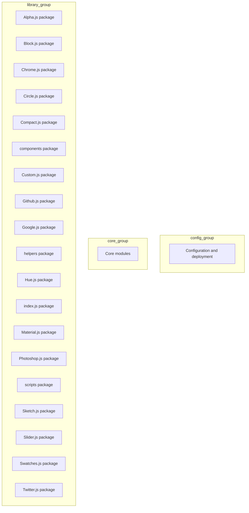

# Architecture report: casesandberg/react-color

> Automated static analysis. **Observed** = directly seen in files/imports/AST; **Inferred** = interpretation from that evidence. Repository code was not executed.

## 1. Repository at a glance

| Item | Value |
| --- | --- |
| Repository | casesandberg/react-color |
| Description | :art: Color Pickers from Sketch, Photoshop, Chrome, Github, Twitter & more |
| Language | JavaScript |
| Stars | 12332 |
| Licence | MIT |
| Analysed commit / branch | bc9a0e1dc5d11b06c511a8e02a95bd85c7129f4b / master |
| Framework(s) | React |
| Files analysed | 197 |
| Components | 21 |

## 2. Architecture in one minute

casesandberg/react-color - :art: Color Pickers from Sketch, Photoshop, Chrome, Github, Twitter & more. This repository was analysed statically from 197 file(s) (0 Python). Detected technologies (observed from imports/manifests): React, Redux, Jest, webpack. Files are grouped into 21 component(s): Alpha.js package, Block.js package, Chrome.js package, Circle.js package, Compact.js package, components package, Configuration and deployment, Core modules. Findings below distinguish observed facts from inferred interpretation.

## 3. High-level block diagram

## 4. Main components

### Alpha.js package (`alpha_js`)

- **Kind:** library
- **Status:** Observed
- **Confidence:** 0.85
- **Responsibility:** Groups 1 file(s) under alpha.js package (observed from repository paths and static analysis).
- **Paths:** `src/Alpha.js`
- **Evidence:** [src/Alpha.js](https://github.com/casesandberg/react-color/blob/bc9a0e1dc5d11b06c511a8e02a95bd85c7129f4b/src/Alpha.js)

### Block.js package (`block_js`)

- **Kind:** library
- **Status:** Observed
- **Confidence:** 0.85
- **Responsibility:** Groups 1 file(s) under block.js package (observed from repository paths and static analysis).
- **Paths:** `src/Block.js`
- **Evidence:** [src/Block.js](https://github.com/casesandberg/react-color/blob/bc9a0e1dc5d11b06c511a8e02a95bd85c7129f4b/src/Block.js)

### Chrome.js package (`chrome_js`)

- **Kind:** library
- **Status:** Observed
- **Confidence:** 0.85
- **Responsibility:** Groups 1 file(s) under chrome.js package (observed from repository paths and static analysis).
- **Paths:** `src/Chrome.js`
- **Evidence:** [src/Chrome.js](https://github.com/casesandberg/react-color/blob/bc9a0e1dc5d11b06c511a8e02a95bd85c7129f4b/src/Chrome.js)

### Circle.js package (`circle_js`)

- **Kind:** library
- **Status:** Observed
- **Confidence:** 0.85
- **Responsibility:** Groups 1 file(s) under circle.js package (observed from repository paths and static analysis).
- **Paths:** `src/Circle.js`
- **Evidence:** [src/Circle.js](https://github.com/casesandberg/react-color/blob/bc9a0e1dc5d11b06c511a8e02a95bd85c7129f4b/src/Circle.js)

### Compact.js package (`compact_js`)

- **Kind:** library
- **Status:** Observed
- **Confidence:** 0.85
- **Responsibility:** Groups 1 file(s) under compact.js package (observed from repository paths and static analysis).
- **Paths:** `src/Compact.js`
- **Evidence:** [src/Compact.js](https://github.com/casesandberg/react-color/blob/bc9a0e1dc5d11b06c511a8e02a95bd85c7129f4b/src/Compact.js)

### components package (`components`)

- **Kind:** library
- **Status:** Observed
- **Confidence:** 0.85
- **Responsibility:** Groups 74 file(s) under components package (observed from repository paths and static analysis).
- **Paths:** `src/components/alpha/Alpha.js`, `src/components/alpha/AlphaPointer.js`, `src/components/alpha/spec.js`, `src/components/block/Block.js`, `src/components/block/BlockSwatches.js`, `src/components/block/spec.js`, `src/components/block/story.js`, `src/components/chrome/Chrome.js`, `src/components/chrome/ChromeFields.js`, `src/components/chrome/ChromePointer.js`, `src/components/chrome/ChromePointerCircle.js`, `src/components/chrome/spec.js`, `src/components/chrome/story.js`, `src/components/circle/Circle.js`, `src/components/circle/CircleSwatch.js`, `src/components/circle/spec.js`, `src/components/circle/story.js`, `src/components/common/Alpha.js`, `src/components/common/Checkboard.js`, `src/components/common/ColorWrap.js`, `src/components/common/EditableInput.js`, `src/components/common/Hue.js`, `src/components/common/Raised.js`, `src/components/common/Saturation.js`, `src/components/common/Swatch.js`, `src/components/common/index.js`, `src/components/common/spec.js`, `src/components/compact/Compact.js`, `src/components/compact/CompactColor.js`, `src/components/compact/CompactFields.js`, `src/components/compact/spec.js`, `src/components/compact/story.js`, `src/components/github/Github.js`, `src/components/github/GithubSwatch.js`, `src/components/github/spec.js`, `src/components/github/story.js`, `src/components/google/Google.js`, `src/components/google/GoogleFields.js`, `src/components/google/GooglePointer.js`, `src/components/google/GooglePointerCircle.js`, `src/components/google/spec.js`, `src/components/google/story.js`, `src/components/hue/Hue.js`, `src/components/hue/HuePointer.js`, `src/components/hue/spec.js`, `src/components/material/Material.js`, `src/components/material/spec.js`, `src/components/material/story.js`, `src/components/photoshop/Photoshop.js`, `src/components/photoshop/PhotoshopButton.js`, `src/components/photoshop/PhotoshopFields.js`, `src/components/photoshop/PhotoshopPointer.js`, `src/components/photoshop/PhotoshopPointerCircle.js`, `src/components/photoshop/PhotoshopPreviews.js`, `src/components/photoshop/spec.js`, `src/components/photoshop/story.js`, `src/components/sketch/Sketch.js`, `src/components/sketch/SketchFields.js`, `src/components/sketch/SketchPresetColors.js`, `src/components/sketch/spec.js`, `src/components/sketch/story.js`, `src/components/slider/Slider.js`, `src/components/slider/SliderPointer.js`, `src/components/slider/SliderSwatch.js`, `src/components/slider/SliderSwatches.js`, `src/components/slider/spec.js`, `src/components/swatches/Swatches.js`, `src/components/swatches/SwatchesColor.js`, `src/components/swatches/SwatchesGroup.js`, `src/components/swatches/spec.js`, `src/components/swatches/story.js`, `src/components/twitter/Twitter.js`, `src/components/twitter/spec.js`, `src/components/twitter/story.js`
- **Evidence:** [src/components/alpha/Alpha.js](https://github.com/casesandberg/react-color/blob/bc9a0e1dc5d11b06c511a8e02a95bd85c7129f4b/src/components/alpha/Alpha.js); [src/components/alpha/AlphaPointer.js](https://github.com/casesandberg/react-color/blob/bc9a0e1dc5d11b06c511a8e02a95bd85c7129f4b/src/components/alpha/AlphaPointer.js); [src/components/alpha/spec.js](https://github.com/casesandberg/react-color/blob/bc9a0e1dc5d11b06c511a8e02a95bd85c7129f4b/src/components/alpha/spec.js); [src/components/block/Block.js](https://github.com/casesandberg/react-color/blob/bc9a0e1dc5d11b06c511a8e02a95bd85c7129f4b/src/components/block/Block.js); [src/components/block/BlockSwatches.js](https://github.com/casesandberg/react-color/blob/bc9a0e1dc5d11b06c511a8e02a95bd85c7129f4b/src/components/block/BlockSwatches.js); [src/components/block/spec.js](https://github.com/casesandberg/react-color/blob/bc9a0e1dc5d11b06c511a8e02a95bd85c7129f4b/src/components/block/spec.js); [src/components/block/story.js](https://github.com/casesandberg/react-color/blob/bc9a0e1dc5d11b06c511a8e02a95bd85c7129f4b/src/components/block/story.js); [src/components/chrome/Chrome.js](https://github.com/casesandberg/react-color/blob/bc9a0e1dc5d11b06c511a8e02a95bd85c7129f4b/src/components/chrome/Chrome.js)

### Configuration and deployment (`config`)

- **Kind:** config
- **Status:** Observed
- **Confidence:** 0.85
- **Responsibility:** Groups 1 file(s) under configuration and deployment (observed from repository paths and static analysis).
- **Paths:** `package.json`
- **Evidence:** [package.json](https://github.com/casesandberg/react-color/blob/bc9a0e1dc5d11b06c511a8e02a95bd85c7129f4b/package.json)

### Core modules (`core`)

- **Kind:** core
- **Status:** Observed
- **Confidence:** 0.85
- **Responsibility:** Groups 1 file(s) under core modules (observed from repository paths and static analysis).
- **Paths:** `webpack.config.js`
- **Evidence:** [webpack.config.js](https://github.com/casesandberg/react-color/blob/bc9a0e1dc5d11b06c511a8e02a95bd85c7129f4b/webpack.config.js)

### Custom.js package (`custom_js`)

- **Kind:** library
- **Status:** Observed
- **Confidence:** 0.85
- **Responsibility:** Groups 1 file(s) under custom.js package (observed from repository paths and static analysis).
- **Paths:** `src/Custom.js`
- **Evidence:** [src/Custom.js](https://github.com/casesandberg/react-color/blob/bc9a0e1dc5d11b06c511a8e02a95bd85c7129f4b/src/Custom.js)

### Github.js package (`github_js`)

- **Kind:** library
- **Status:** Observed
- **Confidence:** 0.85
- **Responsibility:** Groups 1 file(s) under github.js package (observed from repository paths and static analysis).
- **Paths:** `src/Github.js`
- **Evidence:** [src/Github.js](https://github.com/casesandberg/react-color/blob/bc9a0e1dc5d11b06c511a8e02a95bd85c7129f4b/src/Github.js)

### Google.js package (`google_js`)

- **Kind:** library
- **Status:** Observed
- **Confidence:** 0.85
- **Responsibility:** Groups 1 file(s) under google.js package (observed from repository paths and static analysis).
- **Paths:** `src/Google.js`
- **Evidence:** [src/Google.js](https://github.com/casesandberg/react-color/blob/bc9a0e1dc5d11b06c511a8e02a95bd85c7129f4b/src/Google.js)

### helpers package (`helpers`)

- **Kind:** library
- **Status:** Observed
- **Confidence:** 0.85
- **Responsibility:** Groups 8 file(s) under helpers package (observed from repository paths and static analysis).
- **Paths:** `src/helpers/alpha.js`, `src/helpers/checkboard.js`, `src/helpers/color.js`, `src/helpers/hue.js`, `src/helpers/index.js`, `src/helpers/interaction.js`, `src/helpers/saturation.js`, `src/helpers/spec.js`
- **Evidence:** [src/helpers/alpha.js](https://github.com/casesandberg/react-color/blob/bc9a0e1dc5d11b06c511a8e02a95bd85c7129f4b/src/helpers/alpha.js); [src/helpers/checkboard.js](https://github.com/casesandberg/react-color/blob/bc9a0e1dc5d11b06c511a8e02a95bd85c7129f4b/src/helpers/checkboard.js); [src/helpers/color.js](https://github.com/casesandberg/react-color/blob/bc9a0e1dc5d11b06c511a8e02a95bd85c7129f4b/src/helpers/color.js); [src/helpers/hue.js](https://github.com/casesandberg/react-color/blob/bc9a0e1dc5d11b06c511a8e02a95bd85c7129f4b/src/helpers/hue.js); [src/helpers/index.js](https://github.com/casesandberg/react-color/blob/bc9a0e1dc5d11b06c511a8e02a95bd85c7129f4b/src/helpers/index.js); [src/helpers/interaction.js](https://github.com/casesandberg/react-color/blob/bc9a0e1dc5d11b06c511a8e02a95bd85c7129f4b/src/helpers/interaction.js); [src/helpers/saturation.js](https://github.com/casesandberg/react-color/blob/bc9a0e1dc5d11b06c511a8e02a95bd85c7129f4b/src/helpers/saturation.js); [src/helpers/spec.js](https://github.com/casesandberg/react-color/blob/bc9a0e1dc5d11b06c511a8e02a95bd85c7129f4b/src/helpers/spec.js)

### Hue.js package (`hue_js`)

- **Kind:** library
- **Status:** Observed
- **Confidence:** 0.85
- **Responsibility:** Groups 1 file(s) under hue.js package (observed from repository paths and static analysis).
- **Paths:** `src/Hue.js`
- **Evidence:** [src/Hue.js](https://github.com/casesandberg/react-color/blob/bc9a0e1dc5d11b06c511a8e02a95bd85c7129f4b/src/Hue.js)

### index.js package (`index_js`)

- **Kind:** library
- **Status:** Observed
- **Confidence:** 0.85
- **Responsibility:** Groups 1 file(s) under index.js package (observed from repository paths and static analysis).
- **Paths:** `src/index.js`
- **Evidence:** [src/index.js](https://github.com/casesandberg/react-color/blob/bc9a0e1dc5d11b06c511a8e02a95bd85c7129f4b/src/index.js)

### Material.js package (`material_js`)

- **Kind:** library
- **Status:** Observed
- **Confidence:** 0.85
- **Responsibility:** Groups 1 file(s) under material.js package (observed from repository paths and static analysis).
- **Paths:** `src/Material.js`
- **Evidence:** [src/Material.js](https://github.com/casesandberg/react-color/blob/bc9a0e1dc5d11b06c511a8e02a95bd85c7129f4b/src/Material.js)

### Photoshop.js package (`photoshop_js`)

- **Kind:** library
- **Status:** Observed
- **Confidence:** 0.85
- **Responsibility:** Groups 1 file(s) under photoshop.js package (observed from repository paths and static analysis).
- **Paths:** `src/Photoshop.js`
- **Evidence:** [src/Photoshop.js](https://github.com/casesandberg/react-color/blob/bc9a0e1dc5d11b06c511a8e02a95bd85c7129f4b/src/Photoshop.js)

### scripts package (`scripts`)

- **Kind:** library
- **Status:** Observed
- **Confidence:** 0.85
- **Responsibility:** Groups 4 file(s) under scripts package (observed from repository paths and static analysis).
- **Paths:** `scripts/docs-dist.js`, `scripts/docs-server.js`, `scripts/restore-original-babelrc.js`, `scripts/use-module-babelrc.js`
- **Evidence:** [scripts/docs-dist.js](https://github.com/casesandberg/react-color/blob/bc9a0e1dc5d11b06c511a8e02a95bd85c7129f4b/scripts/docs-dist.js); [scripts/docs-server.js](https://github.com/casesandberg/react-color/blob/bc9a0e1dc5d11b06c511a8e02a95bd85c7129f4b/scripts/docs-server.js); [scripts/restore-original-babelrc.js](https://github.com/casesandberg/react-color/blob/bc9a0e1dc5d11b06c511a8e02a95bd85c7129f4b/scripts/restore-original-babelrc.js); [scripts/use-module-babelrc.js](https://github.com/casesandberg/react-color/blob/bc9a0e1dc5d11b06c511a8e02a95bd85c7129f4b/scripts/use-module-babelrc.js)

### Sketch.js package (`sketch_js`)

- **Kind:** library
- **Status:** Observed
- **Confidence:** 0.85
- **Responsibility:** Groups 1 file(s) under sketch.js package (observed from repository paths and static analysis).
- **Paths:** `src/Sketch.js`
- **Evidence:** [src/Sketch.js](https://github.com/casesandberg/react-color/blob/bc9a0e1dc5d11b06c511a8e02a95bd85c7129f4b/src/Sketch.js)

### Slider.js package (`slider_js`)

- **Kind:** library
- **Status:** Observed
- **Confidence:** 0.85
- **Responsibility:** Groups 1 file(s) under slider.js package (observed from repository paths and static analysis).
- **Paths:** `src/Slider.js`
- **Evidence:** [src/Slider.js](https://github.com/casesandberg/react-color/blob/bc9a0e1dc5d11b06c511a8e02a95bd85c7129f4b/src/Slider.js)

### Swatches.js package (`swatches_js`)

- **Kind:** library
- **Status:** Observed
- **Confidence:** 0.85
- **Responsibility:** Groups 1 file(s) under swatches.js package (observed from repository paths and static analysis).
- **Paths:** `src/Swatches.js`
- **Evidence:** [src/Swatches.js](https://github.com/casesandberg/react-color/blob/bc9a0e1dc5d11b06c511a8e02a95bd85c7129f4b/src/Swatches.js)

### Twitter.js package (`twitter_js`)

- **Kind:** library
- **Status:** Observed
- **Confidence:** 0.85
- **Responsibility:** Groups 1 file(s) under twitter.js package (observed from repository paths and static analysis).
- **Paths:** `src/Twitter.js`
- **Evidence:** [src/Twitter.js](https://github.com/casesandberg/react-color/blob/bc9a0e1dc5d11b06c511a8e02a95bd85c7129f4b/src/Twitter.js)

## 5. Execution flow

**Observed** entry point(s):

- [src/components/common/index.js](https://github.com/casesandberg/react-color/blob/bc9a0e1dc5d11b06c511a8e02a95bd85c7129f4b/src/components/common/index.js)
- [src/helpers/index.js](https://github.com/casesandberg/react-color/blob/bc9a0e1dc5d11b06c511a8e02a95bd85c7129f4b/src/helpers/index.js)
- [src/index.js](https://github.com/casesandberg/react-color/blob/bc9a0e1dc5d11b06c511a8e02a95bd85c7129f4b/src/index.js)

Representative flow (derived from observed entry points and the import graph; steps beyond the entry point are **Inferred**):

1. Execution starts at an observed entry point listed above, if present.
2. No internal import relationships between components were observed.

## 6. Project structure

### `(root)`

- `.babelrc` - other (64 bytes)
- `.gitignore` - other (72 bytes)
- `.travis.yml` - ci, YAML (137 bytes)
- `CODE_OF_CONDUCT.md` - docs (3218 bytes)
- `LICENSE` - docs (1080 bytes)
- `README.md` - docs (1549 bytes)
- `package.json` - manifest (3545 bytes)
- `webpack.config.js` - source, JavaScript (971 bytes)

### `.github`

- `.github/CONTRIBUTING.md` - docs (727 bytes)

### `.storybook`

- `.storybook/SyncColorField.js` - source, JavaScript (432 bytes)
- `.storybook/addons.js` - source, JavaScript (84 bytes)
- `.storybook/config.js` - source, JavaScript (567 bytes)
- `.storybook/report.js` - source, JavaScript (3017 bytes)

### `docs`

- `docs/components/home/Home.js` - docs (1051 bytes)
- `docs/components/home/HomeDocumentation.js` - docs (2616 bytes)
- `docs/components/home/HomeFeature.js` - docs (10581 bytes)
- `docs/documentation/01-about.md` - docs (171 bytes)
- `docs/documentation/02-getting-started.md` - docs (51 bytes)
- `docs/documentation/02.01-install.md` - docs (123 bytes)
- `docs/documentation/02.02-include.md` - docs (740 bytes)
- `docs/documentation/03-api.md` - docs (37 bytes)
- `docs/documentation/03.01-color.md` - docs (1038 bytes)
- `docs/documentation/03.02-onChange.md` - docs (824 bytes)
- `docs/documentation/03.03-onChangeComplete.md` - docs (477 bytes)
- `docs/documentation/03.04-individual.md` - docs (5124 bytes)
- `docs/documentation/03.05-customStyles.md` - docs (496 bytes)
- `docs/documentation/04-create.md` - docs (42 bytes)
- `docs/documentation/04.01-parent.md` - docs (687 bytes)
- `docs/documentation/04.02-helpers.md` - docs (3577 bytes)
- `docs/documentation/05-examples.md` - docs (42 bytes)
- `docs/documentation/index.js` - docs (701 bytes)
- `docs/images/react-color.svg` - docs (1067 bytes)
- `docs/index.html` - docs (975 bytes)
- `docs/index.js` - docs (415 bytes)

### `examples`

- `examples/basic-positioning/.gitignore` - other (285 bytes)
- `examples/basic-positioning/package.json` - manifest (286 bytes)
- `examples/basic-positioning/public/index.html` - other (323 bytes)
- `examples/basic-positioning/src/App.js` - source, JavaScript (638 bytes)
- `examples/basic-positioning/src/index.js` - source, JavaScript (150 bytes)
- `examples/basic-toggle-open-closed/.gitignore` - other (285 bytes)
- `examples/basic-toggle-open-closed/package.json` - manifest (293 bytes)
- `examples/basic-toggle-open-closed/public/index.html` - other (323 bytes)
- `examples/basic-toggle-open-closed/src/App.js` - source, JavaScript (747 bytes)
- `examples/basic-toggle-open-closed/src/index.js` - source, JavaScript (150 bytes)
- `examples/basic-with-react-hooks/.gitignore` - other (310 bytes)
- `examples/basic-with-react-hooks/package.json` - manifest (683 bytes)
- `examples/basic-with-react-hooks/public/index.html` - other (1721 bytes)
- `examples/basic-with-react-hooks/src/App.js` - source, JavaScript (341 bytes)
- `examples/basic-with-react-hooks/src/index.js` - source, JavaScript (147 bytes)
- `examples/basic/.gitignore` - other (285 bytes)
- `examples/basic/package.json` - manifest (274 bytes)
- `examples/basic/public/index.html` - other (323 bytes)
- `examples/basic/src/App.js` - source, JavaScript (344 bytes)
- `examples/basic/src/index.js` - source, JavaScript (150 bytes)
- `examples/custom-picker/.gitignore` - other (285 bytes)
- `examples/custom-picker/package.json` - manifest (282 bytes)
- `examples/custom-picker/public/index.html` - other (323 bytes)
- `examples/custom-picker/src/App.js` - source, JavaScript (333 bytes)
- `examples/custom-picker/src/MyPicker.js` - source, JavaScript (882 bytes)
- `examples/custom-picker/src/index.js` - source, JavaScript (150 bytes)
- `examples/custom-pointer/.gitignore` - other (285 bytes)
- `examples/custom-pointer/package.json` - manifest (283 bytes)
- `examples/custom-pointer/public/index.html` - other (323 bytes)
- `examples/custom-pointer/src/App.js` - source, JavaScript (332 bytes)
- `examples/custom-pointer/src/MyPicker.js` - source, JavaScript (507 bytes)
- `examples/custom-pointer/src/MyPointer.js` - source, JavaScript (258 bytes)
- `examples/custom-pointer/src/index.js` - source, JavaScript (150 bytes)
- `examples/with-portals/.gitignore` - other (310 bytes)
- `examples/with-portals/package.json` - manifest (448 bytes)
- `examples/with-portals/public/index.html` - other (352 bytes)
- `examples/with-portals/src/App.js` - source, JavaScript (719 bytes)
- `examples/with-portals/src/Modal.js` - source, JavaScript (599 bytes)
- `examples/with-portals/src/Portal.js` - source, JavaScript (460 bytes)
- `examples/with-portals/src/index.js` - source, JavaScript (149 bytes)
- `examples/with-redux/.gitignore` - other (285 bytes)
- `examples/with-redux/package.json` - manifest (326 bytes)
- `examples/with-redux/public/index.html` - other (323 bytes)
- `examples/with-redux/src/App.js` - source, JavaScript (577 bytes)
- `examples/with-redux/src/index.js` - source, JavaScript (324 bytes)
- `examples/with-redux/src/reducer.js` - source, JavaScript (365 bytes)

### `scripts`

- `scripts/docs-dist.js` - source, JavaScript (399 bytes)
- `scripts/docs-server.js` - source, JavaScript (865 bytes)
- `scripts/restore-original-babelrc.js` - source, JavaScript (230 bytes)
- `scripts/use-module-babelrc.js` - source, JavaScript (562 bytes)

### `src`

- `src/Alpha.js` - source, JavaScript (47 bytes)
- `src/Block.js` - source, JavaScript (47 bytes)
- `src/Chrome.js` - source, JavaScript (49 bytes)
- `src/Circle.js` - source, JavaScript (49 bytes)
- `src/Compact.js` - source, JavaScript (51 bytes)
- `src/Custom.js` - source, JavaScript (52 bytes)
- `src/Github.js` - source, JavaScript (49 bytes)
- `src/Google.js` - source, JavaScript (49 bytes)
- `src/Hue.js` - source, JavaScript (43 bytes)
- `src/Material.js` - source, JavaScript (53 bytes)
- `src/Photoshop.js` - source, JavaScript (55 bytes)
- `src/Sketch.js` - source, JavaScript (49 bytes)
- `src/Slider.js` - source, JavaScript (49 bytes)
- `src/Swatches.js` - source, JavaScript (53 bytes)
- `src/Twitter.js` - source, JavaScript (51 bytes)
- `src/components/alpha/Alpha.js` - source, JavaScript (958 bytes)
- `src/components/alpha/AlphaPointer.js` - source, JavaScript (628 bytes)
- `src/components/alpha/__snapshots__/spec.js.snap` - other (8385 bytes)
- `src/components/alpha/spec.js` - source, JavaScript (1530 bytes)
- `src/components/block/Block.js` - source, JavaScript (3057 bytes)
- `src/components/block/BlockSwatches.js` - source, JavaScript (956 bytes)
- `src/components/block/__snapshots__/spec.js.snap` - other (22812 bytes)
- `src/components/block/spec.js` - source, JavaScript (1782 bytes)
- `src/components/block/story.js` - source, JavaScript (468 bytes)
- `src/components/chrome/Chrome.js` - source, JavaScript (4071 bytes)
- `src/components/chrome/ChromeFields.js` - source, JavaScript (7952 bytes)
- `src/components/chrome/ChromePointer.js` - source, JavaScript (483 bytes)
- `src/components/chrome/ChromePointerCircle.js` - source, JavaScript (437 bytes)
- `src/components/chrome/__snapshots__/spec.js.snap` - other (24596 bytes)
- `src/components/chrome/spec.js` - source, JavaScript (2225 bytes)
- `src/components/chrome/story.js` - source, JavaScript (401 bytes)
- `src/components/circle/Circle.js` - source, JavaScript (1956 bytes)
- `src/components/circle/CircleSwatch.js` - source, JavaScript (1318 bytes)
- `src/components/circle/__snapshots__/spec.js.snap` - other (39483 bytes)
- `src/components/circle/spec.js` - source, JavaScript (1806 bytes)
- `src/components/circle/story.js` - source, JavaScript (602 bytes)
- `src/components/common/Alpha.js` - source, JavaScript (3279 bytes)
- `src/components/common/Checkboard.js` - source, JavaScript (793 bytes)
- `src/components/common/ColorWrap.js` - source, JavaScript (1890 bytes)
- `src/components/common/EditableInput.js` - source, JavaScript (4445 bytes)
- `src/components/common/Hue.js` - source, JavaScript (3201 bytes)
- `src/components/common/Raised.js` - source, JavaScript (1929 bytes)
- `src/components/common/Saturation.js` - source, JavaScript (3799 bytes)
- `src/components/common/Swatch.js` - source, JavaScript (1330 bytes)
- `src/components/common/__snapshots__/spec.js.snap` - other (12676 bytes)
- `src/components/common/index.js` - source, JavaScript (388 bytes)
- `src/components/common/spec.js` - source, JavaScript (2316 bytes)
- `src/components/compact/Compact.js` - source, JavaScript (2224 bytes)
- `src/components/compact/CompactColor.js` - source, JavaScript (1354 bytes)
- `src/components/compact/CompactFields.js` - source, JavaScript (2684 bytes)
- `src/components/compact/__snapshots__/spec.js.snap` - other (112250 bytes)
- `src/components/compact/spec.js` - source, JavaScript (2113 bytes)
- `src/components/compact/story.js` - source, JavaScript (607 bytes)
- `src/components/github/Github.js` - source, JavaScript (3327 bytes)
- `src/components/github/GithubSwatch.js` - source, JavaScript (799 bytes)
- `src/components/github/__snapshots__/spec.js.snap` - other (39628 bytes)
- `src/components/github/spec.js` - source, JavaScript (2018 bytes)
- `src/components/github/story.js` - source, JavaScript (473 bytes)
- `src/components/google/Google.js` - source, JavaScript (3014 bytes)
- `src/components/google/GoogleFields.js` - source, JavaScript (5176 bytes)
- `src/components/google/GooglePointer.js` - source, JavaScript (768 bytes)
- `src/components/google/GooglePointerCircle.js` - source, JavaScript (855 bytes)
- `src/components/google/__snapshots__/spec.js.snap` - other (26349 bytes)
- `src/components/google/spec.js` - source, JavaScript (1822 bytes)
- `src/components/google/story.js` - source, JavaScript (400 bytes)
- `src/components/hue/Hue.js` - source, JavaScript (1151 bytes)
- `src/components/hue/HuePointer.js` - source, JavaScript (630 bytes)
- `src/components/hue/__snapshots__/spec.js.snap` - other (7260 bytes)
- `src/components/hue/spec.js` - source, JavaScript (933 bytes)
- `src/components/material/Material.js` - source, JavaScript (3438 bytes)
- `src/components/material/__snapshots__/spec.js.snap` - other (7517 bytes)
- `src/components/material/spec.js` - source, JavaScript (589 bytes)
- `src/components/material/story.js` - source, JavaScript (401 bytes)
- `src/components/photoshop/Photoshop.js` - source, JavaScript (4048 bytes)
- `src/components/photoshop/PhotoshopButton.js` - source, JavaScript (831 bytes)
- `src/components/photoshop/PhotoshopFields.js` - source, JavaScript (4217 bytes)
- `src/components/photoshop/PhotoshopPointer.js` - source, JavaScript (1346 bytes)
- `src/components/photoshop/PhotoshopPointerCircle.js` - source, JavaScript (582 bytes)
- `src/components/photoshop/PhotoshopPreviews.js` - source, JavaScript (1093 bytes)
- `src/components/photoshop/__snapshots__/spec.js.snap` - other (46367 bytes)
- `src/components/photoshop/spec.js` - source, JavaScript (1797 bytes)
- `src/components/photoshop/story.js` - source, JavaScript (406 bytes)
- `src/components/sketch/Sketch.js` - source, JavaScript (4063 bytes)
- `src/components/sketch/SketchFields.js` - source, JavaScript (3217 bytes)
- `src/components/sketch/SketchPresetColors.js` - source, JavaScript (1891 bytes)
- `src/components/sketch/__snapshots__/spec.js.snap` - other (57158 bytes)
- `src/components/sketch/spec.js` - source, JavaScript (2507 bytes)
- `src/components/sketch/story.js` - source, JavaScript (841 bytes)
- `src/components/slider/Slider.js` - source, JavaScript (1121 bytes)
- `src/components/slider/SliderPointer.js` - source, JavaScript (483 bytes)
- `src/components/slider/SliderSwatch.js` - source, JavaScript (872 bytes)
- `src/components/slider/SliderSwatches.js` - source, JavaScript (1982 bytes)
- `src/components/slider/__snapshots__/spec.js.snap` - other (10343 bytes)
- `src/components/slider/spec.js` - source, JavaScript (1157 bytes)
- `src/components/swatches/Swatches.js` - source, JavaScript (4134 bytes)
- `src/components/swatches/SwatchesColor.js` - source, JavaScript (1593 bytes)
- `src/components/swatches/SwatchesGroup.js` - source, JavaScript (814 bytes)
- `src/components/swatches/__snapshots__/spec.js.snap` - other (9208 bytes)
- `src/components/swatches/spec.js` - source, JavaScript (2164 bytes)
- `src/components/swatches/story.js` - source, JavaScript (545 bytes)
- `src/components/twitter/Twitter.js` - source, JavaScript (4294 bytes)
- `src/components/twitter/__snapshots__/spec.js.snap` - other (31194 bytes)
- `src/components/twitter/spec.js` - source, JavaScript (1861 bytes)
- `src/components/twitter/story.js` - source, JavaScript (478 bytes)
- `src/helpers/alpha.js` - source, JavaScript (1167 bytes)
- `src/helpers/checkboard.js` - source, JavaScript (946 bytes)
- `src/helpers/color.js` - source, JavaScript (1979 bytes)
- `src/helpers/hue.js` - source, JavaScript (1223 bytes)
- `src/helpers/index.js` - source, JavaScript (53 bytes)
- `src/helpers/interaction.js` - source, JavaScript (496 bytes)
- `src/helpers/saturation.js` - source, JavaScript (835 bytes)
- `src/helpers/spec.js` - source, JavaScript (6625 bytes)
- `src/index.js` - source, JavaScript (1523 bytes)

## 7. Key dependencies and integrations

| Name | Category | Status | Confidence | Evidence |
| --- | --- | --- | --- | --- |
| React | framework | Observed | 0.90 | [examples/basic-positioning/package.json:2](https://github.com/casesandberg/react-color/blob/bc9a0e1dc5d11b06c511a8e02a95bd85c7129f4b/examples/basic-positioning/package.json#L2); [examples/basic-positioning/package.json:8](https://github.com/casesandberg/react-color/blob/bc9a0e1dc5d11b06c511a8e02a95bd85c7129f4b/examples/basic-positioning/package.json#L8); [examples/basic-toggle-open-closed/package.json:2](https://github.com/casesandberg/react-color/blob/bc9a0e1dc5d11b06c511a8e02a95bd85c7129f4b/examples/basic-toggle-open-closed/package.json#L2); [examples/basic-toggle-open-closed/package.json:8](https://github.com/casesandberg/react-color/blob/bc9a0e1dc5d11b06c511a8e02a95bd85c7129f4b/examples/basic-toggle-open-closed/package.json#L8) |
| Redux | library | Observed | 0.85 | [examples/with-redux/package.json:9](https://github.com/casesandberg/react-color/blob/bc9a0e1dc5d11b06c511a8e02a95bd85c7129f4b/examples/with-redux/package.json#L9) |
| Jest | tooling | Observed | 0.85 | [package.json:17](https://github.com/casesandberg/react-color/blob/bc9a0e1dc5d11b06c511a8e02a95bd85c7129f4b/package.json#L17) |
| webpack | tooling | Observed | 0.85 | [package.json:81](https://github.com/casesandberg/react-color/blob/bc9a0e1dc5d11b06c511a8e02a95bd85c7129f4b/package.json#L81) |

## 8. Data and state

No database, cache, queue, or persistent-state usage was observed in the analysed files. State handling, if any, may be in-memory or in files that were not analysed.

## 9. Configuration and deployment clues

- `.travis.yml` (ci)
- `examples/basic-positioning/package.json` (manifest)
- `examples/basic-toggle-open-closed/package.json` (manifest)
- `examples/basic-with-react-hooks/package.json` (manifest)
- `examples/basic/package.json` (manifest)
- `examples/custom-picker/package.json` (manifest)
- `examples/custom-pointer/package.json` (manifest)
- `examples/with-portals/package.json` (manifest)
- `examples/with-redux/package.json` (manifest)
- `package.json` (manifest)

## 10. Design observations

- No strong design patterns could be established from the available evidence.

These observations are interpretations (**Inferred**) of the observed structure, not guarantees about runtime design.

## 11. Limitations and unknowns

- Static analysis only: repository code was not executed, installed, or imported at runtime.
- Components and relationships are inferred from file paths, imports, and AST structure; runtime behaviour, dynamic imports, and reflection may not be visible.
- No clear application entry point was observed in the analysed files.
- Repository text was treated as untrusted data; no instructions found in repository files were followed, and likely secret values were redacted/excluded.
- JavaScript and TypeScript files were inventoried from paths and package manifests. They were not parsed with a full language AST, and repository code was not executed.

## 12. Source references

- [examples/basic-positioning/package.json:2](https://github.com/casesandberg/react-color/blob/bc9a0e1dc5d11b06c511a8e02a95bd85c7129f4b/examples/basic-positioning/package.json#L2)
- [examples/basic-positioning/package.json:8](https://github.com/casesandberg/react-color/blob/bc9a0e1dc5d11b06c511a8e02a95bd85c7129f4b/examples/basic-positioning/package.json#L8)
- [examples/basic-toggle-open-closed/package.json:2](https://github.com/casesandberg/react-color/blob/bc9a0e1dc5d11b06c511a8e02a95bd85c7129f4b/examples/basic-toggle-open-closed/package.json#L2)
- [examples/basic-toggle-open-closed/package.json:8](https://github.com/casesandberg/react-color/blob/bc9a0e1dc5d11b06c511a8e02a95bd85c7129f4b/examples/basic-toggle-open-closed/package.json#L8)
- [examples/basic-with-react-hooks/package.json:2](https://github.com/casesandberg/react-color/blob/bc9a0e1dc5d11b06c511a8e02a95bd85c7129f4b/examples/basic-with-react-hooks/package.json#L2)
- [examples/basic-with-react-hooks/package.json:11](https://github.com/casesandberg/react-color/blob/bc9a0e1dc5d11b06c511a8e02a95bd85c7129f4b/examples/basic-with-react-hooks/package.json#L11)
- [examples/basic/package.json:2](https://github.com/casesandberg/react-color/blob/bc9a0e1dc5d11b06c511a8e02a95bd85c7129f4b/examples/basic/package.json#L2)
- [examples/basic/package.json:8](https://github.com/casesandberg/react-color/blob/bc9a0e1dc5d11b06c511a8e02a95bd85c7129f4b/examples/basic/package.json#L8)
- [examples/with-redux/package.json:9](https://github.com/casesandberg/react-color/blob/bc9a0e1dc5d11b06c511a8e02a95bd85c7129f4b/examples/with-redux/package.json#L9)
- [package.json](https://github.com/casesandberg/react-color/blob/bc9a0e1dc5d11b06c511a8e02a95bd85c7129f4b/package.json)
- [package.json:17](https://github.com/casesandberg/react-color/blob/bc9a0e1dc5d11b06c511a8e02a95bd85c7129f4b/package.json#L17)
- [package.json:81](https://github.com/casesandberg/react-color/blob/bc9a0e1dc5d11b06c511a8e02a95bd85c7129f4b/package.json#L81)
- [scripts/docs-dist.js](https://github.com/casesandberg/react-color/blob/bc9a0e1dc5d11b06c511a8e02a95bd85c7129f4b/scripts/docs-dist.js)
- [scripts/docs-server.js](https://github.com/casesandberg/react-color/blob/bc9a0e1dc5d11b06c511a8e02a95bd85c7129f4b/scripts/docs-server.js)
- [scripts/restore-original-babelrc.js](https://github.com/casesandberg/react-color/blob/bc9a0e1dc5d11b06c511a8e02a95bd85c7129f4b/scripts/restore-original-babelrc.js)
- [scripts/use-module-babelrc.js](https://github.com/casesandberg/react-color/blob/bc9a0e1dc5d11b06c511a8e02a95bd85c7129f4b/scripts/use-module-babelrc.js)
- [src/Alpha.js](https://github.com/casesandberg/react-color/blob/bc9a0e1dc5d11b06c511a8e02a95bd85c7129f4b/src/Alpha.js)
- [src/Block.js](https://github.com/casesandberg/react-color/blob/bc9a0e1dc5d11b06c511a8e02a95bd85c7129f4b/src/Block.js)
- [src/Chrome.js](https://github.com/casesandberg/react-color/blob/bc9a0e1dc5d11b06c511a8e02a95bd85c7129f4b/src/Chrome.js)
- [src/Circle.js](https://github.com/casesandberg/react-color/blob/bc9a0e1dc5d11b06c511a8e02a95bd85c7129f4b/src/Circle.js)
- [src/Compact.js](https://github.com/casesandberg/react-color/blob/bc9a0e1dc5d11b06c511a8e02a95bd85c7129f4b/src/Compact.js)
- [src/Custom.js](https://github.com/casesandberg/react-color/blob/bc9a0e1dc5d11b06c511a8e02a95bd85c7129f4b/src/Custom.js)
- [src/Github.js](https://github.com/casesandberg/react-color/blob/bc9a0e1dc5d11b06c511a8e02a95bd85c7129f4b/src/Github.js)
- [src/Google.js](https://github.com/casesandberg/react-color/blob/bc9a0e1dc5d11b06c511a8e02a95bd85c7129f4b/src/Google.js)
- [src/Hue.js](https://github.com/casesandberg/react-color/blob/bc9a0e1dc5d11b06c511a8e02a95bd85c7129f4b/src/Hue.js)
- [src/Material.js](https://github.com/casesandberg/react-color/blob/bc9a0e1dc5d11b06c511a8e02a95bd85c7129f4b/src/Material.js)
- [src/Photoshop.js](https://github.com/casesandberg/react-color/blob/bc9a0e1dc5d11b06c511a8e02a95bd85c7129f4b/src/Photoshop.js)
- [src/Sketch.js](https://github.com/casesandberg/react-color/blob/bc9a0e1dc5d11b06c511a8e02a95bd85c7129f4b/src/Sketch.js)
- [src/Slider.js](https://github.com/casesandberg/react-color/blob/bc9a0e1dc5d11b06c511a8e02a95bd85c7129f4b/src/Slider.js)
- [src/Swatches.js](https://github.com/casesandberg/react-color/blob/bc9a0e1dc5d11b06c511a8e02a95bd85c7129f4b/src/Swatches.js)
- [src/Twitter.js](https://github.com/casesandberg/react-color/blob/bc9a0e1dc5d11b06c511a8e02a95bd85c7129f4b/src/Twitter.js)
- [src/components/alpha/Alpha.js](https://github.com/casesandberg/react-color/blob/bc9a0e1dc5d11b06c511a8e02a95bd85c7129f4b/src/components/alpha/Alpha.js)
- [src/components/alpha/AlphaPointer.js](https://github.com/casesandberg/react-color/blob/bc9a0e1dc5d11b06c511a8e02a95bd85c7129f4b/src/components/alpha/AlphaPointer.js)
- [src/components/alpha/spec.js](https://github.com/casesandberg/react-color/blob/bc9a0e1dc5d11b06c511a8e02a95bd85c7129f4b/src/components/alpha/spec.js)
- [src/components/block/Block.js](https://github.com/casesandberg/react-color/blob/bc9a0e1dc5d11b06c511a8e02a95bd85c7129f4b/src/components/block/Block.js)
- [src/components/block/BlockSwatches.js](https://github.com/casesandberg/react-color/blob/bc9a0e1dc5d11b06c511a8e02a95bd85c7129f4b/src/components/block/BlockSwatches.js)
- [src/components/block/spec.js](https://github.com/casesandberg/react-color/blob/bc9a0e1dc5d11b06c511a8e02a95bd85c7129f4b/src/components/block/spec.js)
- [src/components/block/story.js](https://github.com/casesandberg/react-color/blob/bc9a0e1dc5d11b06c511a8e02a95bd85c7129f4b/src/components/block/story.js)
- [src/components/chrome/Chrome.js](https://github.com/casesandberg/react-color/blob/bc9a0e1dc5d11b06c511a8e02a95bd85c7129f4b/src/components/chrome/Chrome.js)
- [src/components/common/index.js](https://github.com/casesandberg/react-color/blob/bc9a0e1dc5d11b06c511a8e02a95bd85c7129f4b/src/components/common/index.js)
- [src/helpers/alpha.js](https://github.com/casesandberg/react-color/blob/bc9a0e1dc5d11b06c511a8e02a95bd85c7129f4b/src/helpers/alpha.js)
- [src/helpers/checkboard.js](https://github.com/casesandberg/react-color/blob/bc9a0e1dc5d11b06c511a8e02a95bd85c7129f4b/src/helpers/checkboard.js)
- [src/helpers/color.js](https://github.com/casesandberg/react-color/blob/bc9a0e1dc5d11b06c511a8e02a95bd85c7129f4b/src/helpers/color.js)
- [src/helpers/hue.js](https://github.com/casesandberg/react-color/blob/bc9a0e1dc5d11b06c511a8e02a95bd85c7129f4b/src/helpers/hue.js)
- [src/helpers/index.js](https://github.com/casesandberg/react-color/blob/bc9a0e1dc5d11b06c511a8e02a95bd85c7129f4b/src/helpers/index.js)
- [src/helpers/interaction.js](https://github.com/casesandberg/react-color/blob/bc9a0e1dc5d11b06c511a8e02a95bd85c7129f4b/src/helpers/interaction.js)
- [src/helpers/saturation.js](https://github.com/casesandberg/react-color/blob/bc9a0e1dc5d11b06c511a8e02a95bd85c7129f4b/src/helpers/saturation.js)
- [src/helpers/spec.js](https://github.com/casesandberg/react-color/blob/bc9a0e1dc5d11b06c511a8e02a95bd85c7129f4b/src/helpers/spec.js)
- [src/index.js](https://github.com/casesandberg/react-color/blob/bc9a0e1dc5d11b06c511a8e02a95bd85c7129f4b/src/index.js)
- [webpack.config.js](https://github.com/casesandberg/react-color/blob/bc9a0e1dc5d11b06c511a8e02a95bd85c7129f4b/webpack.config.js)
