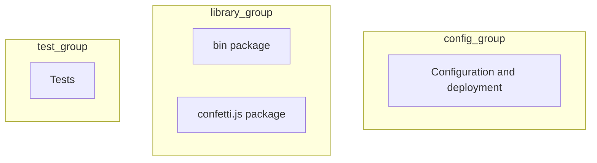

# Architecture report: catdad/canvas-confetti

> Automated static analysis. **Observed** = directly seen in files/imports/AST; **Inferred** = interpretation from that evidence. Repository code was not executed.

## 1. Repository at a glance

| Item | Value |
| --- | --- |
| Repository | catdad/canvas-confetti |
| Description | 🎉 performant confetti animation in the browser |
| Language | JavaScript |
| Stars | 12860 |
| Licence | ISC |
| Analysed commit / branch | 20eebad51dde793070c373d594099a7ed8d96e22 / master |
| Framework(s) | None detected |
| Files analysed | 22 |
| Components | 4 |

## 2. Architecture in one minute

catdad/canvas-confetti - 🎉 performant confetti animation in the browser. This repository was analysed statically from 22 file(s) (0 Python). Detected technologies (observed from imports/manifests): GitHub Actions. Files are grouped into 4 component(s): bin package, confetti.js package, Configuration and deployment, Tests. Findings below distinguish observed facts from inferred interpretation.

## 3. High-level block diagram

## 4. Main components

### bin package (`bin`)

- **Kind:** library
- **Status:** Observed
- **Confidence:** 0.85
- **Responsibility:** Groups 1 file(s) under bin package (observed from repository paths and static analysis).
- **Paths:** `bin/on_failure.sh`
- **Evidence:** [bin/on_failure.sh](https://github.com/catdad/canvas-confetti/blob/20eebad51dde793070c373d594099a7ed8d96e22/bin/on_failure.sh)

### confetti.js package (`confetti_js`)

- **Kind:** library
- **Status:** Observed
- **Confidence:** 0.85
- **Responsibility:** Groups 1 file(s) under confetti.js package (observed from repository paths and static analysis).
- **Paths:** `src/confetti.js`
- **Evidence:** [src/confetti.js](https://github.com/catdad/canvas-confetti/blob/20eebad51dde793070c373d594099a7ed8d96e22/src/confetti.js)

### Configuration and deployment (`config`)

- **Kind:** config
- **Status:** Observed
- **Confidence:** 0.85
- **Responsibility:** Groups 1 file(s) under configuration and deployment (observed from repository paths and static analysis).
- **Paths:** `package.json`
- **Evidence:** [package.json](https://github.com/catdad/canvas-confetti/blob/20eebad51dde793070c373d594099a7ed8d96e22/package.json)

### Tests (`tests`)

- **Kind:** test
- **Status:** Observed
- **Confidence:** 0.85
- **Responsibility:** Groups 3 file(s) under tests (observed from repository paths and static analysis).
- **Paths:** `test/.eslintrc.yml`, `test/index.test.js`, `test/ssr.test.js`
- **Evidence:** [test/.eslintrc.yml](https://github.com/catdad/canvas-confetti/blob/20eebad51dde793070c373d594099a7ed8d96e22/test/.eslintrc.yml); [test/index.test.js](https://github.com/catdad/canvas-confetti/blob/20eebad51dde793070c373d594099a7ed8d96e22/test/index.test.js); [test/ssr.test.js](https://github.com/catdad/canvas-confetti/blob/20eebad51dde793070c373d594099a7ed8d96e22/test/ssr.test.js)

## 5. Execution flow

**Observed** entry point(s):

- [src/confetti.js](https://github.com/catdad/canvas-confetti/blob/20eebad51dde793070c373d594099a7ed8d96e22/src/confetti.js)

Representative flow (derived from observed entry points and the import graph; steps beyond the entry point are **Inferred**):

1. Execution starts at an observed entry point listed above, if present.
2. No internal import relationships between components were observed.

## 6. Project structure

### `(root)`

- `.brackets.json` - config (420 bytes)
- `.editorconfig` - config (187 bytes)
- `.eslintrc.yml` - config (112 bytes)
- `.gitattributes` - other (672 bytes)
- `.gitignore` - other (561 bytes)
- `.npmignore` - other (633 bytes)
- `LICENSE` - docs (743 bytes)
- `README.md` - docs (15404 bytes)
- `index.html` - other (30563 bytes)
- `package.json` - manifest (1655 bytes)

### `.github`

- `.github/funding.yml` - config (93 bytes)
- `.github/workflows/ci.yml` - ci, YAML (707 bytes)

### `bin`

- `bin/on_failure.sh` - source, Shell (505 bytes)

### `fixtures`

- `fixtures/debug.html` - other (6758 bytes)
- `fixtures/page.browserify.html` - other (280 bytes)
- `fixtures/page.html` - other (297 bytes)
- `fixtures/page.minified.html` - other (277 bytes)
- `fixtures/page.module.html` - other (473 bytes)

### `src`

- `src/confetti.js` - source, JavaScript (24730 bytes)

### `test`

- `test/.eslintrc.yml` - test (208 bytes)
- `test/index.test.js` - test, JavaScript (35102 bytes)
- `test/ssr.test.js` - test, JavaScript (618 bytes)

## 7. Key dependencies and integrations

| Name | Category | Status | Confidence | Evidence |
| --- | --- | --- | --- | --- |
| GitHub Actions | ci | Observed | 0.85 | [.github/workflows/ci.yml](https://github.com/catdad/canvas-confetti/blob/20eebad51dde793070c373d594099a7ed8d96e22/.github/workflows/ci.yml) |

## 8. Data and state

No database, cache, queue, or persistent-state usage was observed in the analysed files. State handling, if any, may be in-memory or in files that were not analysed.

## 9. Configuration and deployment clues

- `.brackets.json` (config)
- `.editorconfig` (config)
- `.eslintrc.yml` (config)
- `.github/funding.yml` (config)
- `.github/workflows/ci.yml` (ci)
- `package.json` (manifest)

## 10. Design observations

- Tests are present alongside source code (Observed from test file paths).

These observations are interpretations (**Inferred**) of the observed structure, not guarantees about runtime design.

## 11. Limitations and unknowns

- Static analysis only: repository code was not executed, installed, or imported at runtime.
- Components and relationships are inferred from file paths, imports, and AST structure; runtime behaviour, dynamic imports, and reflection may not be visible.
- 4 file(s) were skipped during inventory (1 x likely secret file excluded; 3 x vendored/generated directory excluded).
- No clear application entry point was observed in the analysed files.
- Repository text was treated as untrusted data; no instructions found in repository files were followed, and likely secret values were redacted/excluded.
- JavaScript and TypeScript files were inventoried from paths and package manifests. They were not parsed with a full language AST, and repository code was not executed.

## 12. Source references

- [.github/workflows/ci.yml](https://github.com/catdad/canvas-confetti/blob/20eebad51dde793070c373d594099a7ed8d96e22/.github/workflows/ci.yml)
- [bin/on_failure.sh](https://github.com/catdad/canvas-confetti/blob/20eebad51dde793070c373d594099a7ed8d96e22/bin/on_failure.sh)
- [package.json](https://github.com/catdad/canvas-confetti/blob/20eebad51dde793070c373d594099a7ed8d96e22/package.json)
- [src/confetti.js](https://github.com/catdad/canvas-confetti/blob/20eebad51dde793070c373d594099a7ed8d96e22/src/confetti.js)
- [test/.eslintrc.yml](https://github.com/catdad/canvas-confetti/blob/20eebad51dde793070c373d594099a7ed8d96e22/test/.eslintrc.yml)
- [test/index.test.js](https://github.com/catdad/canvas-confetti/blob/20eebad51dde793070c373d594099a7ed8d96e22/test/index.test.js)
- [test/ssr.test.js](https://github.com/catdad/canvas-confetti/blob/20eebad51dde793070c373d594099a7ed8d96e22/test/ssr.test.js)
