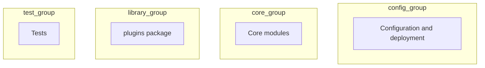

# Architecture report: ccampbell/mousetrap

> Automated static analysis. **Observed** = directly seen in files/imports/AST; **Inferred** = interpretation from that evidence. Repository code was not executed.

## 1. Repository at a glance

| Item | Value |
| --- | --- |
| Repository | ccampbell/mousetrap |
| Description | Simple library for handling keyboard shortcuts in Javascript |
| Language | JavaScript |
| Stars | 11770 |
| Licence | Apache-2.0 |
| Analysed commit / branch | 2f9a476ba6158ba69763e4fcf914966cc72ef433 / master |
| Framework(s) | None detected |
| Files analysed | 22 |
| Components | 4 |

## 2. Architecture in one minute

ccampbell/mousetrap - Simple library for handling keyboard shortcuts in Javascript. This repository was analysed statically from 22 file(s) (0 Python). Detected technologies (observed from imports/manifests): no known frameworks/libraries. Files are grouped into 4 component(s): Configuration and deployment, Core modules, plugins package, Tests. Findings below distinguish observed facts from inferred interpretation.

## 3. High-level block diagram

## 4. Main components

### Configuration and deployment (`config`)

- **Kind:** config
- **Status:** Observed
- **Confidence:** 0.85
- **Responsibility:** Groups 1 file(s) under configuration and deployment (observed from repository paths and static analysis).
- **Paths:** `package.json`
- **Evidence:** [package.json](https://github.com/ccampbell/mousetrap/blob/2f9a476ba6158ba69763e4fcf914966cc72ef433/package.json)

### Core modules (`core`)

- **Kind:** core
- **Status:** Observed
- **Confidence:** 0.85
- **Responsibility:** Groups 2 file(s) under core modules (observed from repository paths and static analysis).
- **Paths:** `Gruntfile.js`, `mousetrap.js`
- **Evidence:** [Gruntfile.js](https://github.com/ccampbell/mousetrap/blob/2f9a476ba6158ba69763e4fcf914966cc72ef433/Gruntfile.js); [mousetrap.js](https://github.com/ccampbell/mousetrap/blob/2f9a476ba6158ba69763e4fcf914966cc72ef433/mousetrap.js)

### plugins package (`plugins`)

- **Kind:** library
- **Status:** Observed
- **Confidence:** 0.85
- **Responsibility:** Groups 4 file(s) under plugins package (observed from repository paths and static analysis).
- **Paths:** `plugins/bind-dictionary/mousetrap-bind-dictionary.js`, `plugins/global-bind/mousetrap-global-bind.js`, `plugins/pause/mousetrap-pause.js`, `plugins/record/mousetrap-record.js`
- **Evidence:** [plugins/bind-dictionary/mousetrap-bind-dictionary.js](https://github.com/ccampbell/mousetrap/blob/2f9a476ba6158ba69763e4fcf914966cc72ef433/plugins/bind-dictionary/mousetrap-bind-dictionary.js); [plugins/global-bind/mousetrap-global-bind.js](https://github.com/ccampbell/mousetrap/blob/2f9a476ba6158ba69763e4fcf914966cc72ef433/plugins/global-bind/mousetrap-global-bind.js); [plugins/pause/mousetrap-pause.js](https://github.com/ccampbell/mousetrap/blob/2f9a476ba6158ba69763e4fcf914966cc72ef433/plugins/pause/mousetrap-pause.js); [plugins/record/mousetrap-record.js](https://github.com/ccampbell/mousetrap/blob/2f9a476ba6158ba69763e4fcf914966cc72ef433/plugins/record/mousetrap-record.js)

### Tests (`tests`)

- **Kind:** test
- **Status:** Observed
- **Confidence:** 0.85
- **Responsibility:** Groups 6 file(s) under tests (observed from repository paths and static analysis).
- **Paths:** `plugins/record/tests/index.html`, `plugins/record/tests/jelly.css`, `plugins/record/tests/jelly.js`, `tests/libs/key-event.js`, `tests/mousetrap.html`, `tests/test.mousetrap.js`
- **Evidence:** [plugins/record/tests/index.html](https://github.com/ccampbell/mousetrap/blob/2f9a476ba6158ba69763e4fcf914966cc72ef433/plugins/record/tests/index.html); [plugins/record/tests/jelly.css](https://github.com/ccampbell/mousetrap/blob/2f9a476ba6158ba69763e4fcf914966cc72ef433/plugins/record/tests/jelly.css); [plugins/record/tests/jelly.js](https://github.com/ccampbell/mousetrap/blob/2f9a476ba6158ba69763e4fcf914966cc72ef433/plugins/record/tests/jelly.js); [tests/libs/key-event.js](https://github.com/ccampbell/mousetrap/blob/2f9a476ba6158ba69763e4fcf914966cc72ef433/tests/libs/key-event.js); [tests/mousetrap.html](https://github.com/ccampbell/mousetrap/blob/2f9a476ba6158ba69763e4fcf914966cc72ef433/tests/mousetrap.html); [tests/test.mousetrap.js](https://github.com/ccampbell/mousetrap/blob/2f9a476ba6158ba69763e4fcf914966cc72ef433/tests/test.mousetrap.js)

## 5. Execution flow

**Observed** entry point(s):

- [mousetrap.js](https://github.com/ccampbell/mousetrap/blob/2f9a476ba6158ba69763e4fcf914966cc72ef433/mousetrap.js)

Representative flow (derived from observed entry points and the import graph; steps beyond the entry point are **Inferred**):

1. Execution starts at an observed entry point listed above, if present.
2. No internal import relationships between components were observed.

## 6. Project structure

### `(root)`

- `.gitignore` - other (33 bytes)
- `Gruntfile.js` - source, JavaScript (793 bytes)
- `LICENSE` - docs (10602 bytes)
- `README.md` - docs (3260 bytes)
- `mousetrap.js` - source, JavaScript (33855 bytes)
- `mousetrap.sublime-project` - other (488 bytes)
- `package.json` - manifest (801 bytes)

### `plugins`

- `plugins/README.md` - docs (563 bytes)
- `plugins/bind-dictionary/README.md` - docs (431 bytes)
- `plugins/bind-dictionary/mousetrap-bind-dictionary.js` - source, JavaScript (1000 bytes)
- `plugins/global-bind/README.md` - docs (552 bytes)
- `plugins/global-bind/mousetrap-global-bind.js` - source, JavaScript (1217 bytes)
- `plugins/pause/README.md` - docs (291 bytes)
- `plugins/pause/mousetrap-pause.js` - source, JavaScript (779 bytes)
- `plugins/record/README.md` - docs (391 bytes)
- `plugins/record/mousetrap-record.js` - source, JavaScript (5515 bytes)
- `plugins/record/tests/index.html` - test (840 bytes)
- `plugins/record/tests/jelly.css` - test (280 bytes)
- `plugins/record/tests/jelly.js` - test, JavaScript (1329 bytes)

### `tests`

- `tests/libs/key-event.js` - test, JavaScript (5187 bytes)
- `tests/mousetrap.html` - test (674 bytes)
- `tests/test.mousetrap.js` - test, JavaScript (25655 bytes)

## 7. Key dependencies and integrations

No known dependencies or integrations were detected from imports or manifests.

## 8. Data and state

No database, cache, queue, or persistent-state usage was observed in the analysed files. State handling, if any, may be in-memory or in files that were not analysed.

## 9. Configuration and deployment clues

- `package.json` (manifest)

## 10. Design observations

- Tests are present alongside source code (Observed from test file paths).

These observations are interpretations (**Inferred**) of the observed structure, not guarantees about runtime design.

## 11. Limitations and unknowns

- Static analysis only: repository code was not executed, installed, or imported at runtime.
- Components and relationships are inferred from file paths, imports, and AST structure; runtime behaviour, dynamic imports, and reflection may not be visible.
- 1 file(s) were skipped during inventory (1 x lockfile excluded).
- No clear application entry point was observed in the analysed files.
- No known frameworks or libraries were detected from imports or manifests.
- Repository text was treated as untrusted data; no instructions found in repository files were followed, and likely secret values were redacted/excluded.
- JavaScript and TypeScript files were inventoried from paths and package manifests. They were not parsed with a full language AST, and repository code was not executed.

## 12. Source references

- [Gruntfile.js](https://github.com/ccampbell/mousetrap/blob/2f9a476ba6158ba69763e4fcf914966cc72ef433/Gruntfile.js)
- [mousetrap.js](https://github.com/ccampbell/mousetrap/blob/2f9a476ba6158ba69763e4fcf914966cc72ef433/mousetrap.js)
- [package.json](https://github.com/ccampbell/mousetrap/blob/2f9a476ba6158ba69763e4fcf914966cc72ef433/package.json)
- [plugins/bind-dictionary/mousetrap-bind-dictionary.js](https://github.com/ccampbell/mousetrap/blob/2f9a476ba6158ba69763e4fcf914966cc72ef433/plugins/bind-dictionary/mousetrap-bind-dictionary.js)
- [plugins/global-bind/mousetrap-global-bind.js](https://github.com/ccampbell/mousetrap/blob/2f9a476ba6158ba69763e4fcf914966cc72ef433/plugins/global-bind/mousetrap-global-bind.js)
- [plugins/pause/mousetrap-pause.js](https://github.com/ccampbell/mousetrap/blob/2f9a476ba6158ba69763e4fcf914966cc72ef433/plugins/pause/mousetrap-pause.js)
- [plugins/record/mousetrap-record.js](https://github.com/ccampbell/mousetrap/blob/2f9a476ba6158ba69763e4fcf914966cc72ef433/plugins/record/mousetrap-record.js)
- [plugins/record/tests/index.html](https://github.com/ccampbell/mousetrap/blob/2f9a476ba6158ba69763e4fcf914966cc72ef433/plugins/record/tests/index.html)
- [plugins/record/tests/jelly.css](https://github.com/ccampbell/mousetrap/blob/2f9a476ba6158ba69763e4fcf914966cc72ef433/plugins/record/tests/jelly.css)
- [plugins/record/tests/jelly.js](https://github.com/ccampbell/mousetrap/blob/2f9a476ba6158ba69763e4fcf914966cc72ef433/plugins/record/tests/jelly.js)
- [tests/libs/key-event.js](https://github.com/ccampbell/mousetrap/blob/2f9a476ba6158ba69763e4fcf914966cc72ef433/tests/libs/key-event.js)
- [tests/mousetrap.html](https://github.com/ccampbell/mousetrap/blob/2f9a476ba6158ba69763e4fcf914966cc72ef433/tests/mousetrap.html)
- [tests/test.mousetrap.js](https://github.com/ccampbell/mousetrap/blob/2f9a476ba6158ba69763e4fcf914966cc72ef433/tests/test.mousetrap.js)
