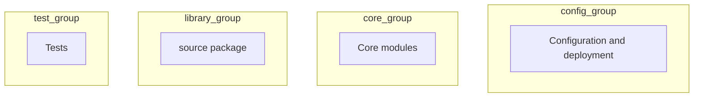

# Architecture report: chalk/chalk

> Automated static analysis. **Observed** = directly seen in files/imports/AST; **Inferred** = interpretation from that evidence. Repository code was not executed.

## 1. Repository at a glance

| Item | Value |
| --- | --- |
| Repository | chalk/chalk |
| Description | 🖍 Terminal string styling done right |
| Language | JavaScript |
| Stars | 23338 |
| Licence | MIT |
| Analysed commit / branch | 72110019e147683f60e13fa0ff5c14a0c27cd9fe / main |
| Framework(s) | None detected |
| Files analysed | 26 |
| Components | 4 |

## 2. Architecture in one minute

chalk/chalk - 🖍 Terminal string styling done right. This repository was analysed statically from 26 file(s) (0 Python). Detected technologies (observed from imports/manifests): GitHub Actions, TypeScript. Files are grouped into 4 component(s): Configuration and deployment, Core modules, source package, Tests. Findings below distinguish observed facts from inferred interpretation.

## 3. High-level block diagram

## 4. Main components

### Configuration and deployment (`config`)

- **Kind:** config
- **Status:** Observed
- **Confidence:** 0.85
- **Responsibility:** Groups 1 file(s) under configuration and deployment (observed from repository paths and static analysis).
- **Paths:** `package.json`
- **Evidence:** [package.json](https://github.com/chalk/chalk/blob/72110019e147683f60e13fa0ff5c14a0c27cd9fe/package.json)

### Core modules (`core`)

- **Kind:** core
- **Status:** Observed
- **Confidence:** 0.85
- **Responsibility:** Groups 1 file(s) under core modules (observed from repository paths and static analysis).
- **Paths:** `benchmark.js`
- **Evidence:** [benchmark.js](https://github.com/chalk/chalk/blob/72110019e147683f60e13fa0ff5c14a0c27cd9fe/benchmark.js)

### source package (`source`)

- **Kind:** library
- **Status:** Observed
- **Confidence:** 0.85
- **Responsibility:** Groups 3 file(s) under source package (observed from repository paths and static analysis).
- **Paths:** `source/index.d.ts`, `source/index.js`, `source/utilities.js`
- **Evidence:** [source/index.d.ts](https://github.com/chalk/chalk/blob/72110019e147683f60e13fa0ff5c14a0c27cd9fe/source/index.d.ts); [source/index.js](https://github.com/chalk/chalk/blob/72110019e147683f60e13fa0ff5c14a0c27cd9fe/source/index.js); [source/utilities.js](https://github.com/chalk/chalk/blob/72110019e147683f60e13fa0ff5c14a0c27cd9fe/source/utilities.js)

### Tests (`tests`)

- **Kind:** test
- **Status:** Observed
- **Confidence:** 0.85
- **Responsibility:** Groups 8 file(s) under tests (observed from repository paths and static analysis).
- **Paths:** `test/_fixture.js`, `test/_force-color-fixture.js`, `test/chalk.js`, `test/force-color.js`, `test/instance.js`, `test/level.js`, `test/no-color-support.js`, `test/visible.js`
- **Evidence:** [test/_fixture.js](https://github.com/chalk/chalk/blob/72110019e147683f60e13fa0ff5c14a0c27cd9fe/test/_fixture.js); [test/_force-color-fixture.js](https://github.com/chalk/chalk/blob/72110019e147683f60e13fa0ff5c14a0c27cd9fe/test/_force-color-fixture.js); [test/chalk.js](https://github.com/chalk/chalk/blob/72110019e147683f60e13fa0ff5c14a0c27cd9fe/test/chalk.js); [test/force-color.js](https://github.com/chalk/chalk/blob/72110019e147683f60e13fa0ff5c14a0c27cd9fe/test/force-color.js); [test/instance.js](https://github.com/chalk/chalk/blob/72110019e147683f60e13fa0ff5c14a0c27cd9fe/test/instance.js); [test/level.js](https://github.com/chalk/chalk/blob/72110019e147683f60e13fa0ff5c14a0c27cd9fe/test/level.js); [test/no-color-support.js](https://github.com/chalk/chalk/blob/72110019e147683f60e13fa0ff5c14a0c27cd9fe/test/no-color-support.js); [test/visible.js](https://github.com/chalk/chalk/blob/72110019e147683f60e13fa0ff5c14a0c27cd9fe/test/visible.js)

## 5. Execution flow

**Observed** entry point(s):

- [source/index.js](https://github.com/chalk/chalk/blob/72110019e147683f60e13fa0ff5c14a0c27cd9fe/source/index.js)

Representative flow (derived from observed entry points and the import graph; steps beyond the entry point are **Inferred**):

1. Execution starts at an observed entry point listed above, if present.
2. No internal import relationships between components were observed.

## 6. Project structure

### `(root)`

- `.editorconfig` - config (175 bytes)
- `.gitattributes` - other (19 bytes)
- `.gitignore` - other (44 bytes)
- `benchmark.js` - source, JavaScript (1823 bytes)
- `code-of-conduct.md` - docs (3230 bytes)
- `contributing.md` - docs (191 bytes)
- `license` - docs (1117 bytes)
- `package.json` - manifest (1753 bytes)
- `readme.md` - docs (13891 bytes)

### `.github`

- `.github/funding.yml` - config (119 bytes)
- `.github/security.md` - docs (166 bytes)
- `.github/workflows/main.yml` - ci, YAML (421 bytes)

### `examples`

- `examples/rainbow.js` - source, JavaScript (985 bytes)
- `examples/screenshot.js` - source, JavaScript (598 bytes)

### `media`

- `media/logo.svg` - other (73253 bytes)

### `source`

- `source/index.d.ts` - source, TypeScript (9987 bytes)
- `source/index.js` - source, JavaScript (8477 bytes)
- `source/utilities.js` - source, JavaScript (1187 bytes)

### `test`

- `test/_fixture.js` - test, JavaScript (148 bytes)
- `test/_force-color-fixture.js` - test, JavaScript (196 bytes)
- `test/chalk.js` - test, JavaScript (11024 bytes)
- `test/force-color.js` - test, JavaScript (3735 bytes)
- `test/instance.js` - test, JavaScript (3528 bytes)
- `test/level.js` - test, JavaScript (1401 bytes)
- `test/no-color-support.js` - test, JavaScript (578 bytes)
- `test/visible.js` - test, JavaScript (1606 bytes)

## 7. Key dependencies and integrations

| Name | Category | Status | Confidence | Evidence |
| --- | --- | --- | --- | --- |
| GitHub Actions | ci | Observed | 0.85 | [.github/workflows/main.yml](https://github.com/chalk/chalk/blob/72110019e147683f60e13fa0ff5c14a0c27cd9fe/.github/workflows/main.yml) |
| TypeScript | tooling | Observed | 0.85 | [package.json:60](https://github.com/chalk/chalk/blob/72110019e147683f60e13fa0ff5c14a0c27cd9fe/package.json#L60) |

## 8. Data and state

No database, cache, queue, or persistent-state usage was observed in the analysed files. State handling, if any, may be in-memory or in files that were not analysed.

## 9. Configuration and deployment clues

- `.editorconfig` (config)
- `.github/funding.yml` (config)
- `.github/workflows/main.yml` (ci)
- `package.json` (manifest)

## 10. Design observations

- Tests are present alongside source code (Observed from test file paths).

These observations are interpretations (**Inferred**) of the observed structure, not guarantees about runtime design.

## 11. Limitations and unknowns

- Static analysis only: repository code was not executed, installed, or imported at runtime.
- Components and relationships are inferred from file paths, imports, and AST structure; runtime behaviour, dynamic imports, and reflection may not be visible.
- 7 file(s) were skipped during inventory (1 x likely secret file excluded; 6 x vendored/generated directory excluded).
- No clear application entry point was observed in the analysed files.
- Repository text was treated as untrusted data; no instructions found in repository files were followed, and likely secret values were redacted/excluded.
- JavaScript and TypeScript files were inventoried from paths and package manifests. They were not parsed with a full language AST, and repository code was not executed.

## 12. Source references

- [.github/workflows/main.yml](https://github.com/chalk/chalk/blob/72110019e147683f60e13fa0ff5c14a0c27cd9fe/.github/workflows/main.yml)
- [benchmark.js](https://github.com/chalk/chalk/blob/72110019e147683f60e13fa0ff5c14a0c27cd9fe/benchmark.js)
- [package.json](https://github.com/chalk/chalk/blob/72110019e147683f60e13fa0ff5c14a0c27cd9fe/package.json)
- [package.json:60](https://github.com/chalk/chalk/blob/72110019e147683f60e13fa0ff5c14a0c27cd9fe/package.json#L60)
- [source/index.d.ts](https://github.com/chalk/chalk/blob/72110019e147683f60e13fa0ff5c14a0c27cd9fe/source/index.d.ts)
- [source/index.js](https://github.com/chalk/chalk/blob/72110019e147683f60e13fa0ff5c14a0c27cd9fe/source/index.js)
- [source/utilities.js](https://github.com/chalk/chalk/blob/72110019e147683f60e13fa0ff5c14a0c27cd9fe/source/utilities.js)
- [test/_fixture.js](https://github.com/chalk/chalk/blob/72110019e147683f60e13fa0ff5c14a0c27cd9fe/test/_fixture.js)
- [test/_force-color-fixture.js](https://github.com/chalk/chalk/blob/72110019e147683f60e13fa0ff5c14a0c27cd9fe/test/_force-color-fixture.js)
- [test/chalk.js](https://github.com/chalk/chalk/blob/72110019e147683f60e13fa0ff5c14a0c27cd9fe/test/chalk.js)
- [test/force-color.js](https://github.com/chalk/chalk/blob/72110019e147683f60e13fa0ff5c14a0c27cd9fe/test/force-color.js)
- [test/instance.js](https://github.com/chalk/chalk/blob/72110019e147683f60e13fa0ff5c14a0c27cd9fe/test/instance.js)
- [test/level.js](https://github.com/chalk/chalk/blob/72110019e147683f60e13fa0ff5c14a0c27cd9fe/test/level.js)
- [test/no-color-support.js](https://github.com/chalk/chalk/blob/72110019e147683f60e13fa0ff5c14a0c27cd9fe/test/no-color-support.js)
- [test/visible.js](https://github.com/chalk/chalk/blob/72110019e147683f60e13fa0ff5c14a0c27cd9fe/test/visible.js)
