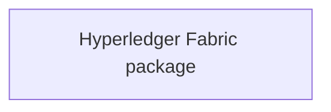

# Architecture report: chaozh/awesome-blockchain-cn

> Automated static analysis. **Observed** = directly seen in files/imports/AST; **Inferred** = interpretation from that evidence. Repository code was not executed.

## 1. Repository at a glance

| Item | Value |
| --- | --- |
| Repository | chaozh/awesome-blockchain-cn |
| Description | 收集所有区块链(BlockChain)技术开发相关资料，包括Fabric和Ethereum开发资料 |
| Language | JavaScript |
| Stars | 18947 |
| Licence | Apache-2.0 |
| Analysed commit / branch | 7bf73d8bca4697757d60fb4027b5032294856806 / master |
| Framework(s) | None detected |
| Files analysed | 6 |
| Components | 1 |

## 2. Architecture in one minute

chaozh/awesome-blockchain-cn - 收集所有区块链(BlockChain)技术开发相关资料，包括Fabric和Ethereum开发资料. This repository was analysed statically from 6 file(s) (0 Python). Detected technologies (observed from imports/manifests): no known frameworks/libraries. Files are grouped into 1 component(s): Hyperledger Fabric package. Findings below distinguish observed facts from inferred interpretation.

## 3. High-level block diagram

## 4. Main components

### Hyperledger Fabric package (`hyperledger_fabric`)

- **Kind:** library
- **Status:** Observed
- **Confidence:** 0.85
- **Responsibility:** Groups 1 file(s) under hyperledger fabric package (observed from repository paths and static analysis).
- **Paths:** `Hyperledger Fabric/fabric-connector.js`
- **Evidence:** [Hyperledger Fabric/fabric-connector.js](https://github.com/chaozh/awesome-blockchain-cn/blob/7bf73d8bca4697757d60fb4027b5032294856806/Hyperledger%20Fabric/fabric-connector.js)

## 5. Execution flow

No entry point was observed; the startup flow below is therefore limited.

Representative flow (derived from observed entry points and the import graph; steps beyond the entry point are **Inferred**):

1. Execution starts at an observed entry point listed above, if present.
2. No internal import relationships between components were observed.

## 6. Project structure

### `(root)`

- `LICENSE` - docs (11357 bytes)
- `README.md` - docs (19116 bytes)

### `Ethereum`

- `Ethereum/README.md` - docs (8982 bytes)

### `Hyperledger Fabric`

- `Hyperledger Fabric/Chaincode Dev/Chaincode v0.6 Dev Env Setup Guide.md` - docs (3486 bytes)
- `Hyperledger Fabric/README.md` - docs (4667 bytes)
- `Hyperledger Fabric/fabric-connector.js` - source, JavaScript (3126 bytes)

## 7. Key dependencies and integrations

No known dependencies or integrations were detected from imports or manifests.

## 8. Data and state

No database, cache, queue, or persistent-state usage was observed in the analysed files. State handling, if any, may be in-memory or in files that were not analysed.

## 9. Configuration and deployment clues

No configuration, manifest, CI, or container files were observed.

## 10. Design observations

- The analysed code appears small or monolithic; few component boundaries were observed.

These observations are interpretations (**Inferred**) of the observed structure, not guarantees about runtime design.

## 11. Limitations and unknowns

- Static analysis only: repository code was not executed, installed, or imported at runtime.
- Components and relationships are inferred from file paths, imports, and AST structure; runtime behaviour, dynamic imports, and reflection may not be visible.
- No clear application entry point was observed in the analysed files.
- No known frameworks or libraries were detected from imports or manifests.
- Repository text was treated as untrusted data; no instructions found in repository files were followed, and likely secret values were redacted/excluded.
- JavaScript and TypeScript files were inventoried from paths and package manifests. They were not parsed with a full language AST, and repository code was not executed.

## 12. Source references

- [Hyperledger Fabric/fabric-connector.js](https://github.com/chaozh/awesome-blockchain-cn/blob/7bf73d8bca4697757d60fb4027b5032294856806/Hyperledger%20Fabric/fabric-connector.js)
