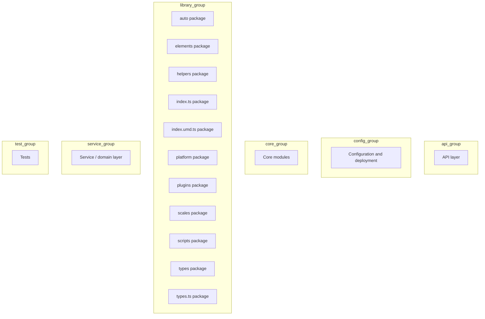

# Architecture report: chartjs/Chart.js

> Automated static analysis. **Observed** = directly seen in files/imports/AST; **Inferred** = interpretation from that evidence. Repository code was not executed.

## 1. Repository at a glance

| Item | Value |
| --- | --- |
| Repository | chartjs/Chart.js |
| Description | Simple HTML5 Charts using the <canvas> tag |
| Language | JavaScript |
| Stars | 67793 |
| Licence | MIT |
| Analysed commit / branch | 71d44219e79e3ac41e6f9dc907022eebf574868d / master |
| Framework(s) | Vue |
| Files analysed | 800 |
| Components | 16 |

## 2. Architecture in one minute

chartjs/Chart.js - Simple HTML5 Charts using the <canvas> tag. This repository was analysed statically from 800 file(s) (0 Python). Detected technologies (observed from imports/manifests): GitHub Actions, Vue, TypeScript, webpack. Files are grouped into 16 component(s): API layer, auto package, Configuration and deployment, Core modules, elements package, helpers package, index.ts package, index.umd.ts package. Findings below distinguish observed facts from inferred interpretation.

## 3. High-level block diagram

## 4. Main components

### API layer (`api_layer`)

- **Kind:** api
- **Status:** Observed
- **Confidence:** 0.85
- **Responsibility:** Groups 9 file(s) under api layer (observed from repository paths and static analysis).
- **Paths:** `src/controllers/controller.bar.js`, `src/controllers/controller.bubble.js`, `src/controllers/controller.doughnut.js`, `src/controllers/controller.line.js`, `src/controllers/controller.pie.js`, `src/controllers/controller.polarArea.js`, `src/controllers/controller.radar.js`, `src/controllers/controller.scatter.js`, `src/controllers/index.js`
- **Evidence:** [src/controllers/controller.bar.js](https://github.com/chartjs/Chart.js/blob/71d44219e79e3ac41e6f9dc907022eebf574868d/src/controllers/controller.bar.js); [src/controllers/controller.bubble.js](https://github.com/chartjs/Chart.js/blob/71d44219e79e3ac41e6f9dc907022eebf574868d/src/controllers/controller.bubble.js); [src/controllers/controller.doughnut.js](https://github.com/chartjs/Chart.js/blob/71d44219e79e3ac41e6f9dc907022eebf574868d/src/controllers/controller.doughnut.js); [src/controllers/controller.line.js](https://github.com/chartjs/Chart.js/blob/71d44219e79e3ac41e6f9dc907022eebf574868d/src/controllers/controller.line.js); [src/controllers/controller.pie.js](https://github.com/chartjs/Chart.js/blob/71d44219e79e3ac41e6f9dc907022eebf574868d/src/controllers/controller.pie.js); [src/controllers/controller.polarArea.js](https://github.com/chartjs/Chart.js/blob/71d44219e79e3ac41e6f9dc907022eebf574868d/src/controllers/controller.polarArea.js); [src/controllers/controller.radar.js](https://github.com/chartjs/Chart.js/blob/71d44219e79e3ac41e6f9dc907022eebf574868d/src/controllers/controller.radar.js); [src/controllers/controller.scatter.js](https://github.com/chartjs/Chart.js/blob/71d44219e79e3ac41e6f9dc907022eebf574868d/src/controllers/controller.scatter.js)

### auto package (`auto`)

- **Kind:** library
- **Status:** Observed
- **Confidence:** 0.85
- **Responsibility:** Groups 3 file(s) under auto package (observed from repository paths and static analysis).
- **Paths:** `auto/auto.cjs`, `auto/auto.d.ts`, `auto/auto.js`
- **Evidence:** [auto/auto.cjs](https://github.com/chartjs/Chart.js/blob/71d44219e79e3ac41e6f9dc907022eebf574868d/auto/auto.cjs); [auto/auto.d.ts](https://github.com/chartjs/Chart.js/blob/71d44219e79e3ac41e6f9dc907022eebf574868d/auto/auto.d.ts); [auto/auto.js](https://github.com/chartjs/Chart.js/blob/71d44219e79e3ac41e6f9dc907022eebf574868d/auto/auto.js)

### Configuration and deployment (`config`)

- **Kind:** config
- **Status:** Observed
- **Confidence:** 0.85
- **Responsibility:** Groups 5 file(s) under configuration and deployment (observed from repository paths and static analysis).
- **Paths:** `auto/package.json`, `composer.json`, `helpers/package.json`, `package.json`, `pnpm-workspace.yaml`
- **Evidence:** [auto/package.json](https://github.com/chartjs/Chart.js/blob/71d44219e79e3ac41e6f9dc907022eebf574868d/auto/package.json); [composer.json](https://github.com/chartjs/Chart.js/blob/71d44219e79e3ac41e6f9dc907022eebf574868d/composer.json); [helpers/package.json](https://github.com/chartjs/Chart.js/blob/71d44219e79e3ac41e6f9dc907022eebf574868d/helpers/package.json); [package.json](https://github.com/chartjs/Chart.js/blob/71d44219e79e3ac41e6f9dc907022eebf574868d/package.json); [pnpm-workspace.yaml](https://github.com/chartjs/Chart.js/blob/71d44219e79e3ac41e6f9dc907022eebf574868d/pnpm-workspace.yaml)

### Core modules (`core`)

- **Kind:** core
- **Status:** Observed
- **Confidence:** 0.85
- **Responsibility:** Groups 2 file(s) under core modules (observed from repository paths and static analysis).
- **Paths:** `karma.conf.cjs`, `rollup.config.js`
- **Evidence:** [karma.conf.cjs](https://github.com/chartjs/Chart.js/blob/71d44219e79e3ac41e6f9dc907022eebf574868d/karma.conf.cjs); [rollup.config.js](https://github.com/chartjs/Chart.js/blob/71d44219e79e3ac41e6f9dc907022eebf574868d/rollup.config.js)

### elements package (`elements`)

- **Kind:** library
- **Status:** Observed
- **Confidence:** 0.85
- **Responsibility:** Groups 5 file(s) under elements package (observed from repository paths and static analysis).
- **Paths:** `src/elements/element.arc.ts`, `src/elements/element.bar.js`, `src/elements/element.line.js`, `src/elements/element.point.ts`, `src/elements/index.js`
- **Evidence:** [src/elements/element.arc.ts](https://github.com/chartjs/Chart.js/blob/71d44219e79e3ac41e6f9dc907022eebf574868d/src/elements/element.arc.ts); [src/elements/element.bar.js](https://github.com/chartjs/Chart.js/blob/71d44219e79e3ac41e6f9dc907022eebf574868d/src/elements/element.bar.js); [src/elements/element.line.js](https://github.com/chartjs/Chart.js/blob/71d44219e79e3ac41e6f9dc907022eebf574868d/src/elements/element.line.js); [src/elements/element.point.ts](https://github.com/chartjs/Chart.js/blob/71d44219e79e3ac41e6f9dc907022eebf574868d/src/elements/element.point.ts); [src/elements/index.js](https://github.com/chartjs/Chart.js/blob/71d44219e79e3ac41e6f9dc907022eebf574868d/src/elements/index.js)

### helpers package (`helpers`)

- **Kind:** library
- **Status:** Observed
- **Confidence:** 0.85
- **Responsibility:** Groups 21 file(s) under helpers package (observed from repository paths and static analysis).
- **Paths:** `helpers/helpers.cjs`, `helpers/helpers.d.ts`, `helpers/helpers.js`, `src/helpers/helpers.canvas.ts`, `src/helpers/helpers.collection.ts`, `src/helpers/helpers.color.ts`, `src/helpers/helpers.config.ts`, `src/helpers/helpers.config.types.ts`, `src/helpers/helpers.core.ts`, `src/helpers/helpers.curve.ts`, `src/helpers/helpers.dataset.ts`, `src/helpers/helpers.dom.ts`, `src/helpers/helpers.easing.ts`, `src/helpers/helpers.extras.ts`, `src/helpers/helpers.interpolation.ts`, `src/helpers/helpers.intl.ts`, `src/helpers/helpers.math.ts`, `src/helpers/helpers.options.ts`, `src/helpers/helpers.rtl.ts`, `src/helpers/helpers.segment.js`, `src/helpers/index.ts`
- **Evidence:** [helpers/helpers.cjs](https://github.com/chartjs/Chart.js/blob/71d44219e79e3ac41e6f9dc907022eebf574868d/helpers/helpers.cjs); [helpers/helpers.d.ts](https://github.com/chartjs/Chart.js/blob/71d44219e79e3ac41e6f9dc907022eebf574868d/helpers/helpers.d.ts); [helpers/helpers.js](https://github.com/chartjs/Chart.js/blob/71d44219e79e3ac41e6f9dc907022eebf574868d/helpers/helpers.js); [src/helpers/helpers.canvas.ts](https://github.com/chartjs/Chart.js/blob/71d44219e79e3ac41e6f9dc907022eebf574868d/src/helpers/helpers.canvas.ts); [src/helpers/helpers.collection.ts](https://github.com/chartjs/Chart.js/blob/71d44219e79e3ac41e6f9dc907022eebf574868d/src/helpers/helpers.collection.ts); [src/helpers/helpers.color.ts](https://github.com/chartjs/Chart.js/blob/71d44219e79e3ac41e6f9dc907022eebf574868d/src/helpers/helpers.color.ts); [src/helpers/helpers.config.ts](https://github.com/chartjs/Chart.js/blob/71d44219e79e3ac41e6f9dc907022eebf574868d/src/helpers/helpers.config.ts); [src/helpers/helpers.config.types.ts](https://github.com/chartjs/Chart.js/blob/71d44219e79e3ac41e6f9dc907022eebf574868d/src/helpers/helpers.config.types.ts)

### index.ts package (`index_ts`)

- **Kind:** library
- **Status:** Observed
- **Confidence:** 0.85
- **Responsibility:** Groups 1 file(s) under index.ts package (observed from repository paths and static analysis).
- **Paths:** `src/index.ts`
- **Evidence:** [src/index.ts](https://github.com/chartjs/Chart.js/blob/71d44219e79e3ac41e6f9dc907022eebf574868d/src/index.ts)

### index.umd.ts package (`index_umd_ts`)

- **Kind:** library
- **Status:** Observed
- **Confidence:** 0.85
- **Responsibility:** Groups 1 file(s) under index.umd.ts package (observed from repository paths and static analysis).
- **Paths:** `src/index.umd.ts`
- **Evidence:** [src/index.umd.ts](https://github.com/chartjs/Chart.js/blob/71d44219e79e3ac41e6f9dc907022eebf574868d/src/index.umd.ts)

### platform package (`platform`)

- **Kind:** library
- **Status:** Observed
- **Confidence:** 0.85
- **Responsibility:** Groups 4 file(s) under platform package (observed from repository paths and static analysis).
- **Paths:** `src/platform/index.js`, `src/platform/platform.base.js`, `src/platform/platform.basic.js`, `src/platform/platform.dom.js`
- **Evidence:** [src/platform/index.js](https://github.com/chartjs/Chart.js/blob/71d44219e79e3ac41e6f9dc907022eebf574868d/src/platform/index.js); [src/platform/platform.base.js](https://github.com/chartjs/Chart.js/blob/71d44219e79e3ac41e6f9dc907022eebf574868d/src/platform/platform.base.js); [src/platform/platform.basic.js](https://github.com/chartjs/Chart.js/blob/71d44219e79e3ac41e6f9dc907022eebf574868d/src/platform/platform.basic.js); [src/platform/platform.dom.js](https://github.com/chartjs/Chart.js/blob/71d44219e79e3ac41e6f9dc907022eebf574868d/src/platform/platform.dom.js)

### plugins package (`plugins`)

- **Kind:** library
- **Status:** Observed
- **Confidence:** 0.85
- **Responsibility:** Groups 15 file(s) under plugins package (observed from repository paths and static analysis).
- **Paths:** `src/plugins/index.js`, `src/plugins/plugin.colors.ts`, `src/plugins/plugin.decimation.js`, `src/plugins/plugin.filler/filler.drawing.js`, `src/plugins/plugin.filler/filler.helper.js`, `src/plugins/plugin.filler/filler.options.js`, `src/plugins/plugin.filler/filler.segment.js`, `src/plugins/plugin.filler/filler.target.js`, `src/plugins/plugin.filler/filler.target.stack.js`, `src/plugins/plugin.filler/index.js`, `src/plugins/plugin.filler/simpleArc.js`, `src/plugins/plugin.legend.js`, `src/plugins/plugin.subtitle.js`, `src/plugins/plugin.title.js`, `src/plugins/plugin.tooltip.js`
- **Evidence:** [src/plugins/index.js](https://github.com/chartjs/Chart.js/blob/71d44219e79e3ac41e6f9dc907022eebf574868d/src/plugins/index.js); [src/plugins/plugin.colors.ts](https://github.com/chartjs/Chart.js/blob/71d44219e79e3ac41e6f9dc907022eebf574868d/src/plugins/plugin.colors.ts); [src/plugins/plugin.decimation.js](https://github.com/chartjs/Chart.js/blob/71d44219e79e3ac41e6f9dc907022eebf574868d/src/plugins/plugin.decimation.js); [src/plugins/plugin.filler/filler.drawing.js](https://github.com/chartjs/Chart.js/blob/71d44219e79e3ac41e6f9dc907022eebf574868d/src/plugins/plugin.filler/filler.drawing.js); [src/plugins/plugin.filler/filler.helper.js](https://github.com/chartjs/Chart.js/blob/71d44219e79e3ac41e6f9dc907022eebf574868d/src/plugins/plugin.filler/filler.helper.js); [src/plugins/plugin.filler/filler.options.js](https://github.com/chartjs/Chart.js/blob/71d44219e79e3ac41e6f9dc907022eebf574868d/src/plugins/plugin.filler/filler.options.js); [src/plugins/plugin.filler/filler.segment.js](https://github.com/chartjs/Chart.js/blob/71d44219e79e3ac41e6f9dc907022eebf574868d/src/plugins/plugin.filler/filler.segment.js); [src/plugins/plugin.filler/filler.target.js](https://github.com/chartjs/Chart.js/blob/71d44219e79e3ac41e6f9dc907022eebf574868d/src/plugins/plugin.filler/filler.target.js)

### scales package (`scales`)

- **Kind:** library
- **Status:** Observed
- **Confidence:** 0.85
- **Responsibility:** Groups 8 file(s) under scales package (observed from repository paths and static analysis).
- **Paths:** `src/scales/index.js`, `src/scales/scale.category.js`, `src/scales/scale.linear.js`, `src/scales/scale.linearbase.js`, `src/scales/scale.logarithmic.js`, `src/scales/scale.radialLinear.js`, `src/scales/scale.time.js`, `src/scales/scale.timeseries.js`
- **Evidence:** [src/scales/index.js](https://github.com/chartjs/Chart.js/blob/71d44219e79e3ac41e6f9dc907022eebf574868d/src/scales/index.js); [src/scales/scale.category.js](https://github.com/chartjs/Chart.js/blob/71d44219e79e3ac41e6f9dc907022eebf574868d/src/scales/scale.category.js); [src/scales/scale.linear.js](https://github.com/chartjs/Chart.js/blob/71d44219e79e3ac41e6f9dc907022eebf574868d/src/scales/scale.linear.js); [src/scales/scale.linearbase.js](https://github.com/chartjs/Chart.js/blob/71d44219e79e3ac41e6f9dc907022eebf574868d/src/scales/scale.linearbase.js); [src/scales/scale.logarithmic.js](https://github.com/chartjs/Chart.js/blob/71d44219e79e3ac41e6f9dc907022eebf574868d/src/scales/scale.logarithmic.js); [src/scales/scale.radialLinear.js](https://github.com/chartjs/Chart.js/blob/71d44219e79e3ac41e6f9dc907022eebf574868d/src/scales/scale.radialLinear.js); [src/scales/scale.time.js](https://github.com/chartjs/Chart.js/blob/71d44219e79e3ac41e6f9dc907022eebf574868d/src/scales/scale.time.js); [src/scales/scale.timeseries.js](https://github.com/chartjs/Chart.js/blob/71d44219e79e3ac41e6f9dc907022eebf574868d/src/scales/scale.timeseries.js)

### scripts package (`scripts`)

- **Kind:** library
- **Status:** Observed
- **Confidence:** 0.85
- **Responsibility:** Groups 4 file(s) under scripts package (observed from repository paths and static analysis).
- **Paths:** `scripts/deploy-docs.sh`, `scripts/docs-config.sh`, `scripts/publish.sh`, `scripts/utils.sh`
- **Evidence:** [scripts/deploy-docs.sh](https://github.com/chartjs/Chart.js/blob/71d44219e79e3ac41e6f9dc907022eebf574868d/scripts/deploy-docs.sh); [scripts/docs-config.sh](https://github.com/chartjs/Chart.js/blob/71d44219e79e3ac41e6f9dc907022eebf574868d/scripts/docs-config.sh); [scripts/publish.sh](https://github.com/chartjs/Chart.js/blob/71d44219e79e3ac41e6f9dc907022eebf574868d/scripts/publish.sh); [scripts/utils.sh](https://github.com/chartjs/Chart.js/blob/71d44219e79e3ac41e6f9dc907022eebf574868d/scripts/utils.sh)

### Service / domain layer (`service_layer`)

- **Kind:** service
- **Status:** Observed
- **Confidence:** 0.85
- **Responsibility:** Groups 21 file(s) under service / domain layer (observed from repository paths and static analysis).
- **Paths:** `src/core/core.adapters.ts`, `src/core/core.animation.js`, `src/core/core.animations.defaults.js`, `src/core/core.animations.js`, `src/core/core.animator.js`, `src/core/core.config.js`, `src/core/core.controller.js`, `src/core/core.datasetController.js`, `src/core/core.defaults.js`, `src/core/core.element.ts`, `src/core/core.interaction.js`, `src/core/core.layouts.defaults.js`, `src/core/core.layouts.js`, `src/core/core.plugins.js`, `src/core/core.registry.js`, `src/core/core.scale.autoskip.js`, `src/core/core.scale.defaults.js`, `src/core/core.scale.js`, `src/core/core.ticks.js`, `src/core/core.typedRegistry.js`, `src/core/index.ts`
- **Evidence:** [src/core/core.adapters.ts](https://github.com/chartjs/Chart.js/blob/71d44219e79e3ac41e6f9dc907022eebf574868d/src/core/core.adapters.ts); [src/core/core.animation.js](https://github.com/chartjs/Chart.js/blob/71d44219e79e3ac41e6f9dc907022eebf574868d/src/core/core.animation.js); [src/core/core.animations.defaults.js](https://github.com/chartjs/Chart.js/blob/71d44219e79e3ac41e6f9dc907022eebf574868d/src/core/core.animations.defaults.js); [src/core/core.animations.js](https://github.com/chartjs/Chart.js/blob/71d44219e79e3ac41e6f9dc907022eebf574868d/src/core/core.animations.js); [src/core/core.animator.js](https://github.com/chartjs/Chart.js/blob/71d44219e79e3ac41e6f9dc907022eebf574868d/src/core/core.animator.js); [src/core/core.config.js](https://github.com/chartjs/Chart.js/blob/71d44219e79e3ac41e6f9dc907022eebf574868d/src/core/core.config.js); [src/core/core.controller.js](https://github.com/chartjs/Chart.js/blob/71d44219e79e3ac41e6f9dc907022eebf574868d/src/core/core.controller.js); [src/core/core.datasetController.js](https://github.com/chartjs/Chart.js/blob/71d44219e79e3ac41e6f9dc907022eebf574868d/src/core/core.datasetController.js)

### Tests (`tests`)

- **Kind:** test
- **Status:** Observed
- **Confidence:** 0.85
- **Responsibility:** Groups 517 file(s) under tests (observed from repository paths and static analysis).
- **Paths:** `test/.eslintrc.yml`, `test/BasicChartWebWorker.js`, `test/fixtures/controller.bar/aligned-pixels.js`, `test/fixtures/controller.bar/backgroundColor/indexable.js`, `test/fixtures/controller.bar/backgroundColor/loopable.js`, `test/fixtures/controller.bar/backgroundColor/scriptable.js`, `test/fixtures/controller.bar/backgroundColor/value.js`, `test/fixtures/controller.bar/bar-animation-hide-show.js`, `test/fixtures/controller.bar/bar-base-value.js`, `test/fixtures/controller.bar/bar-default-begin-at-zero.js`, `test/fixtures/controller.bar/bar-thickness-absolute.json`, `test/fixtures/controller.bar/bar-thickness-flex-offset.json`, `test/fixtures/controller.bar/bar-thickness-flex-single-reverse.json`, `test/fixtures/controller.bar/bar-thickness-flex-single.json`, `test/fixtures/controller.bar/bar-thickness-flex.json`, `test/fixtures/controller.bar/bar-thickness-max.json`, `test/fixtures/controller.bar/bar-thickness-min-interval-multi.json`, `test/fixtures/controller.bar/bar-thickness-min-interval.json`, `test/fixtures/controller.bar/bar-thickness-multiple.json`, `test/fixtures/controller.bar/bar-thickness-no-overlap.json`, `test/fixtures/controller.bar/bar-thickness-offset.json`, `test/fixtures/controller.bar/bar-thickness-per-dataset-stacked.json`, `test/fixtures/controller.bar/bar-thickness-per-dataset.json`, `test/fixtures/controller.bar/bar-thickness-reverse.json`, `test/fixtures/controller.bar/bar-thickness-single-xy.json`, `test/fixtures/controller.bar/bar-thickness-single.json`, `test/fixtures/controller.bar/bar-thickness-stacked.json`, `test/fixtures/controller.bar/baseLine/bottom.js`, `test/fixtures/controller.bar/baseLine/left.js`, `test/fixtures/controller.bar/baseLine/mid-x.js`, `test/fixtures/controller.bar/baseLine/mid-y.js`, `test/fixtures/controller.bar/baseLine/right.js`, `test/fixtures/controller.bar/baseLine/top.js`, `test/fixtures/controller.bar/baseLine/value-x.js`, `test/fixtures/controller.bar/baseLine/value-y.js`, `test/fixtures/controller.bar/borderColor/border+dpr.js`, `test/fixtures/controller.bar/borderColor/indexable.js`, `test/fixtures/controller.bar/borderColor/scriptable.js`, `test/fixtures/controller.bar/borderColor/value.js`, `test/fixtures/controller.bar/borderRadius/border-radius-stacked-number-mixed-chart.js`, `test/fixtures/controller.bar/borderRadius/border-radius-stacked-number-with-order.js`, `test/fixtures/controller.bar/borderRadius/border-radius-stacked-number.js`, `test/fixtures/controller.bar/borderRadius/border-radius.js`, `test/fixtures/controller.bar/borderRadius/no-spacing.js`, `test/fixtures/controller.bar/borderSkipped/indexable.js`, `test/fixtures/controller.bar/borderSkipped/middle.js`, `test/fixtures/controller.bar/borderSkipped/scriptable.js`, `test/fixtures/controller.bar/borderSkipped/value.js`, `test/fixtures/controller.bar/borderWidth/indexable-object.js`, `test/fixtures/controller.bar/borderWidth/indexable.js`, `test/fixtures/controller.bar/borderWidth/negative.js`, `test/fixtures/controller.bar/borderWidth/object.js`, `test/fixtures/controller.bar/borderWidth/scriptable-object.js`, `test/fixtures/controller.bar/borderWidth/scriptable.js`, `test/fixtures/controller.bar/borderWidth/value.js`, `test/fixtures/controller.bar/chart-area-clip.js`, `test/fixtures/controller.bar/data/object-index-axis-y.js`, `test/fixtures/controller.bar/data/object.js`, `test/fixtures/controller.bar/data/parsing.js`, `test/fixtures/controller.bar/floatBar/data-as-objects-horizontal.js`, `test/fixtures/controller.bar/floatBar/data-as-objects.js`, `test/fixtures/controller.bar/floatBar/float-bar-horizontal.json`, `test/fixtures/controller.bar/floatBar/float-bar-stacked-horizontal.json`, `test/fixtures/controller.bar/floatBar/float-bar-stacked.json`, `test/fixtures/controller.bar/floatBar/float-bar.json`, `test/fixtures/controller.bar/horizontal-borders.js`, `test/fixtures/controller.bar/minBarLength/horizontal-neg.js`, `test/fixtures/controller.bar/minBarLength/horizontal-pos.js`, `test/fixtures/controller.bar/minBarLength/horizontal-stacked-no-overlap.js`, `test/fixtures/controller.bar/minBarLength/horizontal-stacked.js`, `test/fixtures/controller.bar/minBarLength/horizontal.js`, `test/fixtures/controller.bar/minBarLength/vertical-neg.js`, `test/fixtures/controller.bar/minBarLength/vertical-pos.js`, `test/fixtures/controller.bar/minBarLength/vertical-stacked-no-overlap.js`, `test/fixtures/controller.bar/minBarLength/vertical-stacked.js`, `test/fixtures/controller.bar/minBarLength/vertical.js`, `test/fixtures/controller.bar/not-grouped/mixed.js`, `test/fixtures/controller.bar/not-grouped/on-time.js`, `test/fixtures/controller.bar/skipNull/bar-skip-null-object-data.js`, `test/fixtures/controller.bar/skipNull/bar-skip-null.js`, `test/fixtures/controller.bar/skipNull/combinations.js`, `test/fixtures/controller.bar/stacking/issue-9105.js`, `test/fixtures/controller.bar/stacking/logarithmic-strings.js`, `test/fixtures/controller.bar/stacking/logarithmic.js`, `test/fixtures/controller.bar/stacking/order-default.json`, `test/fixtures/controller.bar/stacking/order-specified.json`, `test/fixtures/controller.bar/stacking/remove-dataset.js`, `test/fixtures/controller.bar/stacking/replace-data.js`, `test/fixtures/controller.bar/stacking/stacked-and-multiple-axis.js`, `test/fixtures/controller.bubble/autoPadding-disabled.js`, `test/fixtures/controller.bubble/clip.js`, `test/fixtures/controller.bubble/hover-radius-zero.js`, `test/fixtures/controller.bubble/padding-update.js`, `test/fixtures/controller.bubble/padding.js`, `test/fixtures/controller.bubble/point-style.json`, `test/fixtures/controller.bubble/radius-data.js`, `test/fixtures/controller.bubble/radius-scriptable.js`, `test/fixtures/controller.doughnut/backgroundColor/indexable.js`, `test/fixtures/controller.doughnut/backgroundColor/scriptable.js`, `test/fixtures/controller.doughnut/backgroundColor/value.js`, `test/fixtures/controller.doughnut/borderAlign/indexable.js`, `test/fixtures/controller.doughnut/borderAlign/scriptable.js`, `test/fixtures/controller.doughnut/borderAlign/value.js`, `test/fixtures/controller.doughnut/borderColor/indexable.js`, `test/fixtures/controller.doughnut/borderColor/scriptable.js`, `test/fixtures/controller.doughnut/borderColor/value.js`, `test/fixtures/controller.doughnut/borderDash/scriptable.js`, `test/fixtures/controller.doughnut/borderDash/value.js`, `test/fixtures/controller.doughnut/borderJoinStyle/bevel-default.js`, `test/fixtures/controller.doughnut/borderJoinStyle/miter.js`, `test/fixtures/controller.doughnut/borderJoinStyle/round.js`, `test/fixtures/controller.doughnut/borderRadius/scriptable.js`, `test/fixtures/controller.doughnut/borderRadius/value-corners.js`, `test/fixtures/controller.doughnut/borderRadius/value-large-radius.js`, `test/fixtures/controller.doughnut/borderRadius/value-small-number.js`, `test/fixtures/controller.doughnut/borderWidth/indexable.js`, `test/fixtures/controller.doughnut/borderWidth/scriptable.js`, `test/fixtures/controller.doughnut/borderWidth/value.js`, `test/fixtures/controller.doughnut/doughnut-NaN.js`, `test/fixtures/controller.doughnut/doughnut-animation-hide-last.js`, `test/fixtures/controller.doughnut/doughnut-animation.js`, `test/fixtures/controller.doughnut/doughnut-border-align-center.json`, `test/fixtures/controller.doughnut/doughnut-border-align-inner.json`, `test/fixtures/controller.doughnut/doughnut-circumference-over-2pi.json`, `test/fixtures/controller.doughnut/doughnut-circumference-per-dataset.js`, `test/fixtures/controller.doughnut/doughnut-circumference.json`, `test/fixtures/controller.doughnut/doughnut-full-to-semi.js`, `test/fixtures/controller.doughnut/doughnut-hidden-single.js`, `test/fixtures/controller.doughnut/doughnut-hidden.js`, `test/fixtures/controller.doughnut/doughnut-offset.js`, `test/fixtures/controller.doughnut/doughnut-outer-radius-percent.js`, `test/fixtures/controller.doughnut/doughnut-outer-radius-pixels.js`, `test/fixtures/controller.doughnut/doughnut-parsing.js`, `test/fixtures/controller.doughnut/doughnut-rotation-300.js`, `test/fixtures/controller.doughnut/doughnut-rotation-circumference-8x8.js`, `test/fixtures/controller.doughnut/doughnut-rotation-per-dataset.js`, `test/fixtures/controller.doughnut/doughnut-set-active-elements.js`, `test/fixtures/controller.doughnut/doughnut-spacing-and-offset.js`, `test/fixtures/controller.doughnut/doughnut-spacing-parallel.js`, `test/fixtures/controller.doughnut/doughnut-spacing.js`, `test/fixtures/controller.doughnut/doughnut-weight.json`, `test/fixtures/controller.doughnut/event-replay.js`, `test/fixtures/controller.doughnut/pie-border-align-center.json`, `test/fixtures/controller.doughnut/pie-border-align-inner.json`, `test/fixtures/controller.doughnut/pie-circumference.json`, `test/fixtures/controller.doughnut/pie-offset.js`, `test/fixtures/controller.doughnut/pie-weight.json`, `test/fixtures/controller.doughnut/selfJoin/doughnut.js`, `test/fixtures/controller.doughnut/selfJoin/pie.js`, `test/fixtures/controller.doughnut/selfJoin/single-slice-360-border-no-selfjoin.js`, `test/fixtures/controller.doughnut/selfJoin/single-slice-360-border-selfjoin.js`, `test/fixtures/controller.doughnut/single-slice-circumference-405.js`, `test/fixtures/controller.doughnut/single-slice-offset.js`, `test/fixtures/controller.doughnut/single-slice-opacity.js`, `test/fixtures/controller.line/backgroundColor/scriptable.js`, `test/fixtures/controller.line/backgroundColor/value.js`, `test/fixtures/controller.line/borderCapStyle/scriptable.js`, `test/fixtures/controller.line/borderCapStyle/value.js`, `test/fixtures/controller.line/borderColor/scriptable.js`, `test/fixtures/controller.line/borderColor/value.js`, `test/fixtures/controller.line/borderDash/scriptable.js`, `test/fixtures/controller.line/borderDash/value.js`, `test/fixtures/controller.line/borderDashOffset/scriptable.js`, `test/fixtures/controller.line/borderDashOffset/value.js`, `test/fixtures/controller.line/borderJoinStyle/scriptable.js`, `test/fixtures/controller.line/borderJoinStyle/value.js`, `test/fixtures/controller.line/borderWidth/scriptable.js`, `test/fixtures/controller.line/borderWidth/value.js`, `test/fixtures/controller.line/borderWidth/zero.js`, `test/fixtures/controller.line/clip/default-x-max.json`, `test/fixtures/controller.line/clip/default-x-min.json`, `test/fixtures/controller.line/clip/default-x.json`, `test/fixtures/controller.line/clip/default-y-max.json`, `test/fixtures/controller.line/clip/default-y-min.json`, `test/fixtures/controller.line/clip/default-y.json`, `test/fixtures/controller.line/clip/false.js`, `test/fixtures/controller.line/clip/specified.json`, `test/fixtures/controller.line/cubicInterpolationMode/scriptable.js`, `test/fixtures/controller.line/cubicInterpolationMode/value.js`, `test/fixtures/controller.line/fill/no-border.js`, `test/fixtures/controller.line/fill/order-default.js`, `test/fixtures/controller.line/fill/order.js`, `test/fixtures/controller.line/fill/scriptable.js`, `test/fixtures/controller.line/fill/value.js`, `test/fixtures/controller.line/issue-8902.js`, `test/fixtures/controller.line/non-numeric-y.json`, `test/fixtures/controller.line/point-style-offscreen-canvas.json`, `test/fixtures/controller.line/point-style.json`, `test/fixtures/controller.line/pointBackgroundColor/indexable.js`, `test/fixtures/controller.line/pointBackgroundColor/scriptable.js`, `test/fixtures/controller.line/pointBackgroundColor/value.js`, `test/fixtures/controller.line/pointBorderColor/indexable.js`, `test/fixtures/controller.line/pointBorderColor/scriptable.js`, `test/fixtures/controller.line/pointBorderColor/value.js`, `test/fixtures/controller.line/pointBorderWidth/indexable.js`, `test/fixtures/controller.line/pointBorderWidth/scriptable.js`, `test/fixtures/controller.line/pointBorderWidth/value.js`, `test/fixtures/controller.line/pointStyle/indexable.js`, `test/fixtures/controller.line/pointStyle/scriptable.js`, `test/fixtures/controller.line/pointStyle/value.js`, `test/fixtures/controller.line/radius/indexable.js`, `test/fixtures/controller.line/radius/scriptable-to-value.js`, `test/fixtures/controller.line/radius/scriptable.js`, `test/fixtures/controller.line/radius/value.js`, `test/fixtures/controller.line/rotation/indexable.js`, `test/fixtures/controller.line/rotation/scriptable.js`, `test/fixtures/controller.line/rotation/value.js`, `test/fixtures/controller.line/segments/gap.js`, `test/fixtures/controller.line/segments/gradient.js`, `test/fixtures/controller.line/segments/range.js`, `test/fixtures/controller.line/segments/single.js`, `test/fixtures/controller.line/segments/slope.js`, `test/fixtures/controller.line/segments/spanGaps.js`, `test/fixtures/controller.line/showLine/dataset.js`, `test/fixtures/controller.line/showLine/false.js`, `test/fixtures/controller.line/stacking/bounds-data.js`, `test/fixtures/controller.line/stacking/order-default.js`, `test/fixtures/controller.line/stacking/order-specified.js`, `test/fixtures/controller.line/stacking/single.js`, `test/fixtures/controller.line/stacking/stack-cache.js`, `test/fixtures/controller.line/stacking/stacked-scatter.js`, `test/fixtures/controller.line/stacking/updates.js`, `test/fixtures/controller.polarArea/angle-array.json`, `test/fixtures/controller.polarArea/angle-lines.json`, `test/fixtures/controller.polarArea/angle-undefined.json`, `test/fixtures/controller.polarArea/backgroundColor/indexable-dataset.js`, `test/fixtures/controller.polarArea/backgroundColor/indexable-element-options.js`, `test/fixtures/controller.polarArea/backgroundColor/scriptable-dataset.js`, `test/fixtures/controller.polarArea/backgroundColor/scriptable-element-options.js`, `test/fixtures/controller.polarArea/backgroundColor/value-dataset.js`, `test/fixtures/controller.polarArea/backgroundColor/value-element-options.js`, `test/fixtures/controller.polarArea/border-align-center.json`, `test/fixtures/controller.polarArea/border-align-inner.json`, `test/fixtures/controller.polarArea/borderAlign/indexable-dataset.js`, `test/fixtures/controller.polarArea/borderAlign/indexable-element-options.js`, `test/fixtures/controller.polarArea/borderAlign/scriptable-dataset.js`, `test/fixtures/controller.polarArea/borderAlign/scriptable-element-options.js`, `test/fixtures/controller.polarArea/borderAlign/value-dataset.js`, `test/fixtures/controller.polarArea/borderAlign/value-element-options.js`, `test/fixtures/controller.polarArea/borderColor/indexable-dataset.js`, `test/fixtures/controller.polarArea/borderColor/indexable-element-options.js`, `test/fixtures/controller.polarArea/borderColor/scriptable-dataset.js`, `test/fixtures/controller.polarArea/borderColor/scriptable-element-options.js`, `test/fixtures/controller.polarArea/borderColor/value-dataset.js`, `test/fixtures/controller.polarArea/borderColor/value-element-options.js`, `test/fixtures/controller.polarArea/borderDash/scriptable.js`, `test/fixtures/controller.polarArea/borderDash/value.js`, `test/fixtures/controller.polarArea/borderWidth/indexable-dataset.js`, `test/fixtures/controller.polarArea/borderWidth/indexable-element-options.js`, `test/fixtures/controller.polarArea/borderWidth/scriptable-dataset.js`, `test/fixtures/controller.polarArea/borderWidth/scriptable-element-options.js`, `test/fixtures/controller.polarArea/borderWidth/value-dataset.js`, `test/fixtures/controller.polarArea/borderWidth/value-element-options.js`, `test/fixtures/controller.polarArea/last-slice-animate.js`, `test/fixtures/controller.polarArea/parse-object-data.json`, `test/fixtures/controller.polarArea/pointLabels/centered-180.js`, `test/fixtures/controller.polarArea/pointLabels/centered-45.js`, `test/fixtures/controller.polarArea/pointLabels/centered.js`, `test/fixtures/controller.polarArea/pointLabels/default-180.js`, `test/fixtures/controller.polarArea/pointLabels/default-45.js`, `test/fixtures/controller.polarArea/pointLabels/default.js`, `test/fixtures/controller.polarArea/pointLabels/displayAuto-180.js`, `test/fixtures/controller.polarArea/pointLabels/displayAuto.js`, `test/fixtures/controller.polarArea/pointLabels/overlapping.js`, `test/fixtures/controller.polarArea/pointLabels/withTitle/bottom-centered-45.js`, `test/fixtures/controller.polarArea/pointLabels/withTitle/bottom-centered.js`, `test/fixtures/controller.polarArea/pointLabels/withTitle/left-centered-45.js`, `test/fixtures/controller.polarArea/pointLabels/withTitle/left-centered.js`, `test/fixtures/controller.polarArea/pointLabels/withTitle/right-centered-45.js`, `test/fixtures/controller.polarArea/pointLabels/withTitle/right-centered.js`, `test/fixtures/controller.polarArea/pointLabels/withTitle/top-centered-45.js`, `test/fixtures/controller.polarArea/pointLabels/withTitle/top-centered.js`, `test/fixtures/controller.polarArea/pointLabels/withTitle/top-default-45.js`, `test/fixtures/controller.polarArea/pointLabels/withTitle/top-default.js`, `test/fixtures/controller.polarArea/polar-area-animation-rotate.js`, `test/fixtures/controller.polarArea/polar-area-animation-scale.js`, `test/fixtures/controller.radar/backgroundColor/scriptable.js`, `test/fixtures/controller.radar/backgroundColor/value.js`, `test/fixtures/controller.radar/borderCapStyle/scriptable.js`, `test/fixtures/controller.radar/borderCapStyle/value.js`, `test/fixtures/controller.radar/borderColor/scriptable.js`, `test/fixtures/controller.radar/borderColor/value.js`, `test/fixtures/controller.radar/borderDash/scriptable.js`, `test/fixtures/controller.radar/borderDash/value.js`, `test/fixtures/controller.radar/borderDashOffset/scriptable.js`, `test/fixtures/controller.radar/borderDashOffset/value.js`, `test/fixtures/controller.radar/borderJoinStyle/scriptable.js`, `test/fixtures/controller.radar/borderJoinStyle/value.js`, `test/fixtures/controller.radar/borderWidth/scriptable.js`, `test/fixtures/controller.radar/borderWidth/value.js`, `test/fixtures/controller.radar/borderWidth/zero.js`, `test/fixtures/controller.radar/fill/scriptable.js`, `test/fixtures/controller.radar/fill/value.js`, `test/fixtures/controller.radar/point-style.json`, `test/fixtures/controller.radar/pointBackgroundColor/indexable.js`, `test/fixtures/controller.radar/pointBackgroundColor/scriptable.js`, `test/fixtures/controller.radar/pointBackgroundColor/value.js`, `test/fixtures/controller.radar/pointBorderColor/indexable.js`, `test/fixtures/controller.radar/pointBorderColor/scriptable.js`, `test/fixtures/controller.radar/pointBorderColor/value.js`, `test/fixtures/controller.radar/pointBorderWidth/indexable.js`, `test/fixtures/controller.radar/pointBorderWidth/scriptable.js`, `test/fixtures/controller.radar/pointBorderWidth/value.js`, `test/fixtures/controller.radar/pointStyle/indexable.js`, `test/fixtures/controller.radar/pointStyle/scriptable.js`, `test/fixtures/controller.radar/pointStyle/value.js`, `test/fixtures/controller.radar/radius/indexable.js`, `test/fixtures/controller.radar/radius/scriptable.js`, `test/fixtures/controller.radar/radius/value.js`, `test/fixtures/controller.radar/rotation/indexable.js`, `test/fixtures/controller.radar/rotation/scriptable.js`, `test/fixtures/controller.radar/rotation/value.js`, `test/fixtures/controller.radar/showLine/value.js`, `test/fixtures/controller.radar/startAngle/135.js`, `test/fixtures/controller.radar/startAngle/180.js`, `test/fixtures/controller.radar/startAngle/225.js`, `test/fixtures/controller.radar/startAngle/270.js`, `test/fixtures/controller.radar/startAngle/315.js`, `test/fixtures/controller.radar/startAngle/45.js`, `test/fixtures/controller.radar/startAngle/90.js`, `test/fixtures/controller.radar/startAngle/default.js`, `test/fixtures/controller.scatter/showLine/changed.js`, `test/fixtures/controller.scatter/showLine/true.js`, `test/fixtures/controller.scatter/showLine/undefined.js`, `test/fixtures/core.datasetController/stacked-initial-render.js`, `test/fixtures/core.interaction/drawActiveElementsOnTop-false.js`, `test/fixtures/core.interaction/nearest-partial-bar.js`, `test/fixtures/core.interaction/nearest-point-behind-scale.js`, `test/fixtures/core.layouts/hidden-vertical-boxes.js`, `test/fixtures/core.layouts/long-labels.js`, `test/fixtures/core.layouts/no-boxes-all-padding.js`, `test/fixtures/core.layouts/refit-vertical-boxes.js`, `test/fixtures/core.layouts/scriptable.js`, `test/fixtures/core.layouts/stacked-boxes-max-index-without-clip.js`, `test/fixtures/core.layouts/stacked-boxes-max-index.js`, `test/fixtures/core.layouts/stacked-boxes-max-without-clip.js`, `test/fixtures/core.layouts/stacked-boxes-max.js`, `test/fixtures/core.layouts/stacked-boxes-with-weight.js`, `test/fixtures/core.layouts/stacked-boxes.js`, `test/fixtures/core.scale/autoSkip/fit-after.js`, `test/fixtures/core.scale/autoSkip/no-offset.js`, `test/fixtures/core.scale/autoSkip/offset.js`, `test/fixtures/core.scale/backgroundColor.js`, `test/fixtures/core.scale/border-behind-elements.js`, `test/fixtures/core.scale/cartesian-axis-border-settings.json`, `test/fixtures/core.scale/crossAlignment/cross-align-bottom-center.js`, `test/fixtures/core.scale/crossAlignment/cross-align-bottom-far.js`, `test/fixtures/core.scale/crossAlignment/cross-align-bottom-near.js`, `test/fixtures/core.scale/crossAlignment/cross-align-left-center.js`, `test/fixtures/core.scale/crossAlignment/cross-align-left-far-clipped.js`, `test/fixtures/core.scale/crossAlignment/cross-align-left-far.js`, `test/fixtures/core.scale/crossAlignment/cross-align-left-near.js`, `test/fixtures/core.scale/crossAlignment/cross-align-right-center.js`, `test/fixtures/core.scale/crossAlignment/cross-align-right-far-clipped.js`, `test/fixtures/core.scale/crossAlignment/cross-align-right-far.js`, `test/fixtures/core.scale/crossAlignment/cross-align-right-near.js`, `test/fixtures/core.scale/crossAlignment/cross-align-top-center.js`, `test/fixtures/core.scale/crossAlignment/cross-align-top-far.js`, `test/fixtures/core.scale/crossAlignment/cross-align-top-near.js`, `test/fixtures/core.scale/crossAlignment/mirror-cross-align-left-center.js`, `test/fixtures/core.scale/crossAlignment/mirror-cross-align-left-far.js`, `test/fixtures/core.scale/crossAlignment/mirror-cross-align-left-near.js`, `test/fixtures/core.scale/crossAlignment/mirror-cross-align-right-center.js`, `test/fixtures/core.scale/crossAlignment/mirror-cross-align-right-far.js`, `test/fixtures/core.scale/crossAlignment/mirror-cross-align-right-near.js`, `test/fixtures/core.scale/grid/border-over-grid.js`, `test/fixtures/core.scale/grid/colors.js`, `test/fixtures/core.scale/grid/scriptable-borderDash.js`, `test/fixtures/core.scale/label-align-center.js`, `test/fixtures/core.scale/label-align-end.js`, `test/fixtures/core.scale/label-align-inner-onlyX.js`, `test/fixtures/core.scale/label-align-inner-reverse.js`, `test/fixtures/core.scale/label-align-inner-rotate.js`, `test/fixtures/core.scale/label-align-inner.js`, `test/fixtures/core.scale/label-align-start.js`, `test/fixtures/core.scale/label-offset-vertical-axes.json`, `test/fixtures/core.scale/tick-backdrop-alignment-inner.js`, `test/fixtures/core.scale/tick-backdrop-rotation.js`, `test/fixtures/core.scale/tick-backdrop.js`, `test/fixtures/core.scale/tick-drawing.json`, `test/fixtures/core.scale/tick-override-styles.json`, `test/fixtures/core.scale/ticks-mirror-x.js`, `test/fixtures/core.scale/ticks-mirror.js`, `test/fixtures/core.scale/ticks/rotated-long.js`, `test/fixtures/core.scale/ticks/rotated-multi-line.js`, `test/fixtures/core.scale/ticks/skip-by-callback.js`, `test/fixtures/core.scale/title/align-end.js`, `test/fixtures/core.scale/title/align-start.js`, `test/fixtures/core.scale/title/default.js`, `test/fixtures/core.scale/title/horizontal-center.js`, `test/fixtures/core.scale/title/horizontal-value.js`, `test/fixtures/core.scale/title/multi-line/align-end.js`, `test/fixtures/core.scale/title/multi-line/align-start.js`, `test/fixtures/core.scale/title/multi-line/default.js`, `test/fixtures/core.scale/title/vertical-center.js`, `test/fixtures/core.scale/title/vertical-value.js`, `test/fixtures/core.scale/x-axis-position-center.json`, `test/fixtures/core.scale/x-axis-position-dynamic-margin.js`, `test/fixtures/core.scale/x-axis-position-dynamic.json`, `test/fixtures/core.scale/y-axis-position-center.json`, `test/fixtures/core.scale/y-axis-position-dynamic.json`, `test/fixtures/element.line/cubicInterpolationMode/monotone-horizontal.js`, `test/fixtures/element.line/cubicInterpolationMode/monotone-vertical.js`, `test/fixtures/element.line/default.js`, `test/fixtures/element.line/skip/all.js`, `test/fixtures/element.line/skip/first-span.js`, `test/fixtures/element.line/skip/first.js`, `test/fixtures/element.line/skip/last-span.js`, `test/fixtures/element.line/skip/last.js`, `test/fixtures/element.line/skip/middle-span.js`, `test/fixtures/element.line/skip/middle.js`, `test/fixtures/element.line/stepped/after.js`, `test/fixtures/element.line/stepped/before.js`, `test/fixtures/element.line/stepped/default.js`, `test/fixtures/element.line/stepped/middle.js`, `test/fixtures/element.line/tension/default.js`, `test/fixtures/element.line/tension/one.js`, `test/fixtures/element.line/tension/zero.js`, `test/fixtures/element.point/point-style-circle.json`, `test/fixtures/element.point/point-style-cross-rot.json`, `test/fixtures/element.point/point-style-cross.json`, `test/fixtures/element.point/point-style-dash.json`, `test/fixtures/element.point/point-style-image.js`, `test/fixtures/element.point/point-style-line.json`, `test/fixtures/element.point/point-style-rect-rot.json`, `test/fixtures/element.point/point-style-rect-rounded.json`, `test/fixtures/element.point/point-style-rect.json`, `test/fixtures/element.point/point-style-star.json`, `test/fixtures/element.point/point-style-triangle.json`, `test/fixtures/element.point/rotation.js`, `test/fixtures/mixed/bar+line-stacked.js`, `test/fixtures/mixed/bar+line.js`, `test/fixtures/plugin.colors/bar.js`, `test/fixtures/plugin.colors/bubble.js`, `test/fixtures/plugin.colors/chart-options-colors.js`, `test/fixtures/plugin.colors/doughnut.js`, `test/fixtures/plugin.colors/dynamic-datasets-default.js`, `test/fixtures/plugin.colors/dynamic-datasets-force-override.js`, `test/fixtures/plugin.colors/line.js`, `test/fixtures/plugin.colors/mixed.js`, `test/fixtures/plugin.colors/pie.js`, `test/fixtures/plugin.colors/polarArea.js`, `test/fixtures/plugin.colors/radar.js`, `test/fixtures/plugin.colors/scatter.js`, `test/fixtures/plugin.filler/line/above-below-vertical-linechart.js`, `test/fixtures/plugin.filler/line/before-dataset-draw.js`, `test/fixtures/plugin.filler/line/before-datasets-draw.js`, `test/fixtures/plugin.filler/line/boundary/above-below-line-null-start.json`, `test/fixtures/plugin.filler/line/boundary/above-below-line-null.json`, `test/fixtures/plugin.filler/line/boundary/end-span.json`, `test/fixtures/plugin.filler/line/boundary/end.json`, `test/fixtures/plugin.filler/line/boundary/origin-span-dual.json`, `test/fixtures/plugin.filler/line/boundary/origin-span.json`, `test/fixtures/plugin.filler/line/boundary/origin-spline-above.json`, `test/fixtures/plugin.filler/line/boundary/origin-spline-span.json`, `test/fixtures/plugin.filler/line/boundary/origin-spline.json`, `test/fixtures/plugin.filler/line/boundary/origin-stepped-span.json`, `test/fixtures/plugin.filler/line/boundary/origin-stepped.json`, `test/fixtures/plugin.filler/line/boundary/origin.json`, `test/fixtures/plugin.filler/line/boundary/start-span.json`, `test/fixtures/plugin.filler/line/boundary/start.json`, `test/fixtures/plugin.filler/line/dataset/border.json`, `test/fixtures/plugin.filler/line/dataset/clip-bounds-x-off.js`, `test/fixtures/plugin.filler/line/dataset/clip-bounds-x.js`, `test/fixtures/plugin.filler/line/dataset/clip-bounds-y-off.js`, `test/fixtures/plugin.filler/line/dataset/clip-bounds-y.js`, `test/fixtures/plugin.filler/line/dataset/dual.json`, `test/fixtures/plugin.filler/line/dataset/interpolated.js`, `test/fixtures/plugin.filler/line/dataset/no-border.json`, `test/fixtures/plugin.filler/line/dataset/span-dual.json`, `test/fixtures/plugin.filler/line/dataset/span.json`, `test/fixtures/plugin.filler/line/dataset/spline-span-above.json`, `test/fixtures/plugin.filler/line/dataset/spline-span-below.json`, `test/fixtures/plugin.filler/line/dataset/spline-span.json`, `test/fixtures/plugin.filler/line/dataset/spline.json`, `test/fixtures/plugin.filler/line/dataset/stepped.json`, `test/fixtures/plugin.filler/line/drawTimeFillFalse/beforeDatasetDraw.js`, `test/fixtures/plugin.filler/line/drawTimeFillFalse/beforeDatasetsDraw.js`, `test/fixtures/plugin.filler/line/drawTimeFillFalse/beforeDraw.js`, `test/fixtures/plugin.filler/line/offset-scale-minmax.js`, `test/fixtures/plugin.filler/line/points-outside-canvas-initial.js`, `test/fixtures/plugin.filler/line/points-outside-canvas-update.js`, `test/fixtures/plugin.filler/line/segments/alignToPixels.js`, `test/fixtures/plugin.filler/line/segments/gap.js`, `test/fixtures/plugin.filler/line/segments/slope.js`, `test/fixtures/plugin.filler/line/shape.js`, `test/fixtures/plugin.filler/line/stack-multiple-scales.js`, `test/fixtures/plugin.filler/line/stack.json`, `test/fixtures/plugin.filler/line/value.json`, `test/fixtures/plugin.filler/line/vertical.js`, `test/fixtures/plugin.filler/radar/beforeDraw.js`, `test/fixtures/plugin.filler/radar/boundary/end-circular.json`, `test/fixtures/plugin.filler/radar/boundary/end-span.json`, `test/fixtures/plugin.filler/radar/boundary/end.json`, `test/fixtures/plugin.filler/radar/boundary/origin-circular.json`, `test/fixtures/plugin.filler/radar/boundary/origin-span.json`, `test/fixtures/plugin.filler/radar/boundary/origin-spline-span.json`, `test/fixtures/plugin.filler/radar/boundary/origin-spline.json`, `test/fixtures/plugin.filler/radar/boundary/origin.json`, `test/fixtures/plugin.filler/radar/boundary/start-circular.json`, `test/fixtures/plugin.filler/radar/boundary/start-span.json`, `test/fixtures/plugin.filler/radar/boundary/start.json`, `test/fixtures/plugin.filler/radar/dataset/border.json`, `test/fixtures/plugin.filler/radar/dataset/default.json`, `test/fixtures/plugin.filler/radar/dataset/order.js`, `test/fixtures/plugin.filler/radar/dataset/span.json`, `test/fixtures/plugin.filler/radar/dataset/spline.json`, `test/fixtures/plugin.filler/radar/value.json`, `test/fixtures/plugin.legend/borderRadius/legend-border-radius.js`, `test/fixtures/plugin.legend/horizontal-rtl-hitbox.js`, `test/fixtures/plugin.legend/label-textAlign/center.js`, `test/fixtures/plugin.legend/label-textAlign/horizontal-left.js`, `test/fixtures/plugin.legend/label-textAlign/horizontal-right.js`, `test/fixtures/plugin.legend/label-textAlign/horizontal-rtl-left.js`, `test/fixtures/plugin.legend/label-textAlign/horizontal-rtl-right.js`, `test/fixtures/plugin.legend/label-textAlign/left.js`, `test/fixtures/plugin.legend/label-textAlign/right.js`
- **Evidence:** [test/.eslintrc.yml](https://github.com/chartjs/Chart.js/blob/71d44219e79e3ac41e6f9dc907022eebf574868d/test/.eslintrc.yml); [test/BasicChartWebWorker.js](https://github.com/chartjs/Chart.js/blob/71d44219e79e3ac41e6f9dc907022eebf574868d/test/BasicChartWebWorker.js); [test/fixtures/controller.bar/aligned-pixels.js](https://github.com/chartjs/Chart.js/blob/71d44219e79e3ac41e6f9dc907022eebf574868d/test/fixtures/controller.bar/aligned-pixels.js); [test/fixtures/controller.bar/backgroundColor/indexable.js](https://github.com/chartjs/Chart.js/blob/71d44219e79e3ac41e6f9dc907022eebf574868d/test/fixtures/controller.bar/backgroundColor/indexable.js); [test/fixtures/controller.bar/backgroundColor/loopable.js](https://github.com/chartjs/Chart.js/blob/71d44219e79e3ac41e6f9dc907022eebf574868d/test/fixtures/controller.bar/backgroundColor/loopable.js); [test/fixtures/controller.bar/backgroundColor/scriptable.js](https://github.com/chartjs/Chart.js/blob/71d44219e79e3ac41e6f9dc907022eebf574868d/test/fixtures/controller.bar/backgroundColor/scriptable.js); [test/fixtures/controller.bar/backgroundColor/value.js](https://github.com/chartjs/Chart.js/blob/71d44219e79e3ac41e6f9dc907022eebf574868d/test/fixtures/controller.bar/backgroundColor/value.js); [test/fixtures/controller.bar/bar-animation-hide-show.js](https://github.com/chartjs/Chart.js/blob/71d44219e79e3ac41e6f9dc907022eebf574868d/test/fixtures/controller.bar/bar-animation-hide-show.js)

### types package (`types`)

- **Kind:** library
- **Status:** Observed
- **Confidence:** 0.85
- **Responsibility:** Groups 7 file(s) under types package (observed from repository paths and static analysis).
- **Paths:** `src/types/animation.d.ts`, `src/types/basic.d.ts`, `src/types/color.d.ts`, `src/types/geometric.d.ts`, `src/types/index.d.ts`, `src/types/layout.d.ts`, `src/types/utils.d.ts`
- **Evidence:** [src/types/animation.d.ts](https://github.com/chartjs/Chart.js/blob/71d44219e79e3ac41e6f9dc907022eebf574868d/src/types/animation.d.ts); [src/types/basic.d.ts](https://github.com/chartjs/Chart.js/blob/71d44219e79e3ac41e6f9dc907022eebf574868d/src/types/basic.d.ts); [src/types/color.d.ts](https://github.com/chartjs/Chart.js/blob/71d44219e79e3ac41e6f9dc907022eebf574868d/src/types/color.d.ts); [src/types/geometric.d.ts](https://github.com/chartjs/Chart.js/blob/71d44219e79e3ac41e6f9dc907022eebf574868d/src/types/geometric.d.ts); [src/types/index.d.ts](https://github.com/chartjs/Chart.js/blob/71d44219e79e3ac41e6f9dc907022eebf574868d/src/types/index.d.ts); [src/types/layout.d.ts](https://github.com/chartjs/Chart.js/blob/71d44219e79e3ac41e6f9dc907022eebf574868d/src/types/layout.d.ts); [src/types/utils.d.ts](https://github.com/chartjs/Chart.js/blob/71d44219e79e3ac41e6f9dc907022eebf574868d/src/types/utils.d.ts)

### types.ts package (`types_ts`)

- **Kind:** library
- **Status:** Observed
- **Confidence:** 0.85
- **Responsibility:** Groups 1 file(s) under types.ts package (observed from repository paths and static analysis).
- **Paths:** `src/types.ts`
- **Evidence:** [src/types.ts](https://github.com/chartjs/Chart.js/blob/71d44219e79e3ac41e6f9dc907022eebf574868d/src/types.ts)

## 5. Execution flow

**Observed** entry point(s):

- [auto/auto.cjs](https://github.com/chartjs/Chart.js/blob/71d44219e79e3ac41e6f9dc907022eebf574868d/auto/auto.cjs)
- [helpers/helpers.cjs](https://github.com/chartjs/Chart.js/blob/71d44219e79e3ac41e6f9dc907022eebf574868d/helpers/helpers.cjs)
- [src/controllers/index.js](https://github.com/chartjs/Chart.js/blob/71d44219e79e3ac41e6f9dc907022eebf574868d/src/controllers/index.js)
- [src/core/index.ts](https://github.com/chartjs/Chart.js/blob/71d44219e79e3ac41e6f9dc907022eebf574868d/src/core/index.ts)
- [src/elements/index.js](https://github.com/chartjs/Chart.js/blob/71d44219e79e3ac41e6f9dc907022eebf574868d/src/elements/index.js)
- [src/helpers/index.ts](https://github.com/chartjs/Chart.js/blob/71d44219e79e3ac41e6f9dc907022eebf574868d/src/helpers/index.ts)
- [src/index.ts](https://github.com/chartjs/Chart.js/blob/71d44219e79e3ac41e6f9dc907022eebf574868d/src/index.ts)
- [src/platform/index.js](https://github.com/chartjs/Chart.js/blob/71d44219e79e3ac41e6f9dc907022eebf574868d/src/platform/index.js)
- [src/plugins/index.js](https://github.com/chartjs/Chart.js/blob/71d44219e79e3ac41e6f9dc907022eebf574868d/src/plugins/index.js)
- [src/plugins/plugin.filler/index.js](https://github.com/chartjs/Chart.js/blob/71d44219e79e3ac41e6f9dc907022eebf574868d/src/plugins/plugin.filler/index.js)
- [src/scales/index.js](https://github.com/chartjs/Chart.js/blob/71d44219e79e3ac41e6f9dc907022eebf574868d/src/scales/index.js)

Representative flow (derived from observed entry points and the import graph; steps beyond the entry point are **Inferred**):

1. Execution starts at an observed entry point listed above, if present.
2. No internal import relationships between components were observed.

## 6. Project structure

### `(root)`

- `.browserslistrc` - other (58 bytes)
- `.codeclimate.yml` - config (354 bytes)
- `.editorconfig` - config (219 bytes)
- `.eslintignore` - other (40 bytes)
- `.eslintrc.yml` - config (1579 bytes)
- `.gitignore` - other (387 bytes)
- `.htmllintrc` - other (318 bytes)
- `LICENSE.md` - docs (1093 bytes)
- `MAINTAINING.md` - docs (1520 bytes)
- `README.md` - docs (2605 bytes)
- `composer.json` - config (548 bytes)
- `karma.conf.cjs` - source, JavaScript (5084 bytes)
- `package.json` - manifest (4899 bytes)
- `pnpm-workspace.yaml` - config (46 bytes)
- `rollup.config.js` - source, JavaScript (2465 bytes)

### `.github`

- `.github/ISSUE_TEMPLATE.md` - docs (540 bytes)
- `.github/ISSUE_TEMPLATE/bug.yml` - config (3336 bytes)
- `.github/ISSUE_TEMPLATE/config.yml` - config (233 bytes)
- `.github/ISSUE_TEMPLATE/docs.yml` - config (1256 bytes)
- `.github/ISSUE_TEMPLATE/feature.yml` - config (1008 bytes)
- `.github/PULL_REQUEST_TEMPLATE.md` - docs (383 bytes)
- `.github/dependabot.yml` - config (118 bytes)
- `.github/release-drafter.yml` - config (1303 bytes)
- `.github/workflows/ci.yml` - ci, YAML (3132 bytes)
- `.github/workflows/compressed-size.yml` - ci, YAML (702 bytes)
- `.github/workflows/deploy-docs.yml` - ci, YAML (1381 bytes)
- `.github/workflows/release-drafter.yml` - ci, YAML (708 bytes)
- `.github/workflows/release.yml` - ci, YAML (3747 bytes)

### `auto`

- `auto/auto.cjs` - source, JavaScript (170 bytes)
- `auto/auto.d.ts` - source, TypeScript (97 bytes)
- `auto/auto.js` - source, JavaScript (147 bytes)
- `auto/package.json` - manifest (393 bytes)

### `docs`

- `docs/.vuepress/config.ts` - docs (10686 bytes)
- `docs/.vuepress/public/logo.svg` - docs (1249 bytes)
- `docs/.vuepress/redirects` - docs (163 bytes)
- `docs/.vuepress/styles/index.styl` - docs (989 bytes)
- `docs/axes/_common.md` - docs (1842 bytes)
- `docs/axes/_common_ticks.md` - docs (1503 bytes)
- `docs/axes/cartesian/_common.md` - docs (1190 bytes)
- `docs/axes/cartesian/_common_ticks.md` - docs (2353 bytes)
- `docs/axes/cartesian/category.md` - docs (2613 bytes)
- `docs/axes/cartesian/index.md` - docs (9054 bytes)
- `docs/axes/cartesian/linear.md` - docs (3023 bytes)
- `docs/axes/cartesian/logarithmic.md` - docs (864 bytes)
- `docs/axes/cartesian/time.md` - docs (6487 bytes)
- `docs/axes/cartesian/timeseries.md` - docs (490 bytes)
- `docs/axes/index.md` - docs (6663 bytes)
- `docs/axes/labelling.md` - docs (3223 bytes)
- `docs/axes/radial/index.md` - docs (3361 bytes)
- `docs/axes/radial/linear.md` - docs (9258 bytes)
- `docs/axes/styling.md` - docs (3960 bytes)
- `docs/charts/area.md` - docs (3632 bytes)
- `docs/charts/bar.md` - docs (14694 bytes)
- `docs/charts/bubble.md` - docs (5285 bytes)
- `docs/charts/doughnut.md` - docs (10203 bytes)
- `docs/charts/line.md` - docs (12424 bytes)
- `docs/charts/mixed.md` - docs (2603 bytes)
- `docs/charts/polar.md` - docs (7251 bytes)
- `docs/charts/radar.md` - docs (8850 bytes)
- `docs/charts/scatter.md` - docs (1925 bytes)
- `docs/configuration/animations.md` - docs (8785 bytes)
- `docs/configuration/canvas-background.md` - docs (2990 bytes)
- `docs/configuration/decimation.md` - docs (2578 bytes)
- `docs/configuration/device-pixel-ratio.md` - docs (834 bytes)
- `docs/configuration/elements.md` - docs (6433 bytes)
- `docs/configuration/index.md` - docs (3331 bytes)
- `docs/configuration/interactions.md` - docs (9182 bytes)
- `docs/configuration/layout.md` - docs (471 bytes)
- `docs/configuration/legend.md` - docs (9131 bytes)
- `docs/configuration/locale.md` - docs (1084 bytes)
- `docs/configuration/responsive.md` - docs (4792 bytes)
- `docs/configuration/subtitle.md` - docs (803 bytes)
- `docs/configuration/title.md` - docs (2289 bytes)
- `docs/configuration/tooltip.md` - docs (19840 bytes)
- `docs/developers/api.md` - docs (9550 bytes)
- `docs/developers/axes.md` - docs (4847 bytes)
- `docs/developers/charts.md` - docs (4771 bytes)
- `docs/developers/contributing.md` - docs (6718 bytes)
- `docs/developers/index.md` - docs (1722 bytes)
- `docs/developers/plugin_flowcharts.drawio` - docs (11311 bytes)
- `docs/developers/plugins.md` - docs (6455 bytes)
- `docs/developers/publishing.md` - docs (1099 bytes)
- `docs/developers/updates.md` - docs (2910 bytes)
- `docs/general/accessibility.md` - docs (1470 bytes)
- `docs/general/colors.md` - docs (5064 bytes)
- `docs/general/data-structures.md` - docs (6105 bytes)
- `docs/general/fonts.md` - docs (2332 bytes)
- `docs/general/options.md` - docs (5296 bytes)
- `docs/general/padding.md` - docs (1487 bytes)
- `docs/general/performance.md` - docs (7704 bytes)
- `docs/getting-started/index.md` - docs (2224 bytes)
- `docs/getting-started/installation.md` - docs (1540 bytes)
- `docs/getting-started/integration.md` - docs (4582 bytes)
- `docs/getting-started/usage.md` - docs (22497 bytes)
- `docs/getting-started/using-from-node-js.md` - docs (1005 bytes)
- `docs/index.md` - docs (4826 bytes)
- `docs/migration/v3-migration.md` - docs (28941 bytes)
- `docs/migration/v4-migration.md` - docs (3424 bytes)
- `docs/package.json` - manifest (1009 bytes)
- `docs/samples/.eslintrc.yml` - config (27 bytes)
- `docs/samples/advanced/data-decimation.md` - docs (2737 bytes)
- `docs/samples/advanced/derived-axis-type.md` - docs (991 bytes)
- `docs/samples/advanced/derived-chart-type.md` - docs (931 bytes)
- `docs/samples/advanced/linear-gradient.md` - docs (2839 bytes)
- `docs/samples/advanced/programmatic-events.md` - docs (2484 bytes)
- `docs/samples/advanced/progress-bar.md` - docs (3775 bytes)
- `docs/samples/advanced/radial-gradient.md` - docs (2977 bytes)
- `docs/samples/animations/delay.md` - docs (1943 bytes)
- `docs/samples/animations/drop.md` - docs (3201 bytes)
- `docs/samples/animations/loop.md` - docs (3413 bytes)
- `docs/samples/animations/progressive-line-easing.md` - docs (4185 bytes)
- `docs/samples/animations/progressive-line.md` - docs (2365 bytes)
- `docs/samples/area/line-boundaries.md` - docs (2381 bytes)
- `docs/samples/area/line-datasets.md` - docs (3833 bytes)
- `docs/samples/area/line-drawtime.md` - docs (2464 bytes)
- `docs/samples/area/line-stacked.md` - docs (3995 bytes)
- `docs/samples/area/radar.md` - docs (3123 bytes)
- `docs/samples/bar/border-radius.md` - docs (1620 bytes)
- `docs/samples/bar/floating.md` - docs (1571 bytes)
- `docs/samples/bar/horizontal.md` - docs (2907 bytes)
- `docs/samples/bar/stacked-groups.md` - docs (1804 bytes)
- `docs/samples/bar/stacked.md` - docs (1441 bytes)
- `docs/samples/bar/vertical.md` - docs (2631 bytes)
- `docs/samples/information.md` - docs (1484 bytes)
- `docs/samples/legend/events.md` - docs (1496 bytes)
- `docs/samples/legend/html.md` - docs (4077 bytes)
- `docs/samples/legend/point-style.md` - docs (1669 bytes)
- `docs/samples/legend/position.md` - docs (1498 bytes)
- `docs/samples/legend/title.md` - docs (1692 bytes)
- `docs/samples/line/interpolation.md` - docs (1667 bytes)
- `docs/samples/line/line.md` - docs (2603 bytes)
- `docs/samples/line/multi-axis.md` - docs (1976 bytes)
- `docs/samples/line/point-styling.md` - docs (3139 bytes)
- `docs/samples/line/segments.md` - docs (1433 bytes)
- `docs/samples/line/stepped.md` - docs (1894 bytes)
- `docs/samples/line/styling.md` - docs (1617 bytes)
- `docs/samples/other-charts/bubble.md` - docs (2451 bytes)
- `docs/samples/other-charts/combo-bar-line.md` - docs (2722 bytes)
- `docs/samples/other-charts/doughnut.md` - docs (2726 bytes)
- `docs/samples/other-charts/multi-series-pie.md` - docs (2919 bytes)
- `docs/samples/other-charts/pie.md` - docs (2384 bytes)
- `docs/samples/other-charts/polar-area-center-labels.md` - docs (2364 bytes)
- `docs/samples/other-charts/polar-area.md` - docs (2036 bytes)
- `docs/samples/other-charts/radar-skip-points.md` - docs (2125 bytes)
- `docs/samples/other-charts/radar.md` - docs (2593 bytes)
- `docs/samples/other-charts/scatter-multi-axis.md` - docs (3292 bytes)
- `docs/samples/other-charts/scatter.md` - docs (2452 bytes)
- `docs/samples/other-charts/stacked-bar-line.md` - docs (2992 bytes)
- `docs/samples/plugins/chart-area-border.md` - docs (1597 bytes)
- `docs/samples/plugins/doughnut-empty-state.md` - docs (1695 bytes)
- `docs/samples/plugins/quadrants.md` - docs (2044 bytes)
- `docs/samples/scale-options/center.md` - docs (1958 bytes)
- `docs/samples/scale-options/grid.md` - docs (2626 bytes)
- `docs/samples/scale-options/ticks.md` - docs (2548 bytes)
- `docs/samples/scale-options/titles.md` - docs (2082 bytes)
- `docs/samples/scales/linear-min-max-suggested.md` - docs (1448 bytes)
- `docs/samples/scales/linear-min-max.md` - docs (1178 bytes)
- `docs/samples/scales/linear-step-size.md` - docs (3295 bytes)
- `docs/samples/scales/log.md` - docs (1503 bytes)
- `docs/samples/scales/stacked.md` - docs (1557 bytes)
- `docs/samples/scales/time-combo.md` - docs (1891 bytes)
- `docs/samples/scales/time-line.md` - docs (2405 bytes)
- `docs/samples/scales/time-max-span.md` - docs (2811 bytes)
- `docs/samples/scriptable/bar.md` - docs (1530 bytes)
- `docs/samples/scriptable/bubble.md` - docs (2355 bytes)
- `docs/samples/scriptable/line.md` - docs (1837 bytes)
- `docs/samples/scriptable/pie.md` - docs (1649 bytes)
- `docs/samples/scriptable/polar.md` - docs (1471 bytes)
- `docs/samples/scriptable/radar.md` - docs (1882 bytes)
- `docs/samples/subtitle/basic.md` - docs (1211 bytes)
- `docs/samples/title/alignment.md` - docs (1435 bytes)
- `docs/samples/tooltip/content.md` - docs (1553 bytes)
- `docs/samples/tooltip/html.md` - docs (4619 bytes)
- `docs/samples/tooltip/interactions.md` - docs (3027 bytes)
- `docs/samples/tooltip/point-style.md` - docs (2124 bytes)
- `docs/samples/tooltip/position.md` - docs (2407 bytes)
- `docs/samples/utils.md` - docs (878 bytes)
- `docs/scripts/analyzer.js` - docs (1463 bytes)
- `docs/scripts/components.js` - docs (131 bytes)
- `docs/scripts/derived-bubble.js` - docs (1066 bytes)
- `docs/scripts/helpers.js` - docs (149 bytes)
- `docs/scripts/log2.js` - docs (1612 bytes)
- `docs/scripts/register.js` - docs (238 bytes)
- `docs/scripts/utils.js` - docs (3483 bytes)

### `helpers`

- `helpers/helpers.cjs` - source, JavaScript (49 bytes)
- `helpers/helpers.d.ts` - source, TypeScript (42 bytes)
- `helpers/helpers.js` - source, JavaScript (36 bytes)
- `helpers/package.json` - manifest (405 bytes)

### `scripts`

- `scripts/deploy-docs.sh` - source, Shell (1764 bytes)
- `scripts/docs-config.sh` - source, Shell (168 bytes)
- `scripts/publish.sh` - source, Shell (202 bytes)
- `scripts/sample-redirect-template.html` - other (942 bytes)
- `scripts/utils.sh` - source, Shell (498 bytes)

### `src`

- `src/controllers/controller.bar.js` - source, JavaScript (19523 bytes)
- `src/controllers/controller.bubble.js` - source, JavaScript (4340 bytes)
- `src/controllers/controller.doughnut.js` - source, JavaScript (12265 bytes)
- `src/controllers/controller.line.js` - source, JavaScript (4207 bytes)
- `src/controllers/controller.pie.js` - source, JavaScript (555 bytes)
- `src/controllers/controller.polarArea.js` - source, JavaScript (6213 bytes)
- `src/controllers/controller.radar.js` - source, JavaScript (2452 bytes)
- `src/controllers/controller.scatter.js` - source, JavaScript (5159 bytes)
- `src/controllers/index.js` - source, JavaScript (538 bytes)
- `src/core/core.adapters.ts` - source, TypeScript (4028 bytes)
- `src/core/core.animation.js` - source, JavaScript (3132 bytes)
- `src/core/core.animations.defaults.js` - source, JavaScript (1475 bytes)
- `src/core/core.animations.js` - source, JavaScript (4330 bytes)
- `src/core/core.animator.js` - source, JavaScript (4506 bytes)
- `src/core/core.config.js` - source, JavaScript (11853 bytes)
- `src/core/core.controller.js` - source, JavaScript (35837 bytes)
- `src/core/core.datasetController.js` - source, JavaScript (30053 bytes)
- `src/core/core.defaults.js` - source, JavaScript (5161 bytes)
- `src/core/core.element.ts` - source, TypeScript (1478 bytes)
- `src/core/core.interaction.js` - source, JavaScript (16341 bytes)
- `src/core/core.layouts.defaults.js` - source, JavaScript (189 bytes)
- `src/core/core.layouts.js` - source, JavaScript (15880 bytes)
- `src/core/core.plugins.js` - source, JavaScript (5547 bytes)
- `src/core/core.registry.js` - source, JavaScript (4516 bytes)
- `src/core/core.scale.autoskip.js` - source, JavaScript (4540 bytes)
- `src/core/core.scale.defaults.js` - source, JavaScript (2638 bytes)
- `src/core/core.scale.js` - source, JavaScript (49646 bytes)
- `src/core/core.ticks.js` - source, JavaScript (3667 bytes)
- `src/core/core.typedRegistry.js` - source, JavaScript (2770 bytes)
- `src/core/index.ts` - source, TypeScript (859 bytes)
- `src/elements/element.arc.ts` - source, TypeScript (17992 bytes)
- `src/elements/element.bar.js` - source, JavaScript (6478 bytes)
- `src/elements/element.line.js` - source, JavaScript (13417 bytes)
- `src/elements/element.point.ts` - source, TypeScript (2815 bytes)
- `src/elements/index.js` - source, JavaScript (230 bytes)
- `src/helpers/helpers.canvas.ts` - source, TypeScript (14936 bytes)
- `src/helpers/helpers.collection.ts` - source, TypeScript (4529 bytes)
- `src/helpers/helpers.color.ts` - source, TypeScript (1053 bytes)
- `src/helpers/helpers.config.ts` - source, TypeScript (13051 bytes)
- `src/helpers/helpers.config.types.ts` - source, TypeScript (1554 bytes)
- `src/helpers/helpers.core.ts` - source, TypeScript (12109 bytes)
- `src/helpers/helpers.curve.ts` - source, TypeScript (7087 bytes)
- `src/helpers/helpers.dataset.ts` - source, TypeScript (1235 bytes)
- `src/helpers/helpers.dom.ts` - source, TypeScript (9719 bytes)
- `src/helpers/helpers.easing.ts` - source, TypeScript (3543 bytes)
- `src/helpers/helpers.extras.ts` - source, TypeScript (4878 bytes)
- `src/helpers/helpers.interpolation.ts` - source, TypeScript (1078 bytes)
- `src/helpers/helpers.intl.ts` - source, TypeScript (556 bytes)
- `src/helpers/helpers.math.ts` - source, TypeScript (5439 bytes)
- `src/helpers/helpers.options.ts` - source, TypeScript (6969 bytes)
- `src/helpers/helpers.rtl.ts` - source, TypeScript (2064 bytes)
- `src/helpers/helpers.segment.js` - source, JavaScript (9933 bytes)
- `src/helpers/index.ts` - source, TypeScript (617 bytes)
- `src/index.ts` - source, TypeScript (559 bytes)
- `src/index.umd.ts` - source, TypeScript (1710 bytes)
- `src/platform/index.js` - source, JavaScript (452 bytes)
- `src/platform/platform.base.js` - source, JavaScript (2996 bytes)
- `src/platform/platform.basic.js` - source, JavaScript (804 bytes)
- `src/platform/platform.dom.js` - source, JavaScript (12013 bytes)
- `src/plugins/index.js` - source, JavaScript (396 bytes)
- `src/plugins/plugin.colors.ts` - source, TypeScript (3249 bytes)
- `src/plugins/plugin.decimation.js` - source, JavaScript (8724 bytes)
- `src/plugins/plugin.filler/filler.drawing.js` - source, JavaScript (5955 bytes)
- `src/plugins/plugin.filler/filler.helper.js` - source, JavaScript (973 bytes)
- `src/plugins/plugin.filler/filler.options.js` - source, JavaScript (3054 bytes)
- `src/plugins/plugin.filler/filler.segment.js` - source, JavaScript (2697 bytes)
- `src/plugins/plugin.filler/filler.target.js` - source, JavaScript (2303 bytes)
- `src/plugins/plugin.filler/filler.target.stack.js` - source, JavaScript (3037 bytes)
- `src/plugins/plugin.filler/index.js` - source, JavaScript (2562 bytes)
- `src/plugins/plugin.filler/simpleArc.js` - source, JavaScript (616 bytes)
- `src/plugins/plugin.legend.js` - source, JavaScript (22448 bytes)
- `src/plugins/plugin.subtitle.js` - source, JavaScript (1019 bytes)
- `src/plugins/plugin.title.js` - source, JavaScript (3880 bytes)
- `src/plugins/plugin.tooltip.js` - source, JavaScript (39182 bytes)
- `src/scales/index.js` - source, JavaScript (378 bytes)
- `src/scales/scale.category.js` - source, JavaScript (3914 bytes)
- `src/scales/scale.linear.js` - source, JavaScript (1434 bytes)
- `src/scales/scale.linearbase.js` - source, JavaScript (9955 bytes)
- `src/scales/scale.logarithmic.js` - source, JavaScript (6047 bytes)
- `src/scales/scale.radialLinear.js` - source, JavaScript (19343 bytes)
- `src/scales/scale.time.js` - source, JavaScript (19472 bytes)
- `src/scales/scale.timeseries.js` - source, JavaScript (5209 bytes)
- `src/types.ts` - source, TypeScript (986 bytes)
- `src/types/animation.d.ts` - source, TypeScript (997 bytes)
- `src/types/basic.d.ts` - source, TypeScript (95 bytes)
- `src/types/color.d.ts` - source, TypeScript (61 bytes)
- `src/types/geometric.d.ts` - source, TypeScript (880 bytes)
- `src/types/index.d.ts` - source, TypeScript (121109 bytes)
- `src/types/layout.d.ts` - source, TypeScript (1635 bytes)
- `src/types/utils.d.ts` - source, TypeScript (1059 bytes)

### `test`

- `test/.eslintrc.yml` - test (161 bytes)
- `test/BasicChartWebWorker.js` - test, JavaScript (972 bytes)
- `test/fixtures/controller.bar/aligned-pixels.js` - test, JavaScript (484 bytes)
- `test/fixtures/controller.bar/backgroundColor/indexable.js` - test, JavaScript (918 bytes)
- `test/fixtures/controller.bar/backgroundColor/loopable.js` - test, JavaScript (743 bytes)
- `test/fixtures/controller.bar/backgroundColor/scriptable.js` - test, JavaScript (1134 bytes)
- `test/fixtures/controller.bar/backgroundColor/value.js` - test, JavaScript (636 bytes)
- `test/fixtures/controller.bar/bar-animation-hide-show.js` - test, JavaScript (2094 bytes)
- `test/fixtures/controller.bar/bar-base-value.js` - test, JavaScript (475 bytes)
- `test/fixtures/controller.bar/bar-default-begin-at-zero.js` - test, JavaScript (427 bytes)
- `test/fixtures/controller.bar/bar-thickness-absolute.json` - test (1072 bytes)
- `test/fixtures/controller.bar/bar-thickness-flex-offset.json` - test (1059 bytes)
- `test/fixtures/controller.bar/bar-thickness-flex-single-reverse.json` - test (1082 bytes)
- `test/fixtures/controller.bar/bar-thickness-flex-single.json` - test (1045 bytes)
- `test/fixtures/controller.bar/bar-thickness-flex.json` - test (1060 bytes)
- `test/fixtures/controller.bar/bar-thickness-max.json` - test (1058 bytes)
- `test/fixtures/controller.bar/bar-thickness-min-interval-multi.json` - test (1131 bytes)
- `test/fixtures/controller.bar/bar-thickness-min-interval.json` - test (1020 bytes)
- `test/fixtures/controller.bar/bar-thickness-multiple.json` - test (1321 bytes)
- `test/fixtures/controller.bar/bar-thickness-no-overlap.json` - test (1340 bytes)
- `test/fixtures/controller.bar/bar-thickness-offset.json` - test (1320 bytes)
- `test/fixtures/controller.bar/bar-thickness-per-dataset-stacked.json` - test (1404 bytes)
- `test/fixtures/controller.bar/bar-thickness-per-dataset.json` - test (1158 bytes)
- `test/fixtures/controller.bar/bar-thickness-reverse.json` - test (1358 bytes)
- `test/fixtures/controller.bar/bar-thickness-single-xy.json` - test (1026 bytes)
- `test/fixtures/controller.bar/bar-thickness-single.json` - test (1040 bytes)
- `test/fixtures/controller.bar/bar-thickness-stacked.json` - test (1395 bytes)
- `test/fixtures/controller.bar/baseLine/bottom.js` - test, JavaScript (733 bytes)
- `test/fixtures/controller.bar/baseLine/left.js` - test, JavaScript (755 bytes)
- `test/fixtures/controller.bar/baseLine/mid-x.js` - test, JavaScript (756 bytes)
- `test/fixtures/controller.bar/baseLine/mid-y.js` - test, JavaScript (734 bytes)
- `test/fixtures/controller.bar/baseLine/right.js` - test, JavaScript (785 bytes)
- `test/fixtures/controller.bar/baseLine/top.js` - test, JavaScript (763 bytes)
- `test/fixtures/controller.bar/baseLine/value-x.js` - test, JavaScript (770 bytes)
- `test/fixtures/controller.bar/baseLine/value-y.js` - test, JavaScript (748 bytes)
- `test/fixtures/controller.bar/borderColor/border+dpr.js` - test, JavaScript (618 bytes)
- `test/fixtures/controller.bar/borderColor/indexable.js` - test, JavaScript (978 bytes)
- `test/fixtures/controller.bar/borderColor/scriptable.js` - test, JavaScript (1194 bytes)
- `test/fixtures/controller.bar/borderColor/value.js` - test, JavaScript (696 bytes)
- `test/fixtures/controller.bar/borderRadius/border-radius-stacked-number-mixed-chart.js` - test, JavaScript (789 bytes)
- `test/fixtures/controller.bar/borderRadius/border-radius-stacked-number-with-order.js` - test, JavaScript (826 bytes)
- `test/fixtures/controller.bar/borderRadius/border-radius-stacked-number.js` - test, JavaScript (766 bytes)
- `test/fixtures/controller.bar/borderRadius/border-radius.js` - test, JavaScript (868 bytes)
- `test/fixtures/controller.bar/borderRadius/no-spacing.js` - test, JavaScript (696 bytes)
- `test/fixtures/controller.bar/borderSkipped/indexable.js` - test, JavaScript (983 bytes)
- `test/fixtures/controller.bar/borderSkipped/middle.js` - test, JavaScript (737 bytes)
- `test/fixtures/controller.bar/borderSkipped/scriptable.js` - test, JavaScript (1185 bytes)
- `test/fixtures/controller.bar/borderSkipped/value.js` - test, JavaScript (1061 bytes)
- `test/fixtures/controller.bar/borderWidth/indexable-object.js` - test, JavaScript (1328 bytes)
- `test/fixtures/controller.bar/borderWidth/indexable.js` - test, JavaScript (887 bytes)
- `test/fixtures/controller.bar/borderWidth/negative.js` - test, JavaScript (933 bytes)
- `test/fixtures/controller.bar/borderWidth/object.js` - test, JavaScript (823 bytes)
- `test/fixtures/controller.bar/borderWidth/scriptable-object.js` - test, JavaScript (1005 bytes)
- `test/fixtures/controller.bar/borderWidth/scriptable.js` - test, JavaScript (921 bytes)
- `test/fixtures/controller.bar/borderWidth/value.js` - test, JavaScript (685 bytes)
- `test/fixtures/controller.bar/chart-area-clip.js` - test, JavaScript (658 bytes)
- `test/fixtures/controller.bar/data/object-index-axis-y.js` - test, JavaScript (302 bytes)
- `test/fixtures/controller.bar/data/object.js` - test, JavaScript (497 bytes)
- `test/fixtures/controller.bar/data/parsing.js` - test, JavaScript (846 bytes)
- `test/fixtures/controller.bar/floatBar/data-as-objects-horizontal.js` - test, JavaScript (584 bytes)
- `test/fixtures/controller.bar/floatBar/data-as-objects.js` - test, JavaScript (562 bytes)
- `test/fixtures/controller.bar/floatBar/float-bar-horizontal.json` - test (890 bytes)
- `test/fixtures/controller.bar/floatBar/float-bar-stacked-horizontal.json` - test (964 bytes)
- `test/fixtures/controller.bar/floatBar/float-bar-stacked.json` - test (934 bytes)
- `test/fixtures/controller.bar/floatBar/float-bar.json` - test (860 bytes)
- `test/fixtures/controller.bar/horizontal-borders.js` - test, JavaScript (799 bytes)
- `test/fixtures/controller.bar/minBarLength/horizontal-neg.js` - test, JavaScript (551 bytes)
- `test/fixtures/controller.bar/minBarLength/horizontal-pos.js` - test, JavaScript (549 bytes)
- `test/fixtures/controller.bar/minBarLength/horizontal-stacked-no-overlap.js` - test, JavaScript (996 bytes)
- `test/fixtures/controller.bar/minBarLength/horizontal-stacked.js` - test, JavaScript (767 bytes)
- `test/fixtures/controller.bar/minBarLength/horizontal.js` - test, JavaScript (632 bytes)
- `test/fixtures/controller.bar/minBarLength/vertical-neg.js` - test, JavaScript (529 bytes)
- `test/fixtures/controller.bar/minBarLength/vertical-pos.js` - test, JavaScript (527 bytes)
- `test/fixtures/controller.bar/minBarLength/vertical-stacked-no-overlap.js` - test, JavaScript (974 bytes)
- `test/fixtures/controller.bar/minBarLength/vertical-stacked.js` - test, JavaScript (742 bytes)
- `test/fixtures/controller.bar/minBarLength/vertical.js` - test, JavaScript (610 bytes)
- `test/fixtures/controller.bar/not-grouped/mixed.js` - test, JavaScript (732 bytes)
- `test/fixtures/controller.bar/not-grouped/on-time.js` - test, JavaScript (1928 bytes)
- `test/fixtures/controller.bar/skipNull/bar-skip-null-object-data.js` - test, JavaScript (573 bytes)
- `test/fixtures/controller.bar/skipNull/bar-skip-null.js` - test, JavaScript (583 bytes)
- `test/fixtures/controller.bar/skipNull/combinations.js` - test, JavaScript (827 bytes)
- `test/fixtures/controller.bar/stacking/issue-9105.js` - test, JavaScript (1062 bytes)
- `test/fixtures/controller.bar/stacking/logarithmic-strings.js` - test, JavaScript (654 bytes)
- `test/fixtures/controller.bar/stacking/logarithmic.js` - test, JavaScript (638 bytes)
- `test/fixtures/controller.bar/stacking/order-default.json` - test (965 bytes)
- `test/fixtures/controller.bar/stacking/order-specified.json` - test (1052 bytes)
- `test/fixtures/controller.bar/stacking/remove-dataset.js` - test, JavaScript (1796 bytes)
- `test/fixtures/controller.bar/stacking/replace-data.js` - test, JavaScript (893 bytes)
- `test/fixtures/controller.bar/stacking/stacked-and-multiple-axis.js` - test, JavaScript (1609 bytes)
- `test/fixtures/controller.bubble/autoPadding-disabled.js` - test, JavaScript (428 bytes)
- `test/fixtures/controller.bubble/clip.js` - test, JavaScript (605 bytes)
- `test/fixtures/controller.bubble/hover-radius-zero.js` - test, JavaScript (1019 bytes)
- `test/fixtures/controller.bubble/padding-update.js` - test, JavaScript (400 bytes)
- `test/fixtures/controller.bubble/padding.js` - test, JavaScript (354 bytes)
- `test/fixtures/controller.bubble/point-style.json` - test (3676 bytes)
- `test/fixtures/controller.bubble/radius-data.js` - test, JavaScript (828 bytes)
- `test/fixtures/controller.bubble/radius-scriptable.js` - test, JavaScript (731 bytes)
- `test/fixtures/controller.doughnut/backgroundColor/indexable.js` - test, JavaScript (834 bytes)
- `test/fixtures/controller.doughnut/backgroundColor/scriptable.js` - test, JavaScript (1000 bytes)
- `test/fixtures/controller.doughnut/backgroundColor/value.js` - test, JavaScript (552 bytes)
- `test/fixtures/controller.doughnut/borderAlign/indexable.js` - test, JavaScript (946 bytes)
- `test/fixtures/controller.doughnut/borderAlign/scriptable.js` - test, JavaScript (943 bytes)
- `test/fixtures/controller.doughnut/borderAlign/value.js` - test, JavaScript (679 bytes)
- `test/fixtures/controller.doughnut/borderColor/indexable.js` - test, JavaScript (894 bytes)
- `test/fixtures/controller.doughnut/borderColor/scriptable.js` - test, JavaScript (1060 bytes)
- `test/fixtures/controller.doughnut/borderColor/value.js` - test, JavaScript (612 bytes)
- `test/fixtures/controller.doughnut/borderDash/scriptable.js` - test, JavaScript (630 bytes)
- `test/fixtures/controller.doughnut/borderDash/value.js` - test, JavaScript (607 bytes)
- `test/fixtures/controller.doughnut/borderJoinStyle/bevel-default.js` - test, JavaScript (417 bytes)
- `test/fixtures/controller.doughnut/borderJoinStyle/miter.js` - test, JavaScript (453 bytes)
- `test/fixtures/controller.doughnut/borderJoinStyle/round.js` - test, JavaScript (453 bytes)
- `test/fixtures/controller.doughnut/borderRadius/scriptable.js` - test, JavaScript (483 bytes)
- `test/fixtures/controller.doughnut/borderRadius/value-corners.js` - test, JavaScript (542 bytes)
- `test/fixtures/controller.doughnut/borderRadius/value-large-radius.js` - test, JavaScript (720 bytes)
- `test/fixtures/controller.doughnut/borderRadius/value-small-number.js` - test, JavaScript (477 bytes)
- `test/fixtures/controller.doughnut/borderWidth/indexable.js` - test, JavaScript (803 bytes)
- `test/fixtures/controller.doughnut/borderWidth/scriptable.js` - test, JavaScript (789 bytes)
- `test/fixtures/controller.doughnut/borderWidth/value.js` - test, JavaScript (601 bytes)
- `test/fixtures/controller.doughnut/doughnut-NaN.js` - test, JavaScript (595 bytes)
- `test/fixtures/controller.doughnut/doughnut-animation-hide-last.js` - test, JavaScript (1609 bytes)
- `test/fixtures/controller.doughnut/doughnut-animation.js` - test, JavaScript (1948 bytes)
- `test/fixtures/controller.doughnut/doughnut-border-align-center.json` - test (864 bytes)
- `test/fixtures/controller.doughnut/doughnut-border-align-inner.json` - test (904 bytes)
- `test/fixtures/controller.doughnut/doughnut-circumference-over-2pi.json` - test (512 bytes)
- `test/fixtures/controller.doughnut/doughnut-circumference-per-dataset.js` - test, JavaScript (719 bytes)
- `test/fixtures/controller.doughnut/doughnut-circumference.json` - test (900 bytes)
- `test/fixtures/controller.doughnut/doughnut-full-to-semi.js` - test, JavaScript (662 bytes)
- `test/fixtures/controller.doughnut/doughnut-hidden-single.js` - test, JavaScript (927 bytes)
- `test/fixtures/controller.doughnut/doughnut-hidden.js` - test, JavaScript (894 bytes)
- `test/fixtures/controller.doughnut/doughnut-offset.js` - test, JavaScript (308 bytes)
- `test/fixtures/controller.doughnut/doughnut-outer-radius-percent.js` - test, JavaScript (636 bytes)
- `test/fixtures/controller.doughnut/doughnut-outer-radius-pixels.js` - test, JavaScript (634 bytes)
- `test/fixtures/controller.doughnut/doughnut-parsing.js` - test, JavaScript (352 bytes)
- `test/fixtures/controller.doughnut/doughnut-rotation-300.js` - test, JavaScript (635 bytes)
- `test/fixtures/controller.doughnut/doughnut-rotation-circumference-8x8.js` - test, JavaScript (1737 bytes)
- `test/fixtures/controller.doughnut/doughnut-rotation-per-dataset.js` - test, JavaScript (1214 bytes)
- `test/fixtures/controller.doughnut/doughnut-set-active-elements.js` - test, JavaScript (605 bytes)
- `test/fixtures/controller.doughnut/doughnut-spacing-and-offset.js` - test, JavaScript (487 bytes)
- `test/fixtures/controller.doughnut/doughnut-spacing-parallel.js` - test, JavaScript (486 bytes)
- `test/fixtures/controller.doughnut/doughnut-spacing.js` - test, JavaScript (455 bytes)
- `test/fixtures/controller.doughnut/doughnut-weight.json` - test (1145 bytes)
- `test/fixtures/controller.doughnut/event-replay.js` - test, JavaScript (1266 bytes)
- `test/fixtures/controller.doughnut/pie-border-align-center.json` - test (859 bytes)
- `test/fixtures/controller.doughnut/pie-border-align-inner.json` - test (1037 bytes)
- `test/fixtures/controller.doughnut/pie-circumference.json` - test (895 bytes)
- `test/fixtures/controller.doughnut/pie-offset.js` - test, JavaScript (303 bytes)
- `test/fixtures/controller.doughnut/pie-weight.json` - test (1294 bytes)
- `test/fixtures/controller.doughnut/selfJoin/doughnut.js` - test, JavaScript (432 bytes)
- `test/fixtures/controller.doughnut/selfJoin/pie.js` - test, JavaScript (463 bytes)
- `test/fixtures/controller.doughnut/selfJoin/single-slice-360-border-no-selfjoin.js` - test, JavaScript (326 bytes)
- `test/fixtures/controller.doughnut/selfJoin/single-slice-360-border-selfjoin.js` - test, JavaScript (325 bytes)
- `test/fixtures/controller.doughnut/single-slice-circumference-405.js` - test, JavaScript (351 bytes)
- `test/fixtures/controller.doughnut/single-slice-offset.js` - test, JavaScript (271 bytes)
- `test/fixtures/controller.doughnut/single-slice-opacity.js` - test, JavaScript (323 bytes)
- `test/fixtures/controller.line/backgroundColor/scriptable.js` - test, JavaScript (1284 bytes)
- `test/fixtures/controller.line/backgroundColor/value.js` - test, JavaScript (870 bytes)
- `test/fixtures/controller.line/borderCapStyle/scriptable.js` - test, JavaScript (1265 bytes)
- `test/fixtures/controller.line/borderCapStyle/value.js` - test, JavaScript (898 bytes)
- `test/fixtures/controller.line/borderColor/scriptable.js` - test, JavaScript (1210 bytes)
- `test/fixtures/controller.line/borderColor/value.js` - test, JavaScript (783 bytes)
- `test/fixtures/controller.line/borderDash/scriptable.js` - test, JavaScript (954 bytes)
- `test/fixtures/controller.line/borderDash/value.js` - test, JavaScript (804 bytes)
- `test/fixtures/controller.line/borderDashOffset/scriptable.js` - test, JavaScript (996 bytes)
- `test/fixtures/controller.line/borderDashOffset/value.js` - test, JavaScript (867 bytes)
- `test/fixtures/controller.line/borderJoinStyle/scriptable.js` - test, JavaScript (1248 bytes)
- `test/fixtures/controller.line/borderJoinStyle/value.js` - test, JavaScript (943 bytes)
- `test/fixtures/controller.line/borderWidth/scriptable.js` - test, JavaScript (1151 bytes)
- `test/fixtures/controller.line/borderWidth/value.js` - test, JavaScript (801 bytes)
- `test/fixtures/controller.line/borderWidth/zero.js` - test, JavaScript (877 bytes)
- `test/fixtures/controller.line/clip/default-x-max.json` - test (975 bytes)
- `test/fixtures/controller.line/clip/default-x-min.json` - test (976 bytes)
- `test/fixtures/controller.line/clip/default-x.json` - test (1006 bytes)
- `test/fixtures/controller.line/clip/default-y-max.json` - test (975 bytes)
- `test/fixtures/controller.line/clip/default-y-min.json` - test (975 bytes)
- `test/fixtures/controller.line/clip/default-y.json` - test (1005 bytes)
- `test/fixtures/controller.line/clip/false.js` - test, JavaScript (812 bytes)
- `test/fixtures/controller.line/clip/specified.json` - test (2070 bytes)
- `test/fixtures/controller.line/cubicInterpolationMode/scriptable.js` - test, JavaScript (998 bytes)
- `test/fixtures/controller.line/cubicInterpolationMode/value.js` - test, JavaScript (826 bytes)
- `test/fixtures/controller.line/fill/no-border.js` - test, JavaScript (724 bytes)
- `test/fixtures/controller.line/fill/order-default.js` - test, JavaScript (854 bytes)
- `test/fixtures/controller.line/fill/order.js` - test, JavaScript (821 bytes)
- `test/fixtures/controller.line/fill/scriptable.js` - test, JavaScript (998 bytes)
- `test/fixtures/controller.line/fill/value.js` - test, JavaScript (838 bytes)
- `test/fixtures/controller.line/issue-8902.js` - test, JavaScript (543 bytes)
- `test/fixtures/controller.line/non-numeric-y.json` - test (990 bytes)
- `test/fixtures/controller.line/point-style-offscreen-canvas.json` - test (1654 bytes)
- `test/fixtures/controller.line/point-style.json` - test (2719 bytes)
- `test/fixtures/controller.line/pointBackgroundColor/indexable.js` - test, JavaScript (998 bytes)
- `test/fixtures/controller.line/pointBackgroundColor/scriptable.js` - test, JavaScript (1216 bytes)
- `test/fixtures/controller.line/pointBackgroundColor/value.js` - test, JavaScript (717 bytes)
- `test/fixtures/controller.line/pointBorderColor/indexable.js` - test, JavaScript (990 bytes)
- `test/fixtures/controller.line/pointBorderColor/scriptable.js` - test, JavaScript (1208 bytes)
- `test/fixtures/controller.line/pointBorderColor/value.js` - test, JavaScript (709 bytes)
- `test/fixtures/controller.line/pointBorderWidth/indexable.js` - test, JavaScript (847 bytes)
- `test/fixtures/controller.line/pointBorderWidth/scriptable.js` - test, JavaScript (1159 bytes)
- `test/fixtures/controller.line/pointBorderWidth/value.js` - test, JavaScript (766 bytes)
- `test/fixtures/controller.line/pointStyle/indexable.js` - test, JavaScript (1151 bytes)
- `test/fixtures/controller.line/pointStyle/scriptable.js` - test, JavaScript (1341 bytes)
- `test/fixtures/controller.line/pointStyle/value.js` - test, JavaScript (774 bytes)
- `test/fixtures/controller.line/radius/indexable.js` - test, JavaScript (824 bytes)
- `test/fixtures/controller.line/radius/scriptable-to-value.js` - test, JavaScript (521 bytes)
- `test/fixtures/controller.line/radius/scriptable.js` - test, JavaScript (1135 bytes)
- `test/fixtures/controller.line/radius/value.js` - test, JavaScript (742 bytes)
- `test/fixtures/controller.line/rotation/indexable.js` - test, JavaScript (891 bytes)
- `test/fixtures/controller.line/rotation/scriptable.js` - test, JavaScript (1187 bytes)
- `test/fixtures/controller.line/rotation/value.js` - test, JavaScript (791 bytes)
- `test/fixtures/controller.line/segments/gap.js` - test, JavaScript (527 bytes)
- `test/fixtures/controller.line/segments/gradient.js` - test, JavaScript (946 bytes)
- `test/fixtures/controller.line/segments/range.js` - test, JavaScript (1051 bytes)
- `test/fixtures/controller.line/segments/single.js` - test, JavaScript (448 bytes)
- `test/fixtures/controller.line/segments/slope.js` - test, JavaScript (572 bytes)
- `test/fixtures/controller.line/segments/spanGaps.js` - test, JavaScript (778 bytes)
- `test/fixtures/controller.line/showLine/dataset.js` - test, JavaScript (757 bytes)
- `test/fixtures/controller.line/showLine/false.js` - test, JavaScript (635 bytes)
- `test/fixtures/controller.line/stacking/bounds-data.js` - test, JavaScript (451 bytes)
- `test/fixtures/controller.line/stacking/order-default.js` - test, JavaScript (884 bytes)
- `test/fixtures/controller.line/stacking/order-specified.js` - test, JavaScript (924 bytes)
- `test/fixtures/controller.line/stacking/single.js` - test, JavaScript (864 bytes)
- `test/fixtures/controller.line/stacking/stack-cache.js` - test, JavaScript (969 bytes)
- `test/fixtures/controller.line/stacking/stacked-scatter.js` - test, JavaScript (1199 bytes)
- `test/fixtures/controller.line/stacking/updates.js` - test, JavaScript (831 bytes)
- `test/fixtures/controller.polarArea/angle-array.json` - test (726 bytes)
- `test/fixtures/controller.polarArea/angle-lines.json` - test (782 bytes)
- `test/fixtures/controller.polarArea/angle-undefined.json` - test (603 bytes)
- `test/fixtures/controller.polarArea/backgroundColor/indexable-dataset.js` - test, JavaScript (576 bytes)
- `test/fixtures/controller.polarArea/backgroundColor/indexable-element-options.js` - test, JavaScript (638 bytes)
- `test/fixtures/controller.polarArea/backgroundColor/scriptable-dataset.js` - test, JavaScript (659 bytes)
- `test/fixtures/controller.polarArea/backgroundColor/scriptable-element-options.js` - test, JavaScript (721 bytes)
- `test/fixtures/controller.polarArea/backgroundColor/value-dataset.js` - test, JavaScript (435 bytes)
- `test/fixtures/controller.polarArea/backgroundColor/value-element-options.js` - test, JavaScript (497 bytes)
- `test/fixtures/controller.polarArea/border-align-center.json` - test (920 bytes)
- `test/fixtures/controller.polarArea/border-align-inner.json` - test (954 bytes)
- `test/fixtures/controller.polarArea/borderAlign/indexable-dataset.js` - test, JavaScript (752 bytes)
- `test/fixtures/controller.polarArea/borderAlign/indexable-element-options.js` - test, JavaScript (728 bytes)
- `test/fixtures/controller.polarArea/borderAlign/scriptable-dataset.js` - test, JavaScript (751 bytes)
- `test/fixtures/controller.polarArea/borderAlign/scriptable-element-options.js` - test, JavaScript (726 bytes)
- `test/fixtures/controller.polarArea/borderAlign/value-dataset.js` - test, JavaScript (618 bytes)
- `test/fixtures/controller.polarArea/borderAlign/value-element-options.js` - test, JavaScript (595 bytes)
- `test/fixtures/controller.polarArea/borderColor/indexable-dataset.js` - test, JavaScript (691 bytes)
- `test/fixtures/controller.polarArea/borderColor/indexable-element-options.js` - test, JavaScript (702 bytes)
- `test/fixtures/controller.polarArea/borderColor/scriptable-dataset.js` - test, JavaScript (774 bytes)
- `test/fixtures/controller.polarArea/borderColor/scriptable-element-options.js` - test, JavaScript (785 bytes)
- `test/fixtures/controller.polarArea/borderColor/value-dataset.js` - test, JavaScript (550 bytes)
- `test/fixtures/controller.polarArea/borderColor/value-element-options.js` - test, JavaScript (561 bytes)
- `test/fixtures/controller.polarArea/borderDash/scriptable.js` - test, JavaScript (691 bytes)
- `test/fixtures/controller.polarArea/borderDash/value.js` - test, JavaScript (607 bytes)
- `test/fixtures/controller.polarArea/borderWidth/indexable-dataset.js` - test, JavaScript (649 bytes)
- `test/fixtures/controller.polarArea/borderWidth/indexable-element-options.js` - test, JavaScript (659 bytes)
- `test/fixtures/controller.polarArea/borderWidth/scriptable-dataset.js` - test, JavaScript (672 bytes)
- `test/fixtures/controller.polarArea/borderWidth/scriptable-element-options.js` - test, JavaScript (622 bytes)
- `test/fixtures/controller.polarArea/borderWidth/value-dataset.js` - test, JavaScript (548 bytes)
- `test/fixtures/controller.polarArea/borderWidth/value-element-options.js` - test, JavaScript (558 bytes)
- `test/fixtures/controller.polarArea/last-slice-animate.js` - test, JavaScript (1611 bytes)
- `test/fixtures/controller.polarArea/parse-object-data.json` - test (507 bytes)
- `test/fixtures/controller.polarArea/pointLabels/centered-180.js` - test, JavaScript (540 bytes)
- `test/fixtures/controller.polarArea/pointLabels/centered-45.js` - test, JavaScript (539 bytes)
- `test/fixtures/controller.polarArea/pointLabels/centered.js` - test, JavaScript (513 bytes)
- `test/fixtures/controller.polarArea/pointLabels/default-180.js` - test, JavaScript (504 bytes)
- `test/fixtures/controller.polarArea/pointLabels/default-45.js` - test, JavaScript (502 bytes)
- `test/fixtures/controller.polarArea/pointLabels/default.js` - test, JavaScript (477 bytes)
- `test/fixtures/controller.polarArea/pointLabels/displayAuto-180.js` - test, JavaScript (485 bytes)
- `test/fixtures/controller.polarArea/pointLabels/displayAuto.js` - test, JavaScript (458 bytes)
- `test/fixtures/controller.polarArea/pointLabels/overlapping.js` - test, JavaScript (626 bytes)
- `test/fixtures/controller.polarArea/pointLabels/withTitle/bottom-centered-45.js` - test, JavaScript (700 bytes)
- `test/fixtures/controller.polarArea/pointLabels/withTitle/bottom-centered.js` - test, JavaScript (674 bytes)
- `test/fixtures/controller.polarArea/pointLabels/withTitle/left-centered-45.js` - test, JavaScript (698 bytes)
- `test/fixtures/controller.polarArea/pointLabels/withTitle/left-centered.js` - test, JavaScript (672 bytes)
- `test/fixtures/controller.polarArea/pointLabels/withTitle/right-centered-45.js` - test, JavaScript (699 bytes)
- `test/fixtures/controller.polarArea/pointLabels/withTitle/right-centered.js` - test, JavaScript (673 bytes)
- `test/fixtures/controller.polarArea/pointLabels/withTitle/top-centered-45.js` - test, JavaScript (670 bytes)
- `test/fixtures/controller.polarArea/pointLabels/withTitle/top-centered.js` - test, JavaScript (644 bytes)
- `test/fixtures/controller.polarArea/pointLabels/withTitle/top-default-45.js` - test, JavaScript (633 bytes)
- `test/fixtures/controller.polarArea/pointLabels/withTitle/top-default.js` - test, JavaScript (607 bytes)
- `test/fixtures/controller.polarArea/polar-area-animation-rotate.js` - test, JavaScript (1999 bytes)
- `test/fixtures/controller.polarArea/polar-area-animation-scale.js` - test, JavaScript (1998 bytes)
- `test/fixtures/controller.radar/backgroundColor/scriptable.js` - test, JavaScript (1203 bytes)
- `test/fixtures/controller.radar/backgroundColor/value.js` - test, JavaScript (837 bytes)
- `test/fixtures/controller.radar/borderCapStyle/scriptable.js` - test, JavaScript (1231 bytes)
- `test/fixtures/controller.radar/borderCapStyle/value.js` - test, JavaScript (911 bytes)
- `test/fixtures/controller.radar/borderColor/scriptable.js` - test, JavaScript (1128 bytes)
- `test/fixtures/controller.radar/borderColor/value.js` - test, JavaScript (747 bytes)
- `test/fixtures/controller.radar/borderDash/scriptable.js` - test, JavaScript (893 bytes)
- `test/fixtures/controller.radar/borderDash/value.js` - test, JavaScript (769 bytes)
- `test/fixtures/controller.radar/borderDashOffset/scriptable.js` - test, JavaScript (1006 bytes)
- `test/fixtures/controller.radar/borderDashOffset/value.js` - test, JavaScript (877 bytes)
- `test/fixtures/controller.radar/borderJoinStyle/scriptable.js` - test, JavaScript (1284 bytes)
- `test/fixtures/controller.radar/borderJoinStyle/value.js` - test, JavaScript (978 bytes)
- `test/fixtures/controller.radar/borderWidth/scriptable.js` - test, JavaScript (1067 bytes)
- `test/fixtures/controller.radar/borderWidth/value.js` - test, JavaScript (766 bytes)
- `test/fixtures/controller.radar/borderWidth/zero.js` - test, JavaScript (843 bytes)
- `test/fixtures/controller.radar/fill/scriptable.js` - test, JavaScript (971 bytes)
- `test/fixtures/controller.radar/fill/value.js` - test, JavaScript (810 bytes)
- `test/fixtures/controller.radar/point-style.json` - test (2131 bytes)
- `test/fixtures/controller.radar/pointBackgroundColor/indexable.js` - test, JavaScript (1008 bytes)
- `test/fixtures/controller.radar/pointBackgroundColor/scriptable.js` - test, JavaScript (1176 bytes)
- `test/fixtures/controller.radar/pointBackgroundColor/value.js` - test, JavaScript (726 bytes)
- `test/fixtures/controller.radar/pointBorderColor/indexable.js` - test, JavaScript (1026 bytes)
- `test/fixtures/controller.radar/pointBorderColor/scriptable.js` - test, JavaScript (1194 bytes)
- `test/fixtures/controller.radar/pointBorderColor/value.js` - test, JavaScript (744 bytes)
- `test/fixtures/controller.radar/pointBorderWidth/indexable.js` - test, JavaScript (857 bytes)
- `test/fixtures/controller.radar/pointBorderWidth/scriptable.js` - test, JavaScript (1119 bytes)
- `test/fixtures/controller.radar/pointBorderWidth/value.js` - test, JavaScript (775 bytes)
- `test/fixtures/controller.radar/pointStyle/indexable.js` - test, JavaScript (1163 bytes)
- `test/fixtures/controller.radar/pointStyle/scriptable.js` - test, JavaScript (1304 bytes)
- `test/fixtures/controller.radar/pointStyle/value.js` - test, JavaScript (786 bytes)
- `test/fixtures/controller.radar/radius/indexable.js` - test, JavaScript (836 bytes)
- `test/fixtures/controller.radar/radius/scriptable.js` - test, JavaScript (1098 bytes)
- `test/fixtures/controller.radar/radius/value.js` - test, JavaScript (754 bytes)
- `test/fixtures/controller.radar/rotation/indexable.js` - test, JavaScript (903 bytes)
- `test/fixtures/controller.radar/rotation/scriptable.js` - test, JavaScript (1150 bytes)
- `test/fixtures/controller.radar/rotation/value.js` - test, JavaScript (803 bytes)
- `test/fixtures/controller.radar/showLine/value.js` - test, JavaScript (1033 bytes)
- `test/fixtures/controller.radar/startAngle/135.js` - test, JavaScript (565 bytes)
- `test/fixtures/controller.radar/startAngle/180.js` - test, JavaScript (565 bytes)
- `test/fixtures/controller.radar/startAngle/225.js` - test, JavaScript (565 bytes)
- `test/fixtures/controller.radar/startAngle/270.js` - test, JavaScript (565 bytes)
- `test/fixtures/controller.radar/startAngle/315.js` - test, JavaScript (565 bytes)
- `test/fixtures/controller.radar/startAngle/45.js` - test, JavaScript (564 bytes)
- `test/fixtures/controller.radar/startAngle/90.js` - test, JavaScript (564 bytes)
- `test/fixtures/controller.radar/startAngle/default.js` - test, JavaScript (538 bytes)
- `test/fixtures/controller.scatter/showLine/changed.js` - test, JavaScript (598 bytes)
- `test/fixtures/controller.scatter/showLine/true.js` - test, JavaScript (539 bytes)
- `test/fixtures/controller.scatter/showLine/undefined.js` - test, JavaScript (524 bytes)
- `test/fixtures/core.datasetController/stacked-initial-render.js` - test, JavaScript (917 bytes)
- `test/fixtures/core.interaction/drawActiveElementsOnTop-false.js` - test, JavaScript (830 bytes)
- `test/fixtures/core.interaction/nearest-partial-bar.js` - test, JavaScript (774 bytes)
- `test/fixtures/core.interaction/nearest-point-behind-scale.js` - test, JavaScript (807 bytes)
- `test/fixtures/core.layouts/hidden-vertical-boxes.js` - test, JavaScript (1176 bytes)
- `test/fixtures/core.layouts/long-labels.js` - test, JavaScript (650 bytes)
- `test/fixtures/core.layouts/no-boxes-all-padding.js` - test, JavaScript (617 bytes)
- `test/fixtures/core.layouts/refit-vertical-boxes.js` - test, JavaScript (876 bytes)
- `test/fixtures/core.layouts/scriptable.js` - test, JavaScript (1003 bytes)
- `test/fixtures/core.layouts/stacked-boxes-max-index-without-clip.js` - test, JavaScript (2486 bytes)
- `test/fixtures/core.layouts/stacked-boxes-max-index.js` - test, JavaScript (2348 bytes)
- `test/fixtures/core.layouts/stacked-boxes-max-without-clip.js` - test, JavaScript (2486 bytes)
- `test/fixtures/core.layouts/stacked-boxes-max.js` - test, JavaScript (2348 bytes)
- `test/fixtures/core.layouts/stacked-boxes-with-weight.js` - test, JavaScript (2446 bytes)
- `test/fixtures/core.layouts/stacked-boxes.js` - test, JavaScript (2291 bytes)
- `test/fixtures/core.scale/autoSkip/fit-after.js` - test, JavaScript (868 bytes)
- `test/fixtures/core.scale/autoSkip/no-offset.js` - test, JavaScript (434 bytes)
- `test/fixtures/core.scale/autoSkip/offset.js` - test, JavaScript (433 bytes)
- `test/fixtures/core.scale/backgroundColor.js` - test, JavaScript (976 bytes)
- `test/fixtures/core.scale/border-behind-elements.js` - test, JavaScript (793 bytes)
- `test/fixtures/core.scale/cartesian-axis-border-settings.json` - test (1575 bytes)
- `test/fixtures/core.scale/crossAlignment/cross-align-bottom-center.js` - test, JavaScript (425 bytes)
- `test/fixtures/core.scale/crossAlignment/cross-align-bottom-far.js` - test, JavaScript (422 bytes)
- `test/fixtures/core.scale/crossAlignment/cross-align-bottom-near.js` - test, JavaScript (423 bytes)
- `test/fixtures/core.scale/crossAlignment/cross-align-left-center.js` - test, JavaScript (465 bytes)
- `test/fixtures/core.scale/crossAlignment/cross-align-left-far-clipped.js` - test, JavaScript (563 bytes)
- `test/fixtures/core.scale/crossAlignment/cross-align-left-far.js` - test, JavaScript (462 bytes)
- `test/fixtures/core.scale/crossAlignment/cross-align-left-near.js` - test, JavaScript (463 bytes)
- `test/fixtures/core.scale/crossAlignment/cross-align-right-center.js` - test, JavaScript (466 bytes)
- `test/fixtures/core.scale/crossAlignment/cross-align-right-far-clipped.js` - test, JavaScript (582 bytes)
- `test/fixtures/core.scale/crossAlignment/cross-align-right-far.js` - test, JavaScript (463 bytes)
- `test/fixtures/core.scale/crossAlignment/cross-align-right-near.js` - test, JavaScript (464 bytes)
- `test/fixtures/core.scale/crossAlignment/cross-align-top-center.js` - test, JavaScript (452 bytes)
- `test/fixtures/core.scale/crossAlignment/cross-align-top-far.js` - test, JavaScript (449 bytes)
- `test/fixtures/core.scale/crossAlignment/cross-align-top-near.js` - test, JavaScript (450 bytes)
- `test/fixtures/core.scale/crossAlignment/mirror-cross-align-left-center.js` - test, JavaScript (491 bytes)
- `test/fixtures/core.scale/crossAlignment/mirror-cross-align-left-far.js` - test, JavaScript (488 bytes)
- `test/fixtures/core.scale/crossAlignment/mirror-cross-align-left-near.js` - test, JavaScript (489 bytes)
- `test/fixtures/core.scale/crossAlignment/mirror-cross-align-right-center.js` - test, JavaScript (492 bytes)
- `test/fixtures/core.scale/crossAlignment/mirror-cross-align-right-far.js` - test, JavaScript (489 bytes)
- `test/fixtures/core.scale/crossAlignment/mirror-cross-align-right-near.js` - test, JavaScript (490 bytes)
- `test/fixtures/core.scale/grid/border-over-grid.js` - test, JavaScript (745 bytes)
- `test/fixtures/core.scale/grid/colors.js` - test, JavaScript (763 bytes)
- `test/fixtures/core.scale/grid/scriptable-borderDash.js` - test, JavaScript (771 bytes)
- `test/fixtures/core.scale/label-align-center.js` - test, JavaScript (483 bytes)
- `test/fixtures/core.scale/label-align-end.js` - test, JavaScript (477 bytes)
- `test/fixtures/core.scale/label-align-inner-onlyX.js` - test, JavaScript (462 bytes)
- `test/fixtures/core.scale/label-align-inner-reverse.js` - test, JavaScript (421 bytes)
- `test/fixtures/core.scale/label-align-inner-rotate.js` - test, JavaScript (455 bytes)
- `test/fixtures/core.scale/label-align-inner.js` - test, JavaScript (398 bytes)
- `test/fixtures/core.scale/label-align-start.js` - test, JavaScript (481 bytes)
- `test/fixtures/core.scale/label-offset-vertical-axes.json` - test (1078 bytes)
- `test/fixtures/core.scale/tick-backdrop-alignment-inner.js` - test, JavaScript (878 bytes)
- `test/fixtures/core.scale/tick-backdrop-rotation.js` - test, JavaScript (1730 bytes)
- `test/fixtures/core.scale/tick-backdrop.js` - test, JavaScript (1547 bytes)
- `test/fixtures/core.scale/tick-drawing.json` - test (2610 bytes)
- `test/fixtures/core.scale/tick-override-styles.json` - test (1791 bytes)
- `test/fixtures/core.scale/ticks-mirror-x.js` - test, JavaScript (444 bytes)
- `test/fixtures/core.scale/ticks-mirror.js` - test, JavaScript (395 bytes)
- `test/fixtures/core.scale/ticks/rotated-long.js` - test, JavaScript (986 bytes)
- `test/fixtures/core.scale/ticks/rotated-multi-line.js` - test, JavaScript (1061 bytes)
- `test/fixtures/core.scale/ticks/skip-by-callback.js` - test, JavaScript (931 bytes)
- `test/fixtures/core.scale/title/align-end.js` - test, JavaScript (1450 bytes)
- `test/fixtures/core.scale/title/align-start.js` - test, JavaScript (1458 bytes)
- `test/fixtures/core.scale/title/default.js` - test, JavaScript (1346 bytes)
- `test/fixtures/core.scale/title/horizontal-center.js` - test, JavaScript (860 bytes)
- `test/fixtures/core.scale/title/horizontal-value.js` - test, JavaScript (884 bytes)
- `test/fixtures/core.scale/title/multi-line/align-end.js` - test, JavaScript (1530 bytes)
- `test/fixtures/core.scale/title/multi-line/align-start.js` - test, JavaScript (1538 bytes)
- `test/fixtures/core.scale/title/multi-line/default.js` - test, JavaScript (1426 bytes)
- `test/fixtures/core.scale/title/vertical-center.js` - test, JavaScript (862 bytes)
- `test/fixtures/core.scale/title/vertical-value.js` - test, JavaScript (885 bytes)
- `test/fixtures/core.scale/x-axis-position-center.json` - test (1645 bytes)
- `test/fixtures/core.scale/x-axis-position-dynamic-margin.js` - test, JavaScript (429 bytes)
- `test/fixtures/core.scale/x-axis-position-dynamic.json` - test (1652 bytes)
- `test/fixtures/core.scale/y-axis-position-center.json` - test (1607 bytes)
- `test/fixtures/core.scale/y-axis-position-dynamic.json` - test (1678 bytes)
- `test/fixtures/element.line/cubicInterpolationMode/monotone-horizontal.js` - test, JavaScript (527 bytes)
- `test/fixtures/element.line/cubicInterpolationMode/monotone-vertical.js` - test, JavaScript (549 bytes)
- `test/fixtures/element.line/default.js` - test, JavaScript (429 bytes)
- `test/fixtures/element.line/skip/all.js` - test, JavaScript (507 bytes)
- `test/fixtures/element.line/skip/first-span.js` - test, JavaScript (530 bytes)
- `test/fixtures/element.line/skip/first.js` - test, JavaScript (504 bytes)
- `test/fixtures/element.line/skip/last-span.js` - test, JavaScript (529 bytes)
- `test/fixtures/element.line/skip/last.js` - test, JavaScript (503 bytes)
- `test/fixtures/element.line/skip/middle-span.js` - test, JavaScript (550 bytes)
- `test/fixtures/element.line/skip/middle.js` - test, JavaScript (503 bytes)
- `test/fixtures/element.line/stepped/after.js` - test, JavaScript (531 bytes)
- `test/fixtures/element.line/stepped/before.js` - test, JavaScript (532 bytes)
- `test/fixtures/element.line/stepped/default.js` - test, JavaScript (528 bytes)
- `test/fixtures/element.line/stepped/middle.js` - test, JavaScript (532 bytes)
- `test/fixtures/element.line/tension/default.js` - test, JavaScript (481 bytes)
- `test/fixtures/element.line/tension/one.js` - test, JavaScript (503 bytes)
- `test/fixtures/element.line/tension/zero.js` - test, JavaScript (503 bytes)
- `test/fixtures/element.point/point-style-circle.json` - test (1981 bytes)
- `test/fixtures/element.point/point-style-cross-rot.json` - test (1983 bytes)
- `test/fixtures/element.point/point-style-cross.json` - test (1980 bytes)
- `test/fixtures/element.point/point-style-dash.json` - test (1979 bytes)
- `test/fixtures/element.point/point-style-image.js` - test, JavaScript (1137 bytes)
- `test/fixtures/element.point/point-style-line.json` - test (1979 bytes)
- `test/fixtures/element.point/point-style-rect-rot.json` - test (1982 bytes)
- `test/fixtures/element.point/point-style-rect-rounded.json` - test (1986 bytes)
- `test/fixtures/element.point/point-style-rect.json` - test (1979 bytes)
- `test/fixtures/element.point/point-style-star.json` - test (1979 bytes)
- `test/fixtures/element.point/point-style-triangle.json` - test (1983 bytes)
- `test/fixtures/element.point/rotation.js` - test, JavaScript (1201 bytes)
- `test/fixtures/mixed/bar+line-stacked.js` - test, JavaScript (687 bytes)
- `test/fixtures/mixed/bar+line.js` - test, JavaScript (658 bytes)
- `test/fixtures/plugin.colors/bar.js` - test, JavaScript (569 bytes)
- `test/fixtures/plugin.colors/bubble.js` - test, JavaScript (505 bytes)
- `test/fixtures/plugin.colors/chart-options-colors.js` - test, JavaScript (610 bytes)
- `test/fixtures/plugin.colors/doughnut.js` - test, JavaScript (343 bytes)
- `test/fixtures/plugin.colors/dynamic-datasets-default.js` - test, JavaScript (640 bytes)
- `test/fixtures/plugin.colors/dynamic-datasets-force-override.js` - test, JavaScript (669 bytes)
- `test/fixtures/plugin.colors/line.js` - test, JavaScript (570 bytes)
- `test/fixtures/plugin.colors/mixed.js` - test, JavaScript (649 bytes)
- `test/fixtures/plugin.colors/pie.js` - test, JavaScript (338 bytes)
- `test/fixtures/plugin.colors/polarArea.js` - test, JavaScript (425 bytes)
- `test/fixtures/plugin.colors/radar.js` - test, JavaScript (554 bytes)
- `test/fixtures/plugin.colors/scatter.js` - test, JavaScript (651 bytes)
- `test/fixtures/plugin.filler/line/above-below-vertical-linechart.js` - test, JavaScript (969 bytes)
- `test/fixtures/plugin.filler/line/before-dataset-draw.js` - test, JavaScript (829 bytes)
- `test/fixtures/plugin.filler/line/before-datasets-draw.js` - test, JavaScript (830 bytes)
- `test/fixtures/plugin.filler/line/boundary/above-below-line-null-start.json` - test (1506 bytes)
- `test/fixtures/plugin.filler/line/boundary/above-below-line-null.json` - test (1512 bytes)
- `test/fixtures/plugin.filler/line/boundary/end-span.json` - test (1533 bytes)
- `test/fixtures/plugin.filler/line/boundary/end.json` - test (1534 bytes)
- `test/fixtures/plugin.filler/line/boundary/origin-span-dual.json` - test (1645 bytes)
- `test/fixtures/plugin.filler/line/boundary/origin-span.json` - test (1533 bytes)
- `test/fixtures/plugin.filler/line/boundary/origin-spline-above.json` - test (1670 bytes)
- `test/fixtures/plugin.filler/line/boundary/origin-spline-span.json` - test (1567 bytes)
- `test/fixtures/plugin.filler/line/boundary/origin-spline.json` - test (1568 bytes)
- `test/fixtures/plugin.filler/line/boundary/origin-stepped-span.json` - test (1604 bytes)
- `test/fixtures/plugin.filler/line/boundary/origin-stepped.json` - test (1605 bytes)
- `test/fixtures/plugin.filler/line/boundary/origin.json` - test (1534 bytes)
- `test/fixtures/plugin.filler/line/boundary/start-span.json` - test (1531 bytes)
- `test/fixtures/plugin.filler/line/boundary/start.json` - test (1532 bytes)
- `test/fixtures/plugin.filler/line/dataset/border.json` - test (1764 bytes)
- `test/fixtures/plugin.filler/line/dataset/clip-bounds-x-off.js` - test, JavaScript (1655 bytes)
- `test/fixtures/plugin.filler/line/dataset/clip-bounds-x.js` - test, JavaScript (1636 bytes)
- `test/fixtures/plugin.filler/line/dataset/clip-bounds-y-off.js` - test, JavaScript (1633 bytes)
- `test/fixtures/plugin.filler/line/dataset/clip-bounds-y.js` - test, JavaScript (1614 bytes)
- `test/fixtures/plugin.filler/line/dataset/dual.json` - test (1335 bytes)
- `test/fixtures/plugin.filler/line/dataset/interpolated.js` - test, JavaScript (1413 bytes)
- `test/fixtures/plugin.filler/line/dataset/no-border.json` - test (1762 bytes)
- `test/fixtures/plugin.filler/line/dataset/span-dual.json` - test (2286 bytes)
- `test/fixtures/plugin.filler/line/dataset/span.json` - test (1761 bytes)
- `test/fixtures/plugin.filler/line/dataset/spline-span-above.json` - test (1994 bytes)
- `test/fixtures/plugin.filler/line/dataset/spline-span-below.json` - test (1994 bytes)
- `test/fixtures/plugin.filler/line/dataset/spline-span.json` - test (1785 bytes)
- `test/fixtures/plugin.filler/line/dataset/spline.json` - test (1786 bytes)
- `test/fixtures/plugin.filler/line/dataset/stepped.json` - test (1899 bytes)
- `test/fixtures/plugin.filler/line/drawTimeFillFalse/beforeDatasetDraw.js` - test, JavaScript (398 bytes)
- `test/fixtures/plugin.filler/line/drawTimeFillFalse/beforeDatasetsDraw.js` - test, JavaScript (399 bytes)
- `test/fixtures/plugin.filler/line/drawTimeFillFalse/beforeDraw.js` - test, JavaScript (391 bytes)
- `test/fixtures/plugin.filler/line/offset-scale-minmax.js` - test, JavaScript (711 bytes)
- `test/fixtures/plugin.filler/line/points-outside-canvas-initial.js` - test, JavaScript (585 bytes)
- `test/fixtures/plugin.filler/line/points-outside-canvas-update.js` - test, JavaScript (667 bytes)
- `test/fixtures/plugin.filler/line/segments/alignToPixels.js` - test, JavaScript (842 bytes)
- `test/fixtures/plugin.filler/line/segments/gap.js` - test, JavaScript (514 bytes)
- `test/fixtures/plugin.filler/line/segments/slope.js` - test, JavaScript (614 bytes)
- `test/fixtures/plugin.filler/line/shape.js` - test, JavaScript (577 bytes)
- `test/fixtures/plugin.filler/line/stack-multiple-scales.js` - test, JavaScript (1576 bytes)
- `test/fixtures/plugin.filler/line/stack.json` - test (1916 bytes)
- `test/fixtures/plugin.filler/line/value.json` - test (1125 bytes)
- `test/fixtures/plugin.filler/line/vertical.js` - test, JavaScript (735 bytes)
- `test/fixtures/plugin.filler/radar/beforeDraw.js` - test, JavaScript (956 bytes)
- `test/fixtures/plugin.filler/radar/boundary/end-circular.json` - test (1240 bytes)
- `test/fixtures/plugin.filler/radar/boundary/end-span.json` - test (1177 bytes)
- `test/fixtures/plugin.filler/radar/boundary/end.json` - test (1178 bytes)
- `test/fixtures/plugin.filler/radar/boundary/origin-circular.json` - test (1250 bytes)
- `test/fixtures/plugin.filler/radar/boundary/origin-span.json` - test (1177 bytes)
- `test/fixtures/plugin.filler/radar/boundary/origin-spline-span.json` - test (1213 bytes)
- `test/fixtures/plugin.filler/radar/boundary/origin-spline.json` - test (1214 bytes)
- `test/fixtures/plugin.filler/radar/boundary/origin.json` - test (1178 bytes)
- `test/fixtures/plugin.filler/radar/boundary/start-circular.json` - test (1238 bytes)
- `test/fixtures/plugin.filler/radar/boundary/start-span.json` - test (1175 bytes)
- `test/fixtures/plugin.filler/radar/boundary/start.json` - test (1150 bytes)
- `test/fixtures/plugin.filler/radar/dataset/border.json` - test (1424 bytes)
- `test/fixtures/plugin.filler/radar/dataset/default.json` - test (1402 bytes)
- `test/fixtures/plugin.filler/radar/dataset/order.js` - test, JavaScript (672 bytes)
- `test/fixtures/plugin.filler/radar/dataset/span.json` - test (1401 bytes)
- `test/fixtures/plugin.filler/radar/dataset/spline.json` - test (1378 bytes)
- `test/fixtures/plugin.filler/radar/value.json` - test (858 bytes)
- `test/fixtures/plugin.legend/borderRadius/legend-border-radius.js` - test, JavaScript (1169 bytes)
- `test/fixtures/plugin.legend/horizontal-rtl-hitbox.js` - test, JavaScript (1027 bytes)
- `test/fixtures/plugin.legend/label-textAlign/center.js` - test, JavaScript (444 bytes)
- `test/fixtures/plugin.legend/label-textAlign/horizontal-left.js` - test, JavaScript (440 bytes)
- `test/fixtures/plugin.legend/label-textAlign/horizontal-right.js` - test, JavaScript (441 bytes)
- `test/fixtures/plugin.legend/label-textAlign/horizontal-rtl-left.js` - test, JavaScript (461 bytes)
- `test/fixtures/plugin.legend/label-textAlign/horizontal-rtl-right.js` - test, JavaScript (462 bytes)
- `test/fixtures/plugin.legend/label-textAlign/left.js` - test, JavaScript (442 bytes)
- `test/fixtures/plugin.legend/label-textAlign/right.js` - test, JavaScript (443 bytes)

## 7. Key dependencies and integrations

| Name | Category | Status | Confidence | Evidence |
| --- | --- | --- | --- | --- |
| GitHub Actions | ci | Observed | 0.90 | [.github/workflows/ci.yml](https://github.com/chartjs/Chart.js/blob/71d44219e79e3ac41e6f9dc907022eebf574868d/.github/workflows/ci.yml); [.github/workflows/compressed-size.yml](https://github.com/chartjs/Chart.js/blob/71d44219e79e3ac41e6f9dc907022eebf574868d/.github/workflows/compressed-size.yml); [.github/workflows/deploy-docs.yml](https://github.com/chartjs/Chart.js/blob/71d44219e79e3ac41e6f9dc907022eebf574868d/.github/workflows/deploy-docs.yml); [.github/workflows/release-drafter.yml](https://github.com/chartjs/Chart.js/blob/71d44219e79e3ac41e6f9dc907022eebf574868d/.github/workflows/release-drafter.yml) |
| Vue | framework | Observed | 0.85 | [docs/package.json:8](https://github.com/chartjs/Chart.js/blob/71d44219e79e3ac41e6f9dc907022eebf574868d/docs/package.json#L8) |
| TypeScript | tooling | Observed | 0.90 | [docs/package.json:19](https://github.com/chartjs/Chart.js/blob/71d44219e79e3ac41e6f9dc907022eebf574868d/docs/package.json#L19); [package.json:86](https://github.com/chartjs/Chart.js/blob/71d44219e79e3ac41e6f9dc907022eebf574868d/package.json#L86) |
| webpack | tooling | Observed | 0.85 | [docs/package.json:29](https://github.com/chartjs/Chart.js/blob/71d44219e79e3ac41e6f9dc907022eebf574868d/docs/package.json#L29) |

## 8. Data and state

No database, cache, queue, or persistent-state usage was observed in the analysed files. State handling, if any, may be in-memory or in files that were not analysed.

## 9. Configuration and deployment clues

- `.codeclimate.yml` (config)
- `.editorconfig` (config)
- `.eslintrc.yml` (config)
- `.github/ISSUE_TEMPLATE/bug.yml` (config)
- `.github/ISSUE_TEMPLATE/config.yml` (config)
- `.github/ISSUE_TEMPLATE/docs.yml` (config)
- `.github/ISSUE_TEMPLATE/feature.yml` (config)
- `.github/dependabot.yml` (config)
- `.github/release-drafter.yml` (config)
- `.github/workflows/ci.yml` (ci)
- `.github/workflows/compressed-size.yml` (ci)
- `.github/workflows/deploy-docs.yml` (ci)
- `.github/workflows/release-drafter.yml` (ci)
- `.github/workflows/release.yml` (ci)
- `auto/package.json` (manifest)
- `composer.json` (config)
- `docs/package.json` (manifest)
- `docs/samples/.eslintrc.yml` (config)
- `helpers/package.json` (manifest)
- `package.json` (manifest)
- `pnpm-workspace.yaml` (config)

## 10. Design observations

- An entry/API layer is separated from other code (Inferred from paths and decorators).
- Service/domain code is distinct from entry and data code, suggesting layered separation (Inferred).
- Tests are present alongside source code (Observed from test file paths).

These observations are interpretations (**Inferred**) of the observed structure, not guarantees about runtime design.

## 11. Limitations and unknowns

- Static analysis only: repository code was not executed, installed, or imported at runtime.
- Components and relationships are inferred from file paths, imports, and AST structure; runtime behaviour, dynamic imports, and reflection may not be visible.
- No clear application entry point was observed in the analysed files.
- Repository text was treated as untrusted data; no instructions found in repository files were followed, and likely secret values were redacted/excluded.
- JavaScript and TypeScript files were inventoried from paths and package manifests. They were not parsed with a full language AST, and repository code was not executed.

## 12. Source references

- [.github/workflows/ci.yml](https://github.com/chartjs/Chart.js/blob/71d44219e79e3ac41e6f9dc907022eebf574868d/.github/workflows/ci.yml)
- [.github/workflows/compressed-size.yml](https://github.com/chartjs/Chart.js/blob/71d44219e79e3ac41e6f9dc907022eebf574868d/.github/workflows/compressed-size.yml)
- [.github/workflows/deploy-docs.yml](https://github.com/chartjs/Chart.js/blob/71d44219e79e3ac41e6f9dc907022eebf574868d/.github/workflows/deploy-docs.yml)
- [.github/workflows/release-drafter.yml](https://github.com/chartjs/Chart.js/blob/71d44219e79e3ac41e6f9dc907022eebf574868d/.github/workflows/release-drafter.yml)
- [.github/workflows/release.yml](https://github.com/chartjs/Chart.js/blob/71d44219e79e3ac41e6f9dc907022eebf574868d/.github/workflows/release.yml)
- [auto/auto.cjs](https://github.com/chartjs/Chart.js/blob/71d44219e79e3ac41e6f9dc907022eebf574868d/auto/auto.cjs)
- [auto/auto.d.ts](https://github.com/chartjs/Chart.js/blob/71d44219e79e3ac41e6f9dc907022eebf574868d/auto/auto.d.ts)
- [auto/auto.js](https://github.com/chartjs/Chart.js/blob/71d44219e79e3ac41e6f9dc907022eebf574868d/auto/auto.js)
- [auto/package.json](https://github.com/chartjs/Chart.js/blob/71d44219e79e3ac41e6f9dc907022eebf574868d/auto/package.json)
- [composer.json](https://github.com/chartjs/Chart.js/blob/71d44219e79e3ac41e6f9dc907022eebf574868d/composer.json)
- [docs/package.json:8](https://github.com/chartjs/Chart.js/blob/71d44219e79e3ac41e6f9dc907022eebf574868d/docs/package.json#L8)
- [docs/package.json:19](https://github.com/chartjs/Chart.js/blob/71d44219e79e3ac41e6f9dc907022eebf574868d/docs/package.json#L19)
- [docs/package.json:29](https://github.com/chartjs/Chart.js/blob/71d44219e79e3ac41e6f9dc907022eebf574868d/docs/package.json#L29)
- [helpers/helpers.cjs](https://github.com/chartjs/Chart.js/blob/71d44219e79e3ac41e6f9dc907022eebf574868d/helpers/helpers.cjs)
- [helpers/helpers.d.ts](https://github.com/chartjs/Chart.js/blob/71d44219e79e3ac41e6f9dc907022eebf574868d/helpers/helpers.d.ts)
- [helpers/helpers.js](https://github.com/chartjs/Chart.js/blob/71d44219e79e3ac41e6f9dc907022eebf574868d/helpers/helpers.js)
- [helpers/package.json](https://github.com/chartjs/Chart.js/blob/71d44219e79e3ac41e6f9dc907022eebf574868d/helpers/package.json)
- [karma.conf.cjs](https://github.com/chartjs/Chart.js/blob/71d44219e79e3ac41e6f9dc907022eebf574868d/karma.conf.cjs)
- [package.json](https://github.com/chartjs/Chart.js/blob/71d44219e79e3ac41e6f9dc907022eebf574868d/package.json)
- [package.json:86](https://github.com/chartjs/Chart.js/blob/71d44219e79e3ac41e6f9dc907022eebf574868d/package.json#L86)
- [pnpm-workspace.yaml](https://github.com/chartjs/Chart.js/blob/71d44219e79e3ac41e6f9dc907022eebf574868d/pnpm-workspace.yaml)
- [rollup.config.js](https://github.com/chartjs/Chart.js/blob/71d44219e79e3ac41e6f9dc907022eebf574868d/rollup.config.js)
- [scripts/deploy-docs.sh](https://github.com/chartjs/Chart.js/blob/71d44219e79e3ac41e6f9dc907022eebf574868d/scripts/deploy-docs.sh)
- [scripts/docs-config.sh](https://github.com/chartjs/Chart.js/blob/71d44219e79e3ac41e6f9dc907022eebf574868d/scripts/docs-config.sh)
- [scripts/publish.sh](https://github.com/chartjs/Chart.js/blob/71d44219e79e3ac41e6f9dc907022eebf574868d/scripts/publish.sh)
- [scripts/utils.sh](https://github.com/chartjs/Chart.js/blob/71d44219e79e3ac41e6f9dc907022eebf574868d/scripts/utils.sh)
- [src/controllers/controller.bar.js](https://github.com/chartjs/Chart.js/blob/71d44219e79e3ac41e6f9dc907022eebf574868d/src/controllers/controller.bar.js)
- [src/controllers/controller.bubble.js](https://github.com/chartjs/Chart.js/blob/71d44219e79e3ac41e6f9dc907022eebf574868d/src/controllers/controller.bubble.js)
- [src/controllers/controller.doughnut.js](https://github.com/chartjs/Chart.js/blob/71d44219e79e3ac41e6f9dc907022eebf574868d/src/controllers/controller.doughnut.js)
- [src/controllers/controller.line.js](https://github.com/chartjs/Chart.js/blob/71d44219e79e3ac41e6f9dc907022eebf574868d/src/controllers/controller.line.js)
- [src/controllers/controller.pie.js](https://github.com/chartjs/Chart.js/blob/71d44219e79e3ac41e6f9dc907022eebf574868d/src/controllers/controller.pie.js)
- [src/controllers/controller.polarArea.js](https://github.com/chartjs/Chart.js/blob/71d44219e79e3ac41e6f9dc907022eebf574868d/src/controllers/controller.polarArea.js)
- [src/controllers/controller.radar.js](https://github.com/chartjs/Chart.js/blob/71d44219e79e3ac41e6f9dc907022eebf574868d/src/controllers/controller.radar.js)
- [src/controllers/controller.scatter.js](https://github.com/chartjs/Chart.js/blob/71d44219e79e3ac41e6f9dc907022eebf574868d/src/controllers/controller.scatter.js)
- [src/controllers/index.js](https://github.com/chartjs/Chart.js/blob/71d44219e79e3ac41e6f9dc907022eebf574868d/src/controllers/index.js)
- [src/core/core.adapters.ts](https://github.com/chartjs/Chart.js/blob/71d44219e79e3ac41e6f9dc907022eebf574868d/src/core/core.adapters.ts)
- [src/core/core.animation.js](https://github.com/chartjs/Chart.js/blob/71d44219e79e3ac41e6f9dc907022eebf574868d/src/core/core.animation.js)
- [src/core/core.animations.defaults.js](https://github.com/chartjs/Chart.js/blob/71d44219e79e3ac41e6f9dc907022eebf574868d/src/core/core.animations.defaults.js)
- [src/core/core.animations.js](https://github.com/chartjs/Chart.js/blob/71d44219e79e3ac41e6f9dc907022eebf574868d/src/core/core.animations.js)
- [src/core/core.animator.js](https://github.com/chartjs/Chart.js/blob/71d44219e79e3ac41e6f9dc907022eebf574868d/src/core/core.animator.js)
- [src/core/core.config.js](https://github.com/chartjs/Chart.js/blob/71d44219e79e3ac41e6f9dc907022eebf574868d/src/core/core.config.js)
- [src/core/core.controller.js](https://github.com/chartjs/Chart.js/blob/71d44219e79e3ac41e6f9dc907022eebf574868d/src/core/core.controller.js)
- [src/core/core.datasetController.js](https://github.com/chartjs/Chart.js/blob/71d44219e79e3ac41e6f9dc907022eebf574868d/src/core/core.datasetController.js)
- [src/core/index.ts](https://github.com/chartjs/Chart.js/blob/71d44219e79e3ac41e6f9dc907022eebf574868d/src/core/index.ts)
- [src/elements/element.arc.ts](https://github.com/chartjs/Chart.js/blob/71d44219e79e3ac41e6f9dc907022eebf574868d/src/elements/element.arc.ts)
- [src/elements/element.bar.js](https://github.com/chartjs/Chart.js/blob/71d44219e79e3ac41e6f9dc907022eebf574868d/src/elements/element.bar.js)
- [src/elements/element.line.js](https://github.com/chartjs/Chart.js/blob/71d44219e79e3ac41e6f9dc907022eebf574868d/src/elements/element.line.js)
- [src/elements/element.point.ts](https://github.com/chartjs/Chart.js/blob/71d44219e79e3ac41e6f9dc907022eebf574868d/src/elements/element.point.ts)
- [src/elements/index.js](https://github.com/chartjs/Chart.js/blob/71d44219e79e3ac41e6f9dc907022eebf574868d/src/elements/index.js)
- [src/helpers/helpers.canvas.ts](https://github.com/chartjs/Chart.js/blob/71d44219e79e3ac41e6f9dc907022eebf574868d/src/helpers/helpers.canvas.ts)
- [src/helpers/helpers.collection.ts](https://github.com/chartjs/Chart.js/blob/71d44219e79e3ac41e6f9dc907022eebf574868d/src/helpers/helpers.collection.ts)
- [src/helpers/helpers.color.ts](https://github.com/chartjs/Chart.js/blob/71d44219e79e3ac41e6f9dc907022eebf574868d/src/helpers/helpers.color.ts)
- [src/helpers/helpers.config.ts](https://github.com/chartjs/Chart.js/blob/71d44219e79e3ac41e6f9dc907022eebf574868d/src/helpers/helpers.config.ts)
- [src/helpers/helpers.config.types.ts](https://github.com/chartjs/Chart.js/blob/71d44219e79e3ac41e6f9dc907022eebf574868d/src/helpers/helpers.config.types.ts)
- [src/helpers/index.ts](https://github.com/chartjs/Chart.js/blob/71d44219e79e3ac41e6f9dc907022eebf574868d/src/helpers/index.ts)
- [src/index.ts](https://github.com/chartjs/Chart.js/blob/71d44219e79e3ac41e6f9dc907022eebf574868d/src/index.ts)
- [src/index.umd.ts](https://github.com/chartjs/Chart.js/blob/71d44219e79e3ac41e6f9dc907022eebf574868d/src/index.umd.ts)
- [src/platform/index.js](https://github.com/chartjs/Chart.js/blob/71d44219e79e3ac41e6f9dc907022eebf574868d/src/platform/index.js)
- [src/platform/platform.base.js](https://github.com/chartjs/Chart.js/blob/71d44219e79e3ac41e6f9dc907022eebf574868d/src/platform/platform.base.js)
- [src/platform/platform.basic.js](https://github.com/chartjs/Chart.js/blob/71d44219e79e3ac41e6f9dc907022eebf574868d/src/platform/platform.basic.js)
- [src/platform/platform.dom.js](https://github.com/chartjs/Chart.js/blob/71d44219e79e3ac41e6f9dc907022eebf574868d/src/platform/platform.dom.js)
- [src/plugins/index.js](https://github.com/chartjs/Chart.js/blob/71d44219e79e3ac41e6f9dc907022eebf574868d/src/plugins/index.js)
- [src/plugins/plugin.colors.ts](https://github.com/chartjs/Chart.js/blob/71d44219e79e3ac41e6f9dc907022eebf574868d/src/plugins/plugin.colors.ts)
- [src/plugins/plugin.decimation.js](https://github.com/chartjs/Chart.js/blob/71d44219e79e3ac41e6f9dc907022eebf574868d/src/plugins/plugin.decimation.js)
- [src/plugins/plugin.filler/filler.drawing.js](https://github.com/chartjs/Chart.js/blob/71d44219e79e3ac41e6f9dc907022eebf574868d/src/plugins/plugin.filler/filler.drawing.js)
- [src/plugins/plugin.filler/filler.helper.js](https://github.com/chartjs/Chart.js/blob/71d44219e79e3ac41e6f9dc907022eebf574868d/src/plugins/plugin.filler/filler.helper.js)
- [src/plugins/plugin.filler/filler.options.js](https://github.com/chartjs/Chart.js/blob/71d44219e79e3ac41e6f9dc907022eebf574868d/src/plugins/plugin.filler/filler.options.js)
- [src/plugins/plugin.filler/filler.segment.js](https://github.com/chartjs/Chart.js/blob/71d44219e79e3ac41e6f9dc907022eebf574868d/src/plugins/plugin.filler/filler.segment.js)
- [src/plugins/plugin.filler/filler.target.js](https://github.com/chartjs/Chart.js/blob/71d44219e79e3ac41e6f9dc907022eebf574868d/src/plugins/plugin.filler/filler.target.js)
- [src/plugins/plugin.filler/index.js](https://github.com/chartjs/Chart.js/blob/71d44219e79e3ac41e6f9dc907022eebf574868d/src/plugins/plugin.filler/index.js)
- [src/scales/index.js](https://github.com/chartjs/Chart.js/blob/71d44219e79e3ac41e6f9dc907022eebf574868d/src/scales/index.js)
- [src/scales/scale.category.js](https://github.com/chartjs/Chart.js/blob/71d44219e79e3ac41e6f9dc907022eebf574868d/src/scales/scale.category.js)
- [src/scales/scale.linear.js](https://github.com/chartjs/Chart.js/blob/71d44219e79e3ac41e6f9dc907022eebf574868d/src/scales/scale.linear.js)
- [src/scales/scale.linearbase.js](https://github.com/chartjs/Chart.js/blob/71d44219e79e3ac41e6f9dc907022eebf574868d/src/scales/scale.linearbase.js)
- [src/scales/scale.logarithmic.js](https://github.com/chartjs/Chart.js/blob/71d44219e79e3ac41e6f9dc907022eebf574868d/src/scales/scale.logarithmic.js)
- [src/scales/scale.radialLinear.js](https://github.com/chartjs/Chart.js/blob/71d44219e79e3ac41e6f9dc907022eebf574868d/src/scales/scale.radialLinear.js)
- [src/scales/scale.time.js](https://github.com/chartjs/Chart.js/blob/71d44219e79e3ac41e6f9dc907022eebf574868d/src/scales/scale.time.js)
- [src/scales/scale.timeseries.js](https://github.com/chartjs/Chart.js/blob/71d44219e79e3ac41e6f9dc907022eebf574868d/src/scales/scale.timeseries.js)
- [src/types.ts](https://github.com/chartjs/Chart.js/blob/71d44219e79e3ac41e6f9dc907022eebf574868d/src/types.ts)
- [src/types/animation.d.ts](https://github.com/chartjs/Chart.js/blob/71d44219e79e3ac41e6f9dc907022eebf574868d/src/types/animation.d.ts)
- [src/types/basic.d.ts](https://github.com/chartjs/Chart.js/blob/71d44219e79e3ac41e6f9dc907022eebf574868d/src/types/basic.d.ts)
- [src/types/color.d.ts](https://github.com/chartjs/Chart.js/blob/71d44219e79e3ac41e6f9dc907022eebf574868d/src/types/color.d.ts)
- [src/types/geometric.d.ts](https://github.com/chartjs/Chart.js/blob/71d44219e79e3ac41e6f9dc907022eebf574868d/src/types/geometric.d.ts)
- [src/types/index.d.ts](https://github.com/chartjs/Chart.js/blob/71d44219e79e3ac41e6f9dc907022eebf574868d/src/types/index.d.ts)
- [src/types/layout.d.ts](https://github.com/chartjs/Chart.js/blob/71d44219e79e3ac41e6f9dc907022eebf574868d/src/types/layout.d.ts)
- [src/types/utils.d.ts](https://github.com/chartjs/Chart.js/blob/71d44219e79e3ac41e6f9dc907022eebf574868d/src/types/utils.d.ts)
- [test/.eslintrc.yml](https://github.com/chartjs/Chart.js/blob/71d44219e79e3ac41e6f9dc907022eebf574868d/test/.eslintrc.yml)
- [test/BasicChartWebWorker.js](https://github.com/chartjs/Chart.js/blob/71d44219e79e3ac41e6f9dc907022eebf574868d/test/BasicChartWebWorker.js)
- [test/fixtures/controller.bar/aligned-pixels.js](https://github.com/chartjs/Chart.js/blob/71d44219e79e3ac41e6f9dc907022eebf574868d/test/fixtures/controller.bar/aligned-pixels.js)
- [test/fixtures/controller.bar/backgroundColor/indexable.js](https://github.com/chartjs/Chart.js/blob/71d44219e79e3ac41e6f9dc907022eebf574868d/test/fixtures/controller.bar/backgroundColor/indexable.js)
- [test/fixtures/controller.bar/backgroundColor/loopable.js](https://github.com/chartjs/Chart.js/blob/71d44219e79e3ac41e6f9dc907022eebf574868d/test/fixtures/controller.bar/backgroundColor/loopable.js)
- [test/fixtures/controller.bar/backgroundColor/scriptable.js](https://github.com/chartjs/Chart.js/blob/71d44219e79e3ac41e6f9dc907022eebf574868d/test/fixtures/controller.bar/backgroundColor/scriptable.js)
- [test/fixtures/controller.bar/backgroundColor/value.js](https://github.com/chartjs/Chart.js/blob/71d44219e79e3ac41e6f9dc907022eebf574868d/test/fixtures/controller.bar/backgroundColor/value.js)
- [test/fixtures/controller.bar/bar-animation-hide-show.js](https://github.com/chartjs/Chart.js/blob/71d44219e79e3ac41e6f9dc907022eebf574868d/test/fixtures/controller.bar/bar-animation-hide-show.js)
