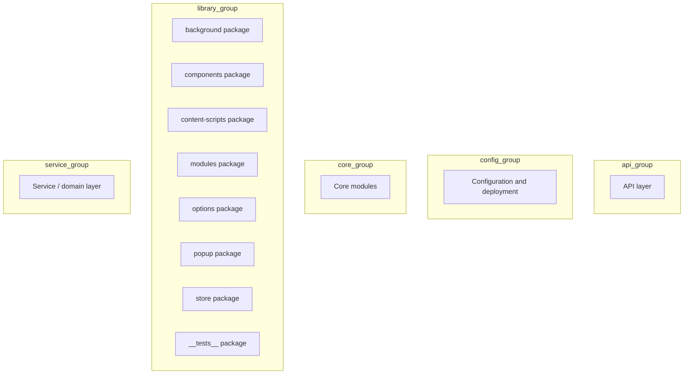

# Architecture report: checkly/headless-recorder

> Automated static analysis. **Observed** = directly seen in files/imports/AST; **Inferred** = interpretation from that evidence. Repository code was not executed.

## 1. Repository at a glance

| Item | Value |
| --- | --- |
| Repository | checkly/headless-recorder |
| Description | Chrome extension that records your browser interactions and generates a Playwright or Puppeteer script.  |
| Language | JavaScript |
| Stars | 15309 |
| Licence | MIT |
| Analysed commit / branch | 4fb93c125f40bceb2dd9aac403e200a3ade5a8d9 / main |
| Framework(s) | Vue |
| Files analysed | 104 |
| Components | 12 |

## 2. Architecture in one minute

checkly/headless-recorder - Chrome extension that records your browser interactions and generates a Playwright or Puppeteer script. . This repository was analysed statically from 104 file(s) (0 Python). Detected technologies (observed from imports/manifests): GitHub Actions, Vue, Tailwind CSS, Jest, TypeScript. Files are grouped into 12 component(s): API layer, background package, components package, Configuration and deployment, content-scripts package, Core modules, modules package, options package. Findings below distinguish observed facts from inferred interpretation.

## 3. High-level block diagram

## 4. Main components

### API layer (`api_layer`)

- **Kind:** api
- **Status:** Observed
- **Confidence:** 0.85
- **Responsibility:** Groups 3 file(s) under api layer (observed from repository paths and static analysis).
- **Paths:** `src/views/Home.vue`, `src/views/Recording.vue`, `src/views/Results.vue`
- **Evidence:** [src/views/Home.vue](https://github.com/checkly/headless-recorder/blob/4fb93c125f40bceb2dd9aac403e200a3ade5a8d9/src/views/Home.vue); [src/views/Recording.vue](https://github.com/checkly/headless-recorder/blob/4fb93c125f40bceb2dd9aac403e200a3ade5a8d9/src/views/Recording.vue); [src/views/Results.vue](https://github.com/checkly/headless-recorder/blob/4fb93c125f40bceb2dd9aac403e200a3ade5a8d9/src/views/Results.vue)

### background package (`background`)

- **Kind:** library
- **Status:** Observed
- **Confidence:** 0.85
- **Responsibility:** Groups 1 file(s) under background package (observed from repository paths and static analysis).
- **Paths:** `src/background/index.js`
- **Evidence:** [src/background/index.js](https://github.com/checkly/headless-recorder/blob/4fb93c125f40bceb2dd9aac403e200a3ade5a8d9/src/background/index.js)

### components package (`components`)

- **Kind:** library
- **Status:** Observed
- **Confidence:** 0.85
- **Responsibility:** Groups 8 file(s) under components package (observed from repository paths and static analysis).
- **Paths:** `src/components/Button.vue`, `src/components/Footer.vue`, `src/components/Header.vue`, `src/components/RecordingLabel.vue`, `src/components/RoundButton.vue`, `src/components/Toggle.vue`, `src/components/__tests__/RecordingTab.spec.js`, `src/components/__tests__/ResultsTab.spec.js`
- **Evidence:** [src/components/Button.vue](https://github.com/checkly/headless-recorder/blob/4fb93c125f40bceb2dd9aac403e200a3ade5a8d9/src/components/Button.vue); [src/components/Footer.vue](https://github.com/checkly/headless-recorder/blob/4fb93c125f40bceb2dd9aac403e200a3ade5a8d9/src/components/Footer.vue); [src/components/Header.vue](https://github.com/checkly/headless-recorder/blob/4fb93c125f40bceb2dd9aac403e200a3ade5a8d9/src/components/Header.vue); [src/components/RecordingLabel.vue](https://github.com/checkly/headless-recorder/blob/4fb93c125f40bceb2dd9aac403e200a3ade5a8d9/src/components/RecordingLabel.vue); [src/components/RoundButton.vue](https://github.com/checkly/headless-recorder/blob/4fb93c125f40bceb2dd9aac403e200a3ade5a8d9/src/components/RoundButton.vue); [src/components/Toggle.vue](https://github.com/checkly/headless-recorder/blob/4fb93c125f40bceb2dd9aac403e200a3ade5a8d9/src/components/Toggle.vue); [src/components/__tests__/RecordingTab.spec.js](https://github.com/checkly/headless-recorder/blob/4fb93c125f40bceb2dd9aac403e200a3ade5a8d9/src/components/__tests__/RecordingTab.spec.js); [src/components/__tests__/ResultsTab.spec.js](https://github.com/checkly/headless-recorder/blob/4fb93c125f40bceb2dd9aac403e200a3ade5a8d9/src/components/__tests__/ResultsTab.spec.js)

### Configuration and deployment (`config`)

- **Kind:** config
- **Status:** Observed
- **Confidence:** 0.85
- **Responsibility:** Groups 5 file(s) under configuration and deployment (observed from repository paths and static analysis).
- **Paths:** `dependabot.yml`, `jsconfig.json`, `package.json`, `public/_locales/en/messages.json`, `src/manifest.json`
- **Evidence:** [dependabot.yml](https://github.com/checkly/headless-recorder/blob/4fb93c125f40bceb2dd9aac403e200a3ade5a8d9/dependabot.yml); [jsconfig.json](https://github.com/checkly/headless-recorder/blob/4fb93c125f40bceb2dd9aac403e200a3ade5a8d9/jsconfig.json); [package.json](https://github.com/checkly/headless-recorder/blob/4fb93c125f40bceb2dd9aac403e200a3ade5a8d9/package.json); [public/_locales/en/messages.json](https://github.com/checkly/headless-recorder/blob/4fb93c125f40bceb2dd9aac403e200a3ade5a8d9/public/_locales/en/messages.json); [src/manifest.json](https://github.com/checkly/headless-recorder/blob/4fb93c125f40bceb2dd9aac403e200a3ade5a8d9/src/manifest.json)

### content-scripts package (`content_scripts`)

- **Kind:** library
- **Status:** Observed
- **Confidence:** 0.85
- **Responsibility:** Groups 6 file(s) under content-scripts package (observed from repository paths and static analysis).
- **Paths:** `src/content-scripts/__tests__/attributes.spec.js`, `src/content-scripts/__tests__/forms.spec.js`, `src/content-scripts/__tests__/helpers.js`, `src/content-scripts/__tests__/screenshot-controller.spec.js`, `src/content-scripts/controller.js`, `src/content-scripts/index.js`
- **Evidence:** [src/content-scripts/__tests__/attributes.spec.js](https://github.com/checkly/headless-recorder/blob/4fb93c125f40bceb2dd9aac403e200a3ade5a8d9/src/content-scripts/__tests__/attributes.spec.js); [src/content-scripts/__tests__/forms.spec.js](https://github.com/checkly/headless-recorder/blob/4fb93c125f40bceb2dd9aac403e200a3ade5a8d9/src/content-scripts/__tests__/forms.spec.js); [src/content-scripts/__tests__/helpers.js](https://github.com/checkly/headless-recorder/blob/4fb93c125f40bceb2dd9aac403e200a3ade5a8d9/src/content-scripts/__tests__/helpers.js); [src/content-scripts/__tests__/screenshot-controller.spec.js](https://github.com/checkly/headless-recorder/blob/4fb93c125f40bceb2dd9aac403e200a3ade5a8d9/src/content-scripts/__tests__/screenshot-controller.spec.js); [src/content-scripts/controller.js](https://github.com/checkly/headless-recorder/blob/4fb93c125f40bceb2dd9aac403e200a3ade5a8d9/src/content-scripts/controller.js); [src/content-scripts/index.js](https://github.com/checkly/headless-recorder/blob/4fb93c125f40bceb2dd9aac403e200a3ade5a8d9/src/content-scripts/index.js)

### Core modules (`core`)

- **Kind:** core
- **Status:** Observed
- **Confidence:** 0.85
- **Responsibility:** Groups 6 file(s) under core modules (observed from repository paths and static analysis).
- **Paths:** `babel.config.js`, `jest.config.js`, `jest.setup.js`, `postcss.config.js`, `tailwind.config.js`, `vue.config.js`
- **Evidence:** [babel.config.js](https://github.com/checkly/headless-recorder/blob/4fb93c125f40bceb2dd9aac403e200a3ade5a8d9/babel.config.js); [jest.config.js](https://github.com/checkly/headless-recorder/blob/4fb93c125f40bceb2dd9aac403e200a3ade5a8d9/jest.config.js); [jest.setup.js](https://github.com/checkly/headless-recorder/blob/4fb93c125f40bceb2dd9aac403e200a3ade5a8d9/jest.setup.js); [postcss.config.js](https://github.com/checkly/headless-recorder/blob/4fb93c125f40bceb2dd9aac403e200a3ade5a8d9/postcss.config.js); [tailwind.config.js](https://github.com/checkly/headless-recorder/blob/4fb93c125f40bceb2dd9aac403e200a3ade5a8d9/tailwind.config.js); [vue.config.js](https://github.com/checkly/headless-recorder/blob/4fb93c125f40bceb2dd9aac403e200a3ade5a8d9/vue.config.js)

### modules package (`modules`)

- **Kind:** library
- **Status:** Observed
- **Confidence:** 0.85
- **Responsibility:** Groups 14 file(s) under modules package (observed from repository paths and static analysis).
- **Paths:** `src/modules/code-generator/__tests__/playwright-code-generator.spec.js`, `src/modules/code-generator/__tests__/puppeteer-code-generator.spec.js`, `src/modules/code-generator/base-generator.js`, `src/modules/code-generator/block.js`, `src/modules/code-generator/constants.js`, `src/modules/code-generator/index.js`, `src/modules/code-generator/playwright.js`, `src/modules/code-generator/puppeteer.js`, `src/modules/overlay/Overlay.vue`, `src/modules/overlay/Selector.vue`, `src/modules/overlay/constants.js`, `src/modules/overlay/index.js`, `src/modules/recorder/index.js`, `src/modules/shooter/index.js`
- **Evidence:** [src/modules/code-generator/__tests__/playwright-code-generator.spec.js](https://github.com/checkly/headless-recorder/blob/4fb93c125f40bceb2dd9aac403e200a3ade5a8d9/src/modules/code-generator/__tests__/playwright-code-generator.spec.js); [src/modules/code-generator/__tests__/puppeteer-code-generator.spec.js](https://github.com/checkly/headless-recorder/blob/4fb93c125f40bceb2dd9aac403e200a3ade5a8d9/src/modules/code-generator/__tests__/puppeteer-code-generator.spec.js); [src/modules/code-generator/base-generator.js](https://github.com/checkly/headless-recorder/blob/4fb93c125f40bceb2dd9aac403e200a3ade5a8d9/src/modules/code-generator/base-generator.js); [src/modules/code-generator/block.js](https://github.com/checkly/headless-recorder/blob/4fb93c125f40bceb2dd9aac403e200a3ade5a8d9/src/modules/code-generator/block.js); [src/modules/code-generator/constants.js](https://github.com/checkly/headless-recorder/blob/4fb93c125f40bceb2dd9aac403e200a3ade5a8d9/src/modules/code-generator/constants.js); [src/modules/code-generator/index.js](https://github.com/checkly/headless-recorder/blob/4fb93c125f40bceb2dd9aac403e200a3ade5a8d9/src/modules/code-generator/index.js); [src/modules/code-generator/playwright.js](https://github.com/checkly/headless-recorder/blob/4fb93c125f40bceb2dd9aac403e200a3ade5a8d9/src/modules/code-generator/playwright.js); [src/modules/code-generator/puppeteer.js](https://github.com/checkly/headless-recorder/blob/4fb93c125f40bceb2dd9aac403e200a3ade5a8d9/src/modules/code-generator/puppeteer.js)

### options package (`options`)

- **Kind:** library
- **Status:** Observed
- **Confidence:** 0.85
- **Responsibility:** Groups 3 file(s) under options package (observed from repository paths and static analysis).
- **Paths:** `src/options/OptionsApp.vue`, `src/options/__tests__/App.spec.js`, `src/options/main.js`
- **Evidence:** [src/options/OptionsApp.vue](https://github.com/checkly/headless-recorder/blob/4fb93c125f40bceb2dd9aac403e200a3ade5a8d9/src/options/OptionsApp.vue); [src/options/__tests__/App.spec.js](https://github.com/checkly/headless-recorder/blob/4fb93c125f40bceb2dd9aac403e200a3ade5a8d9/src/options/__tests__/App.spec.js); [src/options/main.js](https://github.com/checkly/headless-recorder/blob/4fb93c125f40bceb2dd9aac403e200a3ade5a8d9/src/options/main.js)

### popup package (`popup`)

- **Kind:** library
- **Status:** Observed
- **Confidence:** 0.85
- **Responsibility:** Groups 3 file(s) under popup package (observed from repository paths and static analysis).
- **Paths:** `src/popup/PopupApp.vue`, `src/popup/__tests__/App.spec.js`, `src/popup/main.js`
- **Evidence:** [src/popup/PopupApp.vue](https://github.com/checkly/headless-recorder/blob/4fb93c125f40bceb2dd9aac403e200a3ade5a8d9/src/popup/PopupApp.vue); [src/popup/__tests__/App.spec.js](https://github.com/checkly/headless-recorder/blob/4fb93c125f40bceb2dd9aac403e200a3ade5a8d9/src/popup/__tests__/App.spec.js); [src/popup/main.js](https://github.com/checkly/headless-recorder/blob/4fb93c125f40bceb2dd9aac403e200a3ade5a8d9/src/popup/main.js)

### Service / domain layer (`service_layer`)

- **Kind:** service
- **Status:** Observed
- **Confidence:** 0.85
- **Responsibility:** Groups 11 file(s) under service / domain layer (observed from repository paths and static analysis).
- **Paths:** `src/services/__tests__/analytics.spec.js`, `src/services/__tests__/badge.spec.js`, `src/services/__tests__/browser.spec.js`, `src/services/__tests__/constants.spec.js`, `src/services/__tests__/storage.spec.js`, `src/services/analytics.js`, `src/services/badge.js`, `src/services/browser.js`, `src/services/constants.js`, `src/services/selector.js`, `src/services/storage.js`
- **Evidence:** [src/services/__tests__/analytics.spec.js](https://github.com/checkly/headless-recorder/blob/4fb93c125f40bceb2dd9aac403e200a3ade5a8d9/src/services/__tests__/analytics.spec.js); [src/services/__tests__/badge.spec.js](https://github.com/checkly/headless-recorder/blob/4fb93c125f40bceb2dd9aac403e200a3ade5a8d9/src/services/__tests__/badge.spec.js); [src/services/__tests__/browser.spec.js](https://github.com/checkly/headless-recorder/blob/4fb93c125f40bceb2dd9aac403e200a3ade5a8d9/src/services/__tests__/browser.spec.js); [src/services/__tests__/constants.spec.js](https://github.com/checkly/headless-recorder/blob/4fb93c125f40bceb2dd9aac403e200a3ade5a8d9/src/services/__tests__/constants.spec.js); [src/services/__tests__/storage.spec.js](https://github.com/checkly/headless-recorder/blob/4fb93c125f40bceb2dd9aac403e200a3ade5a8d9/src/services/__tests__/storage.spec.js); [src/services/analytics.js](https://github.com/checkly/headless-recorder/blob/4fb93c125f40bceb2dd9aac403e200a3ade5a8d9/src/services/analytics.js); [src/services/badge.js](https://github.com/checkly/headless-recorder/blob/4fb93c125f40bceb2dd9aac403e200a3ade5a8d9/src/services/badge.js); [src/services/browser.js](https://github.com/checkly/headless-recorder/blob/4fb93c125f40bceb2dd9aac403e200a3ade5a8d9/src/services/browser.js)

### store package (`store`)

- **Kind:** library
- **Status:** Observed
- **Confidence:** 0.85
- **Responsibility:** Groups 1 file(s) under store package (observed from repository paths and static analysis).
- **Paths:** `src/store/index.js`
- **Evidence:** [src/store/index.js](https://github.com/checkly/headless-recorder/blob/4fb93c125f40bceb2dd9aac403e200a3ade5a8d9/src/store/index.js)

### __tests__ package (`tests`)

- **Kind:** library
- **Status:** Observed
- **Confidence:** 0.85
- **Responsibility:** Groups 2 file(s) under __tests__ package (observed from repository paths and static analysis).
- **Paths:** `src/__tests__/build.spec.js`, `src/__tests__/helpers.js`
- **Evidence:** [src/__tests__/build.spec.js](https://github.com/checkly/headless-recorder/blob/4fb93c125f40bceb2dd9aac403e200a3ade5a8d9/src/__tests__/build.spec.js); [src/__tests__/helpers.js](https://github.com/checkly/headless-recorder/blob/4fb93c125f40bceb2dd9aac403e200a3ade5a8d9/src/__tests__/helpers.js)

## 5. Execution flow

**Observed** entry point(s):

- [src/background/index.js](https://github.com/checkly/headless-recorder/blob/4fb93c125f40bceb2dd9aac403e200a3ade5a8d9/src/background/index.js)
- [src/content-scripts/index.js](https://github.com/checkly/headless-recorder/blob/4fb93c125f40bceb2dd9aac403e200a3ade5a8d9/src/content-scripts/index.js)
- [src/modules/code-generator/index.js](https://github.com/checkly/headless-recorder/blob/4fb93c125f40bceb2dd9aac403e200a3ade5a8d9/src/modules/code-generator/index.js)
- [src/modules/overlay/index.js](https://github.com/checkly/headless-recorder/blob/4fb93c125f40bceb2dd9aac403e200a3ade5a8d9/src/modules/overlay/index.js)
- [src/modules/recorder/index.js](https://github.com/checkly/headless-recorder/blob/4fb93c125f40bceb2dd9aac403e200a3ade5a8d9/src/modules/recorder/index.js)
- [src/modules/shooter/index.js](https://github.com/checkly/headless-recorder/blob/4fb93c125f40bceb2dd9aac403e200a3ade5a8d9/src/modules/shooter/index.js)
- [src/options/main.js](https://github.com/checkly/headless-recorder/blob/4fb93c125f40bceb2dd9aac403e200a3ade5a8d9/src/options/main.js)
- [src/popup/main.js](https://github.com/checkly/headless-recorder/blob/4fb93c125f40bceb2dd9aac403e200a3ade5a8d9/src/popup/main.js)
- [src/store/index.js](https://github.com/checkly/headless-recorder/blob/4fb93c125f40bceb2dd9aac403e200a3ade5a8d9/src/store/index.js)

Representative flow (derived from observed entry points and the import graph; steps beyond the entry point are **Inferred**):

1. Execution starts at an observed entry point listed above, if present.
2. No internal import relationships between components were observed.

## 6. Project structure

### `(root)`

- `.browserslistrc` - other (30 bytes)
- `.eslintrc.js` - source, JavaScript (661 bytes)
- `.gitignore` - other (292 bytes)
- `.prettierrc.js` - source, JavaScript (115 bytes)
- `CHANGELOG.md` - docs (1452 bytes)
- `CONTRIBUTING.md` - docs (3232 bytes)
- `LICENSE` - docs (1068 bytes)
- `PRIVACY_POLICY.md` - docs (4838 bytes)
- `README.md` - docs (5027 bytes)
- `babel.config.js` - source, JavaScript (66 bytes)
- `dependabot.yml` - config (256 bytes)
- `jest.config.js` - source, JavaScript (231 bytes)
- `jest.setup.js` - source, JavaScript (35 bytes)
- `jsconfig.json` - config (39 bytes)
- `package.json` - manifest (1732 bytes)
- `postcss.config.js` - source, JavaScript (82 bytes)
- `tailwind.config.js` - source, JavaScript (25392 bytes)
- `vue.config.js` - source, JavaScript (634 bytes)

### `.github`

- `.github/auto_assign.yml` - config (127 bytes)
- `.github/dependabot.yml` - config (262 bytes)
- `.github/pull_request_template.md` - docs (1155 bytes)
- `.github/workflows/codeql-analysis.yml` - ci, YAML (1634 bytes)
- `.github/workflows/lint-build-test.yml` - ci, YAML (660 bytes)

### `public`

- `public/_locales/en/messages.json` - config (84 bytes)
- `public/browser-extension.html` - other (464 bytes)
- `public/icons/dark/clip.svg` - other (1946 bytes)
- `public/icons/dark/duplicate.svg` - other (908 bytes)
- `public/icons/dark/pause.svg` - other (621 bytes)
- `public/icons/dark/play.svg` - other (321 bytes)
- `public/icons/dark/screen.svg` - other (1560 bytes)
- `public/icons/dark/sync.svg` - other (745 bytes)
- `public/icons/light/clip.svg` - other (1463 bytes)
- `public/icons/light/duplicate.svg` - other (912 bytes)
- `public/icons/light/pause.svg` - other (669 bytes)
- `public/icons/light/play.svg` - other (332 bytes)
- `public/icons/light/screen.svg` - other (1086 bytes)
- `public/icons/light/sync.svg` - other (833 bytes)
- `public/icons/light/zap.svg` - other (1832 bytes)
- `public/images/checkly-logo.svg` - other (45844 bytes)

### `src`

- `src/__tests__/build.spec.js` - source, JavaScript (303 bytes)
- `src/__tests__/helpers.js` - source, JavaScript (780 bytes)
- `src/assets/animations.css` - other (1000 bytes)
- `src/assets/code.css` - other (1320 bytes)
- `src/assets/icons/gear.svg` - other (4516 bytes)
- `src/assets/icons/moon.svg` - other (930 bytes)
- `src/assets/icons/question.svg` - other (1567 bytes)
- `src/assets/tailwind.css` - other (61 bytes)
- `src/background/index.js` - source, JavaScript (8232 bytes)
- `src/components/Button.vue` - source, Vue (462 bytes)
- `src/components/Footer.vue` - source, Vue (502 bytes)
- `src/components/Header.vue` - source, Vue (678 bytes)
- `src/components/RecordingLabel.vue` - source, Vue (481 bytes)
- `src/components/RoundButton.vue` - source, Vue (621 bytes)
- `src/components/Toggle.vue` - source, Vue (1160 bytes)
- `src/components/__tests__/RecordingTab.spec.js` - source, JavaScript (1623 bytes)
- `src/components/__tests__/ResultsTab.spec.js` - source, JavaScript (1217 bytes)
- `src/components/__tests__/__snapshots__/RecordingTab.spec.js.snap` - other (6065 bytes)
- `src/components/__tests__/__snapshots__/ResultsTab.spec.js.snap` - other (1740 bytes)
- `src/content-scripts/__tests__/attributes.spec.js` - source, JavaScript (1997 bytes)
- `src/content-scripts/__tests__/fixtures/attributes.html` - other (463 bytes)
- `src/content-scripts/__tests__/fixtures/forms.html` - other (1667 bytes)
- `src/content-scripts/__tests__/forms.spec.js` - source, JavaScript (2773 bytes)
- `src/content-scripts/__tests__/helpers.js` - source, JavaScript (1301 bytes)
- `src/content-scripts/__tests__/screenshot-controller.spec.js` - source, JavaScript (1141 bytes)
- `src/content-scripts/controller.js` - source, JavaScript (2797 bytes)
- `src/content-scripts/index.js` - source, JavaScript (342 bytes)
- `src/manifest.json` - config (1277 bytes)
- `src/modules/code-generator/__tests__/playwright-code-generator.spec.js` - source, JavaScript (755 bytes)
- `src/modules/code-generator/__tests__/puppeteer-code-generator.spec.js` - source, JavaScript (5617 bytes)
- `src/modules/code-generator/base-generator.js` - source, JavaScript (6650 bytes)
- `src/modules/code-generator/block.js` - source, JavaScript (419 bytes)
- `src/modules/code-generator/constants.js` - source, JavaScript (522 bytes)
- `src/modules/code-generator/index.js` - source, JavaScript (528 bytes)
- `src/modules/code-generator/playwright.js` - source, JavaScript (1281 bytes)
- `src/modules/code-generator/puppeteer.js` - source, JavaScript (1155 bytes)
- `src/modules/overlay/Overlay.vue` - source, Vue (8924 bytes)
- `src/modules/overlay/Selector.vue` - source, Vue (2366 bytes)
- `src/modules/overlay/constants.js` - source, JavaScript (764 bytes)
- `src/modules/overlay/index.js` - source, JavaScript (2665 bytes)
- `src/modules/recorder/index.js` - source, JavaScript (3235 bytes)
- `src/modules/shooter/index.js` - source, JavaScript (4640 bytes)
- `src/options/OptionsApp.vue` - source, Vue (6981 bytes)
- `src/options/__tests__/App.spec.js` - source, JavaScript (2448 bytes)
- `src/options/__tests__/__snapshots__/App.spec.js.snap` - other (627 bytes)
- `src/options/main.js` - source, JavaScript (129 bytes)
- `src/popup/PopupApp.vue` - source, Vue (6837 bytes)
- `src/popup/__tests__/App.spec.js` - source, JavaScript (409 bytes)
- `src/popup/__tests__/__snapshots__/App.spec.js.snap` - other (1920 bytes)
- `src/popup/main.js` - source, JavaScript (227 bytes)
- `src/services/__tests__/analytics.spec.js` - source, JavaScript (679 bytes)
- `src/services/__tests__/badge.spec.js` - source, JavaScript (1528 bytes)
- `src/services/__tests__/browser.spec.js` - source, JavaScript (2808 bytes)
- `src/services/__tests__/constants.spec.js` - source, JavaScript (638 bytes)
- `src/services/__tests__/storage.spec.js` - source, JavaScript (2758 bytes)
- `src/services/analytics.js` - source, JavaScript (291 bytes)
- `src/services/badge.js` - source, JavaScript (776 bytes)
- `src/services/browser.js` - source, JavaScript (1946 bytes)
- `src/services/constants.js` - source, JavaScript (459 bytes)
- `src/services/selector.js` - source, JavaScript (453 bytes)
- `src/services/storage.js` - source, JavaScript (711 bytes)
- `src/store/index.js` - source, JavaScript (2747 bytes)
- `src/views/Home.vue` - source, Vue (641 bytes)
- `src/views/Recording.vue` - source, Vue (2166 bytes)
- `src/views/Results.vue` - source, Vue (2248 bytes)

## 7. Key dependencies and integrations

| Name | Category | Status | Confidence | Evidence |
| --- | --- | --- | --- | --- |
| GitHub Actions | ci | Observed | 0.90 | [.github/workflows/codeql-analysis.yml](https://github.com/checkly/headless-recorder/blob/4fb93c125f40bceb2dd9aac403e200a3ade5a8d9/.github/workflows/codeql-analysis.yml); [.github/workflows/lint-build-test.yml](https://github.com/checkly/headless-recorder/blob/4fb93c125f40bceb2dd9aac403e200a3ade5a8d9/.github/workflows/lint-build-test.yml) |
| Vue | framework | Observed | 0.85 | [package.json:5](https://github.com/checkly/headless-recorder/blob/4fb93c125f40bceb2dd9aac403e200a3ade5a8d9/package.json#L5) |
| Tailwind CSS | library | Observed | 0.85 | [package.json:14](https://github.com/checkly/headless-recorder/blob/4fb93c125f40bceb2dd9aac403e200a3ade5a8d9/package.json#L14) |
| Jest | tooling | Observed | 0.85 | [package.json:29](https://github.com/checkly/headless-recorder/blob/4fb93c125f40bceb2dd9aac403e200a3ade5a8d9/package.json#L29) |
| TypeScript | tooling | Observed | 0.85 | [package.json:51](https://github.com/checkly/headless-recorder/blob/4fb93c125f40bceb2dd9aac403e200a3ade5a8d9/package.json#L51) |

## 8. Data and state

No database, cache, queue, or persistent-state usage was observed in the analysed files. State handling, if any, may be in-memory or in files that were not analysed.

## 9. Configuration and deployment clues

- `.github/auto_assign.yml` (config)
- `.github/dependabot.yml` (config)
- `.github/workflows/codeql-analysis.yml` (ci)
- `.github/workflows/lint-build-test.yml` (ci)
- `dependabot.yml` (config)
- `jsconfig.json` (config)
- `package.json` (manifest)
- `public/_locales/en/messages.json` (config)
- `src/manifest.json` (config)

## 10. Design observations

- An entry/API layer is separated from other code (Inferred from paths and decorators).
- Service/domain code is distinct from entry and data code, suggesting layered separation (Inferred).

These observations are interpretations (**Inferred**) of the observed structure, not guarantees about runtime design.

## 11. Limitations and unknowns

- Static analysis only: repository code was not executed, installed, or imported at runtime.
- Components and relationships are inferred from file paths, imports, and AST structure; runtime behaviour, dynamic imports, and reflection may not be visible.
- 1 file(s) were skipped during inventory (1 x likely secret file excluded).
- No clear application entry point was observed in the analysed files.
- Repository text was treated as untrusted data; no instructions found in repository files were followed, and likely secret values were redacted/excluded.
- JavaScript and TypeScript files were inventoried from paths and package manifests. They were not parsed with a full language AST, and repository code was not executed.
- The GitHub repository was marked archived at selection time.

## 12. Source references

- [.github/workflows/codeql-analysis.yml](https://github.com/checkly/headless-recorder/blob/4fb93c125f40bceb2dd9aac403e200a3ade5a8d9/.github/workflows/codeql-analysis.yml)
- [.github/workflows/lint-build-test.yml](https://github.com/checkly/headless-recorder/blob/4fb93c125f40bceb2dd9aac403e200a3ade5a8d9/.github/workflows/lint-build-test.yml)
- [babel.config.js](https://github.com/checkly/headless-recorder/blob/4fb93c125f40bceb2dd9aac403e200a3ade5a8d9/babel.config.js)
- [dependabot.yml](https://github.com/checkly/headless-recorder/blob/4fb93c125f40bceb2dd9aac403e200a3ade5a8d9/dependabot.yml)
- [jest.config.js](https://github.com/checkly/headless-recorder/blob/4fb93c125f40bceb2dd9aac403e200a3ade5a8d9/jest.config.js)
- [jest.setup.js](https://github.com/checkly/headless-recorder/blob/4fb93c125f40bceb2dd9aac403e200a3ade5a8d9/jest.setup.js)
- [jsconfig.json](https://github.com/checkly/headless-recorder/blob/4fb93c125f40bceb2dd9aac403e200a3ade5a8d9/jsconfig.json)
- [package.json](https://github.com/checkly/headless-recorder/blob/4fb93c125f40bceb2dd9aac403e200a3ade5a8d9/package.json)
- [package.json:5](https://github.com/checkly/headless-recorder/blob/4fb93c125f40bceb2dd9aac403e200a3ade5a8d9/package.json#L5)
- [package.json:14](https://github.com/checkly/headless-recorder/blob/4fb93c125f40bceb2dd9aac403e200a3ade5a8d9/package.json#L14)
- [package.json:29](https://github.com/checkly/headless-recorder/blob/4fb93c125f40bceb2dd9aac403e200a3ade5a8d9/package.json#L29)
- [package.json:51](https://github.com/checkly/headless-recorder/blob/4fb93c125f40bceb2dd9aac403e200a3ade5a8d9/package.json#L51)
- [postcss.config.js](https://github.com/checkly/headless-recorder/blob/4fb93c125f40bceb2dd9aac403e200a3ade5a8d9/postcss.config.js)
- [public/_locales/en/messages.json](https://github.com/checkly/headless-recorder/blob/4fb93c125f40bceb2dd9aac403e200a3ade5a8d9/public/_locales/en/messages.json)
- [src/__tests__/build.spec.js](https://github.com/checkly/headless-recorder/blob/4fb93c125f40bceb2dd9aac403e200a3ade5a8d9/src/__tests__/build.spec.js)
- [src/__tests__/helpers.js](https://github.com/checkly/headless-recorder/blob/4fb93c125f40bceb2dd9aac403e200a3ade5a8d9/src/__tests__/helpers.js)
- [src/background/index.js](https://github.com/checkly/headless-recorder/blob/4fb93c125f40bceb2dd9aac403e200a3ade5a8d9/src/background/index.js)
- [src/components/Button.vue](https://github.com/checkly/headless-recorder/blob/4fb93c125f40bceb2dd9aac403e200a3ade5a8d9/src/components/Button.vue)
- [src/components/Footer.vue](https://github.com/checkly/headless-recorder/blob/4fb93c125f40bceb2dd9aac403e200a3ade5a8d9/src/components/Footer.vue)
- [src/components/Header.vue](https://github.com/checkly/headless-recorder/blob/4fb93c125f40bceb2dd9aac403e200a3ade5a8d9/src/components/Header.vue)
- [src/components/RecordingLabel.vue](https://github.com/checkly/headless-recorder/blob/4fb93c125f40bceb2dd9aac403e200a3ade5a8d9/src/components/RecordingLabel.vue)
- [src/components/RoundButton.vue](https://github.com/checkly/headless-recorder/blob/4fb93c125f40bceb2dd9aac403e200a3ade5a8d9/src/components/RoundButton.vue)
- [src/components/Toggle.vue](https://github.com/checkly/headless-recorder/blob/4fb93c125f40bceb2dd9aac403e200a3ade5a8d9/src/components/Toggle.vue)
- [src/components/__tests__/RecordingTab.spec.js](https://github.com/checkly/headless-recorder/blob/4fb93c125f40bceb2dd9aac403e200a3ade5a8d9/src/components/__tests__/RecordingTab.spec.js)
- [src/components/__tests__/ResultsTab.spec.js](https://github.com/checkly/headless-recorder/blob/4fb93c125f40bceb2dd9aac403e200a3ade5a8d9/src/components/__tests__/ResultsTab.spec.js)
- [src/content-scripts/__tests__/attributes.spec.js](https://github.com/checkly/headless-recorder/blob/4fb93c125f40bceb2dd9aac403e200a3ade5a8d9/src/content-scripts/__tests__/attributes.spec.js)
- [src/content-scripts/__tests__/forms.spec.js](https://github.com/checkly/headless-recorder/blob/4fb93c125f40bceb2dd9aac403e200a3ade5a8d9/src/content-scripts/__tests__/forms.spec.js)
- [src/content-scripts/__tests__/helpers.js](https://github.com/checkly/headless-recorder/blob/4fb93c125f40bceb2dd9aac403e200a3ade5a8d9/src/content-scripts/__tests__/helpers.js)
- [src/content-scripts/__tests__/screenshot-controller.spec.js](https://github.com/checkly/headless-recorder/blob/4fb93c125f40bceb2dd9aac403e200a3ade5a8d9/src/content-scripts/__tests__/screenshot-controller.spec.js)
- [src/content-scripts/controller.js](https://github.com/checkly/headless-recorder/blob/4fb93c125f40bceb2dd9aac403e200a3ade5a8d9/src/content-scripts/controller.js)
- [src/content-scripts/index.js](https://github.com/checkly/headless-recorder/blob/4fb93c125f40bceb2dd9aac403e200a3ade5a8d9/src/content-scripts/index.js)
- [src/manifest.json](https://github.com/checkly/headless-recorder/blob/4fb93c125f40bceb2dd9aac403e200a3ade5a8d9/src/manifest.json)
- [src/modules/code-generator/__tests__/playwright-code-generator.spec.js](https://github.com/checkly/headless-recorder/blob/4fb93c125f40bceb2dd9aac403e200a3ade5a8d9/src/modules/code-generator/__tests__/playwright-code-generator.spec.js)
- [src/modules/code-generator/__tests__/puppeteer-code-generator.spec.js](https://github.com/checkly/headless-recorder/blob/4fb93c125f40bceb2dd9aac403e200a3ade5a8d9/src/modules/code-generator/__tests__/puppeteer-code-generator.spec.js)
- [src/modules/code-generator/base-generator.js](https://github.com/checkly/headless-recorder/blob/4fb93c125f40bceb2dd9aac403e200a3ade5a8d9/src/modules/code-generator/base-generator.js)
- [src/modules/code-generator/block.js](https://github.com/checkly/headless-recorder/blob/4fb93c125f40bceb2dd9aac403e200a3ade5a8d9/src/modules/code-generator/block.js)
- [src/modules/code-generator/constants.js](https://github.com/checkly/headless-recorder/blob/4fb93c125f40bceb2dd9aac403e200a3ade5a8d9/src/modules/code-generator/constants.js)
- [src/modules/code-generator/index.js](https://github.com/checkly/headless-recorder/blob/4fb93c125f40bceb2dd9aac403e200a3ade5a8d9/src/modules/code-generator/index.js)
- [src/modules/code-generator/playwright.js](https://github.com/checkly/headless-recorder/blob/4fb93c125f40bceb2dd9aac403e200a3ade5a8d9/src/modules/code-generator/playwright.js)
- [src/modules/code-generator/puppeteer.js](https://github.com/checkly/headless-recorder/blob/4fb93c125f40bceb2dd9aac403e200a3ade5a8d9/src/modules/code-generator/puppeteer.js)
- [src/modules/overlay/index.js](https://github.com/checkly/headless-recorder/blob/4fb93c125f40bceb2dd9aac403e200a3ade5a8d9/src/modules/overlay/index.js)
- [src/modules/recorder/index.js](https://github.com/checkly/headless-recorder/blob/4fb93c125f40bceb2dd9aac403e200a3ade5a8d9/src/modules/recorder/index.js)
- [src/modules/shooter/index.js](https://github.com/checkly/headless-recorder/blob/4fb93c125f40bceb2dd9aac403e200a3ade5a8d9/src/modules/shooter/index.js)
- [src/options/OptionsApp.vue](https://github.com/checkly/headless-recorder/blob/4fb93c125f40bceb2dd9aac403e200a3ade5a8d9/src/options/OptionsApp.vue)
- [src/options/__tests__/App.spec.js](https://github.com/checkly/headless-recorder/blob/4fb93c125f40bceb2dd9aac403e200a3ade5a8d9/src/options/__tests__/App.spec.js)
- [src/options/main.js](https://github.com/checkly/headless-recorder/blob/4fb93c125f40bceb2dd9aac403e200a3ade5a8d9/src/options/main.js)
- [src/popup/PopupApp.vue](https://github.com/checkly/headless-recorder/blob/4fb93c125f40bceb2dd9aac403e200a3ade5a8d9/src/popup/PopupApp.vue)
- [src/popup/__tests__/App.spec.js](https://github.com/checkly/headless-recorder/blob/4fb93c125f40bceb2dd9aac403e200a3ade5a8d9/src/popup/__tests__/App.spec.js)
- [src/popup/main.js](https://github.com/checkly/headless-recorder/blob/4fb93c125f40bceb2dd9aac403e200a3ade5a8d9/src/popup/main.js)
- [src/services/__tests__/analytics.spec.js](https://github.com/checkly/headless-recorder/blob/4fb93c125f40bceb2dd9aac403e200a3ade5a8d9/src/services/__tests__/analytics.spec.js)
- [src/services/__tests__/badge.spec.js](https://github.com/checkly/headless-recorder/blob/4fb93c125f40bceb2dd9aac403e200a3ade5a8d9/src/services/__tests__/badge.spec.js)
- [src/services/__tests__/browser.spec.js](https://github.com/checkly/headless-recorder/blob/4fb93c125f40bceb2dd9aac403e200a3ade5a8d9/src/services/__tests__/browser.spec.js)
- [src/services/__tests__/constants.spec.js](https://github.com/checkly/headless-recorder/blob/4fb93c125f40bceb2dd9aac403e200a3ade5a8d9/src/services/__tests__/constants.spec.js)
- [src/services/__tests__/storage.spec.js](https://github.com/checkly/headless-recorder/blob/4fb93c125f40bceb2dd9aac403e200a3ade5a8d9/src/services/__tests__/storage.spec.js)
- [src/services/analytics.js](https://github.com/checkly/headless-recorder/blob/4fb93c125f40bceb2dd9aac403e200a3ade5a8d9/src/services/analytics.js)
- [src/services/badge.js](https://github.com/checkly/headless-recorder/blob/4fb93c125f40bceb2dd9aac403e200a3ade5a8d9/src/services/badge.js)
- [src/services/browser.js](https://github.com/checkly/headless-recorder/blob/4fb93c125f40bceb2dd9aac403e200a3ade5a8d9/src/services/browser.js)
- [src/store/index.js](https://github.com/checkly/headless-recorder/blob/4fb93c125f40bceb2dd9aac403e200a3ade5a8d9/src/store/index.js)
- [src/views/Home.vue](https://github.com/checkly/headless-recorder/blob/4fb93c125f40bceb2dd9aac403e200a3ade5a8d9/src/views/Home.vue)
- [src/views/Recording.vue](https://github.com/checkly/headless-recorder/blob/4fb93c125f40bceb2dd9aac403e200a3ade5a8d9/src/views/Recording.vue)
- [src/views/Results.vue](https://github.com/checkly/headless-recorder/blob/4fb93c125f40bceb2dd9aac403e200a3ade5a8d9/src/views/Results.vue)
- [tailwind.config.js](https://github.com/checkly/headless-recorder/blob/4fb93c125f40bceb2dd9aac403e200a3ade5a8d9/tailwind.config.js)
- [vue.config.js](https://github.com/checkly/headless-recorder/blob/4fb93c125f40bceb2dd9aac403e200a3ade5a8d9/vue.config.js)
