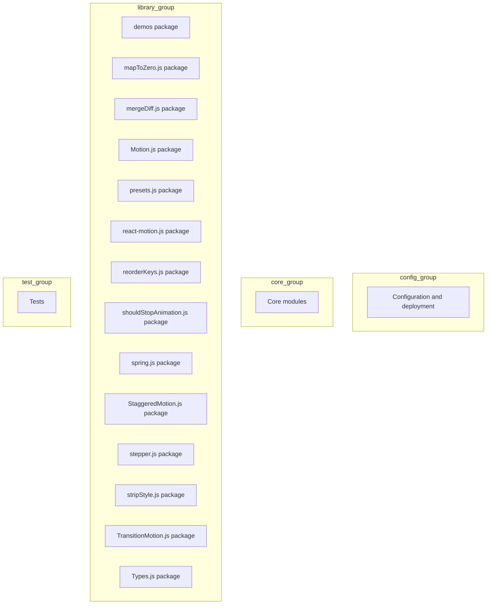

# Architecture report: chenglou/react-motion

> Automated static analysis. **Observed** = directly seen in files/imports/AST; **Inferred** = interpretation from that evidence. Repository code was not executed.

## 1. Repository at a glance

| Item | Value |
| --- | --- |
| Repository | chenglou/react-motion |
| Description | A spring that solves your animation problems. |
| Language | JavaScript |
| Stars | 21910 |
| Licence | MIT |
| Analysed commit / branch | 9e3ce95bacaa9a1b259f969870a21c727232cc68 / master |
| Framework(s) | React |
| Files analysed | 68 |
| Components | 17 |

## 2. Architecture in one minute

chenglou/react-motion - A spring that solves your animation problems.. This repository was analysed statically from 68 file(s) (0 Python). Detected technologies (observed from imports/manifests): React, webpack. Files are grouped into 17 component(s): Configuration and deployment, Core modules, demos package, mapToZero.js package, mergeDiff.js package, Motion.js package, presets.js package, react-motion.js package. Findings below distinguish observed facts from inferred interpretation.

## 3. High-level block diagram

## 4. Main components

### Configuration and deployment (`config`)

- **Kind:** config
- **Status:** Observed
- **Confidence:** 0.85
- **Responsibility:** Groups 2 file(s) under configuration and deployment (observed from repository paths and static analysis).
- **Paths:** `bower.json`, `package.json`
- **Evidence:** [bower.json](https://github.com/chenglou/react-motion/blob/9e3ce95bacaa9a1b259f969870a21c727232cc68/bower.json); [package.json](https://github.com/chenglou/react-motion/blob/9e3ce95bacaa9a1b259f969870a21c727232cc68/package.json)

### Core modules (`core`)

- **Kind:** core
- **Status:** Observed
- **Confidence:** 0.85
- **Responsibility:** Groups 4 file(s) under core modules (observed from repository paths and static analysis).
- **Paths:** `karma.conf.js`, `rollup.config.js`, `server.js`, `webpack.config.js`
- **Evidence:** [karma.conf.js](https://github.com/chenglou/react-motion/blob/9e3ce95bacaa9a1b259f969870a21c727232cc68/karma.conf.js); [rollup.config.js](https://github.com/chenglou/react-motion/blob/9e3ce95bacaa9a1b259f969870a21c727232cc68/rollup.config.js); [server.js](https://github.com/chenglou/react-motion/blob/9e3ce95bacaa9a1b259f969870a21c727232cc68/server.js); [webpack.config.js](https://github.com/chenglou/react-motion/blob/9e3ce95bacaa9a1b259f969870a21c727232cc68/webpack.config.js)

### demos package (`demos`)

- **Kind:** library
- **Status:** Observed
- **Confidence:** 0.85
- **Responsibility:** Groups 16 file(s) under demos package (observed from repository paths and static analysis).
- **Paths:** `demos/demo0-simple-transition/Demo.jsx`, `demos/demo0-simple-transition/index.jsx`, `demos/demo1-chat-heads/Demo.jsx`, `demos/demo1-chat-heads/index.jsx`, `demos/demo2-draggable-balls/Demo.jsx`, `demos/demo2-draggable-balls/index.jsx`, `demos/demo3-todomvc-list-transition/Demo.jsx`, `demos/demo3-todomvc-list-transition/index.jsx`, `demos/demo4-photo-gallery/Demo.jsx`, `demos/demo4-photo-gallery/index.jsx`, `demos/demo5-spring-parameters-chooser/Demo.jsx`, `demos/demo5-spring-parameters-chooser/index.jsx`, `demos/demo7-water-ripples/Demo.jsx`, `demos/demo7-water-ripples/index.jsx`, `demos/demo8-draggable-list/Demo.jsx`, `demos/demo8-draggable-list/index.jsx`
- **Evidence:** [demos/demo0-simple-transition/Demo.jsx](https://github.com/chenglou/react-motion/blob/9e3ce95bacaa9a1b259f969870a21c727232cc68/demos/demo0-simple-transition/Demo.jsx); [demos/demo0-simple-transition/index.jsx](https://github.com/chenglou/react-motion/blob/9e3ce95bacaa9a1b259f969870a21c727232cc68/demos/demo0-simple-transition/index.jsx); [demos/demo1-chat-heads/Demo.jsx](https://github.com/chenglou/react-motion/blob/9e3ce95bacaa9a1b259f969870a21c727232cc68/demos/demo1-chat-heads/Demo.jsx); [demos/demo1-chat-heads/index.jsx](https://github.com/chenglou/react-motion/blob/9e3ce95bacaa9a1b259f969870a21c727232cc68/demos/demo1-chat-heads/index.jsx); [demos/demo2-draggable-balls/Demo.jsx](https://github.com/chenglou/react-motion/blob/9e3ce95bacaa9a1b259f969870a21c727232cc68/demos/demo2-draggable-balls/Demo.jsx); [demos/demo2-draggable-balls/index.jsx](https://github.com/chenglou/react-motion/blob/9e3ce95bacaa9a1b259f969870a21c727232cc68/demos/demo2-draggable-balls/index.jsx); [demos/demo3-todomvc-list-transition/Demo.jsx](https://github.com/chenglou/react-motion/blob/9e3ce95bacaa9a1b259f969870a21c727232cc68/demos/demo3-todomvc-list-transition/Demo.jsx); [demos/demo3-todomvc-list-transition/index.jsx](https://github.com/chenglou/react-motion/blob/9e3ce95bacaa9a1b259f969870a21c727232cc68/demos/demo3-todomvc-list-transition/index.jsx)

### mapToZero.js package (`maptozero_js`)

- **Kind:** library
- **Status:** Observed
- **Confidence:** 0.85
- **Responsibility:** Groups 1 file(s) under maptozero.js package (observed from repository paths and static analysis).
- **Paths:** `src/mapToZero.js`
- **Evidence:** [src/mapToZero.js](https://github.com/chenglou/react-motion/blob/9e3ce95bacaa9a1b259f969870a21c727232cc68/src/mapToZero.js)

### mergeDiff.js package (`mergediff_js`)

- **Kind:** library
- **Status:** Observed
- **Confidence:** 0.85
- **Responsibility:** Groups 1 file(s) under mergediff.js package (observed from repository paths and static analysis).
- **Paths:** `src/mergeDiff.js`
- **Evidence:** [src/mergeDiff.js](https://github.com/chenglou/react-motion/blob/9e3ce95bacaa9a1b259f969870a21c727232cc68/src/mergeDiff.js)

### Motion.js package (`motion_js`)

- **Kind:** library
- **Status:** Observed
- **Confidence:** 0.85
- **Responsibility:** Groups 1 file(s) under motion.js package (observed from repository paths and static analysis).
- **Paths:** `src/Motion.js`
- **Evidence:** [src/Motion.js](https://github.com/chenglou/react-motion/blob/9e3ce95bacaa9a1b259f969870a21c727232cc68/src/Motion.js)

### presets.js package (`presets_js`)

- **Kind:** library
- **Status:** Observed
- **Confidence:** 0.85
- **Responsibility:** Groups 1 file(s) under presets.js package (observed from repository paths and static analysis).
- **Paths:** `src/presets.js`
- **Evidence:** [src/presets.js](https://github.com/chenglou/react-motion/blob/9e3ce95bacaa9a1b259f969870a21c727232cc68/src/presets.js)

### react-motion.js package (`react_motion_js`)

- **Kind:** library
- **Status:** Observed
- **Confidence:** 0.85
- **Responsibility:** Groups 1 file(s) under react-motion.js package (observed from repository paths and static analysis).
- **Paths:** `src/react-motion.js`
- **Evidence:** [src/react-motion.js](https://github.com/chenglou/react-motion/blob/9e3ce95bacaa9a1b259f969870a21c727232cc68/src/react-motion.js)

### reorderKeys.js package (`reorderkeys_js`)

- **Kind:** library
- **Status:** Observed
- **Confidence:** 0.85
- **Responsibility:** Groups 1 file(s) under reorderkeys.js package (observed from repository paths and static analysis).
- **Paths:** `src/reorderKeys.js`
- **Evidence:** [src/reorderKeys.js](https://github.com/chenglou/react-motion/blob/9e3ce95bacaa9a1b259f969870a21c727232cc68/src/reorderKeys.js)

### shouldStopAnimation.js package (`shouldstopanimation_js`)

- **Kind:** library
- **Status:** Observed
- **Confidence:** 0.85
- **Responsibility:** Groups 1 file(s) under shouldstopanimation.js package (observed from repository paths and static analysis).
- **Paths:** `src/shouldStopAnimation.js`
- **Evidence:** [src/shouldStopAnimation.js](https://github.com/chenglou/react-motion/blob/9e3ce95bacaa9a1b259f969870a21c727232cc68/src/shouldStopAnimation.js)

### spring.js package (`spring_js`)

- **Kind:** library
- **Status:** Observed
- **Confidence:** 0.85
- **Responsibility:** Groups 1 file(s) under spring.js package (observed from repository paths and static analysis).
- **Paths:** `src/spring.js`
- **Evidence:** [src/spring.js](https://github.com/chenglou/react-motion/blob/9e3ce95bacaa9a1b259f969870a21c727232cc68/src/spring.js)

### StaggeredMotion.js package (`staggeredmotion_js`)

- **Kind:** library
- **Status:** Observed
- **Confidence:** 0.85
- **Responsibility:** Groups 1 file(s) under staggeredmotion.js package (observed from repository paths and static analysis).
- **Paths:** `src/StaggeredMotion.js`
- **Evidence:** [src/StaggeredMotion.js](https://github.com/chenglou/react-motion/blob/9e3ce95bacaa9a1b259f969870a21c727232cc68/src/StaggeredMotion.js)

### stepper.js package (`stepper_js`)

- **Kind:** library
- **Status:** Observed
- **Confidence:** 0.85
- **Responsibility:** Groups 1 file(s) under stepper.js package (observed from repository paths and static analysis).
- **Paths:** `src/stepper.js`
- **Evidence:** [src/stepper.js](https://github.com/chenglou/react-motion/blob/9e3ce95bacaa9a1b259f969870a21c727232cc68/src/stepper.js)

### stripStyle.js package (`stripstyle_js`)

- **Kind:** library
- **Status:** Observed
- **Confidence:** 0.85
- **Responsibility:** Groups 1 file(s) under stripstyle.js package (observed from repository paths and static analysis).
- **Paths:** `src/stripStyle.js`
- **Evidence:** [src/stripStyle.js](https://github.com/chenglou/react-motion/blob/9e3ce95bacaa9a1b259f969870a21c727232cc68/src/stripStyle.js)

### Tests (`tests`)

- **Kind:** test
- **Status:** Observed
- **Confidence:** 0.85
- **Responsibility:** Groups 11 file(s) under tests (observed from repository paths and static analysis).
- **Paths:** `test/Motion-test.js`, `test/StaggeredMotion-test.js`, `test/TransitionMotion-test.js`, `test/createMockRaf.js`, `test/index.js`, `test/integration/README.md`, `test/integration/bower.html`, `test/integration/bower.json`, `test/integration/package.json`, `test/mergeDiff-test.js`, `test/stripStyle-test.js`
- **Evidence:** [test/Motion-test.js](https://github.com/chenglou/react-motion/blob/9e3ce95bacaa9a1b259f969870a21c727232cc68/test/Motion-test.js); [test/StaggeredMotion-test.js](https://github.com/chenglou/react-motion/blob/9e3ce95bacaa9a1b259f969870a21c727232cc68/test/StaggeredMotion-test.js); [test/TransitionMotion-test.js](https://github.com/chenglou/react-motion/blob/9e3ce95bacaa9a1b259f969870a21c727232cc68/test/TransitionMotion-test.js); [test/createMockRaf.js](https://github.com/chenglou/react-motion/blob/9e3ce95bacaa9a1b259f969870a21c727232cc68/test/createMockRaf.js); [test/index.js](https://github.com/chenglou/react-motion/blob/9e3ce95bacaa9a1b259f969870a21c727232cc68/test/index.js); [test/integration/README.md](https://github.com/chenglou/react-motion/blob/9e3ce95bacaa9a1b259f969870a21c727232cc68/test/integration/README.md); [test/integration/bower.html](https://github.com/chenglou/react-motion/blob/9e3ce95bacaa9a1b259f969870a21c727232cc68/test/integration/bower.html); [test/integration/bower.json](https://github.com/chenglou/react-motion/blob/9e3ce95bacaa9a1b259f969870a21c727232cc68/test/integration/bower.json)

### TransitionMotion.js package (`transitionmotion_js`)

- **Kind:** library
- **Status:** Observed
- **Confidence:** 0.85
- **Responsibility:** Groups 1 file(s) under transitionmotion.js package (observed from repository paths and static analysis).
- **Paths:** `src/TransitionMotion.js`
- **Evidence:** [src/TransitionMotion.js](https://github.com/chenglou/react-motion/blob/9e3ce95bacaa9a1b259f969870a21c727232cc68/src/TransitionMotion.js)

### Types.js package (`types_js`)

- **Kind:** library
- **Status:** Observed
- **Confidence:** 0.85
- **Responsibility:** Groups 1 file(s) under types.js package (observed from repository paths and static analysis).
- **Paths:** `src/Types.js`
- **Evidence:** [src/Types.js](https://github.com/chenglou/react-motion/blob/9e3ce95bacaa9a1b259f969870a21c727232cc68/src/Types.js)

## 5. Execution flow

**Observed** entry point(s):

- [demos/demo0-simple-transition/index.jsx](https://github.com/chenglou/react-motion/blob/9e3ce95bacaa9a1b259f969870a21c727232cc68/demos/demo0-simple-transition/index.jsx)
- [demos/demo1-chat-heads/index.jsx](https://github.com/chenglou/react-motion/blob/9e3ce95bacaa9a1b259f969870a21c727232cc68/demos/demo1-chat-heads/index.jsx)
- [demos/demo2-draggable-balls/index.jsx](https://github.com/chenglou/react-motion/blob/9e3ce95bacaa9a1b259f969870a21c727232cc68/demos/demo2-draggable-balls/index.jsx)
- [demos/demo3-todomvc-list-transition/index.jsx](https://github.com/chenglou/react-motion/blob/9e3ce95bacaa9a1b259f969870a21c727232cc68/demos/demo3-todomvc-list-transition/index.jsx)
- [demos/demo4-photo-gallery/index.jsx](https://github.com/chenglou/react-motion/blob/9e3ce95bacaa9a1b259f969870a21c727232cc68/demos/demo4-photo-gallery/index.jsx)
- [demos/demo5-spring-parameters-chooser/index.jsx](https://github.com/chenglou/react-motion/blob/9e3ce95bacaa9a1b259f969870a21c727232cc68/demos/demo5-spring-parameters-chooser/index.jsx)
- [demos/demo7-water-ripples/index.jsx](https://github.com/chenglou/react-motion/blob/9e3ce95bacaa9a1b259f969870a21c727232cc68/demos/demo7-water-ripples/index.jsx)
- [demos/demo8-draggable-list/index.jsx](https://github.com/chenglou/react-motion/blob/9e3ce95bacaa9a1b259f969870a21c727232cc68/demos/demo8-draggable-list/index.jsx)
- [server.js](https://github.com/chenglou/react-motion/blob/9e3ce95bacaa9a1b259f969870a21c727232cc68/server.js)

Representative flow (derived from observed entry points and the import graph; steps beyond the entry point are **Inferred**):

1. Execution starts at an observed entry point listed above, if present.
2. No internal import relationships between components were observed.

## 6. Project structure

### `(root)`

- `.babelrc` - other (380 bytes)
- `.eslintignore` - other (133 bytes)
- `.eslintrc` - other (2419 bytes)
- `.flowconfig` - other (708 bytes)
- `.gitignore` - other (112 bytes)
- `.npmignore` - other (159 bytes)
- `.size-snapshot.json` - config (463 bytes)
- `.travis.yml` - ci, YAML (114 bytes)
- `AUTHORS` - other (599 bytes)
- `HISTORY.md` - docs (7800 bytes)
- `LICENSE` - docs (1088 bytes)
- `README.md` - docs (15421 bytes)
- `bower.json` - config (746 bytes)
- `karma.conf.js` - source, JavaScript (1837 bytes)
- `package.json` - manifest (3888 bytes)
- `rollup.config.js` - source, JavaScript (1943 bytes)
- `server.js` - source, JavaScript (508 bytes)
- `webpack.config.js` - source, JavaScript (1309 bytes)

### `demos`

- `demos/README.md` - docs (253 bytes)
- `demos/demo0-simple-transition/Demo.jsx` - source, JavaScript (1052 bytes)
- `demos/demo0-simple-transition/index.html` - other (604 bytes)
- `demos/demo0-simple-transition/index.jsx` - source, JavaScript (152 bytes)
- `demos/demo1-chat-heads/Demo.jsx` - source, JavaScript (1597 bytes)
- `demos/demo1-chat-heads/index.html` - other (919 bytes)
- `demos/demo1-chat-heads/index.jsx` - source, JavaScript (152 bytes)
- `demos/demo2-draggable-balls/Demo.jsx` - source, JavaScript (4384 bytes)
- `demos/demo2-draggable-balls/index.html` - other (914 bytes)
- `demos/demo2-draggable-balls/index.jsx` - source, JavaScript (152 bytes)
- `demos/demo3-todomvc-list-transition/Demo.jsx` - source, JavaScript (6183 bytes)
- `demos/demo3-todomvc-list-transition/index.css` - other (8668 bytes)
- `demos/demo3-todomvc-list-transition/index.html` - other (233 bytes)
- `demos/demo3-todomvc-list-transition/index.jsx` - source, JavaScript (152 bytes)
- `demos/demo4-photo-gallery/Demo.jsx` - source, JavaScript (2375 bytes)
- `demos/demo4-photo-gallery/index.html` - other (593 bytes)
- `demos/demo4-photo-gallery/index.jsx` - source, JavaScript (152 bytes)
- `demos/demo5-spring-parameters-chooser/Demo.jsx` - source, JavaScript (5318 bytes)
- `demos/demo5-spring-parameters-chooser/index.html` - other (2524 bytes)
- `demos/demo5-spring-parameters-chooser/index.jsx` - source, JavaScript (152 bytes)
- `demos/demo7-water-ripples/Demo.jsx` - source, JavaScript (1821 bytes)
- `demos/demo7-water-ripples/index.html` - other (647 bytes)
- `demos/demo7-water-ripples/index.jsx` - source, JavaScript (152 bytes)
- `demos/demo8-draggable-list/Demo.jsx` - source, JavaScript (3389 bytes)
- `demos/demo8-draggable-list/index.html` - other (1599 bytes)
- `demos/demo8-draggable-list/index.jsx` - source, JavaScript (152 bytes)

### `src`

- `src/Motion.js` - source, JavaScript (8414 bytes)
- `src/StaggeredMotion.js` - source, JavaScript (9651 bytes)
- `src/TransitionMotion.js` - source, JavaScript (20131 bytes)
- `src/Types.js` - source, JavaScript (2592 bytes)
- `src/mapToZero.js` - source, JavaScript (344 bytes)
- `src/mergeDiff.js` - source, JavaScript (4273 bytes)
- `src/presets.js` - source, JavaScript (241 bytes)
- `src/react-motion.js` - source, JavaScript (431 bytes)
- `src/reorderKeys.js` - source, JavaScript (329 bytes)
- `src/shouldStopAnimation.js` - source, JavaScript (832 bytes)
- `src/spring.js` - source, JavaScript (326 bytes)
- `src/stepper.js` - source, JavaScript (1288 bytes)
- `src/stripStyle.js` - source, JavaScript (491 bytes)

### `test`

- `test/Motion-test.js` - test, JavaScript (13052 bytes)
- `test/StaggeredMotion-test.js` - test, JavaScript (9407 bytes)
- `test/TransitionMotion-test.js` - test, JavaScript (26424 bytes)
- `test/createMockRaf.js` - test, JavaScript (758 bytes)
- `test/index.js` - test, JavaScript (108 bytes)
- `test/integration/README.md` - test (292 bytes)
- `test/integration/bower.html` - test (502 bytes)
- `test/integration/bower.json` - test (375 bytes)
- `test/integration/package.json` - test (340 bytes)
- `test/mergeDiff-test.js` - test, JavaScript (3084 bytes)
- `test/stripStyle-test.js` - test, JavaScript (362 bytes)

## 7. Key dependencies and integrations

| Name | Category | Status | Confidence | Evidence |
| --- | --- | --- | --- | --- |
| React | framework | Observed | 0.90 | [package.json:2](https://github.com/chenglou/react-motion/blob/9e3ce95bacaa9a1b259f969870a21c727232cc68/package.json#L2); [package.json:51](https://github.com/chenglou/react-motion/blob/9e3ce95bacaa9a1b259f969870a21c727232cc68/package.json#L51) |
| webpack | tooling | Observed | 0.85 | [package.json:45](https://github.com/chenglou/react-motion/blob/9e3ce95bacaa9a1b259f969870a21c727232cc68/package.json#L45) |

## 8. Data and state

No database, cache, queue, or persistent-state usage was observed in the analysed files. State handling, if any, may be in-memory or in files that were not analysed.

## 9. Configuration and deployment clues

- `.size-snapshot.json` (config)
- `.travis.yml` (ci)
- `bower.json` (config)
- `package.json` (manifest)

## 10. Design observations

- Tests are present alongside source code (Observed from test file paths).

These observations are interpretations (**Inferred**) of the observed structure, not guarantees about runtime design.

## 11. Limitations and unknowns

- Static analysis only: repository code was not executed, installed, or imported at runtime.
- Components and relationships are inferred from file paths, imports, and AST structure; runtime behaviour, dynamic imports, and reflection may not be visible.
- No clear application entry point was observed in the analysed files.
- Repository text was treated as untrusted data; no instructions found in repository files were followed, and likely secret values were redacted/excluded.
- JavaScript and TypeScript files were inventoried from paths and package manifests. They were not parsed with a full language AST, and repository code was not executed.

## 12. Source references

- [bower.json](https://github.com/chenglou/react-motion/blob/9e3ce95bacaa9a1b259f969870a21c727232cc68/bower.json)
- [demos/demo0-simple-transition/Demo.jsx](https://github.com/chenglou/react-motion/blob/9e3ce95bacaa9a1b259f969870a21c727232cc68/demos/demo0-simple-transition/Demo.jsx)
- [demos/demo0-simple-transition/index.jsx](https://github.com/chenglou/react-motion/blob/9e3ce95bacaa9a1b259f969870a21c727232cc68/demos/demo0-simple-transition/index.jsx)
- [demos/demo1-chat-heads/Demo.jsx](https://github.com/chenglou/react-motion/blob/9e3ce95bacaa9a1b259f969870a21c727232cc68/demos/demo1-chat-heads/Demo.jsx)
- [demos/demo1-chat-heads/index.jsx](https://github.com/chenglou/react-motion/blob/9e3ce95bacaa9a1b259f969870a21c727232cc68/demos/demo1-chat-heads/index.jsx)
- [demos/demo2-draggable-balls/Demo.jsx](https://github.com/chenglou/react-motion/blob/9e3ce95bacaa9a1b259f969870a21c727232cc68/demos/demo2-draggable-balls/Demo.jsx)
- [demos/demo2-draggable-balls/index.jsx](https://github.com/chenglou/react-motion/blob/9e3ce95bacaa9a1b259f969870a21c727232cc68/demos/demo2-draggable-balls/index.jsx)
- [demos/demo3-todomvc-list-transition/Demo.jsx](https://github.com/chenglou/react-motion/blob/9e3ce95bacaa9a1b259f969870a21c727232cc68/demos/demo3-todomvc-list-transition/Demo.jsx)
- [demos/demo3-todomvc-list-transition/index.jsx](https://github.com/chenglou/react-motion/blob/9e3ce95bacaa9a1b259f969870a21c727232cc68/demos/demo3-todomvc-list-transition/index.jsx)
- [demos/demo4-photo-gallery/index.jsx](https://github.com/chenglou/react-motion/blob/9e3ce95bacaa9a1b259f969870a21c727232cc68/demos/demo4-photo-gallery/index.jsx)
- [demos/demo5-spring-parameters-chooser/index.jsx](https://github.com/chenglou/react-motion/blob/9e3ce95bacaa9a1b259f969870a21c727232cc68/demos/demo5-spring-parameters-chooser/index.jsx)
- [demos/demo7-water-ripples/index.jsx](https://github.com/chenglou/react-motion/blob/9e3ce95bacaa9a1b259f969870a21c727232cc68/demos/demo7-water-ripples/index.jsx)
- [demos/demo8-draggable-list/index.jsx](https://github.com/chenglou/react-motion/blob/9e3ce95bacaa9a1b259f969870a21c727232cc68/demos/demo8-draggable-list/index.jsx)
- [karma.conf.js](https://github.com/chenglou/react-motion/blob/9e3ce95bacaa9a1b259f969870a21c727232cc68/karma.conf.js)
- [package.json](https://github.com/chenglou/react-motion/blob/9e3ce95bacaa9a1b259f969870a21c727232cc68/package.json)
- [package.json:2](https://github.com/chenglou/react-motion/blob/9e3ce95bacaa9a1b259f969870a21c727232cc68/package.json#L2)
- [package.json:45](https://github.com/chenglou/react-motion/blob/9e3ce95bacaa9a1b259f969870a21c727232cc68/package.json#L45)
- [package.json:51](https://github.com/chenglou/react-motion/blob/9e3ce95bacaa9a1b259f969870a21c727232cc68/package.json#L51)
- [rollup.config.js](https://github.com/chenglou/react-motion/blob/9e3ce95bacaa9a1b259f969870a21c727232cc68/rollup.config.js)
- [server.js](https://github.com/chenglou/react-motion/blob/9e3ce95bacaa9a1b259f969870a21c727232cc68/server.js)
- [src/Motion.js](https://github.com/chenglou/react-motion/blob/9e3ce95bacaa9a1b259f969870a21c727232cc68/src/Motion.js)
- [src/StaggeredMotion.js](https://github.com/chenglou/react-motion/blob/9e3ce95bacaa9a1b259f969870a21c727232cc68/src/StaggeredMotion.js)
- [src/TransitionMotion.js](https://github.com/chenglou/react-motion/blob/9e3ce95bacaa9a1b259f969870a21c727232cc68/src/TransitionMotion.js)
- [src/Types.js](https://github.com/chenglou/react-motion/blob/9e3ce95bacaa9a1b259f969870a21c727232cc68/src/Types.js)
- [src/mapToZero.js](https://github.com/chenglou/react-motion/blob/9e3ce95bacaa9a1b259f969870a21c727232cc68/src/mapToZero.js)
- [src/mergeDiff.js](https://github.com/chenglou/react-motion/blob/9e3ce95bacaa9a1b259f969870a21c727232cc68/src/mergeDiff.js)
- [src/presets.js](https://github.com/chenglou/react-motion/blob/9e3ce95bacaa9a1b259f969870a21c727232cc68/src/presets.js)
- [src/react-motion.js](https://github.com/chenglou/react-motion/blob/9e3ce95bacaa9a1b259f969870a21c727232cc68/src/react-motion.js)
- [src/reorderKeys.js](https://github.com/chenglou/react-motion/blob/9e3ce95bacaa9a1b259f969870a21c727232cc68/src/reorderKeys.js)
- [src/shouldStopAnimation.js](https://github.com/chenglou/react-motion/blob/9e3ce95bacaa9a1b259f969870a21c727232cc68/src/shouldStopAnimation.js)
- [src/spring.js](https://github.com/chenglou/react-motion/blob/9e3ce95bacaa9a1b259f969870a21c727232cc68/src/spring.js)
- [src/stepper.js](https://github.com/chenglou/react-motion/blob/9e3ce95bacaa9a1b259f969870a21c727232cc68/src/stepper.js)
- [src/stripStyle.js](https://github.com/chenglou/react-motion/blob/9e3ce95bacaa9a1b259f969870a21c727232cc68/src/stripStyle.js)
- [test/Motion-test.js](https://github.com/chenglou/react-motion/blob/9e3ce95bacaa9a1b259f969870a21c727232cc68/test/Motion-test.js)
- [test/StaggeredMotion-test.js](https://github.com/chenglou/react-motion/blob/9e3ce95bacaa9a1b259f969870a21c727232cc68/test/StaggeredMotion-test.js)
- [test/TransitionMotion-test.js](https://github.com/chenglou/react-motion/blob/9e3ce95bacaa9a1b259f969870a21c727232cc68/test/TransitionMotion-test.js)
- [test/createMockRaf.js](https://github.com/chenglou/react-motion/blob/9e3ce95bacaa9a1b259f969870a21c727232cc68/test/createMockRaf.js)
- [test/index.js](https://github.com/chenglou/react-motion/blob/9e3ce95bacaa9a1b259f969870a21c727232cc68/test/index.js)
- [test/integration/README.md](https://github.com/chenglou/react-motion/blob/9e3ce95bacaa9a1b259f969870a21c727232cc68/test/integration/README.md)
- [test/integration/bower.html](https://github.com/chenglou/react-motion/blob/9e3ce95bacaa9a1b259f969870a21c727232cc68/test/integration/bower.html)
- [test/integration/bower.json](https://github.com/chenglou/react-motion/blob/9e3ce95bacaa9a1b259f969870a21c727232cc68/test/integration/bower.json)
- [webpack.config.js](https://github.com/chenglou/react-motion/blob/9e3ce95bacaa9a1b259f969870a21c727232cc68/webpack.config.js)
