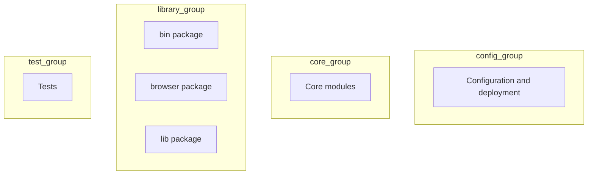

# Architecture report: chjj/blessed

> Automated static analysis. **Observed** = directly seen in files/imports/AST; **Inferred** = interpretation from that evidence. Repository code was not executed.

## 1. Repository at a glance

| Item | Value |
| --- | --- |
| Repository | chjj/blessed |
| Description | A high-level terminal interface library for node.js. |
| Language | JavaScript |
| Stars | 11883 |
| Licence | Other |
| Analysed commit / branch | eab243fc7ad27f1d2932db6134f7382825ee3488 / master |
| Framework(s) | None detected |
| Files analysed | 121 |
| Components | 6 |

## 2. Architecture in one minute

chjj/blessed - A high-level terminal interface library for node.js.. This repository was analysed statically from 121 file(s) (0 Python). Detected technologies (observed from imports/manifests): no known frameworks/libraries. Files are grouped into 6 component(s): bin package, browser package, Configuration and deployment, Core modules, lib package, Tests. Findings below distinguish observed facts from inferred interpretation.

## 3. High-level block diagram

## 4. Main components

### bin package (`bin`)

- **Kind:** library
- **Status:** Observed
- **Confidence:** 0.85
- **Responsibility:** Groups 1 file(s) under bin package (observed from repository paths and static analysis).
- **Paths:** `bin/tput.js`
- **Evidence:** [bin/tput.js](https://github.com/chjj/blessed/blob/eab243fc7ad27f1d2932db6134f7382825ee3488/bin/tput.js)

### browser package (`browser`)

- **Kind:** library
- **Status:** Observed
- **Confidence:** 0.85
- **Responsibility:** Groups 1 file(s) under browser package (observed from repository paths and static analysis).
- **Paths:** `browser/transform.js`
- **Evidence:** [browser/transform.js](https://github.com/chjj/blessed/blob/eab243fc7ad27f1d2932db6134f7382825ee3488/browser/transform.js)

### Configuration and deployment (`config`)

- **Kind:** config
- **Status:** Observed
- **Confidence:** 0.85
- **Responsibility:** Groups 1 file(s) under configuration and deployment (observed from repository paths and static analysis).
- **Paths:** `package.json`
- **Evidence:** [package.json](https://github.com/chjj/blessed/blob/eab243fc7ad27f1d2932db6134f7382825ee3488/package.json)

### Core modules (`core`)

- **Kind:** core
- **Status:** Observed
- **Confidence:** 0.85
- **Responsibility:** Groups 1 file(s) under core modules (observed from repository paths and static analysis).
- **Paths:** `index.js`
- **Evidence:** [index.js](https://github.com/chjj/blessed/blob/eab243fc7ad27f1d2932db6134f7382825ee3488/index.js)

### lib package (`lib`)

- **Kind:** library
- **Status:** Observed
- **Confidence:** 0.85
- **Responsibility:** Groups 45 file(s) under lib package (observed from repository paths and static analysis).
- **Paths:** `lib/alias.js`, `lib/blessed.js`, `lib/colors.js`, `lib/events.js`, `lib/gpmclient.js`, `lib/helpers.js`, `lib/keys.js`, `lib/program.js`, `lib/tput.js`, `lib/unicode.js`, `lib/widget.js`, `lib/widgets/ansiimage.js`, `lib/widgets/bigtext.js`, `lib/widgets/box.js`, `lib/widgets/button.js`, `lib/widgets/checkbox.js`, `lib/widgets/element.js`, `lib/widgets/filemanager.js`, `lib/widgets/form.js`, `lib/widgets/image.js`, `lib/widgets/input.js`, `lib/widgets/layout.js`, `lib/widgets/line.js`, `lib/widgets/list.js`, `lib/widgets/listbar.js`, `lib/widgets/listtable.js`, `lib/widgets/loading.js`, `lib/widgets/log.js`, `lib/widgets/message.js`, `lib/widgets/node.js`, `lib/widgets/overlayimage.js`, `lib/widgets/progressbar.js`, `lib/widgets/prompt.js`, `lib/widgets/question.js`, `lib/widgets/radiobutton.js`, `lib/widgets/radioset.js`, `lib/widgets/screen.js`, `lib/widgets/scrollablebox.js`, `lib/widgets/scrollabletext.js`, `lib/widgets/table.js`, `lib/widgets/terminal.js`, `lib/widgets/text.js`, `lib/widgets/textarea.js`, `lib/widgets/textbox.js`, `lib/widgets/video.js`
- **Evidence:** [lib/alias.js](https://github.com/chjj/blessed/blob/eab243fc7ad27f1d2932db6134f7382825ee3488/lib/alias.js); [lib/blessed.js](https://github.com/chjj/blessed/blob/eab243fc7ad27f1d2932db6134f7382825ee3488/lib/blessed.js); [lib/colors.js](https://github.com/chjj/blessed/blob/eab243fc7ad27f1d2932db6134f7382825ee3488/lib/colors.js); [lib/events.js](https://github.com/chjj/blessed/blob/eab243fc7ad27f1d2932db6134f7382825ee3488/lib/events.js); [lib/gpmclient.js](https://github.com/chjj/blessed/blob/eab243fc7ad27f1d2932db6134f7382825ee3488/lib/gpmclient.js); [lib/helpers.js](https://github.com/chjj/blessed/blob/eab243fc7ad27f1d2932db6134f7382825ee3488/lib/helpers.js); [lib/keys.js](https://github.com/chjj/blessed/blob/eab243fc7ad27f1d2932db6134f7382825ee3488/lib/keys.js); [lib/program.js](https://github.com/chjj/blessed/blob/eab243fc7ad27f1d2932db6134f7382825ee3488/lib/program.js)

### Tests (`tests`)

- **Kind:** test
- **Status:** Observed
- **Confidence:** 0.85
- **Responsibility:** Groups 46 file(s) under tests (observed from repository paths and static analysis).
- **Paths:** `test/git.diff`, `test/helpers.js`, `test/logs/.gitignore`, `test/lorem.txt`, `test/program-mouse.js`, `test/tail.js`, `test/terminfo`, `test/tput`, `test/tput.js`, `test/widget-autopad.js`, `test/widget-bigtext.js`, `test/widget-csr.js`, `test/widget-dock-noborder.js`, `test/widget-dock.js`, `test/widget-exit.js`, `test/widget-file.js`, `test/widget-form.js`, `test/widget-image.js`, `test/widget-insert.js`, `test/widget-layout.js`, `test/widget-listbar.js`, `test/widget-listtable.js`, `test/widget-log.js`, `test/widget-nested-attr.js`, `test/widget-noalt.js`, `test/widget-nowrap.js`, `test/widget-obscure-sides.js`, `test/widget-padding.js`, `test/widget-play.js`, `test/widget-png.js`, `test/widget-pos.js`, `test/widget-prompt.js`, `test/widget-record.js`, `test/widget-scrollable-boxes.js`, `test/widget-shadow.js`, `test/widget-shrink-fail-2.js`, `test/widget-shrink-fail.js`, `test/widget-shrink-padding.js`, `test/widget-table.js`, `test/widget-term-blessed.js`, `test/widget-termswitch.js`, `test/widget-textarea.js`, `test/widget-unicode.js`, `test/widget-valign.js`, `test/widget-video.js`, `test/widget.js`
- **Evidence:** [test/git.diff](https://github.com/chjj/blessed/blob/eab243fc7ad27f1d2932db6134f7382825ee3488/test/git.diff); [test/helpers.js](https://github.com/chjj/blessed/blob/eab243fc7ad27f1d2932db6134f7382825ee3488/test/helpers.js); [test/logs/.gitignore](https://github.com/chjj/blessed/blob/eab243fc7ad27f1d2932db6134f7382825ee3488/test/logs/.gitignore); [test/lorem.txt](https://github.com/chjj/blessed/blob/eab243fc7ad27f1d2932db6134f7382825ee3488/test/lorem.txt); [test/program-mouse.js](https://github.com/chjj/blessed/blob/eab243fc7ad27f1d2932db6134f7382825ee3488/test/program-mouse.js); [test/tail.js](https://github.com/chjj/blessed/blob/eab243fc7ad27f1d2932db6134f7382825ee3488/test/tail.js); [test/terminfo](https://github.com/chjj/blessed/blob/eab243fc7ad27f1d2932db6134f7382825ee3488/test/terminfo); [test/tput](https://github.com/chjj/blessed/blob/eab243fc7ad27f1d2932db6134f7382825ee3488/test/tput)

## 5. Execution flow

**Observed** entry point(s):

- [bin/tput.js](https://github.com/chjj/blessed/blob/eab243fc7ad27f1d2932db6134f7382825ee3488/bin/tput.js)
- [example/ansi-viewer/index.js](https://github.com/chjj/blessed/blob/eab243fc7ad27f1d2932db6134f7382825ee3488/example/ansi-viewer/index.js)
- [index.js](https://github.com/chjj/blessed/blob/eab243fc7ad27f1d2932db6134f7382825ee3488/index.js)
- [lib/blessed.js](https://github.com/chjj/blessed/blob/eab243fc7ad27f1d2932db6134f7382825ee3488/lib/blessed.js)

Representative flow (derived from observed entry points and the import graph; steps beyond the entry point are **Inferred**):

1. Execution starts at an observed entry point listed above, if present.
2. No internal import relationships between components were observed.

## 6. Project structure

### `(root)`

- `.gitignore` - other (14 bytes)
- `.jscsrc` - other (385 bytes)
- `.jshintrc` - other (641 bytes)
- `.npmignore` - other (49 bytes)
- `CHANGELOG.md` - docs (3217 bytes)
- `LICENSE` - docs (1111 bytes)
- `README.md` - docs (73782 bytes)
- `index.js` - source, JavaScript (43 bytes)
- `package.json` - manifest (654 bytes)

### `bin`

- `bin/tput.js` - source, JavaScript (301 bytes)

### `browser`

- `browser/Makefile` - other (107 bytes)
- `browser/transform.js` - source, JavaScript (2579 bytes)

### `example`

- `example/ansi-viewer/LICENSE` - docs (1089 bytes)
- `example/ansi-viewer/README.md` - docs (520 bytes)
- `example/ansi-viewer/ansi-art.list` - other (146106 bytes)
- `example/ansi-viewer/index.js` - source, JavaScript (5977 bytes)
- `example/ansi-viewer/package.json` - manifest (523 bytes)
- `example/ansi-viewer/singlebyte.js` - source, JavaScript (18871 bytes)
- `example/blessed-telnet.js` - source, JavaScript (2118 bytes)
- `example/index.js` - source, JavaScript (2023 bytes)
- `example/multiplex.js` - source, JavaScript (2457 bytes)
- `example/ping` - other (10038 bytes)
- `example/simple-form.js` - source, JavaScript (1218 bytes)
- `example/time.js` - source, JavaScript (14586 bytes)
- `example/widget.js` - source, JavaScript (1159 bytes)

### `lib`

- `lib/alias.js` - source, JavaScript (77344 bytes)
- `lib/blessed.js` - source, JavaScript (786 bytes)
- `lib/colors.js` - source, JavaScript (10175 bytes)
- `lib/events.js` - source, JavaScript (4444 bytes)
- `lib/gpmclient.js` - source, JavaScript (5921 bytes)
- `lib/helpers.js` - source, JavaScript (3497 bytes)
- `lib/keys.js` - source, JavaScript (11292 bytes)
- `lib/program.js` - source, JavaScript (120321 bytes)
- `lib/tput.js` - source, JavaScript (68713 bytes)
- `lib/unicode.js` - source, JavaScript (27754 bytes)
- `lib/widget.js` - source, JavaScript (1035 bytes)
- `lib/widgets/ansiimage.js` - source, JavaScript (3305 bytes)
- `lib/widgets/bigtext.js` - source, JavaScript (3817 bytes)
- `lib/widgets/box.js` - source, JavaScript (530 bytes)
- `lib/widgets/button.js` - source, JavaScript (1034 bytes)
- `lib/widgets/checkbox.js` - source, JavaScript (1845 bytes)
- `lib/widgets/element.js` - source, JavaScript (69231 bytes)
- `lib/widgets/filemanager.js` - source, JavaScript (4303 bytes)
- `lib/widgets/form.js` - source, JavaScript (6059 bytes)
- `lib/widgets/image.js` - source, JavaScript (1467 bytes)
- `lib/widgets/input.js` - source, JavaScript (541 bytes)
- `lib/widgets/layout.js` - source, JavaScript (6178 bytes)
- `lib/widgets/line.js` - source, JavaScript (935 bytes)
- `lib/widgets/list.js` - source, JavaScript (15268 bytes)
- `lib/widgets/listbar.js` - source, JavaScript (8827 bytes)
- `lib/widgets/listtable.js` - source, JavaScript (6424 bytes)
- `lib/widgets/loading.js` - source, JavaScript (1609 bytes)
- `lib/widgets/log.js` - source, JavaScript (1798 bytes)
- `lib/widgets/message.js` - source, JavaScript (2921 bytes)
- `lib/widgets/node.js` - source, JavaScript (6224 bytes)
- `lib/widgets/overlayimage.js` - source, JavaScript (15411 bytes)
- `lib/widgets/progressbar.js` - source, JavaScript (3555 bytes)
- `lib/widgets/prompt.js` - source, JavaScript (2084 bytes)
- `lib/widgets/question.js` - source, JavaScript (2206 bytes)
- `lib/widgets/radiobutton.js` - source, JavaScript (1204 bytes)
- `lib/widgets/radioset.js` - source, JavaScript (639 bytes)
- `lib/widgets/screen.js` - source, JavaScript (56311 bytes)
- `lib/widgets/scrollablebox.js` - source, JavaScript (11114 bytes)
- `lib/widgets/scrollabletext.js` - source, JavaScript (686 bytes)
- `lib/widgets/table.js` - source, JavaScript (9197 bytes)
- `lib/widgets/terminal.js` - source, JavaScript (10168 bytes)
- `lib/widgets/text.js` - source, JavaScript (564 bytes)
- `lib/widgets/textarea.js` - source, JavaScript (7766 bytes)
- `lib/widgets/textbox.js` - source, JavaScript (1607 bytes)
- `lib/widgets/video.js` - source, JavaScript (2749 bytes)

### `test`

- `test/git.diff` - test (6885 bytes)
- `test/helpers.js` - test, JavaScript (243 bytes)
- `test/logs/.gitignore` - test (2 bytes)
- `test/lorem.txt` - test (3312 bytes)
- `test/program-mouse.js` - test, JavaScript (1787 bytes)
- `test/tail.js` - test, JavaScript (1402 bytes)
- `test/terminfo` - test (27952 bytes)
- `test/tput` - test (396 bytes)
- `test/tput.js` - test, JavaScript (4196 bytes)
- `test/widget-autopad.js` - test, JavaScript (485 bytes)
- `test/widget-bigtext.js` - test, JavaScript (501 bytes)
- `test/widget-csr.js` - test, JavaScript (1729 bytes)
- `test/widget-dock-noborder.js` - test, JavaScript (1462 bytes)
- `test/widget-dock.js` - test, JavaScript (2036 bytes)
- `test/widget-exit.js` - test, JavaScript (711 bytes)
- `test/widget-file.js` - test, JavaScript (1151 bytes)
- `test/widget-form.js` - test, JavaScript (3393 bytes)
- `test/widget-image.js` - test, JavaScript (1511 bytes)
- `test/widget-insert.js` - test, JavaScript (623 bytes)
- `test/widget-layout.js` - test, JavaScript (2456 bytes)
- `test/widget-listbar.js` - test, JavaScript (2315 bytes)
- `test/widget-listtable.js` - test, JavaScript (1764 bytes)
- `test/widget-log.js` - test, JavaScript (809 bytes)
- `test/widget-nested-attr.js` - test, JavaScript (500 bytes)
- `test/widget-noalt.js` - test, JavaScript (711 bytes)
- `test/widget-nowrap.js` - test, JavaScript (700 bytes)
- `test/widget-obscure-sides.js` - test, JavaScript (992 bytes)
- `test/widget-padding.js` - test, JavaScript (419 bytes)
- `test/widget-play.js` - test, JavaScript (359 bytes)
- `test/widget-png.js` - test, JavaScript (2459 bytes)
- `test/widget-pos.js` - test, JavaScript (2582 bytes)
- `test/widget-prompt.js` - test, JavaScript (1555 bytes)
- `test/widget-record.js` - test, JavaScript (924 bytes)
- `test/widget-scrollable-boxes.js` - test, JavaScript (1884 bytes)
- `test/widget-shadow.js` - test, JavaScript (4749 bytes)
- `test/widget-shrink-fail-2.js` - test, JavaScript (632 bytes)
- `test/widget-shrink-fail.js` - test, JavaScript (2177 bytes)
- `test/widget-shrink-padding.js` - test, JavaScript (621 bytes)
- `test/widget-table.js` - test, JavaScript (1405 bytes)
- `test/widget-term-blessed.js` - test, JavaScript (1118 bytes)
- `test/widget-termswitch.js` - test, JavaScript (925 bytes)
- `test/widget-textarea.js` - test, JavaScript (568 bytes)
- `test/widget-unicode.js` - test, JavaScript (2742 bytes)
- `test/widget-valign.js` - test, JavaScript (460 bytes)
- `test/widget-video.js` - test, JavaScript (428 bytes)
- `test/widget.js` - test, JavaScript (6694 bytes)

### `usr`

- `usr/fonts/AUTHORS` - other (42 bytes)
- `usr/fonts/LICENSE` - docs (4481 bytes)
- `usr/fonts/README` - other (9191 bytes)
- `usr/xterm.termcap` - other (10343 bytes)
- `usr/xterm.terminfo` - other (43340 bytes)

## 7. Key dependencies and integrations

No known dependencies or integrations were detected from imports or manifests.

## 8. Data and state

No database, cache, queue, or persistent-state usage was observed in the analysed files. State handling, if any, may be in-memory or in files that were not analysed.

## 9. Configuration and deployment clues

- `example/ansi-viewer/package.json` (manifest)
- `package.json` (manifest)

## 10. Design observations

- Tests are present alongside source code (Observed from test file paths).

These observations are interpretations (**Inferred**) of the observed structure, not guarantees about runtime design.

## 11. Limitations and unknowns

- Static analysis only: repository code was not executed, installed, or imported at runtime.
- Components and relationships are inferred from file paths, imports, and AST structure; runtime behaviour, dynamic imports, and reflection may not be visible.
- 1 file(s) were skipped during inventory (1 x vendored/generated directory excluded).
- No clear application entry point was observed in the analysed files.
- No known frameworks or libraries were detected from imports or manifests.
- Repository text was treated as untrusted data; no instructions found in repository files were followed, and likely secret values were redacted/excluded.
- JavaScript and TypeScript files were inventoried from paths and package manifests. They were not parsed with a full language AST, and repository code was not executed.

## 12. Source references

- [bin/tput.js](https://github.com/chjj/blessed/blob/eab243fc7ad27f1d2932db6134f7382825ee3488/bin/tput.js)
- [browser/transform.js](https://github.com/chjj/blessed/blob/eab243fc7ad27f1d2932db6134f7382825ee3488/browser/transform.js)
- [example/ansi-viewer/index.js](https://github.com/chjj/blessed/blob/eab243fc7ad27f1d2932db6134f7382825ee3488/example/ansi-viewer/index.js)
- [index.js](https://github.com/chjj/blessed/blob/eab243fc7ad27f1d2932db6134f7382825ee3488/index.js)
- [lib/alias.js](https://github.com/chjj/blessed/blob/eab243fc7ad27f1d2932db6134f7382825ee3488/lib/alias.js)
- [lib/blessed.js](https://github.com/chjj/blessed/blob/eab243fc7ad27f1d2932db6134f7382825ee3488/lib/blessed.js)
- [lib/colors.js](https://github.com/chjj/blessed/blob/eab243fc7ad27f1d2932db6134f7382825ee3488/lib/colors.js)
- [lib/events.js](https://github.com/chjj/blessed/blob/eab243fc7ad27f1d2932db6134f7382825ee3488/lib/events.js)
- [lib/gpmclient.js](https://github.com/chjj/blessed/blob/eab243fc7ad27f1d2932db6134f7382825ee3488/lib/gpmclient.js)
- [lib/helpers.js](https://github.com/chjj/blessed/blob/eab243fc7ad27f1d2932db6134f7382825ee3488/lib/helpers.js)
- [lib/keys.js](https://github.com/chjj/blessed/blob/eab243fc7ad27f1d2932db6134f7382825ee3488/lib/keys.js)
- [lib/program.js](https://github.com/chjj/blessed/blob/eab243fc7ad27f1d2932db6134f7382825ee3488/lib/program.js)
- [package.json](https://github.com/chjj/blessed/blob/eab243fc7ad27f1d2932db6134f7382825ee3488/package.json)
- [test/git.diff](https://github.com/chjj/blessed/blob/eab243fc7ad27f1d2932db6134f7382825ee3488/test/git.diff)
- [test/helpers.js](https://github.com/chjj/blessed/blob/eab243fc7ad27f1d2932db6134f7382825ee3488/test/helpers.js)
- [test/logs/.gitignore](https://github.com/chjj/blessed/blob/eab243fc7ad27f1d2932db6134f7382825ee3488/test/logs/.gitignore)
- [test/lorem.txt](https://github.com/chjj/blessed/blob/eab243fc7ad27f1d2932db6134f7382825ee3488/test/lorem.txt)
- [test/program-mouse.js](https://github.com/chjj/blessed/blob/eab243fc7ad27f1d2932db6134f7382825ee3488/test/program-mouse.js)
- [test/tail.js](https://github.com/chjj/blessed/blob/eab243fc7ad27f1d2932db6134f7382825ee3488/test/tail.js)
- [test/terminfo](https://github.com/chjj/blessed/blob/eab243fc7ad27f1d2932db6134f7382825ee3488/test/terminfo)
- [test/tput](https://github.com/chjj/blessed/blob/eab243fc7ad27f1d2932db6134f7382825ee3488/test/tput)
