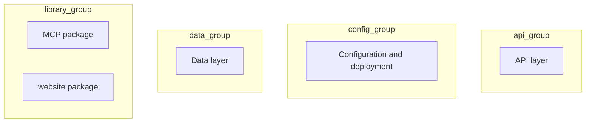

# Architecture report: chokcoco/iCSS

> Automated static analysis. **Observed** = directly seen in files/imports/AST; **Inferred** = interpretation from that evidence. Repository code was not executed.

## 1. Repository at a glance

| Item | Value |
| --- | --- |
| Repository | chokcoco/iCSS |
| Description | 不止于 CSS |
| Language | JavaScript |
| Stars | 20623 |
| Licence | Not detected |
| Analysed commit / branch | e03eb3e59021dff1e51434cc81626e8a53c525cc / master |
| Framework(s) | Next.js, React |
| Files analysed | 53 |
| Components | 5 |

## 2. Architecture in one minute

chokcoco/iCSS - 不止于 CSS. This repository was analysed statically from 53 file(s) (0 Python). Detected technologies (observed from imports/manifests): SQLite, Next.js, React, axios, Tailwind CSS, TypeScript. Files are grouped into 5 component(s): API layer, Configuration and deployment, Data layer, MCP package, website package. Findings below distinguish observed facts from inferred interpretation.

## 3. High-level block diagram

## 4. Main components

### API layer (`api_layer`)

- **Kind:** api
- **Status:** Observed
- **Confidence:** 0.85
- **Responsibility:** Groups 3 file(s) under api layer (observed from repository paths and static analysis).
- **Paths:** `website/app/api/articles/[id]/route.ts`, `website/app/api/articles/route.ts`, `website/app/api/categories/route.ts`
- **Evidence:** [website/app/api/articles/[id]/route.ts](https://github.com/chokcoco/iCSS/blob/e03eb3e59021dff1e51434cc81626e8a53c525cc/website/app/api/articles/%5Bid%5D/route.ts); [website/app/api/articles/route.ts](https://github.com/chokcoco/iCSS/blob/e03eb3e59021dff1e51434cc81626e8a53c525cc/website/app/api/articles/route.ts); [website/app/api/categories/route.ts](https://github.com/chokcoco/iCSS/blob/e03eb3e59021dff1e51434cc81626e8a53c525cc/website/app/api/categories/route.ts)

### Configuration and deployment (`config`)

- **Kind:** config
- **Status:** Observed
- **Confidence:** 0.85
- **Responsibility:** Groups 5 file(s) under configuration and deployment (observed from repository paths and static analysis).
- **Paths:** `MCP/package.json`, `MCP/scripts/cursor-config.json`, `website/package.json`, `website/tsconfig.json`, `website/vercel.json`
- **Evidence:** [MCP/package.json](https://github.com/chokcoco/iCSS/blob/e03eb3e59021dff1e51434cc81626e8a53c525cc/MCP/package.json); [MCP/scripts/cursor-config.json](https://github.com/chokcoco/iCSS/blob/e03eb3e59021dff1e51434cc81626e8a53c525cc/MCP/scripts/cursor-config.json); [website/package.json](https://github.com/chokcoco/iCSS/blob/e03eb3e59021dff1e51434cc81626e8a53c525cc/website/package.json); [website/tsconfig.json](https://github.com/chokcoco/iCSS/blob/e03eb3e59021dff1e51434cc81626e8a53c525cc/website/tsconfig.json); [website/vercel.json](https://github.com/chokcoco/iCSS/blob/e03eb3e59021dff1e51434cc81626e8a53c525cc/website/vercel.json)

### Data layer (`data_layer`)

- **Kind:** data
- **Status:** Inferred
- **Confidence:** 0.70
- **Responsibility:** Groups 0 file(s) under data layer (observed from repository paths and static analysis).
- **Evidence:** [MCP/package.json:72](https://github.com/chokcoco/iCSS/blob/e03eb3e59021dff1e51434cc81626e8a53c525cc/MCP/package.json#L72)

### MCP package (`mcp`)

- **Kind:** library
- **Status:** Observed
- **Confidence:** 0.85
- **Responsibility:** Groups 14 file(s) under mcp package (observed from repository paths and static analysis).
- **Paths:** `MCP/bin/icss-mcp.js`, `MCP/bin/install.js`, `MCP/debug-interactive.js`, `MCP/debug-local.js`, `MCP/debug-query.js`, `MCP/debug.js`, `MCP/diagnose-mcp.js`, `MCP/scripts/fetch-inspiration.js`, `MCP/scripts/fetch-issues.js`, `MCP/scripts/publish-check.js`, `MCP/server.js`, `MCP/setup.js`, `MCP/test-inspiration.js`, `MCP/test-server.js`
- **Evidence:** [MCP/bin/icss-mcp.js](https://github.com/chokcoco/iCSS/blob/e03eb3e59021dff1e51434cc81626e8a53c525cc/MCP/bin/icss-mcp.js); [MCP/bin/install.js](https://github.com/chokcoco/iCSS/blob/e03eb3e59021dff1e51434cc81626e8a53c525cc/MCP/bin/install.js); [MCP/debug-interactive.js](https://github.com/chokcoco/iCSS/blob/e03eb3e59021dff1e51434cc81626e8a53c525cc/MCP/debug-interactive.js); [MCP/debug-local.js](https://github.com/chokcoco/iCSS/blob/e03eb3e59021dff1e51434cc81626e8a53c525cc/MCP/debug-local.js); [MCP/debug-query.js](https://github.com/chokcoco/iCSS/blob/e03eb3e59021dff1e51434cc81626e8a53c525cc/MCP/debug-query.js); [MCP/debug.js](https://github.com/chokcoco/iCSS/blob/e03eb3e59021dff1e51434cc81626e8a53c525cc/MCP/debug.js); [MCP/diagnose-mcp.js](https://github.com/chokcoco/iCSS/blob/e03eb3e59021dff1e51434cc81626e8a53c525cc/MCP/diagnose-mcp.js); [MCP/scripts/fetch-inspiration.js](https://github.com/chokcoco/iCSS/blob/e03eb3e59021dff1e51434cc81626e8a53c525cc/MCP/scripts/fetch-inspiration.js)

### website package (`website`)

- **Kind:** library
- **Status:** Observed
- **Confidence:** 0.85
- **Responsibility:** Groups 20 file(s) under website package (observed from repository paths and static analysis).
- **Paths:** `website/app/article/[id]/page.tsx`, `website/app/components/CodeBlock.tsx`, `website/app/components/LanguageToggle.tsx`, `website/app/components/ThemeToggle.tsx`, `website/app/contexts/AppContext.tsx`, `website/app/layout.tsx`, `website/app/lib/cache.ts`, `website/app/lib/github.ts`, `website/app/lib/language.ts`, `website/app/lib/theme.ts`, `website/app/lib/translations.ts`, `website/app/page.tsx`, `website/app/test-api/page.tsx`, `website/app/test-demo/page.tsx`, `website/app/test-fixes/page.tsx`, `website/app/test-theme-lang/page.tsx`, `website/next-env.d.ts`, `website/next.config.js`, `website/postcss.config.js`, `website/tailwind.config.js`
- **Evidence:** [website/app/article/[id]/page.tsx](https://github.com/chokcoco/iCSS/blob/e03eb3e59021dff1e51434cc81626e8a53c525cc/website/app/article/%5Bid%5D/page.tsx); [website/app/components/CodeBlock.tsx](https://github.com/chokcoco/iCSS/blob/e03eb3e59021dff1e51434cc81626e8a53c525cc/website/app/components/CodeBlock.tsx); [website/app/components/LanguageToggle.tsx](https://github.com/chokcoco/iCSS/blob/e03eb3e59021dff1e51434cc81626e8a53c525cc/website/app/components/LanguageToggle.tsx); [website/app/components/ThemeToggle.tsx](https://github.com/chokcoco/iCSS/blob/e03eb3e59021dff1e51434cc81626e8a53c525cc/website/app/components/ThemeToggle.tsx); [website/app/contexts/AppContext.tsx](https://github.com/chokcoco/iCSS/blob/e03eb3e59021dff1e51434cc81626e8a53c525cc/website/app/contexts/AppContext.tsx); [website/app/layout.tsx](https://github.com/chokcoco/iCSS/blob/e03eb3e59021dff1e51434cc81626e8a53c525cc/website/app/layout.tsx); [website/app/lib/cache.ts](https://github.com/chokcoco/iCSS/blob/e03eb3e59021dff1e51434cc81626e8a53c525cc/website/app/lib/cache.ts); [website/app/lib/github.ts](https://github.com/chokcoco/iCSS/blob/e03eb3e59021dff1e51434cc81626e8a53c525cc/website/app/lib/github.ts)

## 5. Execution flow

**Observed** entry point(s):

- [MCP/bin/icss-mcp.js](https://github.com/chokcoco/iCSS/blob/e03eb3e59021dff1e51434cc81626e8a53c525cc/MCP/bin/icss-mcp.js)
- [MCP/bin/install.js](https://github.com/chokcoco/iCSS/blob/e03eb3e59021dff1e51434cc81626e8a53c525cc/MCP/bin/install.js)
- [MCP/server.js](https://github.com/chokcoco/iCSS/blob/e03eb3e59021dff1e51434cc81626e8a53c525cc/MCP/server.js)
- [website/app/page.tsx](https://github.com/chokcoco/iCSS/blob/e03eb3e59021dff1e51434cc81626e8a53c525cc/website/app/page.tsx)
- [website/app/test-api/page.tsx](https://github.com/chokcoco/iCSS/blob/e03eb3e59021dff1e51434cc81626e8a53c525cc/website/app/test-api/page.tsx)
- [website/app/test-demo/page.tsx](https://github.com/chokcoco/iCSS/blob/e03eb3e59021dff1e51434cc81626e8a53c525cc/website/app/test-demo/page.tsx)
- [website/app/test-fixes/page.tsx](https://github.com/chokcoco/iCSS/blob/e03eb3e59021dff1e51434cc81626e8a53c525cc/website/app/test-fixes/page.tsx)
- [website/app/test-theme-lang/page.tsx](https://github.com/chokcoco/iCSS/blob/e03eb3e59021dff1e51434cc81626e8a53c525cc/website/app/test-theme-lang/page.tsx)

Representative flow (derived from observed entry points and the import graph; steps beyond the entry point are **Inferred**):

1. Execution starts at an observed entry point listed above, if present.
2. No internal import relationships between components were observed.

## 6. Project structure

### `(root)`

- `.gitattributes` - other (55 bytes)
- `readme.md` - docs (47073 bytes)

### `MCP`

- `MCP/.gitignore` - other (1179 bytes)
- `MCP/LICENSE` - docs (1072 bytes)
- `MCP/README.en.md` - docs (6805 bytes)
- `MCP/README.md` - docs (4128 bytes)
- `MCP/bin/icss-mcp.js` - source, JavaScript (1746 bytes)
- `MCP/bin/install.js` - source, JavaScript (6102 bytes)
- `MCP/debug-interactive.js` - source, JavaScript (3165 bytes)
- `MCP/debug-local.js` - source, JavaScript (10752 bytes)
- `MCP/debug-query.js` - source, JavaScript (4269 bytes)
- `MCP/debug.js` - source, JavaScript (6068 bytes)
- `MCP/diagnose-mcp.js` - source, JavaScript (6421 bytes)
- `MCP/package.json` - manifest (2190 bytes)
- `MCP/scripts/cursor-config.json` - config (965 bytes)
- `MCP/scripts/fetch-inspiration.js` - source, JavaScript (18106 bytes)
- `MCP/scripts/fetch-issues.js` - source, JavaScript (40435 bytes)
- `MCP/scripts/publish-check.js` - source, JavaScript (8401 bytes)
- `MCP/server.js` - source, JavaScript (26101 bytes)
- `MCP/setup.js` - source, JavaScript (2883 bytes)
- `MCP/test-inspiration.js` - source, JavaScript (5793 bytes)
- `MCP/test-server.js` - source, JavaScript (3428 bytes)

### `website`

- `website/README.md` - docs (3905 bytes)
- `website/THEME_LANG_FEATURES.md` - docs (6003 bytes)
- `website/app/api/articles/[id]/route.ts` - source, TypeScript (713 bytes)
- `website/app/api/articles/route.ts` - source, TypeScript (2905 bytes)
- `website/app/api/categories/route.ts` - source, TypeScript (1036 bytes)
- `website/app/article/[id]/page.tsx` - source, TypeScript (29313 bytes)
- `website/app/components/CodeBlock.tsx` - source, TypeScript (5068 bytes)
- `website/app/components/LanguageToggle.tsx` - source, TypeScript (2658 bytes)
- `website/app/components/ThemeToggle.tsx` - source, TypeScript (3023 bytes)
- `website/app/contexts/AppContext.tsx` - source, TypeScript (2001 bytes)
- `website/app/globals.css` - other (4774 bytes)
- `website/app/layout.tsx` - source, TypeScript (1199 bytes)
- `website/app/lib/cache.ts` - source, TypeScript (1353 bytes)
- `website/app/lib/github.ts` - source, TypeScript (9791 bytes)
- `website/app/lib/language.ts` - source, TypeScript (623 bytes)
- `website/app/lib/theme.ts` - source, TypeScript (1570 bytes)
- `website/app/lib/translations.ts` - source, TypeScript (3215 bytes)
- `website/app/page.tsx` - source, TypeScript (10697 bytes)
- `website/app/test-api/page.tsx` - source, TypeScript (5837 bytes)
- `website/app/test-demo/page.tsx` - source, TypeScript (12499 bytes)
- `website/app/test-fixes/page.tsx` - source, TypeScript (15232 bytes)
- `website/app/test-theme-lang/page.tsx` - source, TypeScript (9862 bytes)
- `website/next-env.d.ts` - source, TypeScript (228 bytes)
- `website/next.config.js` - source, JavaScript (1269 bytes)
- `website/package.json` - manifest (873 bytes)
- `website/postcss.config.js` - source, JavaScript (82 bytes)
- `website/public/index.md` - docs (9 bytes)
- `website/tailwind.config.js` - source, JavaScript (3576 bytes)
- `website/test-features.md` - docs (3441 bytes)
- `website/tsconfig.json` - config (612 bytes)
- `website/vercel.json` - config (202 bytes)

## 7. Key dependencies and integrations

| Name | Category | Status | Confidence | Evidence |
| --- | --- | --- | --- | --- |
| SQLite | database | Observed | 0.85 | [MCP/package.json:72](https://github.com/chokcoco/iCSS/blob/e03eb3e59021dff1e51434cc81626e8a53c525cc/MCP/package.json#L72) |
| Next.js | framework | Observed | 0.85 | [website/package.json:10](https://github.com/chokcoco/iCSS/blob/e03eb3e59021dff1e51434cc81626e8a53c525cc/website/package.json#L10) |
| React | framework | Observed | 0.90 | [website/package.json:18](https://github.com/chokcoco/iCSS/blob/e03eb3e59021dff1e51434cc81626e8a53c525cc/website/package.json#L18); [website/package.json:19](https://github.com/chokcoco/iCSS/blob/e03eb3e59021dff1e51434cc81626e8a53c525cc/website/package.json#L19) |
| axios | library | Observed | 0.85 | [MCP/package.json:67](https://github.com/chokcoco/iCSS/blob/e03eb3e59021dff1e51434cc81626e8a53c525cc/MCP/package.json#L67) |
| Tailwind CSS | library | Observed | 0.85 | [website/package.json:16](https://github.com/chokcoco/iCSS/blob/e03eb3e59021dff1e51434cc81626e8a53c525cc/website/package.json#L16) |
| TypeScript | tooling | Observed | 0.85 | [website/package.json:30](https://github.com/chokcoco/iCSS/blob/e03eb3e59021dff1e51434cc81626e8a53c525cc/website/package.json#L30) |

## 8. Data and state

- **SQLite** (Observed, confidence 0.85) - evidence: [MCP/package.json:72](https://github.com/chokcoco/iCSS/blob/e03eb3e59021dff1e51434cc81626e8a53c525cc/MCP/package.json#L72)
- Data component `data_layer` (Inferred): Groups 0 file(s) under data layer (observed from repository paths and static analysis).

## 9. Configuration and deployment clues

- `MCP/package.json` (manifest)
- `MCP/scripts/cursor-config.json` (config)
- `website/package.json` (manifest)
- `website/tsconfig.json` (config)
- `website/vercel.json` (config)

## 10. Design observations

- An entry/API layer is separated from other code (Inferred from paths and decorators).
- Data-related code is grouped separately, suggesting a data-layer boundary (Inferred).

These observations are interpretations (**Inferred**) of the observed structure, not guarantees about runtime design.

## 11. Limitations and unknowns

- Static analysis only: repository code was not executed, installed, or imported at runtime.
- Components and relationships are inferred from file paths, imports, and AST structure; runtime behaviour, dynamic imports, and reflection may not be visible.
- 2 file(s) were skipped during inventory (2 x lockfile excluded).
- No clear application entry point was observed in the analysed files.
- Repository text was treated as untrusted data; no instructions found in repository files were followed, and likely secret values were redacted/excluded.
- JavaScript and TypeScript files were inventoried from paths and package manifests. They were not parsed with a full language AST, and repository code was not executed.

## 12. Source references

- [MCP/bin/icss-mcp.js](https://github.com/chokcoco/iCSS/blob/e03eb3e59021dff1e51434cc81626e8a53c525cc/MCP/bin/icss-mcp.js)
- [MCP/bin/install.js](https://github.com/chokcoco/iCSS/blob/e03eb3e59021dff1e51434cc81626e8a53c525cc/MCP/bin/install.js)
- [MCP/debug-interactive.js](https://github.com/chokcoco/iCSS/blob/e03eb3e59021dff1e51434cc81626e8a53c525cc/MCP/debug-interactive.js)
- [MCP/debug-local.js](https://github.com/chokcoco/iCSS/blob/e03eb3e59021dff1e51434cc81626e8a53c525cc/MCP/debug-local.js)
- [MCP/debug-query.js](https://github.com/chokcoco/iCSS/blob/e03eb3e59021dff1e51434cc81626e8a53c525cc/MCP/debug-query.js)
- [MCP/debug.js](https://github.com/chokcoco/iCSS/blob/e03eb3e59021dff1e51434cc81626e8a53c525cc/MCP/debug.js)
- [MCP/diagnose-mcp.js](https://github.com/chokcoco/iCSS/blob/e03eb3e59021dff1e51434cc81626e8a53c525cc/MCP/diagnose-mcp.js)
- [MCP/package.json](https://github.com/chokcoco/iCSS/blob/e03eb3e59021dff1e51434cc81626e8a53c525cc/MCP/package.json)
- [MCP/package.json:67](https://github.com/chokcoco/iCSS/blob/e03eb3e59021dff1e51434cc81626e8a53c525cc/MCP/package.json#L67)
- [MCP/package.json:72](https://github.com/chokcoco/iCSS/blob/e03eb3e59021dff1e51434cc81626e8a53c525cc/MCP/package.json#L72)
- [MCP/scripts/cursor-config.json](https://github.com/chokcoco/iCSS/blob/e03eb3e59021dff1e51434cc81626e8a53c525cc/MCP/scripts/cursor-config.json)
- [MCP/scripts/fetch-inspiration.js](https://github.com/chokcoco/iCSS/blob/e03eb3e59021dff1e51434cc81626e8a53c525cc/MCP/scripts/fetch-inspiration.js)
- [MCP/server.js](https://github.com/chokcoco/iCSS/blob/e03eb3e59021dff1e51434cc81626e8a53c525cc/MCP/server.js)
- [website/app/api/articles/[id]/route.ts](https://github.com/chokcoco/iCSS/blob/e03eb3e59021dff1e51434cc81626e8a53c525cc/website/app/api/articles/%5Bid%5D/route.ts)
- [website/app/api/articles/route.ts](https://github.com/chokcoco/iCSS/blob/e03eb3e59021dff1e51434cc81626e8a53c525cc/website/app/api/articles/route.ts)
- [website/app/api/categories/route.ts](https://github.com/chokcoco/iCSS/blob/e03eb3e59021dff1e51434cc81626e8a53c525cc/website/app/api/categories/route.ts)
- [website/app/article/[id]/page.tsx](https://github.com/chokcoco/iCSS/blob/e03eb3e59021dff1e51434cc81626e8a53c525cc/website/app/article/%5Bid%5D/page.tsx)
- [website/app/components/CodeBlock.tsx](https://github.com/chokcoco/iCSS/blob/e03eb3e59021dff1e51434cc81626e8a53c525cc/website/app/components/CodeBlock.tsx)
- [website/app/components/LanguageToggle.tsx](https://github.com/chokcoco/iCSS/blob/e03eb3e59021dff1e51434cc81626e8a53c525cc/website/app/components/LanguageToggle.tsx)
- [website/app/components/ThemeToggle.tsx](https://github.com/chokcoco/iCSS/blob/e03eb3e59021dff1e51434cc81626e8a53c525cc/website/app/components/ThemeToggle.tsx)
- [website/app/contexts/AppContext.tsx](https://github.com/chokcoco/iCSS/blob/e03eb3e59021dff1e51434cc81626e8a53c525cc/website/app/contexts/AppContext.tsx)
- [website/app/layout.tsx](https://github.com/chokcoco/iCSS/blob/e03eb3e59021dff1e51434cc81626e8a53c525cc/website/app/layout.tsx)
- [website/app/lib/cache.ts](https://github.com/chokcoco/iCSS/blob/e03eb3e59021dff1e51434cc81626e8a53c525cc/website/app/lib/cache.ts)
- [website/app/lib/github.ts](https://github.com/chokcoco/iCSS/blob/e03eb3e59021dff1e51434cc81626e8a53c525cc/website/app/lib/github.ts)
- [website/app/page.tsx](https://github.com/chokcoco/iCSS/blob/e03eb3e59021dff1e51434cc81626e8a53c525cc/website/app/page.tsx)
- [website/app/test-api/page.tsx](https://github.com/chokcoco/iCSS/blob/e03eb3e59021dff1e51434cc81626e8a53c525cc/website/app/test-api/page.tsx)
- [website/app/test-demo/page.tsx](https://github.com/chokcoco/iCSS/blob/e03eb3e59021dff1e51434cc81626e8a53c525cc/website/app/test-demo/page.tsx)
- [website/app/test-fixes/page.tsx](https://github.com/chokcoco/iCSS/blob/e03eb3e59021dff1e51434cc81626e8a53c525cc/website/app/test-fixes/page.tsx)
- [website/app/test-theme-lang/page.tsx](https://github.com/chokcoco/iCSS/blob/e03eb3e59021dff1e51434cc81626e8a53c525cc/website/app/test-theme-lang/page.tsx)
- [website/package.json](https://github.com/chokcoco/iCSS/blob/e03eb3e59021dff1e51434cc81626e8a53c525cc/website/package.json)
- [website/package.json:10](https://github.com/chokcoco/iCSS/blob/e03eb3e59021dff1e51434cc81626e8a53c525cc/website/package.json#L10)
- [website/package.json:16](https://github.com/chokcoco/iCSS/blob/e03eb3e59021dff1e51434cc81626e8a53c525cc/website/package.json#L16)
- [website/package.json:18](https://github.com/chokcoco/iCSS/blob/e03eb3e59021dff1e51434cc81626e8a53c525cc/website/package.json#L18)
- [website/package.json:19](https://github.com/chokcoco/iCSS/blob/e03eb3e59021dff1e51434cc81626e8a53c525cc/website/package.json#L19)
- [website/package.json:30](https://github.com/chokcoco/iCSS/blob/e03eb3e59021dff1e51434cc81626e8a53c525cc/website/package.json#L30)
- [website/tsconfig.json](https://github.com/chokcoco/iCSS/blob/e03eb3e59021dff1e51434cc81626e8a53c525cc/website/tsconfig.json)
- [website/vercel.json](https://github.com/chokcoco/iCSS/blob/e03eb3e59021dff1e51434cc81626e8a53c525cc/website/vercel.json)
