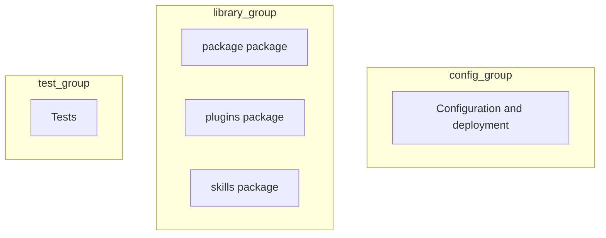

# Architecture report: citrolabs/ego-lite

> Automated static analysis. **Observed** = directly seen in files/imports/AST; **Inferred** = interpretation from that evidence. Repository code was not executed.

## 1. Repository at a glance

| Item | Value |
| --- | --- |
| Repository | citrolabs/ego-lite |
| Description | The fastest browser for AI agents to run browser automation, built for sharing your logged-in browser state with your AI agents, like Codex or Claude Code, without disturbing you. Zero cost, zero config. |
| Language | JavaScript |
| Stars | 22877 |
| Licence | MIT |
| Analysed commit / branch | bacaece43900e8ca68eea3b6f1663835ea38df9e / main |
| Framework(s) | None detected |
| Files analysed | 242 |
| Components | 5 |

## 2. Architecture in one minute

citrolabs/ego-lite - The fastest browser for AI agents to run browser automation, built for sharing your logged-in browser state with your AI agents, like Codex or Claude Code, without disturbing you. Zero cost, zero con…. This repository was analysed statically from 242 file(s) (1 Python). Detected technologies (observed from imports/manifests): GitHub Actions, TypeScript. Files are grouped into 5 component(s): Configuration and deployment, package package, plugins package, skills package, Tests. Observed entry point(s): .github/star-history/postprocess-svg.py. Findings below distinguish observed facts from inferred interpretation.

## 3. High-level block diagram

## 4. Main components

### Configuration and deployment (`config`)

- **Kind:** config
- **Status:** Observed
- **Confidence:** 0.85
- **Responsibility:** Groups 19 file(s) under configuration and deployment (observed from repository paths and static analysis).
- **Paths:** `lefthook.yml`, `package/ego-browser/package.json`, `package/ego-browser/tsconfig.json`, `plugins/ego/.claude-plugin/plugin.json`, `plugins/ego/.codebuddy-plugin/plugin.json`, `plugins/ego/.codex-plugin/plugin.json`, `plugins/ego/.cursor-plugin/plugin.json`, `plugins/ego/.qoder-plugin/plugin.json`, `plugins/ego/cordis.patch.yml`, `plugins/ego/package.json`, `plugins/ego/plugin.json`, `plugins/ego/skills/ego-browser/agents/openai.yaml`, `plugins/ego/skills/ego-browser/learnings/github/manifest.json`, `plugins/ego/skills/ego-browser/learnings/google/manifest.json`, `plugins/ego/skills/ego-browser/learnings/x-com/manifest.json`, `skills/ego-browser/agents/openai.yaml`, `skills/ego-browser/learnings/github/manifest.json`, `skills/ego-browser/learnings/google/manifest.json`, `skills/ego-browser/learnings/x-com/manifest.json`
- **Evidence:** [lefthook.yml](https://github.com/citrolabs/ego-lite/blob/bacaece43900e8ca68eea3b6f1663835ea38df9e/lefthook.yml); [package/ego-browser/package.json](https://github.com/citrolabs/ego-lite/blob/bacaece43900e8ca68eea3b6f1663835ea38df9e/package/ego-browser/package.json); [package/ego-browser/tsconfig.json](https://github.com/citrolabs/ego-lite/blob/bacaece43900e8ca68eea3b6f1663835ea38df9e/package/ego-browser/tsconfig.json); [plugins/ego/.claude-plugin/plugin.json](https://github.com/citrolabs/ego-lite/blob/bacaece43900e8ca68eea3b6f1663835ea38df9e/plugins/ego/.claude-plugin/plugin.json); [plugins/ego/.codebuddy-plugin/plugin.json](https://github.com/citrolabs/ego-lite/blob/bacaece43900e8ca68eea3b6f1663835ea38df9e/plugins/ego/.codebuddy-plugin/plugin.json); [plugins/ego/.codex-plugin/plugin.json](https://github.com/citrolabs/ego-lite/blob/bacaece43900e8ca68eea3b6f1663835ea38df9e/plugins/ego/.codex-plugin/plugin.json); [plugins/ego/.cursor-plugin/plugin.json](https://github.com/citrolabs/ego-lite/blob/bacaece43900e8ca68eea3b6f1663835ea38df9e/plugins/ego/.cursor-plugin/plugin.json); [plugins/ego/.qoder-plugin/plugin.json](https://github.com/citrolabs/ego-lite/blob/bacaece43900e8ca68eea3b6f1663835ea38df9e/plugins/ego/.qoder-plugin/plugin.json)

### package package (`package`)

- **Kind:** library
- **Status:** Observed
- **Confidence:** 0.85
- **Responsibility:** Groups 134 file(s) under package package (observed from repository paths and static analysis).
- **Paths:** `package/ego-browser/scripts/build.mjs`, `package/ego-browser/scripts/check-skill-translation.mjs`, `package/ego-browser/scripts/real-browser-e2e/cases/environment.mjs`, `package/ego-browser/scripts/real-browser-e2e/cases/event-isolation.mjs`, `package/ego-browser/scripts/real-browser-e2e/cases/helper-surface.mjs`, `package/ego-browser/scripts/real-browser-e2e/cases/index.mjs`, `package/ego-browser/scripts/real-browser-e2e/cases/keyboard-regression.mjs`, `package/ego-browser/scripts/real-browser-e2e/cases/keyboard.mjs`, `package/ego-browser/scripts/real-browser-e2e/cases/navigation.mjs`, `package/ego-browser/scripts/real-browser-e2e/cases/observation.mjs`, `package/ego-browser/scripts/real-browser-e2e/cases/page-action-latency.mjs`, `package/ego-browser/scripts/real-browser-e2e/cases/page-action-motion.mjs`, `package/ego-browser/scripts/real-browser-e2e/cases/page-actionability.mjs`, `package/ego-browser/scripts/real-browser-e2e/cases/page-api-alignment.mjs`, `package/ego-browser/scripts/real-browser-e2e/cases/page-automation-hooks.mjs`, `package/ego-browser/scripts/real-browser-e2e/cases/page-click-hit-target.mjs`, `package/ego-browser/scripts/real-browser-e2e/cases/page-default-screenshot-path.mjs`, `package/ego-browser/scripts/real-browser-e2e/cases/page-delayed-popup.mjs`, `package/ego-browser/scripts/real-browser-e2e/cases/page-dialogs.mjs`, `package/ego-browser/scripts/real-browser-e2e/cases/page-download.mjs`, `package/ego-browser/scripts/real-browser-e2e/cases/page-drag-and-draw.mjs`, `package/ego-browser/scripts/real-browser-e2e/cases/page-evaluate-timeout.mjs`, `package/ego-browser/scripts/real-browser-e2e/cases/page-keyboard.mjs`, `package/ego-browser/scripts/real-browser-e2e/cases/page-labels.mjs`, `package/ego-browser/scripts/real-browser-e2e/cases/page-load-states.mjs`, `package/ego-browser/scripts/real-browser-e2e/cases/page-media-playback.mjs`, `package/ego-browser/scripts/real-browser-e2e/cases/page-oopif.mjs`, `package/ego-browser/scripts/real-browser-e2e/cases/page-pending-navigation.mjs`, `package/ego-browser/scripts/real-browser-e2e/cases/page-popup-waiter.mjs`, `package/ego-browser/scripts/real-browser-e2e/cases/page-ref-identity.mjs`, `package/ego-browser/scripts/real-browser-e2e/cases/page-ref-workflows.mjs`, `package/ego-browser/scripts/real-browser-e2e/cases/page-screenshot.mjs`, `package/ego-browser/scripts/real-browser-e2e/cases/page-selector-compatibility.mjs`, `package/ego-browser/scripts/real-browser-e2e/cases/page-shadow-dom.mjs`, `package/ego-browser/scripts/real-browser-e2e/cases/page-snapshot-locators.mjs`, `package/ego-browser/scripts/real-browser-e2e/cases/page-snapshot-subtree.mjs`, `package/ego-browser/scripts/real-browser-e2e/cases/page-snapshot-viewport-overflow.mjs`, `package/ego-browser/scripts/real-browser-e2e/cases/page-text-locators.mjs`, `package/ego-browser/scripts/real-browser-e2e/cases/page-wheel-trap.mjs`, `package/ego-browser/scripts/real-browser-e2e/cases/page-workers.mjs`, `package/ego-browser/scripts/real-browser-e2e/cases/pointer.mjs`, `package/ego-browser/scripts/real-browser-e2e/cases/profile-selection.mjs`, `package/ego-browser/scripts/real-browser-e2e/cases/runtime-regression.mjs`, `package/ego-browser/scripts/real-browser-e2e/cases/runtime.mjs`, `package/ego-browser/scripts/real-browser-e2e/cases/task-space.mjs`, `package/ego-browser/scripts/real-browser-e2e/cases/workflow-chains.mjs`, `package/ego-browser/scripts/real-browser-e2e/ego-browser-cli.mjs`, `package/ego-browser/scripts/real-browser-e2e/ego-source.mjs`, `package/ego-browser/scripts/real-browser-e2e/fixture.mjs`, `package/ego-browser/scripts/real-browser-e2e/run-command.mjs`, `package/ego-browser/scripts/real-browser-e2e/runner.mjs`, `package/ego-browser/scripts/render-guide.mjs`, `package/ego-browser/scripts/repro-popup-foreground.sh`, `package/ego-browser/scripts/run-real-browser-e2e.mjs`, `package/ego-browser/scripts/validate-site-skills.ts`, `package/ego-browser/src/browser-runtime.test.mjs`, `package/ego-browser/src/browser-runtime.ts`, `package/ego-browser/src/cdp-eval.test.mjs`, `package/ego-browser/src/cdp-eval.ts`, `package/ego-browser/src/clipboard.test.mjs`, `package/ego-browser/src/clipboard.ts`, `package/ego-browser/src/driver/action-target.test.mjs`, `package/ego-browser/src/driver/action-target.ts`, `package/ego-browser/src/driver/downloads.test.mjs`, `package/ego-browser/src/driver/downloads.ts`, `package/ego-browser/src/driver/element-ops.ts`, `package/ego-browser/src/driver/files.ts`, `package/ego-browser/src/driver/keyboard.test.mjs`, `package/ego-browser/src/driver/keyboard.ts`, `package/ego-browser/src/driver/load.ts`, `package/ego-browser/src/driver/nav.test.mjs`, `package/ego-browser/src/driver/nav.ts`, `package/ego-browser/src/driver/observe.test.mjs`, `package/ego-browser/src/driver/observe.ts`, `package/ego-browser/src/driver/page-actions.ts`, `package/ego-browser/src/driver/page-input.ts`, `package/ego-browser/src/driver/page-keyboard.ts`, `package/ego-browser/src/driver/page-waits.test.mjs`, `package/ego-browser/src/driver/page-waits.ts`, `package/ego-browser/src/driver/pointer.test.mjs`, `package/ego-browser/src/driver/pointer.ts`, `package/ego-browser/src/driver/scroll-motion.test.mjs`, `package/ego-browser/src/driver/scroll-motion.ts`, `package/ego-browser/src/driver/waits.test.mjs`, `package/ego-browser/src/driver/waits.ts`, `package/ego-browser/src/ego-errors.test.mjs`, `package/ego-browser/src/ego-errors.ts`, `package/ego-browser/src/element-resolver.test.mjs`, `package/ego-browser/src/element-resolver.ts`, `package/ego-browser/src/env.ts`, `package/ego-browser/src/format.test.mjs`, `package/ego-browser/src/format.ts`, `package/ego-browser/src/help-runtime.test.mjs`, `package/ego-browser/src/help-runtime.ts`, `package/ego-browser/src/helpers.test.mjs`, `package/ego-browser/src/helpers.ts`, `package/ego-browser/src/http.ts`, `package/ego-browser/src/index.ts`, `package/ego-browser/src/learning/check-domain-learning.ts`, `package/ego-browser/src/learning/index.ts`, `package/ego-browser/src/learning/validate-learning-format.ts`, `package/ego-browser/src/native-gate.test.mjs`, `package/ego-browser/src/native-gate.ts`, `package/ego-browser/src/output-sink.test.mjs`, `package/ego-browser/src/output-sink.ts`, `package/ego-browser/src/page-actions.test.mjs`, `package/ego-browser/src/page-context-guard.ts`, `package/ego-browser/src/page-discovery.test.mjs`, `package/ego-browser/src/page-discovery.ts`, `package/ego-browser/src/page-ledger.test.mjs`, `package/ego-browser/src/page-ledger.ts`, `package/ego-browser/src/page-model.ts`, `package/ego-browser/src/page-ref-registry.test.mjs`, `package/ego-browser/src/page-ref-registry.ts`, `package/ego-browser/src/public-api-schema.test.mjs`, `package/ego-browser/src/public-api-schema.ts`, `package/ego-browser/src/real-browser-fixture.test.mjs`, `package/ego-browser/src/real-browser-runner.test.mjs`, `package/ego-browser/src/ref-map.test.mjs`, `package/ego-browser/src/ref-map.ts`, `package/ego-browser/src/ref-state.ts`, `package/ego-browser/src/run-output-sink.test.mjs`, `package/ego-browser/src/run.ts`, `package/ego-browser/src/sdk-lifecycle.test.mjs`, `package/ego-browser/src/skill-migration.test.mjs`, `package/ego-browser/src/skill-migration.ts`, `package/ego-browser/src/skill-package.test.mjs`, `package/ego-browser/src/snapshot-result.test.mjs`, `package/ego-browser/src/snapshot-result.ts`, `package/ego-browser/src/state.ts`, `package/ego-browser/src/taskspace-e2e.test.mjs`, `package/ego-browser/src/update-notice.test.mjs`, `package/ego-browser/src/update-notice.ts`, `package/ego-browser/src/workflows.test.mjs`
- **Evidence:** [package/ego-browser/scripts/build.mjs](https://github.com/citrolabs/ego-lite/blob/bacaece43900e8ca68eea3b6f1663835ea38df9e/package/ego-browser/scripts/build.mjs); [package/ego-browser/scripts/check-skill-translation.mjs](https://github.com/citrolabs/ego-lite/blob/bacaece43900e8ca68eea3b6f1663835ea38df9e/package/ego-browser/scripts/check-skill-translation.mjs); [package/ego-browser/scripts/real-browser-e2e/cases/environment.mjs](https://github.com/citrolabs/ego-lite/blob/bacaece43900e8ca68eea3b6f1663835ea38df9e/package/ego-browser/scripts/real-browser-e2e/cases/environment.mjs); [package/ego-browser/scripts/real-browser-e2e/cases/event-isolation.mjs](https://github.com/citrolabs/ego-lite/blob/bacaece43900e8ca68eea3b6f1663835ea38df9e/package/ego-browser/scripts/real-browser-e2e/cases/event-isolation.mjs); [package/ego-browser/scripts/real-browser-e2e/cases/helper-surface.mjs](https://github.com/citrolabs/ego-lite/blob/bacaece43900e8ca68eea3b6f1663835ea38df9e/package/ego-browser/scripts/real-browser-e2e/cases/helper-surface.mjs); [package/ego-browser/scripts/real-browser-e2e/cases/index.mjs](https://github.com/citrolabs/ego-lite/blob/bacaece43900e8ca68eea3b6f1663835ea38df9e/package/ego-browser/scripts/real-browser-e2e/cases/index.mjs); [package/ego-browser/scripts/real-browser-e2e/cases/keyboard-regression.mjs](https://github.com/citrolabs/ego-lite/blob/bacaece43900e8ca68eea3b6f1663835ea38df9e/package/ego-browser/scripts/real-browser-e2e/cases/keyboard-regression.mjs); [package/ego-browser/scripts/real-browser-e2e/cases/keyboard.mjs](https://github.com/citrolabs/ego-lite/blob/bacaece43900e8ca68eea3b6f1663835ea38df9e/package/ego-browser/scripts/real-browser-e2e/cases/keyboard.mjs)

### plugins package (`plugins`)

- **Kind:** library
- **Status:** Observed
- **Confidence:** 0.85
- **Responsibility:** Groups 13 file(s) under plugins package (observed from repository paths and static analysis).
- **Paths:** `plugins/ego/dsh/src/index.js`, `plugins/ego/index.js`, `plugins/ego/skills/ego-browser/learnings/github/browser-tools/repo-stats.js`, `plugins/ego/skills/ego-browser/learnings/github/tools/open-issues.js`, `plugins/ego/skills/ego-browser/learnings/github/tools/search-repos.js`, `plugins/ego/skills/ego-browser/learnings/google/browser-tools/autocomplete.js`, `plugins/ego/skills/ego-browser/learnings/google/tools/search-extract.js`, `plugins/ego/skills/ego-browser/learnings/x-com/browser-tools/extract-post.js`, `plugins/ego/skills/ego-browser/learnings/x-com/tools/search-users.js`, `plugins/ego/skills/ego-browser/learnings/x-com/tools/timeline.js`, `plugins/ego/skills/ego-browser/scripts/install.sh`, `plugins/scripts/package-plugins.mjs`, `plugins/scripts/sync-skills.mjs`
- **Evidence:** [plugins/ego/dsh/src/index.js](https://github.com/citrolabs/ego-lite/blob/bacaece43900e8ca68eea3b6f1663835ea38df9e/plugins/ego/dsh/src/index.js); [plugins/ego/index.js](https://github.com/citrolabs/ego-lite/blob/bacaece43900e8ca68eea3b6f1663835ea38df9e/plugins/ego/index.js); [plugins/ego/skills/ego-browser/learnings/github/browser-tools/repo-stats.js](https://github.com/citrolabs/ego-lite/blob/bacaece43900e8ca68eea3b6f1663835ea38df9e/plugins/ego/skills/ego-browser/learnings/github/browser-tools/repo-stats.js); [plugins/ego/skills/ego-browser/learnings/github/tools/open-issues.js](https://github.com/citrolabs/ego-lite/blob/bacaece43900e8ca68eea3b6f1663835ea38df9e/plugins/ego/skills/ego-browser/learnings/github/tools/open-issues.js); [plugins/ego/skills/ego-browser/learnings/github/tools/search-repos.js](https://github.com/citrolabs/ego-lite/blob/bacaece43900e8ca68eea3b6f1663835ea38df9e/plugins/ego/skills/ego-browser/learnings/github/tools/search-repos.js); [plugins/ego/skills/ego-browser/learnings/google/browser-tools/autocomplete.js](https://github.com/citrolabs/ego-lite/blob/bacaece43900e8ca68eea3b6f1663835ea38df9e/plugins/ego/skills/ego-browser/learnings/google/browser-tools/autocomplete.js); [plugins/ego/skills/ego-browser/learnings/google/tools/search-extract.js](https://github.com/citrolabs/ego-lite/blob/bacaece43900e8ca68eea3b6f1663835ea38df9e/plugins/ego/skills/ego-browser/learnings/google/tools/search-extract.js); [plugins/ego/skills/ego-browser/learnings/x-com/browser-tools/extract-post.js](https://github.com/citrolabs/ego-lite/blob/bacaece43900e8ca68eea3b6f1663835ea38df9e/plugins/ego/skills/ego-browser/learnings/x-com/browser-tools/extract-post.js)

### skills package (`skills`)

- **Kind:** library
- **Status:** Observed
- **Confidence:** 0.85
- **Responsibility:** Groups 9 file(s) under skills package (observed from repository paths and static analysis).
- **Paths:** `skills/ego-browser/learnings/github/browser-tools/repo-stats.js`, `skills/ego-browser/learnings/github/tools/open-issues.js`, `skills/ego-browser/learnings/github/tools/search-repos.js`, `skills/ego-browser/learnings/google/browser-tools/autocomplete.js`, `skills/ego-browser/learnings/google/tools/search-extract.js`, `skills/ego-browser/learnings/x-com/browser-tools/extract-post.js`, `skills/ego-browser/learnings/x-com/tools/search-users.js`, `skills/ego-browser/learnings/x-com/tools/timeline.js`, `skills/ego-browser/scripts/install.sh`
- **Evidence:** [skills/ego-browser/learnings/github/browser-tools/repo-stats.js](https://github.com/citrolabs/ego-lite/blob/bacaece43900e8ca68eea3b6f1663835ea38df9e/skills/ego-browser/learnings/github/browser-tools/repo-stats.js); [skills/ego-browser/learnings/github/tools/open-issues.js](https://github.com/citrolabs/ego-lite/blob/bacaece43900e8ca68eea3b6f1663835ea38df9e/skills/ego-browser/learnings/github/tools/open-issues.js); [skills/ego-browser/learnings/github/tools/search-repos.js](https://github.com/citrolabs/ego-lite/blob/bacaece43900e8ca68eea3b6f1663835ea38df9e/skills/ego-browser/learnings/github/tools/search-repos.js); [skills/ego-browser/learnings/google/browser-tools/autocomplete.js](https://github.com/citrolabs/ego-lite/blob/bacaece43900e8ca68eea3b6f1663835ea38df9e/skills/ego-browser/learnings/google/browser-tools/autocomplete.js); [skills/ego-browser/learnings/google/tools/search-extract.js](https://github.com/citrolabs/ego-lite/blob/bacaece43900e8ca68eea3b6f1663835ea38df9e/skills/ego-browser/learnings/google/tools/search-extract.js); [skills/ego-browser/learnings/x-com/browser-tools/extract-post.js](https://github.com/citrolabs/ego-lite/blob/bacaece43900e8ca68eea3b6f1663835ea38df9e/skills/ego-browser/learnings/x-com/browser-tools/extract-post.js); [skills/ego-browser/learnings/x-com/tools/search-users.js](https://github.com/citrolabs/ego-lite/blob/bacaece43900e8ca68eea3b6f1663835ea38df9e/skills/ego-browser/learnings/x-com/tools/search-users.js); [skills/ego-browser/learnings/x-com/tools/timeline.js](https://github.com/citrolabs/ego-lite/blob/bacaece43900e8ca68eea3b6f1663835ea38df9e/skills/ego-browser/learnings/x-com/tools/timeline.js)

### Tests (`tests`)

- **Kind:** test
- **Status:** Observed
- **Confidence:** 0.85
- **Responsibility:** Groups 5 file(s) under tests (observed from repository paths and static analysis).
- **Paths:** `plugins/ego/tests/claude-plugin-mode-isolation.test.mjs`, `plugins/ego/tests/cross-host-plugin.test.mjs`, `plugins/ego/tests/dsh-plugin.test.mjs`, `plugins/ego/tests/plugin-packaging.test.mjs`, `plugins/ego/tests/sync-skills.test.mjs`
- **Evidence:** [plugins/ego/tests/claude-plugin-mode-isolation.test.mjs](https://github.com/citrolabs/ego-lite/blob/bacaece43900e8ca68eea3b6f1663835ea38df9e/plugins/ego/tests/claude-plugin-mode-isolation.test.mjs); [plugins/ego/tests/cross-host-plugin.test.mjs](https://github.com/citrolabs/ego-lite/blob/bacaece43900e8ca68eea3b6f1663835ea38df9e/plugins/ego/tests/cross-host-plugin.test.mjs); [plugins/ego/tests/dsh-plugin.test.mjs](https://github.com/citrolabs/ego-lite/blob/bacaece43900e8ca68eea3b6f1663835ea38df9e/plugins/ego/tests/dsh-plugin.test.mjs); [plugins/ego/tests/plugin-packaging.test.mjs](https://github.com/citrolabs/ego-lite/blob/bacaece43900e8ca68eea3b6f1663835ea38df9e/plugins/ego/tests/plugin-packaging.test.mjs); [plugins/ego/tests/sync-skills.test.mjs](https://github.com/citrolabs/ego-lite/blob/bacaece43900e8ca68eea3b6f1663835ea38df9e/plugins/ego/tests/sync-skills.test.mjs)

## 5. Execution flow

**Observed** entry point(s):

- [.github/star-history/postprocess-svg.py:85](https://github.com/citrolabs/ego-lite/blob/bacaece43900e8ca68eea3b6f1663835ea38df9e/.github/star-history/postprocess-svg.py#L85)
- [package/ego-browser/src/index.ts](https://github.com/citrolabs/ego-lite/blob/bacaece43900e8ca68eea3b6f1663835ea38df9e/package/ego-browser/src/index.ts)
- [plugins/ego/index.js](https://github.com/citrolabs/ego-lite/blob/bacaece43900e8ca68eea3b6f1663835ea38df9e/plugins/ego/index.js)

Representative flow (derived from observed entry points and the import graph; steps beyond the entry point are **Inferred**):

1. Execution starts at an observed entry point listed above, if present.
2. No internal import relationships between components were observed.

## 6. Project structure

### `(root)`

- `.gitignore` - other (1038 bytes)
- `.prettierignore` - other (95 bytes)
- `AGENTS.md` - docs (7720 bytes)
- `CONTRIBUTING.md` - docs (12799 bytes)
- `LICENSE` - docs (1066 bytes)
- `README.es.md` - docs (12823 bytes)
- `README.fr.md` - docs (13103 bytes)
- `README.it.md` - docs (12622 bytes)
- `README.ja.md` - docs (14965 bytes)
- `README.ko.md` - docs (13688 bytes)
- `README.md` - docs (11462 bytes)
- `README.pt.md` - docs (12576 bytes)
- `README.ru.md` - docs (17190 bytes)
- `README.zh-CN.md` - docs (11393 bytes)
- `install.md` - docs (41 bytes)
- `lefthook.yml` - config (3102 bytes)

### `.agents`

- `.agents/plugins/marketplace.json` - config (368 bytes)

### `.claude-plugin`

- `.claude-plugin/marketplace.json` - config (608 bytes)

### `.cursor-plugin`

- `.cursor-plugin/marketplace.json` - config (267 bytes)

### `.github`

- `.github/dev-skills/ego-lite-simplify/SKILL.md` - docs (4869 bytes)
- `.github/dev-skills/ego-lite-simplify/agents/openai.yaml` - config (250 bytes)
- `.github/release.yml` - config (416 bytes)
- `.github/star-history/FONT-LICENSE.txt` - docs (577 bytes)
- `.github/star-history/action-runtime.patch` - other (229 bytes)
- `.github/star-history/branch-readme.md` - docs (881 bytes)
- `.github/star-history/postprocess-svg.py` - source, Python (3315 bytes)
- `.github/star-history/y-axis.patch` - other (446 bytes)
- `.github/star-history/y-axis.test.ts` - source, TypeScript (1419 bytes)
- `.github/workflows/ci.yml` - ci, YAML (5573 bytes)
- `.github/workflows/codex-review.yml` - ci, YAML (9911 bytes)
- `.github/workflows/main-pr-source.yml` - ci, YAML (759 bytes)
- `.github/workflows/purge-camo-cache.yml` - ci, YAML (471 bytes)
- `.github/workflows/star-history.yml` - ci, YAML (6097 bytes)

### `docs`

- `docs/ego-browser-skill-command.md` - docs (6667 bytes)
- `docs/local-runtime-development.md` - docs (3424 bytes)
- `docs/native-bindings-api.md` - docs (24171 bytes)
- `docs/native-javascript-dialog-requirement.md` - docs (2589 bytes)
- `docs/native-sdk-lifecycle-requirement.md` - docs (1583 bytes)
- `docs/native-snapshot-ref-requirement.md` - docs (4083 bytes)

### `package`

- `package/ego-browser/.gitignore` - other (52 bytes)
- `package/ego-browser/README.md` - docs (5619 bytes)
- `package/ego-browser/package.json` - manifest (1351 bytes)
- `package/ego-browser/scripts/build.mjs` - source, JavaScript (4269 bytes)
- `package/ego-browser/scripts/check-skill-translation.mjs` - source, JavaScript (969 bytes)
- `package/ego-browser/scripts/real-browser-e2e/cases/environment.mjs` - source, JavaScript (3125 bytes)
- `package/ego-browser/scripts/real-browser-e2e/cases/event-isolation.mjs` - source, JavaScript (1246 bytes)
- `package/ego-browser/scripts/real-browser-e2e/cases/helper-surface.mjs` - source, JavaScript (2366 bytes)
- `package/ego-browser/scripts/real-browser-e2e/cases/index.mjs` - source, JavaScript (10382 bytes)
- `package/ego-browser/scripts/real-browser-e2e/cases/keyboard-regression.mjs` - source, JavaScript (3378 bytes)
- `package/ego-browser/scripts/real-browser-e2e/cases/keyboard.mjs` - source, JavaScript (4598 bytes)
- `package/ego-browser/scripts/real-browser-e2e/cases/navigation.mjs` - source, JavaScript (4656 bytes)
- `package/ego-browser/scripts/real-browser-e2e/cases/observation.mjs` - source, JavaScript (6439 bytes)
- `package/ego-browser/scripts/real-browser-e2e/cases/page-action-latency.mjs` - source, JavaScript (8112 bytes)
- `package/ego-browser/scripts/real-browser-e2e/cases/page-action-motion.mjs` - source, JavaScript (4126 bytes)
- `package/ego-browser/scripts/real-browser-e2e/cases/page-actionability.mjs` - source, JavaScript (14652 bytes)
- `package/ego-browser/scripts/real-browser-e2e/cases/page-api-alignment.mjs` - source, JavaScript (10339 bytes)
- `package/ego-browser/scripts/real-browser-e2e/cases/page-automation-hooks.mjs` - source, JavaScript (1506 bytes)
- `package/ego-browser/scripts/real-browser-e2e/cases/page-click-hit-target.mjs` - source, JavaScript (7154 bytes)
- `package/ego-browser/scripts/real-browser-e2e/cases/page-default-screenshot-path.mjs` - source, JavaScript (2971 bytes)
- `package/ego-browser/scripts/real-browser-e2e/cases/page-delayed-popup.mjs` - source, JavaScript (1978 bytes)
- `package/ego-browser/scripts/real-browser-e2e/cases/page-dialogs.mjs` - source, JavaScript (8247 bytes)
- `package/ego-browser/scripts/real-browser-e2e/cases/page-download.mjs` - source, JavaScript (15935 bytes)
- `package/ego-browser/scripts/real-browser-e2e/cases/page-drag-and-draw.mjs` - source, JavaScript (3344 bytes)
- `package/ego-browser/scripts/real-browser-e2e/cases/page-evaluate-timeout.mjs` - source, JavaScript (5762 bytes)
- `package/ego-browser/scripts/real-browser-e2e/cases/page-keyboard.mjs` - source, JavaScript (11106 bytes)
- `package/ego-browser/scripts/real-browser-e2e/cases/page-labels.mjs` - source, JavaScript (51102 bytes)
- `package/ego-browser/scripts/real-browser-e2e/cases/page-load-states.mjs` - source, JavaScript (13670 bytes)
- `package/ego-browser/scripts/real-browser-e2e/cases/page-media-playback.mjs` - source, JavaScript (3809 bytes)
- `package/ego-browser/scripts/real-browser-e2e/cases/page-oopif.mjs` - source, JavaScript (5416 bytes)
- `package/ego-browser/scripts/real-browser-e2e/cases/page-pending-navigation.mjs` - source, JavaScript (7137 bytes)
- `package/ego-browser/scripts/real-browser-e2e/cases/page-popup-waiter.mjs` - source, JavaScript (3656 bytes)
- `package/ego-browser/scripts/real-browser-e2e/cases/page-ref-identity.mjs` - source, JavaScript (7012 bytes)
- `package/ego-browser/scripts/real-browser-e2e/cases/page-ref-workflows.mjs` - source, JavaScript (9123 bytes)
- `package/ego-browser/scripts/real-browser-e2e/cases/page-screenshot.mjs` - source, JavaScript (2472 bytes)
- `package/ego-browser/scripts/real-browser-e2e/cases/page-selector-compatibility.mjs` - source, JavaScript (7013 bytes)
- `package/ego-browser/scripts/real-browser-e2e/cases/page-shadow-dom.mjs` - source, JavaScript (1216 bytes)
- `package/ego-browser/scripts/real-browser-e2e/cases/page-snapshot-locators.mjs` - source, JavaScript (1277 bytes)
- `package/ego-browser/scripts/real-browser-e2e/cases/page-snapshot-subtree.mjs` - source, JavaScript (20105 bytes)
- `package/ego-browser/scripts/real-browser-e2e/cases/page-snapshot-viewport-overflow.mjs` - source, JavaScript (2309 bytes)
- `package/ego-browser/scripts/real-browser-e2e/cases/page-text-locators.mjs` - source, JavaScript (2135 bytes)
- `package/ego-browser/scripts/real-browser-e2e/cases/page-wheel-trap.mjs` - source, JavaScript (2323 bytes)
- `package/ego-browser/scripts/real-browser-e2e/cases/page-workers.mjs` - source, JavaScript (5197 bytes)
- `package/ego-browser/scripts/real-browser-e2e/cases/pointer.mjs` - source, JavaScript (11541 bytes)
- `package/ego-browser/scripts/real-browser-e2e/cases/profile-selection.mjs` - source, JavaScript (2904 bytes)
- `package/ego-browser/scripts/real-browser-e2e/cases/runtime-regression.mjs` - source, JavaScript (2984 bytes)
- `package/ego-browser/scripts/real-browser-e2e/cases/runtime.mjs` - source, JavaScript (5149 bytes)
- `package/ego-browser/scripts/real-browser-e2e/cases/task-space.mjs` - source, JavaScript (9619 bytes)
- `package/ego-browser/scripts/real-browser-e2e/cases/workflow-chains.mjs` - source, JavaScript (12499 bytes)
- `package/ego-browser/scripts/real-browser-e2e/ego-browser-cli.mjs` - source, JavaScript (568 bytes)
- `package/ego-browser/scripts/real-browser-e2e/ego-source.mjs` - source, JavaScript (12827 bytes)
- `package/ego-browser/scripts/real-browser-e2e/fixture.mjs` - source, JavaScript (49622 bytes)
- `package/ego-browser/scripts/real-browser-e2e/run-command.mjs` - source, JavaScript (2623 bytes)
- `package/ego-browser/scripts/real-browser-e2e/runner.mjs` - source, JavaScript (13456 bytes)
- `package/ego-browser/scripts/render-guide.mjs` - source, JavaScript (4155 bytes)
- `package/ego-browser/scripts/repro-popup-foreground.sh` - source, Shell (2502 bytes)
- `package/ego-browser/scripts/run-real-browser-e2e.mjs` - source, JavaScript (115 bytes)
- `package/ego-browser/scripts/validate-site-skills.ts` - source, TypeScript (897 bytes)
- `package/ego-browser/skill-body/SKILL.md` - docs (24570 bytes)
- `package/ego-browser/src/browser-runtime.test.mjs` - source, JavaScript (72771 bytes)
- `package/ego-browser/src/browser-runtime.ts` - source, TypeScript (59136 bytes)
- `package/ego-browser/src/cdp-eval.test.mjs` - source, JavaScript (3444 bytes)
- `package/ego-browser/src/cdp-eval.ts` - source, TypeScript (6363 bytes)
- `package/ego-browser/src/clipboard.test.mjs` - source, JavaScript (8727 bytes)
- `package/ego-browser/src/clipboard.ts` - source, TypeScript (20982 bytes)
- `package/ego-browser/src/driver/action-target.test.mjs` - source, JavaScript (5681 bytes)
- `package/ego-browser/src/driver/action-target.ts` - source, TypeScript (15413 bytes)
- `package/ego-browser/src/driver/downloads.test.mjs` - source, JavaScript (20476 bytes)
- `package/ego-browser/src/driver/downloads.ts` - source, TypeScript (15539 bytes)
- `package/ego-browser/src/driver/element-ops.ts` - source, TypeScript (2887 bytes)
- `package/ego-browser/src/driver/files.ts` - source, TypeScript (563 bytes)
- `package/ego-browser/src/driver/keyboard.test.mjs` - source, JavaScript (7868 bytes)
- `package/ego-browser/src/driver/keyboard.ts` - source, TypeScript (18096 bytes)
- `package/ego-browser/src/driver/load.ts` - source, TypeScript (817 bytes)
- `package/ego-browser/src/driver/nav.test.mjs` - source, JavaScript (7007 bytes)
- `package/ego-browser/src/driver/nav.ts` - source, TypeScript (8451 bytes)
- `package/ego-browser/src/driver/observe.test.mjs` - source, JavaScript (8778 bytes)
- `package/ego-browser/src/driver/observe.ts` - source, TypeScript (6823 bytes)
- `package/ego-browser/src/driver/page-actions.ts` - source, TypeScript (60218 bytes)
- `package/ego-browser/src/driver/page-input.ts` - source, TypeScript (4227 bytes)
- `package/ego-browser/src/driver/page-keyboard.ts` - source, TypeScript (22221 bytes)
- `package/ego-browser/src/driver/page-waits.test.mjs` - source, JavaScript (12602 bytes)
- `package/ego-browser/src/driver/page-waits.ts` - source, TypeScript (36161 bytes)
- `package/ego-browser/src/driver/pointer.test.mjs` - source, JavaScript (13019 bytes)
- `package/ego-browser/src/driver/pointer.ts` - source, TypeScript (28326 bytes)
- `package/ego-browser/src/driver/scroll-motion.test.mjs` - source, JavaScript (3037 bytes)
- `package/ego-browser/src/driver/scroll-motion.ts` - source, TypeScript (2129 bytes)
- `package/ego-browser/src/driver/waits.test.mjs` - source, JavaScript (6541 bytes)
- `package/ego-browser/src/driver/waits.ts` - source, TypeScript (7048 bytes)
- `package/ego-browser/src/ego-errors.test.mjs` - source, JavaScript (9871 bytes)
- `package/ego-browser/src/ego-errors.ts` - source, TypeScript (11112 bytes)
- `package/ego-browser/src/element-resolver.test.mjs` - source, JavaScript (39840 bytes)
- `package/ego-browser/src/element-resolver.ts` - source, TypeScript (77963 bytes)
- `package/ego-browser/src/env.ts` - source, TypeScript (1387 bytes)
- `package/ego-browser/src/format.test.mjs` - source, JavaScript (893 bytes)
- `package/ego-browser/src/format.ts` - source, TypeScript (241 bytes)
- `package/ego-browser/src/help-runtime.test.mjs` - source, JavaScript (797 bytes)
- `package/ego-browser/src/help-runtime.ts` - source, TypeScript (9996 bytes)
- `package/ego-browser/src/helpers.test.mjs` - source, JavaScript (38719 bytes)
- `package/ego-browser/src/helpers.ts` - source, TypeScript (27641 bytes)
- `package/ego-browser/src/http.ts` - source, TypeScript (1763 bytes)
- `package/ego-browser/src/index.ts` - source, TypeScript (8229 bytes)
- `package/ego-browser/src/learning/check-domain-learning.ts` - source, TypeScript (5726 bytes)
- `package/ego-browser/src/learning/index.ts` - source, TypeScript (6668 bytes)
- `package/ego-browser/src/learning/validate-learning-format.ts` - source, TypeScript (9688 bytes)
- `package/ego-browser/src/native-gate.test.mjs` - source, JavaScript (5124 bytes)
- `package/ego-browser/src/native-gate.ts` - source, TypeScript (5072 bytes)
- `package/ego-browser/src/output-sink.test.mjs` - source, JavaScript (4038 bytes)
- `package/ego-browser/src/output-sink.ts` - source, TypeScript (4946 bytes)
- `package/ego-browser/src/page-actions.test.mjs` - source, JavaScript (15616 bytes)
- `package/ego-browser/src/page-context-guard.ts` - source, TypeScript (2062 bytes)
- `package/ego-browser/src/page-discovery.test.mjs` - source, JavaScript (1541 bytes)
- `package/ego-browser/src/page-discovery.ts` - source, TypeScript (3381 bytes)
- `package/ego-browser/src/page-ledger.test.mjs` - source, JavaScript (26241 bytes)
- `package/ego-browser/src/page-ledger.ts` - source, TypeScript (28561 bytes)
- `package/ego-browser/src/page-model.ts` - source, TypeScript (140851 bytes)
- `package/ego-browser/src/page-ref-registry.test.mjs` - source, JavaScript (6631 bytes)
- `package/ego-browser/src/page-ref-registry.ts` - source, TypeScript (6946 bytes)
- `package/ego-browser/src/public-api-schema.test.mjs` - source, JavaScript (4249 bytes)
- `package/ego-browser/src/public-api-schema.ts` - source, TypeScript (26432 bytes)
- `package/ego-browser/src/real-browser-fixture.test.mjs` - source, JavaScript (1240 bytes)
- `package/ego-browser/src/real-browser-runner.test.mjs` - source, JavaScript (3149 bytes)
- `package/ego-browser/src/ref-map.test.mjs` - source, JavaScript (374 bytes)
- `package/ego-browser/src/ref-map.ts` - source, TypeScript (1087 bytes)
- `package/ego-browser/src/ref-state.ts` - source, TypeScript (621 bytes)
- `package/ego-browser/src/run-output-sink.test.mjs` - source, JavaScript (11456 bytes)
- `package/ego-browser/src/run.ts` - source, TypeScript (5690 bytes)
- `package/ego-browser/src/sdk-lifecycle.test.mjs` - source, JavaScript (4203 bytes)
- `package/ego-browser/src/skill-migration.test.mjs` - source, JavaScript (1622 bytes)
- `package/ego-browser/src/skill-migration.ts` - source, TypeScript (2076 bytes)
- `package/ego-browser/src/skill-package.test.mjs` - source, JavaScript (7893 bytes)
- `package/ego-browser/src/snapshot-result.test.mjs` - source, JavaScript (15982 bytes)
- `package/ego-browser/src/snapshot-result.ts` - source, TypeScript (13603 bytes)
- `package/ego-browser/src/state.ts` - source, TypeScript (713 bytes)
- `package/ego-browser/src/taskspace-e2e.test.mjs` - source, JavaScript (9743 bytes)
- `package/ego-browser/src/update-notice.test.mjs` - source, JavaScript (3162 bytes)
- `package/ego-browser/src/update-notice.ts` - source, TypeScript (1261 bytes)
- `package/ego-browser/src/workflows.test.mjs` - source, JavaScript (2992 bytes)
- `package/ego-browser/tsconfig.json` - config (329 bytes)

### `plugins`

- `plugins/ego/.claude-plugin/plugin.json` - config (293 bytes)
- `plugins/ego/.codebuddy-plugin/plugin.json` - config (446 bytes)
- `plugins/ego/.codex-plugin/plugin.json` - config (1271 bytes)
- `plugins/ego/.cursor-plugin/plugin.json` - config (562 bytes)
- `plugins/ego/.qoder-plugin/plugin.json` - config (446 bytes)
- `plugins/ego/LICENSE` - docs (1066 bytes)
- `plugins/ego/README.md` - docs (15270 bytes)
- `plugins/ego/cordis.patch.yml` - config (57 bytes)
- `plugins/ego/dsh/src/index.js` - source, JavaScript (2341 bytes)
- `plugins/ego/index.js` - source, JavaScript (1556 bytes)
- `plugins/ego/package.json` - manifest (1216 bytes)
- `plugins/ego/plugin.json` - config (459 bytes)
- `plugins/ego/skills/ego-browser/SKILL.md` - docs (1733 bytes)
- `plugins/ego/skills/ego-browser/agents/openai.yaml` - config (271 bytes)
- `plugins/ego/skills/ego-browser/learnings/github/browser-tools/repo-stats.js` - source, JavaScript (579 bytes)
- `plugins/ego/skills/ego-browser/learnings/github/manifest.json` - config (1664 bytes)
- `plugins/ego/skills/ego-browser/learnings/github/notes/overview.md` - docs (880 bytes)
- `plugins/ego/skills/ego-browser/learnings/github/tools/open-issues.js` - source, JavaScript (987 bytes)
- `plugins/ego/skills/ego-browser/learnings/github/tools/search-repos.js` - source, JavaScript (1211 bytes)
- `plugins/ego/skills/ego-browser/learnings/google/browser-tools/autocomplete.js` - source, JavaScript (373 bytes)
- `plugins/ego/skills/ego-browser/learnings/google/manifest.json` - config (1117 bytes)
- `plugins/ego/skills/ego-browser/learnings/google/notes/overview.md` - docs (667 bytes)
- `plugins/ego/skills/ego-browser/learnings/google/tools/search-extract.js` - source, JavaScript (1039 bytes)
- `plugins/ego/skills/ego-browser/learnings/x-com/browser-tools/extract-post.js` - source, JavaScript (458 bytes)
- `plugins/ego/skills/ego-browser/learnings/x-com/manifest.json` - config (1453 bytes)
- `plugins/ego/skills/ego-browser/learnings/x-com/notes/overview.md` - docs (777 bytes)
- `plugins/ego/skills/ego-browser/learnings/x-com/notes/timeline.md` - docs (618 bytes)
- `plugins/ego/skills/ego-browser/learnings/x-com/tools/search-users.js` - source, JavaScript (800 bytes)
- `plugins/ego/skills/ego-browser/learnings/x-com/tools/timeline.js` - source, JavaScript (934 bytes)
- `plugins/ego/skills/ego-browser/references/clearing-state.md` - docs (4140 bytes)
- `plugins/ego/skills/ego-browser/references/install-macos.md` - docs (2478 bytes)
- `plugins/ego/skills/ego-browser/references/install-windows.md` - docs (1860 bytes)
- `plugins/ego/skills/ego-browser/references/install.md` - docs (1949 bytes)
- `plugins/ego/skills/ego-browser/scripts/install.sh` - source, Shell (6021 bytes)
- `plugins/ego/tests/claude-plugin-mode-isolation.test.mjs` - test, JavaScript (7285 bytes)
- `plugins/ego/tests/cross-host-plugin.test.mjs` - test, JavaScript (15549 bytes)
- `plugins/ego/tests/dsh-plugin.test.mjs` - test, JavaScript (3923 bytes)
- `plugins/ego/tests/plugin-packaging.test.mjs` - test, JavaScript (19071 bytes)
- `plugins/ego/tests/sync-skills.test.mjs` - test, JavaScript (2582 bytes)
- `plugins/scripts/package-plugins.mjs` - source, JavaScript (14666 bytes)
- `plugins/scripts/sync-skills.mjs` - source, JavaScript (1849 bytes)

### `skills`

- `skills/ego-browser/SKILL.md` - docs (1733 bytes)
- `skills/ego-browser/agents/openai.yaml` - config (271 bytes)
- `skills/ego-browser/learnings/github/browser-tools/repo-stats.js` - source, JavaScript (579 bytes)
- `skills/ego-browser/learnings/github/manifest.json` - config (1664 bytes)
- `skills/ego-browser/learnings/github/notes/overview.md` - docs (880 bytes)
- `skills/ego-browser/learnings/github/tools/open-issues.js` - source, JavaScript (987 bytes)
- `skills/ego-browser/learnings/github/tools/search-repos.js` - source, JavaScript (1211 bytes)
- `skills/ego-browser/learnings/google/browser-tools/autocomplete.js` - source, JavaScript (373 bytes)
- `skills/ego-browser/learnings/google/manifest.json` - config (1117 bytes)
- `skills/ego-browser/learnings/google/notes/overview.md` - docs (667 bytes)
- `skills/ego-browser/learnings/google/tools/search-extract.js` - source, JavaScript (1039 bytes)
- `skills/ego-browser/learnings/x-com/browser-tools/extract-post.js` - source, JavaScript (458 bytes)
- `skills/ego-browser/learnings/x-com/manifest.json` - config (1453 bytes)
- `skills/ego-browser/learnings/x-com/notes/overview.md` - docs (777 bytes)
- `skills/ego-browser/learnings/x-com/notes/timeline.md` - docs (618 bytes)
- `skills/ego-browser/learnings/x-com/tools/search-users.js` - source, JavaScript (800 bytes)
- `skills/ego-browser/learnings/x-com/tools/timeline.js` - source, JavaScript (934 bytes)
- `skills/ego-browser/references/clearing-state.md` - docs (4140 bytes)
- `skills/ego-browser/references/install-macos.md` - docs (2478 bytes)
- `skills/ego-browser/references/install-windows.md` - docs (1860 bytes)
- `skills/ego-browser/references/install.md` - docs (1949 bytes)
- `skills/ego-browser/scripts/install.sh` - source, Shell (6021 bytes)

### `spec`

- `spec/agent-skills-spec.md` - docs (87 bytes)

## 7. Key dependencies and integrations

| Name | Category | Status | Confidence | Evidence |
| --- | --- | --- | --- | --- |
| GitHub Actions | ci | Observed | 0.90 | [.github/workflows/ci.yml](https://github.com/citrolabs/ego-lite/blob/bacaece43900e8ca68eea3b6f1663835ea38df9e/.github/workflows/ci.yml); [.github/workflows/codex-review.yml](https://github.com/citrolabs/ego-lite/blob/bacaece43900e8ca68eea3b6f1663835ea38df9e/.github/workflows/codex-review.yml); [.github/workflows/main-pr-source.yml](https://github.com/citrolabs/ego-lite/blob/bacaece43900e8ca68eea3b6f1663835ea38df9e/.github/workflows/main-pr-source.yml); [.github/workflows/purge-camo-cache.yml](https://github.com/citrolabs/ego-lite/blob/bacaece43900e8ca68eea3b6f1663835ea38df9e/.github/workflows/purge-camo-cache.yml) |
| TypeScript | tooling | Observed | 0.85 | [package/ego-browser/package.json:4](https://github.com/citrolabs/ego-lite/blob/bacaece43900e8ca68eea3b6f1663835ea38df9e/package/ego-browser/package.json#L4) |

## 8. Data and state

No database, cache, queue, or persistent-state usage was observed in the analysed files. State handling, if any, may be in-memory or in files that were not analysed.

## 9. Configuration and deployment clues

- `.agents/plugins/marketplace.json` (config)
- `.claude-plugin/marketplace.json` (config)
- `.cursor-plugin/marketplace.json` (config)
- `.github/dev-skills/ego-lite-simplify/agents/openai.yaml` (config)
- `.github/release.yml` (config)
- `.github/workflows/ci.yml` (ci)
- `.github/workflows/codex-review.yml` (ci)
- `.github/workflows/main-pr-source.yml` (ci)
- `.github/workflows/purge-camo-cache.yml` (ci)
- `.github/workflows/star-history.yml` (ci)
- `lefthook.yml` (config)
- `package/ego-browser/package.json` (manifest)
- `package/ego-browser/tsconfig.json` (config)
- `plugins/ego/.claude-plugin/plugin.json` (config)
- `plugins/ego/.codebuddy-plugin/plugin.json` (config)
- `plugins/ego/.codex-plugin/plugin.json` (config)
- `plugins/ego/.cursor-plugin/plugin.json` (config)
- `plugins/ego/.qoder-plugin/plugin.json` (config)
- `plugins/ego/cordis.patch.yml` (config)
- `plugins/ego/package.json` (manifest)
- `plugins/ego/plugin.json` (config)
- `plugins/ego/skills/ego-browser/agents/openai.yaml` (config)
- `plugins/ego/skills/ego-browser/learnings/github/manifest.json` (config)
- `plugins/ego/skills/ego-browser/learnings/google/manifest.json` (config)
- `plugins/ego/skills/ego-browser/learnings/x-com/manifest.json` (config)
- `skills/ego-browser/agents/openai.yaml` (config)
- `skills/ego-browser/learnings/github/manifest.json` (config)
- `skills/ego-browser/learnings/google/manifest.json` (config)
- `skills/ego-browser/learnings/x-com/manifest.json` (config)

## 10. Design observations

- Tests are present alongside source code (Observed from test file paths).

These observations are interpretations (**Inferred**) of the observed structure, not guarantees about runtime design.

## 11. Limitations and unknowns

- Static analysis only: repository code was not executed, installed, or imported at runtime.
- Components and relationships are inferred from file paths, imports, and AST structure; runtime behaviour, dynamic imports, and reflection may not be visible.
- 1 file(s) were skipped during inventory (1 x lockfile excluded).
- Repository text was treated as untrusted data; no instructions found in repository files were followed, and likely secret values were redacted/excluded.

## 12. Source references

- [.github/star-history/postprocess-svg.py:85](https://github.com/citrolabs/ego-lite/blob/bacaece43900e8ca68eea3b6f1663835ea38df9e/.github/star-history/postprocess-svg.py#L85)
- [.github/workflows/ci.yml](https://github.com/citrolabs/ego-lite/blob/bacaece43900e8ca68eea3b6f1663835ea38df9e/.github/workflows/ci.yml)
- [.github/workflows/codex-review.yml](https://github.com/citrolabs/ego-lite/blob/bacaece43900e8ca68eea3b6f1663835ea38df9e/.github/workflows/codex-review.yml)
- [.github/workflows/main-pr-source.yml](https://github.com/citrolabs/ego-lite/blob/bacaece43900e8ca68eea3b6f1663835ea38df9e/.github/workflows/main-pr-source.yml)
- [.github/workflows/purge-camo-cache.yml](https://github.com/citrolabs/ego-lite/blob/bacaece43900e8ca68eea3b6f1663835ea38df9e/.github/workflows/purge-camo-cache.yml)
- [.github/workflows/star-history.yml](https://github.com/citrolabs/ego-lite/blob/bacaece43900e8ca68eea3b6f1663835ea38df9e/.github/workflows/star-history.yml)
- [lefthook.yml](https://github.com/citrolabs/ego-lite/blob/bacaece43900e8ca68eea3b6f1663835ea38df9e/lefthook.yml)
- [package/ego-browser/package.json](https://github.com/citrolabs/ego-lite/blob/bacaece43900e8ca68eea3b6f1663835ea38df9e/package/ego-browser/package.json)
- [package/ego-browser/package.json:4](https://github.com/citrolabs/ego-lite/blob/bacaece43900e8ca68eea3b6f1663835ea38df9e/package/ego-browser/package.json#L4)
- [package/ego-browser/scripts/build.mjs](https://github.com/citrolabs/ego-lite/blob/bacaece43900e8ca68eea3b6f1663835ea38df9e/package/ego-browser/scripts/build.mjs)
- [package/ego-browser/scripts/check-skill-translation.mjs](https://github.com/citrolabs/ego-lite/blob/bacaece43900e8ca68eea3b6f1663835ea38df9e/package/ego-browser/scripts/check-skill-translation.mjs)
- [package/ego-browser/scripts/real-browser-e2e/cases/environment.mjs](https://github.com/citrolabs/ego-lite/blob/bacaece43900e8ca68eea3b6f1663835ea38df9e/package/ego-browser/scripts/real-browser-e2e/cases/environment.mjs)
- [package/ego-browser/scripts/real-browser-e2e/cases/event-isolation.mjs](https://github.com/citrolabs/ego-lite/blob/bacaece43900e8ca68eea3b6f1663835ea38df9e/package/ego-browser/scripts/real-browser-e2e/cases/event-isolation.mjs)
- [package/ego-browser/scripts/real-browser-e2e/cases/helper-surface.mjs](https://github.com/citrolabs/ego-lite/blob/bacaece43900e8ca68eea3b6f1663835ea38df9e/package/ego-browser/scripts/real-browser-e2e/cases/helper-surface.mjs)
- [package/ego-browser/scripts/real-browser-e2e/cases/index.mjs](https://github.com/citrolabs/ego-lite/blob/bacaece43900e8ca68eea3b6f1663835ea38df9e/package/ego-browser/scripts/real-browser-e2e/cases/index.mjs)
- [package/ego-browser/scripts/real-browser-e2e/cases/keyboard-regression.mjs](https://github.com/citrolabs/ego-lite/blob/bacaece43900e8ca68eea3b6f1663835ea38df9e/package/ego-browser/scripts/real-browser-e2e/cases/keyboard-regression.mjs)
- [package/ego-browser/scripts/real-browser-e2e/cases/keyboard.mjs](https://github.com/citrolabs/ego-lite/blob/bacaece43900e8ca68eea3b6f1663835ea38df9e/package/ego-browser/scripts/real-browser-e2e/cases/keyboard.mjs)
- [package/ego-browser/src/index.ts](https://github.com/citrolabs/ego-lite/blob/bacaece43900e8ca68eea3b6f1663835ea38df9e/package/ego-browser/src/index.ts)
- [package/ego-browser/tsconfig.json](https://github.com/citrolabs/ego-lite/blob/bacaece43900e8ca68eea3b6f1663835ea38df9e/package/ego-browser/tsconfig.json)
- [plugins/ego/.claude-plugin/plugin.json](https://github.com/citrolabs/ego-lite/blob/bacaece43900e8ca68eea3b6f1663835ea38df9e/plugins/ego/.claude-plugin/plugin.json)
- [plugins/ego/.codebuddy-plugin/plugin.json](https://github.com/citrolabs/ego-lite/blob/bacaece43900e8ca68eea3b6f1663835ea38df9e/plugins/ego/.codebuddy-plugin/plugin.json)
- [plugins/ego/.codex-plugin/plugin.json](https://github.com/citrolabs/ego-lite/blob/bacaece43900e8ca68eea3b6f1663835ea38df9e/plugins/ego/.codex-plugin/plugin.json)
- [plugins/ego/.cursor-plugin/plugin.json](https://github.com/citrolabs/ego-lite/blob/bacaece43900e8ca68eea3b6f1663835ea38df9e/plugins/ego/.cursor-plugin/plugin.json)
- [plugins/ego/.qoder-plugin/plugin.json](https://github.com/citrolabs/ego-lite/blob/bacaece43900e8ca68eea3b6f1663835ea38df9e/plugins/ego/.qoder-plugin/plugin.json)
- [plugins/ego/dsh/src/index.js](https://github.com/citrolabs/ego-lite/blob/bacaece43900e8ca68eea3b6f1663835ea38df9e/plugins/ego/dsh/src/index.js)
- [plugins/ego/index.js](https://github.com/citrolabs/ego-lite/blob/bacaece43900e8ca68eea3b6f1663835ea38df9e/plugins/ego/index.js)
- [plugins/ego/skills/ego-browser/learnings/github/browser-tools/repo-stats.js](https://github.com/citrolabs/ego-lite/blob/bacaece43900e8ca68eea3b6f1663835ea38df9e/plugins/ego/skills/ego-browser/learnings/github/browser-tools/repo-stats.js)
- [plugins/ego/skills/ego-browser/learnings/github/tools/open-issues.js](https://github.com/citrolabs/ego-lite/blob/bacaece43900e8ca68eea3b6f1663835ea38df9e/plugins/ego/skills/ego-browser/learnings/github/tools/open-issues.js)
- [plugins/ego/skills/ego-browser/learnings/github/tools/search-repos.js](https://github.com/citrolabs/ego-lite/blob/bacaece43900e8ca68eea3b6f1663835ea38df9e/plugins/ego/skills/ego-browser/learnings/github/tools/search-repos.js)
- [plugins/ego/skills/ego-browser/learnings/google/browser-tools/autocomplete.js](https://github.com/citrolabs/ego-lite/blob/bacaece43900e8ca68eea3b6f1663835ea38df9e/plugins/ego/skills/ego-browser/learnings/google/browser-tools/autocomplete.js)
- [plugins/ego/skills/ego-browser/learnings/google/tools/search-extract.js](https://github.com/citrolabs/ego-lite/blob/bacaece43900e8ca68eea3b6f1663835ea38df9e/plugins/ego/skills/ego-browser/learnings/google/tools/search-extract.js)
- [plugins/ego/skills/ego-browser/learnings/x-com/browser-tools/extract-post.js](https://github.com/citrolabs/ego-lite/blob/bacaece43900e8ca68eea3b6f1663835ea38df9e/plugins/ego/skills/ego-browser/learnings/x-com/browser-tools/extract-post.js)
- [plugins/ego/tests/claude-plugin-mode-isolation.test.mjs](https://github.com/citrolabs/ego-lite/blob/bacaece43900e8ca68eea3b6f1663835ea38df9e/plugins/ego/tests/claude-plugin-mode-isolation.test.mjs)
- [plugins/ego/tests/cross-host-plugin.test.mjs](https://github.com/citrolabs/ego-lite/blob/bacaece43900e8ca68eea3b6f1663835ea38df9e/plugins/ego/tests/cross-host-plugin.test.mjs)
- [plugins/ego/tests/dsh-plugin.test.mjs](https://github.com/citrolabs/ego-lite/blob/bacaece43900e8ca68eea3b6f1663835ea38df9e/plugins/ego/tests/dsh-plugin.test.mjs)
- [plugins/ego/tests/plugin-packaging.test.mjs](https://github.com/citrolabs/ego-lite/blob/bacaece43900e8ca68eea3b6f1663835ea38df9e/plugins/ego/tests/plugin-packaging.test.mjs)
- [plugins/ego/tests/sync-skills.test.mjs](https://github.com/citrolabs/ego-lite/blob/bacaece43900e8ca68eea3b6f1663835ea38df9e/plugins/ego/tests/sync-skills.test.mjs)
- [skills/ego-browser/learnings/github/browser-tools/repo-stats.js](https://github.com/citrolabs/ego-lite/blob/bacaece43900e8ca68eea3b6f1663835ea38df9e/skills/ego-browser/learnings/github/browser-tools/repo-stats.js)
- [skills/ego-browser/learnings/github/tools/open-issues.js](https://github.com/citrolabs/ego-lite/blob/bacaece43900e8ca68eea3b6f1663835ea38df9e/skills/ego-browser/learnings/github/tools/open-issues.js)
- [skills/ego-browser/learnings/github/tools/search-repos.js](https://github.com/citrolabs/ego-lite/blob/bacaece43900e8ca68eea3b6f1663835ea38df9e/skills/ego-browser/learnings/github/tools/search-repos.js)
- [skills/ego-browser/learnings/google/browser-tools/autocomplete.js](https://github.com/citrolabs/ego-lite/blob/bacaece43900e8ca68eea3b6f1663835ea38df9e/skills/ego-browser/learnings/google/browser-tools/autocomplete.js)
- [skills/ego-browser/learnings/google/tools/search-extract.js](https://github.com/citrolabs/ego-lite/blob/bacaece43900e8ca68eea3b6f1663835ea38df9e/skills/ego-browser/learnings/google/tools/search-extract.js)
- [skills/ego-browser/learnings/x-com/browser-tools/extract-post.js](https://github.com/citrolabs/ego-lite/blob/bacaece43900e8ca68eea3b6f1663835ea38df9e/skills/ego-browser/learnings/x-com/browser-tools/extract-post.js)
- [skills/ego-browser/learnings/x-com/tools/search-users.js](https://github.com/citrolabs/ego-lite/blob/bacaece43900e8ca68eea3b6f1663835ea38df9e/skills/ego-browser/learnings/x-com/tools/search-users.js)
- [skills/ego-browser/learnings/x-com/tools/timeline.js](https://github.com/citrolabs/ego-lite/blob/bacaece43900e8ca68eea3b6f1663835ea38df9e/skills/ego-browser/learnings/x-com/tools/timeline.js)
