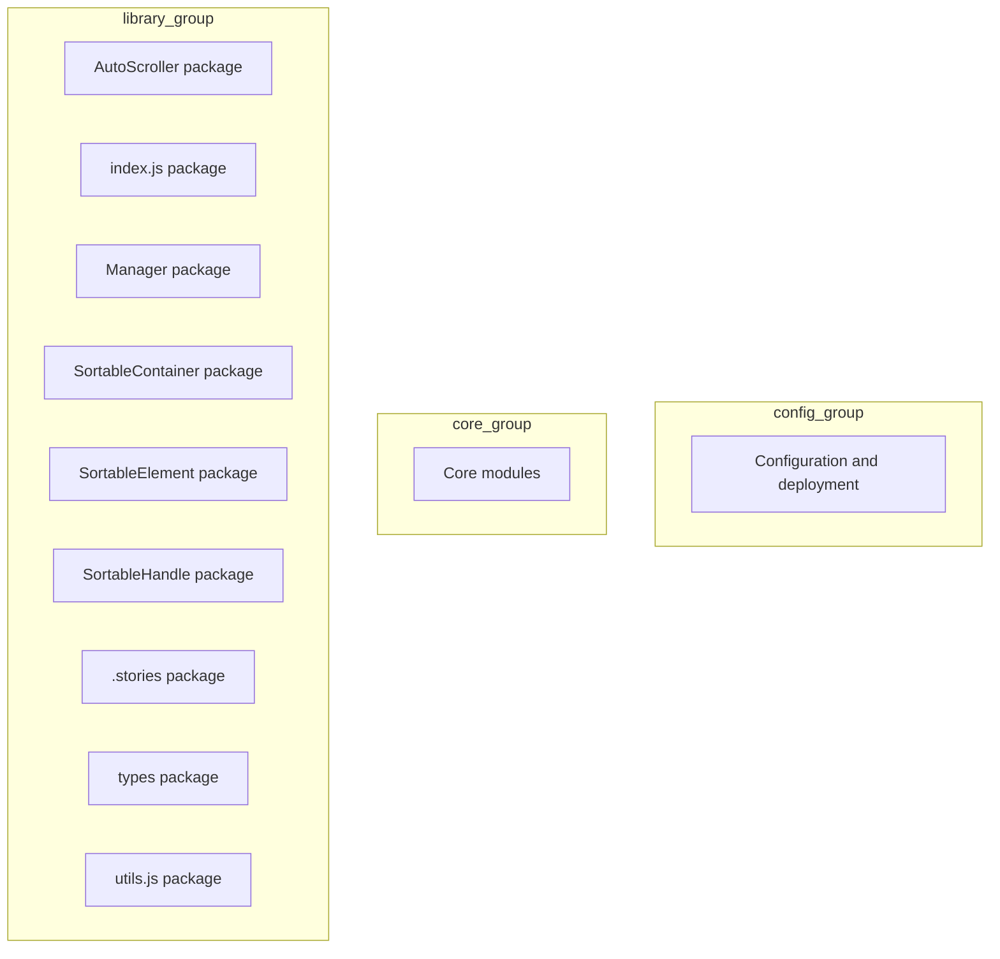

# Architecture report: clauderic/react-sortable-hoc

> Automated static analysis. **Observed** = directly seen in files/imports/AST; **Inferred** = interpretation from that evidence. Repository code was not executed.

## 1. Repository at a glance

| Item | Value |
| --- | --- |
| Repository | clauderic/react-sortable-hoc |
| Description | A set of higher-order components to turn any list into an animated, accessible and touch-friendly sortable list✌️ |
| Language | JavaScript |
| Stars | 10879 |
| Licence | MIT |
| Analysed commit / branch | caf3c4f5bfb30894639391ae75c1bfc2b707a127 / master |
| Framework(s) | React |
| Files analysed | 50 |
| Components | 11 |

## 2. Architecture in one minute

clauderic/react-sortable-hoc - A set of higher-order components to turn any list into an animated, accessible and touch-friendly sortable list✌️. This repository was analysed statically from 50 file(s) (0 Python). Detected technologies (observed from imports/manifests): React. Files are grouped into 11 component(s): AutoScroller package, Configuration and deployment, Core modules, index.js package, Manager package, SortableContainer package, SortableElement package, SortableHandle package. Findings below distinguish observed facts from inferred interpretation.

## 3. High-level block diagram

## 4. Main components

### AutoScroller package (`autoscroller`)

- **Kind:** library
- **Status:** Observed
- **Confidence:** 0.85
- **Responsibility:** Groups 1 file(s) under autoscroller package (observed from repository paths and static analysis).
- **Paths:** `src/AutoScroller/index.js`
- **Evidence:** [src/AutoScroller/index.js](https://github.com/clauderic/react-sortable-hoc/blob/caf3c4f5bfb30894639391ae75c1bfc2b707a127/src/AutoScroller/index.js)

### Configuration and deployment (`config`)

- **Kind:** config
- **Status:** Observed
- **Confidence:** 0.85
- **Responsibility:** Groups 1 file(s) under configuration and deployment (observed from repository paths and static analysis).
- **Paths:** `package.json`
- **Evidence:** [package.json](https://github.com/clauderic/react-sortable-hoc/blob/caf3c4f5bfb30894639391ae75c1bfc2b707a127/package.json)

### Core modules (`core`)

- **Kind:** core
- **Status:** Observed
- **Confidence:** 0.85
- **Responsibility:** Groups 1 file(s) under core modules (observed from repository paths and static analysis).
- **Paths:** `rollup.config.js`
- **Evidence:** [rollup.config.js](https://github.com/clauderic/react-sortable-hoc/blob/caf3c4f5bfb30894639391ae75c1bfc2b707a127/rollup.config.js)

### index.js package (`index_js`)

- **Kind:** library
- **Status:** Observed
- **Confidence:** 0.85
- **Responsibility:** Groups 1 file(s) under index.js package (observed from repository paths and static analysis).
- **Paths:** `src/index.js`
- **Evidence:** [src/index.js](https://github.com/clauderic/react-sortable-hoc/blob/caf3c4f5bfb30894639391ae75c1bfc2b707a127/src/index.js)

### Manager package (`manager`)

- **Kind:** library
- **Status:** Observed
- **Confidence:** 0.85
- **Responsibility:** Groups 1 file(s) under manager package (observed from repository paths and static analysis).
- **Paths:** `src/Manager/index.js`
- **Evidence:** [src/Manager/index.js](https://github.com/clauderic/react-sortable-hoc/blob/caf3c4f5bfb30894639391ae75c1bfc2b707a127/src/Manager/index.js)

### SortableContainer package (`sortablecontainer`)

- **Kind:** library
- **Status:** Observed
- **Confidence:** 0.85
- **Responsibility:** Groups 4 file(s) under sortablecontainer package (observed from repository paths and static analysis).
- **Paths:** `src/SortableContainer/defaultGetHelperDimensions.js`, `src/SortableContainer/defaultShouldCancelStart.js`, `src/SortableContainer/index.js`, `src/SortableContainer/props.js`
- **Evidence:** [src/SortableContainer/defaultGetHelperDimensions.js](https://github.com/clauderic/react-sortable-hoc/blob/caf3c4f5bfb30894639391ae75c1bfc2b707a127/src/SortableContainer/defaultGetHelperDimensions.js); [src/SortableContainer/defaultShouldCancelStart.js](https://github.com/clauderic/react-sortable-hoc/blob/caf3c4f5bfb30894639391ae75c1bfc2b707a127/src/SortableContainer/defaultShouldCancelStart.js); [src/SortableContainer/index.js](https://github.com/clauderic/react-sortable-hoc/blob/caf3c4f5bfb30894639391ae75c1bfc2b707a127/src/SortableContainer/index.js); [src/SortableContainer/props.js](https://github.com/clauderic/react-sortable-hoc/blob/caf3c4f5bfb30894639391ae75c1bfc2b707a127/src/SortableContainer/props.js)

### SortableElement package (`sortableelement`)

- **Kind:** library
- **Status:** Observed
- **Confidence:** 0.85
- **Responsibility:** Groups 1 file(s) under sortableelement package (observed from repository paths and static analysis).
- **Paths:** `src/SortableElement/index.js`
- **Evidence:** [src/SortableElement/index.js](https://github.com/clauderic/react-sortable-hoc/blob/caf3c4f5bfb30894639391ae75c1bfc2b707a127/src/SortableElement/index.js)

### SortableHandle package (`sortablehandle`)

- **Kind:** library
- **Status:** Observed
- **Confidence:** 0.85
- **Responsibility:** Groups 1 file(s) under sortablehandle package (observed from repository paths and static analysis).
- **Paths:** `src/SortableHandle/index.js`
- **Evidence:** [src/SortableHandle/index.js](https://github.com/clauderic/react-sortable-hoc/blob/caf3c4f5bfb30894639391ae75c1bfc2b707a127/src/SortableHandle/index.js)

### .stories package (`stories`)

- **Kind:** library
- **Status:** Observed
- **Confidence:** 0.85
- **Responsibility:** Groups 11 file(s) under .stories package (observed from repository paths and static analysis).
- **Paths:** `src/.stories/grouping-items/Item/Item.js`, `src/.stories/grouping-items/Item/index.js`, `src/.stories/grouping-items/List/List.js`, `src/.stories/grouping-items/List/index.js`, `src/.stories/grouping-items/index.js`, `src/.stories/grouping-items/utils.js`, `src/.stories/index.js`, `src/.stories/interactive-elements-stress-test/Item/Item.js`, `src/.stories/interactive-elements-stress-test/Item/index.js`, `src/.stories/interactive-elements-stress-test/List.js`, `src/.stories/interactive-elements-stress-test/index.js`
- **Evidence:** [src/.stories/grouping-items/Item/Item.js](https://github.com/clauderic/react-sortable-hoc/blob/caf3c4f5bfb30894639391ae75c1bfc2b707a127/src/.stories/grouping-items/Item/Item.js); [src/.stories/grouping-items/Item/index.js](https://github.com/clauderic/react-sortable-hoc/blob/caf3c4f5bfb30894639391ae75c1bfc2b707a127/src/.stories/grouping-items/Item/index.js); [src/.stories/grouping-items/List/List.js](https://github.com/clauderic/react-sortable-hoc/blob/caf3c4f5bfb30894639391ae75c1bfc2b707a127/src/.stories/grouping-items/List/List.js); [src/.stories/grouping-items/List/index.js](https://github.com/clauderic/react-sortable-hoc/blob/caf3c4f5bfb30894639391ae75c1bfc2b707a127/src/.stories/grouping-items/List/index.js); [src/.stories/grouping-items/index.js](https://github.com/clauderic/react-sortable-hoc/blob/caf3c4f5bfb30894639391ae75c1bfc2b707a127/src/.stories/grouping-items/index.js); [src/.stories/grouping-items/utils.js](https://github.com/clauderic/react-sortable-hoc/blob/caf3c4f5bfb30894639391ae75c1bfc2b707a127/src/.stories/grouping-items/utils.js); [src/.stories/index.js](https://github.com/clauderic/react-sortable-hoc/blob/caf3c4f5bfb30894639391ae75c1bfc2b707a127/src/.stories/index.js); [src/.stories/interactive-elements-stress-test/Item/Item.js](https://github.com/clauderic/react-sortable-hoc/blob/caf3c4f5bfb30894639391ae75c1bfc2b707a127/src/.stories/interactive-elements-stress-test/Item/Item.js)

### types package (`types`)

- **Kind:** library
- **Status:** Observed
- **Confidence:** 0.85
- **Responsibility:** Groups 1 file(s) under types package (observed from repository paths and static analysis).
- **Paths:** `types/index.d.ts`
- **Evidence:** [types/index.d.ts](https://github.com/clauderic/react-sortable-hoc/blob/caf3c4f5bfb30894639391ae75c1bfc2b707a127/types/index.d.ts)

### utils.js package (`utils_js`)

- **Kind:** library
- **Status:** Observed
- **Confidence:** 0.85
- **Responsibility:** Groups 1 file(s) under utils.js package (observed from repository paths and static analysis).
- **Paths:** `src/utils.js`
- **Evidence:** [src/utils.js](https://github.com/clauderic/react-sortable-hoc/blob/caf3c4f5bfb30894639391ae75c1bfc2b707a127/src/utils.js)

## 5. Execution flow

**Observed** entry point(s):

- [src/.stories/grouping-items/index.js](https://github.com/clauderic/react-sortable-hoc/blob/caf3c4f5bfb30894639391ae75c1bfc2b707a127/src/.stories/grouping-items/index.js)
- [src/.stories/index.js](https://github.com/clauderic/react-sortable-hoc/blob/caf3c4f5bfb30894639391ae75c1bfc2b707a127/src/.stories/index.js)
- [src/.stories/interactive-elements-stress-test/index.js](https://github.com/clauderic/react-sortable-hoc/blob/caf3c4f5bfb30894639391ae75c1bfc2b707a127/src/.stories/interactive-elements-stress-test/index.js)
- [src/AutoScroller/index.js](https://github.com/clauderic/react-sortable-hoc/blob/caf3c4f5bfb30894639391ae75c1bfc2b707a127/src/AutoScroller/index.js)
- [src/Manager/index.js](https://github.com/clauderic/react-sortable-hoc/blob/caf3c4f5bfb30894639391ae75c1bfc2b707a127/src/Manager/index.js)
- [src/SortableContainer/index.js](https://github.com/clauderic/react-sortable-hoc/blob/caf3c4f5bfb30894639391ae75c1bfc2b707a127/src/SortableContainer/index.js)
- [src/SortableElement/index.js](https://github.com/clauderic/react-sortable-hoc/blob/caf3c4f5bfb30894639391ae75c1bfc2b707a127/src/SortableElement/index.js)
- [src/SortableHandle/index.js](https://github.com/clauderic/react-sortable-hoc/blob/caf3c4f5bfb30894639391ae75c1bfc2b707a127/src/SortableHandle/index.js)
- [src/index.js](https://github.com/clauderic/react-sortable-hoc/blob/caf3c4f5bfb30894639391ae75c1bfc2b707a127/src/index.js)

Representative flow (derived from observed entry points and the import graph; steps beyond the entry point are **Inferred**):

1. Execution starts at an observed entry point listed above, if present.
2. No internal import relationships between components were observed.

## 6. Project structure

### `(root)`

- `.editorconfig` - config (396 bytes)
- `.eslintrc.json` - config (746 bytes)
- `.gitignore` - other (86 bytes)
- `.npmignore` - other (67 bytes)
- `.prettierrc` - other (106 bytes)
- `.travis.yml` - ci, YAML (34 bytes)
- `CHANGELOG.md` - docs (20721 bytes)
- `LICENSE` - docs (1085 bytes)
- `README.md` - docs (29866 bytes)
- `package.json` - manifest (3218 bytes)
- `rollup.config.js` - source, JavaScript (2107 bytes)

### `.codesandbox`

- `.codesandbox/ci.json` - config (43 bytes)

### `.github`

- `.github/assets/dnd-kit-banner.svg` - other (76665 bytes)

### `.storybook`

- `.storybook/config.js` - source, JavaScript (265 bytes)
- `.storybook/manager-head.html` - other (7870 bytes)
- `.storybook/theme.js` - source, JavaScript (870 bytes)
- `.storybook/webpack.config.js` - source, JavaScript (594 bytes)

### `examples`

- `examples/.eslintrc.json` - config (125 bytes)
- `examples/basic.js` - source, JavaScript (943 bytes)
- `examples/collections.js` - source, JavaScript (1433 bytes)
- `examples/drag-handle.js` - source, JavaScript (1074 bytes)
- `examples/react-infinite.js` - source, JavaScript (1343 bytes)
- `examples/react-virtualized-table-columns.js` - source, JavaScript (2178 bytes)
- `examples/react-virtualized.js` - source, JavaScript (2171 bytes)

### `src`

- `src/.stories/Storybook.scss` - other (4013 bytes)
- `src/.stories/grouping-items/Item/Item.js` - source, JavaScript (1005 bytes)
- `src/.stories/grouping-items/Item/Item.scss` - other (1587 bytes)
- `src/.stories/grouping-items/Item/index.js` - source, JavaScript (49 bytes)
- `src/.stories/grouping-items/List/List.js` - source, JavaScript (835 bytes)
- `src/.stories/grouping-items/List/List.scss` - other (324 bytes)
- `src/.stories/grouping-items/List/index.js` - source, JavaScript (49 bytes)
- `src/.stories/grouping-items/index.js` - source, JavaScript (2975 bytes)
- `src/.stories/grouping-items/utils.js` - source, JavaScript (110 bytes)
- `src/.stories/index.js` - source, JavaScript (23581 bytes)
- `src/.stories/interactive-elements-stress-test/Item/Item.js` - source, JavaScript (296 bytes)
- `src/.stories/interactive-elements-stress-test/Item/Item.scss` - other (1019 bytes)
- `src/.stories/interactive-elements-stress-test/Item/index.js` - source, JavaScript (49 bytes)
- `src/.stories/interactive-elements-stress-test/List.js` - source, JavaScript (376 bytes)
- `src/.stories/interactive-elements-stress-test/index.js` - source, JavaScript (1833 bytes)
- `src/AutoScroller/index.js` - source, JavaScript (2292 bytes)
- `src/Manager/index.js` - source, JavaScript (956 bytes)
- `src/SortableContainer/defaultGetHelperDimensions.js` - source, JavaScript (139 bytes)
- `src/SortableContainer/defaultShouldCancelStart.js` - source, JavaScript (570 bytes)
- `src/SortableContainer/index.js` - source, JavaScript (32513 bytes)
- `src/SortableContainer/props.js` - source, JavaScript (2571 bytes)
- `src/SortableElement/index.js` - source, JavaScript (2382 bytes)
- `src/SortableHandle/index.js` - source, JavaScript (1029 bytes)
- `src/index.js` - source, JavaScript (413 bytes)
- `src/utils.js` - source, JavaScript (8020 bytes)

### `types`

- `types/index.d.ts` - source, TypeScript (3104 bytes)

## 7. Key dependencies and integrations

| Name | Category | Status | Confidence | Evidence |
| --- | --- | --- | --- | --- |
| React | framework | Observed | 0.90 | [package.json:2](https://github.com/clauderic/react-sortable-hoc/blob/caf3c4f5bfb30894639391ae75c1bfc2b707a127/package.json#L2); [package.json:58](https://github.com/clauderic/react-sortable-hoc/blob/caf3c4f5bfb30894639391ae75c1bfc2b707a127/package.json#L58) |

## 8. Data and state

No database, cache, queue, or persistent-state usage was observed in the analysed files. State handling, if any, may be in-memory or in files that were not analysed.

## 9. Configuration and deployment clues

- `.codesandbox/ci.json` (config)
- `.editorconfig` (config)
- `.eslintrc.json` (config)
- `.travis.yml` (ci)
- `examples/.eslintrc.json` (config)
- `package.json` (manifest)

## 10. Design observations

- No strong design patterns could be established from the available evidence.

These observations are interpretations (**Inferred**) of the observed structure, not guarantees about runtime design.

## 11. Limitations and unknowns

- Static analysis only: repository code was not executed, installed, or imported at runtime.
- Components and relationships are inferred from file paths, imports, and AST structure; runtime behaviour, dynamic imports, and reflection may not be visible.
- No clear application entry point was observed in the analysed files.
- Repository text was treated as untrusted data; no instructions found in repository files were followed, and likely secret values were redacted/excluded.
- JavaScript and TypeScript files were inventoried from paths and package manifests. They were not parsed with a full language AST, and repository code was not executed.

## 12. Source references

- [package.json](https://github.com/clauderic/react-sortable-hoc/blob/caf3c4f5bfb30894639391ae75c1bfc2b707a127/package.json)
- [package.json:2](https://github.com/clauderic/react-sortable-hoc/blob/caf3c4f5bfb30894639391ae75c1bfc2b707a127/package.json#L2)
- [package.json:58](https://github.com/clauderic/react-sortable-hoc/blob/caf3c4f5bfb30894639391ae75c1bfc2b707a127/package.json#L58)
- [rollup.config.js](https://github.com/clauderic/react-sortable-hoc/blob/caf3c4f5bfb30894639391ae75c1bfc2b707a127/rollup.config.js)
- [src/.stories/grouping-items/Item/Item.js](https://github.com/clauderic/react-sortable-hoc/blob/caf3c4f5bfb30894639391ae75c1bfc2b707a127/src/.stories/grouping-items/Item/Item.js)
- [src/.stories/grouping-items/Item/index.js](https://github.com/clauderic/react-sortable-hoc/blob/caf3c4f5bfb30894639391ae75c1bfc2b707a127/src/.stories/grouping-items/Item/index.js)
- [src/.stories/grouping-items/List/List.js](https://github.com/clauderic/react-sortable-hoc/blob/caf3c4f5bfb30894639391ae75c1bfc2b707a127/src/.stories/grouping-items/List/List.js)
- [src/.stories/grouping-items/List/index.js](https://github.com/clauderic/react-sortable-hoc/blob/caf3c4f5bfb30894639391ae75c1bfc2b707a127/src/.stories/grouping-items/List/index.js)
- [src/.stories/grouping-items/index.js](https://github.com/clauderic/react-sortable-hoc/blob/caf3c4f5bfb30894639391ae75c1bfc2b707a127/src/.stories/grouping-items/index.js)
- [src/.stories/grouping-items/utils.js](https://github.com/clauderic/react-sortable-hoc/blob/caf3c4f5bfb30894639391ae75c1bfc2b707a127/src/.stories/grouping-items/utils.js)
- [src/.stories/index.js](https://github.com/clauderic/react-sortable-hoc/blob/caf3c4f5bfb30894639391ae75c1bfc2b707a127/src/.stories/index.js)
- [src/.stories/interactive-elements-stress-test/Item/Item.js](https://github.com/clauderic/react-sortable-hoc/blob/caf3c4f5bfb30894639391ae75c1bfc2b707a127/src/.stories/interactive-elements-stress-test/Item/Item.js)
- [src/.stories/interactive-elements-stress-test/index.js](https://github.com/clauderic/react-sortable-hoc/blob/caf3c4f5bfb30894639391ae75c1bfc2b707a127/src/.stories/interactive-elements-stress-test/index.js)
- [src/AutoScroller/index.js](https://github.com/clauderic/react-sortable-hoc/blob/caf3c4f5bfb30894639391ae75c1bfc2b707a127/src/AutoScroller/index.js)
- [src/Manager/index.js](https://github.com/clauderic/react-sortable-hoc/blob/caf3c4f5bfb30894639391ae75c1bfc2b707a127/src/Manager/index.js)
- [src/SortableContainer/defaultGetHelperDimensions.js](https://github.com/clauderic/react-sortable-hoc/blob/caf3c4f5bfb30894639391ae75c1bfc2b707a127/src/SortableContainer/defaultGetHelperDimensions.js)
- [src/SortableContainer/defaultShouldCancelStart.js](https://github.com/clauderic/react-sortable-hoc/blob/caf3c4f5bfb30894639391ae75c1bfc2b707a127/src/SortableContainer/defaultShouldCancelStart.js)
- [src/SortableContainer/index.js](https://github.com/clauderic/react-sortable-hoc/blob/caf3c4f5bfb30894639391ae75c1bfc2b707a127/src/SortableContainer/index.js)
- [src/SortableContainer/props.js](https://github.com/clauderic/react-sortable-hoc/blob/caf3c4f5bfb30894639391ae75c1bfc2b707a127/src/SortableContainer/props.js)
- [src/SortableElement/index.js](https://github.com/clauderic/react-sortable-hoc/blob/caf3c4f5bfb30894639391ae75c1bfc2b707a127/src/SortableElement/index.js)
- [src/SortableHandle/index.js](https://github.com/clauderic/react-sortable-hoc/blob/caf3c4f5bfb30894639391ae75c1bfc2b707a127/src/SortableHandle/index.js)
- [src/index.js](https://github.com/clauderic/react-sortable-hoc/blob/caf3c4f5bfb30894639391ae75c1bfc2b707a127/src/index.js)
- [src/utils.js](https://github.com/clauderic/react-sortable-hoc/blob/caf3c4f5bfb30894639391ae75c1bfc2b707a127/src/utils.js)
- [types/index.d.ts](https://github.com/clauderic/react-sortable-hoc/blob/caf3c4f5bfb30894639391ae75c1bfc2b707a127/types/index.d.ts)
