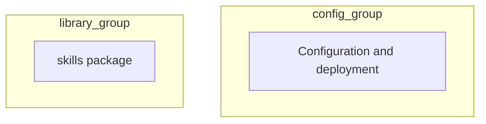

# Architecture report: cloudflare/security-audit-skill

> Automated static analysis. **Observed** = directly seen in files/imports/AST; **Inferred** = interpretation from that evidence. Repository code was not executed.

## 1. Repository at a glance

| Item | Value |
| --- | --- |
| Repository | cloudflare/security-audit-skill |
| Description | A coding-agent skill for multi-phase security audits with independently verified, machine-readable findings |
| Language | JavaScript |
| Stars | 72484 |
| Licence | MIT |
| Analysed commit / branch | c1c8a8c1471069fb0e188eeaff69b8e8db6564a8 / main |
| Framework(s) | None detected |
| Files analysed | 22 |
| Components | 2 |

## 2. Architecture in one minute

cloudflare/security-audit-skill - A coding-agent skill for multi-phase security audits with independently verified, machine-readable findings. This repository was analysed statically from 22 file(s) (0 Python). Detected technologies (observed from imports/manifests): no known frameworks/libraries. Files are grouped into 2 component(s): Configuration and deployment, skills package. Findings below distinguish observed facts from inferred interpretation.

## 3. High-level block diagram

## 4. Main components

### Configuration and deployment (`config`)

- **Kind:** config
- **Status:** Observed
- **Confidence:** 0.85
- **Responsibility:** Groups 1 file(s) under configuration and deployment (observed from repository paths and static analysis).
- **Paths:** `skills/security-audit/report-schema.json`
- **Evidence:** [skills/security-audit/report-schema.json](https://github.com/cloudflare/security-audit-skill/blob/c1c8a8c1471069fb0e188eeaff69b8e8db6564a8/skills/security-audit/report-schema.json)

### skills package (`skills`)

- **Kind:** library
- **Status:** Observed
- **Confidence:** 0.85
- **Responsibility:** Groups 4 file(s) under skills package (observed from repository paths and static analysis).
- **Paths:** `skills/security-audit/validate-coverage-ledger.cjs`, `skills/security-audit/validate-coverage-ledger.test.cjs`, `skills/security-audit/validate-findings.cjs`, `skills/security-audit/validate-findings.test.cjs`
- **Evidence:** [skills/security-audit/validate-coverage-ledger.cjs](https://github.com/cloudflare/security-audit-skill/blob/c1c8a8c1471069fb0e188eeaff69b8e8db6564a8/skills/security-audit/validate-coverage-ledger.cjs); [skills/security-audit/validate-coverage-ledger.test.cjs](https://github.com/cloudflare/security-audit-skill/blob/c1c8a8c1471069fb0e188eeaff69b8e8db6564a8/skills/security-audit/validate-coverage-ledger.test.cjs); [skills/security-audit/validate-findings.cjs](https://github.com/cloudflare/security-audit-skill/blob/c1c8a8c1471069fb0e188eeaff69b8e8db6564a8/skills/security-audit/validate-findings.cjs); [skills/security-audit/validate-findings.test.cjs](https://github.com/cloudflare/security-audit-skill/blob/c1c8a8c1471069fb0e188eeaff69b8e8db6564a8/skills/security-audit/validate-findings.test.cjs)

## 5. Execution flow

No entry point was observed; the startup flow below is therefore limited.

Representative flow (derived from observed entry points and the import graph; steps beyond the entry point are **Inferred**):

1. Execution starts at an observed entry point listed above, if present.
2. No internal import relationships between components were observed.

## 6. Project structure

### `(root)`

- `LICENSE` - docs (1078 bytes)
- `README.md` - docs (6950 bytes)

### `skills`

- `skills/security-audit/AI-AND-LLM.md` - docs (10617 bytes)
- `skills/security-audit/ATTACK-CLASSES.md` - docs (15695 bytes)
- `skills/security-audit/CLIENT-SIDE.md` - docs (8594 bytes)
- `skills/security-audit/CLOUD-AND-DEPLOYMENT.md` - docs (8291 bytes)
- `skills/security-audit/DATA-ISOLATION-AND-LIFECYCLE.md` - docs (7798 bytes)
- `skills/security-audit/DESKTOP-MOBILE-AND-LOCAL-IPC.md` - docs (8739 bytes)
- `skills/security-audit/HUNTING.md` - docs (22446 bytes)
- `skills/security-audit/MEMORY-SAFETY-AND-BINARY.md` - docs (10513 bytes)
- `skills/security-audit/PROTOCOLS-RPC-AND-MESSAGING.md` - docs (7483 bytes)
- `skills/security-audit/RECONNAISSANCE.md` - docs (15902 bytes)
- `skills/security-audit/RESOURCE-EXHAUSTION-AND-AVAILABILITY.md` - docs (7476 bytes)
- `skills/security-audit/SKILL.md` - docs (22026 bytes)
- `skills/security-audit/SUPPLY-CHAIN-AND-RELEASE.md` - docs (7258 bytes)
- `skills/security-audit/VALIDATION-AND-REPORTING.md` - docs (17843 bytes)
- `skills/security-audit/WEB-PROTOCOL-AND-AUTH.md` - docs (12300 bytes)
- `skills/security-audit/report-schema.json` - config (14494 bytes)
- `skills/security-audit/validate-coverage-ledger.cjs` - source, JavaScript (33522 bytes)
- `skills/security-audit/validate-coverage-ledger.test.cjs` - source, JavaScript (28483 bytes)
- `skills/security-audit/validate-findings.cjs` - source, JavaScript (28806 bytes)
- `skills/security-audit/validate-findings.test.cjs` - source, JavaScript (26384 bytes)

## 7. Key dependencies and integrations

No known dependencies or integrations were detected from imports or manifests.

## 8. Data and state

No database, cache, queue, or persistent-state usage was observed in the analysed files. State handling, if any, may be in-memory or in files that were not analysed.

## 9. Configuration and deployment clues

- `skills/security-audit/report-schema.json` (config)

## 10. Design observations

- No strong design patterns could be established from the available evidence.

These observations are interpretations (**Inferred**) of the observed structure, not guarantees about runtime design.

## 11. Limitations and unknowns

- Static analysis only: repository code was not executed, installed, or imported at runtime.
- Components and relationships are inferred from file paths, imports, and AST structure; runtime behaviour, dynamic imports, and reflection may not be visible.
- No clear application entry point was observed in the analysed files.
- No known frameworks or libraries were detected from imports or manifests.
- Repository text was treated as untrusted data; no instructions found in repository files were followed, and likely secret values were redacted/excluded.
- JavaScript and TypeScript files were inventoried from paths and package manifests. They were not parsed with a full language AST, and repository code was not executed.

## 12. Source references

- [skills/security-audit/report-schema.json](https://github.com/cloudflare/security-audit-skill/blob/c1c8a8c1471069fb0e188eeaff69b8e8db6564a8/skills/security-audit/report-schema.json)
- [skills/security-audit/validate-coverage-ledger.cjs](https://github.com/cloudflare/security-audit-skill/blob/c1c8a8c1471069fb0e188eeaff69b8e8db6564a8/skills/security-audit/validate-coverage-ledger.cjs)
- [skills/security-audit/validate-coverage-ledger.test.cjs](https://github.com/cloudflare/security-audit-skill/blob/c1c8a8c1471069fb0e188eeaff69b8e8db6564a8/skills/security-audit/validate-coverage-ledger.test.cjs)
- [skills/security-audit/validate-findings.cjs](https://github.com/cloudflare/security-audit-skill/blob/c1c8a8c1471069fb0e188eeaff69b8e8db6564a8/skills/security-audit/validate-findings.cjs)
- [skills/security-audit/validate-findings.test.cjs](https://github.com/cloudflare/security-audit-skill/blob/c1c8a8c1471069fb0e188eeaff69b8e8db6564a8/skills/security-audit/validate-findings.test.cjs)
