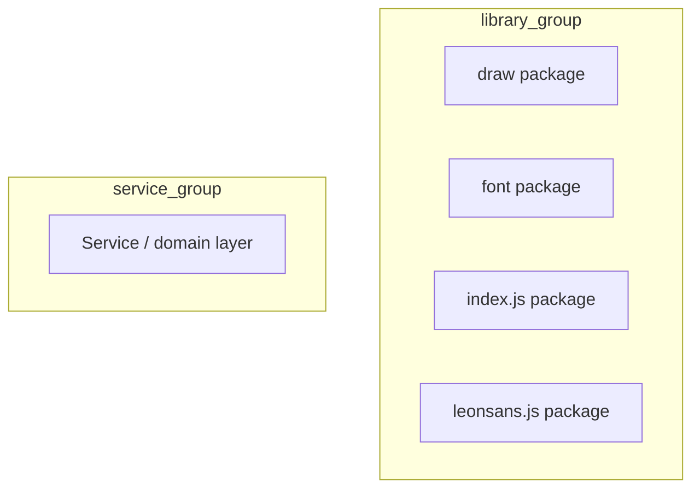

# Architecture report: cmiscm/leonsans

> Automated static analysis. **Observed** = directly seen in files/imports/AST; **Inferred** = interpretation from that evidence. Repository code was not executed.

## 1. Repository at a glance

| Item | Value |
| --- | --- |
| Repository | cmiscm/leonsans |
| Description | Leon Sans is a geometric sans-serif typeface made with code in 2019 by Jongmin Kim. |
| Language | JavaScript |
| Stars | 10172 |
| Licence | MIT |
| Analysed commit / branch | f8c03c92d80552f9210a9c5a54a1b1ee81252129 / master |
| Framework(s) | None detected |
| Files analysed | 47 |
| Components | 5 |

## 2. Architecture in one minute

cmiscm/leonsans - Leon Sans is a geometric sans-serif typeface made with code in 2019 by Jongmin Kim.. This repository was analysed statically from 47 file(s) (0 Python). Detected technologies (observed from imports/manifests): no known frameworks/libraries. Files are grouped into 5 component(s): draw package, font package, index.js package, leonsans.js package, Service / domain layer. Findings below distinguish observed facts from inferred interpretation.

## 3. High-level block diagram

## 4. Main components

### draw package (`draw`)

- **Kind:** library
- **Status:** Observed
- **Confidence:** 0.85
- **Responsibility:** Groups 9 file(s) under draw package (observed from repository paths and static analysis).
- **Paths:** `src/draw/canvas/color.js`, `src/draw/canvas/colorful.js`, `src/draw/canvas/grids.js`, `src/draw/canvas/lines.js`, `src/draw/canvas/pattern.js`, `src/draw/canvas/points.js`, `src/draw/canvas/wave.js`, `src/draw/pixi/color.js`, `src/draw/pixi/lines.js`
- **Evidence:** [src/draw/canvas/color.js](https://github.com/cmiscm/leonsans/blob/f8c03c92d80552f9210a9c5a54a1b1ee81252129/src/draw/canvas/color.js); [src/draw/canvas/colorful.js](https://github.com/cmiscm/leonsans/blob/f8c03c92d80552f9210a9c5a54a1b1ee81252129/src/draw/canvas/colorful.js); [src/draw/canvas/grids.js](https://github.com/cmiscm/leonsans/blob/f8c03c92d80552f9210a9c5a54a1b1ee81252129/src/draw/canvas/grids.js); [src/draw/canvas/lines.js](https://github.com/cmiscm/leonsans/blob/f8c03c92d80552f9210a9c5a54a1b1ee81252129/src/draw/canvas/lines.js); [src/draw/canvas/pattern.js](https://github.com/cmiscm/leonsans/blob/f8c03c92d80552f9210a9c5a54a1b1ee81252129/src/draw/canvas/pattern.js); [src/draw/canvas/points.js](https://github.com/cmiscm/leonsans/blob/f8c03c92d80552f9210a9c5a54a1b1ee81252129/src/draw/canvas/points.js); [src/draw/canvas/wave.js](https://github.com/cmiscm/leonsans/blob/f8c03c92d80552f9210a9c5a54a1b1ee81252129/src/draw/canvas/wave.js); [src/draw/pixi/color.js](https://github.com/cmiscm/leonsans/blob/f8c03c92d80552f9210a9c5a54a1b1ee81252129/src/draw/pixi/color.js)

### font package (`font`)

- **Kind:** library
- **Status:** Observed
- **Confidence:** 0.85
- **Responsibility:** Groups 8 file(s) under font package (observed from repository paths and static analysis).
- **Paths:** `src/font/index.js`, `src/font/latin.js`, `src/font/latinutil.js`, `src/font/lower.js`, `src/font/number.js`, `src/font/special.js`, `src/font/upper.js`, `src/font/util.js`
- **Evidence:** [src/font/index.js](https://github.com/cmiscm/leonsans/blob/f8c03c92d80552f9210a9c5a54a1b1ee81252129/src/font/index.js); [src/font/latin.js](https://github.com/cmiscm/leonsans/blob/f8c03c92d80552f9210a9c5a54a1b1ee81252129/src/font/latin.js); [src/font/latinutil.js](https://github.com/cmiscm/leonsans/blob/f8c03c92d80552f9210a9c5a54a1b1ee81252129/src/font/latinutil.js); [src/font/lower.js](https://github.com/cmiscm/leonsans/blob/f8c03c92d80552f9210a9c5a54a1b1ee81252129/src/font/lower.js); [src/font/number.js](https://github.com/cmiscm/leonsans/blob/f8c03c92d80552f9210a9c5a54a1b1ee81252129/src/font/number.js); [src/font/special.js](https://github.com/cmiscm/leonsans/blob/f8c03c92d80552f9210a9c5a54a1b1ee81252129/src/font/special.js); [src/font/upper.js](https://github.com/cmiscm/leonsans/blob/f8c03c92d80552f9210a9c5a54a1b1ee81252129/src/font/upper.js); [src/font/util.js](https://github.com/cmiscm/leonsans/blob/f8c03c92d80552f9210a9c5a54a1b1ee81252129/src/font/util.js)

### index.js package (`index_js`)

- **Kind:** library
- **Status:** Observed
- **Confidence:** 0.85
- **Responsibility:** Groups 1 file(s) under index.js package (observed from repository paths and static analysis).
- **Paths:** `src/index.js`
- **Evidence:** [src/index.js](https://github.com/cmiscm/leonsans/blob/f8c03c92d80552f9210a9c5a54a1b1ee81252129/src/index.js)

### leonsans.js package (`leonsans_js`)

- **Kind:** library
- **Status:** Observed
- **Confidence:** 0.85
- **Responsibility:** Groups 1 file(s) under leonsans.js package (observed from repository paths and static analysis).
- **Paths:** `src/leonsans.js`
- **Evidence:** [src/leonsans.js](https://github.com/cmiscm/leonsans/blob/f8c03c92d80552f9210a9c5a54a1b1ee81252129/src/leonsans.js)

### Service / domain layer (`service_layer`)

- **Kind:** service
- **Status:** Observed
- **Confidence:** 0.85
- **Responsibility:** Groups 10 file(s) under service / domain layer (observed from repository paths and static analysis).
- **Paths:** `src/core/align.js`, `src/core/dispatcher.js`, `src/core/group.js`, `src/core/guide.js`, `src/core/length.js`, `src/core/model.js`, `src/core/paths.js`, `src/core/point.js`, `src/core/util.js`, `src/core/vector.js`
- **Evidence:** [src/core/align.js](https://github.com/cmiscm/leonsans/blob/f8c03c92d80552f9210a9c5a54a1b1ee81252129/src/core/align.js); [src/core/dispatcher.js](https://github.com/cmiscm/leonsans/blob/f8c03c92d80552f9210a9c5a54a1b1ee81252129/src/core/dispatcher.js); [src/core/group.js](https://github.com/cmiscm/leonsans/blob/f8c03c92d80552f9210a9c5a54a1b1ee81252129/src/core/group.js); [src/core/guide.js](https://github.com/cmiscm/leonsans/blob/f8c03c92d80552f9210a9c5a54a1b1ee81252129/src/core/guide.js); [src/core/length.js](https://github.com/cmiscm/leonsans/blob/f8c03c92d80552f9210a9c5a54a1b1ee81252129/src/core/length.js); [src/core/model.js](https://github.com/cmiscm/leonsans/blob/f8c03c92d80552f9210a9c5a54a1b1ee81252129/src/core/model.js); [src/core/paths.js](https://github.com/cmiscm/leonsans/blob/f8c03c92d80552f9210a9c5a54a1b1ee81252129/src/core/paths.js); [src/core/point.js](https://github.com/cmiscm/leonsans/blob/f8c03c92d80552f9210a9c5a54a1b1ee81252129/src/core/point.js)

## 5. Execution flow

**Observed** entry point(s):

- [src/font/index.js](https://github.com/cmiscm/leonsans/blob/f8c03c92d80552f9210a9c5a54a1b1ee81252129/src/font/index.js)
- [src/index.js](https://github.com/cmiscm/leonsans/blob/f8c03c92d80552f9210a9c5a54a1b1ee81252129/src/index.js)

Representative flow (derived from observed entry points and the import graph; steps beyond the entry point are **Inferred**):

1. Execution starts at an observed entry point listed above, if present.
2. No internal import relationships between components were observed.

## 6. Project structure

### `(root)`

- `.gitignore` - other (44 bytes)
- `LICENSE` - docs (1068 bytes)
- `README.md` - docs (9481 bytes)

### `examples`

- `examples/all.html` - other (3506 bytes)
- `examples/canvas-basic.html` - other (4124 bytes)
- `examples/color-pattern.html` - other (4393 bytes)
- `examples/colorful.html` - other (3373 bytes)
- `examples/gradient.html` - other (3131 bytes)
- `examples/grid.html` - other (2509 bytes)
- `examples/index.html` - other (8903 bytes)
- `examples/js/util.js` - source, JavaScript (1955 bytes)
- `examples/mask-tiling-pixi.html` - other (6186 bytes)
- `examples/metaball-pixi.html` - other (7843 bytes)
- `examples/morphing-pixi.html` - other (7442 bytes)
- `examples/pattern.html` - other (2792 bytes)
- `examples/plants-pixi.html` - other (7554 bytes)
- `examples/wave.html` - other (2219 bytes)
- `examples/webgl-basic-pixi.html` - other (4080 bytes)

### `src`

- `src/core/align.js` - source, JavaScript (338 bytes)
- `src/core/dispatcher.js` - source, JavaScript (1256 bytes)
- `src/core/group.js` - source, JavaScript (2924 bytes)
- `src/core/guide.js` - source, JavaScript (1114 bytes)
- `src/core/length.js` - source, JavaScript (2987 bytes)
- `src/core/model.js` - source, JavaScript (7310 bytes)
- `src/core/paths.js` - source, JavaScript (5670 bytes)
- `src/core/point.js` - source, JavaScript (570 bytes)
- `src/core/util.js` - source, JavaScript (5662 bytes)
- `src/core/vector.js` - source, JavaScript (3243 bytes)
- `src/draw/canvas/color.js` - source, JavaScript (760 bytes)
- `src/draw/canvas/colorful.js` - source, JavaScript (2919 bytes)
- `src/draw/canvas/grids.js` - source, JavaScript (557 bytes)
- `src/draw/canvas/lines.js` - source, JavaScript (780 bytes)
- `src/draw/canvas/pattern.js` - source, JavaScript (786 bytes)
- `src/draw/canvas/points.js` - source, JavaScript (1991 bytes)
- `src/draw/canvas/wave.js` - source, JavaScript (1556 bytes)
- `src/draw/pixi/color.js` - source, JavaScript (1119 bytes)
- `src/draw/pixi/lines.js` - source, JavaScript (1596 bytes)
- `src/font/index.js` - source, JavaScript (444 bytes)
- `src/font/latin.js` - source, JavaScript (20903 bytes)
- `src/font/latinutil.js` - source, JavaScript (8507 bytes)
- `src/font/lower.js` - source, JavaScript (24180 bytes)
- `src/font/number.js` - source, JavaScript (10101 bytes)
- `src/font/special.js` - source, JavaScript (32259 bytes)
- `src/font/upper.js` - source, JavaScript (23178 bytes)
- `src/font/util.js` - source, JavaScript (2283 bytes)
- `src/index.js` - source, JavaScript (74 bytes)
- `src/leonsans.js` - source, JavaScript (11669 bytes)

## 7. Key dependencies and integrations

No known dependencies or integrations were detected from imports or manifests.

## 8. Data and state

No database, cache, queue, or persistent-state usage was observed in the analysed files. State handling, if any, may be in-memory or in files that were not analysed.

## 9. Configuration and deployment clues

No configuration, manifest, CI, or container files were observed.

## 10. Design observations

- Service/domain code is distinct from entry and data code, suggesting layered separation (Inferred).

These observations are interpretations (**Inferred**) of the observed structure, not guarantees about runtime design.

## 11. Limitations and unknowns

- Static analysis only: repository code was not executed, installed, or imported at runtime.
- Components and relationships are inferred from file paths, imports, and AST structure; runtime behaviour, dynamic imports, and reflection may not be visible.
- 1 file(s) were skipped during inventory (1 x vendored/generated directory excluded).
- No clear application entry point was observed in the analysed files.
- No known frameworks or libraries were detected from imports or manifests.
- Repository text was treated as untrusted data; no instructions found in repository files were followed, and likely secret values were redacted/excluded.
- JavaScript and TypeScript files were inventoried from paths and package manifests. They were not parsed with a full language AST, and repository code was not executed.

## 12. Source references

- [src/core/align.js](https://github.com/cmiscm/leonsans/blob/f8c03c92d80552f9210a9c5a54a1b1ee81252129/src/core/align.js)
- [src/core/dispatcher.js](https://github.com/cmiscm/leonsans/blob/f8c03c92d80552f9210a9c5a54a1b1ee81252129/src/core/dispatcher.js)
- [src/core/group.js](https://github.com/cmiscm/leonsans/blob/f8c03c92d80552f9210a9c5a54a1b1ee81252129/src/core/group.js)
- [src/core/guide.js](https://github.com/cmiscm/leonsans/blob/f8c03c92d80552f9210a9c5a54a1b1ee81252129/src/core/guide.js)
- [src/core/length.js](https://github.com/cmiscm/leonsans/blob/f8c03c92d80552f9210a9c5a54a1b1ee81252129/src/core/length.js)
- [src/core/model.js](https://github.com/cmiscm/leonsans/blob/f8c03c92d80552f9210a9c5a54a1b1ee81252129/src/core/model.js)
- [src/core/paths.js](https://github.com/cmiscm/leonsans/blob/f8c03c92d80552f9210a9c5a54a1b1ee81252129/src/core/paths.js)
- [src/core/point.js](https://github.com/cmiscm/leonsans/blob/f8c03c92d80552f9210a9c5a54a1b1ee81252129/src/core/point.js)
- [src/draw/canvas/color.js](https://github.com/cmiscm/leonsans/blob/f8c03c92d80552f9210a9c5a54a1b1ee81252129/src/draw/canvas/color.js)
- [src/draw/canvas/colorful.js](https://github.com/cmiscm/leonsans/blob/f8c03c92d80552f9210a9c5a54a1b1ee81252129/src/draw/canvas/colorful.js)
- [src/draw/canvas/grids.js](https://github.com/cmiscm/leonsans/blob/f8c03c92d80552f9210a9c5a54a1b1ee81252129/src/draw/canvas/grids.js)
- [src/draw/canvas/lines.js](https://github.com/cmiscm/leonsans/blob/f8c03c92d80552f9210a9c5a54a1b1ee81252129/src/draw/canvas/lines.js)
- [src/draw/canvas/pattern.js](https://github.com/cmiscm/leonsans/blob/f8c03c92d80552f9210a9c5a54a1b1ee81252129/src/draw/canvas/pattern.js)
- [src/draw/canvas/points.js](https://github.com/cmiscm/leonsans/blob/f8c03c92d80552f9210a9c5a54a1b1ee81252129/src/draw/canvas/points.js)
- [src/draw/canvas/wave.js](https://github.com/cmiscm/leonsans/blob/f8c03c92d80552f9210a9c5a54a1b1ee81252129/src/draw/canvas/wave.js)
- [src/draw/pixi/color.js](https://github.com/cmiscm/leonsans/blob/f8c03c92d80552f9210a9c5a54a1b1ee81252129/src/draw/pixi/color.js)
- [src/font/index.js](https://github.com/cmiscm/leonsans/blob/f8c03c92d80552f9210a9c5a54a1b1ee81252129/src/font/index.js)
- [src/font/latin.js](https://github.com/cmiscm/leonsans/blob/f8c03c92d80552f9210a9c5a54a1b1ee81252129/src/font/latin.js)
- [src/font/latinutil.js](https://github.com/cmiscm/leonsans/blob/f8c03c92d80552f9210a9c5a54a1b1ee81252129/src/font/latinutil.js)
- [src/font/lower.js](https://github.com/cmiscm/leonsans/blob/f8c03c92d80552f9210a9c5a54a1b1ee81252129/src/font/lower.js)
- [src/font/number.js](https://github.com/cmiscm/leonsans/blob/f8c03c92d80552f9210a9c5a54a1b1ee81252129/src/font/number.js)
- [src/font/special.js](https://github.com/cmiscm/leonsans/blob/f8c03c92d80552f9210a9c5a54a1b1ee81252129/src/font/special.js)
- [src/font/upper.js](https://github.com/cmiscm/leonsans/blob/f8c03c92d80552f9210a9c5a54a1b1ee81252129/src/font/upper.js)
- [src/font/util.js](https://github.com/cmiscm/leonsans/blob/f8c03c92d80552f9210a9c5a54a1b1ee81252129/src/font/util.js)
- [src/index.js](https://github.com/cmiscm/leonsans/blob/f8c03c92d80552f9210a9c5a54a1b1ee81252129/src/index.js)
- [src/leonsans.js](https://github.com/cmiscm/leonsans/blob/f8c03c92d80552f9210a9c5a54a1b1ee81252129/src/leonsans.js)
