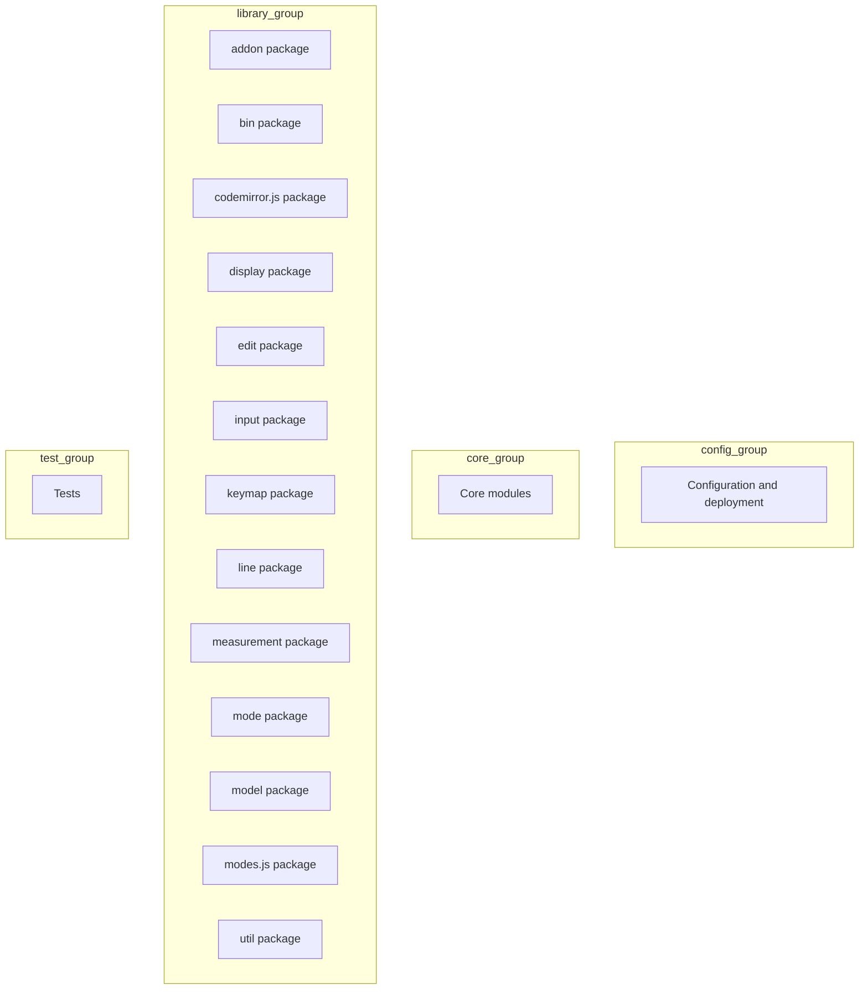

# Architecture report: codemirror/codemirror5

> Automated static analysis. **Observed** = directly seen in files/imports/AST; **Inferred** = interpretation from that evidence. Repository code was not executed.

## 1. Repository at a glance

| Item | Value |
| --- | --- |
| Repository | codemirror/codemirror5 |
| Description | In-browser code editor (version 5, legacy) |
| Language | JavaScript |
| Stars | 27192 |
| Licence | MIT |
| Analysed commit / branch | 9b4f0603cb042286a7ac2262b98245493d0d7e4b / master |
| Framework(s) | None detected |
| Files analysed | 578 |
| Components | 16 |

## 2. Architecture in one minute

codemirror/codemirror5 - In-browser code editor (version 5, legacy). This repository was analysed statically from 578 file(s) (0 Python). Detected technologies (observed from imports/manifests): Docker. Files are grouped into 16 component(s): addon package, bin package, codemirror.js package, Configuration and deployment, Core modules, display package, edit package, input package. Findings below distinguish observed facts from inferred interpretation.

## 3. High-level block diagram

## 4. Main components

### addon package (`addon`)

- **Kind:** library
- **Status:** Observed
- **Confidence:** 0.85
- **Responsibility:** Groups 61 file(s) under addon package (observed from repository paths and static analysis).
- **Paths:** `addon/comment/comment.js`, `addon/comment/continuecomment.js`, `addon/dialog/dialog.js`, `addon/display/autorefresh.js`, `addon/display/fullscreen.js`, `addon/display/panel.js`, `addon/display/placeholder.js`, `addon/display/rulers.js`, `addon/edit/closebrackets.js`, `addon/edit/closetag.js`, `addon/edit/continuelist.js`, `addon/edit/matchbrackets.js`, `addon/edit/matchtags.js`, `addon/edit/trailingspace.js`, `addon/fold/brace-fold.js`, `addon/fold/comment-fold.js`, `addon/fold/foldcode.js`, `addon/fold/foldgutter.js`, `addon/fold/indent-fold.js`, `addon/fold/markdown-fold.js`, `addon/fold/xml-fold.js`, `addon/hint/anyword-hint.js`, `addon/hint/css-hint.js`, `addon/hint/html-hint.js`, `addon/hint/javascript-hint.js`, `addon/hint/show-hint.js`, `addon/hint/sql-hint.js`, `addon/hint/xml-hint.js`, `addon/lint/coffeescript-lint.js`, `addon/lint/css-lint.js`, `addon/lint/html-lint.js`, `addon/lint/javascript-lint.js`, `addon/lint/json-lint.js`, `addon/lint/lint.js`, `addon/lint/yaml-lint.js`, `addon/merge/merge.js`, `addon/mode/loadmode.js`, `addon/mode/multiplex.js`, `addon/mode/multiplex_test.js`, `addon/mode/overlay.js`, `addon/mode/simple.js`, `addon/runmode/colorize.js`, `addon/runmode/runmode.js`, `addon/scroll/annotatescrollbar.js`, `addon/scroll/scrollpastend.js`, `addon/scroll/simplescrollbars.js`, `addon/search/jump-to-line.js`, `addon/search/match-highlighter.js`, `addon/search/matchesonscrollbar.js`, `addon/search/search.js`, `addon/search/searchcursor.js`, `addon/selection/active-line.js`, `addon/selection/mark-selection.js`, `addon/selection/selection-pointer.js`, `addon/tern/tern.js`, `addon/tern/worker.js`, `addon/wrap/hardwrap.js`, `src/addon/runmode/codemirror-standalone.js`, `src/addon/runmode/codemirror.node.js`, `src/addon/runmode/runmode-standalone.js`, `src/addon/runmode/runmode.node.js`
- **Evidence:** [addon/comment/comment.js](https://github.com/codemirror/codemirror5/blob/9b4f0603cb042286a7ac2262b98245493d0d7e4b/addon/comment/comment.js); [addon/comment/continuecomment.js](https://github.com/codemirror/codemirror5/blob/9b4f0603cb042286a7ac2262b98245493d0d7e4b/addon/comment/continuecomment.js); [addon/dialog/dialog.js](https://github.com/codemirror/codemirror5/blob/9b4f0603cb042286a7ac2262b98245493d0d7e4b/addon/dialog/dialog.js); [addon/display/autorefresh.js](https://github.com/codemirror/codemirror5/blob/9b4f0603cb042286a7ac2262b98245493d0d7e4b/addon/display/autorefresh.js); [addon/display/fullscreen.js](https://github.com/codemirror/codemirror5/blob/9b4f0603cb042286a7ac2262b98245493d0d7e4b/addon/display/fullscreen.js); [addon/display/panel.js](https://github.com/codemirror/codemirror5/blob/9b4f0603cb042286a7ac2262b98245493d0d7e4b/addon/display/panel.js); [addon/display/placeholder.js](https://github.com/codemirror/codemirror5/blob/9b4f0603cb042286a7ac2262b98245493d0d7e4b/addon/display/placeholder.js); [addon/display/rulers.js](https://github.com/codemirror/codemirror5/blob/9b4f0603cb042286a7ac2262b98245493d0d7e4b/addon/display/rulers.js)

### bin package (`bin`)

- **Kind:** library
- **Status:** Observed
- **Confidence:** 0.85
- **Responsibility:** Groups 2 file(s) under bin package (observed from repository paths and static analysis).
- **Paths:** `bin/authors.sh`, `bin/upload-release.js`
- **Evidence:** [bin/authors.sh](https://github.com/codemirror/codemirror5/blob/9b4f0603cb042286a7ac2262b98245493d0d7e4b/bin/authors.sh); [bin/upload-release.js](https://github.com/codemirror/codemirror5/blob/9b4f0603cb042286a7ac2262b98245493d0d7e4b/bin/upload-release.js)

### codemirror.js package (`codemirror_js`)

- **Kind:** library
- **Status:** Observed
- **Confidence:** 0.85
- **Responsibility:** Groups 1 file(s) under codemirror.js package (observed from repository paths and static analysis).
- **Paths:** `src/codemirror.js`
- **Evidence:** [src/codemirror.js](https://github.com/codemirror/codemirror5/blob/9b4f0603cb042286a7ac2262b98245493d0d7e4b/src/codemirror.js)

### Configuration and deployment (`config`)

- **Kind:** config
- **Status:** Observed
- **Confidence:** 0.85
- **Responsibility:** Groups 2 file(s) under configuration and deployment (observed from repository paths and static analysis).
- **Paths:** `mode/dockerfile/dockerfile.js`, `package.json`
- **Evidence:** [mode/dockerfile/dockerfile.js](https://github.com/codemirror/codemirror5/blob/9b4f0603cb042286a7ac2262b98245493d0d7e4b/mode/dockerfile/dockerfile.js); [package.json](https://github.com/codemirror/codemirror5/blob/9b4f0603cb042286a7ac2262b98245493d0d7e4b/package.json)

### Core modules (`core`)

- **Kind:** core
- **Status:** Observed
- **Confidence:** 0.85
- **Responsibility:** Groups 1 file(s) under core modules (observed from repository paths and static analysis).
- **Paths:** `rollup.config.js`
- **Evidence:** [rollup.config.js](https://github.com/codemirror/codemirror5/blob/9b4f0603cb042286a7ac2262b98245493d0d7e4b/rollup.config.js)

### display package (`display`)

- **Kind:** library
- **Status:** Observed
- **Confidence:** 0.85
- **Responsibility:** Groups 15 file(s) under display package (observed from repository paths and static analysis).
- **Paths:** `src/display/Display.js`, `src/display/focus.js`, `src/display/gutters.js`, `src/display/highlight_worker.js`, `src/display/line_numbers.js`, `src/display/mode_state.js`, `src/display/operations.js`, `src/display/scroll_events.js`, `src/display/scrollbars.js`, `src/display/scrolling.js`, `src/display/selection.js`, `src/display/update_display.js`, `src/display/update_line.js`, `src/display/update_lines.js`, `src/display/view_tracking.js`
- **Evidence:** [src/display/Display.js](https://github.com/codemirror/codemirror5/blob/9b4f0603cb042286a7ac2262b98245493d0d7e4b/src/display/Display.js); [src/display/focus.js](https://github.com/codemirror/codemirror5/blob/9b4f0603cb042286a7ac2262b98245493d0d7e4b/src/display/focus.js); [src/display/gutters.js](https://github.com/codemirror/codemirror5/blob/9b4f0603cb042286a7ac2262b98245493d0d7e4b/src/display/gutters.js); [src/display/highlight_worker.js](https://github.com/codemirror/codemirror5/blob/9b4f0603cb042286a7ac2262b98245493d0d7e4b/src/display/highlight_worker.js); [src/display/line_numbers.js](https://github.com/codemirror/codemirror5/blob/9b4f0603cb042286a7ac2262b98245493d0d7e4b/src/display/line_numbers.js); [src/display/mode_state.js](https://github.com/codemirror/codemirror5/blob/9b4f0603cb042286a7ac2262b98245493d0d7e4b/src/display/mode_state.js); [src/display/operations.js](https://github.com/codemirror/codemirror5/blob/9b4f0603cb042286a7ac2262b98245493d0d7e4b/src/display/operations.js); [src/display/scroll_events.js](https://github.com/codemirror/codemirror5/blob/9b4f0603cb042286a7ac2262b98245493d0d7e4b/src/display/scroll_events.js)

### edit package (`edit`)

- **Kind:** library
- **Status:** Observed
- **Confidence:** 0.85
- **Responsibility:** Groups 13 file(s) under edit package (observed from repository paths and static analysis).
- **Paths:** `src/edit/CodeMirror.js`, `src/edit/commands.js`, `src/edit/deleteNearSelection.js`, `src/edit/drop_events.js`, `src/edit/fromTextArea.js`, `src/edit/global_events.js`, `src/edit/key_events.js`, `src/edit/legacy.js`, `src/edit/main.js`, `src/edit/methods.js`, `src/edit/mouse_events.js`, `src/edit/options.js`, `src/edit/utils.js`
- **Evidence:** [src/edit/CodeMirror.js](https://github.com/codemirror/codemirror5/blob/9b4f0603cb042286a7ac2262b98245493d0d7e4b/src/edit/CodeMirror.js); [src/edit/commands.js](https://github.com/codemirror/codemirror5/blob/9b4f0603cb042286a7ac2262b98245493d0d7e4b/src/edit/commands.js); [src/edit/deleteNearSelection.js](https://github.com/codemirror/codemirror5/blob/9b4f0603cb042286a7ac2262b98245493d0d7e4b/src/edit/deleteNearSelection.js); [src/edit/drop_events.js](https://github.com/codemirror/codemirror5/blob/9b4f0603cb042286a7ac2262b98245493d0d7e4b/src/edit/drop_events.js); [src/edit/fromTextArea.js](https://github.com/codemirror/codemirror5/blob/9b4f0603cb042286a7ac2262b98245493d0d7e4b/src/edit/fromTextArea.js); [src/edit/global_events.js](https://github.com/codemirror/codemirror5/blob/9b4f0603cb042286a7ac2262b98245493d0d7e4b/src/edit/global_events.js); [src/edit/key_events.js](https://github.com/codemirror/codemirror5/blob/9b4f0603cb042286a7ac2262b98245493d0d7e4b/src/edit/key_events.js); [src/edit/legacy.js](https://github.com/codemirror/codemirror5/blob/9b4f0603cb042286a7ac2262b98245493d0d7e4b/src/edit/legacy.js)

### input package (`input`)

- **Kind:** library
- **Status:** Observed
- **Confidence:** 0.85
- **Responsibility:** Groups 7 file(s) under input package (observed from repository paths and static analysis).
- **Paths:** `src/input/ContentEditableInput.js`, `src/input/TextareaInput.js`, `src/input/indent.js`, `src/input/input.js`, `src/input/keymap.js`, `src/input/keynames.js`, `src/input/movement.js`
- **Evidence:** [src/input/ContentEditableInput.js](https://github.com/codemirror/codemirror5/blob/9b4f0603cb042286a7ac2262b98245493d0d7e4b/src/input/ContentEditableInput.js); [src/input/TextareaInput.js](https://github.com/codemirror/codemirror5/blob/9b4f0603cb042286a7ac2262b98245493d0d7e4b/src/input/TextareaInput.js); [src/input/indent.js](https://github.com/codemirror/codemirror5/blob/9b4f0603cb042286a7ac2262b98245493d0d7e4b/src/input/indent.js); [src/input/input.js](https://github.com/codemirror/codemirror5/blob/9b4f0603cb042286a7ac2262b98245493d0d7e4b/src/input/input.js); [src/input/keymap.js](https://github.com/codemirror/codemirror5/blob/9b4f0603cb042286a7ac2262b98245493d0d7e4b/src/input/keymap.js); [src/input/keynames.js](https://github.com/codemirror/codemirror5/blob/9b4f0603cb042286a7ac2262b98245493d0d7e4b/src/input/keynames.js); [src/input/movement.js](https://github.com/codemirror/codemirror5/blob/9b4f0603cb042286a7ac2262b98245493d0d7e4b/src/input/movement.js)

### keymap package (`keymap`)

- **Kind:** library
- **Status:** Observed
- **Confidence:** 0.85
- **Responsibility:** Groups 2 file(s) under keymap package (observed from repository paths and static analysis).
- **Paths:** `keymap/emacs.js`, `keymap/sublime.js`
- **Evidence:** [keymap/emacs.js](https://github.com/codemirror/codemirror5/blob/9b4f0603cb042286a7ac2262b98245493d0d7e4b/keymap/emacs.js); [keymap/sublime.js](https://github.com/codemirror/codemirror5/blob/9b4f0603cb042286a7ac2262b98245493d0d7e4b/keymap/sublime.js)

### line package (`line`)

- **Kind:** library
- **Status:** Observed
- **Confidence:** 0.85
- **Responsibility:** Groups 6 file(s) under line package (observed from repository paths and static analysis).
- **Paths:** `src/line/highlight.js`, `src/line/line_data.js`, `src/line/pos.js`, `src/line/saw_special_spans.js`, `src/line/spans.js`, `src/line/utils_line.js`
- **Evidence:** [src/line/highlight.js](https://github.com/codemirror/codemirror5/blob/9b4f0603cb042286a7ac2262b98245493d0d7e4b/src/line/highlight.js); [src/line/line_data.js](https://github.com/codemirror/codemirror5/blob/9b4f0603cb042286a7ac2262b98245493d0d7e4b/src/line/line_data.js); [src/line/pos.js](https://github.com/codemirror/codemirror5/blob/9b4f0603cb042286a7ac2262b98245493d0d7e4b/src/line/pos.js); [src/line/saw_special_spans.js](https://github.com/codemirror/codemirror5/blob/9b4f0603cb042286a7ac2262b98245493d0d7e4b/src/line/saw_special_spans.js); [src/line/spans.js](https://github.com/codemirror/codemirror5/blob/9b4f0603cb042286a7ac2262b98245493d0d7e4b/src/line/spans.js); [src/line/utils_line.js](https://github.com/codemirror/codemirror5/blob/9b4f0603cb042286a7ac2262b98245493d0d7e4b/src/line/utils_line.js)

### measurement package (`measurement`)

- **Kind:** library
- **Status:** Observed
- **Confidence:** 0.85
- **Responsibility:** Groups 2 file(s) under measurement package (observed from repository paths and static analysis).
- **Paths:** `src/measurement/position_measurement.js`, `src/measurement/widgets.js`
- **Evidence:** [src/measurement/position_measurement.js](https://github.com/codemirror/codemirror5/blob/9b4f0603cb042286a7ac2262b98245493d0d7e4b/src/measurement/position_measurement.js); [src/measurement/widgets.js](https://github.com/codemirror/codemirror5/blob/9b4f0603cb042286a7ac2262b98245493d0d7e4b/src/measurement/widgets.js)

### mode package (`mode`)

- **Kind:** library
- **Status:** Observed
- **Confidence:** 0.85
- **Responsibility:** Groups 155 file(s) under mode package (observed from repository paths and static analysis).
- **Paths:** `mode/apl/apl.js`, `mode/asciiarmor/asciiarmor.js`, `mode/asn.1/asn.1.js`, `mode/asterisk/asterisk.js`, `mode/brainfuck/brainfuck.js`, `mode/clike/clike.js`, `mode/clike/test.js`, `mode/clojure/clojure.js`, `mode/clojure/test.js`, `mode/cmake/cmake.js`, `mode/cobol/cobol.js`, `mode/coffeescript/coffeescript.js`, `mode/commonlisp/commonlisp.js`, `mode/crystal/crystal.js`, `mode/css/css.js`, `mode/css/gss_test.js`, `mode/css/less_test.js`, `mode/css/scss_test.js`, `mode/css/test.js`, `mode/cypher/cypher.js`, `mode/cypher/test.js`, `mode/d/d.js`, `mode/d/test.js`, `mode/dart/dart.js`, `mode/diff/diff.js`, `mode/django/django.js`, `mode/dockerfile/test.js`, `mode/dtd/dtd.js`, `mode/dylan/dylan.js`, `mode/dylan/test.js`, `mode/ebnf/ebnf.js`, `mode/ecl/ecl.js`, `mode/eiffel/eiffel.js`, `mode/elm/elm.js`, `mode/erlang/erlang.js`, `mode/factor/factor.js`, `mode/fcl/fcl.js`, `mode/forth/forth.js`, `mode/fortran/fortran.js`, `mode/gas/gas.js`, `mode/gfm/gfm.js`, `mode/gfm/test.js`, `mode/gherkin/gherkin.js`, `mode/go/go.js`, `mode/groovy/groovy.js`, `mode/haml/haml.js`, `mode/haml/test.js`, `mode/handlebars/handlebars.js`, `mode/haskell-literate/haskell-literate.js`, `mode/haskell/haskell.js`, `mode/haxe/haxe.js`, `mode/htmlembedded/htmlembedded.js`, `mode/htmlmixed/htmlmixed.js`, `mode/http/http.js`, `mode/idl/idl.js`, `mode/javascript/javascript.js`, `mode/javascript/test.js`, `mode/jinja2/jinja2.js`, `mode/jsx/jsx.js`, `mode/jsx/test.js`, `mode/julia/julia.js`, `mode/livescript/livescript.js`, `mode/lua/lua.js`, `mode/markdown/markdown.js`, `mode/markdown/test.js`, `mode/mathematica/mathematica.js`, `mode/mbox/mbox.js`, `mode/meta.js`, `mode/mirc/mirc.js`, `mode/mllike/mllike.js`, `mode/modelica/modelica.js`, `mode/mscgen/mscgen.js`, `mode/mscgen/mscgen_test.js`, `mode/mscgen/msgenny_test.js`, `mode/mscgen/xu_test.js`, `mode/mumps/mumps.js`, `mode/nginx/nginx.js`, `mode/nsis/nsis.js`, `mode/ntriples/ntriples.js`, `mode/octave/octave.js`, `mode/oz/oz.js`, `mode/pascal/pascal.js`, `mode/pegjs/pegjs.js`, `mode/perl/perl.js`, `mode/php/php.js`, `mode/php/test.js`, `mode/pig/pig.js`, `mode/powershell/powershell.js`, `mode/powershell/test.js`, `mode/properties/properties.js`, `mode/protobuf/protobuf.js`, `mode/pug/pug.js`, `mode/puppet/puppet.js`, `mode/python/python.js`, `mode/python/test.js`, `mode/q/q.js`, `mode/r/r.js`, `mode/rpm/rpm.js`, `mode/rst/rst.js`, `mode/ruby/ruby.js`, `mode/ruby/test.js`, `mode/rust/rust.js`, `mode/rust/test.js`, `mode/sas/sas.js`, `mode/sass/sass.js`, `mode/sass/test.js`, `mode/scheme/scheme.js`, `mode/shell/shell.js`, `mode/shell/test.js`, `mode/sieve/sieve.js`, `mode/slim/slim.js`, `mode/slim/test.js`, `mode/smalltalk/smalltalk.js`, `mode/smarty/smarty.js`, `mode/solr/solr.js`, `mode/soy/soy.js`, `mode/soy/test.js`, `mode/sparql/sparql.js`, `mode/spreadsheet/spreadsheet.js`, `mode/sql/sql.js`, `mode/stex/stex.js`, `mode/stex/test.js`, `mode/stylus/stylus.js`, `mode/swift/swift.js`, `mode/swift/test.js`, `mode/tcl/tcl.js`, `mode/textile/test.js`, `mode/textile/textile.js`, `mode/tiddlywiki/tiddlywiki.js`, `mode/tiki/tiki.js`, `mode/toml/toml.js`, `mode/tornado/tornado.js`, `mode/troff/troff.js`, `mode/ttcn-cfg/ttcn-cfg.js`, `mode/ttcn/ttcn.js`, `mode/turtle/turtle.js`, `mode/twig/twig.js`, `mode/vb/vb.js`, `mode/vbscript/vbscript.js`, `mode/velocity/velocity.js`, `mode/verilog/test.js`, `mode/verilog/verilog.js`, `mode/vhdl/vhdl.js`, `mode/vue/vue.js`, `mode/wast/test.js`, `mode/wast/wast.js`, `mode/webidl/webidl.js`, `mode/xml/test.js`, `mode/xml/xml.js`, `mode/xquery/test.js`, `mode/xquery/xquery.js`, `mode/yacas/yacas.js`, `mode/yaml-frontmatter/yaml-frontmatter.js`, `mode/yaml/yaml.js`, `mode/z80/z80.js`
- **Evidence:** [mode/apl/apl.js](https://github.com/codemirror/codemirror5/blob/9b4f0603cb042286a7ac2262b98245493d0d7e4b/mode/apl/apl.js); [mode/asciiarmor/asciiarmor.js](https://github.com/codemirror/codemirror5/blob/9b4f0603cb042286a7ac2262b98245493d0d7e4b/mode/asciiarmor/asciiarmor.js); [mode/asn.1/asn.1.js](https://github.com/codemirror/codemirror5/blob/9b4f0603cb042286a7ac2262b98245493d0d7e4b/mode/asn.1/asn.1.js); [mode/asterisk/asterisk.js](https://github.com/codemirror/codemirror5/blob/9b4f0603cb042286a7ac2262b98245493d0d7e4b/mode/asterisk/asterisk.js); [mode/brainfuck/brainfuck.js](https://github.com/codemirror/codemirror5/blob/9b4f0603cb042286a7ac2262b98245493d0d7e4b/mode/brainfuck/brainfuck.js); [mode/clike/clike.js](https://github.com/codemirror/codemirror5/blob/9b4f0603cb042286a7ac2262b98245493d0d7e4b/mode/clike/clike.js); [mode/clike/test.js](https://github.com/codemirror/codemirror5/blob/9b4f0603cb042286a7ac2262b98245493d0d7e4b/mode/clike/test.js); [mode/clojure/clojure.js](https://github.com/codemirror/codemirror5/blob/9b4f0603cb042286a7ac2262b98245493d0d7e4b/mode/clojure/clojure.js)

### model package (`model`)

- **Kind:** library
- **Status:** Observed
- **Confidence:** 0.85
- **Responsibility:** Groups 10 file(s) under model package (observed from repository paths and static analysis).
- **Paths:** `src/model/Doc.js`, `src/model/change_measurement.js`, `src/model/changes.js`, `src/model/chunk.js`, `src/model/document_data.js`, `src/model/history.js`, `src/model/line_widget.js`, `src/model/mark_text.js`, `src/model/selection.js`, `src/model/selection_updates.js`
- **Evidence:** [src/model/Doc.js](https://github.com/codemirror/codemirror5/blob/9b4f0603cb042286a7ac2262b98245493d0d7e4b/src/model/Doc.js); [src/model/change_measurement.js](https://github.com/codemirror/codemirror5/blob/9b4f0603cb042286a7ac2262b98245493d0d7e4b/src/model/change_measurement.js); [src/model/changes.js](https://github.com/codemirror/codemirror5/blob/9b4f0603cb042286a7ac2262b98245493d0d7e4b/src/model/changes.js); [src/model/chunk.js](https://github.com/codemirror/codemirror5/blob/9b4f0603cb042286a7ac2262b98245493d0d7e4b/src/model/chunk.js); [src/model/document_data.js](https://github.com/codemirror/codemirror5/blob/9b4f0603cb042286a7ac2262b98245493d0d7e4b/src/model/document_data.js); [src/model/history.js](https://github.com/codemirror/codemirror5/blob/9b4f0603cb042286a7ac2262b98245493d0d7e4b/src/model/history.js); [src/model/line_widget.js](https://github.com/codemirror/codemirror5/blob/9b4f0603cb042286a7ac2262b98245493d0d7e4b/src/model/line_widget.js); [src/model/mark_text.js](https://github.com/codemirror/codemirror5/blob/9b4f0603cb042286a7ac2262b98245493d0d7e4b/src/model/mark_text.js)

### modes.js package (`modes_js`)

- **Kind:** library
- **Status:** Observed
- **Confidence:** 0.85
- **Responsibility:** Groups 1 file(s) under modes.js package (observed from repository paths and static analysis).
- **Paths:** `src/modes.js`
- **Evidence:** [src/modes.js](https://github.com/codemirror/codemirror5/blob/9b4f0603cb042286a7ac2262b98245493d0d7e4b/src/modes.js)

### Tests (`tests`)

- **Kind:** test
- **Status:** Observed
- **Confidence:** 0.85
- **Responsibility:** Groups 18 file(s) under tests (observed from repository paths and static analysis).
- **Paths:** `test/annotatescrollbar.js`, `test/comment_test.js`, `test/contenteditable_test.js`, `test/doc_test.js`, `test/driver.js`, `test/emacs_test.js`, `test/html-hint-test.js`, `test/index.html`, `test/lint.js`, `test/mode_test.css`, `test/mode_test.js`, `test/multi_test.js`, `test/run.js`, `test/scroll_test.js`, `test/search_test.js`, `test/sql-hint-test.js`, `test/sublime_test.js`, `test/test.js`
- **Evidence:** [test/annotatescrollbar.js](https://github.com/codemirror/codemirror5/blob/9b4f0603cb042286a7ac2262b98245493d0d7e4b/test/annotatescrollbar.js); [test/comment_test.js](https://github.com/codemirror/codemirror5/blob/9b4f0603cb042286a7ac2262b98245493d0d7e4b/test/comment_test.js); [test/contenteditable_test.js](https://github.com/codemirror/codemirror5/blob/9b4f0603cb042286a7ac2262b98245493d0d7e4b/test/contenteditable_test.js); [test/doc_test.js](https://github.com/codemirror/codemirror5/blob/9b4f0603cb042286a7ac2262b98245493d0d7e4b/test/doc_test.js); [test/driver.js](https://github.com/codemirror/codemirror5/blob/9b4f0603cb042286a7ac2262b98245493d0d7e4b/test/driver.js); [test/emacs_test.js](https://github.com/codemirror/codemirror5/blob/9b4f0603cb042286a7ac2262b98245493d0d7e4b/test/emacs_test.js); [test/html-hint-test.js](https://github.com/codemirror/codemirror5/blob/9b4f0603cb042286a7ac2262b98245493d0d7e4b/test/html-hint-test.js); [test/index.html](https://github.com/codemirror/codemirror5/blob/9b4f0603cb042286a7ac2262b98245493d0d7e4b/test/index.html)

### util package (`util`)

- **Kind:** library
- **Status:** Observed
- **Confidence:** 0.85
- **Responsibility:** Groups 8 file(s) under util package (observed from repository paths and static analysis).
- **Paths:** `src/util/StringStream.js`, `src/util/bidi.js`, `src/util/browser.js`, `src/util/dom.js`, `src/util/event.js`, `src/util/feature_detection.js`, `src/util/misc.js`, `src/util/operation_group.js`
- **Evidence:** [src/util/StringStream.js](https://github.com/codemirror/codemirror5/blob/9b4f0603cb042286a7ac2262b98245493d0d7e4b/src/util/StringStream.js); [src/util/bidi.js](https://github.com/codemirror/codemirror5/blob/9b4f0603cb042286a7ac2262b98245493d0d7e4b/src/util/bidi.js); [src/util/browser.js](https://github.com/codemirror/codemirror5/blob/9b4f0603cb042286a7ac2262b98245493d0d7e4b/src/util/browser.js); [src/util/dom.js](https://github.com/codemirror/codemirror5/blob/9b4f0603cb042286a7ac2262b98245493d0d7e4b/src/util/dom.js); [src/util/event.js](https://github.com/codemirror/codemirror5/blob/9b4f0603cb042286a7ac2262b98245493d0d7e4b/src/util/event.js); [src/util/feature_detection.js](https://github.com/codemirror/codemirror5/blob/9b4f0603cb042286a7ac2262b98245493d0d7e4b/src/util/feature_detection.js); [src/util/misc.js](https://github.com/codemirror/codemirror5/blob/9b4f0603cb042286a7ac2262b98245493d0d7e4b/src/util/misc.js); [src/util/operation_group.js](https://github.com/codemirror/codemirror5/blob/9b4f0603cb042286a7ac2262b98245493d0d7e4b/src/util/operation_group.js)

## 5. Execution flow

**Observed** entry point(s):

- [src/edit/main.js](https://github.com/codemirror/codemirror5/blob/9b4f0603cb042286a7ac2262b98245493d0d7e4b/src/edit/main.js)

Representative flow (derived from observed entry points and the import graph; steps beyond the entry point are **Inferred**):

1. Execution starts at an observed entry point listed above, if present.
2. No internal import relationships between components were observed.

## 6. Project structure

### `(root)`

- `.editorconfig` - config (87 bytes)
- `.gitattributes` - other (160 bytes)
- `.gitignore` - other (204 bytes)
- `.npmignore` - other (169 bytes)
- `AUTHORS` - other (12982 bytes)
- `CHANGELOG.md` - docs (117628 bytes)
- `CONTRIBUTING.md` - docs (3188 bytes)
- `LICENSE` - docs (1113 bytes)
- `README.md` - docs (1966 bytes)
- `index.html` - other (7635 bytes)
- `package.json` - manifest (1229 bytes)
- `rollup.config.js` - source, JavaScript (1444 bytes)

### `.github`

- `.github/FUNDING.yml` - config (127 bytes)

### `addon`

- `addon/comment/comment.js` - source, JavaScript (9230 bytes)
- `addon/comment/continuecomment.js` - source, JavaScript (4849 bytes)
- `addon/dialog/dialog.css` - other (507 bytes)
- `addon/dialog/dialog.js` - source, JavaScript (5252 bytes)
- `addon/display/autorefresh.js` - source, JavaScript (1546 bytes)
- `addon/display/fullscreen.css` - other (116 bytes)
- `addon/display/fullscreen.js` - source, JavaScript (1497 bytes)
- `addon/display/panel.js` - source, JavaScript (4661 bytes)
- `addon/display/placeholder.js` - source, JavaScript (2831 bytes)
- `addon/display/rulers.js` - source, JavaScript (1918 bytes)
- `addon/edit/closebrackets.js` - source, JavaScript (7123 bytes)
- `addon/edit/closetag.js` - source, JavaScript (8544 bytes)
- `addon/edit/continuelist.js` - source, JavaScript (3989 bytes)
- `addon/edit/matchbrackets.js` - source, JavaScript (6815 bytes)
- `addon/edit/matchtags.js` - source, JavaScript (2358 bytes)
- `addon/edit/trailingspace.js` - source, JavaScript (1006 bytes)
- `addon/fold/brace-fold.js` - source, JavaScript (4475 bytes)
- `addon/fold/comment-fold.js` - source, JavaScript (2164 bytes)
- `addon/fold/foldcode.js` - source, JavaScript (4985 bytes)
- `addon/fold/foldgutter.css` - other (435 bytes)
- `addon/fold/foldgutter.js` - source, JavaScript (5539 bytes)
- `addon/fold/indent-fold.js` - source, JavaScript (1676 bytes)
- `addon/fold/markdown-fold.js` - source, JavaScript (1608 bytes)
- `addon/fold/xml-fold.js` - source, JavaScript (6702 bytes)
- `addon/hint/anyword-hint.js` - source, JavaScript (1683 bytes)
- `addon/hint/css-hint.js` - source, JavaScript (2580 bytes)
- `addon/hint/html-hint.js` - source, JavaScript (11458 bytes)
- `addon/hint/javascript-hint.js` - source, JavaScript (6855 bytes)
- `addon/hint/show-hint.css` - other (649 bytes)
- `addon/hint/show-hint.js` - source, JavaScript (19792 bytes)
- `addon/hint/sql-hint.js` - source, JavaScript (9595 bytes)
- `addon/hint/xml-hint.js` - source, JavaScript (5705 bytes)
- `addon/lint/coffeescript-lint.js` - source, JavaScript (1468 bytes)
- `addon/lint/css-lint.js` - source, JavaScript (1312 bytes)
- `addon/lint/html-lint.js` - source, JavaScript (1991 bytes)
- `addon/lint/javascript-lint.js` - source, JavaScript (2161 bytes)
- `addon/lint/json-lint.js` - source, JavaScript (1335 bytes)
- `addon/lint/lint.css` - other (3035 bytes)
- `addon/lint/lint.js` - source, JavaScript (9841 bytes)
- `addon/lint/yaml-lint.js` - source, JavaScript (1257 bytes)
- `addon/merge/merge.css` - other (3423 bytes)
- `addon/merge/merge.js` - source, JavaScript (38660 bytes)
- `addon/mode/loadmode.js` - source, JavaScript (2543 bytes)
- `addon/mode/multiplex.js` - source, JavaScript (5191 bytes)
- `addon/mode/multiplex_test.js` - source, JavaScript (1367 bytes)
- `addon/mode/overlay.js` - source, JavaScript (3243 bytes)
- `addon/mode/simple.js` - source, JavaScript (8076 bytes)
- `addon/runmode/colorize.js` - source, JavaScript (1308 bytes)
- `addon/runmode/runmode.js` - source, JavaScript (2777 bytes)
- `addon/scroll/annotatescrollbar.js` - source, JavaScript (4630 bytes)
- `addon/scroll/scrollpastend.js` - source, JavaScript (1584 bytes)
- `addon/scroll/simplescrollbars.css` - other (1347 bytes)
- `addon/scroll/simplescrollbars.js` - source, JavaScript (5465 bytes)
- `addon/search/jump-to-line.js` - source, JavaScript (2143 bytes)
- `addon/search/match-highlighter.js` - source, JavaScript (6216 bytes)
- `addon/search/matchesonscrollbar.css` - other (188 bytes)
- `addon/search/matchesonscrollbar.js` - source, JavaScript (3858 bytes)
- `addon/search/search.js` - source, JavaScript (11863 bytes)
- `addon/search/searchcursor.js` - source, JavaScript (12234 bytes)
- `addon/selection/active-line.js` - source, JavaScript (2509 bytes)
- `addon/selection/mark-selection.js` - source, JavaScript (3849 bytes)
- `addon/selection/selection-pointer.js` - source, JavaScript (3295 bytes)
- `addon/tern/tern.css` - other (1872 bytes)
- `addon/tern/tern.js` - source, JavaScript (26448 bytes)
- `addon/tern/worker.js` - source, JavaScript (1211 bytes)
- `addon/wrap/hardwrap.js` - source, JavaScript (6109 bytes)

### `bin`

- `bin/authors.sh` - source, Shell (352 bytes)
- `bin/lint` - other (71 bytes)
- `bin/release` - other (1249 bytes)
- `bin/source-highlight` - other (1389 bytes)
- `bin/upload-release.js` - source, JavaScript (1234 bytes)

### `demo`

- `demo/activeline.html` - other (3234 bytes)
- `demo/anywordhint.html` - other (2767 bytes)
- `demo/bidi.html` - other (4921 bytes)
- `demo/btree.html` - other (2959 bytes)
- `demo/buffers.html` - other (3563 bytes)
- `demo/changemode.html` - other (1716 bytes)
- `demo/closebrackets.html` - other (1654 bytes)
- `demo/closetag.html` - other (1392 bytes)
- `demo/complete.html` - other (4303 bytes)
- `demo/emacs.html` - other (2504 bytes)
- `demo/folding.html` - other (5801 bytes)
- `demo/fullscreen.html` - other (3477 bytes)
- `demo/hardwrap.html` - other (2571 bytes)
- `demo/html5complete.html` - other (1744 bytes)
- `demo/indentwrap.html` - other (2578 bytes)
- `demo/lint.html` - other (4075 bytes)
- `demo/loadmode.html` - other (2223 bytes)
- `demo/marker.html` - other (1484 bytes)
- `demo/markselection.html` - other (1875 bytes)
- `demo/matchhighlighter.html` - other (4838 bytes)
- `demo/matchtags.html` - other (1373 bytes)
- `demo/merge.html` - other (4196 bytes)
- `demo/multiplex.html` - other (2163 bytes)
- `demo/mustache.html` - other (2094 bytes)
- `demo/panel.html` - other (3484 bytes)
- `demo/placeholder.html` - other (1506 bytes)
- `demo/preview.html` - other (2432 bytes)
- `demo/requirejs.html` - other (2298 bytes)
- `demo/resize.html` - other (1357 bytes)
- `demo/rulers.html` - other (1403 bytes)
- `demo/runmode-standalone.html` - other (2246 bytes)
- `demo/runmode.html` - other (2280 bytes)
- `demo/search.html` - other (4541 bytes)
- `demo/simplemode.html` - other (8191 bytes)
- `demo/simplescrollbars.html` - other (5026 bytes)
- `demo/spanaffectswrapping_shim.html` - other (3054 bytes)
- `demo/sublime.html` - other (2841 bytes)
- `demo/tern.html` - other (4545 bytes)
- `demo/theme.html` - other (7617 bytes)
- `demo/trailingspace.html` - other (1566 bytes)
- `demo/variableheight.html` - other (2066 bytes)
- `demo/vim.html` - other (4008 bytes)
- `demo/visibletabs.html` - other (1861 bytes)
- `demo/widget.html` - other (2956 bytes)
- `demo/xmlcomplete.html` - other (3702 bytes)

### `doc`

- `doc/activebookmark.js` - source, JavaScript (1897 bytes)
- `doc/docs.css` - other (3315 bytes)
- `doc/internals.html` - other (25778 bytes)
- `doc/logo.svg` - other (7056 bytes)
- `doc/releases.html` - other (163999 bytes)
- `doc/reporting.html` - other (2059 bytes)
- `doc/upgrade_v2.2.html` - other (3560 bytes)
- `doc/upgrade_v3.html` - other (8523 bytes)
- `doc/upgrade_v4.html` - other (5471 bytes)

### `keymap`

- `keymap/emacs.js` - source, JavaScript (16336 bytes)
- `keymap/sublime.js` - source, JavaScript (26694 bytes)

### `lib`

- `lib/codemirror.css` - other (8720 bytes)

### `mode`

- `mode/apl/apl.js` - source, JavaScript (4739 bytes)
- `mode/apl/index.html` - other (2201 bytes)
- `mode/asciiarmor/asciiarmor.js` - source, JavaScript (2449 bytes)
- `mode/asciiarmor/index.html` - other (1351 bytes)
- `mode/asn.1/asn.1.js` - source, JavaScript (7738 bytes)
- `mode/asn.1/index.html` - other (2286 bytes)
- `mode/asterisk/asterisk.js` - source, JavaScript (8142 bytes)
- `mode/asterisk/index.html` - other (4672 bytes)
- `mode/brainfuck/brainfuck.js` - source, JavaScript (2177 bytes)
- `mode/brainfuck/index.html` - other (3360 bytes)
- `mode/clike/clike.js` - source, JavaScript (37362 bytes)
- `mode/clike/index.html` - other (10572 bytes)
- `mode/clike/scala.html` - other (28540 bytes)
- `mode/clike/test.js` - source, JavaScript (5612 bytes)
- `mode/clojure/clojure.js` - source, JavaScript (15410 bytes)
- `mode/clojure/index.html` - other (2749 bytes)
- `mode/clojure/test.js` - source, JavaScript (18973 bytes)
- `mode/cmake/cmake.js` - source, JavaScript (2603 bytes)
- `mode/cmake/index.html` - other (4174 bytes)
- `mode/cobol/cobol.js` - source, JavaScript (10325 bytes)
- `mode/cobol/index.html` - other (8106 bytes)
- `mode/coffeescript/coffeescript.js` - source, JavaScript (10038 bytes)
- `mode/coffeescript/index.html` - other (22499 bytes)
- `mode/commonlisp/commonlisp.js` - source, JavaScript (4597 bytes)
- `mode/commonlisp/index.html` - other (6713 bytes)
- `mode/crystal/crystal.js` - source, JavaScript (12865 bytes)
- `mode/crystal/index.html` - other (2627 bytes)
- `mode/css/css.js` - source, JavaScript (40492 bytes)
- `mode/css/gss.html` - other (2851 bytes)
- `mode/css/gss_test.js` - source, JavaScript (463 bytes)
- `mode/css/index.html` - other (2233 bytes)
- `mode/css/less.html` - other (4086 bytes)
- `mode/css/less_test.js` - source, JavaScript (1910 bytes)
- `mode/css/scss.html` - other (2822 bytes)
- `mode/css/scss_test.js` - source, JavaScript (3182 bytes)
- `mode/css/test.js` - source, JavaScript (7523 bytes)
- `mode/cypher/cypher.js` - source, JavaScript (7130 bytes)
- `mode/cypher/index.html` - other (1987 bytes)
- `mode/cypher/test.js` - source, JavaScript (1346 bytes)
- `mode/d/d.js` - source, JavaScript (7706 bytes)
- `mode/d/index.html` - other (6354 bytes)
- `mode/d/test.js` - source, JavaScript (416 bytes)
- `mode/dart/dart.js` - source, JavaScript (5664 bytes)
- `mode/dart/index.html` - other (1658 bytes)
- `mode/diff/diff.js` - source, JavaScript (1141 bytes)
- `mode/diff/index.html` - other (4431 bytes)
- `mode/django/django.js` - source, JavaScript (11794 bytes)
- `mode/django/index.html` - other (2083 bytes)
- `mode/dockerfile/dockerfile.js` - container (4741 bytes)
- `mode/dockerfile/index.html` - other (2273 bytes)
- `mode/dockerfile/test.js` - source, JavaScript (5232 bytes)
- `mode/dtd/dtd.js` - source, JavaScript (4740 bytes)
- `mode/dtd/index.html` - other (3343 bytes)
- `mode/dylan/dylan.js` - source, JavaScript (10115 bytes)
- `mode/dylan/index.html` - other (13038 bytes)
- `mode/dylan/test.js` - source, JavaScript (2741 bytes)
- `mode/ebnf/ebnf.js` - source, JavaScript (6072 bytes)
- `mode/ebnf/index.html` - other (2456 bytes)
- `mode/ecl/ecl.js` - source, JavaScript (8846 bytes)
- `mode/ecl/index.html` - other (1431 bytes)
- `mode/eiffel/eiffel.js` - source, JavaScript (3747 bytes)
- `mode/eiffel/index.html` - other (13220 bytes)
- `mode/elm/elm.js` - source, JavaScript (5657 bytes)
- `mode/elm/index.html` - other (1646 bytes)
- `mode/erlang/erlang.js` - source, JavaScript (18876 bytes)
- `mode/erlang/index.html` - other (2174 bytes)
- `mode/factor/factor.js` - source, JavaScript (3559 bytes)
- `mode/factor/index.html` - other (2046 bytes)
- `mode/fcl/fcl.js` - source, JavaScript (4706 bytes)
- `mode/fcl/index.html` - other (3118 bytes)
- `mode/forth/forth.js` - source, JavaScript (5233 bytes)
- `mode/forth/index.html` - other (1805 bytes)
- `mode/fortran/fortran.js` - source, JavaScript (8634 bytes)
- `mode/fortran/index.html` - other (2498 bytes)
- `mode/gas/gas.js` - source, JavaScript (9192 bytes)
- `mode/gas/index.html` - other (1862 bytes)
- `mode/gfm/gfm.js` - source, JavaScript (5106 bytes)
- `mode/gfm/index.html` - other (3666 bytes)
- `mode/gfm/test.js` - source, JavaScript (6872 bytes)
- `mode/gherkin/gherkin.js` - source, JavaScript (14155 bytes)
- `mode/gherkin/index.html` - other (1588 bytes)
- `mode/go/go.js` - source, JavaScript (6070 bytes)
- `mode/go/index.html` - other (2196 bytes)
- `mode/groovy/groovy.js` - source, JavaScript (8459 bytes)
- `mode/groovy/index.html` - other (2199 bytes)
- `mode/haml/haml.js` - source, JavaScript (5357 bytes)
- `mode/haml/index.html` - other (2093 bytes)
- `mode/haml/test.js` - source, JavaScript (3013 bytes)
- `mode/handlebars/handlebars.js` - source, JavaScript (2408 bytes)
- `mode/handlebars/index.html` - other (2309 bytes)
- `mode/haskell-literate/haskell-literate.js` - source, JavaScript (1393 bytes)
- `mode/haskell-literate/index.html` - other (9396 bytes)
- `mode/haskell/haskell.js` - source, JavaScript (8167 bytes)
- `mode/haskell/index.html` - other (2200 bytes)
- `mode/haxe/haxe.js` - source, JavaScript (17566 bytes)
- `mode/haxe/index.html` - other (2583 bytes)
- `mode/htmlembedded/htmlembedded.js` - source, JavaScript (1723 bytes)
- `mode/htmlembedded/index.html` - other (2092 bytes)
- `mode/htmlmixed/htmlmixed.js` - source, JavaScript (5688 bytes)
- `mode/htmlmixed/index.html` - other (3441 bytes)
- `mode/http/http.js` - source, JavaScript (2798 bytes)
- `mode/http/index.html` - other (1399 bytes)
- `mode/idl/idl.js` - source, JavaScript (14893 bytes)
- `mode/idl/index.html` - other (1697 bytes)
- `mode/index.html` - other (8378 bytes)
- `mode/javascript/index.html` - other (4679 bytes)
- `mode/javascript/javascript.js` - source, JavaScript (38894 bytes)
- `mode/javascript/json-ld.html` - other (2149 bytes)
- `mode/javascript/test.js` - source, JavaScript (20328 bytes)
- `mode/javascript/typescript.html` - other (1621 bytes)
- `mode/jinja2/index.html` - other (2072 bytes)
- `mode/jinja2/jinja2.js` - source, JavaScript (5907 bytes)
- `mode/jsx/index.html` - other (2416 bytes)
- `mode/jsx/jsx.js` - source, JavaScript (5294 bytes)
- `mode/jsx/test.js` - source, JavaScript (4429 bytes)
- `mode/julia/index.html` - other (2439 bytes)
- `mode/julia/julia.js` - source, JavaScript (11358 bytes)
- `mode/livescript/index.html` - other (9865 bytes)
- `mode/livescript/livescript.js` - source, JavaScript (7671 bytes)
- `mode/lua/index.html` - other (2098 bytes)
- `mode/lua/lua.js` - source, JavaScript (6005 bytes)
- `mode/markdown/index.html` - other (12793 bytes)
- `mode/markdown/markdown.js` - source, JavaScript (31325 bytes)
- `mode/markdown/test.js` - source, JavaScript (38880 bytes)
- `mode/mathematica/index.html` - other (2276 bytes)
- `mode/mathematica/mathematica.js` - source, JavaScript (5641 bytes)
- `mode/mbox/index.html` - other (1315 bytes)
- `mode/mbox/mbox.js` - source, JavaScript (3652 bytes)
- `mode/meta.js` - source, JavaScript (15926 bytes)
- `mode/mirc/index.html` - other (5878 bytes)
- `mode/mirc/mirc.js` - source, JavaScript (10080 bytes)
- `mode/mllike/index.html` - other (4690 bytes)
- `mode/mllike/mllike.js` - source, JavaScript (8725 bytes)
- `mode/modelica/index.html` - other (2029 bytes)
- `mode/modelica/modelica.js` - source, JavaScript (6936 bytes)
- `mode/mscgen/index.html` - other (4332 bytes)
- `mode/mscgen/mscgen.js` - source, JavaScript (6917 bytes)
- `mode/mscgen/mscgen_test.js` - source, JavaScript (3829 bytes)
- `mode/mscgen/msgenny_test.js` - source, JavaScript (3292 bytes)
- `mode/mscgen/xu_test.js` - source, JavaScript (4206 bytes)
- `mode/mumps/index.html` - other (2614 bytes)
- `mode/mumps/mumps.js` - source, JavaScript (5356 bytes)
- `mode/nginx/index.html` - other (5267 bytes)
- `mode/nginx/nginx.js` - source, JavaScript (10167 bytes)
- `mode/nsis/index.html` - other (1786 bytes)
- `mode/nsis/nsis.js` - source, JavaScript (8114 bytes)
- `mode/ntriples/index.html` - other (2454 bytes)
- `mode/ntriples/ntriples.js` - source, JavaScript (7044 bytes)
- `mode/octave/index.html` - other (1869 bytes)
- `mode/octave/octave.js` - source, JavaScript (4528 bytes)
- `mode/oz/index.html` - other (1365 bytes)
- `mode/oz/oz.js` - source, JavaScript (6663 bytes)
- `mode/pascal/index.html` - other (1446 bytes)
- `mode/pascal/pascal.js` - source, JavaScript (4221 bytes)
- `mode/pegjs/index.html` - other (1896 bytes)
- `mode/pegjs/pegjs.js` - source, JavaScript (3532 bytes)
- `mode/perl/index.html` - other (1548 bytes)
- `mode/perl/perl.js` - source, JavaScript (56084 bytes)
- `mode/php/index.html` - other (2006 bytes)
- `mode/php/php.js` - source, JavaScript (18339 bytes)
- `mode/php/test.js` - source, JavaScript (6640 bytes)
- `mode/pig/index.html` - other (1497 bytes)
- `mode/pig/pig.js` - source, JavaScript (5813 bytes)
- `mode/powershell/index.html` - other (7492 bytes)
- `mode/powershell/powershell.js` - source, JavaScript (12921 bytes)
- `mode/powershell/test.js` - source, JavaScript (2968 bytes)
- `mode/properties/index.html` - other (1577 bytes)
- `mode/properties/properties.js` - source, JavaScript (2174 bytes)
- `mode/protobuf/index.html` - other (2648 bytes)
- `mode/protobuf/protobuf.js` - source, JavaScript (2192 bytes)
- `mode/pug/index.html` - other (2495 bytes)
- `mode/pug/pug.js` - source, JavaScript (15991 bytes)
- `mode/puppet/index.html` - other (3282 bytes)
- `mode/puppet/puppet.js` - source, JavaScript (7575 bytes)
- `mode/python/index.html` - other (6281 bytes)
- `mode/python/python.js` - source, JavaScript (14984 bytes)
- `mode/python/test.js` - source, JavaScript (3304 bytes)
- `mode/q/index.html` - other (8967 bytes)
- `mode/q/q.js` - source, JavaScript (6596 bytes)
- `mode/r/index.html` - other (2540 bytes)
- `mode/r/r.js` - source, JavaScript (6740 bytes)
- `mode/rpm/changes/index.html` - other (2179 bytes)
- `mode/rpm/index.html` - other (4629 bytes)
- `mode/rpm/rpm.js` - source, JavaScript (3774 bytes)
- `mode/rst/index.html` - other (17775 bytes)
- `mode/rst/rst.js` - source, JavaScript (17550 bytes)
- `mode/ruby/index.html` - other (5773 bytes)
- `mode/ruby/ruby.js` - source, JavaScript (10703 bytes)
- `mode/ruby/test.js` - source, JavaScript (855 bytes)
- `mode/rust/index.html` - other (1536 bytes)
- `mode/rust/rust.js` - source, JavaScript (3100 bytes)
- `mode/rust/test.js` - source, JavaScript (995 bytes)
- `mode/sas/index.html` - other (1860 bytes)
- `mode/sas/sas.js` - source, JavaScript (15458 bytes)
- `mode/sass/index.html` - other (1653 bytes)
- `mode/sass/sass.js` - source, JavaScript (11619 bytes)
- `mode/sass/test.js` - source, JavaScript (5141 bytes)
- `mode/scheme/index.html` - other (2576 bytes)
- `mode/scheme/scheme.js` - source, JavaScript (15266 bytes)
- `mode/shell/index.html` - other (1798 bytes)
- `mode/shell/shell.js` - source, JavaScript (5383 bytes)
- `mode/shell/test.js` - source, JavaScript (2377 bytes)
- `mode/sieve/index.html` - other (2357 bytes)
- `mode/sieve/sieve.js` - source, JavaScript (4288 bytes)
- `mode/slim/index.html` - other (2942 bytes)
- `mode/slim/slim.js` - source, JavaScript (18029 bytes)
- `mode/slim/test.js` - source, JavaScript (3133 bytes)
- `mode/smalltalk/index.html` - other (1926 bytes)
- `mode/smalltalk/smalltalk.js` - source, JavaScript (4546 bytes)
- `mode/smarty/index.html` - other (3979 bytes)
- `mode/smarty/smarty.js` - source, JavaScript (6843 bytes)
- `mode/solr/index.html` - other (1371 bytes)
- `mode/solr/solr.js` - source, JavaScript (2675 bytes)
- `mode/soy/index.html` - other (1945 bytes)
- `mode/soy/soy.js` - source, JavaScript (23022 bytes)
- `mode/soy/test.js` - source, JavaScript (12338 bytes)
- `mode/sparql/index.html` - other (1795 bytes)
- `mode/sparql/sparql.js` - source, JavaScript (6901 bytes)
- `mode/spreadsheet/index.html` - other (1398 bytes)
- `mode/spreadsheet/spreadsheet.js` - source, JavaScript (3142 bytes)
- `mode/sql/index.html` - other (3414 bytes)
- `mode/sql/sql.js` - source, JavaScript (59457 bytes)
- `mode/stex/index.html` - other (4349 bytes)
- `mode/stex/stex.js` - source, JavaScript (7798 bytes)
- `mode/stex/test.js` - source, JavaScript (3704 bytes)
- `mode/stylus/index.html` - other (2494 bytes)
- `mode/stylus/stylus.js` - source, JavaScript (42180 bytes)
- `mode/swift/index.html` - other (1784 bytes)
- `mode/swift/swift.js` - source, JavaScript (7527 bytes)
- `mode/swift/test.js` - source, JavaScript (9428 bytes)
- `mode/tcl/index.html` - other (6319 bytes)
- `mode/tcl/tcl.js` - source, JavaScript (4947 bytes)
- `mode/textile/index.html` - other (4357 bytes)
- `mode/textile/test.js` - source, JavaScript (9442 bytes)
- `mode/textile/textile.js` - source, JavaScript (13838 bytes)
- `mode/tiddlywiki/index.html` - other (4585 bytes)
- `mode/tiddlywiki/tiddlywiki.css` - other (220 bytes)
- `mode/tiddlywiki/tiddlywiki.js` - source, JavaScript (8512 bytes)
- `mode/tiki/index.html` - other (1728 bytes)
- `mode/tiki/tiki.css` - other (439 bytes)
- `mode/tiki/tiki.js` - source, JavaScript (8465 bytes)
- `mode/toml/index.html` - other (1846 bytes)
- `mode/toml/toml.js` - source, JavaScript (2900 bytes)
- `mode/tornado/index.html` - other (1797 bytes)
- `mode/tornado/tornado.js` - source, JavaScript (2499 bytes)
- `mode/troff/index.html` - other (4487 bytes)
- `mode/troff/troff.js` - source, JavaScript (2395 bytes)
- `mode/ttcn-cfg/index.html` - other (3669 bytes)
- `mode/ttcn-cfg/ttcn-cfg.js` - source, JavaScript (7860 bytes)
- `mode/ttcn/index.html` - other (3554 bytes)
- `mode/ttcn/ttcn.js` - source, JavaScript (10158 bytes)
- `mode/turtle/index.html` - other (1550 bytes)
- `mode/turtle/turtle.js` - source, JavaScript (4852 bytes)
- `mode/twig/index.html` - other (1471 bytes)
- `mode/twig/twig.js` - source, JavaScript (4568 bytes)
- `mode/vb/index.html` - other (1483 bytes)
- `mode/vb/vb.js` - source, JavaScript (9839 bytes)
- `mode/vbscript/index.html` - other (1523 bytes)
- `mode/vbscript/vbscript.js` - source, JavaScript (13798 bytes)
- `mode/velocity/index.html` - other (3322 bytes)
- `mode/velocity/velocity.js` - source, JavaScript (7131 bytes)
- `mode/verilog/index.html` - other (2625 bytes)
- `mode/verilog/test.js` - source, JavaScript (12323 bytes)
- `mode/verilog/verilog.js` - source, JavaScript (29786 bytes)
- `mode/vhdl/index.html` - other (2492 bytes)
- `mode/vhdl/vhdl.js` - source, JavaScript (6707 bytes)
- `mode/vue/index.html` - other (2084 bytes)
- `mode/vue/vue.js` - source, JavaScript (2887 bytes)
- `mode/wast/index.html` - other (1795 bytes)
- `mode/wast/test.js` - source, JavaScript (21987 bytes)
- `mode/wast/wast.js` - source, JavaScript (4807 bytes)
- `mode/webidl/index.html` - other (2170 bytes)
- `mode/webidl/webidl.js` - source, JavaScript (5787 bytes)
- `mode/xml/index.html` - other (2177 bytes)
- `mode/xml/test.js` - source, JavaScript (1761 bytes)
- `mode/xml/xml.js` - source, JavaScript (13353 bytes)
- `mode/xquery/index.html` - other (8673 bytes)
- `mode/xquery/test.js` - source, JavaScript (5114 bytes)
- `mode/xquery/xquery.js` - source, JavaScript (15755 bytes)
- `mode/yacas/index.html` - other (2198 bytes)
- `mode/yacas/yacas.js` - source, JavaScript (5429 bytes)
- `mode/yaml-frontmatter/index.html` - other (3094 bytes)
- `mode/yaml-frontmatter/yaml-frontmatter.js` - source, JavaScript (2509 bytes)
- `mode/yaml/index.html` - other (2120 bytes)
- `mode/yaml/yaml.js` - source, JavaScript (3734 bytes)
- `mode/z80/index.html` - other (1412 bytes)
- `mode/z80/z80.js` - source, JavaScript (3580 bytes)

### `src`

- `src/addon/runmode/codemirror-standalone.js` - source, JavaScript (936 bytes)
- `src/addon/runmode/codemirror.node.js` - source, JavaScript (975 bytes)
- `src/addon/runmode/runmode-standalone.js` - source, JavaScript (78 bytes)
- `src/addon/runmode/runmode.node.js` - source, JavaScript (72 bytes)
- `src/codemirror.js` - source, JavaScript (71 bytes)
- `src/display/Display.js` - source, JavaScript (5047 bytes)
- `src/display/focus.js` - source, JavaScript (1588 bytes)
- `src/display/gutters.js` - source, JavaScript (1557 bytes)
- `src/display/highlight_worker.js` - source, JavaScript (2276 bytes)
- `src/display/line_numbers.js` - source, JavaScript (2167 bytes)
- `src/display/mode_state.js` - source, JavaScript (621 bytes)
- `src/display/operations.js` - source, JavaScript (8098 bytes)
- `src/display/scroll_events.js` - source, JavaScript (5478 bytes)
- `src/display/scrollbars.js` - source, JavaScript (7475 bytes)
- `src/display/scrolling.js` - source, JavaScript (8213 bytes)
- `src/display/selection.js` - source, JavaScript (7470 bytes)
- `src/display/update_display.js` - source, JavaScript (10613 bytes)
- `src/display/update_line.js` - source, JavaScript (7984 bytes)
- `src/display/update_lines.js` - source, JavaScript (3468 bytes)
- `src/display/view_tracking.js` - source, JavaScript (5385 bytes)
- `src/edit/CodeMirror.js` - source, JavaScript (8623 bytes)
- `src/edit/commands.js` - source, JavaScript (7502 bytes)
- `src/edit/deleteNearSelection.js` - source, JavaScript (1058 bytes)
- `src/edit/drop_events.js` - source, JavaScript (5134 bytes)
- `src/edit/fromTextArea.js` - source, JavaScript (2014 bytes)
- `src/edit/global_events.js` - source, JavaScript (1448 bytes)
- `src/edit/key_events.js` - source, JavaScript (5521 bytes)
- `src/edit/legacy.js` - source, JavaScript (2583 bytes)
- `src/edit/main.js` - source, JavaScript (2073 bytes)
- `src/edit/methods.js` - source, JavaScript (22266 bytes)
- `src/edit/mouse_events.js` - source, JavaScript (16002 bytes)
- `src/edit/options.js` - source, JavaScript (7256 bytes)
- `src/edit/utils.js` - source, JavaScript (270 bytes)
- `src/input/ContentEditableInput.js` - source, JavaScript (19426 bytes)
- `src/input/TextareaInput.js` - source, JavaScript (14253 bytes)
- `src/input/indent.js` - source, JavaScript (2757 bytes)
- `src/input/input.js` - source, JavaScript (5543 bytes)
- `src/input/keymap.js` - source, JavaScript (6512 bytes)
- `src/input/keynames.js` - source, JavaScript (1014 bytes)
- `src/input/movement.js` - source, JavaScript (5090 bytes)
- `src/line/highlight.js` - source, JavaScript (10135 bytes)
- `src/line/line_data.js` - source, JavaScript (14317 bytes)
- `src/line/pos.js` - source, JavaScript (1528 bytes)
- `src/line/saw_special_spans.js` - source, JavaScript (253 bytes)
- `src/line/spans.js` - source, JavaScript (14369 bytes)
- `src/line/utils_line.js` - source, JavaScript (2573 bytes)
- `src/measurement/position_measurement.js` - source, JavaScript (28863 bytes)
- `src/measurement/widgets.js` - source, JavaScript (1050 bytes)
- `src/model/Doc.js` - source, JavaScript (17341 bytes)
- `src/model/change_measurement.js` - source, JavaScript (2229 bytes)
- `src/model/changes.js` - source, JavaScript (12228 bytes)
- `src/model/chunk.js` - source, JavaScript (5356 bytes)
- `src/model/document_data.js` - source, JavaScript (4265 bytes)
- `src/model/history.js` - source, JavaScript (8329 bytes)
- `src/model/line_widget.js` - source, JavaScript (2870 bytes)
- `src/model/mark_text.js` - source, JavaScript (11224 bytes)
- `src/model/selection.js` - source, JavaScript (2902 bytes)
- `src/model/selection_updates.js` - source, JavaScript (8114 bytes)
- `src/modes.js` - source, JavaScript (3241 bytes)
- `src/util/StringStream.js` - source, JavaScript (2799 bytes)
- `src/util/bidi.js` - source, JavaScript (8508 bytes)
- `src/util/browser.js` - source, JavaScript (1908 bytes)
- `src/util/dom.js` - source, JavaScript (3705 bytes)
- `src/util/event.js` - source, JavaScript (3262 bytes)
- `src/util/feature_detection.js` - source, JavaScript (2994 bytes)
- `src/util/misc.js` - source, JavaScript (7121 bytes)
- `src/util/operation_group.js` - source, JavaScript (2154 bytes)

### `test`

- `test/annotatescrollbar.js` - test, JavaScript (2165 bytes)
- `test/comment_test.js` - test, JavaScript (5580 bytes)
- `test/contenteditable_test.js` - test, JavaScript (4038 bytes)
- `test/doc_test.js` - test, JavaScript (11353 bytes)
- `test/driver.js` - test, JavaScript (4203 bytes)
- `test/emacs_test.js` - test, JavaScript (6562 bytes)
- `test/html-hint-test.js` - test, JavaScript (2334 bytes)
- `test/index.html` - test (11147 bytes)
- `test/lint.js` - test, JavaScript (480 bytes)
- `test/mode_test.css` - test (366 bytes)
- `test/mode_test.js` - test, JavaScript (7092 bytes)
- `test/multi_test.js` - test, JavaScript (10424 bytes)
- `test/run.js` - test, JavaScript (1511 bytes)
- `test/scroll_test.js` - test, JavaScript (4770 bytes)
- `test/search_test.js` - test, JavaScript (3536 bytes)
- `test/sql-hint-test.js` - test, JavaScript (7921 bytes)
- `test/sublime_test.js` - test, JavaScript (11020 bytes)
- `test/test.js` - test, JavaScript (98806 bytes)

### `theme`

- `theme/3024-day.css` - other (1987 bytes)
- `theme/3024-night.css` - other (2076 bytes)
- `theme/abbott.css` - other (7702 bytes)
- `theme/abcdef.css` - other (1969 bytes)
- `theme/ambiance-mobile.css` - other (103 bytes)
- `theme/ambiance.css` - other (26493 bytes)
- `theme/ayu-dark.css` - other (2421 bytes)
- `theme/ayu-mirage.css` - other (2538 bytes)
- `theme/base16-dark.css` - other (2292 bytes)
- `theme/base16-light.css` - other (2124 bytes)
- `theme/bespin.css` - other (1413 bytes)
- `theme/blackboard.css` - other (1931 bytes)
- `theme/cobalt.css` - other (1726 bytes)
- `theme/colorforth.css` - other (1677 bytes)
- `theme/darcula.css` - other (2686 bytes)
- `theme/dracula.css` - other (2042 bytes)
- `theme/duotone-dark.css` - other (2614 bytes)
- `theme/duotone-light.css` - other (2719 bytes)
- `theme/eclipse.css` - other (1187 bytes)
- `theme/elegant.css` - other (781 bytes)
- `theme/erlang-dark.css` - other (2286 bytes)
- `theme/gruvbox-dark.css` - other (1918 bytes)
- `theme/hopscotch.css` - other (1469 bytes)
- `theme/icecoder.css` - other (2515 bytes)
- `theme/idea.css` - other (1672 bytes)
- `theme/isotope.css` - other (1442 bytes)
- `theme/juejin.css` - other (517 bytes)
- `theme/lesser-dark.css` - other (2637 bytes)
- `theme/liquibyte.css` - other (3991 bytes)
- `theme/lucario.css` - other (1914 bytes)
- `theme/material-darker.css` - other (2607 bytes)
- `theme/material-ocean.css` - other (2767 bytes)
- `theme/material-palenight.css` - other (2923 bytes)
- `theme/material.css` - other (2533 bytes)
- `theme/mbo.css` - other (2112 bytes)
- `theme/mdn-like.css` - other (5121 bytes)
- `theme/midnight.css` - other (1856 bytes)
- `theme/monokai.css` - other (2179 bytes)
- `theme/moxer.css` - other (2369 bytes)
- `theme/neat.css` - other (688 bytes)
- `theme/neo.css` - other (947 bytes)
- `theme/night.css` - other (1746 bytes)
- `theme/nord.css` - other (2088 bytes)
- `theme/oceanic-next.css` - other (2440 bytes)
- `theme/panda-syntax.css` - other (1804 bytes)
- `theme/paraiso-dark.css` - other (2078 bytes)
- `theme/paraiso-light.css` - other (2078 bytes)
- `theme/pastel-on-dark.css` - other (2485 bytes)
- `theme/railscasts.css` - other (1514 bytes)
- `theme/rubyblue.css` - other (1801 bytes)
- `theme/seti.css` - other (2009 bytes)
- `theme/shadowfox.css` - other (2440 bytes)
- `theme/solarized.css` - other (5337 bytes)
- `theme/ssms.css` - other (751 bytes)
- `theme/the-matrix.css` - other (1940 bytes)
- `theme/tomorrow-night-bright.css` - other (1769 bytes)
- `theme/tomorrow-night-eighties.css` - other (2439 bytes)
- `theme/ttcn.css` - other (2440 bytes)
- `theme/twilight.css` - other (2164 bytes)
- `theme/vibrant-ink.css` - other (2142 bytes)
- `theme/xq-dark.css` - other (3033 bytes)
- `theme/xq-light.css` - other (2255 bytes)
- `theme/yeti.css` - other (1884 bytes)
- `theme/yonce.css` - other (3075 bytes)
- `theme/zenburn.css` - other (2001 bytes)

## 7. Key dependencies and integrations

| Name | Category | Status | Confidence | Evidence |
| --- | --- | --- | --- | --- |
| Docker | tooling | Observed | 0.85 | [mode/dockerfile/dockerfile.js](https://github.com/codemirror/codemirror5/blob/9b4f0603cb042286a7ac2262b98245493d0d7e4b/mode/dockerfile/dockerfile.js) |

## 8. Data and state

No database, cache, queue, or persistent-state usage was observed in the analysed files. State handling, if any, may be in-memory or in files that were not analysed.

## 9. Configuration and deployment clues

- `.editorconfig` (config)
- `.github/FUNDING.yml` (config)
- `mode/dockerfile/dockerfile.js` (container)
- `package.json` (manifest)

## 10. Design observations

- Tests are present alongside source code (Observed from test file paths).

These observations are interpretations (**Inferred**) of the observed structure, not guarantees about runtime design.

## 11. Limitations and unknowns

- Static analysis only: repository code was not executed, installed, or imported at runtime.
- Components and relationships are inferred from file paths, imports, and AST structure; runtime behaviour, dynamic imports, and reflection may not be visible.
- No clear application entry point was observed in the analysed files.
- Repository text was treated as untrusted data; no instructions found in repository files were followed, and likely secret values were redacted/excluded.
- JavaScript and TypeScript files were inventoried from paths and package manifests. They were not parsed with a full language AST, and repository code was not executed.
- The GitHub repository was marked archived at selection time.

## 12. Source references

- [addon/comment/comment.js](https://github.com/codemirror/codemirror5/blob/9b4f0603cb042286a7ac2262b98245493d0d7e4b/addon/comment/comment.js)
- [addon/comment/continuecomment.js](https://github.com/codemirror/codemirror5/blob/9b4f0603cb042286a7ac2262b98245493d0d7e4b/addon/comment/continuecomment.js)
- [addon/dialog/dialog.js](https://github.com/codemirror/codemirror5/blob/9b4f0603cb042286a7ac2262b98245493d0d7e4b/addon/dialog/dialog.js)
- [addon/display/autorefresh.js](https://github.com/codemirror/codemirror5/blob/9b4f0603cb042286a7ac2262b98245493d0d7e4b/addon/display/autorefresh.js)
- [addon/display/fullscreen.js](https://github.com/codemirror/codemirror5/blob/9b4f0603cb042286a7ac2262b98245493d0d7e4b/addon/display/fullscreen.js)
- [addon/display/panel.js](https://github.com/codemirror/codemirror5/blob/9b4f0603cb042286a7ac2262b98245493d0d7e4b/addon/display/panel.js)
- [addon/display/placeholder.js](https://github.com/codemirror/codemirror5/blob/9b4f0603cb042286a7ac2262b98245493d0d7e4b/addon/display/placeholder.js)
- [addon/display/rulers.js](https://github.com/codemirror/codemirror5/blob/9b4f0603cb042286a7ac2262b98245493d0d7e4b/addon/display/rulers.js)
- [bin/authors.sh](https://github.com/codemirror/codemirror5/blob/9b4f0603cb042286a7ac2262b98245493d0d7e4b/bin/authors.sh)
- [bin/upload-release.js](https://github.com/codemirror/codemirror5/blob/9b4f0603cb042286a7ac2262b98245493d0d7e4b/bin/upload-release.js)
- [keymap/emacs.js](https://github.com/codemirror/codemirror5/blob/9b4f0603cb042286a7ac2262b98245493d0d7e4b/keymap/emacs.js)
- [keymap/sublime.js](https://github.com/codemirror/codemirror5/blob/9b4f0603cb042286a7ac2262b98245493d0d7e4b/keymap/sublime.js)
- [mode/apl/apl.js](https://github.com/codemirror/codemirror5/blob/9b4f0603cb042286a7ac2262b98245493d0d7e4b/mode/apl/apl.js)
- [mode/asciiarmor/asciiarmor.js](https://github.com/codemirror/codemirror5/blob/9b4f0603cb042286a7ac2262b98245493d0d7e4b/mode/asciiarmor/asciiarmor.js)
- [mode/asn.1/asn.1.js](https://github.com/codemirror/codemirror5/blob/9b4f0603cb042286a7ac2262b98245493d0d7e4b/mode/asn.1/asn.1.js)
- [mode/asterisk/asterisk.js](https://github.com/codemirror/codemirror5/blob/9b4f0603cb042286a7ac2262b98245493d0d7e4b/mode/asterisk/asterisk.js)
- [mode/brainfuck/brainfuck.js](https://github.com/codemirror/codemirror5/blob/9b4f0603cb042286a7ac2262b98245493d0d7e4b/mode/brainfuck/brainfuck.js)
- [mode/clike/clike.js](https://github.com/codemirror/codemirror5/blob/9b4f0603cb042286a7ac2262b98245493d0d7e4b/mode/clike/clike.js)
- [mode/clike/test.js](https://github.com/codemirror/codemirror5/blob/9b4f0603cb042286a7ac2262b98245493d0d7e4b/mode/clike/test.js)
- [mode/clojure/clojure.js](https://github.com/codemirror/codemirror5/blob/9b4f0603cb042286a7ac2262b98245493d0d7e4b/mode/clojure/clojure.js)
- [mode/dockerfile/dockerfile.js](https://github.com/codemirror/codemirror5/blob/9b4f0603cb042286a7ac2262b98245493d0d7e4b/mode/dockerfile/dockerfile.js)
- [package.json](https://github.com/codemirror/codemirror5/blob/9b4f0603cb042286a7ac2262b98245493d0d7e4b/package.json)
- [rollup.config.js](https://github.com/codemirror/codemirror5/blob/9b4f0603cb042286a7ac2262b98245493d0d7e4b/rollup.config.js)
- [src/codemirror.js](https://github.com/codemirror/codemirror5/blob/9b4f0603cb042286a7ac2262b98245493d0d7e4b/src/codemirror.js)
- [src/display/Display.js](https://github.com/codemirror/codemirror5/blob/9b4f0603cb042286a7ac2262b98245493d0d7e4b/src/display/Display.js)
- [src/display/focus.js](https://github.com/codemirror/codemirror5/blob/9b4f0603cb042286a7ac2262b98245493d0d7e4b/src/display/focus.js)
- [src/display/gutters.js](https://github.com/codemirror/codemirror5/blob/9b4f0603cb042286a7ac2262b98245493d0d7e4b/src/display/gutters.js)
- [src/display/highlight_worker.js](https://github.com/codemirror/codemirror5/blob/9b4f0603cb042286a7ac2262b98245493d0d7e4b/src/display/highlight_worker.js)
- [src/display/line_numbers.js](https://github.com/codemirror/codemirror5/blob/9b4f0603cb042286a7ac2262b98245493d0d7e4b/src/display/line_numbers.js)
- [src/display/mode_state.js](https://github.com/codemirror/codemirror5/blob/9b4f0603cb042286a7ac2262b98245493d0d7e4b/src/display/mode_state.js)
- [src/display/operations.js](https://github.com/codemirror/codemirror5/blob/9b4f0603cb042286a7ac2262b98245493d0d7e4b/src/display/operations.js)
- [src/display/scroll_events.js](https://github.com/codemirror/codemirror5/blob/9b4f0603cb042286a7ac2262b98245493d0d7e4b/src/display/scroll_events.js)
- [src/edit/CodeMirror.js](https://github.com/codemirror/codemirror5/blob/9b4f0603cb042286a7ac2262b98245493d0d7e4b/src/edit/CodeMirror.js)
- [src/edit/commands.js](https://github.com/codemirror/codemirror5/blob/9b4f0603cb042286a7ac2262b98245493d0d7e4b/src/edit/commands.js)
- [src/edit/deleteNearSelection.js](https://github.com/codemirror/codemirror5/blob/9b4f0603cb042286a7ac2262b98245493d0d7e4b/src/edit/deleteNearSelection.js)
- [src/edit/drop_events.js](https://github.com/codemirror/codemirror5/blob/9b4f0603cb042286a7ac2262b98245493d0d7e4b/src/edit/drop_events.js)
- [src/edit/fromTextArea.js](https://github.com/codemirror/codemirror5/blob/9b4f0603cb042286a7ac2262b98245493d0d7e4b/src/edit/fromTextArea.js)
- [src/edit/global_events.js](https://github.com/codemirror/codemirror5/blob/9b4f0603cb042286a7ac2262b98245493d0d7e4b/src/edit/global_events.js)
- [src/edit/key_events.js](https://github.com/codemirror/codemirror5/blob/9b4f0603cb042286a7ac2262b98245493d0d7e4b/src/edit/key_events.js)
- [src/edit/legacy.js](https://github.com/codemirror/codemirror5/blob/9b4f0603cb042286a7ac2262b98245493d0d7e4b/src/edit/legacy.js)
- [src/edit/main.js](https://github.com/codemirror/codemirror5/blob/9b4f0603cb042286a7ac2262b98245493d0d7e4b/src/edit/main.js)
- [src/input/ContentEditableInput.js](https://github.com/codemirror/codemirror5/blob/9b4f0603cb042286a7ac2262b98245493d0d7e4b/src/input/ContentEditableInput.js)
- [src/input/TextareaInput.js](https://github.com/codemirror/codemirror5/blob/9b4f0603cb042286a7ac2262b98245493d0d7e4b/src/input/TextareaInput.js)
- [src/input/indent.js](https://github.com/codemirror/codemirror5/blob/9b4f0603cb042286a7ac2262b98245493d0d7e4b/src/input/indent.js)
- [src/input/input.js](https://github.com/codemirror/codemirror5/blob/9b4f0603cb042286a7ac2262b98245493d0d7e4b/src/input/input.js)
- [src/input/keymap.js](https://github.com/codemirror/codemirror5/blob/9b4f0603cb042286a7ac2262b98245493d0d7e4b/src/input/keymap.js)
- [src/input/keynames.js](https://github.com/codemirror/codemirror5/blob/9b4f0603cb042286a7ac2262b98245493d0d7e4b/src/input/keynames.js)
- [src/input/movement.js](https://github.com/codemirror/codemirror5/blob/9b4f0603cb042286a7ac2262b98245493d0d7e4b/src/input/movement.js)
- [src/line/highlight.js](https://github.com/codemirror/codemirror5/blob/9b4f0603cb042286a7ac2262b98245493d0d7e4b/src/line/highlight.js)
- [src/line/line_data.js](https://github.com/codemirror/codemirror5/blob/9b4f0603cb042286a7ac2262b98245493d0d7e4b/src/line/line_data.js)
- [src/line/pos.js](https://github.com/codemirror/codemirror5/blob/9b4f0603cb042286a7ac2262b98245493d0d7e4b/src/line/pos.js)
- [src/line/saw_special_spans.js](https://github.com/codemirror/codemirror5/blob/9b4f0603cb042286a7ac2262b98245493d0d7e4b/src/line/saw_special_spans.js)
- [src/line/spans.js](https://github.com/codemirror/codemirror5/blob/9b4f0603cb042286a7ac2262b98245493d0d7e4b/src/line/spans.js)
- [src/line/utils_line.js](https://github.com/codemirror/codemirror5/blob/9b4f0603cb042286a7ac2262b98245493d0d7e4b/src/line/utils_line.js)
- [src/measurement/position_measurement.js](https://github.com/codemirror/codemirror5/blob/9b4f0603cb042286a7ac2262b98245493d0d7e4b/src/measurement/position_measurement.js)
- [src/measurement/widgets.js](https://github.com/codemirror/codemirror5/blob/9b4f0603cb042286a7ac2262b98245493d0d7e4b/src/measurement/widgets.js)
- [src/model/Doc.js](https://github.com/codemirror/codemirror5/blob/9b4f0603cb042286a7ac2262b98245493d0d7e4b/src/model/Doc.js)
- [src/model/change_measurement.js](https://github.com/codemirror/codemirror5/blob/9b4f0603cb042286a7ac2262b98245493d0d7e4b/src/model/change_measurement.js)
- [src/model/changes.js](https://github.com/codemirror/codemirror5/blob/9b4f0603cb042286a7ac2262b98245493d0d7e4b/src/model/changes.js)
- [src/model/chunk.js](https://github.com/codemirror/codemirror5/blob/9b4f0603cb042286a7ac2262b98245493d0d7e4b/src/model/chunk.js)
- [src/model/document_data.js](https://github.com/codemirror/codemirror5/blob/9b4f0603cb042286a7ac2262b98245493d0d7e4b/src/model/document_data.js)
- [src/model/history.js](https://github.com/codemirror/codemirror5/blob/9b4f0603cb042286a7ac2262b98245493d0d7e4b/src/model/history.js)
- [src/model/line_widget.js](https://github.com/codemirror/codemirror5/blob/9b4f0603cb042286a7ac2262b98245493d0d7e4b/src/model/line_widget.js)
- [src/model/mark_text.js](https://github.com/codemirror/codemirror5/blob/9b4f0603cb042286a7ac2262b98245493d0d7e4b/src/model/mark_text.js)
- [src/modes.js](https://github.com/codemirror/codemirror5/blob/9b4f0603cb042286a7ac2262b98245493d0d7e4b/src/modes.js)
- [src/util/StringStream.js](https://github.com/codemirror/codemirror5/blob/9b4f0603cb042286a7ac2262b98245493d0d7e4b/src/util/StringStream.js)
- [src/util/bidi.js](https://github.com/codemirror/codemirror5/blob/9b4f0603cb042286a7ac2262b98245493d0d7e4b/src/util/bidi.js)
- [src/util/browser.js](https://github.com/codemirror/codemirror5/blob/9b4f0603cb042286a7ac2262b98245493d0d7e4b/src/util/browser.js)
- [src/util/dom.js](https://github.com/codemirror/codemirror5/blob/9b4f0603cb042286a7ac2262b98245493d0d7e4b/src/util/dom.js)
- [src/util/event.js](https://github.com/codemirror/codemirror5/blob/9b4f0603cb042286a7ac2262b98245493d0d7e4b/src/util/event.js)
- [src/util/feature_detection.js](https://github.com/codemirror/codemirror5/blob/9b4f0603cb042286a7ac2262b98245493d0d7e4b/src/util/feature_detection.js)
- [src/util/misc.js](https://github.com/codemirror/codemirror5/blob/9b4f0603cb042286a7ac2262b98245493d0d7e4b/src/util/misc.js)
- [src/util/operation_group.js](https://github.com/codemirror/codemirror5/blob/9b4f0603cb042286a7ac2262b98245493d0d7e4b/src/util/operation_group.js)
- [test/annotatescrollbar.js](https://github.com/codemirror/codemirror5/blob/9b4f0603cb042286a7ac2262b98245493d0d7e4b/test/annotatescrollbar.js)
- [test/comment_test.js](https://github.com/codemirror/codemirror5/blob/9b4f0603cb042286a7ac2262b98245493d0d7e4b/test/comment_test.js)
- [test/contenteditable_test.js](https://github.com/codemirror/codemirror5/blob/9b4f0603cb042286a7ac2262b98245493d0d7e4b/test/contenteditable_test.js)
- [test/doc_test.js](https://github.com/codemirror/codemirror5/blob/9b4f0603cb042286a7ac2262b98245493d0d7e4b/test/doc_test.js)
- [test/driver.js](https://github.com/codemirror/codemirror5/blob/9b4f0603cb042286a7ac2262b98245493d0d7e4b/test/driver.js)
- [test/emacs_test.js](https://github.com/codemirror/codemirror5/blob/9b4f0603cb042286a7ac2262b98245493d0d7e4b/test/emacs_test.js)
- [test/html-hint-test.js](https://github.com/codemirror/codemirror5/blob/9b4f0603cb042286a7ac2262b98245493d0d7e4b/test/html-hint-test.js)
- [test/index.html](https://github.com/codemirror/codemirror5/blob/9b4f0603cb042286a7ac2262b98245493d0d7e4b/test/index.html)
