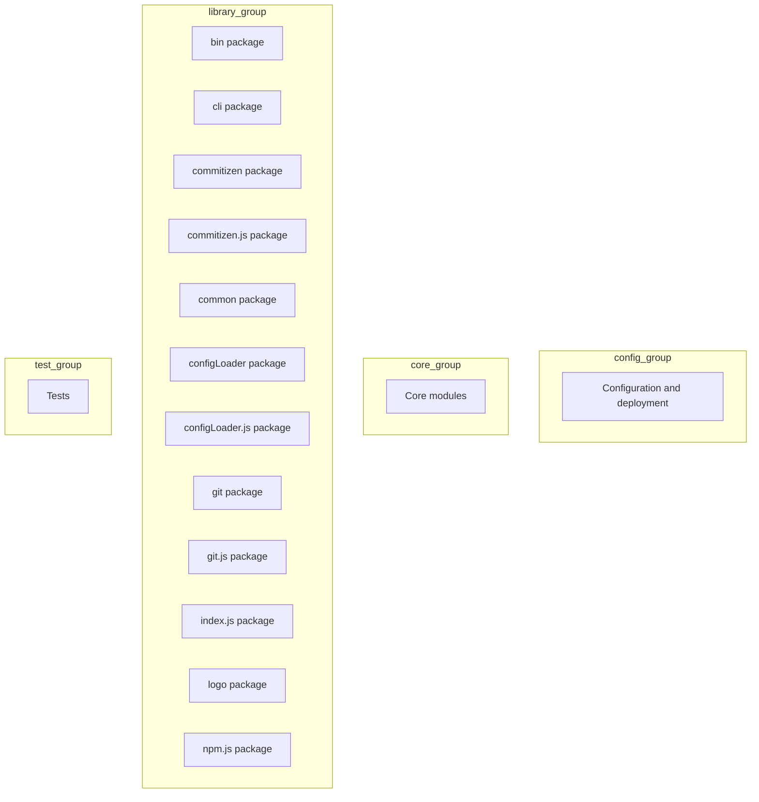

# Architecture report: commitizen/cz-cli

> Automated static analysis. **Observed** = directly seen in files/imports/AST; **Inferred** = interpretation from that evidence. Repository code was not executed.

## 1. Repository at a glance

| Item | Value |
| --- | --- |
| Repository | commitizen/cz-cli |
| Description | The commitizen command line utility. #BlackLivesMatter |
| Language | JavaScript |
| Stars | 17504 |
| Licence | MIT |
| Analysed commit / branch | 1a8c49c02c9d52d1b4ef8cdabefb538088ddea03 / master |
| Framework(s) | None detected |
| Files analysed | 70 |
| Components | 15 |

## 2. Architecture in one minute

commitizen/cz-cli - The commitizen command line utility. #BlackLivesMatter. This repository was analysed statically from 70 file(s) (0 Python). Detected technologies (observed from imports/manifests): GitHub Actions. Files are grouped into 15 component(s): bin package, cli package, commitizen package, commitizen.js package, common package, Configuration and deployment, configLoader package, configLoader.js package. Findings below distinguish observed facts from inferred interpretation.

## 3. High-level block diagram

## 4. Main components

### bin package (`bin`)

- **Kind:** library
- **Status:** Observed
- **Confidence:** 0.85
- **Responsibility:** Groups 2 file(s) under bin package (observed from repository paths and static analysis).
- **Paths:** `bin/commitizen.js`, `bin/git-cz.js`
- **Evidence:** [bin/commitizen.js](https://github.com/commitizen/cz-cli/blob/1a8c49c02c9d52d1b4ef8cdabefb538088ddea03/bin/commitizen.js); [bin/git-cz.js](https://github.com/commitizen/cz-cli/blob/1a8c49c02c9d52d1b4ef8cdabefb538088ddea03/bin/git-cz.js)

### cli package (`cli`)

- **Kind:** library
- **Status:** Observed
- **Confidence:** 0.85
- **Responsibility:** Groups 8 file(s) under cli package (observed from repository paths and static analysis).
- **Paths:** `src/cli/commitizen.js`, `src/cli/git-cz.js`, `src/cli/parsers.js`, `src/cli/parsers/commitizen.js`, `src/cli/parsers/git-cz.js`, `src/cli/strategies.js`, `src/cli/strategies/git-cz.js`, `src/cli/strategies/git.js`
- **Evidence:** [src/cli/commitizen.js](https://github.com/commitizen/cz-cli/blob/1a8c49c02c9d52d1b4ef8cdabefb538088ddea03/src/cli/commitizen.js); [src/cli/git-cz.js](https://github.com/commitizen/cz-cli/blob/1a8c49c02c9d52d1b4ef8cdabefb538088ddea03/src/cli/git-cz.js); [src/cli/parsers.js](https://github.com/commitizen/cz-cli/blob/1a8c49c02c9d52d1b4ef8cdabefb538088ddea03/src/cli/parsers.js); [src/cli/parsers/commitizen.js](https://github.com/commitizen/cz-cli/blob/1a8c49c02c9d52d1b4ef8cdabefb538088ddea03/src/cli/parsers/commitizen.js); [src/cli/parsers/git-cz.js](https://github.com/commitizen/cz-cli/blob/1a8c49c02c9d52d1b4ef8cdabefb538088ddea03/src/cli/parsers/git-cz.js); [src/cli/strategies.js](https://github.com/commitizen/cz-cli/blob/1a8c49c02c9d52d1b4ef8cdabefb538088ddea03/src/cli/strategies.js); [src/cli/strategies/git-cz.js](https://github.com/commitizen/cz-cli/blob/1a8c49c02c9d52d1b4ef8cdabefb538088ddea03/src/cli/strategies/git-cz.js); [src/cli/strategies/git.js](https://github.com/commitizen/cz-cli/blob/1a8c49c02c9d52d1b4ef8cdabefb538088ddea03/src/cli/strategies/git.js)

### commitizen package (`commitizen`)

- **Kind:** library
- **Status:** Observed
- **Confidence:** 0.85
- **Responsibility:** Groups 6 file(s) under commitizen package (observed from repository paths and static analysis).
- **Paths:** `src/commitizen/adapter.js`, `src/commitizen/cache.js`, `src/commitizen/commit.js`, `src/commitizen/configLoader.js`, `src/commitizen/init.js`, `src/commitizen/staging.js`
- **Evidence:** [src/commitizen/adapter.js](https://github.com/commitizen/cz-cli/blob/1a8c49c02c9d52d1b4ef8cdabefb538088ddea03/src/commitizen/adapter.js); [src/commitizen/cache.js](https://github.com/commitizen/cz-cli/blob/1a8c49c02c9d52d1b4ef8cdabefb538088ddea03/src/commitizen/cache.js); [src/commitizen/commit.js](https://github.com/commitizen/cz-cli/blob/1a8c49c02c9d52d1b4ef8cdabefb538088ddea03/src/commitizen/commit.js); [src/commitizen/configLoader.js](https://github.com/commitizen/cz-cli/blob/1a8c49c02c9d52d1b4ef8cdabefb538088ddea03/src/commitizen/configLoader.js); [src/commitizen/init.js](https://github.com/commitizen/cz-cli/blob/1a8c49c02c9d52d1b4ef8cdabefb538088ddea03/src/commitizen/init.js); [src/commitizen/staging.js](https://github.com/commitizen/cz-cli/blob/1a8c49c02c9d52d1b4ef8cdabefb538088ddea03/src/commitizen/staging.js)

### commitizen.js package (`commitizen_js`)

- **Kind:** library
- **Status:** Observed
- **Confidence:** 0.85
- **Responsibility:** Groups 1 file(s) under commitizen.js package (observed from repository paths and static analysis).
- **Paths:** `src/commitizen.js`
- **Evidence:** [src/commitizen.js](https://github.com/commitizen/cz-cli/blob/1a8c49c02c9d52d1b4ef8cdabefb538088ddea03/src/commitizen.js)

### common package (`common`)

- **Kind:** library
- **Status:** Observed
- **Confidence:** 0.85
- **Responsibility:** Groups 1 file(s) under common package (observed from repository paths and static analysis).
- **Paths:** `src/common/util.js`
- **Evidence:** [src/common/util.js](https://github.com/commitizen/cz-cli/blob/1a8c49c02c9d52d1b4ef8cdabefb538088ddea03/src/common/util.js)

### Configuration and deployment (`config`)

- **Kind:** config
- **Status:** Observed
- **Confidence:** 0.85
- **Responsibility:** Groups 5 file(s) under configuration and deployment (observed from repository paths and static analysis).
- **Paths:** `azure-pipelines.yml`, `jobs/build.yml`, `jsconfig.json`, `package.json`, `renovate.json`
- **Evidence:** [azure-pipelines.yml](https://github.com/commitizen/cz-cli/blob/1a8c49c02c9d52d1b4ef8cdabefb538088ddea03/azure-pipelines.yml); [jobs/build.yml](https://github.com/commitizen/cz-cli/blob/1a8c49c02c9d52d1b4ef8cdabefb538088ddea03/jobs/build.yml); [jsconfig.json](https://github.com/commitizen/cz-cli/blob/1a8c49c02c9d52d1b4ef8cdabefb538088ddea03/jsconfig.json); [package.json](https://github.com/commitizen/cz-cli/blob/1a8c49c02c9d52d1b4ef8cdabefb538088ddea03/package.json); [renovate.json](https://github.com/commitizen/cz-cli/blob/1a8c49c02c9d52d1b4ef8cdabefb538088ddea03/renovate.json)

### configLoader package (`configloader`)

- **Kind:** library
- **Status:** Observed
- **Confidence:** 0.85
- **Responsibility:** Groups 4 file(s) under configloader package (observed from repository paths and static analysis).
- **Paths:** `src/configLoader/findup.js`, `src/configLoader/getContent.js`, `src/configLoader/getNormalizedConfig.js`, `src/configLoader/loader.js`
- **Evidence:** [src/configLoader/findup.js](https://github.com/commitizen/cz-cli/blob/1a8c49c02c9d52d1b4ef8cdabefb538088ddea03/src/configLoader/findup.js); [src/configLoader/getContent.js](https://github.com/commitizen/cz-cli/blob/1a8c49c02c9d52d1b4ef8cdabefb538088ddea03/src/configLoader/getContent.js); [src/configLoader/getNormalizedConfig.js](https://github.com/commitizen/cz-cli/blob/1a8c49c02c9d52d1b4ef8cdabefb538088ddea03/src/configLoader/getNormalizedConfig.js); [src/configLoader/loader.js](https://github.com/commitizen/cz-cli/blob/1a8c49c02c9d52d1b4ef8cdabefb538088ddea03/src/configLoader/loader.js)

### configLoader.js package (`configloader_js`)

- **Kind:** library
- **Status:** Observed
- **Confidence:** 0.85
- **Responsibility:** Groups 1 file(s) under configloader.js package (observed from repository paths and static analysis).
- **Paths:** `src/configLoader.js`
- **Evidence:** [src/configLoader.js](https://github.com/commitizen/cz-cli/blob/1a8c49c02c9d52d1b4ef8cdabefb538088ddea03/src/configLoader.js)

### Core modules (`core`)

- **Kind:** core
- **Status:** Observed
- **Confidence:** 0.85
- **Responsibility:** Groups 1 file(s) under core modules (observed from repository paths and static analysis).
- **Paths:** `babel.config.js`
- **Evidence:** [babel.config.js](https://github.com/commitizen/cz-cli/blob/1a8c49c02c9d52d1b4ef8cdabefb538088ddea03/babel.config.js)

### git package (`git`)

- **Kind:** library
- **Status:** Observed
- **Confidence:** 0.85
- **Responsibility:** Groups 5 file(s) under git package (observed from repository paths and static analysis).
- **Paths:** `src/git/add.js`, `src/git/commit.js`, `src/git/init.js`, `src/git/log.js`, `src/git/whatChanged.js`
- **Evidence:** [src/git/add.js](https://github.com/commitizen/cz-cli/blob/1a8c49c02c9d52d1b4ef8cdabefb538088ddea03/src/git/add.js); [src/git/commit.js](https://github.com/commitizen/cz-cli/blob/1a8c49c02c9d52d1b4ef8cdabefb538088ddea03/src/git/commit.js); [src/git/init.js](https://github.com/commitizen/cz-cli/blob/1a8c49c02c9d52d1b4ef8cdabefb538088ddea03/src/git/init.js); [src/git/log.js](https://github.com/commitizen/cz-cli/blob/1a8c49c02c9d52d1b4ef8cdabefb538088ddea03/src/git/log.js); [src/git/whatChanged.js](https://github.com/commitizen/cz-cli/blob/1a8c49c02c9d52d1b4ef8cdabefb538088ddea03/src/git/whatChanged.js)

### git.js package (`git_js`)

- **Kind:** library
- **Status:** Observed
- **Confidence:** 0.85
- **Responsibility:** Groups 1 file(s) under git.js package (observed from repository paths and static analysis).
- **Paths:** `src/git.js`
- **Evidence:** [src/git.js](https://github.com/commitizen/cz-cli/blob/1a8c49c02c9d52d1b4ef8cdabefb538088ddea03/src/git.js)

### index.js package (`index_js`)

- **Kind:** library
- **Status:** Observed
- **Confidence:** 0.85
- **Responsibility:** Groups 1 file(s) under index.js package (observed from repository paths and static analysis).
- **Paths:** `src/index.js`
- **Evidence:** [src/index.js](https://github.com/commitizen/cz-cli/blob/1a8c49c02c9d52d1b4ef8cdabefb538088ddea03/src/index.js)

### logo package (`logo`)

- **Kind:** library
- **Status:** Observed
- **Confidence:** 0.85
- **Responsibility:** Groups 1 file(s) under logo package (observed from repository paths and static analysis).
- **Paths:** `logo/generate.sh`
- **Evidence:** [logo/generate.sh](https://github.com/commitizen/cz-cli/blob/1a8c49c02c9d52d1b4ef8cdabefb538088ddea03/logo/generate.sh)

### npm.js package (`npm_js`)

- **Kind:** library
- **Status:** Observed
- **Confidence:** 0.85
- **Responsibility:** Groups 1 file(s) under npm.js package (observed from repository paths and static analysis).
- **Paths:** `src/npm.js`
- **Evidence:** [src/npm.js](https://github.com/commitizen/cz-cli/blob/1a8c49c02c9d52d1b4ef8cdabefb538088ddea03/src/npm.js)

### Tests (`tests`)

- **Kind:** test
- **Status:** Observed
- **Confidence:** 0.85
- **Responsibility:** Groups 18 file(s) under tests (observed from repository paths and static analysis).
- **Paths:** `test/config.js`, `test/fixtures/invalid-json-rc`, `test/fixtures/invalid-json.json`, `test/fixtures/valid-json-rc`, `test/mochareporters.json`, `test/tester.js`, `test/tests/adapter.js`, `test/tests/cli.js`, `test/tests/commit.js`, `test/tests/configLoader.js`, `test/tests/index.js`, `test/tests/init.js`, `test/tests/parsers.js`, `test/tests/staging.js`, `test/tests/util.js`, `test/tools/clean.js`, `test/tools/files.js`, `test/tools/repo.js`
- **Evidence:** [test/config.js](https://github.com/commitizen/cz-cli/blob/1a8c49c02c9d52d1b4ef8cdabefb538088ddea03/test/config.js); [test/fixtures/invalid-json-rc](https://github.com/commitizen/cz-cli/blob/1a8c49c02c9d52d1b4ef8cdabefb538088ddea03/test/fixtures/invalid-json-rc); [test/fixtures/invalid-json.json](https://github.com/commitizen/cz-cli/blob/1a8c49c02c9d52d1b4ef8cdabefb538088ddea03/test/fixtures/invalid-json.json); [test/fixtures/valid-json-rc](https://github.com/commitizen/cz-cli/blob/1a8c49c02c9d52d1b4ef8cdabefb538088ddea03/test/fixtures/valid-json-rc); [test/mochareporters.json](https://github.com/commitizen/cz-cli/blob/1a8c49c02c9d52d1b4ef8cdabefb538088ddea03/test/mochareporters.json); [test/tester.js](https://github.com/commitizen/cz-cli/blob/1a8c49c02c9d52d1b4ef8cdabefb538088ddea03/test/tester.js); [test/tests/adapter.js](https://github.com/commitizen/cz-cli/blob/1a8c49c02c9d52d1b4ef8cdabefb538088ddea03/test/tests/adapter.js); [test/tests/cli.js](https://github.com/commitizen/cz-cli/blob/1a8c49c02c9d52d1b4ef8cdabefb538088ddea03/test/tests/cli.js)

## 5. Execution flow

**Observed** entry point(s):

- [bin/commitizen](https://github.com/commitizen/cz-cli/blob/1a8c49c02c9d52d1b4ef8cdabefb538088ddea03/bin/commitizen)
- [bin/git-cz](https://github.com/commitizen/cz-cli/blob/1a8c49c02c9d52d1b4ef8cdabefb538088ddea03/bin/git-cz)
- [src/index.js](https://github.com/commitizen/cz-cli/blob/1a8c49c02c9d52d1b4ef8cdabefb538088ddea03/src/index.js)

Representative flow (derived from observed entry points and the import graph; steps beyond the entry point are **Inferred**):

1. Execution starts at an observed entry point listed above, if present.
2. No internal import relationships between components were observed.

## 6. Project structure

### `(root)`

- `.editorconfig` - config (162 bytes)
- `.eslintrc` - other (192 bytes)
- `.gitignore` - other (120 bytes)
- `.npmignore` - other (138 bytes)
- `CONTRIBUTING.md` - docs (1652 bytes)
- `LICENSE` - docs (1045 bytes)
- `README.md` - docs (19517 bytes)
- `azure-pipelines.yml` - ci, YAML (614 bytes)
- `babel.config.js` - source, JavaScript (219 bytes)
- `jsconfig.json` - config (129 bytes)
- `package.json` - manifest (3290 bytes)
- `renovate.json` - config (74 bytes)

### `.github`

- `.github/workflows/release.yml` - ci, YAML (542 bytes)

### `bin`

- `bin/commitizen` - other (49 bytes)
- `bin/commitizen.cmd` - other (17 bytes)
- `bin/commitizen.js` - source, JavaScript (51 bytes)
- `bin/git-cz` - other (45 bytes)
- `bin/git-cz.cmd` - other (17 bytes)
- `bin/git-cz.js` - source, JavaScript (365 bytes)

### `jobs`

- `jobs/build.yml` - config (1417 bytes)

### `logo`

- `logo/commitizen-logo-color.svg` - other (14394 bytes)
- `logo/commitizen-logo-mono.svg` - other (16809 bytes)
- `logo/generate.sh` - source, Shell (1806 bytes)

### `src`

- `src/cli/commitizen.js` - source, JavaScript (2764 bytes)
- `src/cli/git-cz.js` - source, JavaScript (781 bytes)
- `src/cli/parsers.js` - source, JavaScript (130 bytes)
- `src/cli/parsers/commitizen.js` - source, JavaScript (324 bytes)
- `src/cli/parsers/git-cz.js` - source, JavaScript (743 bytes)
- `src/cli/strategies.js` - source, JavaScript (105 bytes)
- `src/cli/strategies/git-cz.js` - source, JavaScript (2610 bytes)
- `src/cli/strategies/git.js` - source, JavaScript (673 bytes)
- `src/commitizen.js` - source, JavaScript (386 bytes)
- `src/commitizen/adapter.js` - source, JavaScript (5845 bytes)
- `src/commitizen/cache.js` - source, JavaScript (846 bytes)
- `src/commitizen/commit.js` - source, JavaScript (2278 bytes)
- `src/commitizen/configLoader.js` - source, JavaScript (230 bytes)
- `src/commitizen/init.js` - source, JavaScript (3651 bytes)
- `src/commitizen/staging.js` - source, JavaScript (507 bytes)
- `src/common/util.js` - source, JavaScript (1143 bytes)
- `src/configLoader.js` - source, JavaScript (306 bytes)
- `src/configLoader/findup.js` - source, JavaScript (825 bytes)
- `src/configLoader/getContent.js` - source, JavaScript (2310 bytes)
- `src/configLoader/getNormalizedConfig.js` - source, JavaScript (994 bytes)
- `src/configLoader/loader.js` - source, JavaScript (1695 bytes)
- `src/git.js` - source, JavaScript (303 bytes)
- `src/git/add.js` - source, JavaScript (392 bytes)
- `src/git/commit.js` - source, JavaScript (2210 bytes)
- `src/git/init.js` - source, JavaScript (210 bytes)
- `src/git/log.js` - source, JavaScript (309 bytes)
- `src/git/whatChanged.js` - source, JavaScript (442 bytes)
- `src/index.js` - source, JavaScript (71 bytes)
- `src/npm.js` - source, JavaScript (54 bytes)

### `test`

- `test/config.js` - test, JavaScript (1556 bytes)
- `test/fixtures/invalid-json-rc` - test (44 bytes)
- `test/fixtures/invalid-json.json` - test (44 bytes)
- `test/fixtures/valid-json-rc` - test (40 bytes)
- `test/mochareporters.json` - test (213 bytes)
- `test/tester.js` - test, JavaScript (515 bytes)
- `test/tests/adapter.js` - test, JavaScript (6006 bytes)
- `test/tests/cli.js` - test, JavaScript (1718 bytes)
- `test/tests/commit.js` - test, JavaScript (13173 bytes)
- `test/tests/configLoader.js` - test, JavaScript (1712 bytes)
- `test/tests/index.js` - test, JavaScript (154 bytes)
- `test/tests/init.js` - test, JavaScript (11655 bytes)
- `test/tests/parsers.js` - test, JavaScript (1492 bytes)
- `test/tests/staging.js` - test, JavaScript (3874 bytes)
- `test/tests/util.js` - test, JavaScript (728 bytes)
- `test/tools/clean.js` - test, JavaScript (3029 bytes)
- `test/tools/files.js` - test, JavaScript (451 bytes)
- `test/tools/repo.js` - test, JavaScript (415 bytes)

## 7. Key dependencies and integrations

| Name | Category | Status | Confidence | Evidence |
| --- | --- | --- | --- | --- |
| GitHub Actions | ci | Observed | 0.85 | [.github/workflows/release.yml](https://github.com/commitizen/cz-cli/blob/1a8c49c02c9d52d1b4ef8cdabefb538088ddea03/.github/workflows/release.yml) |

## 8. Data and state

No database, cache, queue, or persistent-state usage was observed in the analysed files. State handling, if any, may be in-memory or in files that were not analysed.

## 9. Configuration and deployment clues

- `.editorconfig` (config)
- `.github/workflows/release.yml` (ci)
- `azure-pipelines.yml` (ci)
- `jobs/build.yml` (config)
- `jsconfig.json` (config)
- `package.json` (manifest)
- `renovate.json` (config)

## 10. Design observations

- Tests are present alongside source code (Observed from test file paths).

These observations are interpretations (**Inferred**) of the observed structure, not guarantees about runtime design.

## 11. Limitations and unknowns

- Static analysis only: repository code was not executed, installed, or imported at runtime.
- Components and relationships are inferred from file paths, imports, and AST structure; runtime behaviour, dynamic imports, and reflection may not be visible.
- 1 file(s) were skipped during inventory (1 x likely secret file excluded).
- No clear application entry point was observed in the analysed files.
- Repository text was treated as untrusted data; no instructions found in repository files were followed, and likely secret values were redacted/excluded.
- JavaScript and TypeScript files were inventoried from paths and package manifests. They were not parsed with a full language AST, and repository code was not executed.

## 12. Source references

- [.github/workflows/release.yml](https://github.com/commitizen/cz-cli/blob/1a8c49c02c9d52d1b4ef8cdabefb538088ddea03/.github/workflows/release.yml)
- [azure-pipelines.yml](https://github.com/commitizen/cz-cli/blob/1a8c49c02c9d52d1b4ef8cdabefb538088ddea03/azure-pipelines.yml)
- [babel.config.js](https://github.com/commitizen/cz-cli/blob/1a8c49c02c9d52d1b4ef8cdabefb538088ddea03/babel.config.js)
- [bin/commitizen](https://github.com/commitizen/cz-cli/blob/1a8c49c02c9d52d1b4ef8cdabefb538088ddea03/bin/commitizen)
- [bin/commitizen.js](https://github.com/commitizen/cz-cli/blob/1a8c49c02c9d52d1b4ef8cdabefb538088ddea03/bin/commitizen.js)
- [bin/git-cz](https://github.com/commitizen/cz-cli/blob/1a8c49c02c9d52d1b4ef8cdabefb538088ddea03/bin/git-cz)
- [bin/git-cz.js](https://github.com/commitizen/cz-cli/blob/1a8c49c02c9d52d1b4ef8cdabefb538088ddea03/bin/git-cz.js)
- [jobs/build.yml](https://github.com/commitizen/cz-cli/blob/1a8c49c02c9d52d1b4ef8cdabefb538088ddea03/jobs/build.yml)
- [jsconfig.json](https://github.com/commitizen/cz-cli/blob/1a8c49c02c9d52d1b4ef8cdabefb538088ddea03/jsconfig.json)
- [logo/generate.sh](https://github.com/commitizen/cz-cli/blob/1a8c49c02c9d52d1b4ef8cdabefb538088ddea03/logo/generate.sh)
- [package.json](https://github.com/commitizen/cz-cli/blob/1a8c49c02c9d52d1b4ef8cdabefb538088ddea03/package.json)
- [renovate.json](https://github.com/commitizen/cz-cli/blob/1a8c49c02c9d52d1b4ef8cdabefb538088ddea03/renovate.json)
- [src/cli/commitizen.js](https://github.com/commitizen/cz-cli/blob/1a8c49c02c9d52d1b4ef8cdabefb538088ddea03/src/cli/commitizen.js)
- [src/cli/git-cz.js](https://github.com/commitizen/cz-cli/blob/1a8c49c02c9d52d1b4ef8cdabefb538088ddea03/src/cli/git-cz.js)
- [src/cli/parsers.js](https://github.com/commitizen/cz-cli/blob/1a8c49c02c9d52d1b4ef8cdabefb538088ddea03/src/cli/parsers.js)
- [src/cli/parsers/commitizen.js](https://github.com/commitizen/cz-cli/blob/1a8c49c02c9d52d1b4ef8cdabefb538088ddea03/src/cli/parsers/commitizen.js)
- [src/cli/parsers/git-cz.js](https://github.com/commitizen/cz-cli/blob/1a8c49c02c9d52d1b4ef8cdabefb538088ddea03/src/cli/parsers/git-cz.js)
- [src/cli/strategies.js](https://github.com/commitizen/cz-cli/blob/1a8c49c02c9d52d1b4ef8cdabefb538088ddea03/src/cli/strategies.js)
- [src/cli/strategies/git-cz.js](https://github.com/commitizen/cz-cli/blob/1a8c49c02c9d52d1b4ef8cdabefb538088ddea03/src/cli/strategies/git-cz.js)
- [src/cli/strategies/git.js](https://github.com/commitizen/cz-cli/blob/1a8c49c02c9d52d1b4ef8cdabefb538088ddea03/src/cli/strategies/git.js)
- [src/commitizen.js](https://github.com/commitizen/cz-cli/blob/1a8c49c02c9d52d1b4ef8cdabefb538088ddea03/src/commitizen.js)
- [src/commitizen/adapter.js](https://github.com/commitizen/cz-cli/blob/1a8c49c02c9d52d1b4ef8cdabefb538088ddea03/src/commitizen/adapter.js)
- [src/commitizen/cache.js](https://github.com/commitizen/cz-cli/blob/1a8c49c02c9d52d1b4ef8cdabefb538088ddea03/src/commitizen/cache.js)
- [src/commitizen/commit.js](https://github.com/commitizen/cz-cli/blob/1a8c49c02c9d52d1b4ef8cdabefb538088ddea03/src/commitizen/commit.js)
- [src/commitizen/configLoader.js](https://github.com/commitizen/cz-cli/blob/1a8c49c02c9d52d1b4ef8cdabefb538088ddea03/src/commitizen/configLoader.js)
- [src/commitizen/init.js](https://github.com/commitizen/cz-cli/blob/1a8c49c02c9d52d1b4ef8cdabefb538088ddea03/src/commitizen/init.js)
- [src/commitizen/staging.js](https://github.com/commitizen/cz-cli/blob/1a8c49c02c9d52d1b4ef8cdabefb538088ddea03/src/commitizen/staging.js)
- [src/common/util.js](https://github.com/commitizen/cz-cli/blob/1a8c49c02c9d52d1b4ef8cdabefb538088ddea03/src/common/util.js)
- [src/configLoader.js](https://github.com/commitizen/cz-cli/blob/1a8c49c02c9d52d1b4ef8cdabefb538088ddea03/src/configLoader.js)
- [src/configLoader/findup.js](https://github.com/commitizen/cz-cli/blob/1a8c49c02c9d52d1b4ef8cdabefb538088ddea03/src/configLoader/findup.js)
- [src/configLoader/getContent.js](https://github.com/commitizen/cz-cli/blob/1a8c49c02c9d52d1b4ef8cdabefb538088ddea03/src/configLoader/getContent.js)
- [src/configLoader/getNormalizedConfig.js](https://github.com/commitizen/cz-cli/blob/1a8c49c02c9d52d1b4ef8cdabefb538088ddea03/src/configLoader/getNormalizedConfig.js)
- [src/configLoader/loader.js](https://github.com/commitizen/cz-cli/blob/1a8c49c02c9d52d1b4ef8cdabefb538088ddea03/src/configLoader/loader.js)
- [src/git.js](https://github.com/commitizen/cz-cli/blob/1a8c49c02c9d52d1b4ef8cdabefb538088ddea03/src/git.js)
- [src/git/add.js](https://github.com/commitizen/cz-cli/blob/1a8c49c02c9d52d1b4ef8cdabefb538088ddea03/src/git/add.js)
- [src/git/commit.js](https://github.com/commitizen/cz-cli/blob/1a8c49c02c9d52d1b4ef8cdabefb538088ddea03/src/git/commit.js)
- [src/git/init.js](https://github.com/commitizen/cz-cli/blob/1a8c49c02c9d52d1b4ef8cdabefb538088ddea03/src/git/init.js)
- [src/git/log.js](https://github.com/commitizen/cz-cli/blob/1a8c49c02c9d52d1b4ef8cdabefb538088ddea03/src/git/log.js)
- [src/git/whatChanged.js](https://github.com/commitizen/cz-cli/blob/1a8c49c02c9d52d1b4ef8cdabefb538088ddea03/src/git/whatChanged.js)
- [src/index.js](https://github.com/commitizen/cz-cli/blob/1a8c49c02c9d52d1b4ef8cdabefb538088ddea03/src/index.js)
- [src/npm.js](https://github.com/commitizen/cz-cli/blob/1a8c49c02c9d52d1b4ef8cdabefb538088ddea03/src/npm.js)
- [test/config.js](https://github.com/commitizen/cz-cli/blob/1a8c49c02c9d52d1b4ef8cdabefb538088ddea03/test/config.js)
- [test/fixtures/invalid-json-rc](https://github.com/commitizen/cz-cli/blob/1a8c49c02c9d52d1b4ef8cdabefb538088ddea03/test/fixtures/invalid-json-rc)
- [test/fixtures/invalid-json.json](https://github.com/commitizen/cz-cli/blob/1a8c49c02c9d52d1b4ef8cdabefb538088ddea03/test/fixtures/invalid-json.json)
- [test/fixtures/valid-json-rc](https://github.com/commitizen/cz-cli/blob/1a8c49c02c9d52d1b4ef8cdabefb538088ddea03/test/fixtures/valid-json-rc)
- [test/mochareporters.json](https://github.com/commitizen/cz-cli/blob/1a8c49c02c9d52d1b4ef8cdabefb538088ddea03/test/mochareporters.json)
- [test/tester.js](https://github.com/commitizen/cz-cli/blob/1a8c49c02c9d52d1b4ef8cdabefb538088ddea03/test/tester.js)
- [test/tests/adapter.js](https://github.com/commitizen/cz-cli/blob/1a8c49c02c9d52d1b4ef8cdabefb538088ddea03/test/tests/adapter.js)
- [test/tests/cli.js](https://github.com/commitizen/cz-cli/blob/1a8c49c02c9d52d1b4ef8cdabefb538088ddea03/test/tests/cli.js)
