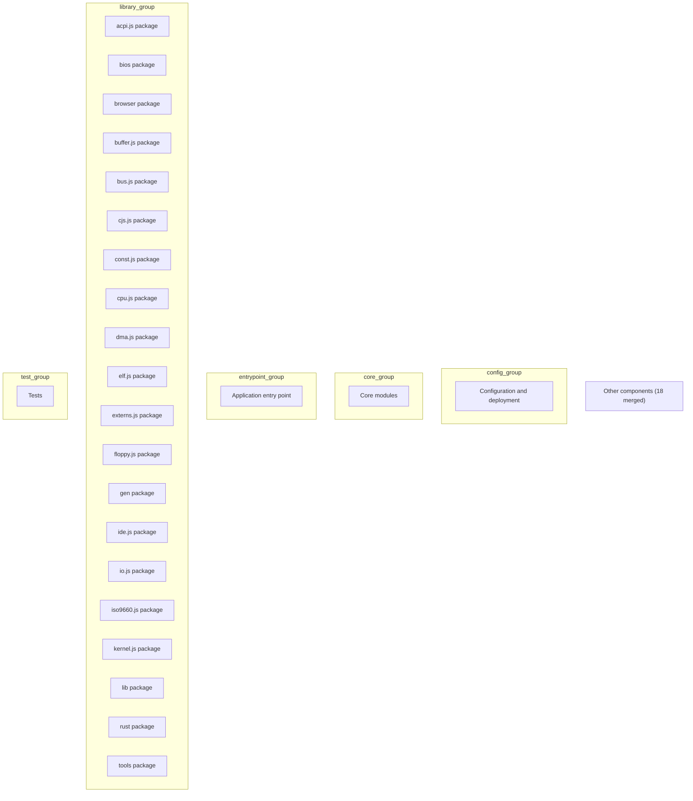

# Architecture report: copy/v86

> Automated static analysis. **Observed** = directly seen in files/imports/AST; **Inferred** = interpretation from that evidence. Repository code was not executed.

## 1. Repository at a glance

| Item | Value |
| --- | --- |
| Repository | copy/v86 |
| Description | x86 PC emulator and x86-to-wasm JIT, running in the browser |
| Language | JavaScript |
| Stars | 23688 |
| Licence | BSD-2-Clause |
| Analysed commit / branch | 315b2b0b758703ef0e6cc7b4088d6068f83f3c20 / master |
| Framework(s) | None detected |
| Files analysed | 584 |
| Components | 42 |

## 2. Architecture in one minute

copy/v86 - x86 PC emulator and x86-to-wasm JIT, running in the browser. This repository was analysed statically from 584 file(s) (3 Python). Detected technologies (observed from imports/manifests): GitHub Actions, Docker. Files are grouped into 42 component(s): acpi.js package, bios package, browser package, buffer.js package, bus.js package, cjs.js package, Configuration and deployment, const.js package. Observed entry point(s): tools/copy-to-sha256.py, tools/fs2json.py. Findings below distinguish observed facts from inferred interpretation.

## 3. High-level block diagram

## 4. Main components

### acpi.js package (`acpi_js`)

- **Kind:** library
- **Status:** Observed
- **Confidence:** 0.85
- **Responsibility:** Groups 1 file(s) under acpi.js package (observed from repository paths and static analysis).
- **Paths:** `src/acpi.js`
- **Evidence:** [src/acpi.js](https://github.com/copy/v86/blob/315b2b0b758703ef0e6cc7b4088d6068f83f3c20/src/acpi.js)

### bios package (`bios`)

- **Kind:** library
- **Status:** Observed
- **Confidence:** 0.85
- **Responsibility:** Groups 1 file(s) under bios package (observed from repository paths and static analysis).
- **Paths:** `bios/fetch-and-build-seabios.sh`
- **Evidence:** [bios/fetch-and-build-seabios.sh](https://github.com/copy/v86/blob/315b2b0b758703ef0e6cc7b4088d6068f83f3c20/bios/fetch-and-build-seabios.sh)

### browser package (`browser`)

- **Kind:** library
- **Status:** Observed
- **Confidence:** 0.85
- **Responsibility:** Groups 18 file(s) under browser package (observed from repository paths and static analysis).
- **Paths:** `src/browser/ansi_screen.js`, `src/browser/dummy_screen.js`, `src/browser/fake_network.js`, `src/browser/fetch_network.js`, `src/browser/filestorage.js`, `src/browser/inbrowser_network.js`, `src/browser/keyboard.js`, `src/browser/main.js`, `src/browser/modem.js`, `src/browser/mouse.js`, `src/browser/network.js`, `src/browser/print_stats.js`, `src/browser/screen.js`, `src/browser/serial.js`, `src/browser/speaker.js`, `src/browser/starter.js`, `src/browser/wisp_network.js`, `src/browser/worker_bus.js`
- **Evidence:** [src/browser/ansi_screen.js](https://github.com/copy/v86/blob/315b2b0b758703ef0e6cc7b4088d6068f83f3c20/src/browser/ansi_screen.js); [src/browser/dummy_screen.js](https://github.com/copy/v86/blob/315b2b0b758703ef0e6cc7b4088d6068f83f3c20/src/browser/dummy_screen.js); [src/browser/fake_network.js](https://github.com/copy/v86/blob/315b2b0b758703ef0e6cc7b4088d6068f83f3c20/src/browser/fake_network.js); [src/browser/fetch_network.js](https://github.com/copy/v86/blob/315b2b0b758703ef0e6cc7b4088d6068f83f3c20/src/browser/fetch_network.js); [src/browser/filestorage.js](https://github.com/copy/v86/blob/315b2b0b758703ef0e6cc7b4088d6068f83f3c20/src/browser/filestorage.js); [src/browser/inbrowser_network.js](https://github.com/copy/v86/blob/315b2b0b758703ef0e6cc7b4088d6068f83f3c20/src/browser/inbrowser_network.js); [src/browser/keyboard.js](https://github.com/copy/v86/blob/315b2b0b758703ef0e6cc7b4088d6068f83f3c20/src/browser/keyboard.js); [src/browser/main.js](https://github.com/copy/v86/blob/315b2b0b758703ef0e6cc7b4088d6068f83f3c20/src/browser/main.js)

### buffer.js package (`buffer_js`)

- **Kind:** library
- **Status:** Observed
- **Confidence:** 0.85
- **Responsibility:** Groups 1 file(s) under buffer.js package (observed from repository paths and static analysis).
- **Paths:** `src/buffer.js`
- **Evidence:** [src/buffer.js](https://github.com/copy/v86/blob/315b2b0b758703ef0e6cc7b4088d6068f83f3c20/src/buffer.js)

### bus.js package (`bus_js`)

- **Kind:** library
- **Status:** Observed
- **Confidence:** 0.85
- **Responsibility:** Groups 1 file(s) under bus.js package (observed from repository paths and static analysis).
- **Paths:** `src/bus.js`
- **Evidence:** [src/bus.js](https://github.com/copy/v86/blob/315b2b0b758703ef0e6cc7b4088d6068f83f3c20/src/bus.js)

### cjs.js package (`cjs_js`)

- **Kind:** library
- **Status:** Observed
- **Confidence:** 0.85
- **Responsibility:** Groups 1 file(s) under cjs.js package (observed from repository paths and static analysis).
- **Paths:** `src/cjs.js`
- **Evidence:** [src/cjs.js](https://github.com/copy/v86/blob/315b2b0b758703ef0e6cc7b4088d6068f83f3c20/src/cjs.js)

### Configuration and deployment (`config`)

- **Kind:** config
- **Status:** Observed
- **Confidence:** 0.85
- **Responsibility:** Groups 7 file(s) under configuration and deployment (observed from repository paths and static analysis).
- **Paths:** `Cargo.toml`, `manifest.json`, `package.json`, `tools/docker/alpine/Dockerfile`, `tools/docker/debian/Dockerfile`, `tools/docker/exec/Dockerfile`, `tools/docker/test-image/Dockerfile`
- **Evidence:** [Cargo.toml](https://github.com/copy/v86/blob/315b2b0b758703ef0e6cc7b4088d6068f83f3c20/Cargo.toml); [manifest.json](https://github.com/copy/v86/blob/315b2b0b758703ef0e6cc7b4088d6068f83f3c20/manifest.json); [package.json](https://github.com/copy/v86/blob/315b2b0b758703ef0e6cc7b4088d6068f83f3c20/package.json); [tools/docker/alpine/Dockerfile](https://github.com/copy/v86/blob/315b2b0b758703ef0e6cc7b4088d6068f83f3c20/tools/docker/alpine/Dockerfile); [tools/docker/debian/Dockerfile](https://github.com/copy/v86/blob/315b2b0b758703ef0e6cc7b4088d6068f83f3c20/tools/docker/debian/Dockerfile); [tools/docker/exec/Dockerfile](https://github.com/copy/v86/blob/315b2b0b758703ef0e6cc7b4088d6068f83f3c20/tools/docker/exec/Dockerfile); [tools/docker/test-image/Dockerfile](https://github.com/copy/v86/blob/315b2b0b758703ef0e6cc7b4088d6068f83f3c20/tools/docker/test-image/Dockerfile)

### const.js package (`const_js`)

- **Kind:** library
- **Status:** Observed
- **Confidence:** 0.85
- **Responsibility:** Groups 1 file(s) under const.js package (observed from repository paths and static analysis).
- **Paths:** `src/const.js`
- **Evidence:** [src/const.js](https://github.com/copy/v86/blob/315b2b0b758703ef0e6cc7b4088d6068f83f3c20/src/const.js)

### Core modules (`core`)

- **Kind:** core
- **Status:** Observed
- **Confidence:** 0.85
- **Responsibility:** Groups 2 file(s) under core modules (observed from repository paths and static analysis).
- **Paths:** `eslint.config.mjs`, `v86.d.ts`
- **Evidence:** [eslint.config.mjs](https://github.com/copy/v86/blob/315b2b0b758703ef0e6cc7b4088d6068f83f3c20/eslint.config.mjs); [v86.d.ts](https://github.com/copy/v86/blob/315b2b0b758703ef0e6cc7b4088d6068f83f3c20/v86.d.ts)

### cpu.js package (`cpu_js`)

- **Kind:** library
- **Status:** Observed
- **Confidence:** 0.85
- **Responsibility:** Groups 1 file(s) under cpu.js package (observed from repository paths and static analysis).
- **Paths:** `src/cpu.js`
- **Evidence:** [src/cpu.js](https://github.com/copy/v86/blob/315b2b0b758703ef0e6cc7b4088d6068f83f3c20/src/cpu.js)

### dma.js package (`dma_js`)

- **Kind:** library
- **Status:** Observed
- **Confidence:** 0.85
- **Responsibility:** Groups 1 file(s) under dma.js package (observed from repository paths and static analysis).
- **Paths:** `src/dma.js`
- **Evidence:** [src/dma.js](https://github.com/copy/v86/blob/315b2b0b758703ef0e6cc7b4088d6068f83f3c20/src/dma.js)

### elf.js package (`elf_js`)

- **Kind:** library
- **Status:** Observed
- **Confidence:** 0.85
- **Responsibility:** Groups 1 file(s) under elf.js package (observed from repository paths and static analysis).
- **Paths:** `src/elf.js`
- **Evidence:** [src/elf.js](https://github.com/copy/v86/blob/315b2b0b758703ef0e6cc7b4088d6068f83f3c20/src/elf.js)

### Application entry point (`entrypoint`)

- **Kind:** entrypoint
- **Status:** Observed
- **Confidence:** 0.85
- **Responsibility:** Groups 2 file(s) under application entry point (observed from repository paths and static analysis). Observed top-level classes: ZstdCompress. Observed top-level functions: handle_dir, handle_tar, hash_file, hash_fileobj, main.
- **Paths:** `tools/copy-to-sha256.py`, `tools/fs2json.py`
- **Evidence:** [tools/copy-to-sha256.py:17](https://github.com/copy/v86/blob/315b2b0b758703ef0e6cc7b4088d6068f83f3c20/tools/copy-to-sha256.py#L17); [tools/fs2json.py:40](https://github.com/copy/v86/blob/315b2b0b758703ef0e6cc7b4088d6068f83f3c20/tools/fs2json.py#L40)

### externs.js package (`externs_js`)

- **Kind:** library
- **Status:** Observed
- **Confidence:** 0.85
- **Responsibility:** Groups 1 file(s) under externs.js package (observed from repository paths and static analysis).
- **Paths:** `src/externs.js`
- **Evidence:** [src/externs.js](https://github.com/copy/v86/blob/315b2b0b758703ef0e6cc7b4088d6068f83f3c20/src/externs.js)

### floppy.js package (`floppy_js`)

- **Kind:** library
- **Status:** Observed
- **Confidence:** 0.85
- **Responsibility:** Groups 1 file(s) under floppy.js package (observed from repository paths and static analysis).
- **Paths:** `src/floppy.js`
- **Evidence:** [src/floppy.js](https://github.com/copy/v86/blob/315b2b0b758703ef0e6cc7b4088d6068f83f3c20/src/floppy.js)

### gen package (`gen`)

- **Kind:** library
- **Status:** Observed
- **Confidence:** 0.85
- **Responsibility:** Groups 6 file(s) under gen package (observed from repository paths and static analysis).
- **Paths:** `gen/generate_analyzer.js`, `gen/generate_interpreter.js`, `gen/generate_jit.js`, `gen/rust_ast.js`, `gen/util.js`, `gen/x86_table.js`
- **Evidence:** [gen/generate_analyzer.js](https://github.com/copy/v86/blob/315b2b0b758703ef0e6cc7b4088d6068f83f3c20/gen/generate_analyzer.js); [gen/generate_interpreter.js](https://github.com/copy/v86/blob/315b2b0b758703ef0e6cc7b4088d6068f83f3c20/gen/generate_interpreter.js); [gen/generate_jit.js](https://github.com/copy/v86/blob/315b2b0b758703ef0e6cc7b4088d6068f83f3c20/gen/generate_jit.js); [gen/rust_ast.js](https://github.com/copy/v86/blob/315b2b0b758703ef0e6cc7b4088d6068f83f3c20/gen/rust_ast.js); [gen/util.js](https://github.com/copy/v86/blob/315b2b0b758703ef0e6cc7b4088d6068f83f3c20/gen/util.js); [gen/x86_table.js](https://github.com/copy/v86/blob/315b2b0b758703ef0e6cc7b4088d6068f83f3c20/gen/x86_table.js)

### ide.js package (`ide_js`)

- **Kind:** library
- **Status:** Observed
- **Confidence:** 0.85
- **Responsibility:** Groups 1 file(s) under ide.js package (observed from repository paths and static analysis).
- **Paths:** `src/ide.js`
- **Evidence:** [src/ide.js](https://github.com/copy/v86/blob/315b2b0b758703ef0e6cc7b4088d6068f83f3c20/src/ide.js)

### io.js package (`io_js`)

- **Kind:** library
- **Status:** Observed
- **Confidence:** 0.85
- **Responsibility:** Groups 1 file(s) under io.js package (observed from repository paths and static analysis).
- **Paths:** `src/io.js`
- **Evidence:** [src/io.js](https://github.com/copy/v86/blob/315b2b0b758703ef0e6cc7b4088d6068f83f3c20/src/io.js)

### iso9660.js package (`iso9660_js`)

- **Kind:** library
- **Status:** Observed
- **Confidence:** 0.85
- **Responsibility:** Groups 1 file(s) under iso9660.js package (observed from repository paths and static analysis).
- **Paths:** `src/iso9660.js`
- **Evidence:** [src/iso9660.js](https://github.com/copy/v86/blob/315b2b0b758703ef0e6cc7b4088d6068f83f3c20/src/iso9660.js)

### kernel.js package (`kernel_js`)

- **Kind:** library
- **Status:** Observed
- **Confidence:** 0.85
- **Responsibility:** Groups 1 file(s) under kernel.js package (observed from repository paths and static analysis).
- **Paths:** `src/kernel.js`
- **Evidence:** [src/kernel.js](https://github.com/copy/v86/blob/315b2b0b758703ef0e6cc7b4088d6068f83f3c20/src/kernel.js)

### lib package (`lib`)

- **Kind:** library
- **Status:** Observed
- **Confidence:** 0.85
- **Responsibility:** Groups 3 file(s) under lib package (observed from repository paths and static analysis).
- **Paths:** `lib/9p.js`, `lib/filesystem.js`, `lib/marshall.js`
- **Evidence:** [lib/9p.js](https://github.com/copy/v86/blob/315b2b0b758703ef0e6cc7b4088d6068f83f3c20/lib/9p.js); [lib/filesystem.js](https://github.com/copy/v86/blob/315b2b0b758703ef0e6cc7b4088d6068f83f3c20/lib/filesystem.js); [lib/marshall.js](https://github.com/copy/v86/blob/315b2b0b758703ef0e6cc7b4088d6068f83f3c20/lib/marshall.js)

### lib.js package (`lib_js`)

- **Kind:** library
- **Status:** Observed
- **Confidence:** 0.85
- **Responsibility:** Groups 1 file(s) under lib.js package (observed from repository paths and static analysis).
- **Paths:** `src/lib.js`
- **Evidence:** [src/lib.js](https://github.com/copy/v86/blob/315b2b0b758703ef0e6cc7b4088d6068f83f3c20/src/lib.js)

### log.js package (`log_js`)

- **Kind:** library
- **Status:** Observed
- **Confidence:** 0.85
- **Responsibility:** Groups 1 file(s) under log.js package (observed from repository paths and static analysis).
- **Paths:** `src/log.js`
- **Evidence:** [src/log.js](https://github.com/copy/v86/blob/315b2b0b758703ef0e6cc7b4088d6068f83f3c20/src/log.js)

### main.js package (`main_js`)

- **Kind:** library
- **Status:** Observed
- **Confidence:** 0.85
- **Responsibility:** Groups 1 file(s) under main.js package (observed from repository paths and static analysis).
- **Paths:** `src/main.js`
- **Evidence:** [src/main.js](https://github.com/copy/v86/blob/315b2b0b758703ef0e6cc7b4088d6068f83f3c20/src/main.js)

### ne2k.js package (`ne2k_js`)

- **Kind:** library
- **Status:** Observed
- **Confidence:** 0.85
- **Responsibility:** Groups 1 file(s) under ne2k.js package (observed from repository paths and static analysis).
- **Paths:** `src/ne2k.js`
- **Evidence:** [src/ne2k.js](https://github.com/copy/v86/blob/315b2b0b758703ef0e6cc7b4088d6068f83f3c20/src/ne2k.js)

### parallel.js package (`parallel_js`)

- **Kind:** library
- **Status:** Observed
- **Confidence:** 0.85
- **Responsibility:** Groups 1 file(s) under parallel.js package (observed from repository paths and static analysis).
- **Paths:** `src/parallel.js`
- **Evidence:** [src/parallel.js](https://github.com/copy/v86/blob/315b2b0b758703ef0e6cc7b4088d6068f83f3c20/src/parallel.js)

### pci.js package (`pci_js`)

- **Kind:** library
- **Status:** Observed
- **Confidence:** 0.85
- **Responsibility:** Groups 1 file(s) under pci.js package (observed from repository paths and static analysis).
- **Paths:** `src/pci.js`
- **Evidence:** [src/pci.js](https://github.com/copy/v86/blob/315b2b0b758703ef0e6cc7b4088d6068f83f3c20/src/pci.js)

### pit.js package (`pit_js`)

- **Kind:** library
- **Status:** Observed
- **Confidence:** 0.85
- **Responsibility:** Groups 1 file(s) under pit.js package (observed from repository paths and static analysis).
- **Paths:** `src/pit.js`
- **Evidence:** [src/pit.js](https://github.com/copy/v86/blob/315b2b0b758703ef0e6cc7b4088d6068f83f3c20/src/pit.js)

### ps2.js package (`ps2_js`)

- **Kind:** library
- **Status:** Observed
- **Confidence:** 0.85
- **Responsibility:** Groups 1 file(s) under ps2.js package (observed from repository paths and static analysis).
- **Paths:** `src/ps2.js`
- **Evidence:** [src/ps2.js](https://github.com/copy/v86/blob/315b2b0b758703ef0e6cc7b4088d6068f83f3c20/src/ps2.js)

### rtc.js package (`rtc_js`)

- **Kind:** library
- **Status:** Observed
- **Confidence:** 0.85
- **Responsibility:** Groups 1 file(s) under rtc.js package (observed from repository paths and static analysis).
- **Paths:** `src/rtc.js`
- **Evidence:** [src/rtc.js](https://github.com/copy/v86/blob/315b2b0b758703ef0e6cc7b4088d6068f83f3c20/src/rtc.js)

### rust package (`rust`)

- **Kind:** library
- **Status:** Observed
- **Confidence:** 0.85
- **Responsibility:** Groups 41 file(s) under rust package (observed from repository paths and static analysis).
- **Paths:** `src/rust/analysis.rs`, `src/rust/codegen.rs`, `src/rust/config.rs`, `src/rust/control_flow.rs`, `src/rust/cpu/apic.rs`, `src/rust/cpu/arith.rs`, `src/rust/cpu/call_indirect.rs`, `src/rust/cpu/cpu.rs`, `src/rust/cpu/fpu.rs`, `src/rust/cpu/global_pointers.rs`, `src/rust/cpu/instructions.rs`, `src/rust/cpu/instructions_0f.rs`, `src/rust/cpu/ioapic.rs`, `src/rust/cpu/memory.rs`, `src/rust/cpu/misc_instr.rs`, `src/rust/cpu/mod.rs`, `src/rust/cpu/modrm.rs`, `src/rust/cpu/pic.rs`, `src/rust/cpu/sse_instr.rs`, `src/rust/cpu/string.rs`, `src/rust/cpu/vga.rs`, `src/rust/cpu_context.rs`, `src/rust/dbg.rs`, `src/rust/gen/mod.rs`, `src/rust/jit.rs`, `src/rust/js_api.rs`, `src/rust/leb.rs`, `src/rust/lib.rs`, `src/rust/modrm.rs`, `src/rust/opstats.rs`, `src/rust/page.rs`, `src/rust/paging.rs`, `src/rust/prefix.rs`, `src/rust/profiler.rs`, `src/rust/regs.rs`, `src/rust/softfloat.rs`, `src/rust/state_flags.rs`, `src/rust/wasmgen/mod.rs`, `src/rust/wasmgen/wasm_builder.rs`, `src/rust/wasmgen/wasm_opcodes.rs`, `src/rust/zstd.rs`
- **Evidence:** [src/rust/analysis.rs](https://github.com/copy/v86/blob/315b2b0b758703ef0e6cc7b4088d6068f83f3c20/src/rust/analysis.rs); [src/rust/codegen.rs](https://github.com/copy/v86/blob/315b2b0b758703ef0e6cc7b4088d6068f83f3c20/src/rust/codegen.rs); [src/rust/config.rs](https://github.com/copy/v86/blob/315b2b0b758703ef0e6cc7b4088d6068f83f3c20/src/rust/config.rs); [src/rust/control_flow.rs](https://github.com/copy/v86/blob/315b2b0b758703ef0e6cc7b4088d6068f83f3c20/src/rust/control_flow.rs); [src/rust/cpu/apic.rs](https://github.com/copy/v86/blob/315b2b0b758703ef0e6cc7b4088d6068f83f3c20/src/rust/cpu/apic.rs); [src/rust/cpu/arith.rs](https://github.com/copy/v86/blob/315b2b0b758703ef0e6cc7b4088d6068f83f3c20/src/rust/cpu/arith.rs); [src/rust/cpu/call_indirect.rs](https://github.com/copy/v86/blob/315b2b0b758703ef0e6cc7b4088d6068f83f3c20/src/rust/cpu/call_indirect.rs); [src/rust/cpu/cpu.rs](https://github.com/copy/v86/blob/315b2b0b758703ef0e6cc7b4088d6068f83f3c20/src/rust/cpu/cpu.rs)

### sb16.js package (`sb16_js`)

- **Kind:** library
- **Status:** Observed
- **Confidence:** 0.85
- **Responsibility:** Groups 1 file(s) under sb16.js package (observed from repository paths and static analysis).
- **Paths:** `src/sb16.js`
- **Evidence:** [src/sb16.js](https://github.com/copy/v86/blob/315b2b0b758703ef0e6cc7b4088d6068f83f3c20/src/sb16.js)

### state.js package (`state_js`)

- **Kind:** library
- **Status:** Observed
- **Confidence:** 0.85
- **Responsibility:** Groups 1 file(s) under state.js package (observed from repository paths and static analysis).
- **Paths:** `src/state.js`
- **Evidence:** [src/state.js](https://github.com/copy/v86/blob/315b2b0b758703ef0e6cc7b4088d6068f83f3c20/src/state.js)

### Tests (`tests`)

- **Kind:** test
- **Status:** Observed
- **Confidence:** 0.85
- **Responsibility:** Groups 405 file(s) under tests (observed from repository paths and static analysis).
- **Paths:** `tests/Readme.md`, `tests/api/2g-mem.js`, `tests/api/cdrom-insert-eject.js`, `tests/api/clean-shutdown.js`, `tests/api/floppy.js`, `tests/api/iso9660.js`, `tests/api/parallel.js`, `tests/api/pic.js`, `tests/api/reboot-buildroot.js`, `tests/api/reboot.js`, `tests/api/reset.js`, `tests/api/serial.js`, `tests/api/state.js`, `tests/api/test.js`, `tests/benchmark/arch-bytemark.js`, `tests/benchmark/arch-python.js`, `tests/benchmark/fetch-download.js`, `tests/benchmark/linux-boot.js`, `tests/benchmark/snapshot.js`, `tests/devices/fetch_network.js`, `tests/devices/fetch_network_post.js`, `tests/devices/testfs.json`, `tests/devices/testfs/5d70f436aa013f4f1d5af4a5e8149b479c813ab4ceea0bcf8b01f78eac84fd25`, `tests/devices/testfs/7d865e959b2466918c9863afca942d0fb89d7c9ac0c99bafc3749504ded97730`, `tests/devices/virtio_9p.js`, `tests/devices/virtio_balloon.js`, `tests/devices/virtio_console.js`, `tests/devices/wisp_network.js`, `tests/expect/readme.md`, `tests/expect/run.js`, `tests/expect/tests/Makefile`, `tests/expect/tests/adc8.asm`, `tests/expect/tests/adc8.wast`, `tests/expect/tests/add.asm`, `tests/expect/tests/add.wast`, `tests/expect/tests/add8-mem.asm`, `tests/expect/tests/add8-mem.wast`, `tests/expect/tests/add8.asm`, `tests/expect/tests/add8.wast`, `tests/expect/tests/call-ret.asm`, `tests/expect/tests/call-ret.wast`, `tests/expect/tests/do-while.asm`, `tests/expect/tests/do-while.wast`, `tests/expect/tests/if.asm`, `tests/expect/tests/if.wast`, `tests/expect/tests/inc.asm`, `tests/expect/tests/inc.wast`, `tests/expect/tests/indirect-call.asm`, `tests/expect/tests/indirect-call.wast`, `tests/expect/tests/loop.asm`, `tests/expect/tests/loop.wast`, `tests/expect/tests/mem32r.asm`, `tests/expect/tests/mem32r.wast`, `tests/expect/tests/mem32rmw.asm`, `tests/expect/tests/mem32rmw.wast`, `tests/expect/tests/mem32w.asm`, `tests/expect/tests/mem32w.wast`, `tests/expect/tests/mov-immoffs.asm`, `tests/expect/tests/mov-immoffs.wast`, `tests/expect/tests/pop-esp.asm`, `tests/expect/tests/pop-esp.wast`, `tests/expect/tests/pop.asm`, `tests/expect/tests/pop.wast`, `tests/expect/tests/push.asm`, `tests/expect/tests/push.wast`, `tests/expect/tests/something.asm`, `tests/expect/tests/something.wast`, `tests/expect/tests/sti-near-end-of-page.asm`, `tests/expect/tests/sti-near-end-of-page.wast`, `tests/expect/tests/sti.asm`, `tests/expect/tests/sti.wast`, `tests/expect/tests/task_switch_test.asm`, `tests/expect/tests/task_switch_test.wast`, `tests/expect/tests/task_switch_test_sse.asm`, `tests/expect/tests/task_switch_test_sse.wast`, `tests/expect/tests/while-do.asm`, `tests/expect/tests/while-do.wast`, `tests/expect/tests/xor8.asm`, `tests/expect/tests/xor8.wast`, `tests/full/run.js`, `tests/jit-paging/Makefile`, `tests/jit-paging/README.md`, `tests/jit-paging/run-smc.js`, `tests/jit-paging/run.js`, `tests/jit-paging/test-jit-smc.c`, `tests/jit-paging/test-jit.c`, `tests/kvm-unit-tests/.gitignore`, `tests/kvm-unit-tests/COPYRIGHT`, `tests/kvm-unit-tests/MAINTAINERS`, `tests/kvm-unit-tests/Makefile`, `tests/kvm-unit-tests/README.md`, `tests/kvm-unit-tests/api/api-sample.cc`, `tests/kvm-unit-tests/api/dirty-log-perf.cc`, `tests/kvm-unit-tests/api/dirty-log.cc`, `tests/kvm-unit-tests/api/exception.cc`, `tests/kvm-unit-tests/api/exception.hh`, `tests/kvm-unit-tests/api/identity.cc`, `tests/kvm-unit-tests/api/identity.hh`, `tests/kvm-unit-tests/api/kvmxx.cc`, `tests/kvm-unit-tests/api/kvmxx.hh`, `tests/kvm-unit-tests/api/memmap.cc`, `tests/kvm-unit-tests/api/memmap.hh`, `tests/kvm-unit-tests/build.sh`, `tests/kvm-unit-tests/configure`, `tests/kvm-unit-tests/lib/abort.c`, `tests/kvm-unit-tests/lib/alloc.c`, `tests/kvm-unit-tests/lib/alloc.h`, `tests/kvm-unit-tests/lib/argv.c`, `tests/kvm-unit-tests/lib/argv.h`, `tests/kvm-unit-tests/lib/asm-generic/atomic.h`, `tests/kvm-unit-tests/lib/asm-generic/barrier.h`, `tests/kvm-unit-tests/lib/asm-generic/io.h`, `tests/kvm-unit-tests/lib/asm-generic/page.h`, `tests/kvm-unit-tests/lib/asm-generic/pci-host-bridge.h`, `tests/kvm-unit-tests/lib/asm-generic/pci.h`, `tests/kvm-unit-tests/lib/asm-generic/spinlock.h`, `tests/kvm-unit-tests/lib/auxinfo.c`, `tests/kvm-unit-tests/lib/auxinfo.h`, `tests/kvm-unit-tests/lib/bitops.h`, `tests/kvm-unit-tests/lib/chr-testdev.c`, `tests/kvm-unit-tests/lib/chr-testdev.h`, `tests/kvm-unit-tests/lib/devicetree.c`, `tests/kvm-unit-tests/lib/devicetree.h`, `tests/kvm-unit-tests/lib/errata.h`, `tests/kvm-unit-tests/lib/kbuild.h`, `tests/kvm-unit-tests/lib/libcflat.h`, `tests/kvm-unit-tests/lib/libfdt/Makefile.libfdt`, `tests/kvm-unit-tests/lib/libfdt/README`, `tests/kvm-unit-tests/lib/libfdt/fdt.c`, `tests/kvm-unit-tests/lib/libfdt/fdt.h`, `tests/kvm-unit-tests/lib/libfdt/fdt_empty_tree.c`, `tests/kvm-unit-tests/lib/libfdt/fdt_ro.c`, `tests/kvm-unit-tests/lib/libfdt/fdt_rw.c`, `tests/kvm-unit-tests/lib/libfdt/fdt_strerror.c`, `tests/kvm-unit-tests/lib/libfdt/fdt_sw.c`, `tests/kvm-unit-tests/lib/libfdt/fdt_wip.c`, `tests/kvm-unit-tests/lib/libfdt/libfdt.h`, `tests/kvm-unit-tests/lib/libfdt/libfdt_env.h`, `tests/kvm-unit-tests/lib/libfdt/libfdt_internal.h`, `tests/kvm-unit-tests/lib/libfdt/version.lds`, `tests/kvm-unit-tests/lib/linux/const.h`, `tests/kvm-unit-tests/lib/linux/pci_regs.h`, `tests/kvm-unit-tests/lib/linux/psci.h`, `tests/kvm-unit-tests/lib/pci-edu.c`, `tests/kvm-unit-tests/lib/pci-edu.h`, `tests/kvm-unit-tests/lib/pci-host-generic.c`, `tests/kvm-unit-tests/lib/pci-host-generic.h`, `tests/kvm-unit-tests/lib/pci-testdev.c`, `tests/kvm-unit-tests/lib/pci.c`, `tests/kvm-unit-tests/lib/pci.h`, `tests/kvm-unit-tests/lib/printf.c`, `tests/kvm-unit-tests/lib/report.c`, `tests/kvm-unit-tests/lib/setjmp.h`, `tests/kvm-unit-tests/lib/stack.c`, `tests/kvm-unit-tests/lib/stack.h`, `tests/kvm-unit-tests/lib/string.c`, `tests/kvm-unit-tests/lib/string.h`, `tests/kvm-unit-tests/lib/util.c`, `tests/kvm-unit-tests/lib/util.h`, `tests/kvm-unit-tests/lib/virtio-mmio.c`, `tests/kvm-unit-tests/lib/virtio-mmio.h`, `tests/kvm-unit-tests/lib/virtio.c`, `tests/kvm-unit-tests/lib/virtio.h`, `tests/kvm-unit-tests/lib/x86/acpi.c`, `tests/kvm-unit-tests/lib/x86/acpi.h`, `tests/kvm-unit-tests/lib/x86/apic-defs.h`, `tests/kvm-unit-tests/lib/x86/apic.c`, `tests/kvm-unit-tests/lib/x86/apic.h`, `tests/kvm-unit-tests/lib/x86/asm/barrier.h`, `tests/kvm-unit-tests/lib/x86/asm/bitops.h`, `tests/kvm-unit-tests/lib/x86/asm/io.h`, `tests/kvm-unit-tests/lib/x86/asm/page.h`, `tests/kvm-unit-tests/lib/x86/asm/pci.h`, `tests/kvm-unit-tests/lib/x86/asm/spinlock.h`, `tests/kvm-unit-tests/lib/x86/asm/stack.h`, `tests/kvm-unit-tests/lib/x86/atomic.c`, `tests/kvm-unit-tests/lib/x86/atomic.h`, `tests/kvm-unit-tests/lib/x86/desc.c`, `tests/kvm-unit-tests/lib/x86/desc.h`, `tests/kvm-unit-tests/lib/x86/fake-apic.h`, `tests/kvm-unit-tests/lib/x86/fwcfg.c`, `tests/kvm-unit-tests/lib/x86/fwcfg.h`, `tests/kvm-unit-tests/lib/x86/intel-iommu.c`, `tests/kvm-unit-tests/lib/x86/intel-iommu.h`, `tests/kvm-unit-tests/lib/x86/io.c`, `tests/kvm-unit-tests/lib/x86/isr.c`, `tests/kvm-unit-tests/lib/x86/isr.h`, `tests/kvm-unit-tests/lib/x86/msr.h`, `tests/kvm-unit-tests/lib/x86/processor.h`, `tests/kvm-unit-tests/lib/x86/setjmp32.S`, `tests/kvm-unit-tests/lib/x86/setjmp64.S`, `tests/kvm-unit-tests/lib/x86/setup.c`, `tests/kvm-unit-tests/lib/x86/smp.c`, `tests/kvm-unit-tests/lib/x86/smp.h`, `tests/kvm-unit-tests/lib/x86/stack.c`, `tests/kvm-unit-tests/lib/x86/vm.c`, `tests/kvm-unit-tests/lib/x86/vm.h`, `tests/kvm-unit-tests/run.mjs`, `tests/kvm-unit-tests/x86/Makefile`, `tests/kvm-unit-tests/x86/Makefile.common`, `tests/kvm-unit-tests/x86/Makefile.i386`, `tests/kvm-unit-tests/x86/Makefile.x86_64`, `tests/kvm-unit-tests/x86/README`, `tests/kvm-unit-tests/x86/access.c`, `tests/kvm-unit-tests/x86/apic.c`, `tests/kvm-unit-tests/x86/asyncpf.c`, `tests/kvm-unit-tests/x86/cmpxchg8b.c`, `tests/kvm-unit-tests/x86/cstart.S`, `tests/kvm-unit-tests/x86/cstart64.S`, `tests/kvm-unit-tests/x86/debug.c`, `tests/kvm-unit-tests/x86/emulator.c`, `tests/kvm-unit-tests/x86/eventinj.c`, `tests/kvm-unit-tests/x86/flat.lds`, `tests/kvm-unit-tests/x86/hypercall.c`, `tests/kvm-unit-tests/x86/hyperv.c`, `tests/kvm-unit-tests/x86/hyperv.h`, `tests/kvm-unit-tests/x86/hyperv_clock.c`, `tests/kvm-unit-tests/x86/hyperv_connections.c`, `tests/kvm-unit-tests/x86/hyperv_stimer.c`, `tests/kvm-unit-tests/x86/hyperv_synic.c`, `tests/kvm-unit-tests/x86/idt_test.c`, `tests/kvm-unit-tests/x86/init.c`, `tests/kvm-unit-tests/x86/intel-iommu.c`, `tests/kvm-unit-tests/x86/ioapic.c`, `tests/kvm-unit-tests/x86/ioram.h`, `tests/kvm-unit-tests/x86/kvmclock.c`, `tests/kvm-unit-tests/x86/kvmclock.h`, `tests/kvm-unit-tests/x86/kvmclock_test.c`, `tests/kvm-unit-tests/x86/memory.c`, `tests/kvm-unit-tests/x86/msr.c`, `tests/kvm-unit-tests/x86/nx.c`, `tests/kvm-unit-tests/x86/pae.c`, `tests/kvm-unit-tests/x86/pat.c`, `tests/kvm-unit-tests/x86/pcid.c`, `tests/kvm-unit-tests/x86/pku.c`, `tests/kvm-unit-tests/x86/pmu.c`, `tests/kvm-unit-tests/x86/port80.c`, `tests/kvm-unit-tests/x86/realmode.c`, `tests/kvm-unit-tests/x86/realmode.lds`, `tests/kvm-unit-tests/x86/rmap_chain.c`, `tests/kvm-unit-tests/x86/s3.c`, `tests/kvm-unit-tests/x86/setjmp.c`, `tests/kvm-unit-tests/x86/sieve.c`, `tests/kvm-unit-tests/x86/smap.c`, `tests/kvm-unit-tests/x86/smptest.c`, `tests/kvm-unit-tests/x86/svm.c`, `tests/kvm-unit-tests/x86/svm.h`, `tests/kvm-unit-tests/x86/syscall.c`, `tests/kvm-unit-tests/x86/taskswitch.c`, `tests/kvm-unit-tests/x86/taskswitch2.c`, `tests/kvm-unit-tests/x86/tsc.c`, `tests/kvm-unit-tests/x86/tsc_adjust.c`, `tests/kvm-unit-tests/x86/tscdeadline_latency.c`, `tests/kvm-unit-tests/x86/types.h`, `tests/kvm-unit-tests/x86/vmexit.c`, `tests/kvm-unit-tests/x86/vmx.c`, `tests/kvm-unit-tests/x86/vmx.h`, `tests/kvm-unit-tests/x86/vmx_tests.c`, `tests/kvm-unit-tests/x86/xsave.c`, `tests/manual/gc.html`, `tests/nasm/Readme.md`, `tests/nasm/arith-optimisations.asm`, `tests/nasm/btc-imm.asm`, `tests/nasm/btc-reg16.asm`, `tests/nasm/btc-reg32.asm`, `tests/nasm/btr-imm.asm`, `tests/nasm/btr-reg16.asm`, `tests/nasm/btr-reg32.asm`, `tests/nasm/bts-imm.asm`, `tests/nasm/bts-reg16.asm`, `tests/nasm/bts-reg32.asm`, `tests/nasm/cmp16-setbe.asm`, `tests/nasm/cmpxchg-setbe.asm`, `tests/nasm/cmpxchg.asm`, `tests/nasm/cmpxchg8b.asm`, `tests/nasm/comiss.asm`, `tests/nasm/create_tests.js`, `tests/nasm/cvtpi2ps.asm`, `tests/nasm/cvtps2pi.asm`, `tests/nasm/cvttps2pi.asm`, `tests/nasm/double-segment-prefix.asm`, `tests/nasm/emms.asm`, `tests/nasm/f2xm1.asm`, `tests/nasm/fchs.asm`, `tests/nasm/fdecstp.asm`, `tests/nasm/fdiv-zero.asm`, `tests/nasm/fdiv.asm`, `tests/nasm/fdivr.asm`, `tests/nasm/fincstp.asm`, `tests/nasm/footer.inc`, `tests/nasm/fprem-distinct.asm`, `tests/nasm/fprem.asm`, `tests/nasm/fprem1.asm`, `tests/nasm/fptan.asm`, `tests/nasm/fpu_m80.asm`, `tests/nasm/frndint.asm`, `tests/nasm/fsave_frstor.asm`, `tests/nasm/fscale.asm`, `tests/nasm/fsincos.asm`, `tests/nasm/fsqrt.asm`, `tests/nasm/fst-st-empty-tag.asm`, `tests/nasm/fstenv.asm`, `tests/nasm/fstm80.asm`, `tests/nasm/fstsw.asm`, `tests/nasm/fxtract-zero.asm`, `tests/nasm/fxtract.asm`, `tests/nasm/fyl2x-zero.asm`, `tests/nasm/fyl2x.asm`, `tests/nasm/fyl2xp1.asm`, `tests/nasm/gdb-extract-def`, `tests/nasm/gen_fixtures.js`, `tests/nasm/header.inc`, `tests/nasm/idiv16-overflow.asm`, `tests/nasm/idiv32-overflow.asm`, `tests/nasm/idiv8-overflow.asm`, `tests/nasm/indirect-call.asm`, `tests/nasm/indirect-jump.asm`, `tests/nasm/jcxz.asm`, `tests/nasm/jump.asm`, `tests/nasm/lea-nop.asm`, `tests/nasm/leave16.asm`, `tests/nasm/leave32.asm`, `tests/nasm/loop.asm`, `tests/nasm/loopnz.asm`, `tests/nasm/loopz.asm`, `tests/nasm/maskmovdqu.asm`, `tests/nasm/maskmovq.asm`, `tests/nasm/mov16.asm`, `tests/nasm/mov_sreg.asm`, `tests/nasm/mov_sreg_ud1.asm`, `tests/nasm/mov_sreg_ud2.asm`, `tests/nasm/movaps.asm`, `tests/nasm/movd.asm`, `tests/nasm/movntpd.asm`, `tests/nasm/movntps.asm`, `tests/nasm/movq.asm`, `tests/nasm/packssdw.asm`, `tests/nasm/packsswb.asm`, `tests/nasm/packuswb.asm`, `tests/nasm/paddb.asm`, `tests/nasm/paddd.asm`, `tests/nasm/paddsb.asm`, `tests/nasm/paddsw.asm`, `tests/nasm/paddusb.asm`, `tests/nasm/paddusw.asm`, `tests/nasm/paddw.asm`, `tests/nasm/pand.asm`, `tests/nasm/pandn.asm`, `tests/nasm/pcmpeqb.asm`, `tests/nasm/pcmpeqd.asm`, `tests/nasm/pcmpeqw.asm`, `tests/nasm/pcmpgtb.asm`, `tests/nasm/pcmpgtd.asm`, `tests/nasm/pcmpgtw.asm`, `tests/nasm/pmaddwd.asm`, `tests/nasm/pmulhw.asm`, `tests/nasm/pmullw.asm`, `tests/nasm/pmuludq.asm`, `tests/nasm/pop_esp.asm`, `tests/nasm/pop_esp2.asm`, `tests/nasm/por.asm`, `tests/nasm/pshufw.asm`, `tests/nasm/pslld.asm`, `tests/nasm/psllq.asm`, `tests/nasm/psllw.asm`, `tests/nasm/psrad.asm`, `tests/nasm/psraw.asm`, `tests/nasm/psrld.asm`, `tests/nasm/psrlq.asm`, `tests/nasm/psrlw.asm`, `tests/nasm/psubb.asm`, `tests/nasm/psubd.asm`, `tests/nasm/psubsb.asm`, `tests/nasm/psubsw.asm`, `tests/nasm/psubusb.asm`, `tests/nasm/psubusw.asm`, `tests/nasm/psubw.asm`, `tests/nasm/punpckhbw.asm`, `tests/nasm/punpckhdq.asm`, `tests/nasm/punpckhwd.asm`, `tests/nasm/punpcklbw.asm`, `tests/nasm/punpckldq.asm`, `tests/nasm/punpcklwd.asm`, `tests/nasm/push.asm`, `tests/nasm/pushf.asm`, `tests/nasm/pxor.asm`, `tests/nasm/rand.js`, `tests/nasm/ret-imm.asm`, `tests/nasm/run.js`, `tests/nasm/shufps-edgecase.asm`, `tests/nasm/ucomiss.asm`, `tests/qemu/LICENSE`, `tests/qemu/Makefile`, `tests/qemu/Readme.md`, `tests/qemu/compiler.h`, `tests/qemu/config-host.h`, `tests/qemu/run-qemu.js`, `tests/qemu/run.js`, `tests/qemu/test-i386-code16.S`, `tests/qemu/test-i386-muldiv.h`, `tests/qemu/test-i386-shift.h`, `tests/qemu/test-i386-vm86.S`, `tests/qemu/test-i386.c`, `tests/qemu/test-i386.h`, `tests/rust/verify-wasmgen-dummy-output.js`
- **Evidence:** [tests/Readme.md](https://github.com/copy/v86/blob/315b2b0b758703ef0e6cc7b4088d6068f83f3c20/tests/Readme.md); [tests/api/2g-mem.js](https://github.com/copy/v86/blob/315b2b0b758703ef0e6cc7b4088d6068f83f3c20/tests/api/2g-mem.js); [tests/api/cdrom-insert-eject.js](https://github.com/copy/v86/blob/315b2b0b758703ef0e6cc7b4088d6068f83f3c20/tests/api/cdrom-insert-eject.js); [tests/api/clean-shutdown.js](https://github.com/copy/v86/blob/315b2b0b758703ef0e6cc7b4088d6068f83f3c20/tests/api/clean-shutdown.js); [tests/api/floppy.js](https://github.com/copy/v86/blob/315b2b0b758703ef0e6cc7b4088d6068f83f3c20/tests/api/floppy.js); [tests/api/iso9660.js](https://github.com/copy/v86/blob/315b2b0b758703ef0e6cc7b4088d6068f83f3c20/tests/api/iso9660.js); [tests/api/parallel.js](https://github.com/copy/v86/blob/315b2b0b758703ef0e6cc7b4088d6068f83f3c20/tests/api/parallel.js); [tests/api/pic.js](https://github.com/copy/v86/blob/315b2b0b758703ef0e6cc7b4088d6068f83f3c20/tests/api/pic.js)

### tools package (`tools`)

- **Kind:** library
- **Status:** Observed
- **Confidence:** 0.85
- **Responsibility:** Groups 10 file(s) under tools package (observed from repository paths and static analysis).
- **Paths:** `tools/docker/alpine/build-state.js`, `tools/docker/alpine/build.sh`, `tools/docker/debian/build-9p.sh`, `tools/docker/debian/build-raw-disk.sh`, `tools/docker/debian/build-state-9p.js`, `tools/docker/debian/build-state-raw-disk.js`, `tools/docker/exec/build.sh`, `tools/fetch_network_harness.mjs`, `tools/mkisofs.js`, `tools/split-image.py`
- **Evidence:** [tools/docker/alpine/build-state.js](https://github.com/copy/v86/blob/315b2b0b758703ef0e6cc7b4088d6068f83f3c20/tools/docker/alpine/build-state.js); [tools/docker/alpine/build.sh](https://github.com/copy/v86/blob/315b2b0b758703ef0e6cc7b4088d6068f83f3c20/tools/docker/alpine/build.sh); [tools/docker/debian/build-9p.sh](https://github.com/copy/v86/blob/315b2b0b758703ef0e6cc7b4088d6068f83f3c20/tools/docker/debian/build-9p.sh); [tools/docker/debian/build-raw-disk.sh](https://github.com/copy/v86/blob/315b2b0b758703ef0e6cc7b4088d6068f83f3c20/tools/docker/debian/build-raw-disk.sh); [tools/docker/debian/build-state-9p.js](https://github.com/copy/v86/blob/315b2b0b758703ef0e6cc7b4088d6068f83f3c20/tools/docker/debian/build-state-9p.js); [tools/docker/debian/build-state-raw-disk.js](https://github.com/copy/v86/blob/315b2b0b758703ef0e6cc7b4088d6068f83f3c20/tools/docker/debian/build-state-raw-disk.js); [tools/docker/exec/build.sh](https://github.com/copy/v86/blob/315b2b0b758703ef0e6cc7b4088d6068f83f3c20/tools/docker/exec/build.sh); [tools/fetch_network_harness.mjs](https://github.com/copy/v86/blob/315b2b0b758703ef0e6cc7b4088d6068f83f3c20/tools/fetch_network_harness.mjs)

### uart.js package (`uart_js`)

- **Kind:** library
- **Status:** Observed
- **Confidence:** 0.85
- **Responsibility:** Groups 1 file(s) under uart.js package (observed from repository paths and static analysis).
- **Paths:** `src/uart.js`
- **Evidence:** [src/uart.js](https://github.com/copy/v86/blob/315b2b0b758703ef0e6cc7b4088d6068f83f3c20/src/uart.js)

### vga.js package (`vga_js`)

- **Kind:** library
- **Status:** Observed
- **Confidence:** 0.85
- **Responsibility:** Groups 1 file(s) under vga.js package (observed from repository paths and static analysis).
- **Paths:** `src/vga.js`
- **Evidence:** [src/vga.js](https://github.com/copy/v86/blob/315b2b0b758703ef0e6cc7b4088d6068f83f3c20/src/vga.js)

### virtio_balloon.js package (`virtio_balloon_js`)

- **Kind:** library
- **Status:** Observed
- **Confidence:** 0.85
- **Responsibility:** Groups 1 file(s) under virtio_balloon.js package (observed from repository paths and static analysis).
- **Paths:** `src/virtio_balloon.js`
- **Evidence:** [src/virtio_balloon.js](https://github.com/copy/v86/blob/315b2b0b758703ef0e6cc7b4088d6068f83f3c20/src/virtio_balloon.js)

### virtio_console.js package (`virtio_console_js`)

- **Kind:** library
- **Status:** Observed
- **Confidence:** 0.85
- **Responsibility:** Groups 1 file(s) under virtio_console.js package (observed from repository paths and static analysis).
- **Paths:** `src/virtio_console.js`
- **Evidence:** [src/virtio_console.js](https://github.com/copy/v86/blob/315b2b0b758703ef0e6cc7b4088d6068f83f3c20/src/virtio_console.js)

### virtio.js package (`virtio_js`)

- **Kind:** library
- **Status:** Observed
- **Confidence:** 0.85
- **Responsibility:** Groups 1 file(s) under virtio.js package (observed from repository paths and static analysis).
- **Paths:** `src/virtio.js`
- **Evidence:** [src/virtio.js](https://github.com/copy/v86/blob/315b2b0b758703ef0e6cc7b4088d6068f83f3c20/src/virtio.js)

### virtio_net.js package (`virtio_net_js`)

- **Kind:** library
- **Status:** Observed
- **Confidence:** 0.85
- **Responsibility:** Groups 1 file(s) under virtio_net.js package (observed from repository paths and static analysis).
- **Paths:** `src/virtio_net.js`
- **Evidence:** [src/virtio_net.js](https://github.com/copy/v86/blob/315b2b0b758703ef0e6cc7b4088d6068f83f3c20/src/virtio_net.js)

### vmware.js package (`vmware_js`)

- **Kind:** library
- **Status:** Observed
- **Confidence:** 0.85
- **Responsibility:** Groups 1 file(s) under vmware.js package (observed from repository paths and static analysis).
- **Paths:** `src/vmware.js`
- **Evidence:** [src/vmware.js](https://github.com/copy/v86/blob/315b2b0b758703ef0e6cc7b4088d6068f83f3c20/src/vmware.js)

## 5. Execution flow

**Observed** entry point(s):

- [src/browser/main.js](https://github.com/copy/v86/blob/315b2b0b758703ef0e6cc7b4088d6068f83f3c20/src/browser/main.js)
- [src/main.js](https://github.com/copy/v86/blob/315b2b0b758703ef0e6cc7b4088d6068f83f3c20/src/main.js)
- [tools/copy-to-sha256.py:138](https://github.com/copy/v86/blob/315b2b0b758703ef0e6cc7b4088d6068f83f3c20/tools/copy-to-sha256.py#L138)
- [tools/fs2json.py:274](https://github.com/copy/v86/blob/315b2b0b758703ef0e6cc7b4088d6068f83f3c20/tools/fs2json.py#L274)

Representative flow (derived from observed entry points and the import graph; steps beyond the entry point are **Inferred**):

1. Execution starts at an observed entry point listed above, if present.
2. No internal import relationships between components were observed.

## 6. Project structure

### `(root)`

- `.editorconfig` - config (71 bytes)
- `.gitattributes` - other (63 bytes)
- `.gitignore` - other (452 bytes)
- `.rustfmt.toml` - config (188 bytes)
- `Cargo.toml` - manifest (395 bytes)
- `LICENSE` - docs (1306 bytes)
- `LICENSE.MIT` - other (1141 bytes)
- `Makefile` - other (15602 bytes)
- `Readme.md` - docs (11551 bytes)
- `debug.html` - other (13264 bytes)
- `eslint.config.mjs` - source, JavaScript (5975 bytes)
- `index.html` - other (43651 bytes)
- `manifest.json` - config (238 bytes)
- `package.json` - manifest (454 bytes)
- `v86.css` - other (10661 bytes)
- `v86.d.ts` - source, TypeScript (24740 bytes)

### `.cargo`

- `.cargo/config.toml` - config (29 bytes)

### `.devcontainer`

- `.devcontainer/Dockerfile` - container (604 bytes)
- `.devcontainer/devcontainer.json` - config (599 bytes)

### `.github`

- `.github/ISSUE_TEMPLATE/issue.md` - docs (1044 bytes)
- `.github/workflows/ci.yml` - ci, YAML (5395 bytes)

### `.vscode`

- `.vscode/tasks.json` - config (434 bytes)

### `bios`

- `bios/.gitignore` - other (5 bytes)
- `bios/COPYING.LESSER` - other (7639 bytes)
- `bios/fetch-and-build-seabios.sh` - source, Shell (371 bytes)
- `bios/seabios-debug.config` - other (2246 bytes)
- `bios/seabios.config` - other (2157 bytes)

### `docs`

- `docs/.gitignore` - docs (17 bytes)
- `docs/archlinux.md` - docs (18995 bytes)
- `docs/dos.md` - docs (6136 bytes)
- `docs/filesystem.md` - docs (3322 bytes)
- `docs/how-it-works.md` - docs (3710 bytes)
- `docs/linux-9p-image.md` - docs (1260 bytes)
- `docs/modem.md` - docs (13282 bytes)
- `docs/networking.md` - docs (15393 bytes)
- `docs/profiling.md` - docs (432 bytes)
- `docs/sse-shifts.txt` - docs (2857 bytes)
- `docs/windows-31x.md` - docs (11769 bytes)
- `docs/windows-9x.md` - docs (10598 bytes)
- `docs/windows-nt.md` - docs (8891 bytes)

### `examples`

- `examples/alpine.html` - other (1022 bytes)
- `examples/arch.html` - other (2157 bytes)
- `examples/async_load.html` - other (1230 bytes)
- `examples/basic.html` - other (894 bytes)
- `examples/broadcast-network.html` - other (1636 bytes)
- `examples/debian-9p.html` - other (1142 bytes)
- `examples/debian-raw-disk.html` - other (1291 bytes)
- `examples/destroy.html` - other (837 bytes)
- `examples/lang.html` - other (2171 bytes)
- `examples/lua.html` - other (2787 bytes)
- `examples/nodejs.js` - source, JavaScript (1043 bytes)
- `examples/nodejs_state.js` - source, JavaScript (1291 bytes)
- `examples/save_restore.html` - other (2511 bytes)
- `examples/sectorc.html` - other (15003 bytes)
- `examples/serial.html` - other (2152 bytes)
- `examples/tcp_terminal.html` - other (4080 bytes)
- `examples/two_instances.html` - other (2587 bytes)
- `examples/worker.html` - other (645 bytes)
- `examples/worker.js` - source, JavaScript (603 bytes)

### `gen`

- `gen/generate_analyzer.js` - source, JavaScript (14204 bytes)
- `gen/generate_interpreter.js` - source, JavaScript (14563 bytes)
- `gen/generate_jit.js` - source, JavaScript (16672 bytes)
- `gen/rust_ast.js` - source, JavaScript (2307 bytes)
- `gen/util.js` - source, JavaScript (856 bytes)
- `gen/x86_table.js` - source, JavaScript (47968 bytes)

### `lib`

- `lib/9p.js` - source, JavaScript (41413 bytes)
- `lib/filesystem.js` - source, JavaScript (55903 bytes)
- `lib/marshall.js` - source, JavaScript (4459 bytes)

### `src`

- `src/acpi.js` - source, JavaScript (5774 bytes)
- `src/browser/ansi_screen.js` - source, JavaScript (4352 bytes)
- `src/browser/dummy_screen.js` - source, JavaScript (2922 bytes)
- `src/browser/fake_network.js` - source, JavaScript (47229 bytes)
- `src/browser/fetch_network.js` - source, JavaScript (11931 bytes)
- `src/browser/filestorage.js` - source, JavaScript (4113 bytes)
- `src/browser/inbrowser_network.js` - source, JavaScript (1681 bytes)
- `src/browser/keyboard.js` - source, JavaScript (14591 bytes)
- `src/browser/main.js` - source, JavaScript (102749 bytes)
- `src/browser/modem.js` - source, JavaScript (27484 bytes)
- `src/browser/mouse.js` - source, JavaScript (8869 bytes)
- `src/browser/network.js` - source, JavaScript (3253 bytes)
- `src/browser/print_stats.js` - source, JavaScript (9323 bytes)
- `src/browser/screen.js` - source, JavaScript (31362 bytes)
- `src/browser/serial.js` - source, JavaScript (7970 bytes)
- `src/browser/speaker.js` - source, JavaScript (31930 bytes)
- `src/browser/starter.js` - source, JavaScript (47624 bytes)
- `src/browser/wisp_network.js` - source, JavaScript (8357 bytes)
- `src/browser/worker_bus.js` - source, JavaScript (1165 bytes)
- `src/buffer.js` - source, JavaScript (21646 bytes)
- `src/bus.js` - source, JavaScript (1888 bytes)
- `src/cjs.js` - source, JavaScript (96 bytes)
- `src/const.js` - source, JavaScript (3430 bytes)
- `src/cpu.js` - source, JavaScript (77960 bytes)
- `src/dma.js` - source, JavaScript (14327 bytes)
- `src/elf.js` - source, JavaScript (5987 bytes)
- `src/externs.js` - source, JavaScript (559 bytes)
- `src/floppy.js` - source, JavaScript (53254 bytes)
- `src/ide.js` - source, JavaScript (102779 bytes)
- `src/io.js` - source, JavaScript (13233 bytes)
- `src/iso9660.js` - source, JavaScript (14367 bytes)
- `src/kernel.js` - source, JavaScript (8305 bytes)
- `src/lib.js` - source, JavaScript (19275 bytes)
- `src/log.js` - source, JavaScript (3100 bytes)
- `src/main.js` - source, JavaScript (5438 bytes)
- `src/ne2k.js` - source, JavaScript (39064 bytes)
- `src/parallel.js` - source, JavaScript (4693 bytes)
- `src/pci.js` - source, JavaScript (17573 bytes)
- `src/pit.js` - source, JavaScript (9407 bytes)
- `src/ps2.js` - source, JavaScript (22243 bytes)
- `src/rtc.js` - source, JavaScript (12707 bytes)
- `src/rust/analysis.rs` - source, Rust (3332 bytes)
- `src/rust/codegen.rs` - source, Rust (91476 bytes)
- `src/rust/config.rs` - source, Rust (89 bytes)
- `src/rust/control_flow.rs` - source, Rust (14612 bytes)
- `src/rust/cpu/apic.rs` - source, Rust (19147 bytes)
- `src/rust/cpu/arith.rs` - source, Rust (38265 bytes)
- `src/rust/cpu/call_indirect.rs` - source, Rust (65 bytes)
- `src/rust/cpu/cpu.rs` - source, Rust (155610 bytes)
- `src/rust/cpu/fpu.rs` - source, Rust (26666 bytes)
- `src/rust/cpu/global_pointers.rs` - source, Rust (4096 bytes)
- `src/rust/cpu/instructions.rs` - source, Rust (100691 bytes)
- `src/rust/cpu/instructions_0f.rs` - source, Rust (184765 bytes)
- `src/rust/cpu/ioapic.rs` - source, Rust (9924 bytes)
- `src/rust/cpu/memory.rs` - source, Rust (10337 bytes)
- `src/rust/cpu/misc_instr.rs` - source, Rust (19183 bytes)
- `src/rust/cpu/mod.rs` - source, Rust (278 bytes)
- `src/rust/cpu/modrm.rs` - source, Rust (5490 bytes)
- `src/rust/cpu/pic.rs` - source, Rust (10868 bytes)
- `src/rust/cpu/sse_instr.rs` - source, Rust (11846 bytes)
- `src/rust/cpu/string.rs` - source, Rust (25201 bytes)
- `src/rust/cpu/vga.rs` - source, Rust (6623 bytes)
- `src/rust/cpu_context.rs` - source, Rust (1942 bytes)
- `src/rust/dbg.rs` - source, Rust (2163 bytes)
- `src/rust/gen/mod.rs` - source, Rust (214 bytes)
- `src/rust/jit.rs` - source, Rust (94889 bytes)
- `src/rust/js_api.rs` - source, Rust (184 bytes)
- `src/rust/leb.rs` - source, Rust (1429 bytes)
- `src/rust/lib.rs` - source, Rust (332 bytes)
- `src/rust/modrm.rs` - source, Rust (10223 bytes)
- `src/rust/opstats.rs` - source, Rust (8207 bytes)
- `src/rust/page.rs` - source, Rust (439 bytes)
- `src/rust/paging.rs` - source, Rust (479 bytes)
- `src/rust/prefix.rs` - source, Rust (483 bytes)
- `src/rust/profiler.rs` - source, Rust (3842 bytes)
- `src/rust/regs.rs` - source, Rust (800 bytes)
- `src/rust/softfloat.rs` - source, Rust (8852 bytes)
- `src/rust/state_flags.rs` - source, Rust (969 bytes)
- `src/rust/wasmgen/mod.rs` - source, Rust (40 bytes)
- `src/rust/wasmgen/wasm_builder.rs` - source, Rust (38991 bytes)
- `src/rust/wasmgen/wasm_opcodes.rs` - source, Rust (5013 bytes)
- `src/rust/zstd.rs` - source, Rust (2813 bytes)
- `src/sb16.js` - source, JavaScript (50931 bytes)
- `src/state.js` - source, JavaScript (9874 bytes)
- `src/uart.js` - source, JavaScript (12022 bytes)
- `src/vga.js` - source, JavaScript (83945 bytes)
- `src/virtio.js` - source, JavaScript (47219 bytes)
- `src/virtio_balloon.js` - source, JavaScript (7314 bytes)
- `src/virtio_console.js` - source, JavaScript (9439 bytes)
- `src/virtio_net.js` - source, JavaScript (7926 bytes)
- `src/vmware.js` - source, JavaScript (11708 bytes)

### `tests`

- `tests/Readme.md` - test (1340 bytes)
- `tests/api/2g-mem.js` - test, JavaScript (2136 bytes)
- `tests/api/cdrom-insert-eject.js` - test, JavaScript (1733 bytes)
- `tests/api/clean-shutdown.js` - test, JavaScript (1057 bytes)
- `tests/api/floppy.js` - test, JavaScript (7813 bytes)
- `tests/api/iso9660.js` - test, JavaScript (3012 bytes)
- `tests/api/parallel.js` - test, JavaScript (4419 bytes)
- `tests/api/pic.js` - test, JavaScript (2427 bytes)
- `tests/api/reboot-buildroot.js` - test, JavaScript (2137 bytes)
- `tests/api/reboot.js` - test, JavaScript (2076 bytes)
- `tests/api/reset.js` - test, JavaScript (1856 bytes)
- `tests/api/serial.js` - test, JavaScript (1609 bytes)
- `tests/api/state.js` - test, JavaScript (3544 bytes)
- `tests/api/test.js` - test, JavaScript (828 bytes)
- `tests/benchmark/arch-bytemark.js` - test, JavaScript (2189 bytes)
- `tests/benchmark/arch-python.js` - test, JavaScript (1855 bytes)
- `tests/benchmark/fetch-download.js` - test, JavaScript (3118 bytes)
- `tests/benchmark/linux-boot.js` - test, JavaScript (2412 bytes)
- `tests/benchmark/snapshot.js` - test, JavaScript (1670 bytes)
- `tests/devices/fetch_network.js` - test, JavaScript (15282 bytes)
- `tests/devices/fetch_network_post.js` - test, JavaScript (6598 bytes)
- `tests/devices/testfs.json` - test (287 bytes)
- `tests/devices/testfs/5d70f436aa013f4f1d5af4a5e8149b479c813ab4ceea0bcf8b01f78eac84fd25` - test (7 bytes)
- `tests/devices/testfs/7d865e959b2466918c9863afca942d0fb89d7c9ac0c99bafc3749504ded97730` - test (4 bytes)
- `tests/devices/virtio_9p.js` - test, JavaScript (48998 bytes)
- `tests/devices/virtio_balloon.js` - test, JavaScript (5596 bytes)
- `tests/devices/virtio_console.js` - test, JavaScript (1979 bytes)
- `tests/devices/wisp_network.js` - test, JavaScript (4720 bytes)
- `tests/expect/readme.md` - test (836 bytes)
- `tests/expect/run.js` - test, JavaScript (6198 bytes)
- `tests/expect/tests/Makefile` - test (288 bytes)
- `tests/expect/tests/adc8.asm` - test (82 bytes)
- `tests/expect/tests/adc8.wast` - test (6439 bytes)
- `tests/expect/tests/add.asm` - test (33 bytes)
- `tests/expect/tests/add.wast` - test (5653 bytes)
- `tests/expect/tests/add8-mem.asm` - test (34 bytes)
- `tests/expect/tests/add8-mem.wast` - test (8233 bytes)
- `tests/expect/tests/add8.asm` - test (31 bytes)
- `tests/expect/tests/add8.wast` - test (6158 bytes)
- `tests/expect/tests/call-ret.asm` - test (57 bytes)
- `tests/expect/tests/call-ret.wast` - test (11211 bytes)
- `tests/expect/tests/do-while.asm` - test (67 bytes)
- `tests/expect/tests/do-while.wast` - test (7996 bytes)
- `tests/expect/tests/if.asm` - test (74 bytes)
- `tests/expect/tests/if.wast` - test (9019 bytes)
- `tests/expect/tests/inc.asm` - test (28 bytes)
- `tests/expect/tests/inc.wast` - test (6744 bytes)
- `tests/expect/tests/indirect-call.asm` - test (31 bytes)
- `tests/expect/tests/indirect-call.wast` - test (9931 bytes)
- `tests/expect/tests/loop.asm` - test (40 bytes)
- `tests/expect/tests/loop.wast` - test (6045 bytes)
- `tests/expect/tests/mem32r.asm` - test (47 bytes)
- `tests/expect/tests/mem32r.wast` - test (7040 bytes)
- `tests/expect/tests/mem32rmw.asm` - test (48 bytes)
- `tests/expect/tests/mem32rmw.wast` - test (9556 bytes)
- `tests/expect/tests/mem32w.asm` - test (47 bytes)
- `tests/expect/tests/mem32w.wast` - test (7077 bytes)
- `tests/expect/tests/mov-immoffs.asm` - test (38 bytes)
- `tests/expect/tests/mov-immoffs.wast` - test (6982 bytes)
- `tests/expect/tests/pop-esp.asm` - test (39 bytes)
- `tests/expect/tests/pop-esp.wast` - test (9479 bytes)
- `tests/expect/tests/pop.asm` - test (28 bytes)
- `tests/expect/tests/pop.wast` - test (6796 bytes)
- `tests/expect/tests/push.asm` - test (29 bytes)
- `tests/expect/tests/push.wast` - test (6909 bytes)
- `tests/expect/tests/something.asm` - test (75 bytes)
- `tests/expect/tests/something.wast` - test (7270 bytes)
- `tests/expect/tests/sti-near-end-of-page.asm` - test (515 bytes)
- `tests/expect/tests/sti-near-end-of-page.wast` - test (3688 bytes)
- `tests/expect/tests/sti.asm` - test (118 bytes)
- `tests/expect/tests/sti.wast` - test (7617 bytes)
- `tests/expect/tests/task_switch_test.asm` - test (25 bytes)
- `tests/expect/tests/task_switch_test.wast` - test (6098 bytes)
- `tests/expect/tests/task_switch_test_sse.asm` - test (37 bytes)
- `tests/expect/tests/task_switch_test_sse.wast` - test (6015 bytes)
- `tests/expect/tests/while-do.asm` - test (86 bytes)
- `tests/expect/tests/while-do.wast` - test (6932 bytes)
- `tests/expect/tests/xor8.asm` - test (31 bytes)
- `tests/expect/tests/xor8.wast` - test (6126 bytes)
- `tests/full/run.js` - test, JavaScript (55880 bytes)
- `tests/jit-paging/Makefile` - test (421 bytes)
- `tests/jit-paging/README.md` - test (450 bytes)
- `tests/jit-paging/run-smc.js` - test, JavaScript (2159 bytes)
- `tests/jit-paging/run.js` - test, JavaScript (2169 bytes)
- `tests/jit-paging/test-jit-smc.c` - test, C (2802 bytes)
- `tests/jit-paging/test-jit.c` - test, C (4748 bytes)
- `tests/kvm-unit-tests/.gitignore` - test (195 bytes)
- `tests/kvm-unit-tests/COPYRIGHT` - test (495 bytes)
- `tests/kvm-unit-tests/MAINTAINERS` - test (3129 bytes)
- `tests/kvm-unit-tests/Makefile` - test (3594 bytes)
- `tests/kvm-unit-tests/README.md` - test (3857 bytes)
- `tests/kvm-unit-tests/api/api-sample.cc` - test (534 bytes)
- `tests/kvm-unit-tests/api/dirty-log-perf.cc` - test (4107 bytes)
- `tests/kvm-unit-tests/api/dirty-log.cc` - test (2253 bytes)
- `tests/kvm-unit-tests/api/exception.cc` - test (687 bytes)
- `tests/kvm-unit-tests/api/exception.hh` - test (383 bytes)
- `tests/kvm-unit-tests/api/identity.cc` - test (3345 bytes)
- `tests/kvm-unit-tests/api/identity.hh` - test (823 bytes)
- `tests/kvm-unit-tests/api/kvmxx.cc` - test (4123 bytes)
- `tests/kvm-unit-tests/api/kvmxx.hh` - test (1816 bytes)
- `tests/kvm-unit-tests/api/memmap.cc` - test (2174 bytes)
- `tests/kvm-unit-tests/api/memmap.hh` - test (821 bytes)
- `tests/kvm-unit-tests/build.sh` - test, Shell (212 bytes)
- `tests/kvm-unit-tests/configure` - test (4603 bytes)
- `tests/kvm-unit-tests/lib/abort.c` - test, C (609 bytes)
- `tests/kvm-unit-tests/lib/alloc.c` - test, C (3969 bytes)
- `tests/kvm-unit-tests/lib/alloc.h` - test, C/C++ (3510 bytes)
- `tests/kvm-unit-tests/lib/argv.c` - test, C (2538 bytes)
- `tests/kvm-unit-tests/lib/argv.h` - test, C/C++ (347 bytes)
- `tests/kvm-unit-tests/lib/asm-generic/atomic.h` - test, C/C++ (972 bytes)
- `tests/kvm-unit-tests/lib/asm-generic/barrier.h` - test, C/C++ (657 bytes)
- `tests/kvm-unit-tests/lib/asm-generic/io.h` - test, C/C++ (4846 bytes)
- `tests/kvm-unit-tests/lib/asm-generic/page.h` - test, C/C++ (756 bytes)
- `tests/kvm-unit-tests/lib/asm-generic/pci-host-bridge.h` - test, C/C++ (886 bytes)
- `tests/kvm-unit-tests/lib/asm-generic/pci.h` - test, C/C++ (107 bytes)
- `tests/kvm-unit-tests/lib/asm-generic/spinlock.h` - test, C/C++ (312 bytes)
- `tests/kvm-unit-tests/lib/auxinfo.c` - test, C (60 bytes)
- `tests/kvm-unit-tests/lib/auxinfo.h` - test, C/C++ (309 bytes)
- `tests/kvm-unit-tests/lib/bitops.h` - test, C/C++ (1031 bytes)
- `tests/kvm-unit-tests/lib/chr-testdev.c` - test, C (1296 bytes)
- `tests/kvm-unit-tests/lib/chr-testdev.h` - test, C/C++ (471 bytes)
- `tests/kvm-unit-tests/lib/devicetree.c` - test, C (6867 bytes)
- `tests/kvm-unit-tests/lib/devicetree.h` - test, C/C++ (7589 bytes)
- `tests/kvm-unit-tests/lib/errata.h` - test, C/C++ (934 bytes)
- `tests/kvm-unit-tests/lib/kbuild.h` - test, C/C++ (282 bytes)
- `tests/kvm-unit-tests/lib/libcflat.h` - test, C/C++ (4728 bytes)
- `tests/kvm-unit-tests/lib/libfdt/Makefile.libfdt` - test (394 bytes)
- `tests/kvm-unit-tests/lib/libfdt/README` - test (133 bytes)
- `tests/kvm-unit-tests/lib/libfdt/fdt.c` - test, C (6514 bytes)
- `tests/kvm-unit-tests/lib/libfdt/fdt.h` - test, C/C++ (4022 bytes)
- `tests/kvm-unit-tests/lib/libfdt/fdt_empty_tree.c` - test, C (2903 bytes)
- `tests/kvm-unit-tests/lib/libfdt/fdt_ro.c` - test, C (14019 bytes)
- `tests/kvm-unit-tests/lib/libfdt/fdt_rw.c` - test, C (12967 bytes)
- `tests/kvm-unit-tests/lib/libfdt/fdt_strerror.c` - test, C (3401 bytes)
- `tests/kvm-unit-tests/lib/libfdt/fdt_sw.c` - test, C (7150 bytes)
- `tests/kvm-unit-tests/lib/libfdt/fdt_wip.c` - test, C (3668 bytes)
- `tests/kvm-unit-tests/lib/libfdt/libfdt.h` - test, C/C++ (56088 bytes)
- `tests/kvm-unit-tests/lib/libfdt/libfdt_env.h` - test, C/C++ (4062 bytes)
- `tests/kvm-unit-tests/lib/libfdt/libfdt_internal.h` - test, C/C++ (3668 bytes)
- `tests/kvm-unit-tests/lib/libfdt/version.lds` - test (1156 bytes)
- `tests/kvm-unit-tests/lib/linux/const.h` - test, C/C++ (673 bytes)
- `tests/kvm-unit-tests/lib/linux/pci_regs.h` - test, C/C++ (49077 bytes)
- `tests/kvm-unit-tests/lib/linux/psci.h` - test, C/C++ (3862 bytes)
- `tests/kvm-unit-tests/lib/pci-edu.c` - test, C (1776 bytes)
- `tests/kvm-unit-tests/lib/pci-edu.h` - test, C/C++ (2299 bytes)
- `tests/kvm-unit-tests/lib/pci-host-generic.c` - test, C (7757 bytes)
- `tests/kvm-unit-tests/lib/pci-host-generic.h` - test, C/C++ (1203 bytes)
- `tests/kvm-unit-tests/lib/pci-testdev.c` - test, C (4232 bytes)
- `tests/kvm-unit-tests/lib/pci.c` - test, C (9074 bytes)
- `tests/kvm-unit-tests/lib/pci.h` - test, C/C++ (3445 bytes)
- `tests/kvm-unit-tests/lib/printf.c` - test, C (5532 bytes)
- `tests/kvm-unit-tests/lib/report.c` - test, C (3435 bytes)
- `tests/kvm-unit-tests/lib/setjmp.h` - test, C/C++ (466 bytes)
- `tests/kvm-unit-tests/lib/stack.c` - test, C (2268 bytes)
- `tests/kvm-unit-tests/lib/stack.h` - test, C/C++ (628 bytes)
- `tests/kvm-unit-tests/lib/string.c` - test, C (3643 bytes)
- `tests/kvm-unit-tests/lib/string.h` - test, C/C++ (896 bytes)
- `tests/kvm-unit-tests/lib/util.c` - test, C (320 bytes)
- `tests/kvm-unit-tests/lib/util.h` - test, C/C++ (763 bytes)
- `tests/kvm-unit-tests/lib/virtio-mmio.c` - test, C (4442 bytes)
- `tests/kvm-unit-tests/lib/virtio-mmio.h` - test, C/C++ (2068 bytes)
- `tests/kvm-unit-tests/lib/virtio.c` - test, C (2724 bytes)
- `tests/kvm-unit-tests/lib/virtio.h` - test, C/C++ (3364 bytes)
- `tests/kvm-unit-tests/lib/x86/acpi.c` - test, C (1228 bytes)
- `tests/kvm-unit-tests/lib/x86/acpi.h` - test, C/C++ (5335 bytes)
- `tests/kvm-unit-tests/lib/x86/apic-defs.h` - test, C/C++ (4376 bytes)
- `tests/kvm-unit-tests/lib/x86/apic.c` - test, C (4220 bytes)
- `tests/kvm-unit-tests/lib/x86/apic.h` - test, C/C++ (1133 bytes)
- `tests/kvm-unit-tests/lib/x86/asm/barrier.h` - test, C/C++ (620 bytes)
- `tests/kvm-unit-tests/lib/x86/asm/bitops.h` - test, C/C++ (217 bytes)
- `tests/kvm-unit-tests/lib/x86/asm/io.h` - test, C/C++ (1478 bytes)
- `tests/kvm-unit-tests/lib/x86/asm/page.h` - test, C/C++ (1203 bytes)
- `tests/kvm-unit-tests/lib/x86/asm/pci.h` - test, C/C++ (1446 bytes)
- `tests/kvm-unit-tests/lib/x86/asm/spinlock.h` - test, C/C++ (93 bytes)
- `tests/kvm-unit-tests/lib/x86/asm/stack.h` - test, C/C++ (213 bytes)
- `tests/kvm-unit-tests/lib/x86/atomic.c` - test, C (814 bytes)
- `tests/kvm-unit-tests/lib/x86/atomic.h` - test, C/C++ (3214 bytes)
- `tests/kvm-unit-tests/lib/x86/desc.c` - test, C (8873 bytes)
- `tests/kvm-unit-tests/lib/x86/desc.h` - test, C/C++ (4681 bytes)
- `tests/kvm-unit-tests/lib/x86/fake-apic.h` - test, C/C++ (305 bytes)
- `tests/kvm-unit-tests/lib/x86/fwcfg.c` - test, C (865 bytes)
- `tests/kvm-unit-tests/lib/x86/fwcfg.h` - test, C/C++ (1271 bytes)
- `tests/kvm-unit-tests/lib/x86/intel-iommu.c` - test, C (9617 bytes)
- `tests/kvm-unit-tests/lib/x86/intel-iommu.h` - test, C/C++ (5754 bytes)
- `tests/kvm-unit-tests/lib/x86/io.c` - test, C (2173 bytes)
- `tests/kvm-unit-tests/lib/x86/isr.c` - test, C (2802 bytes)
- `tests/kvm-unit-tests/lib/x86/isr.h` - test, C/C++ (285 bytes)
- `tests/kvm-unit-tests/lib/x86/msr.h` - test, C/C++ (14928 bytes)
- `tests/kvm-unit-tests/lib/x86/processor.h` - test, C/C++ (8772 bytes)
- `tests/kvm-unit-tests/lib/x86/setjmp32.S` - test (512 bytes)
- `tests/kvm-unit-tests/lib/x86/setjmp64.S` - test (467 bytes)
- `tests/kvm-unit-tests/lib/x86/setup.c` - test, C (1009 bytes)
- `tests/kvm-unit-tests/lib/x86/smp.c` - test, C (2400 bytes)
- `tests/kvm-unit-tests/lib/x86/smp.h` - test, C/C++ (341 bytes)
- `tests/kvm-unit-tests/lib/x86/stack.c` - test, C (651 bytes)
- `tests/kvm-unit-tests/lib/x86/vm.c` - test, C (8122 bytes)
- `tests/kvm-unit-tests/lib/x86/vm.h` - test, C/C++ (1699 bytes)
- `tests/kvm-unit-tests/run.mjs` - test, JavaScript (1167 bytes)
- `tests/kvm-unit-tests/x86/Makefile` - test (47 bytes)
- `tests/kvm-unit-tests/x86/Makefile.common` - test (2801 bytes)
- `tests/kvm-unit-tests/x86/Makefile.i386` - test (883 bytes)
- `tests/kvm-unit-tests/x86/Makefile.x86_64` - test (821 bytes)
- `tests/kvm-unit-tests/x86/README` - test (2297 bytes)
- `tests/kvm-unit-tests/x86/access.c` - test, C (24802 bytes)
- `tests/kvm-unit-tests/x86/apic.c` - test, C (11953 bytes)
- `tests/kvm-unit-tests/x86/asyncpf.c` - test, C (2685 bytes)
- `tests/kvm-unit-tests/x86/cmpxchg8b.c` - test, C (554 bytes)
- `tests/kvm-unit-tests/x86/cstart.S` - test (3647 bytes)
- `tests/kvm-unit-tests/x86/cstart64.S` - test (4163 bytes)
- `tests/kvm-unit-tests/x86/debug.c` - test, C (4080 bytes)
- `tests/kvm-unit-tests/x86/emulator.c` - test, C (33282 bytes)
- `tests/kvm-unit-tests/x86/eventinj.c` - test, C (10277 bytes)
- `tests/kvm-unit-tests/x86/flat.lds` - test (384 bytes)
- `tests/kvm-unit-tests/x86/hypercall.c` - test, C (1923 bytes)
- `tests/kvm-unit-tests/x86/hyperv.c` - test, C (1699 bytes)
- `tests/kvm-unit-tests/x86/hyperv.h` - test, C/C++ (7320 bytes)
- `tests/kvm-unit-tests/x86/hyperv_clock.c` - test, C (4515 bytes)
- `tests/kvm-unit-tests/x86/hyperv_connections.c` - test, C (8247 bytes)
- `tests/kvm-unit-tests/x86/hyperv_stimer.c` - test, C (9284 bytes)
- `tests/kvm-unit-tests/x86/hyperv_synic.c` - test, C (3998 bytes)
- `tests/kvm-unit-tests/x86/idt_test.c` - test, C (886 bytes)
- `tests/kvm-unit-tests/x86/init.c` - test, C (2689 bytes)
- `tests/kvm-unit-tests/x86/intel-iommu.c` - test, C (3981 bytes)
- `tests/kvm-unit-tests/x86/ioapic.c` - test, C (9052 bytes)
- `tests/kvm-unit-tests/x86/ioram.h` - test, C/C++ (118 bytes)
- `tests/kvm-unit-tests/x86/kvmclock.c` - test, C (6946 bytes)
- `tests/kvm-unit-tests/x86/kvmclock.h` - test, C/C++ (891 bytes)
- `tests/kvm-unit-tests/x86/kvmclock_test.c` - test, C (4672 bytes)
- `tests/kvm-unit-tests/x86/memory.c` - test, C (1927 bytes)
- `tests/kvm-unit-tests/x86/msr.c` - test, C (3488 bytes)
- `tests/kvm-unit-tests/x86/nx.c` - test, C (7447 bytes)
- `tests/kvm-unit-tests/x86/pae.c` - test, C (3132 bytes)
- `tests/kvm-unit-tests/x86/pat.c` - test, C (2440 bytes)
- `tests/kvm-unit-tests/x86/pcid.c` - test, C (3779 bytes)
- `tests/kvm-unit-tests/x86/pku.c` - test, C (3593 bytes)
- `tests/kvm-unit-tests/x86/pmu.c` - test, C (9774 bytes)
- `tests/kvm-unit-tests/x86/port80.c` - test, C (202 bytes)
- `tests/kvm-unit-tests/x86/realmode.c` - test, C (54198 bytes)
- `tests/kvm-unit-tests/x86/realmode.lds` - test (201 bytes)
- `tests/kvm-unit-tests/x86/rmap_chain.c` - test, C (1033 bytes)
- `tests/kvm-unit-tests/x86/s3.c` - test, C (2174 bytes)
- `tests/kvm-unit-tests/x86/setjmp.c` - test, C (244 bytes)
- `tests/kvm-unit-tests/x86/sieve.c` - test, C (851 bytes)
- `tests/kvm-unit-tests/x86/smap.c` - test, C (4497 bytes)
- `tests/kvm-unit-tests/x86/smptest.c` - test, C (519 bytes)
- `tests/kvm-unit-tests/x86/svm.c` - test, C (26692 bytes)
- `tests/kvm-unit-tests/x86/svm.h` - test, C/C++ (8176 bytes)
- `tests/kvm-unit-tests/x86/syscall.c` - test, C (3386 bytes)
- `tests/kvm-unit-tests/x86/taskswitch.c` - test, C (795 bytes)
- `tests/kvm-unit-tests/x86/taskswitch2.c` - test, C (7104 bytes)
- `tests/kvm-unit-tests/x86/tsc.c` - test, C (829 bytes)
- `tests/kvm-unit-tests/x86/tsc_adjust.c` - test, C (1139 bytes)
- `tests/kvm-unit-tests/x86/tscdeadline_latency.c` - test, C (2847 bytes)
- `tests/kvm-unit-tests/x86/types.h` - test, C/C++ (352 bytes)
- `tests/kvm-unit-tests/x86/vmexit.c` - test, C (11167 bytes)
- `tests/kvm-unit-tests/x86/vmx.c` - test, C (46804 bytes)
- `tests/kvm-unit-tests/x86/vmx.h` - test, C/C++ (20513 bytes)
- `tests/kvm-unit-tests/x86/vmx_tests.c` - test, C (92645 bytes)
- `tests/kvm-unit-tests/x86/xsave.c` - test, C (5336 bytes)
- `tests/manual/gc.html` - test (1043 bytes)
- `tests/nasm/Readme.md` - test (156 bytes)
- `tests/nasm/arith-optimisations.asm` - test (221 bytes)
- `tests/nasm/btc-imm.asm` - test (711 bytes)
- `tests/nasm/btc-reg16.asm` - test (612 bytes)
- `tests/nasm/btc-reg32.asm` - test (626 bytes)
- `tests/nasm/btr-imm.asm` - test (647 bytes)
- `tests/nasm/btr-reg16.asm` - test (548 bytes)
- `tests/nasm/btr-reg32.asm` - test (562 bytes)
- `tests/nasm/bts-imm.asm` - test (639 bytes)
- `tests/nasm/bts-reg16.asm` - test (540 bytes)
- `tests/nasm/bts-reg32.asm` - test (554 bytes)
- `tests/nasm/cmp16-setbe.asm` - test (104 bytes)
- `tests/nasm/cmpxchg-setbe.asm` - test (126 bytes)
- `tests/nasm/cmpxchg.asm` - test (432 bytes)
- `tests/nasm/cmpxchg8b.asm` - test (296 bytes)
- `tests/nasm/comiss.asm` - test (941 bytes)
- `tests/nasm/create_tests.js` - test, JavaScript (21510 bytes)
- `tests/nasm/cvtpi2ps.asm` - test (351 bytes)
- `tests/nasm/cvtps2pi.asm` - test (749 bytes)
- `tests/nasm/cvttps2pi.asm` - test (458 bytes)
- `tests/nasm/double-segment-prefix.asm` - test (181 bytes)
- `tests/nasm/emms.asm` - test (212 bytes)
- `tests/nasm/f2xm1.asm` - test (151 bytes)
- `tests/nasm/fchs.asm` - test (79 bytes)
- `tests/nasm/fdecstp.asm` - test (73 bytes)
- `tests/nasm/fdiv-zero.asm` - test (162 bytes)
- `tests/nasm/fdiv.asm` - test (88 bytes)
- `tests/nasm/fdivr.asm` - test (89 bytes)
- `tests/nasm/fincstp.asm` - test (73 bytes)
- `tests/nasm/footer.inc` - test (38 bytes)
- `tests/nasm/fprem-distinct.asm` - test (396 bytes)
- `tests/nasm/fprem.asm` - test (179 bytes)
- `tests/nasm/fprem1.asm` - test (183 bytes)
- `tests/nasm/fptan.asm` - test (113 bytes)
- `tests/nasm/fpu_m80.asm` - test (141 bytes)
- `tests/nasm/frndint.asm` - test (153 bytes)
- `tests/nasm/fsave_frstor.asm` - test (261 bytes)
- `tests/nasm/fscale.asm` - test (92 bytes)
- `tests/nasm/fsincos.asm` - test (180 bytes)
- `tests/nasm/fsqrt.asm` - test (81 bytes)
- `tests/nasm/fst-st-empty-tag.asm` - test (190 bytes)
- `tests/nasm/fstenv.asm` - test (253 bytes)
- `tests/nasm/fstm80.asm` - test (195 bytes)
- `tests/nasm/fstsw.asm` - test (132 bytes)
- `tests/nasm/fxtract-zero.asm` - test (130 bytes)
- `tests/nasm/fxtract.asm` - test (134 bytes)
- `tests/nasm/fyl2x-zero.asm` - test (163 bytes)
- `tests/nasm/fyl2x.asm` - test (90 bytes)
- `tests/nasm/fyl2xp1.asm` - test (92 bytes)
- `tests/nasm/gdb-extract-def` - test (4197 bytes)
- `tests/nasm/gen_fixtures.js` - test, JavaScript (4044 bytes)
- `tests/nasm/header.inc` - test (840 bytes)
- `tests/nasm/idiv16-overflow.asm` - test (124 bytes)
- `tests/nasm/idiv32-overflow.asm` - test (136 bytes)
- `tests/nasm/idiv8-overflow.asm` - test (106 bytes)
- `tests/nasm/indirect-call.asm` - test (227 bytes)
- `tests/nasm/indirect-jump.asm` - test (127 bytes)
- `tests/nasm/jcxz.asm` - test (284 bytes)
- `tests/nasm/jump.asm` - test (790 bytes)
- `tests/nasm/lea-nop.asm` - test (314 bytes)
- `tests/nasm/leave16.asm` - test (137 bytes)
- `tests/nasm/leave32.asm` - test (125 bytes)
- `tests/nasm/loop.asm` - test (217 bytes)
- `tests/nasm/loopnz.asm` - test (293 bytes)
- `tests/nasm/loopz.asm` - test (296 bytes)
- `tests/nasm/maskmovdqu.asm` - test (724 bytes)
- `tests/nasm/maskmovq.asm` - test (588 bytes)
- `tests/nasm/mov16.asm` - test (800 bytes)
- `tests/nasm/mov_sreg.asm` - test (573 bytes)
- `tests/nasm/mov_sreg_ud1.asm` - test (83 bytes)
- `tests/nasm/mov_sreg_ud2.asm` - test (83 bytes)
- `tests/nasm/movaps.asm` - test (298 bytes)
- `tests/nasm/movd.asm` - test (302 bytes)
- `tests/nasm/movntpd.asm` - test (299 bytes)
- `tests/nasm/movntps.asm` - test (299 bytes)
- `tests/nasm/movq.asm` - test (248 bytes)
- `tests/nasm/packssdw.asm` - test (427 bytes)
- `tests/nasm/packsswb.asm` - test (431 bytes)
- `tests/nasm/packuswb.asm` - test (700 bytes)
- `tests/nasm/paddb.asm` - test (488 bytes)
- `tests/nasm/paddd.asm` - test (488 bytes)
- `tests/nasm/paddsb.asm` - test (422 bytes)
- `tests/nasm/paddsw.asm` - test (422 bytes)
- `tests/nasm/paddusb.asm` - test (422 bytes)
- `tests/nasm/paddusw.asm` - test (422 bytes)
- `tests/nasm/paddw.asm` - test (221 bytes)
- `tests/nasm/pand.asm` - test (492 bytes)
- `tests/nasm/pandn.asm` - test (417 bytes)
- `tests/nasm/pcmpeqb.asm` - test (544 bytes)
- `tests/nasm/pcmpeqd.asm` - test (422 bytes)
- `tests/nasm/pcmpeqw.asm` - test (422 bytes)
- `tests/nasm/pcmpgtb.asm` - test (657 bytes)
- `tests/nasm/pcmpgtd.asm` - test (423 bytes)
- `tests/nasm/pcmpgtw.asm` - test (422 bytes)
- `tests/nasm/pmaddwd.asm` - test (494 bytes)
- `tests/nasm/pmulhw.asm` - test (422 bytes)
- `tests/nasm/pmullw.asm` - test (422 bytes)
- `tests/nasm/pmuludq.asm` - test (650 bytes)
- `tests/nasm/pop_esp.asm` - test (166 bytes)
- `tests/nasm/pop_esp2.asm` - test (160 bytes)
- `tests/nasm/por.asm` - test (407 bytes)
- `tests/nasm/pshufw.asm` - test (352 bytes)
- `tests/nasm/pslld.asm` - test (633 bytes)
- `tests/nasm/psllq.asm` - test (719 bytes)
- `tests/nasm/psllw.asm` - test (755 bytes)
- `tests/nasm/psrad.asm` - test (582 bytes)
- `tests/nasm/psraw.asm` - test (598 bytes)
- `tests/nasm/psrld.asm` - test (602 bytes)
- `tests/nasm/psrlq.asm` - test (864 bytes)
- `tests/nasm/psrlw.asm` - test (672 bytes)
- `tests/nasm/psubb.asm` - test (488 bytes)
- `tests/nasm/psubd.asm` - test (488 bytes)
- `tests/nasm/psubsb.asm` - test (422 bytes)
- `tests/nasm/psubsw.asm` - test (422 bytes)
- `tests/nasm/psubusb.asm` - test (422 bytes)
- `tests/nasm/psubusw.asm` - test (422 bytes)
- `tests/nasm/psubw.asm` - test (566 bytes)
- `tests/nasm/punpckhbw.asm` - test (437 bytes)
- `tests/nasm/punpckhdq.asm` - test (437 bytes)
- `tests/nasm/punpckhwd.asm` - test (437 bytes)
- `tests/nasm/punpcklbw.asm` - test (712 bytes)
- `tests/nasm/punpckldq.asm` - test (681 bytes)
- `tests/nasm/punpcklwd.asm` - test (681 bytes)
- `tests/nasm/push.asm` - test (645 bytes)
- `tests/nasm/pushf.asm` - test (156 bytes)
- `tests/nasm/pxor.asm` - test (652 bytes)
- `tests/nasm/rand.js` - test, JavaScript (1977 bytes)
- `tests/nasm/ret-imm.asm` - test (205 bytes)
- `tests/nasm/run.js` - test, JavaScript (16750 bytes)
- `tests/nasm/shufps-edgecase.asm` - test (213 bytes)
- `tests/nasm/ucomiss.asm` - test (945 bytes)
- `tests/qemu/LICENSE` - test (661 bytes)
- `tests/qemu/Makefile` - test (424 bytes)
- `tests/qemu/Readme.md` - test (266 bytes)
- `tests/qemu/compiler.h` - test, C/C++ (3523 bytes)
- `tests/qemu/config-host.h` - test, C/C++ (1886 bytes)
- `tests/qemu/run-qemu.js` - test, JavaScript (2069 bytes)
- `tests/qemu/run.js` - test, JavaScript (2087 bytes)
- `tests/qemu/test-i386-code16.S` - test (1319 bytes)
- `tests/qemu/test-i386-muldiv.h` - test, C/C++ (2177 bytes)
- `tests/qemu/test-i386-shift.h` - test, C/C++ (5216 bytes)
- `tests/qemu/test-i386-vm86.S` - test (1816 bytes)
- `tests/qemu/test-i386.c` - test, C (94610 bytes)
- `tests/qemu/test-i386.h` - test, C/C++ (3859 bytes)
- `tests/rust/verify-wasmgen-dummy-output.js` - test, JavaScript (1042 bytes)

### `tools`

- `tools/copy-to-sha256.py` - source, Python (4769 bytes)
- `tools/docker/README.md` - docs (317 bytes)
- `tools/docker/alpine/Dockerfile` - container (1079 bytes)
- `tools/docker/alpine/Readme.md` - docs (472 bytes)
- `tools/docker/alpine/build-state.js` - source, JavaScript (2052 bytes)
- `tools/docker/alpine/build.sh` - source, Shell (932 bytes)
- `tools/docker/debian/Dockerfile` - container (4178 bytes)
- `tools/docker/debian/Readme.md` - docs (965 bytes)
- `tools/docker/debian/build-9p.sh` - source, Shell (1017 bytes)
- `tools/docker/debian/build-raw-disk.sh` - source, Shell (1348 bytes)
- `tools/docker/debian/build-state-9p.js` - source, JavaScript (3675 bytes)
- `tools/docker/debian/build-state-raw-disk.js` - source, JavaScript (3706 bytes)
- `tools/docker/exec/Dockerfile` - container (540 bytes)
- `tools/docker/exec/build.sh` - source, Shell (222 bytes)
- `tools/docker/test-image/Dockerfile` - container (621 bytes)
- `tools/fetch_network_harness.mjs` - source, JavaScript (1181 bytes)
- `tools/fs2json.py` - source, Python (7674 bytes)
- `tools/mkisofs.js` - source, JavaScript (697 bytes)
- `tools/rust-lld-wrapper` - other (1946 bytes)
- `tools/split-image.py` - source, Python (1656 bytes)

## 7. Key dependencies and integrations

| Name | Category | Status | Confidence | Evidence |
| --- | --- | --- | --- | --- |
| GitHub Actions | ci | Observed | 0.85 | [.github/workflows/ci.yml](https://github.com/copy/v86/blob/315b2b0b758703ef0e6cc7b4088d6068f83f3c20/.github/workflows/ci.yml) |
| Docker | tooling | Observed | 0.90 | [.devcontainer/Dockerfile](https://github.com/copy/v86/blob/315b2b0b758703ef0e6cc7b4088d6068f83f3c20/.devcontainer/Dockerfile); [tools/docker/alpine/Dockerfile](https://github.com/copy/v86/blob/315b2b0b758703ef0e6cc7b4088d6068f83f3c20/tools/docker/alpine/Dockerfile); [tools/docker/debian/Dockerfile](https://github.com/copy/v86/blob/315b2b0b758703ef0e6cc7b4088d6068f83f3c20/tools/docker/debian/Dockerfile); [tools/docker/exec/Dockerfile](https://github.com/copy/v86/blob/315b2b0b758703ef0e6cc7b4088d6068f83f3c20/tools/docker/exec/Dockerfile) |

## 8. Data and state

No database, cache, queue, or persistent-state usage was observed in the analysed files. State handling, if any, may be in-memory or in files that were not analysed.

## 9. Configuration and deployment clues

- `.cargo/config.toml` (config)
- `.devcontainer/Dockerfile` (container)
- `.devcontainer/devcontainer.json` (config)
- `.editorconfig` (config)
- `.github/workflows/ci.yml` (ci)
- `.rustfmt.toml` (config)
- `.vscode/tasks.json` (config)
- `Cargo.toml` (manifest)
- `manifest.json` (config)
- `package.json` (manifest)
- `tools/docker/alpine/Dockerfile` (container)
- `tools/docker/debian/Dockerfile` (container)
- `tools/docker/exec/Dockerfile` (container)
- `tools/docker/test-image/Dockerfile` (container)

## 10. Design observations

- An entry/API layer is separated from other code (Inferred from paths and decorators).
- Tests are present alongside source code (Observed from test file paths).

These observations are interpretations (**Inferred**) of the observed structure, not guarantees about runtime design.

## 11. Limitations and unknowns

- Static analysis only: repository code was not executed, installed, or imported at runtime.
- Components and relationships are inferred from file paths, imports, and AST structure; runtime behaviour, dynamic imports, and reflection may not be visible.
- Repository text was treated as untrusted data; no instructions found in repository files were followed, and likely secret values were redacted/excluded.

## 12. Source references

- [.devcontainer/Dockerfile](https://github.com/copy/v86/blob/315b2b0b758703ef0e6cc7b4088d6068f83f3c20/.devcontainer/Dockerfile)
- [.github/workflows/ci.yml](https://github.com/copy/v86/blob/315b2b0b758703ef0e6cc7b4088d6068f83f3c20/.github/workflows/ci.yml)
- [Cargo.toml](https://github.com/copy/v86/blob/315b2b0b758703ef0e6cc7b4088d6068f83f3c20/Cargo.toml)
- [bios/fetch-and-build-seabios.sh](https://github.com/copy/v86/blob/315b2b0b758703ef0e6cc7b4088d6068f83f3c20/bios/fetch-and-build-seabios.sh)
- [eslint.config.mjs](https://github.com/copy/v86/blob/315b2b0b758703ef0e6cc7b4088d6068f83f3c20/eslint.config.mjs)
- [gen/generate_analyzer.js](https://github.com/copy/v86/blob/315b2b0b758703ef0e6cc7b4088d6068f83f3c20/gen/generate_analyzer.js)
- [gen/generate_interpreter.js](https://github.com/copy/v86/blob/315b2b0b758703ef0e6cc7b4088d6068f83f3c20/gen/generate_interpreter.js)
- [gen/generate_jit.js](https://github.com/copy/v86/blob/315b2b0b758703ef0e6cc7b4088d6068f83f3c20/gen/generate_jit.js)
- [gen/rust_ast.js](https://github.com/copy/v86/blob/315b2b0b758703ef0e6cc7b4088d6068f83f3c20/gen/rust_ast.js)
- [gen/util.js](https://github.com/copy/v86/blob/315b2b0b758703ef0e6cc7b4088d6068f83f3c20/gen/util.js)
- [gen/x86_table.js](https://github.com/copy/v86/blob/315b2b0b758703ef0e6cc7b4088d6068f83f3c20/gen/x86_table.js)
- [lib/9p.js](https://github.com/copy/v86/blob/315b2b0b758703ef0e6cc7b4088d6068f83f3c20/lib/9p.js)
- [lib/filesystem.js](https://github.com/copy/v86/blob/315b2b0b758703ef0e6cc7b4088d6068f83f3c20/lib/filesystem.js)
- [lib/marshall.js](https://github.com/copy/v86/blob/315b2b0b758703ef0e6cc7b4088d6068f83f3c20/lib/marshall.js)
- [manifest.json](https://github.com/copy/v86/blob/315b2b0b758703ef0e6cc7b4088d6068f83f3c20/manifest.json)
- [package.json](https://github.com/copy/v86/blob/315b2b0b758703ef0e6cc7b4088d6068f83f3c20/package.json)
- [src/acpi.js](https://github.com/copy/v86/blob/315b2b0b758703ef0e6cc7b4088d6068f83f3c20/src/acpi.js)
- [src/browser/ansi_screen.js](https://github.com/copy/v86/blob/315b2b0b758703ef0e6cc7b4088d6068f83f3c20/src/browser/ansi_screen.js)
- [src/browser/dummy_screen.js](https://github.com/copy/v86/blob/315b2b0b758703ef0e6cc7b4088d6068f83f3c20/src/browser/dummy_screen.js)
- [src/browser/fake_network.js](https://github.com/copy/v86/blob/315b2b0b758703ef0e6cc7b4088d6068f83f3c20/src/browser/fake_network.js)
- [src/browser/fetch_network.js](https://github.com/copy/v86/blob/315b2b0b758703ef0e6cc7b4088d6068f83f3c20/src/browser/fetch_network.js)
- [src/browser/filestorage.js](https://github.com/copy/v86/blob/315b2b0b758703ef0e6cc7b4088d6068f83f3c20/src/browser/filestorage.js)
- [src/browser/inbrowser_network.js](https://github.com/copy/v86/blob/315b2b0b758703ef0e6cc7b4088d6068f83f3c20/src/browser/inbrowser_network.js)
- [src/browser/keyboard.js](https://github.com/copy/v86/blob/315b2b0b758703ef0e6cc7b4088d6068f83f3c20/src/browser/keyboard.js)
- [src/browser/main.js](https://github.com/copy/v86/blob/315b2b0b758703ef0e6cc7b4088d6068f83f3c20/src/browser/main.js)
- [src/buffer.js](https://github.com/copy/v86/blob/315b2b0b758703ef0e6cc7b4088d6068f83f3c20/src/buffer.js)
- [src/bus.js](https://github.com/copy/v86/blob/315b2b0b758703ef0e6cc7b4088d6068f83f3c20/src/bus.js)
- [src/cjs.js](https://github.com/copy/v86/blob/315b2b0b758703ef0e6cc7b4088d6068f83f3c20/src/cjs.js)
- [src/const.js](https://github.com/copy/v86/blob/315b2b0b758703ef0e6cc7b4088d6068f83f3c20/src/const.js)
- [src/cpu.js](https://github.com/copy/v86/blob/315b2b0b758703ef0e6cc7b4088d6068f83f3c20/src/cpu.js)
- [src/dma.js](https://github.com/copy/v86/blob/315b2b0b758703ef0e6cc7b4088d6068f83f3c20/src/dma.js)
- [src/elf.js](https://github.com/copy/v86/blob/315b2b0b758703ef0e6cc7b4088d6068f83f3c20/src/elf.js)
- [src/externs.js](https://github.com/copy/v86/blob/315b2b0b758703ef0e6cc7b4088d6068f83f3c20/src/externs.js)
- [src/floppy.js](https://github.com/copy/v86/blob/315b2b0b758703ef0e6cc7b4088d6068f83f3c20/src/floppy.js)
- [src/ide.js](https://github.com/copy/v86/blob/315b2b0b758703ef0e6cc7b4088d6068f83f3c20/src/ide.js)
- [src/io.js](https://github.com/copy/v86/blob/315b2b0b758703ef0e6cc7b4088d6068f83f3c20/src/io.js)
- [src/iso9660.js](https://github.com/copy/v86/blob/315b2b0b758703ef0e6cc7b4088d6068f83f3c20/src/iso9660.js)
- [src/kernel.js](https://github.com/copy/v86/blob/315b2b0b758703ef0e6cc7b4088d6068f83f3c20/src/kernel.js)
- [src/lib.js](https://github.com/copy/v86/blob/315b2b0b758703ef0e6cc7b4088d6068f83f3c20/src/lib.js)
- [src/log.js](https://github.com/copy/v86/blob/315b2b0b758703ef0e6cc7b4088d6068f83f3c20/src/log.js)
- [src/main.js](https://github.com/copy/v86/blob/315b2b0b758703ef0e6cc7b4088d6068f83f3c20/src/main.js)
- [src/ne2k.js](https://github.com/copy/v86/blob/315b2b0b758703ef0e6cc7b4088d6068f83f3c20/src/ne2k.js)
- [src/parallel.js](https://github.com/copy/v86/blob/315b2b0b758703ef0e6cc7b4088d6068f83f3c20/src/parallel.js)
- [src/pci.js](https://github.com/copy/v86/blob/315b2b0b758703ef0e6cc7b4088d6068f83f3c20/src/pci.js)
- [src/pit.js](https://github.com/copy/v86/blob/315b2b0b758703ef0e6cc7b4088d6068f83f3c20/src/pit.js)
- [src/ps2.js](https://github.com/copy/v86/blob/315b2b0b758703ef0e6cc7b4088d6068f83f3c20/src/ps2.js)
- [src/rtc.js](https://github.com/copy/v86/blob/315b2b0b758703ef0e6cc7b4088d6068f83f3c20/src/rtc.js)
- [src/rust/analysis.rs](https://github.com/copy/v86/blob/315b2b0b758703ef0e6cc7b4088d6068f83f3c20/src/rust/analysis.rs)
- [src/rust/codegen.rs](https://github.com/copy/v86/blob/315b2b0b758703ef0e6cc7b4088d6068f83f3c20/src/rust/codegen.rs)
- [src/rust/config.rs](https://github.com/copy/v86/blob/315b2b0b758703ef0e6cc7b4088d6068f83f3c20/src/rust/config.rs)
- [src/rust/control_flow.rs](https://github.com/copy/v86/blob/315b2b0b758703ef0e6cc7b4088d6068f83f3c20/src/rust/control_flow.rs)
- [src/rust/cpu/apic.rs](https://github.com/copy/v86/blob/315b2b0b758703ef0e6cc7b4088d6068f83f3c20/src/rust/cpu/apic.rs)
- [src/rust/cpu/arith.rs](https://github.com/copy/v86/blob/315b2b0b758703ef0e6cc7b4088d6068f83f3c20/src/rust/cpu/arith.rs)
- [src/rust/cpu/call_indirect.rs](https://github.com/copy/v86/blob/315b2b0b758703ef0e6cc7b4088d6068f83f3c20/src/rust/cpu/call_indirect.rs)
- [src/rust/cpu/cpu.rs](https://github.com/copy/v86/blob/315b2b0b758703ef0e6cc7b4088d6068f83f3c20/src/rust/cpu/cpu.rs)
- [src/sb16.js](https://github.com/copy/v86/blob/315b2b0b758703ef0e6cc7b4088d6068f83f3c20/src/sb16.js)
- [src/state.js](https://github.com/copy/v86/blob/315b2b0b758703ef0e6cc7b4088d6068f83f3c20/src/state.js)
- [src/uart.js](https://github.com/copy/v86/blob/315b2b0b758703ef0e6cc7b4088d6068f83f3c20/src/uart.js)
- [src/vga.js](https://github.com/copy/v86/blob/315b2b0b758703ef0e6cc7b4088d6068f83f3c20/src/vga.js)
- [src/virtio.js](https://github.com/copy/v86/blob/315b2b0b758703ef0e6cc7b4088d6068f83f3c20/src/virtio.js)
- [src/virtio_balloon.js](https://github.com/copy/v86/blob/315b2b0b758703ef0e6cc7b4088d6068f83f3c20/src/virtio_balloon.js)
- [src/virtio_console.js](https://github.com/copy/v86/blob/315b2b0b758703ef0e6cc7b4088d6068f83f3c20/src/virtio_console.js)
- [src/virtio_net.js](https://github.com/copy/v86/blob/315b2b0b758703ef0e6cc7b4088d6068f83f3c20/src/virtio_net.js)
- [src/vmware.js](https://github.com/copy/v86/blob/315b2b0b758703ef0e6cc7b4088d6068f83f3c20/src/vmware.js)
- [tests/Readme.md](https://github.com/copy/v86/blob/315b2b0b758703ef0e6cc7b4088d6068f83f3c20/tests/Readme.md)
- [tests/api/2g-mem.js](https://github.com/copy/v86/blob/315b2b0b758703ef0e6cc7b4088d6068f83f3c20/tests/api/2g-mem.js)
- [tests/api/cdrom-insert-eject.js](https://github.com/copy/v86/blob/315b2b0b758703ef0e6cc7b4088d6068f83f3c20/tests/api/cdrom-insert-eject.js)
- [tests/api/clean-shutdown.js](https://github.com/copy/v86/blob/315b2b0b758703ef0e6cc7b4088d6068f83f3c20/tests/api/clean-shutdown.js)
- [tests/api/floppy.js](https://github.com/copy/v86/blob/315b2b0b758703ef0e6cc7b4088d6068f83f3c20/tests/api/floppy.js)
- [tests/api/iso9660.js](https://github.com/copy/v86/blob/315b2b0b758703ef0e6cc7b4088d6068f83f3c20/tests/api/iso9660.js)
- [tests/api/parallel.js](https://github.com/copy/v86/blob/315b2b0b758703ef0e6cc7b4088d6068f83f3c20/tests/api/parallel.js)
- [tests/api/pic.js](https://github.com/copy/v86/blob/315b2b0b758703ef0e6cc7b4088d6068f83f3c20/tests/api/pic.js)
- [tools/copy-to-sha256.py:17](https://github.com/copy/v86/blob/315b2b0b758703ef0e6cc7b4088d6068f83f3c20/tools/copy-to-sha256.py#L17)
- [tools/copy-to-sha256.py:138](https://github.com/copy/v86/blob/315b2b0b758703ef0e6cc7b4088d6068f83f3c20/tools/copy-to-sha256.py#L138)
- [tools/docker/alpine/Dockerfile](https://github.com/copy/v86/blob/315b2b0b758703ef0e6cc7b4088d6068f83f3c20/tools/docker/alpine/Dockerfile)
- [tools/docker/alpine/build-state.js](https://github.com/copy/v86/blob/315b2b0b758703ef0e6cc7b4088d6068f83f3c20/tools/docker/alpine/build-state.js)
- [tools/docker/alpine/build.sh](https://github.com/copy/v86/blob/315b2b0b758703ef0e6cc7b4088d6068f83f3c20/tools/docker/alpine/build.sh)
- [tools/docker/debian/Dockerfile](https://github.com/copy/v86/blob/315b2b0b758703ef0e6cc7b4088d6068f83f3c20/tools/docker/debian/Dockerfile)
- [tools/docker/debian/build-9p.sh](https://github.com/copy/v86/blob/315b2b0b758703ef0e6cc7b4088d6068f83f3c20/tools/docker/debian/build-9p.sh)
- [tools/docker/debian/build-raw-disk.sh](https://github.com/copy/v86/blob/315b2b0b758703ef0e6cc7b4088d6068f83f3c20/tools/docker/debian/build-raw-disk.sh)
- [tools/docker/debian/build-state-9p.js](https://github.com/copy/v86/blob/315b2b0b758703ef0e6cc7b4088d6068f83f3c20/tools/docker/debian/build-state-9p.js)
- [tools/docker/debian/build-state-raw-disk.js](https://github.com/copy/v86/blob/315b2b0b758703ef0e6cc7b4088d6068f83f3c20/tools/docker/debian/build-state-raw-disk.js)
- [tools/docker/exec/Dockerfile](https://github.com/copy/v86/blob/315b2b0b758703ef0e6cc7b4088d6068f83f3c20/tools/docker/exec/Dockerfile)
- [tools/docker/exec/build.sh](https://github.com/copy/v86/blob/315b2b0b758703ef0e6cc7b4088d6068f83f3c20/tools/docker/exec/build.sh)
- [tools/docker/test-image/Dockerfile](https://github.com/copy/v86/blob/315b2b0b758703ef0e6cc7b4088d6068f83f3c20/tools/docker/test-image/Dockerfile)
- [tools/fetch_network_harness.mjs](https://github.com/copy/v86/blob/315b2b0b758703ef0e6cc7b4088d6068f83f3c20/tools/fetch_network_harness.mjs)
- [tools/fs2json.py:40](https://github.com/copy/v86/blob/315b2b0b758703ef0e6cc7b4088d6068f83f3c20/tools/fs2json.py#L40)
- [tools/fs2json.py:274](https://github.com/copy/v86/blob/315b2b0b758703ef0e6cc7b4088d6068f83f3c20/tools/fs2json.py#L274)
- [v86.d.ts](https://github.com/copy/v86/blob/315b2b0b758703ef0e6cc7b4088d6068f83f3c20/v86.d.ts)
