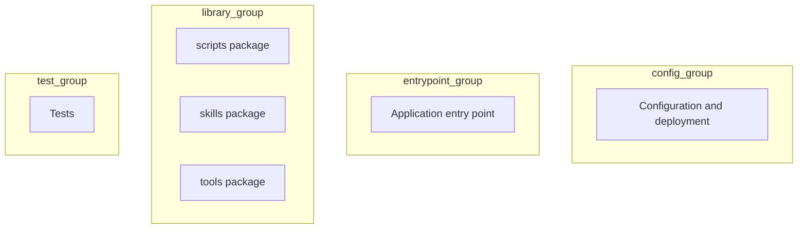

# Architecture report: coreyhaines31/marketingskills

> Automated static analysis. **Observed** = directly seen in files/imports/AST; **Inferred** = interpretation from that evidence. Repository code was not executed.

## 1. Repository at a glance

| Item | Value |
| --- | --- |
| Repository | coreyhaines31/marketingskills |
| Description | Marketing skills for Claude Code and AI agents. CRO, copywriting, SEO, analytics, and growth engineering. |
| Language | JavaScript |
| Stars | 60299 |
| Licence | MIT |
| Analysed commit / branch | 1f837447b20bb6f0e72d87b80ece1c221c362c7d / main |
| Framework(s) | None detected |
| Files analysed | 800 |
| Components | 6 |

## 2. Architecture in one minute

coreyhaines31/marketingskills - Marketing skills for Claude Code and AI agents. CRO, copywriting, SEO, analytics, and growth engineering.. This repository was analysed statically from 800 file(s) (4 Python). Detected technologies (observed from imports/manifests): GitHub Actions, unittest. Files are grouped into 6 component(s): Configuration and deployment, Application entry point, scripts package, skills package, Tests, tools package. Observed entry point(s): scripts/package_skills.py, skills/conversion-tracking/scripts/build_recipe.py, skills/conversion-tracking/scripts/check_recipes.py. Findings below distinguish observed facts from inferred interpretation.

## 3. High-level block diagram

## 4. Main components

### Configuration and deployment (`config`)

- **Kind:** config
- **Status:** Observed
- **Confidence:** 0.85
- **Responsibility:** Groups 94 file(s) under configuration and deployment (observed from repository paths and static analysis).
- **Paths:** `evals/triggers/heldout.json`, `evals/triggers/heldout2.json`, `evals/triggers/heldout3.json`, `evals/triggers/heldout4.json`, `evals/triggers/prompts.json`, `partners.json`, `scripts/claude-web-descriptions.json`, `skills/ab-testing/evals/evals.json`, `skills/ad-creative/evals/evals.json`, `skills/ads/evals/evals.json`, `skills/ai-seo/evals/evals.json`, `skills/analytics/evals/evals.json`, `skills/aso/evals/evals.json`, `skills/attribution/evals/evals.json`, `skills/churn-prevention/evals/evals.json`, `skills/co-marketing/evals/evals.json`, `skills/cold-email/evals/evals.json`, `skills/community-marketing/evals/evals.json`, `skills/competitor-profiling/evals/evals.json`, `skills/competitors/evals/evals.json`, `skills/content-strategy/evals/evals.json`, `skills/conversion-tracking/assets/gtm-recipes/detect/detect-acuity-scheduling.json`, `skills/conversion-tracking/assets/gtm-recipes/detect/detect-cal-com.json`, `skills/conversion-tracking/assets/gtm-recipes/detect/detect-calendly.json`, `skills/conversion-tracking/assets/gtm-recipes/detect/detect-contact-form-7.json`, `skills/conversion-tracking/assets/gtm-recipes/detect/detect-divi-forms.json`, `skills/conversion-tracking/assets/gtm-recipes/detect/detect-elementor-forms.json`, `skills/conversion-tracking/assets/gtm-recipes/detect/detect-file-download.json`, `skills/conversion-tracking/assets/gtm-recipes/detect/detect-fluent-forms.json`, `skills/conversion-tracking/assets/gtm-recipes/detect/detect-formidable-forms.json`, `skills/conversion-tracking/assets/gtm-recipes/detect/detect-forminator.json`, `skills/conversion-tracking/assets/gtm-recipes/detect/detect-framer-forms.json`, `skills/conversion-tracking/assets/gtm-recipes/detect/detect-generic-ajax-form.json`, `skills/conversion-tracking/assets/gtm-recipes/detect/detect-gravity-forms.json`, `skills/conversion-tracking/assets/gtm-recipes/detect/detect-hubspot-forms.json`, `skills/conversion-tracking/assets/gtm-recipes/detect/detect-jotform.json`, `skills/conversion-tracking/assets/gtm-recipes/detect/detect-ninja-forms.json`, `skills/conversion-tracking/assets/gtm-recipes/detect/detect-phone-click.json`, `skills/conversion-tracking/assets/gtm-recipes/detect/detect-squarespace-forms.json`, `skills/conversion-tracking/assets/gtm-recipes/detect/detect-tally.json`, `skills/conversion-tracking/assets/gtm-recipes/detect/detect-thank-you-page.json`, `skills/conversion-tracking/assets/gtm-recipes/detect/detect-typeform.json`, `skills/conversion-tracking/assets/gtm-recipes/detect/detect-webflow-forms.json`, `skills/conversion-tracking/assets/gtm-recipes/detect/detect-wix-forms.json`, `skills/conversion-tracking/assets/gtm-recipes/detect/detect-wix-scheduling.json`, `skills/conversion-tracking/assets/gtm-recipes/detect/detect-wpforms.json`, `skills/conversion-tracking/assets/gtm-recipes/detect/detect-ws-form.json`, `skills/conversion-tracking/assets/gtm-recipes/event-map.json`, `skills/conversion-tracking/assets/gtm-recipes/send/ga4.json`, `skills/conversion-tracking/assets/gtm-recipes/send/google-ads.json`, `skills/conversion-tracking/assets/gtm-recipes/send/linkedin.json`, `skills/conversion-tracking/assets/gtm-recipes/send/meta.json`, `skills/conversion-tracking/assets/gtm-recipes/send/microsoft.json`, `skills/conversion-tracking/assets/gtm-recipes/send/tiktok.json`, `skills/conversion-tracking/evals/evals.json`, `skills/copy-editing/evals/evals.json`, `skills/copywriting/evals/evals.json`, `skills/cro/evals/evals.json`, `skills/customer-research/evals/evals.json`, `skills/directory-submissions/evals/evals.json`, `skills/emails/evals/evals.json`, `skills/events/evals/evals.json`, `skills/free-tools/evals/evals.json`, `skills/image/evals/evals.json`, `skills/influencer-marketing/evals/evals.json`, `skills/launch/evals/evals.json`, `skills/lead-magnets/evals/evals.json`, `skills/link-building/evals/evals.json`, `skills/marketing-council/evals/evals.json`, `skills/marketing-ideas/evals/evals.json`, `skills/marketing-loops/evals/evals.json`, `skills/marketing-plan/evals/evals.json`, `skills/marketing-psychology/evals/evals.json`, `skills/offers/evals/evals.json`, `skills/onboarding/evals/evals.json`, `skills/paywalls/evals/evals.json`, `skills/popups/evals/evals.json`, `skills/pricing/evals/evals.json`, `skills/product-marketing/evals/evals.json`, `skills/programmatic-seo/evals/evals.json`, `skills/prospecting/evals/evals.json`, `skills/public-relations/evals/evals.json`, `skills/referrals/evals/evals.json`, `skills/reverse-engineer-marketing/evals/evals.json`, `skills/revops/evals/evals.json`, `skills/sales-enablement/evals/evals.json`, `skills/schema/evals/evals.json`, `skills/seo-audit/evals/evals.json`, `skills/signup/evals/evals.json`, `skills/site-architecture/evals/evals.json`, `skills/sms/evals/evals.json`, `skills/social/evals/evals.json`, `skills/video/evals/evals.json`, `tools/aisa/evals/evals.json`
- **Evidence:** [evals/triggers/heldout.json](https://github.com/coreyhaines31/marketingskills/blob/1f837447b20bb6f0e72d87b80ece1c221c362c7d/evals/triggers/heldout.json); [evals/triggers/heldout2.json](https://github.com/coreyhaines31/marketingskills/blob/1f837447b20bb6f0e72d87b80ece1c221c362c7d/evals/triggers/heldout2.json); [evals/triggers/heldout3.json](https://github.com/coreyhaines31/marketingskills/blob/1f837447b20bb6f0e72d87b80ece1c221c362c7d/evals/triggers/heldout3.json); [evals/triggers/heldout4.json](https://github.com/coreyhaines31/marketingskills/blob/1f837447b20bb6f0e72d87b80ece1c221c362c7d/evals/triggers/heldout4.json); [evals/triggers/prompts.json](https://github.com/coreyhaines31/marketingskills/blob/1f837447b20bb6f0e72d87b80ece1c221c362c7d/evals/triggers/prompts.json); [partners.json](https://github.com/coreyhaines31/marketingskills/blob/1f837447b20bb6f0e72d87b80ece1c221c362c7d/partners.json); [scripts/claude-web-descriptions.json](https://github.com/coreyhaines31/marketingskills/blob/1f837447b20bb6f0e72d87b80ece1c221c362c7d/scripts/claude-web-descriptions.json); [skills/ab-testing/evals/evals.json](https://github.com/coreyhaines31/marketingskills/blob/1f837447b20bb6f0e72d87b80ece1c221c362c7d/skills/ab-testing/evals/evals.json)

### Application entry point (`entrypoint`)

- **Kind:** entrypoint
- **Status:** Observed
- **Confidence:** 0.85
- **Responsibility:** Groups 3 file(s) under application entry point (observed from repository paths and static analysis). Observed top-level functions: build, expected_html, fail, git, html_param, js_escape.
- **Paths:** `scripts/package_skills.py`, `skills/conversion-tracking/scripts/build_recipe.py`, `skills/conversion-tracking/scripts/check_recipes.py`
- **Evidence:** [scripts/package_skills.py:26](https://github.com/coreyhaines31/marketingskills/blob/1f837447b20bb6f0e72d87b80ece1c221c362c7d/scripts/package_skills.py#L26); [skills/conversion-tracking/scripts/build_recipe.py:52](https://github.com/coreyhaines31/marketingskills/blob/1f837447b20bb6f0e72d87b80ece1c221c362c7d/skills/conversion-tracking/scripts/build_recipe.py#L52); [skills/conversion-tracking/scripts/check_recipes.py:33](https://github.com/coreyhaines31/marketingskills/blob/1f837447b20bb6f0e72d87b80ece1c221c362c7d/skills/conversion-tracking/scripts/check_recipes.py#L33)

### scripts package (`scripts`)

- **Kind:** library
- **Status:** Observed
- **Confidence:** 0.85
- **Responsibility:** Groups 3 file(s) under scripts package (observed from repository paths and static analysis).
- **Paths:** `scripts/check-versions.mjs`, `scripts/sync-partners.mjs`, `scripts/trigger-eval.mjs`
- **Evidence:** [scripts/check-versions.mjs](https://github.com/coreyhaines31/marketingskills/blob/1f837447b20bb6f0e72d87b80ece1c221c362c7d/scripts/check-versions.mjs); [scripts/sync-partners.mjs](https://github.com/coreyhaines31/marketingskills/blob/1f837447b20bb6f0e72d87b80ece1c221c362c7d/scripts/sync-partners.mjs); [scripts/trigger-eval.mjs](https://github.com/coreyhaines31/marketingskills/blob/1f837447b20bb6f0e72d87b80ece1c221c362c7d/scripts/trigger-eval.mjs)

### skills package (`skills`)

- **Kind:** library
- **Status:** Observed
- **Confidence:** 0.85
- **Responsibility:** Groups 27 file(s) under skills package (observed from repository paths and static analysis).
- **Paths:** `skills/conversion-tracking/assets/snippets/acuity-scheduling.js`, `skills/conversion-tracking/assets/snippets/cal-com.js`, `skills/conversion-tracking/assets/snippets/calendly.js`, `skills/conversion-tracking/assets/snippets/contact-form-7.js`, `skills/conversion-tracking/assets/snippets/divi-forms.js`, `skills/conversion-tracking/assets/snippets/elementor-forms.js`, `skills/conversion-tracking/assets/snippets/file-download.js`, `skills/conversion-tracking/assets/snippets/fluent-forms.js`, `skills/conversion-tracking/assets/snippets/formidable-forms.js`, `skills/conversion-tracking/assets/snippets/forminator.js`, `skills/conversion-tracking/assets/snippets/framer-forms.js`, `skills/conversion-tracking/assets/snippets/generic-ajax-form.js`, `skills/conversion-tracking/assets/snippets/gravity-forms.js`, `skills/conversion-tracking/assets/snippets/hubspot-forms.js`, `skills/conversion-tracking/assets/snippets/jotform.js`, `skills/conversion-tracking/assets/snippets/ninja-forms.js`, `skills/conversion-tracking/assets/snippets/phone-click.js`, `skills/conversion-tracking/assets/snippets/squarespace-forms.js`, `skills/conversion-tracking/assets/snippets/tally.js`, `skills/conversion-tracking/assets/snippets/thank-you-page.js`, `skills/conversion-tracking/assets/snippets/typeform.js`, `skills/conversion-tracking/assets/snippets/webflow-forms.js`, `skills/conversion-tracking/assets/snippets/wix-forms.js`, `skills/conversion-tracking/assets/snippets/wix-scheduling.js`, `skills/conversion-tracking/assets/snippets/wpforms.js`, `skills/conversion-tracking/assets/snippets/ws-form.js`, `skills/reverse-engineer-marketing/scripts/teardown.mjs`
- **Evidence:** [skills/conversion-tracking/assets/snippets/acuity-scheduling.js](https://github.com/coreyhaines31/marketingskills/blob/1f837447b20bb6f0e72d87b80ece1c221c362c7d/skills/conversion-tracking/assets/snippets/acuity-scheduling.js); [skills/conversion-tracking/assets/snippets/cal-com.js](https://github.com/coreyhaines31/marketingskills/blob/1f837447b20bb6f0e72d87b80ece1c221c362c7d/skills/conversion-tracking/assets/snippets/cal-com.js); [skills/conversion-tracking/assets/snippets/calendly.js](https://github.com/coreyhaines31/marketingskills/blob/1f837447b20bb6f0e72d87b80ece1c221c362c7d/skills/conversion-tracking/assets/snippets/calendly.js); [skills/conversion-tracking/assets/snippets/contact-form-7.js](https://github.com/coreyhaines31/marketingskills/blob/1f837447b20bb6f0e72d87b80ece1c221c362c7d/skills/conversion-tracking/assets/snippets/contact-form-7.js); [skills/conversion-tracking/assets/snippets/divi-forms.js](https://github.com/coreyhaines31/marketingskills/blob/1f837447b20bb6f0e72d87b80ece1c221c362c7d/skills/conversion-tracking/assets/snippets/divi-forms.js); [skills/conversion-tracking/assets/snippets/elementor-forms.js](https://github.com/coreyhaines31/marketingskills/blob/1f837447b20bb6f0e72d87b80ece1c221c362c7d/skills/conversion-tracking/assets/snippets/elementor-forms.js); [skills/conversion-tracking/assets/snippets/file-download.js](https://github.com/coreyhaines31/marketingskills/blob/1f837447b20bb6f0e72d87b80ece1c221c362c7d/skills/conversion-tracking/assets/snippets/file-download.js); [skills/conversion-tracking/assets/snippets/fluent-forms.js](https://github.com/coreyhaines31/marketingskills/blob/1f837447b20bb6f0e72d87b80ece1c221c362c7d/skills/conversion-tracking/assets/snippets/fluent-forms.js)

### Tests (`tests`)

- **Kind:** test
- **Status:** Observed
- **Confidence:** 0.85
- **Responsibility:** Groups 152 file(s) under tests (observed from repository paths and static analysis). Observed top-level classes: PackagingTests.
- **Paths:** `tests/assets/conversion-tracking-formidable-forms.test.cjs`, `tests/assets/conversion-tracking-generic-ajax-form.test.cjs`, `tests/assets/conversion-tracking-thank-you-page.test.cjs`, `tests/assets/creative-review-images.test.cjs`, `tests/clis/activecampaign-contact-fields.test.cjs`, `tests/clis/adobe-report-suites.test.cjs`, `tests/clis/ahrefs-link-reports.test.cjs`, `tests/clis/ahrefs-reports.test.cjs`, `tests/clis/airops-public-api.test.cjs`, `tests/clis/amplitude-device-identity.test.cjs`, `tests/clis/amplitude-export.test.cjs`, `tests/clis/amplitude-json-shapes.test.cjs`, `tests/clis/amplitude-retention-events.test.cjs`, `tests/clis/amplitude-user-activity.test.cjs`, `tests/clis/apollo-employee-ranges.test.cjs`, `tests/clis/apollo-enrichment.test.cjs`, `tests/clis/beehiiv-post-content.test.cjs`, `tests/clis/beehiiv-update.test.cjs`, `tests/clis/brevo-contact-suppression.test.cjs`, `tests/clis/buffer-publish-flags.test.cjs`, `tests/clis/calendly-webhooks.test.cjs`, `tests/clis/cloro-requests.test.cjs`, `tests/clis/close-collection-pagination.test.cjs`, `tests/clis/close-opportunity-status.test.cjs`, `tests/clis/close-opportunity-value.test.cjs`, `tests/clis/crossbeam-overlaps.test.cjs`, `tests/clis/customer-io-suppression.test.cjs`, `tests/clis/customerio-identifiers.test.cjs`, `tests/clis/customerio-json-data.test.cjs`, `tests/clis/customerio-region.test.cjs`, `tests/clis/dataforseo-market.test.cjs`, `tests/clis/dataforseo-status.test.cjs`, `tests/clis/demio-participant-route.test.cjs`, `tests/clis/dub-breakdowns.test.cjs`, `tests/clis/dub-bulk-container.test.cjs`, `tests/clis/dub-link-tags.test.cjs`, `tests/clis/email-boolean-states.test.cjs`, `tests/clis/email-colon-values.test.cjs`, `tests/clis/exa-answer.test.cjs`, `tests/clis/exa-structured-search.test.cjs`, `tests/clis/firecrawl-crawl-inspection.test.cjs`, `tests/clis/ga4-event-params.test.cjs`, `tests/clis/ga4-mp-auth.test.cjs`, `tests/clis/ga4-report-pagination.test.cjs`, `tests/clis/github-enrichment.test.cjs`, `tests/clis/github-http-status.test.cjs`, `tests/clis/google-ads-manager.test.cjs`, `tests/clis/google-ads-project-auth.test.cjs`, `tests/clis/google-ads-query.test.cjs`, `tests/clis/gsc-query-pagination.test.cjs`, `tests/clis/gsc-sitemap-result.test.cjs`, `tests/clis/hotjar-surveys.test.cjs`, `tests/clis/http-rejection-status.test.cjs`, `tests/clis/hunter-auth-query.test.cjs`, `tests/clis/hunter-domain-pagination.test.cjs`, `tests/clis/instantly-v2.test.cjs`, `tests/clis/intercom-event-metadata.test.cjs`, `tests/clis/intercom-messages.test.cjs`, `tests/clis/intercom-metadata-container.test.cjs`, `tests/clis/intercom-search.test.cjs`, `tests/clis/keywords-seed-suggestions.test.cjs`, `tests/clis/kit-field-objects.test.cjs`, `tests/clis/kit-preview-redaction.test.cjs`, `tests/clis/klaviyo-cursors.test.cjs`, `tests/clis/klaviyo-event-value.test.cjs`, `tests/clis/klaviyo-properties-json.test.cjs`, `tests/clis/lemlist-webhook-type.test.cjs`, `tests/clis/linkedin-ads-rest.test.cjs`, `tests/clis/livestorm-registration.test.cjs`, `tests/clis/local-validation-status.test.cjs`, `tests/clis/mailchimp-members.test.cjs`, `tests/clis/mailchimp-update-tags.test.cjs`, `tests/clis/meta-account-ids.test.cjs`, `tests/clis/mixpanel-ingestion-status.test.cjs`, `tests/clis/mixpanel-property-objects.test.cjs`, `tests/clis/mixpanel-region.test.cjs`, `tests/clis/mixpanel-service-first.test.cjs`, `tests/clis/onesignal-audience-shapes.test.cjs`, `tests/clis/onesignal-send.test.cjs`, `tests/clis/onesignal-targeting-conflicts.test.cjs`, `tests/clis/onesignal-users.test.cjs`, `tests/clis/optimizely-archive.test.cjs`, `tests/clis/outreach-mailbox.test.cjs`, `tests/clis/outreach-pagination.test.cjs`, `tests/clis/outreach-task-state.test.cjs`, `tests/clis/paddle-discount-limit.test.cjs`, `tests/clis/paddle-subscription-updates.test.cjs`, `tests/clis/partnerstack-actions.test.cjs`, `tests/clis/partnerstack-transactions.test.cjs`, `tests/clis/partnerstack-webhooks.test.cjs`, `tests/clis/pendo-identifiers.test.cjs`, `tests/clis/pendo-pipeline-envelope.test.cjs`, `tests/clis/pendo-search-query-shape.test.cjs`, `tests/clis/plausible-dates.test.cjs`, `tests/clis/plausible-pagination.test.cjs`, `tests/clis/postmark-batch-status.test.cjs`, `tests/clis/postmark-layout-template.test.cjs`, `tests/clis/postmark-model-json.test.cjs`, `tests/clis/prospect-csv.test.cjs`, `tests/clis/prospect-truncation.test.cjs`, `tests/clis/request-deadlines.test.cjs`, `tests/clis/resend-batch-shape.test.cjs`, `tests/clis/resend-error-exit.test.cjs`, `tests/clis/resend-idempotency.test.cjs`, `tests/clis/resend-list-cursors.test.cjs`, `tests/clis/resend-template-variables.test.cjs`, `tests/clis/resend-webhook-endpoint.test.cjs`, `tests/clis/reverse-engineer-teardown.test.cjs`, `tests/clis/rewardful-mutations.test.cjs`, `tests/clis/rewardful-pagination.test.cjs`, `tests/clis/rewardful-update-id.test.cjs`, `tests/clis/savvycal-booking.test.cjs`, `tests/clis/savvycal-link-resource.test.cjs`, `tests/clis/segment-anonymous-identity.test.cjs`, `tests/clis/segment-delivery-metadata.test.cjs`, `tests/clis/segment-json-objects.test.cjs`, `tests/clis/segment-profile-identifiers.test.cjs`, `tests/clis/semrush-backlinks-route.test.cjs`, `tests/clis/semrush-csv.test.cjs`, `tests/clis/semrush-status.test.cjs`, `tests/clis/sendgrid-campaign-routes.test.cjs`, `tests/clis/sendgrid-dynamic-template.test.cjs`, `tests/clis/sendgrid-template-data-object.test.cjs`, `tests/clis/similarweb-referrals.test.cjs`, `tests/clis/snov-domain-tasks.test.cjs`, `tests/clis/snov-prospect-search.test.cjs`, `tests/clis/supermetrics-contract.test.cjs`, `tests/clis/sync-literal-text.test.cjs`, `tests/clis/sync-metadata-scope.test.cjs`, `tests/clis/sync-readme-line-endings.test.cjs`, `tests/clis/sync-skills-frontmatter.test.cjs`, `tests/clis/tiktok-error-exit.test.cjs`, `tests/clis/tiktok-read-contracts.test.cjs`, `tests/clis/tolt-public-api.test.cjs`, `tests/clis/trigger-eval.test.cjs`, `tests/clis/truelist.test.cjs`, `tests/clis/trustpilot-invitations.test.cjs`, `tests/clis/typeform-update.test.cjs`, `tests/clis/version-nested-references.test.cjs`, `tests/clis/wistia-auth.test.cjs`, `tests/clis/zapier-webhook.test.cjs`, `tests/clis/zoominfo-auth.test.cjs`, `tests/fixtures/invalid/body-frontmatter/SKILL.md.fixture`, `tests/fixtures/invalid/body-frontmatter/expected-error.txt`, `tests/fixtures/invalid/page--cro/SKILL.md.fixture`, `tests/fixtures/invalid/page--cro/expected-error.txt`, `tests/fixtures/invalid/unclosed-frontmatter/SKILL.md.fixture`, `tests/fixtures/invalid/unclosed-frontmatter/expected-error.txt`, `tests/fixtures/invalid/versiontest/SKILL.md.fixture`, `tests/fixtures/invalid/versiontest/expected-error.txt`, `tests/run-regression.sh`, `tests/test_skill_packaging.py`
- **Evidence:** [tests/assets/conversion-tracking-formidable-forms.test.cjs](https://github.com/coreyhaines31/marketingskills/blob/1f837447b20bb6f0e72d87b80ece1c221c362c7d/tests/assets/conversion-tracking-formidable-forms.test.cjs); [tests/assets/conversion-tracking-generic-ajax-form.test.cjs](https://github.com/coreyhaines31/marketingskills/blob/1f837447b20bb6f0e72d87b80ece1c221c362c7d/tests/assets/conversion-tracking-generic-ajax-form.test.cjs); [tests/assets/conversion-tracking-thank-you-page.test.cjs](https://github.com/coreyhaines31/marketingskills/blob/1f837447b20bb6f0e72d87b80ece1c221c362c7d/tests/assets/conversion-tracking-thank-you-page.test.cjs); [tests/assets/creative-review-images.test.cjs](https://github.com/coreyhaines31/marketingskills/blob/1f837447b20bb6f0e72d87b80ece1c221c362c7d/tests/assets/creative-review-images.test.cjs); [tests/clis/activecampaign-contact-fields.test.cjs](https://github.com/coreyhaines31/marketingskills/blob/1f837447b20bb6f0e72d87b80ece1c221c362c7d/tests/clis/activecampaign-contact-fields.test.cjs); [tests/clis/adobe-report-suites.test.cjs](https://github.com/coreyhaines31/marketingskills/blob/1f837447b20bb6f0e72d87b80ece1c221c362c7d/tests/clis/adobe-report-suites.test.cjs); [tests/clis/ahrefs-link-reports.test.cjs](https://github.com/coreyhaines31/marketingskills/blob/1f837447b20bb6f0e72d87b80ece1c221c362c7d/tests/clis/ahrefs-link-reports.test.cjs); [tests/clis/ahrefs-reports.test.cjs](https://github.com/coreyhaines31/marketingskills/blob/1f837447b20bb6f0e72d87b80ece1c221c362c7d/tests/clis/ahrefs-reports.test.cjs)

### tools package (`tools`)

- **Kind:** library
- **Status:** Observed
- **Confidence:** 0.85
- **Responsibility:** Groups 67 file(s) under tools package (observed from repository paths and static analysis).
- **Paths:** `tools/clis/activecampaign.js`, `tools/clis/adobe-analytics.js`, `tools/clis/ahrefs.js`, `tools/clis/airops.js`, `tools/clis/amplitude.js`, `tools/clis/apollo.js`, `tools/clis/beehiiv.js`, `tools/clis/brevo.js`, `tools/clis/buffer.js`, `tools/clis/calendly.js`, `tools/clis/clay.js`, `tools/clis/clearbit.js`, `tools/clis/cloro.js`, `tools/clis/close.js`, `tools/clis/coupler.js`, `tools/clis/crossbeam.js`, `tools/clis/customer-io.js`, `tools/clis/dataforseo.js`, `tools/clis/demio.js`, `tools/clis/dub.js`, `tools/clis/exa.js`, `tools/clis/firecrawl.js`, `tools/clis/g2.js`, `tools/clis/ga4.js`, `tools/clis/github-prospects.js`, `tools/clis/google-ads.js`, `tools/clis/google-search-console.js`, `tools/clis/hotjar.js`, `tools/clis/hunter.js`, `tools/clis/instantly.js`, `tools/clis/intercom.js`, `tools/clis/keywords-everywhere.js`, `tools/clis/kit.js`, `tools/clis/klaviyo.js`, `tools/clis/lemlist.js`, `tools/clis/linkedin-ads.js`, `tools/clis/livestorm.js`, `tools/clis/mailchimp.js`, `tools/clis/mention-me.js`, `tools/clis/meta-ads.js`, `tools/clis/mixpanel.js`, `tools/clis/onesignal.js`, `tools/clis/optimizely.js`, `tools/clis/outreach.js`, `tools/clis/paddle.js`, `tools/clis/partnerstack.js`, `tools/clis/pendo.js`, `tools/clis/plausible.js`, `tools/clis/postmark.js`, `tools/clis/rankparse.js`, `tools/clis/resend.js`, `tools/clis/rewardful.js`, `tools/clis/savvycal.js`, `tools/clis/segment.js`, `tools/clis/semrush.js`, `tools/clis/sendgrid.js`, `tools/clis/similarweb.js`, `tools/clis/snov.js`, `tools/clis/supermetrics.js`, `tools/clis/tiktok-ads.js`, `tools/clis/tolt.js`, `tools/clis/truelist.js`, `tools/clis/trustpilot.js`, `tools/clis/typeform.js`, `tools/clis/wistia.js`, `tools/clis/zapier.js`, `tools/clis/zoominfo.js`
- **Evidence:** [tools/clis/activecampaign.js](https://github.com/coreyhaines31/marketingskills/blob/1f837447b20bb6f0e72d87b80ece1c221c362c7d/tools/clis/activecampaign.js); [tools/clis/adobe-analytics.js](https://github.com/coreyhaines31/marketingskills/blob/1f837447b20bb6f0e72d87b80ece1c221c362c7d/tools/clis/adobe-analytics.js); [tools/clis/ahrefs.js](https://github.com/coreyhaines31/marketingskills/blob/1f837447b20bb6f0e72d87b80ece1c221c362c7d/tools/clis/ahrefs.js); [tools/clis/airops.js](https://github.com/coreyhaines31/marketingskills/blob/1f837447b20bb6f0e72d87b80ece1c221c362c7d/tools/clis/airops.js); [tools/clis/amplitude.js](https://github.com/coreyhaines31/marketingskills/blob/1f837447b20bb6f0e72d87b80ece1c221c362c7d/tools/clis/amplitude.js); [tools/clis/apollo.js](https://github.com/coreyhaines31/marketingskills/blob/1f837447b20bb6f0e72d87b80ece1c221c362c7d/tools/clis/apollo.js); [tools/clis/beehiiv.js](https://github.com/coreyhaines31/marketingskills/blob/1f837447b20bb6f0e72d87b80ece1c221c362c7d/tools/clis/beehiiv.js); [tools/clis/brevo.js](https://github.com/coreyhaines31/marketingskills/blob/1f837447b20bb6f0e72d87b80ece1c221c362c7d/tools/clis/brevo.js)

## 5. Execution flow

**Observed** entry point(s):

- [scripts/package_skills.py:223](https://github.com/coreyhaines31/marketingskills/blob/1f837447b20bb6f0e72d87b80ece1c221c362c7d/scripts/package_skills.py#L223)
- [skills/conversion-tracking/scripts/build_recipe.py:222](https://github.com/coreyhaines31/marketingskills/blob/1f837447b20bb6f0e72d87b80ece1c221c362c7d/skills/conversion-tracking/scripts/build_recipe.py#L222)
- [skills/conversion-tracking/scripts/check_recipes.py:88](https://github.com/coreyhaines31/marketingskills/blob/1f837447b20bb6f0e72d87b80ece1c221c362c7d/skills/conversion-tracking/scripts/check_recipes.py#L88)

Representative flow (derived from observed entry points and the import graph; steps beyond the entry point are **Inferred**):

1. Execution starts at an observed entry point listed above, if present.
2. No internal import relationships between components were observed.

## 6. Project structure

### `(root)`

- `.gitignore` - other (516 bytes)
- `AGENTS.md` - docs (13003 bytes)
- `CONTRIBUTING.md` - docs (5465 bytes)
- `LICENSE` - docs (1069 bytes)
- `README.md` - docs (26674 bytes)
- `VERSIONS.md` - docs (171591 bytes)
- `partners.json` - config (4164 bytes)

### `.agents`

- `.agents/plugins/marketplace.json` - config (366 bytes)

### `.claude-plugin`

- `.claude-plugin/marketplace.json` - config (898 bytes)
- `.claude-plugin/plugin.json` - config (413 bytes)

### `.codex-plugin`

- `.codex-plugin/plugin.json` - config (414 bytes)

### `.github`

- `.github/FUNDING.yml` - config (98 bytes)
- `.github/ISSUE_TEMPLATE/config.yml` - config (374 bytes)
- `.github/ISSUE_TEMPLATE/skill-request.yml` - config (1920 bytes)
- `.github/PULL_REQUEST_TEMPLATE/documentation.md` - docs (267 bytes)
- `.github/PULL_REQUEST_TEMPLATE/new-skill.md` - docs (414 bytes)
- `.github/PULL_REQUEST_TEMPLATE/skill-update.md` - docs (381 bytes)
- `.github/scripts/sync-skills.js` - source, JavaScript (6895 bytes)
- `.github/workflows/check-versions.yml` - ci, YAML (727 bytes)
- `.github/workflows/regression-tests.yml` - ci, YAML (1265 bytes)
- `.github/workflows/release.yml` - ci, YAML (5147 bytes)
- `.github/workflows/skill-packaging.yml` - ci, YAML (1058 bytes)
- `.github/workflows/sync-skills.yml` - ci, YAML (843 bytes)
- `.github/workflows/validate-skill.yml` - ci, YAML (1905 bytes)

### `docs`

- `docs/skill-release-packaging.md` - docs (5868 bytes)

### `evals`

- `evals/triggers/README.md` - docs (5734 bytes)
- `evals/triggers/heldout.json` - config (37899 bytes)
- `evals/triggers/heldout2.json` - config (45359 bytes)
- `evals/triggers/heldout3.json` - config (48282 bytes)
- `evals/triggers/heldout4.json` - config (51952 bytes)
- `evals/triggers/prompts.json` - config (39153 bytes)

### `scripts`

- `scripts/check-versions.mjs` - source, JavaScript (7846 bytes)
- `scripts/claude-web-descriptions.json` - config (15282 bytes)
- `scripts/package_skills.py` - source, Python (12034 bytes)
- `scripts/sync-partners.mjs` - source, JavaScript (2909 bytes)
- `scripts/trigger-eval.mjs` - source, JavaScript (9596 bytes)

### `skills`

- `skills/ab-testing/SKILL.md` - docs (12881 bytes)
- `skills/ab-testing/evals/evals.json` - config (9025 bytes)
- `skills/ab-testing/references/sample-size-guide.md` - docs (9183 bytes)
- `skills/ab-testing/references/test-templates.md` - docs (6473 bytes)
- `skills/ad-creative/SKILL.md` - docs (26575 bytes)
- `skills/ad-creative/assets/creative-review-template.html` - other (26092 bytes)
- `skills/ad-creative/evals/evals.json` - config (29078 bytes)
- `skills/ad-creative/references/awareness-headlines.md` - docs (6765 bytes)
- `skills/ad-creative/references/creative-review-page.md` - docs (9602 bytes)
- `skills/ad-creative/references/creative-roadmap.md` - docs (9010 bytes)
- `skills/ad-creative/references/generative-tools.md` - docs (24215 bytes)
- `skills/ad-creative/references/hook-system.md` - docs (10030 bytes)
- `skills/ad-creative/references/imessage-video-ads.md` - docs (19922 bytes)
- `skills/ad-creative/references/meta-creative-formats.md` - docs (10938 bytes)
- `skills/ad-creative/references/motion-video-ads.md` - docs (11801 bytes)
- `skills/ad-creative/references/platform-specs.md` - docs (6525 bytes)
- `skills/ad-creative/references/short-form-video-specs.md` - docs (19389 bytes)
- `skills/ad-creative/references/static-ad-templates.md` - docs (37143 bytes)
- `skills/ads/SKILL.md` - docs (30109 bytes)
- `skills/ads/evals/evals.json` - config (27082 bytes)
- `skills/ads/references/abm-playbook.md` - docs (8100 bytes)
- `skills/ads/references/ad-copy-templates.md` - docs (4821 bytes)
- `skills/ads/references/audience-targeting.md` - docs (6067 bytes)
- `skills/ads/references/audit-guardrails.md` - docs (8158 bytes)
- `skills/ads/references/b2b-paid-playbook.md` - docs (7951 bytes)
- `skills/ads/references/creative-research-automation.md` - docs (10459 bytes)
- `skills/ads/references/google-ads-audit-checklist.md` - docs (12811 bytes)
- `skills/ads/references/google-search-playbook.md` - docs (10873 bytes)
- `skills/ads/references/linkedin-b2b-playbook.md` - docs (9222 bytes)
- `skills/ads/references/meta-andromeda-playbook.md` - docs (8201 bytes)
- `skills/ads/references/meta-decision-system.md` - docs (15663 bytes)
- `skills/ads/references/operating-check.md` - docs (7235 bytes)
- `skills/ads/references/payback-period.md` - docs (6920 bytes)
- `skills/ads/references/platform-setup-checklists.md` - docs (7613 bytes)
- `skills/ads/references/reading-google-ads-data.md` - docs (8750 bytes)
- `skills/ads/references/rsa-output-spec.md` - docs (3689 bytes)
- `skills/ai-seo/SKILL.md` - docs (36278 bytes)
- `skills/ai-seo/evals/evals.json` - config (20713 bytes)
- `skills/ai-seo/references/agent-defaults.md` - docs (9344 bytes)
- `skills/ai-seo/references/agent-readiness.md` - docs (17492 bytes)
- `skills/ai-seo/references/ai-attribution.md` - docs (4302 bytes)
- `skills/ai-seo/references/answer-accuracy.md` - docs (5705 bytes)
- `skills/ai-seo/references/citations-vs-recommendations.md` - docs (12839 bytes)
- `skills/ai-seo/references/content-patterns.md` - docs (12949 bytes)
- `skills/ai-seo/references/content-types.md` - docs (3558 bytes)
- `skills/ai-seo/references/format-volatility.md` - docs (7269 bytes)
- `skills/ai-seo/references/linkedin-ai-citations.md` - docs (8747 bytes)
- `skills/ai-seo/references/multilingual-and-commerce.md` - docs (4880 bytes)
- `skills/ai-seo/references/okf.md` - docs (5952 bytes)
- `skills/ai-seo/references/platform-ranking-factors.md` - docs (16734 bytes)
- `skills/ai-seo/references/positioning-and-consensus.md` - docs (7283 bytes)
- `skills/ai-seo/references/prompt-portfolio.md` - docs (7712 bytes)
- `skills/ai-seo/references/youtube-ai-citations.md` - docs (4478 bytes)
- `skills/analytics/SKILL.md` - docs (14071 bytes)
- `skills/analytics/evals/evals.json` - config (8819 bytes)
- `skills/analytics/references/event-library.md` - docs (8654 bytes)
- `skills/analytics/references/ga4-implementation.md` - docs (7189 bytes)
- `skills/analytics/references/gtm-implementation.md` - docs (8413 bytes)
- `skills/aso/SKILL.md` - docs (15716 bytes)
- `skills/aso/evals/evals.json` - config (8766 bytes)
- `skills/aso/references/apple-specs.md` - docs (6194 bytes)
- `skills/aso/references/benchmarks.md` - docs (5444 bytes)
- `skills/aso/references/google-play-specs.md` - docs (6599 bytes)
- `skills/aso/references/report-template.md` - docs (5124 bytes)
- `skills/aso/references/scoring-criteria.md` - docs (13756 bytes)
- `skills/attribution/SKILL.md` - docs (22846 bytes)
- `skills/attribution/evals/evals.json` - config (13186 bytes)
- `skills/attribution/references/attribution-models.md` - docs (6783 bytes)
- `skills/attribution/references/by-business-type.md` - docs (7857 bytes)
- `skills/attribution/references/first-party-tracking.md` - docs (19867 bytes)
- `skills/attribution/references/measurement-paradigms.md` - docs (10598 bytes)
- `skills/churn-prevention/SKILL.md` - docs (19664 bytes)
- `skills/churn-prevention/evals/evals.json` - config (8144 bytes)
- `skills/churn-prevention/references/cancel-flow-patterns.md` - docs (10650 bytes)
- `skills/churn-prevention/references/dunning-playbook.md` - docs (14061 bytes)
- `skills/co-marketing/SKILL.md` - docs (11939 bytes)
- `skills/co-marketing/evals/evals.json` - config (8934 bytes)
- `skills/co-marketing/references/partnership-types.md` - docs (8111 bytes)
- `skills/cold-email/SKILL.md` - docs (12167 bytes)
- `skills/cold-email/evals/evals.json` - config (10441 bytes)
- `skills/cold-email/references/benchmarks.md` - docs (6411 bytes)
- `skills/cold-email/references/deliverability.md` - docs (7833 bytes)
- `skills/cold-email/references/follow-up-sequences.md` - docs (3947 bytes)
- `skills/cold-email/references/frameworks.md` - docs (5387 bytes)
- `skills/cold-email/references/linkedin-outreach.md` - docs (5750 bytes)
- `skills/cold-email/references/multichannel-cadence.md` - docs (5481 bytes)
- `skills/cold-email/references/outbound-plays.md` - docs (6113 bytes)
- `skills/cold-email/references/personalization.md` - docs (5238 bytes)
- `skills/cold-email/references/reply-handling.md` - docs (4648 bytes)
- `skills/cold-email/references/subject-lines.md` - docs (3015 bytes)
- `skills/community-marketing/SKILL.md` - docs (9525 bytes)
- `skills/community-marketing/evals/evals.json` - config (9451 bytes)
- `skills/community-marketing/references/community-models.md` - docs (4046 bytes)
- `skills/competitor-profiling/SKILL.md` - docs (17390 bytes)
- `skills/competitor-profiling/evals/evals.json` - config (8565 bytes)
- `skills/competitor-profiling/references/templates.md` - docs (4668 bytes)
- `skills/competitor-profiling/references/tool-reference.md` - docs (13132 bytes)
- `skills/competitors/SKILL.md` - docs (11511 bytes)
- `skills/competitors/evals/evals.json` - config (9137 bytes)
- `skills/competitors/references/content-architecture.md` - docs (7745 bytes)
- `skills/competitors/references/templates.md` - docs (5649 bytes)
- `skills/content-strategy/SKILL.md` - docs (19040 bytes)
- `skills/content-strategy/evals/evals.json` - config (10190 bytes)
- `skills/content-strategy/references/content-distribution.md` - docs (5576 bytes)
- `skills/content-strategy/references/headless-cms.md` - docs (8583 bytes)
- `skills/conversion-tracking/SKILL.md` - docs (30472 bytes)
- `skills/conversion-tracking/assets/gtm-recipes/README.md` - docs (6405 bytes)
- `skills/conversion-tracking/assets/gtm-recipes/detect/detect-acuity-scheduling.json` - config (7154 bytes)
- `skills/conversion-tracking/assets/gtm-recipes/detect/detect-cal-com.json` - config (9059 bytes)
- `skills/conversion-tracking/assets/gtm-recipes/detect/detect-calendly.json` - config (7873 bytes)
- `skills/conversion-tracking/assets/gtm-recipes/detect/detect-contact-form-7.json` - config (6460 bytes)
- `skills/conversion-tracking/assets/gtm-recipes/detect/detect-divi-forms.json` - config (5092 bytes)
- `skills/conversion-tracking/assets/gtm-recipes/detect/detect-elementor-forms.json` - config (4463 bytes)
- `skills/conversion-tracking/assets/gtm-recipes/detect/detect-file-download.json` - config (5098 bytes)
- `skills/conversion-tracking/assets/gtm-recipes/detect/detect-fluent-forms.json` - config (6939 bytes)
- `skills/conversion-tracking/assets/gtm-recipes/detect/detect-formidable-forms.json` - config (11029 bytes)
- `skills/conversion-tracking/assets/gtm-recipes/detect/detect-forminator.json` - config (5616 bytes)
- `skills/conversion-tracking/assets/gtm-recipes/detect/detect-framer-forms.json` - config (6487 bytes)
- `skills/conversion-tracking/assets/gtm-recipes/detect/detect-generic-ajax-form.json` - config (8012 bytes)
- `skills/conversion-tracking/assets/gtm-recipes/detect/detect-gravity-forms.json` - config (15762 bytes)
- `skills/conversion-tracking/assets/gtm-recipes/detect/detect-hubspot-forms.json` - config (9472 bytes)
- `skills/conversion-tracking/assets/gtm-recipes/detect/detect-jotform.json` - config (3885 bytes)
- `skills/conversion-tracking/assets/gtm-recipes/detect/detect-ninja-forms.json` - config (8605 bytes)
- `skills/conversion-tracking/assets/gtm-recipes/detect/detect-phone-click.json` - config (4745 bytes)
- `skills/conversion-tracking/assets/gtm-recipes/detect/detect-squarespace-forms.json` - config (18966 bytes)
- `skills/conversion-tracking/assets/gtm-recipes/detect/detect-tally.json` - config (10662 bytes)
- `skills/conversion-tracking/assets/gtm-recipes/detect/detect-thank-you-page.json` - config (6326 bytes)
- `skills/conversion-tracking/assets/gtm-recipes/detect/detect-typeform.json` - config (8061 bytes)
- `skills/conversion-tracking/assets/gtm-recipes/detect/detect-webflow-forms.json` - config (5695 bytes)
- `skills/conversion-tracking/assets/gtm-recipes/detect/detect-wix-forms.json` - config (9772 bytes)
- `skills/conversion-tracking/assets/gtm-recipes/detect/detect-wix-scheduling.json` - config (5199 bytes)
- `skills/conversion-tracking/assets/gtm-recipes/detect/detect-wpforms.json` - config (11381 bytes)
- `skills/conversion-tracking/assets/gtm-recipes/detect/detect-ws-form.json` - config (4777 bytes)
- `skills/conversion-tracking/assets/gtm-recipes/event-map.json` - config (3211 bytes)
- `skills/conversion-tracking/assets/gtm-recipes/send/ga4.json` - config (1859 bytes)
- `skills/conversion-tracking/assets/gtm-recipes/send/google-ads.json` - config (2765 bytes)
- `skills/conversion-tracking/assets/gtm-recipes/send/linkedin.json` - config (3851 bytes)
- `skills/conversion-tracking/assets/gtm-recipes/send/meta.json` - config (4218 bytes)
- `skills/conversion-tracking/assets/gtm-recipes/send/microsoft.json` - config (4105 bytes)
- `skills/conversion-tracking/assets/gtm-recipes/send/tiktok.json` - config (4464 bytes)
- `skills/conversion-tracking/assets/snippets/README.md` - docs (17719 bytes)
- `skills/conversion-tracking/assets/snippets/acuity-scheduling-field.html` - other (1290 bytes)
- `skills/conversion-tracking/assets/snippets/acuity-scheduling.js` - source, JavaScript (3368 bytes)
- `skills/conversion-tracking/assets/snippets/cal-com.js` - source, JavaScript (5650 bytes)
- `skills/conversion-tracking/assets/snippets/calendly.js` - source, JavaScript (4923 bytes)
- `skills/conversion-tracking/assets/snippets/contact-form-7.js` - source, JavaScript (3964 bytes)
- `skills/conversion-tracking/assets/snippets/divi-forms.js` - source, JavaScript (2657 bytes)
- `skills/conversion-tracking/assets/snippets/elementor-forms.js` - source, JavaScript (2013 bytes)
- `skills/conversion-tracking/assets/snippets/file-download.js` - source, JavaScript (3230 bytes)
- `skills/conversion-tracking/assets/snippets/fluent-forms.js` - source, JavaScript (4407 bytes)
- `skills/conversion-tracking/assets/snippets/formidable-forms.js` - source, JavaScript (8414 bytes)
- `skills/conversion-tracking/assets/snippets/forminator.js` - source, JavaScript (3164 bytes)
- `skills/conversion-tracking/assets/snippets/framer-forms.js` - source, JavaScript (3990 bytes)
- `skills/conversion-tracking/assets/snippets/generic-ajax-form.js` - source, JavaScript (6069 bytes)
- `skills/conversion-tracking/assets/snippets/gravity-forms.js` - source, JavaScript (13094 bytes)
- `skills/conversion-tracking/assets/snippets/hubspot-forms.js` - source, JavaScript (6921 bytes)
- `skills/conversion-tracking/assets/snippets/jotform.js` - source, JavaScript (1465 bytes)
- `skills/conversion-tracking/assets/snippets/ninja-forms.js` - source, JavaScript (6058 bytes)
- `skills/conversion-tracking/assets/snippets/phone-click.js` - source, JavaScript (2870 bytes)
- `skills/conversion-tracking/assets/snippets/squarespace-forms.js` - source, JavaScript (15690 bytes)
- `skills/conversion-tracking/assets/snippets/tally.js` - source, JavaScript (7668 bytes)
- `skills/conversion-tracking/assets/snippets/thank-you-page.js` - source, JavaScript (4430 bytes)
- `skills/conversion-tracking/assets/snippets/typeform.js` - source, JavaScript (5080 bytes)
- `skills/conversion-tracking/assets/snippets/webflow-forms.js` - source, JavaScript (3245 bytes)
- `skills/conversion-tracking/assets/snippets/wix-forms.js` - source, JavaScript (7145 bytes)
- `skills/conversion-tracking/assets/snippets/wix-scheduling.js` - source, JavaScript (2722 bytes)
- `skills/conversion-tracking/assets/snippets/wpforms.js` - source, JavaScript (8797 bytes)
- `skills/conversion-tracking/assets/snippets/ws-form.js` - source, JavaScript (2346 bytes)
- `skills/conversion-tracking/evals/evals.json` - config (21506 bytes)
- `skills/conversion-tracking/references/audit-playbook.md` - docs (12862 bytes)
- `skills/conversion-tracking/references/browser-side.md` - docs (23029 bytes)
- `skills/conversion-tracking/references/conversion-moments.md` - docs (32010 bytes)
- `skills/conversion-tracking/references/discrepancies.md` - docs (13767 bytes)
- `skills/conversion-tracking/references/ecommerce-platforms.md` - docs (10127 bytes)
- `skills/conversion-tracking/references/google-ads.md` - docs (30294 bytes)
- `skills/conversion-tracking/references/meta.md` - docs (18249 bytes)
- `skills/conversion-tracking/references/other-platforms.md` - docs (20004 bytes)
- `skills/conversion-tracking/references/server-side.md` - docs (31914 bytes)
- `skills/conversion-tracking/scripts/build_recipe.py` - source, Python (11107 bytes)
- `skills/conversion-tracking/scripts/check_recipes.py` - source, Python (3246 bytes)
- `skills/copy-editing/SKILL.md` - docs (17963 bytes)
- `skills/copy-editing/evals/evals.json` - config (11880 bytes)
- `skills/copy-editing/references/checklist.md` - docs (4505 bytes)
- `skills/copy-editing/references/content-refresh.md` - docs (4662 bytes)
- `skills/copy-editing/references/plain-english-alternatives.md` - docs (8258 bytes)
- `skills/copywriting/SKILL.md` - docs (15044 bytes)
- `skills/copywriting/evals/evals.json` - config (12995 bytes)
- `skills/copywriting/references/ai-tells.md` - docs (20804 bytes)
- `skills/copywriting/references/copy-frameworks.md` - docs (14409 bytes)
- `skills/copywriting/references/natural-transitions.md` - docs (5561 bytes)
- `skills/cro/SKILL.md` - docs (6815 bytes)
- `skills/cro/evals/evals.json` - config (7656 bytes)
- `skills/cro/references/experiments.md` - docs (7850 bytes)
- `skills/cro/references/form.md` - docs (10332 bytes)
- `skills/customer-research/SKILL.md` - docs (14570 bytes)
- `skills/customer-research/evals/evals.json` - config (12547 bytes)
- `skills/customer-research/references/interviews-and-surveys.md` - docs (8640 bytes)
- `skills/customer-research/references/source-guides.md` - docs (16240 bytes)
- `skills/directory-submissions/SKILL.md` - docs (31755 bytes)
- `skills/directory-submissions/evals/evals.json` - config (12454 bytes)
- `skills/directory-submissions/references/agent-registry-files.md` - docs (4177 bytes)
- `skills/directory-submissions/references/directory-list.md` - docs (32691 bytes)
- `skills/directory-submissions/references/listing-kit.md` - docs (6316 bytes)
- `skills/directory-submissions/references/positioning-variations.md` - docs (9409 bytes)
- `skills/directory-submissions/references/submission-tracker-template.csv` - data (20689 bytes)
- `skills/emails/SKILL.md` - docs (11226 bytes)
- `skills/emails/evals/evals.json` - config (7471 bytes)
- `skills/emails/references/copy-guidelines.md` - docs (2332 bytes)
- `skills/emails/references/email-types.md` - docs (14250 bytes)
- `skills/emails/references/sequence-templates.md` - docs (3909 bytes)
- `skills/events/SKILL.md` - docs (11647 bytes)
- `skills/events/evals/evals.json` - config (11178 bytes)
- `skills/events/references/event-portfolio-strategy.md` - docs (7981 bytes)
- `skills/events/references/speaking.md` - docs (5348 bytes)
- `skills/events/references/sponsorship-roi.md` - docs (6243 bytes)
- `skills/events/references/webinar-funnel.md` - docs (8191 bytes)
- `skills/free-tools/SKILL.md` - docs (7044 bytes)
- `skills/free-tools/evals/evals.json` - config (7602 bytes)
- `skills/free-tools/references/tool-benchmarks.md` - docs (4814 bytes)
- `skills/free-tools/references/tool-types.md` - docs (4012 bytes)
- `skills/image/SKILL.md` - docs (15569 bytes)
- `skills/image/evals/evals.json` - config (6932 bytes)
- `skills/image/references/ai-image-prompting.md` - docs (8266 bytes)
- `skills/influencer-marketing/SKILL.md` - docs (19790 bytes)
- `skills/influencer-marketing/evals/evals.json` - config (10840 bytes)
- `skills/influencer-marketing/references/newsletter-sponsorships.md` - docs (6166 bytes)
- `skills/influencer-marketing/references/paid-ads-creator-program.md` - docs (7150 bytes)
- `skills/influencer-marketing/references/telegram-channels.md` - docs (8229 bytes)
- `skills/influencer-marketing/references/ugc-creator-program.md` - docs (8908 bytes)
- `skills/launch/SKILL.md` - docs (15380 bytes)
- `skills/launch/evals/evals.json` - config (10567 bytes)
- `skills/launch/references/shipped-changes.md` - docs (4703 bytes)
- `skills/launch/references/site-launch-qa.md` - docs (3793 bytes)
- `skills/lead-magnets/SKILL.md` - docs (10863 bytes)
- `skills/lead-magnets/evals/evals.json` - config (9645 bytes)
- `skills/lead-magnets/references/benchmarks.md` - docs (4234 bytes)
- `skills/lead-magnets/references/content-to-skill-corpus-design.md` - docs (5008 bytes)
- `skills/lead-magnets/references/content-to-skill-release.md` - docs (4792 bytes)
- `skills/lead-magnets/references/content-to-skill.md` - docs (8406 bytes)
- `skills/lead-magnets/references/format-guide.md` - docs (5826 bytes)
- `skills/link-building/SKILL.md` - docs (13376 bytes)
- `skills/link-building/evals/evals.json` - config (5712 bytes)
- `skills/link-building/references/prospecting-and-outreach.md` - docs (4618 bytes)
- `skills/link-building/references/risk-policy.md` - docs (4672 bytes)
- `skills/link-building/references/tactics.md` - docs (7212 bytes)
- `skills/marketing-council/SKILL.md` - docs (11993 bytes)
- `skills/marketing-council/evals/evals.json` - config (5709 bytes)
- `skills/marketing-council/references/advisor-template.md` - docs (2112 bytes)
- `skills/marketing-council/references/advisors/alex-hormozi.md` - docs (3987 bytes)
- `skills/marketing-council/references/advisors/ann-handley.md` - docs (4064 bytes)
- `skills/marketing-council/references/advisors/april-dunford.md` - docs (4410 bytes)
- `skills/marketing-council/references/advisors/byron-sharp.md` - docs (4790 bytes)
- `skills/marketing-council/references/advisors/claude-hopkins.md` - docs (3789 bytes)
- `skills/marketing-council/references/advisors/david-ogilvy.md` - docs (4096 bytes)
- `skills/marketing-council/references/advisors/eugene-schwartz.md` - docs (4184 bytes)
- `skills/marketing-council/references/advisors/gary-halbert.md` - docs (3968 bytes)
- `skills/marketing-council/references/advisors/gary-vaynerchuk.md` - docs (4399 bytes)
- `skills/marketing-council/references/advisors/rory-sutherland.md` - docs (4732 bytes)
- `skills/marketing-council/references/advisors/russell-brunson.md` - docs (4331 bytes)
- `skills/marketing-council/references/advisors/seth-godin.md` - docs (4026 bytes)
- `skills/marketing-ideas/SKILL.md` - docs (5670 bytes)
- `skills/marketing-ideas/evals/evals.json` - config (7490 bytes)
- `skills/marketing-ideas/references/guerrilla-marketing.md` - docs (5033 bytes)
- `skills/marketing-ideas/references/ideas-by-category.md` - docs (15400 bytes)
- `skills/marketing-loops/SKILL.md` - docs (9589 bytes)
- `skills/marketing-loops/evals/evals.json` - config (11928 bytes)
- `skills/marketing-loops/references/loop-catalog.md` - docs (68519 bytes)
- `skills/marketing-loops/references/loop-guardrails.md` - docs (4998 bytes)
- `skills/marketing-loops/references/loop-orchestration.md` - docs (5333 bytes)
- `skills/marketing-loops/references/loop-state.md` - docs (5868 bytes)
- `skills/marketing-loops/references/loop-template.md` - docs (5122 bytes)
- `skills/marketing-loops/references/outbound-operator.md` - docs (5001 bytes)
- `skills/marketing-loops/references/seo-operator.md` - docs (8377 bytes)
- `skills/marketing-plan/SKILL.md` - docs (24813 bytes)
- `skills/marketing-plan/evals/evals.json` - config (12727 bytes)
- `skills/marketing-plan/references/aarrr-framework.md` - docs (10766 bytes)
- `skills/marketing-plan/references/budget-planning.md` - docs (10265 bytes)
- `skills/marketing-plan/references/client-types.md` - docs (11386 bytes)
- `skills/marketing-plan/references/current-state-rubric.md` - docs (11656 bytes)
- `skills/marketing-plan/references/example-quietude.md` - docs (69116 bytes)
- `skills/marketing-plan/references/funding-stage-unlocks.md` - docs (9797 bytes)
- `skills/marketing-plan/references/growth-patterns.md` - docs (13419 bytes)
- `skills/marketing-plan/references/idea-cross-reference.md` - docs (13418 bytes)
- `skills/marketing-plan/references/market-sizing.md` - docs (9820 bytes)
- `skills/marketing-plan/references/measurement-framework.md` - docs (10845 bytes)
- `skills/marketing-plan/references/methodology.md` - docs (16806 bytes)
- `skills/marketing-plan/references/ops-stack-mapping.md` - docs (12221 bytes)
- `skills/marketing-plan/references/plan-template.md` - docs (18735 bytes)
- `skills/marketing-plan/references/team-and-agency-model.md` - docs (14537 bytes)
- `skills/marketing-psychology/SKILL.md` - docs (21597 bytes)
- `skills/marketing-psychology/evals/evals.json` - config (6036 bytes)
- `skills/offers/SKILL.md` - docs (9593 bytes)
- `skills/offers/evals/evals.json` - config (3190 bytes)
- `skills/offers/references/bonus-stacking.md` - docs (7758 bytes)
- `skills/offers/references/examples.md` - docs (10203 bytes)
- `skills/offers/references/guarantee-design.md` - docs (8173 bytes)
- `skills/offers/references/offer-anatomy.md` - docs (8857 bytes)
- `skills/offers/references/offer-formats.md` - docs (10690 bytes)
- `skills/offers/references/saas-offers.md` - docs (7869 bytes)
- `skills/offers/references/scarcity-urgency.md` - docs (7106 bytes)
- `skills/offers/references/value-equation.md` - docs (7883 bytes)
- `skills/onboarding/SKILL.md` - docs (11249 bytes)
- `skills/onboarding/evals/evals.json` - config (8239 bytes)
- `skills/onboarding/references/activation-models.md` - docs (4089 bytes)
- `skills/onboarding/references/experiments.md` - docs (7796 bytes)
- `skills/onboarding/references/minimum-path-to-value.md` - docs (3152 bytes)
- `skills/paywalls/SKILL.md` - docs (5779 bytes)
- `skills/paywalls/evals/evals.json` - config (8160 bytes)
- `skills/paywalls/references/experiments.md` - docs (5801 bytes)
- `skills/paywalls/references/mobile-subscription-paywalls.md` - docs (5387 bytes)
- `skills/popups/SKILL.md` - docs (11523 bytes)
- `skills/popups/evals/evals.json` - config (6585 bytes)
- `skills/pricing/SKILL.md` - docs (12949 bytes)
- `skills/pricing/evals/evals.json` - config (11295 bytes)
- `skills/pricing/references/pricing-models.md` - docs (4681 bytes)
- `skills/pricing/references/pricing-page-teardown.md` - docs (7283 bytes)
- `skills/pricing/references/research-methods.md` - docs (6677 bytes)
- `skills/pricing/references/tier-structure.md` - docs (7199 bytes)
- `skills/product-marketing/SKILL.md` - docs (13569 bytes)
- `skills/product-marketing/evals/evals.json` - config (7214 bytes)
- `skills/product-marketing/references/brand-voice.md` - docs (8361 bytes)
- `skills/programmatic-seo/SKILL.md` - docs (7354 bytes)
- `skills/programmatic-seo/evals/evals.json` - config (8227 bytes)
- `skills/programmatic-seo/references/implementation-platforms.md` - docs (5617 bytes)
- `skills/programmatic-seo/references/playbooks.md` - docs (8305 bytes)
- `skills/prospecting/SKILL.md` - docs (19790 bytes)
- `skills/prospecting/evals/evals.json` - config (18371 bytes)
- `skills/prospecting/references/account-research.md` - docs (3771 bytes)
- `skills/prospecting/references/b2b-prospecting.md` - docs (4978 bytes)
- `skills/prospecting/references/compliance.md` - docs (11065 bytes)
- `skills/prospecting/references/data-sources.md` - docs (13456 bytes)
- `skills/prospecting/references/demand-signals.md` - docs (10185 bytes)
- `skills/prospecting/references/enrichment-playbook.md` - docs (5290 bytes)
- `skills/prospecting/references/local-prospecting.md` - docs (8150 bytes)
- `skills/prospecting/references/saas-prospecting.md` - docs (6045 bytes)
- `skills/prospecting/references/signal-plays.md` - docs (13911 bytes)
- `skills/prospecting/references/sourcing-and-enrichment.md` - docs (6740 bytes)
- `skills/public-relations/SKILL.md` - docs (9268 bytes)
- `skills/public-relations/evals/evals.json` - config (3813 bytes)
- `skills/public-relations/references/crisis-communications.md` - docs (8599 bytes)
- `skills/public-relations/references/journalist-pitching.md` - docs (11065 bytes)
- `skills/public-relations/references/media-outlets.md` - docs (9307 bytes)
- `skills/public-relations/references/newsjacking.md` - docs (8650 bytes)
- `skills/public-relations/references/podcast-guest-prep.md` - docs (5593 bytes)
- `skills/public-relations/references/press-platforms.md` - docs (6909 bytes)
- `skills/public-relations/references/statement-templates.md` - docs (5637 bytes)
- `skills/public-relations/references/story-angles.md` - docs (6509 bytes)
- `skills/referrals/SKILL.md` - docs (10152 bytes)
- `skills/referrals/evals/evals.json` - config (14925 bytes)
- `skills/referrals/references/affiliate-operations.md` - docs (7098 bytes)
- `skills/referrals/references/affiliate-programs.md` - docs (4484 bytes)
- `skills/referrals/references/program-examples.md` - docs (5935 bytes)
- `skills/referrals/references/review-platform-rules.md` - docs (4533 bytes)
- `skills/referrals/references/review-program-operations.md` - docs (4383 bytes)
- `skills/referrals/references/review-programs.md` - docs (9618 bytes)
- `skills/referrals/references/viral-mechanisms.md` - docs (6057 bytes)
- `skills/reverse-engineer-marketing/SKILL.md` - docs (27016 bytes)
- `skills/reverse-engineer-marketing/evals/evals.json` - config (20632 bytes)
- `skills/reverse-engineer-marketing/references/content-teardown.md` - docs (4815 bytes)
- `skills/reverse-engineer-marketing/references/data-sources.md` - docs (10579 bytes)
- `skills/reverse-engineer-marketing/references/funnel-hack.md` - docs (6007 bytes)
- `skills/reverse-engineer-marketing/references/go-inside.md` - docs (6432 bytes)
- `skills/reverse-engineer-marketing/references/hidden-signals.md` - docs (6288 bytes)
- `skills/reverse-engineer-marketing/references/industries/agencies-b2b-services.md` - docs (6111 bytes)
- `skills/reverse-engineer-marketing/references/industries/automotive.md` - docs (6346 bytes)
- `skills/reverse-engineer-marketing/references/industries/care-services.md` - docs (7528 bytes)
- `skills/reverse-engineer-marketing/references/industries/consumer-hardware.md` - docs (7203 bytes)
- `skills/reverse-engineer-marketing/references/industries/cpg-food-beverage.md` - docs (6578 bytes)
- `skills/reverse-engineer-marketing/references/industries/crypto-web3.md` - docs (6975 bytes)
- `skills/reverse-engineer-marketing/references/industries/ecommerce-dtc.md` - docs (8075 bytes)
- `skills/reverse-engineer-marketing/references/industries/education.md` - docs (7345 bytes)
- `skills/reverse-engineer-marketing/references/industries/events-entertainment.md` - docs (7449 bytes)
- `skills/reverse-engineer-marketing/references/industries/finance.md` - docs (8714 bytes)
- `skills/reverse-engineer-marketing/references/industries/fitness-wellness.md` - docs (7294 bytes)
- `skills/reverse-engineer-marketing/references/industries/franchising.md` - docs (7481 bytes)
- `skills/reverse-engineer-marketing/references/industries/gambling-betting.md` - docs (7737 bytes)
- `skills/reverse-engineer-marketing/references/industries/games-pc-console.md` - docs (7445 bytes)
- `skills/reverse-engineer-marketing/references/industries/govtech-public-sector.md` - docs (6672 bytes)
- `skills/reverse-engineer-marketing/references/industries/healthcare.md` - docs (8479 bytes)
- `skills/reverse-engineer-marketing/references/industries/hospitality-travel.md` - docs (7690 bytes)
- `skills/reverse-engineer-marketing/references/industries/insurance.md` - docs (7936 bytes)
- `skills/reverse-engineer-marketing/references/industries/legal-professional-services.md` - docs (7761 bytes)
- `skills/reverse-engineer-marketing/references/industries/local-services.md` - docs (8431 bytes)
- `skills/reverse-engineer-marketing/references/industries/logistics-transportation.md` - docs (6967 bytes)
- `skills/reverse-engineer-marketing/references/industries/manufacturing-industrial.md` - docs (6460 bytes)
- `skills/reverse-engineer-marketing/references/industries/marketplaces.md` - docs (7444 bytes)
- `skills/reverse-engineer-marketing/references/industries/media-creators.md` - docs (6877 bytes)
- `skills/reverse-engineer-marketing/references/industries/mobile-apps-games.md` - docs (9356 bytes)
- `skills/reverse-engineer-marketing/references/industries/nonprofit.md` - docs (6413 bytes)
- `skills/reverse-engineer-marketing/references/industries/real-estate.md` - docs (7777 bytes)
- `skills/reverse-engineer-marketing/references/industries/regulated-goods.md` - docs (8575 bytes)
- `skills/reverse-engineer-marketing/references/industries/retail.md` - docs (6340 bytes)
- `skills/reverse-engineer-marketing/references/industries/saas.md` - docs (7855 bytes)
- `skills/reverse-engineer-marketing/references/industries/solar-home-energy.md` - docs (7768 bytes)
- `skills/reverse-engineer-marketing/references/landscape.md` - docs (4961 bytes)
- `skills/reverse-engineer-marketing/references/play-routing.md` - docs (6039 bytes)
- `skills/reverse-engineer-marketing/references/playbook-template.md` - docs (4478 bytes)
- `skills/reverse-engineer-marketing/references/team-voices.md` - docs (4564 bytes)
- `skills/reverse-engineer-marketing/references/timeline-analysis.md` - docs (3818 bytes)
- `skills/reverse-engineer-marketing/references/weak-spots.md` - docs (6313 bytes)
- `skills/reverse-engineer-marketing/scripts/teardown.mjs` - source, JavaScript (101209 bytes)
- `skills/revops/SKILL.md` - docs (16325 bytes)
- `skills/revops/evals/evals.json` - config (7169 bytes)
- `skills/revops/references/automation-playbooks.md` - docs (11165 bytes)
- `skills/revops/references/inbound-routing.md` - docs (4642 bytes)
- `skills/revops/references/lifecycle-definitions.md` - docs (9445 bytes)
- `skills/revops/references/routing-rules.md` - docs (6792 bytes)
- `skills/revops/references/scoring-models.md` - docs (10678 bytes)
- `skills/sales-enablement/SKILL.md` - docs (20497 bytes)
- `skills/sales-enablement/evals/evals.json` - config (11688 bytes)
- `skills/sales-enablement/references/cold-call-scripts.md` - docs (4133 bytes)
- `skills/sales-enablement/references/deck-frameworks.md` - docs (7730 bytes)
- `skills/sales-enablement/references/demo-scripts.md` - docs (11769 bytes)
- `skills/sales-enablement/references/objection-library.md` - docs (13393 bytes)
- `skills/sales-enablement/references/one-pager-templates.md` - docs (5823 bytes)
- `skills/sales-enablement/references/win-loss-analysis.md` - docs (4299 bytes)
- `skills/schema/SKILL.md` - docs (6914 bytes)
- `skills/schema/evals/evals.json` - config (9815 bytes)
- `skills/schema/references/schema-examples.md` - docs (9298 bytes)
- `skills/seo-audit/SKILL.md` - docs (17785 bytes)
- `skills/seo-audit/evals/evals.json` - config (15717 bytes)
- `skills/seo-audit/references/ai-writing-detection.md` - docs (6528 bytes)
- `skills/seo-audit/references/international-seo.md` - docs (14898 bytes)
- `skills/seo-audit/references/local-seo-pages-and-measurement.md` - docs (4036 bytes)
- `skills/seo-audit/references/local-seo-profile-and-citations.md` - docs (3971 bytes)
- `skills/seo-audit/references/local-seo.md` - docs (7249 bytes)
- `skills/seo-audit/references/rankings-push.md` - docs (4509 bytes)
- `skills/seo-audit/references/title-tags.md` - docs (5533 bytes)
- `skills/signup/SKILL.md` - docs (10445 bytes)
- `skills/signup/evals/evals.json` - config (6243 bytes)
- `skills/site-architecture/SKILL.md` - docs (13554 bytes)
- `skills/site-architecture/evals/evals.json` - config (8386 bytes)
- `skills/site-architecture/references/mermaid-templates.md` - docs (4922 bytes)
- `skills/site-architecture/references/navigation-patterns.md` - docs (10733 bytes)
- `skills/site-architecture/references/platforms-and-migration.md` - docs (9915 bytes)
- `skills/site-architecture/references/site-type-templates.md` - docs (9624 bytes)
- `skills/sms/SKILL.md` - docs (17967 bytes)
- `skills/sms/evals/evals.json` - config (11269 bytes)
- `skills/sms/references/compliance.md` - docs (7833 bytes)
- `skills/sms/references/platforms.md` - docs (9865 bytes)
- `skills/sms/references/sequence-templates.md` - docs (7070 bytes)
- `skills/sms/references/whatsapp.md` - docs (16194 bytes)
- `skills/social/SKILL.md` - docs (18369 bytes)
- `skills/social/evals/evals.json` - config (17109 bytes)
- `skills/social/references/carousel-frameworks.md` - docs (11124 bytes)
- `skills/social/references/listening-sources-template.md` - docs (3479 bytes)
- `skills/social/references/listening.md` - docs (13474 bytes)
- `skills/social/references/platform-limits.md` - docs (2830 bytes)
- `skills/social/references/platforms.md` - docs (8434 bytes)
- `skills/social/references/post-templates.md` - docs (4016 bytes)
- `skills/social/references/reverse-engineering.md` - docs (5551 bytes)
- `skills/social/references/ship-post.md` - docs (6355 bytes)
- `skills/social/references/short-form-video.md` - docs (10546 bytes)
- `skills/social/references/x-algorithm.md` - docs (7113 bytes)
- `skills/video/SKILL.md` - docs (16829 bytes)
- `skills/video/evals/evals.json` - config (14569 bytes)
- `skills/video/references/ai-video-prompting.md` - docs (5258 bytes)
- `skills/video/references/code-rendered-product-films.md` - docs (8825 bytes)
- `skills/video/references/edit-anatomy.md` - docs (7593 bytes)
- `skills/video/references/product-demo-recording.md` - docs (10635 bytes)

### `tests`

- `tests/assets/conversion-tracking-formidable-forms.test.cjs` - test, JavaScript (5271 bytes)
- `tests/assets/conversion-tracking-generic-ajax-form.test.cjs` - test, JavaScript (4797 bytes)
- `tests/assets/conversion-tracking-thank-you-page.test.cjs` - test, JavaScript (4892 bytes)
- `tests/assets/creative-review-images.test.cjs` - test, JavaScript (1959 bytes)
- `tests/clis/activecampaign-contact-fields.test.cjs` - test, JavaScript (4226 bytes)
- `tests/clis/adobe-report-suites.test.cjs` - test, JavaScript (2745 bytes)
- `tests/clis/ahrefs-link-reports.test.cjs` - test, JavaScript (2405 bytes)
- `tests/clis/ahrefs-reports.test.cjs` - test, JavaScript (4007 bytes)
- `tests/clis/airops-public-api.test.cjs` - test, JavaScript (3240 bytes)
- `tests/clis/amplitude-device-identity.test.cjs` - test, JavaScript (2652 bytes)
- `tests/clis/amplitude-export.test.cjs` - test, JavaScript (2810 bytes)
- `tests/clis/amplitude-json-shapes.test.cjs` - test, JavaScript (4011 bytes)
- `tests/clis/amplitude-retention-events.test.cjs` - test, JavaScript (3477 bytes)
- `tests/clis/amplitude-user-activity.test.cjs` - test, JavaScript (5008 bytes)
- `tests/clis/apollo-employee-ranges.test.cjs` - test, JavaScript (2477 bytes)
- `tests/clis/apollo-enrichment.test.cjs` - test, JavaScript (3211 bytes)
- `tests/clis/beehiiv-post-content.test.cjs` - test, JavaScript (2277 bytes)
- `tests/clis/beehiiv-update.test.cjs` - test, JavaScript (2051 bytes)
- `tests/clis/brevo-contact-suppression.test.cjs` - test, JavaScript (3316 bytes)
- `tests/clis/buffer-publish-flags.test.cjs` - test, JavaScript (2270 bytes)
- `tests/clis/calendly-webhooks.test.cjs` - test, JavaScript (2564 bytes)
- `tests/clis/cloro-requests.test.cjs` - test, JavaScript (4535 bytes)
- `tests/clis/close-collection-pagination.test.cjs` - test, JavaScript (2397 bytes)
- `tests/clis/close-opportunity-status.test.cjs` - test, JavaScript (2893 bytes)
- `tests/clis/close-opportunity-value.test.cjs` - test, JavaScript (1746 bytes)
- `tests/clis/crossbeam-overlaps.test.cjs` - test, JavaScript (3156 bytes)
- `tests/clis/customer-io-suppression.test.cjs` - test, JavaScript (2906 bytes)
- `tests/clis/customerio-identifiers.test.cjs` - test, JavaScript (2675 bytes)
- `tests/clis/customerio-json-data.test.cjs` - test, JavaScript (2255 bytes)
- `tests/clis/customerio-region.test.cjs` - test, JavaScript (3711 bytes)
- `tests/clis/dataforseo-market.test.cjs` - test, JavaScript (2845 bytes)
- `tests/clis/dataforseo-status.test.cjs` - test, JavaScript (3605 bytes)
- `tests/clis/demio-participant-route.test.cjs` - test, JavaScript (2227 bytes)
- `tests/clis/dub-breakdowns.test.cjs` - test, JavaScript (2369 bytes)
- `tests/clis/dub-bulk-container.test.cjs` - test, JavaScript (2079 bytes)
- `tests/clis/dub-link-tags.test.cjs` - test, JavaScript (3092 bytes)
- `tests/clis/email-boolean-states.test.cjs` - test, JavaScript (2941 bytes)
- `tests/clis/email-colon-values.test.cjs` - test, JavaScript (2910 bytes)
- `tests/clis/exa-answer.test.cjs` - test, JavaScript (2693 bytes)
- `tests/clis/exa-structured-search.test.cjs` - test, JavaScript (3425 bytes)
- `tests/clis/firecrawl-crawl-inspection.test.cjs` - test, JavaScript (4521 bytes)
- `tests/clis/ga4-event-params.test.cjs` - test, JavaScript (3351 bytes)
- `tests/clis/ga4-mp-auth.test.cjs` - test, JavaScript (2664 bytes)
- `tests/clis/ga4-report-pagination.test.cjs` - test, JavaScript (4374 bytes)
- `tests/clis/github-enrichment.test.cjs` - test, JavaScript (2156 bytes)
- `tests/clis/github-http-status.test.cjs` - test, JavaScript (2767 bytes)
- `tests/clis/google-ads-manager.test.cjs` - test, JavaScript (2185 bytes)
- `tests/clis/google-ads-project-auth.test.cjs` - test, JavaScript (3516 bytes)
- `tests/clis/google-ads-query.test.cjs` - test, JavaScript (3270 bytes)
- `tests/clis/gsc-query-pagination.test.cjs` - test, JavaScript (3922 bytes)
- `tests/clis/gsc-sitemap-result.test.cjs` - test, JavaScript (2953 bytes)
- `tests/clis/hotjar-surveys.test.cjs` - test, JavaScript (2926 bytes)
- `tests/clis/http-rejection-status.test.cjs` - test, JavaScript (5486 bytes)
- `tests/clis/hunter-auth-query.test.cjs` - test, JavaScript (2300 bytes)
- `tests/clis/hunter-domain-pagination.test.cjs` - test, JavaScript (2043 bytes)
- `tests/clis/instantly-v2.test.cjs` - test, JavaScript (4805 bytes)
- `tests/clis/intercom-event-metadata.test.cjs` - test, JavaScript (2594 bytes)
- `tests/clis/intercom-messages.test.cjs` - test, JavaScript (2739 bytes)
- `tests/clis/intercom-metadata-container.test.cjs` - test, JavaScript (1505 bytes)
- `tests/clis/intercom-search.test.cjs` - test, JavaScript (2641 bytes)
- `tests/clis/keywords-seed-suggestions.test.cjs` - test, JavaScript (2794 bytes)
- `tests/clis/kit-field-objects.test.cjs` - test, JavaScript (1976 bytes)
- `tests/clis/kit-preview-redaction.test.cjs` - test, JavaScript (2375 bytes)
- `tests/clis/klaviyo-cursors.test.cjs` - test, JavaScript (2111 bytes)
- `tests/clis/klaviyo-event-value.test.cjs` - test, JavaScript (2669 bytes)
- `tests/clis/klaviyo-properties-json.test.cjs` - test, JavaScript (2446 bytes)
- `tests/clis/lemlist-webhook-type.test.cjs` - test, JavaScript (2398 bytes)
- `tests/clis/linkedin-ads-rest.test.cjs` - test, JavaScript (3718 bytes)
- `tests/clis/livestorm-registration.test.cjs` - test, JavaScript (2855 bytes)
- `tests/clis/local-validation-status.test.cjs` - test, JavaScript (8886 bytes)
- `tests/clis/mailchimp-members.test.cjs` - test, JavaScript (2741 bytes)
- `tests/clis/mailchimp-update-tags.test.cjs` - test, JavaScript (4455 bytes)
- `tests/clis/meta-account-ids.test.cjs` - test, JavaScript (2609 bytes)
- `tests/clis/mixpanel-ingestion-status.test.cjs` - test, JavaScript (2108 bytes)
- `tests/clis/mixpanel-property-objects.test.cjs` - test, JavaScript (2232 bytes)
- `tests/clis/mixpanel-region.test.cjs` - test, JavaScript (3336 bytes)
- `tests/clis/mixpanel-service-first.test.cjs` - test, JavaScript (4722 bytes)
- `tests/clis/onesignal-audience-shapes.test.cjs` - test, JavaScript (2954 bytes)
- `tests/clis/onesignal-send.test.cjs` - test, JavaScript (4764 bytes)
- `tests/clis/onesignal-targeting-conflicts.test.cjs` - test, JavaScript (2081 bytes)
- `tests/clis/onesignal-users.test.cjs` - test, JavaScript (2428 bytes)
- `tests/clis/optimizely-archive.test.cjs` - test, JavaScript (1928 bytes)
- `tests/clis/outreach-mailbox.test.cjs` - test, JavaScript (2464 bytes)
- `tests/clis/outreach-pagination.test.cjs` - test, JavaScript (3080 bytes)
- `tests/clis/outreach-task-state.test.cjs` - test, JavaScript (2100 bytes)
- `tests/clis/paddle-discount-limit.test.cjs` - test, JavaScript (2548 bytes)
- `tests/clis/paddle-subscription-updates.test.cjs` - test, JavaScript (5213 bytes)
- `tests/clis/partnerstack-actions.test.cjs` - test, JavaScript (2682 bytes)
- `tests/clis/partnerstack-transactions.test.cjs` - test, JavaScript (2290 bytes)
- `tests/clis/partnerstack-webhooks.test.cjs` - test, JavaScript (2527 bytes)
- `tests/clis/pendo-identifiers.test.cjs` - test, JavaScript (3084 bytes)
- `tests/clis/pendo-pipeline-envelope.test.cjs` - test, JavaScript (3005 bytes)
- `tests/clis/pendo-search-query-shape.test.cjs` - test, JavaScript (2167 bytes)
- `tests/clis/plausible-dates.test.cjs` - test, JavaScript (3306 bytes)
- `tests/clis/plausible-pagination.test.cjs` - test, JavaScript (5083 bytes)
- `tests/clis/postmark-batch-status.test.cjs` - test, JavaScript (2925 bytes)
- `tests/clis/postmark-layout-template.test.cjs` - test, JavaScript (2919 bytes)
- `tests/clis/postmark-model-json.test.cjs` - test, JavaScript (2444 bytes)
- `tests/clis/prospect-csv.test.cjs` - test, JavaScript (2039 bytes)
- `tests/clis/prospect-truncation.test.cjs` - test, JavaScript (2102 bytes)
- `tests/clis/request-deadlines.test.cjs` - test, JavaScript (2977 bytes)
- `tests/clis/resend-batch-shape.test.cjs` - test, JavaScript (2115 bytes)
- `tests/clis/resend-error-exit.test.cjs` - test, JavaScript (894 bytes)
- `tests/clis/resend-idempotency.test.cjs` - test, JavaScript (2479 bytes)
- `tests/clis/resend-list-cursors.test.cjs` - test, JavaScript (2214 bytes)
- `tests/clis/resend-template-variables.test.cjs` - test, JavaScript (2631 bytes)
- `tests/clis/resend-webhook-endpoint.test.cjs` - test, JavaScript (2592 bytes)
- `tests/clis/reverse-engineer-teardown.test.cjs` - test, JavaScript (23333 bytes)
- `tests/clis/rewardful-mutations.test.cjs` - test, JavaScript (3473 bytes)
- `tests/clis/rewardful-pagination.test.cjs` - test, JavaScript (2811 bytes)
- `tests/clis/rewardful-update-id.test.cjs` - test, JavaScript (2649 bytes)
- `tests/clis/savvycal-booking.test.cjs` - test, JavaScript (3034 bytes)
- `tests/clis/savvycal-link-resource.test.cjs` - test, JavaScript (5468 bytes)
- `tests/clis/segment-anonymous-identity.test.cjs` - test, JavaScript (3343 bytes)
- `tests/clis/segment-delivery-metadata.test.cjs` - test, JavaScript (3350 bytes)
- `tests/clis/segment-json-objects.test.cjs` - test, JavaScript (1949 bytes)
- `tests/clis/segment-profile-identifiers.test.cjs` - test, JavaScript (2578 bytes)
- `tests/clis/semrush-backlinks-route.test.cjs` - test, JavaScript (2787 bytes)
- `tests/clis/semrush-csv.test.cjs` - test, JavaScript (1827 bytes)
- `tests/clis/semrush-status.test.cjs` - test, JavaScript (2582 bytes)
- `tests/clis/sendgrid-campaign-routes.test.cjs` - test, JavaScript (2682 bytes)
- `tests/clis/sendgrid-dynamic-template.test.cjs` - test, JavaScript (2832 bytes)
- `tests/clis/sendgrid-template-data-object.test.cjs` - test, JavaScript (1778 bytes)
- `tests/clis/similarweb-referrals.test.cjs` - test, JavaScript (2572 bytes)
- `tests/clis/snov-domain-tasks.test.cjs` - test, JavaScript (4788 bytes)
- `tests/clis/snov-prospect-search.test.cjs` - test, JavaScript (2620 bytes)
- `tests/clis/supermetrics-contract.test.cjs` - test, JavaScript (4286 bytes)
- `tests/clis/sync-literal-text.test.cjs` - test, JavaScript (1958 bytes)
- `tests/clis/sync-metadata-scope.test.cjs` - test, JavaScript (2178 bytes)
- `tests/clis/sync-readme-line-endings.test.cjs` - test, JavaScript (2043 bytes)
- `tests/clis/sync-skills-frontmatter.test.cjs` - test, JavaScript (3190 bytes)
- `tests/clis/tiktok-error-exit.test.cjs` - test, JavaScript (2557 bytes)
- `tests/clis/tiktok-read-contracts.test.cjs` - test, JavaScript (3510 bytes)
- `tests/clis/tolt-public-api.test.cjs` - test, JavaScript (4445 bytes)
- `tests/clis/trigger-eval.test.cjs` - test, JavaScript (4187 bytes)
- `tests/clis/truelist.test.cjs` - test, JavaScript (4177 bytes)
- `tests/clis/trustpilot-invitations.test.cjs` - test, JavaScript (3552 bytes)
- `tests/clis/typeform-update.test.cjs` - test, JavaScript (2320 bytes)
- `tests/clis/version-nested-references.test.cjs` - test, JavaScript (2304 bytes)
- `tests/clis/wistia-auth.test.cjs` - test, JavaScript (2023 bytes)
- `tests/clis/zapier-webhook.test.cjs` - test, JavaScript (3278 bytes)
- `tests/clis/zoominfo-auth.test.cjs` - test, JavaScript (4931 bytes)
- `tests/fixtures/invalid/body-frontmatter/SKILL.md.fixture` - test (160 bytes)
- `tests/fixtures/invalid/body-frontmatter/expected-error.txt` - test (43 bytes)
- `tests/fixtures/invalid/page--cro/SKILL.md.fixture` - test (526 bytes)
- `tests/fixtures/invalid/page--cro/expected-error.txt` - test (39 bytes)
- `tests/fixtures/invalid/unclosed-frontmatter/SKILL.md.fixture` - test (153 bytes)
- `tests/fixtures/invalid/unclosed-frontmatter/expected-error.txt` - test (43 bytes)
- `tests/fixtures/invalid/versiontest/SKILL.md.fixture` - test (559 bytes)
- `tests/fixtures/invalid/versiontest/expected-error.txt` - test (53 bytes)
- `tests/run-regression.sh` - test, Shell (2360 bytes)
- `tests/test_skill_packaging.py` - test, Python (15153 bytes)

### `tools`

- `tools/PARTNERS.md` - docs (10476 bytes)
- `tools/REGISTRY.md` - docs (47183 bytes)
- `tools/SETUP.md` - docs (14453 bytes)
- `tools/aisa/README.md` - docs (5810 bytes)
- `tools/aisa/coverage-map.md` - docs (8713 bytes)
- `tools/aisa/evals/README.md` - docs (6296 bytes)
- `tools/aisa/evals/evals.json` - config (20662 bytes)
- `tools/clis/README.md` - docs (11273 bytes)
- `tools/clis/activecampaign.js` - source, JavaScript (17597 bytes)
- `tools/clis/adobe-analytics.js` - source, JavaScript (5380 bytes)
- `tools/clis/ahrefs.js` - source, JavaScript (8026 bytes)
- `tools/clis/airops.js` - source, JavaScript (4648 bytes)
- `tools/clis/amplitude.js` - source, JavaScript (9242 bytes)
- `tools/clis/apollo.js` - source, JavaScript (6007 bytes)
- `tools/clis/beehiiv.js` - source, JavaScript (9920 bytes)
- `tools/clis/brevo.js` - source, JavaScript (14714 bytes)
- `tools/clis/buffer.js` - source, JavaScript (10438 bytes)
- `tools/clis/calendly.js` - source, JavaScript (10551 bytes)
- `tools/clis/clay.js` - source, JavaScript (5322 bytes)
- `tools/clis/clearbit.js` - source, JavaScript (5563 bytes)
- `tools/clis/cloro.js` - source, JavaScript (4877 bytes)
- `tools/clis/close.js` - source, JavaScript (9688 bytes)
- `tools/clis/coupler.js` - source, JavaScript (5740 bytes)
- `tools/clis/crossbeam.js` - source, JavaScript (6417 bytes)
- `tools/clis/customer-io.js` - source, JavaScript (8819 bytes)
- `tools/clis/dataforseo.js` - source, JavaScript (10282 bytes)
- `tools/clis/demio.js` - source, JavaScript (4871 bytes)
- `tools/clis/dub.js` - source, JavaScript (6009 bytes)
- `tools/clis/exa.js` - source, JavaScript (9251 bytes)
- `tools/clis/firecrawl.js` - source, JavaScript (5778 bytes)
- `tools/clis/g2.js` - source, JavaScript (6219 bytes)
- `tools/clis/ga4.js` - source, JavaScript (8437 bytes)
- `tools/clis/github-prospects.js` - source, JavaScript (10477 bytes)
- `tools/clis/google-ads.js` - source, JavaScript (7641 bytes)
- `tools/clis/google-search-console.js` - source, JavaScript (6163 bytes)
- `tools/clis/hotjar.js` - source, JavaScript (5700 bytes)
- `tools/clis/hunter.js` - source, JavaScript (9242 bytes)
- `tools/clis/instantly.js` - source, JavaScript (12911 bytes)
- `tools/clis/intercom.js` - source, JavaScript (16342 bytes)
- `tools/clis/keywords-everywhere.js` - source, JavaScript (6707 bytes)
- `tools/clis/kit.js` - source, JavaScript (9185 bytes)
- `tools/clis/klaviyo.js` - source, JavaScript (14047 bytes)
- `tools/clis/lemlist.js` - source, JavaScript (8195 bytes)
- `tools/clis/linkedin-ads.js` - source, JavaScript (8509 bytes)
- `tools/clis/livestorm.js` - source, JavaScript (10360 bytes)
- `tools/clis/mailchimp.js` - source, JavaScript (8548 bytes)
- `tools/clis/mention-me.js` - source, JavaScript (5799 bytes)
- `tools/clis/meta-ads.js` - source, JavaScript (6701 bytes)
- `tools/clis/mixpanel.js` - source, JavaScript (10474 bytes)
- `tools/clis/onesignal.js` - source, JavaScript (10838 bytes)
- `tools/clis/optimizely.js` - source, JavaScript (8380 bytes)
- `tools/clis/outreach.js` - source, JavaScript (8867 bytes)
- `tools/clis/paddle.js` - source, JavaScript (15629 bytes)
- `tools/clis/partnerstack.js` - source, JavaScript (14928 bytes)
- `tools/clis/pendo.js` - source, JavaScript (7609 bytes)
- `tools/clis/plausible.js` - source, JavaScript (10908 bytes)
- `tools/clis/postmark.js` - source, JavaScript (15182 bytes)
- `tools/clis/rankparse.js` - source, JavaScript (7182 bytes)
- `tools/clis/resend.js` - source, JavaScript (15997 bytes)
- `tools/clis/rewardful.js` - source, JavaScript (6564 bytes)
- `tools/clis/savvycal.js` - source, JavaScript (9128 bytes)
- `tools/clis/segment.js` - source, JavaScript (8797 bytes)
- `tools/clis/semrush.js` - source, JavaScript (7767 bytes)
- `tools/clis/sendgrid.js` - source, JavaScript (8086 bytes)
- `tools/clis/similarweb.js` - source, JavaScript (10221 bytes)
- `tools/clis/snov.js` - source, JavaScript (11224 bytes)
- `tools/clis/supermetrics.js` - source, JavaScript (6538 bytes)
- `tools/clis/tiktok-ads.js` - source, JavaScript (7504 bytes)
- `tools/clis/tolt.js` - source, JavaScript (6478 bytes)
- `tools/clis/truelist.js` - source, JavaScript (6511 bytes)
- `tools/clis/trustpilot.js` - source, JavaScript (11607 bytes)
- `tools/clis/typeform.js` - source, JavaScript (10163 bytes)
- `tools/clis/wistia.js` - source, JavaScript (9659 bytes)
- `tools/clis/zapier.js` - source, JavaScript (4941 bytes)
- `tools/clis/zoominfo.js` - source, JavaScript (9089 bytes)
- `tools/composio/README.md` - docs (2539 bytes)
- `tools/composio/marketing-tools.md` - docs (4736 bytes)
- `tools/integrations/activecampaign.md` - docs (8249 bytes)
- `tools/integrations/admakeai.md` - docs (4666 bytes)
- `tools/integrations/adobe-analytics.md` - docs (3773 bytes)
- `tools/integrations/agentaos.md` - docs (5577 bytes)
- `tools/integrations/ahrefs.md` - docs (4525 bytes)
- `tools/integrations/airops.md` - docs (3806 bytes)
- `tools/integrations/aisa.md` - docs (8298 bytes)
- `tools/integrations/amplitude.md` - docs (4935 bytes)
- `tools/integrations/apify.md` - docs (3897 bytes)
- `tools/integrations/apollo.md` - docs (4022 bytes)
- `tools/integrations/attentive.md` - docs (3932 bytes)
- `tools/integrations/attio.md` - docs (3959 bytes)
- `tools/integrations/audiencetap.md` - docs (3653 bytes)
- `tools/integrations/beehiiv.md` - docs (4185 bytes)
- `tools/integrations/brevo.md` - docs (7338 bytes)
- `tools/integrations/browserbase.md` - docs (4280 bytes)
- `tools/integrations/buffer.md` - docs (3784 bytes)
- `tools/integrations/calendly.md` - docs (4647 bytes)
- `tools/integrations/clay.md` - docs (3378 bytes)
- `tools/integrations/clearbit.md` - docs (4985 bytes)
- `tools/integrations/cloro.md` - docs (7198 bytes)
- `tools/integrations/close.md` - docs (5719 bytes)
- `tools/integrations/cogny.md` - docs (6145 bytes)
- `tools/integrations/composio.md` - docs (6744 bytes)
- `tools/integrations/contentful.md` - docs (4828 bytes)
- `tools/integrations/converly.md` - docs (12256 bytes)
- `tools/integrations/coupler.md` - docs (3551 bytes)
- `tools/integrations/crossbeam.md` - docs (4109 bytes)
- `tools/integrations/customer-io.md` - docs (5734 bytes)
- `tools/integrations/dataforseo.md` - docs (3909 bytes)
- `tools/integrations/demio.md` - docs (4259 bytes)
- `tools/integrations/dub-co.md` - docs (3675 bytes)
- `tools/integrations/exa.md` - docs (7741 bytes)
- `tools/integrations/firecrawl.md` - docs (7702 bytes)
- `tools/integrations/firehose.md` - docs (3796 bytes)
- `tools/integrations/fullenrich.md` - docs (4497 bytes)
- `tools/integrations/g2.md` - docs (4513 bytes)
- `tools/integrations/ga4.md` - docs (5964 bytes)
- `tools/integrations/github.md` - docs (8336 bytes)
- `tools/integrations/glasser.md` - docs (12913 bytes)
- `tools/integrations/gong.md` - docs (4302 bytes)
- `tools/integrations/google-ads.md` - docs (10348 bytes)
- `tools/integrations/google-search-console.md` - docs (4944 bytes)
- `tools/integrations/heygen.md` - docs (2998 bytes)
- `tools/integrations/heyreach.md` - docs (4609 bytes)
- `tools/integrations/hotjar.md` - docs (3317 bytes)
- `tools/integrations/hubspot.md` - docs (3327 bytes)
- `tools/integrations/hunter.md` - docs (4068 bytes)
- `tools/integrations/hyperframes.md` - docs (4913 bytes)
- `tools/integrations/instantly.md` - docs (5392 bytes)
- `tools/integrations/intercom.md` - docs (6999 bytes)
- `tools/integrations/introw.md` - docs (4846 bytes)
- `tools/integrations/keywords-everywhere.md` - docs (4481 bytes)
- `tools/integrations/kit.md` - docs (3203 bytes)
- `tools/integrations/klaviyo.md` - docs (5961 bytes)
- `tools/integrations/leadmagic.md` - docs (3951 bytes)
- `tools/integrations/lemlist.md` - docs (4163 bytes)
- `tools/integrations/linkedin-ads.md` - docs (5800 bytes)
- `tools/integrations/livestorm.md` - docs (7726 bytes)
- `tools/integrations/mailchimp.md` - docs (3587 bytes)
- `tools/integrations/mention-me.md` - docs (3220 bytes)
- `tools/integrations/meta-ads.md` - docs (5369 bytes)
- `tools/integrations/mixpanel.md` - docs (4869 bytes)
- `tools/integrations/nitrosend.md` - docs (3871 bytes)
- `tools/integrations/omnia.md` - docs (11723 bytes)
- `tools/integrations/onesignal.md` - docs (6742 bytes)
- `tools/integrations/optimizely.md` - docs (4078 bytes)
- `tools/integrations/outreach.md` - docs (6464 bytes)
- `tools/integrations/paddle.md` - docs (5501 bytes)
- `tools/integrations/partnerstack.md` - docs (5042 bytes)
- `tools/integrations/pendo.md` - docs (5225 bytes)
- `tools/integrations/plausible.md` - docs (6628 bytes)
- `tools/integrations/plivo.md` - docs (3643 bytes)
- `tools/integrations/ploy.md` - docs (10776 bytes)
- `tools/integrations/post-bridge.md` - docs (4361 bytes)

## 7. Key dependencies and integrations

| Name | Category | Status | Confidence | Evidence |
| --- | --- | --- | --- | --- |
| GitHub Actions | ci | Observed | 0.90 | [.github/workflows/check-versions.yml](https://github.com/coreyhaines31/marketingskills/blob/1f837447b20bb6f0e72d87b80ece1c221c362c7d/.github/workflows/check-versions.yml); [.github/workflows/regression-tests.yml](https://github.com/coreyhaines31/marketingskills/blob/1f837447b20bb6f0e72d87b80ece1c221c362c7d/.github/workflows/regression-tests.yml); [.github/workflows/release.yml](https://github.com/coreyhaines31/marketingskills/blob/1f837447b20bb6f0e72d87b80ece1c221c362c7d/.github/workflows/release.yml); [.github/workflows/skill-packaging.yml](https://github.com/coreyhaines31/marketingskills/blob/1f837447b20bb6f0e72d87b80ece1c221c362c7d/.github/workflows/skill-packaging.yml) |
| unittest | tooling | Observed | 0.95 | [tests/test_skill_packaging.py:7](https://github.com/coreyhaines31/marketingskills/blob/1f837447b20bb6f0e72d87b80ece1c221c362c7d/tests/test_skill_packaging.py#L7); [tests/test_skill_packaging.py:8](https://github.com/coreyhaines31/marketingskills/blob/1f837447b20bb6f0e72d87b80ece1c221c362c7d/tests/test_skill_packaging.py#L8) |

## 8. Data and state

No database, cache, queue, or persistent-state usage was observed in the analysed files. State handling, if any, may be in-memory or in files that were not analysed.

## 9. Configuration and deployment clues

- `.agents/plugins/marketplace.json` (config)
- `.claude-plugin/marketplace.json` (config)
- `.claude-plugin/plugin.json` (config)
- `.codex-plugin/plugin.json` (config)
- `.github/FUNDING.yml` (config)
- `.github/ISSUE_TEMPLATE/config.yml` (config)
- `.github/ISSUE_TEMPLATE/skill-request.yml` (config)
- `.github/workflows/check-versions.yml` (ci)
- `.github/workflows/regression-tests.yml` (ci)
- `.github/workflows/release.yml` (ci)
- `.github/workflows/skill-packaging.yml` (ci)
- `.github/workflows/sync-skills.yml` (ci)
- `.github/workflows/validate-skill.yml` (ci)
- `evals/triggers/heldout.json` (config)
- `evals/triggers/heldout2.json` (config)
- `evals/triggers/heldout3.json` (config)
- `evals/triggers/heldout4.json` (config)
- `evals/triggers/prompts.json` (config)
- `partners.json` (config)
- `scripts/claude-web-descriptions.json` (config)
- `skills/ab-testing/evals/evals.json` (config)
- `skills/ad-creative/evals/evals.json` (config)
- `skills/ads/evals/evals.json` (config)
- `skills/ai-seo/evals/evals.json` (config)
- `skills/analytics/evals/evals.json` (config)
- `skills/aso/evals/evals.json` (config)
- `skills/attribution/evals/evals.json` (config)
- `skills/churn-prevention/evals/evals.json` (config)
- `skills/co-marketing/evals/evals.json` (config)
- `skills/cold-email/evals/evals.json` (config)
- `skills/community-marketing/evals/evals.json` (config)
- `skills/competitor-profiling/evals/evals.json` (config)
- `skills/competitors/evals/evals.json` (config)
- `skills/content-strategy/evals/evals.json` (config)
- `skills/conversion-tracking/assets/gtm-recipes/detect/detect-acuity-scheduling.json` (config)
- `skills/conversion-tracking/assets/gtm-recipes/detect/detect-cal-com.json` (config)
- `skills/conversion-tracking/assets/gtm-recipes/detect/detect-calendly.json` (config)
- `skills/conversion-tracking/assets/gtm-recipes/detect/detect-contact-form-7.json` (config)
- `skills/conversion-tracking/assets/gtm-recipes/detect/detect-divi-forms.json` (config)
- `skills/conversion-tracking/assets/gtm-recipes/detect/detect-elementor-forms.json` (config)
- `skills/conversion-tracking/assets/gtm-recipes/detect/detect-file-download.json` (config)
- `skills/conversion-tracking/assets/gtm-recipes/detect/detect-fluent-forms.json` (config)
- `skills/conversion-tracking/assets/gtm-recipes/detect/detect-formidable-forms.json` (config)
- `skills/conversion-tracking/assets/gtm-recipes/detect/detect-forminator.json` (config)
- `skills/conversion-tracking/assets/gtm-recipes/detect/detect-framer-forms.json` (config)
- `skills/conversion-tracking/assets/gtm-recipes/detect/detect-generic-ajax-form.json` (config)
- `skills/conversion-tracking/assets/gtm-recipes/detect/detect-gravity-forms.json` (config)
- `skills/conversion-tracking/assets/gtm-recipes/detect/detect-hubspot-forms.json` (config)
- `skills/conversion-tracking/assets/gtm-recipes/detect/detect-jotform.json` (config)
- `skills/conversion-tracking/assets/gtm-recipes/detect/detect-ninja-forms.json` (config)
- `skills/conversion-tracking/assets/gtm-recipes/detect/detect-phone-click.json` (config)
- `skills/conversion-tracking/assets/gtm-recipes/detect/detect-squarespace-forms.json` (config)
- `skills/conversion-tracking/assets/gtm-recipes/detect/detect-tally.json` (config)
- `skills/conversion-tracking/assets/gtm-recipes/detect/detect-thank-you-page.json` (config)
- `skills/conversion-tracking/assets/gtm-recipes/detect/detect-typeform.json` (config)
- `skills/conversion-tracking/assets/gtm-recipes/detect/detect-webflow-forms.json` (config)
- `skills/conversion-tracking/assets/gtm-recipes/detect/detect-wix-forms.json` (config)
- `skills/conversion-tracking/assets/gtm-recipes/detect/detect-wix-scheduling.json` (config)
- `skills/conversion-tracking/assets/gtm-recipes/detect/detect-wpforms.json` (config)
- `skills/conversion-tracking/assets/gtm-recipes/detect/detect-ws-form.json` (config)
- `skills/conversion-tracking/assets/gtm-recipes/event-map.json` (config)
- `skills/conversion-tracking/assets/gtm-recipes/send/ga4.json` (config)
- `skills/conversion-tracking/assets/gtm-recipes/send/google-ads.json` (config)
- `skills/conversion-tracking/assets/gtm-recipes/send/linkedin.json` (config)
- `skills/conversion-tracking/assets/gtm-recipes/send/meta.json` (config)
- `skills/conversion-tracking/assets/gtm-recipes/send/microsoft.json` (config)
- `skills/conversion-tracking/assets/gtm-recipes/send/tiktok.json` (config)
- `skills/conversion-tracking/evals/evals.json` (config)
- `skills/copy-editing/evals/evals.json` (config)
- `skills/copywriting/evals/evals.json` (config)
- `skills/cro/evals/evals.json` (config)
- `skills/customer-research/evals/evals.json` (config)
- `skills/directory-submissions/evals/evals.json` (config)
- `skills/emails/evals/evals.json` (config)
- `skills/events/evals/evals.json` (config)
- `skills/free-tools/evals/evals.json` (config)
- `skills/image/evals/evals.json` (config)
- `skills/influencer-marketing/evals/evals.json` (config)
- `skills/launch/evals/evals.json` (config)
- `skills/lead-magnets/evals/evals.json` (config)
- `skills/link-building/evals/evals.json` (config)
- `skills/marketing-council/evals/evals.json` (config)
- `skills/marketing-ideas/evals/evals.json` (config)
- `skills/marketing-loops/evals/evals.json` (config)
- `skills/marketing-plan/evals/evals.json` (config)
- `skills/marketing-psychology/evals/evals.json` (config)
- `skills/offers/evals/evals.json` (config)
- `skills/onboarding/evals/evals.json` (config)
- `skills/paywalls/evals/evals.json` (config)
- `skills/popups/evals/evals.json` (config)
- `skills/pricing/evals/evals.json` (config)
- `skills/product-marketing/evals/evals.json` (config)
- `skills/programmatic-seo/evals/evals.json` (config)
- `skills/prospecting/evals/evals.json` (config)
- `skills/public-relations/evals/evals.json` (config)
- `skills/referrals/evals/evals.json` (config)
- `skills/reverse-engineer-marketing/evals/evals.json` (config)
- `skills/revops/evals/evals.json` (config)
- `skills/sales-enablement/evals/evals.json` (config)
- `skills/schema/evals/evals.json` (config)
- `skills/seo-audit/evals/evals.json` (config)
- `skills/signup/evals/evals.json` (config)
- `skills/site-architecture/evals/evals.json` (config)
- `skills/sms/evals/evals.json` (config)
- `skills/social/evals/evals.json` (config)
- `skills/video/evals/evals.json` (config)
- `tools/aisa/evals/evals.json` (config)

## 10. Design observations

- An entry/API layer is separated from other code (Inferred from paths and decorators).
- Tests are present alongside source code (Observed from test file paths).

These observations are interpretations (**Inferred**) of the observed structure, not guarantees about runtime design.

## 11. Limitations and unknowns

- Static analysis only: repository code was not executed, installed, or imported at runtime.
- Components and relationships are inferred from file paths, imports, and AST structure; runtime behaviour, dynamic imports, and reflection may not be visible.
- Repository text was treated as untrusted data; no instructions found in repository files were followed, and likely secret values were redacted/excluded.

## 12. Source references

- [.github/workflows/check-versions.yml](https://github.com/coreyhaines31/marketingskills/blob/1f837447b20bb6f0e72d87b80ece1c221c362c7d/.github/workflows/check-versions.yml)
- [.github/workflows/regression-tests.yml](https://github.com/coreyhaines31/marketingskills/blob/1f837447b20bb6f0e72d87b80ece1c221c362c7d/.github/workflows/regression-tests.yml)
- [.github/workflows/release.yml](https://github.com/coreyhaines31/marketingskills/blob/1f837447b20bb6f0e72d87b80ece1c221c362c7d/.github/workflows/release.yml)
- [.github/workflows/skill-packaging.yml](https://github.com/coreyhaines31/marketingskills/blob/1f837447b20bb6f0e72d87b80ece1c221c362c7d/.github/workflows/skill-packaging.yml)
- [.github/workflows/sync-skills.yml](https://github.com/coreyhaines31/marketingskills/blob/1f837447b20bb6f0e72d87b80ece1c221c362c7d/.github/workflows/sync-skills.yml)
- [.github/workflows/validate-skill.yml](https://github.com/coreyhaines31/marketingskills/blob/1f837447b20bb6f0e72d87b80ece1c221c362c7d/.github/workflows/validate-skill.yml)
- [evals/triggers/heldout.json](https://github.com/coreyhaines31/marketingskills/blob/1f837447b20bb6f0e72d87b80ece1c221c362c7d/evals/triggers/heldout.json)
- [evals/triggers/heldout2.json](https://github.com/coreyhaines31/marketingskills/blob/1f837447b20bb6f0e72d87b80ece1c221c362c7d/evals/triggers/heldout2.json)
- [evals/triggers/heldout3.json](https://github.com/coreyhaines31/marketingskills/blob/1f837447b20bb6f0e72d87b80ece1c221c362c7d/evals/triggers/heldout3.json)
- [evals/triggers/heldout4.json](https://github.com/coreyhaines31/marketingskills/blob/1f837447b20bb6f0e72d87b80ece1c221c362c7d/evals/triggers/heldout4.json)
- [evals/triggers/prompts.json](https://github.com/coreyhaines31/marketingskills/blob/1f837447b20bb6f0e72d87b80ece1c221c362c7d/evals/triggers/prompts.json)
- [partners.json](https://github.com/coreyhaines31/marketingskills/blob/1f837447b20bb6f0e72d87b80ece1c221c362c7d/partners.json)
- [scripts/check-versions.mjs](https://github.com/coreyhaines31/marketingskills/blob/1f837447b20bb6f0e72d87b80ece1c221c362c7d/scripts/check-versions.mjs)
- [scripts/claude-web-descriptions.json](https://github.com/coreyhaines31/marketingskills/blob/1f837447b20bb6f0e72d87b80ece1c221c362c7d/scripts/claude-web-descriptions.json)
- [scripts/package_skills.py:26](https://github.com/coreyhaines31/marketingskills/blob/1f837447b20bb6f0e72d87b80ece1c221c362c7d/scripts/package_skills.py#L26)
- [scripts/package_skills.py:223](https://github.com/coreyhaines31/marketingskills/blob/1f837447b20bb6f0e72d87b80ece1c221c362c7d/scripts/package_skills.py#L223)
- [scripts/sync-partners.mjs](https://github.com/coreyhaines31/marketingskills/blob/1f837447b20bb6f0e72d87b80ece1c221c362c7d/scripts/sync-partners.mjs)
- [scripts/trigger-eval.mjs](https://github.com/coreyhaines31/marketingskills/blob/1f837447b20bb6f0e72d87b80ece1c221c362c7d/scripts/trigger-eval.mjs)
- [skills/ab-testing/evals/evals.json](https://github.com/coreyhaines31/marketingskills/blob/1f837447b20bb6f0e72d87b80ece1c221c362c7d/skills/ab-testing/evals/evals.json)
- [skills/conversion-tracking/assets/snippets/acuity-scheduling.js](https://github.com/coreyhaines31/marketingskills/blob/1f837447b20bb6f0e72d87b80ece1c221c362c7d/skills/conversion-tracking/assets/snippets/acuity-scheduling.js)
- [skills/conversion-tracking/assets/snippets/cal-com.js](https://github.com/coreyhaines31/marketingskills/blob/1f837447b20bb6f0e72d87b80ece1c221c362c7d/skills/conversion-tracking/assets/snippets/cal-com.js)
- [skills/conversion-tracking/assets/snippets/calendly.js](https://github.com/coreyhaines31/marketingskills/blob/1f837447b20bb6f0e72d87b80ece1c221c362c7d/skills/conversion-tracking/assets/snippets/calendly.js)
- [skills/conversion-tracking/assets/snippets/contact-form-7.js](https://github.com/coreyhaines31/marketingskills/blob/1f837447b20bb6f0e72d87b80ece1c221c362c7d/skills/conversion-tracking/assets/snippets/contact-form-7.js)
- [skills/conversion-tracking/assets/snippets/divi-forms.js](https://github.com/coreyhaines31/marketingskills/blob/1f837447b20bb6f0e72d87b80ece1c221c362c7d/skills/conversion-tracking/assets/snippets/divi-forms.js)
- [skills/conversion-tracking/assets/snippets/elementor-forms.js](https://github.com/coreyhaines31/marketingskills/blob/1f837447b20bb6f0e72d87b80ece1c221c362c7d/skills/conversion-tracking/assets/snippets/elementor-forms.js)
- [skills/conversion-tracking/assets/snippets/file-download.js](https://github.com/coreyhaines31/marketingskills/blob/1f837447b20bb6f0e72d87b80ece1c221c362c7d/skills/conversion-tracking/assets/snippets/file-download.js)
- [skills/conversion-tracking/assets/snippets/fluent-forms.js](https://github.com/coreyhaines31/marketingskills/blob/1f837447b20bb6f0e72d87b80ece1c221c362c7d/skills/conversion-tracking/assets/snippets/fluent-forms.js)
- [skills/conversion-tracking/scripts/build_recipe.py:52](https://github.com/coreyhaines31/marketingskills/blob/1f837447b20bb6f0e72d87b80ece1c221c362c7d/skills/conversion-tracking/scripts/build_recipe.py#L52)
- [skills/conversion-tracking/scripts/build_recipe.py:222](https://github.com/coreyhaines31/marketingskills/blob/1f837447b20bb6f0e72d87b80ece1c221c362c7d/skills/conversion-tracking/scripts/build_recipe.py#L222)
- [skills/conversion-tracking/scripts/check_recipes.py:33](https://github.com/coreyhaines31/marketingskills/blob/1f837447b20bb6f0e72d87b80ece1c221c362c7d/skills/conversion-tracking/scripts/check_recipes.py#L33)
- [skills/conversion-tracking/scripts/check_recipes.py:88](https://github.com/coreyhaines31/marketingskills/blob/1f837447b20bb6f0e72d87b80ece1c221c362c7d/skills/conversion-tracking/scripts/check_recipes.py#L88)
- [tests/assets/conversion-tracking-formidable-forms.test.cjs](https://github.com/coreyhaines31/marketingskills/blob/1f837447b20bb6f0e72d87b80ece1c221c362c7d/tests/assets/conversion-tracking-formidable-forms.test.cjs)
- [tests/assets/conversion-tracking-generic-ajax-form.test.cjs](https://github.com/coreyhaines31/marketingskills/blob/1f837447b20bb6f0e72d87b80ece1c221c362c7d/tests/assets/conversion-tracking-generic-ajax-form.test.cjs)
- [tests/assets/conversion-tracking-thank-you-page.test.cjs](https://github.com/coreyhaines31/marketingskills/blob/1f837447b20bb6f0e72d87b80ece1c221c362c7d/tests/assets/conversion-tracking-thank-you-page.test.cjs)
- [tests/assets/creative-review-images.test.cjs](https://github.com/coreyhaines31/marketingskills/blob/1f837447b20bb6f0e72d87b80ece1c221c362c7d/tests/assets/creative-review-images.test.cjs)
- [tests/clis/activecampaign-contact-fields.test.cjs](https://github.com/coreyhaines31/marketingskills/blob/1f837447b20bb6f0e72d87b80ece1c221c362c7d/tests/clis/activecampaign-contact-fields.test.cjs)
- [tests/clis/adobe-report-suites.test.cjs](https://github.com/coreyhaines31/marketingskills/blob/1f837447b20bb6f0e72d87b80ece1c221c362c7d/tests/clis/adobe-report-suites.test.cjs)
- [tests/clis/ahrefs-link-reports.test.cjs](https://github.com/coreyhaines31/marketingskills/blob/1f837447b20bb6f0e72d87b80ece1c221c362c7d/tests/clis/ahrefs-link-reports.test.cjs)
- [tests/clis/ahrefs-reports.test.cjs](https://github.com/coreyhaines31/marketingskills/blob/1f837447b20bb6f0e72d87b80ece1c221c362c7d/tests/clis/ahrefs-reports.test.cjs)
- [tests/test_skill_packaging.py:7](https://github.com/coreyhaines31/marketingskills/blob/1f837447b20bb6f0e72d87b80ece1c221c362c7d/tests/test_skill_packaging.py#L7)
- [tests/test_skill_packaging.py:8](https://github.com/coreyhaines31/marketingskills/blob/1f837447b20bb6f0e72d87b80ece1c221c362c7d/tests/test_skill_packaging.py#L8)
- [tools/clis/activecampaign.js](https://github.com/coreyhaines31/marketingskills/blob/1f837447b20bb6f0e72d87b80ece1c221c362c7d/tools/clis/activecampaign.js)
- [tools/clis/adobe-analytics.js](https://github.com/coreyhaines31/marketingskills/blob/1f837447b20bb6f0e72d87b80ece1c221c362c7d/tools/clis/adobe-analytics.js)
- [tools/clis/ahrefs.js](https://github.com/coreyhaines31/marketingskills/blob/1f837447b20bb6f0e72d87b80ece1c221c362c7d/tools/clis/ahrefs.js)
- [tools/clis/airops.js](https://github.com/coreyhaines31/marketingskills/blob/1f837447b20bb6f0e72d87b80ece1c221c362c7d/tools/clis/airops.js)
- [tools/clis/amplitude.js](https://github.com/coreyhaines31/marketingskills/blob/1f837447b20bb6f0e72d87b80ece1c221c362c7d/tools/clis/amplitude.js)
- [tools/clis/apollo.js](https://github.com/coreyhaines31/marketingskills/blob/1f837447b20bb6f0e72d87b80ece1c221c362c7d/tools/clis/apollo.js)
- [tools/clis/beehiiv.js](https://github.com/coreyhaines31/marketingskills/blob/1f837447b20bb6f0e72d87b80ece1c221c362c7d/tools/clis/beehiiv.js)
- [tools/clis/brevo.js](https://github.com/coreyhaines31/marketingskills/blob/1f837447b20bb6f0e72d87b80ece1c221c362c7d/tools/clis/brevo.js)
